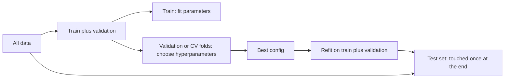
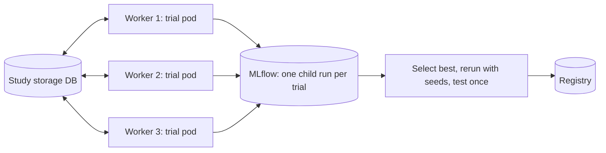

# Hyperparameter tuning at scale

## Parameters vs hyperparameters

**Parameters** are learned from data (weights, tree splits). **Hyperparameters** are chosen before or
around training: learning rate, tree depth, regularisation strength, batch size, architecture choices,
even preprocessing options. Hyperparameter optimisation (HPO) is the search for a configuration that
maximises a validation metric — under a compute budget. From an MLOps point of view, HPO is the most
compute-hungry, most parallelisable, and most easily wasted part of the training loop.

## The evaluation protocol comes first

Mueller & Guido (ch. 5) are emphatic: if you choose hyperparameters using the test set, the test score
is no longer an honest estimate. The standard protocol is a **three-way split** (or cross-validation
inside the training set):



- **Grid search with cross-validation** (`GridSearchCV`) evaluates each configuration by k-fold CV on the
  training set, then refits the best on all training data.
- For time-dependent data use **time-series splits** (train on the past, validate on the future) — random
  CV leaks the future.
- For grouped data (several rows per user) use **GroupKFold** so the same user is never in both train and
  validation.
- **Nested CV** gives an unbiased estimate of the whole "tune + train" procedure when data is scarce.

> [!WARNING]
> Every time you look at the test set and then change something, you leak a little. With thousands of
> HPO trials evaluated on the same validation set, you also overfit the *validation* set — the best
> trial's score is optimistically biased. Confirm the winner on untouched test data.

## Search strategies

### Grid search

Try every combination of a fixed set of values. Simple, reproducible, embarrassingly parallel — and
exponential in the number of hyperparameters. Four hyperparameters with five values each is 625 trainings.

### Random search

Sample configurations from distributions. Bergstra & Bengio (2012) showed random search beats grid search
when only a few hyperparameters really matter: a 3×3 grid tests only 3 distinct values of the important
one, while 9 random points test 9.

```python-run
import numpy as np
rng = np.random.default_rng(0)
# Objective: only "lr" matters much; "depth" barely matters.
def score(lr, depth):
    return 0.9 - 2.0 * (np.log10(lr) + 1.7) ** 2 - 0.0005 * (depth - 6) ** 2

grid_lr = [1e-3, 1e-2, 1e-1]; grid_depth = [3, 6, 9]
grid_best = max(score(lr, d) for lr in grid_lr for d in grid_depth)

best_random = []
for _ in range(500):                         # repeat the 9-trial random search many times
    lrs = 10 ** rng.uniform(-3, -1, 9)       # log-uniform sampling!
    ds = rng.integers(3, 10, 9)
    best_random.append(max(score(lr, d) for lr, d in zip(lrs, ds)))
print(f"grid search (9 trials)  best = {grid_best:.4f}")
print(f"random search (9 trials) mean best = {np.mean(best_random):.4f}, "
      f"beats grid in {np.mean(np.array(best_random) > grid_best) * 100:.0f}% of repeats")
```

Note the **log-uniform** sampling for the learning rate: hyperparameters that span orders of magnitude
(learning rate, regularisation) should be searched on a log scale.

### Bayesian optimisation

Build a **surrogate model** of "configuration → score" from completed trials and use an **acquisition
function** to pick the next configuration, trading off exploration (uncertain regions) and exploitation
(promising regions). Common surrogates: Gaussian processes, and the **Tree-structured Parzen Estimator
(TPE)** used by Optuna and Hyperopt, which models the densities of good and bad configurations. Bayesian
methods are sample-efficient — valuable when each trial is expensive — but less trivially parallel since
each suggestion wants prior results.

### Early stopping: successive halving, Hyperband, ASHA

Most bad configurations reveal themselves early. **Successive halving** starts many trials with a small
budget (few epochs), keeps the top $1/\eta$, multiplies their budget by $\eta$, and repeats.
**Hyperband** runs several successive-halving brackets with different trade-offs between "many configs,
small budget" and "few configs, large budget". **ASHA** is the asynchronous version that promotes trials
as soon as possible without waiting for a whole rung — ideal on a cluster.

```python-run
import numpy as np
rng = np.random.default_rng(1)
n, eta, min_budget = 27, 3, 1
quality = rng.uniform(0.6, 0.9, n)                       # true final accuracy of each config
def observe(q, budget):                                   # noisy learning curve
    return q * (1 - np.exp(-budget / 3)) + rng.normal(0, 0.01)

alive = list(range(n)); budget = min_budget; spent = 0
while len(alive) > 1:
    scores = {i: observe(quality[i], budget) for i in alive}
    spent += len(alive) * budget
    keep = max(1, len(alive) // eta)
    alive = sorted(alive, key=scores.get, reverse=True)[:keep]
    print(f"budget={budget:2d} epochs -> kept {len(alive):2d} configs")
    budget *= eta
full_cost = n * budget
print(f"picked config quality {quality[alive[0]]:.3f} (true best {quality.max():.3f}); "
      f"epochs spent {spent} vs {full_cost} for training all {n} fully")
```

### Population-based training (PBT)

Train a population in parallel; periodically, poor performers copy the weights of good performers
(exploit) and perturb their hyperparameters (explore). PBT discovers hyperparameter *schedules* and is
popular in reinforcement learning.

| Method | Sample efficiency | Parallelism | Best when |
|---|---|---|---|
| Grid | poor | perfect | ≤ 2–3 hyperparameters, need exhaustive table |
| Random | fair | perfect | cheap trials, strong baseline |
| Bayesian (TPE/GP) | good | moderate | expensive trials |
| Hyperband/ASHA | good | high | iterative training with meaningful early signal |
| PBT | good | high | long trainings, schedules matter |

## Tools

**Optuna** — define-by-run API, TPE sampler, pruners (median, successive halving, Hyperband), storage in
a database for distributed studies, MLflow integration.

```python
import optuna, mlflow
from sklearn.ensemble import HistGradientBoostingClassifier
from sklearn.model_selection import cross_val_score

def objective(trial: optuna.Trial) -> float:
    params = {
        "learning_rate": trial.suggest_float("learning_rate", 1e-3, 0.3, log=True),
        "max_leaf_nodes": trial.suggest_int("max_leaf_nodes", 8, 128, log=True),
        "l2_regularization": trial.suggest_float("l2_regularization", 1e-8, 10.0, log=True),
        "max_iter": trial.suggest_int("max_iter", 100, 600, step=100),
    }
    with mlflow.start_run(nested=True):                      # one child run per trial
        mlflow.log_params(params)
        score = cross_val_score(HistGradientBoostingClassifier(**params, random_state=0),
                                X_train, y_train, cv=5, scoring="average_precision").mean()
        mlflow.log_metric("cv_pr_auc", score)
    return score

study = optuna.create_study(direction="maximize",
                            sampler=optuna.samplers.TPESampler(seed=0),
                            pruner=optuna.pruners.MedianPruner(n_warmup_steps=5),
                            storage="postgresql://optuna:***@db/optuna",   # shared storage -> many workers
                            study_name="churn-gbm", load_if_exists=True)
with mlflow.start_run(run_name="hpo-parent"):
    study.optimize(objective, n_trials=100, timeout=3600)
    mlflow.log_params({f"best_{k}": v for k, v in study.best_params.items()})
```

For iterative training, report intermediate values and let the pruner stop hopeless trials:

```python
for epoch in range(epochs):
    val = train_one_epoch(...)
    trial.report(val, step=epoch)
    if trial.should_prune():
        raise optuna.TrialPruned()
```

**Ray Tune** — distributed HPO on a Ray cluster with ASHA, PBT, Bayesian search backends, per-trial
resource requests (e.g., 1 GPU each) and checkpointing. **Katib** — Kubernetes-native HPO in Kubeflow
(each trial is a pod/job). Managed: **SageMaker Automatic Model Tuning**, **Vertex AI Vizier**, **Azure
ML sweeps**; W&B Sweeps.

## Operational concerns

- **Budget first**: decide the number of trials / GPU-hours before starting; log cost per study.
- **Track every trial** as a child run with params, metrics, seed — failed and pruned ones included.
- **Fixed data and seed policy**: all trials see the same splits; otherwise you compare noise.
  For the finalists, rerun with several seeds (lesson 11).
- **Fault tolerance**: trials should checkpoint so spot preemptions do not waste them (lesson 14).
- **Parallelism vs efficiency**: 100 parallel random trials finish fast; 100 sequential Bayesian trials
  are more sample-efficient. With K parallel workers, Bayesian methods suggest K points using partial
  information — a middle ground.
- **Multi-objective**: accuracy vs latency vs model size. Optuna supports Pareto fronts
  (`directions=["maximize", "minimize"]`); in production you usually maximise quality *subject to* a
  latency budget.
- **Warm starts**: seed the search with last month's best configuration; narrow ranges over time.
- **Do not over-tune**: for scheduled retrains, re-tuning every time adds cost and variance. Tune
  occasionally; retrain with fixed hyperparameters.



> [!INTERVIEW]
> "How would you tune hyperparameters for an expensive model with a fixed budget?" — Define the metric and
> a leak-free validation scheme; choose log-scaled search spaces; start with random search or TPE plus an
> early-stopping scheduler (ASHA/Hyperband) so bad configs die cheaply; run trials in parallel on spot
> instances with checkpointing; track everything; confirm the top few with multiple seeds; evaluate once
> on the test set. Mention that random search beats grid search in high dimensions.

## Designing a search space

The search space is the most consequential HPO decision; a perfect optimiser cannot fix ranges that
exclude the optimum or waste budget on irrelevant dimensions.

| Hyperparameter kind | Examples | How to search |
|---|---|---|
| Scale parameters spanning decades | learning rate, weight decay, regularisation | log-uniform |
| Capacity | depth, leaves, hidden units, layers | integers, often log-scaled or powers of two |
| Probabilities / fractions | dropout, subsample, colsample | uniform on a sensible interval |
| Choices | optimiser, activation, model family | categorical |
| Conditional | momentum only if optimiser = SGD | define-by-run branches |

Guidelines:

1. **Start wide, then narrow.** A first coarse sweep finds the region; a second sweep zooms in. If the
   best trials sit on the edge of a range, the range is wrong — extend it.
2. **Tune the few that matter.** For gradient-boosted trees: learning rate with number of trees (use
   early stopping to set the latter), tree complexity (leaves/depth), regularisation, subsampling. For
   neural nets: learning rate first, then batch size, weight decay, warmup.
3. **Fix what you can reason about.** Do not tune the random seed; do not tune things that barely matter.
4. **Use domain knowledge as priors.** Seed the study with known-good configurations
   (`study.enqueue_trial({...})`).

```python
def objective(trial):
    family = trial.suggest_categorical("model", ["gbm", "logreg"])
    if family == "gbm":                                   # conditional space: define-by-run
        params = {"learning_rate": trial.suggest_float("gbm_lr", 1e-3, 0.3, log=True),
                  "max_leaf_nodes": trial.suggest_int("gbm_leaves", 8, 128, log=True)}
        model = HistGradientBoostingClassifier(early_stopping=True, max_iter=2000, **params)
    else:
        model = LogisticRegression(C=trial.suggest_float("lr_C", 1e-4, 1e2, log=True), max_iter=2000)
    return cross_val_score(model, X, y, cv=cv, scoring="average_precision").mean()
```

## How many trials? Thinking in probabilities

For random search there is a neat rule: if you want at least one trial in the best 5% of the search
space with probability 95%, you need $n$ such that $1 - 0.95^n \ge 0.95$, i.e. about 59 trials —
regardless of the number of dimensions.

```python-run
import math
print("trials needed for P(at least one trial in the top q of the space) >= conf")
for q in (0.10, 0.05, 0.01):
    for conf in (0.90, 0.95, 0.99):
        n = math.ceil(math.log(1 - conf) / math.log(1 - q))
        print(f"  top {q:4.0%}, confidence {conf:.0%}: {n:4d} trials")
```

That gives a principled budget for a first random sweep (around 60 trials), after which a smarter
sampler or a narrowed space is a better use of compute than hundreds more random points.

## Reading the results

Do not just take `study.best_params`. Inspect:

- **Optimisation history**: is the best value still improving, or flat for the last half? Flat means you
  can stop.
- **Parameter importance** (fANOVA in Optuna): which hyperparameters explain score variance? Drop the
  rest from the next sweep.
- **Slice / parallel-coordinate plots**: is the optimum inside the range or pinned at a boundary?
- **Sensitivity around the best point**: prefer a configuration in a *flat, wide* good region over a
  marginally better one on a cliff — it will be more robust to data changes at the next retrain.
- **Top-k agreement**: if the top ten trials have similar scores and very different hyperparameters, the
  model is insensitive and further tuning is wasted effort.

```python-run
import numpy as np
rng = np.random.default_rng(3)
# Simulated study: score depends strongly on log10(lr), weakly on leaves, not at all on subsample.
n = 200
log_lr = rng.uniform(-3, -0.5, n); leaves = rng.integers(8, 129, n); sub = rng.uniform(0.5, 1.0, n)
score = 0.74 - 0.03 * (log_lr + 1.3) ** 2 - 0.000002 * (leaves - 48) ** 2 + rng.normal(0, 0.003, n)

def importance(x, y, bins=8):                     # variance explained by binning one parameter
    edges = np.quantile(x, np.linspace(0, 1, bins + 1)); idx = np.clip(np.searchsorted(edges, x, side="right") - 1, 0, bins - 1)
    means = np.array([y[idx == b].mean() for b in range(bins)]); counts = np.bincount(idx, minlength=bins)
    return float((counts * (means - y.mean()) ** 2).sum() / ((y - y.mean()) ** 2).sum())
for name, x in (("learning_rate (log)", log_lr), ("max_leaf_nodes", leaves.astype(float)), ("subsample", sub)):
    print(f"{name:20s} importance ~ {importance(x, score):.2f}")
best = np.argsort(score)[-10:]
print(f"top-10 trials: lr in [{10**log_lr[best].min():.3f}, {10**log_lr[best].max():.3f}], "
      f"leaves in [{leaves[best].min()}, {leaves[best].max()}], subsample in [{sub[best].min():.2f}, {sub[best].max():.2f}]")
```

The learning rate explains most of the variance; subsample explains none, and the top trials span its
whole range — remove it from the next search and spend the budget where it matters.

## HPO and continuous training

For scheduled retrains, a common policy is: **fixed hyperparameters by default; a small warm-started
re-tune when the promotion gate fails or drift is large; a full study quarterly or after feature
changes.** Record with each production model which study produced its hyperparameters, so the lineage
includes the tuning decision.

## Summary

- Tune on validation data (or CV), never on the test set; respect time and group structure.
- Random search > grid search when few hyperparameters matter; sample scale-type hyperparameters
  log-uniformly.
- Bayesian optimisation is sample-efficient; successive halving/Hyperband/ASHA save compute by stopping
  bad trials early; PBT learns schedules.
- Operationally: budget, track every trial, fix data/seed policy, checkpoint, and consider multi-objective
  trade-offs.

```quiz
[
  {"q": "Why does random search often beat grid search with the same number of trials?",
   "options": ["It uses GPUs better", "It tests more distinct values of the few hyperparameters that matter", "It never repeats a configuration", "It uses the test set"],
   "answer": 1, "explain": "A grid wastes trials repeating the same values of important hyperparameters."},
  {"q": "How should a learning rate range of 1e-4 to 1e-1 be sampled?",
   "options": ["Uniformly", "Log-uniformly", "Only at the endpoints", "From a normal distribution centred at 0.05"],
   "answer": 1, "explain": "Parameters spanning orders of magnitude should be searched on a log scale."},
  {"q": "What does successive halving do?",
   "options": ["Halves the learning rate each epoch", "Gives many configs a small budget, keeps the best fraction, and increases their budget repeatedly", "Splits data in half", "Halves the batch size on OOM"],
   "answer": 1, "explain": "It allocates more budget only to promising configurations."},
  {"q": "For time-series data, which validation scheme is appropriate during tuning?",
   "options": ["Random k-fold", "Train on the past, validate on later periods", "Leave-one-out with shuffling", "Validate on the training set"],
   "answer": 1, "explain": "Random folds leak future information."},
  {"q": "After 2,000 trials, the best validation score is 0.912. What is the right expectation for test performance?",
   "options": ["Exactly 0.912", "Probably somewhat lower, because the maximum over many noisy trials is optimistically biased", "Higher", "Unrelated"],
   "answer": 1, "explain": "Selecting the max overfits the validation set; confirm on untouched test data."},
  {"q": "Which Optuna feature stops unpromising trials early?",
   "options": ["Samplers", "Pruners", "Storages", "Directions"],
   "answer": 1, "explain": "Pruners use reported intermediate values to stop trials."},
  {"q": "What is the role of the surrogate model in Bayesian optimisation?",
   "options": ["It replaces the final model in production", "It predicts the score of untried configurations to guide which to try next", "It labels data", "It prunes the dataset"],
   "answer": 1, "explain": "The surrogate plus an acquisition function balances exploration and exploitation."}
]
```

> **Source:** Mueller & Guido, *Introduction to Machine Learning with Python*, ch. 5 (cross-validation, grid search, the danger of using the test set for selection); Bergstra & Bengio, *Random Search for Hyper-Parameter Optimization* (JMLR 2012); Li et al., *Hyperband* (2018) and *ASHA* (2020); Optuna, Ray Tune and Katib documentation.
