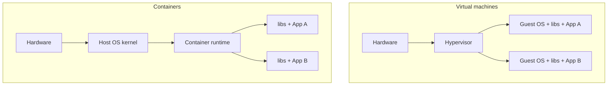

# Docker fundamentals: images, layers and the build cache

## "It works on my machine"

A model trained with scikit-learn 1.5 on Python 3.11 with OpenBLAS may refuse to unpickle under 1.3,
or — worse — load and predict differently. **Containers** package the application together with its
entire userland (OS libraries, Python, packages, model files) into one immutable artifact that runs the
same on a laptop, a CI runner and a Kubernetes node.

As Lubanovic recounts (*FastAPI*, ch. 13), Docker made Linux containers mainstream in 2013: instead of
emulating a whole machine like a VM, a container shares the host's Linux kernel and isolates processes,
filesystems and networks, which makes it much lighter and faster to start.

## Containers vs virtual machines



| | VM | Container |
|---|---|---|
| Isolation | full guest OS, hardware virtualisation | process-level via kernel features |
| Startup | tens of seconds to minutes | sub-second to seconds |
| Size | gigabytes | megabytes to a few GB |
| Kernel | own | shared with host |

Containers are built from Linux kernel features: **namespaces** (isolated views of process IDs, network,
mounts, hostnames, users), **cgroups** (limits on CPU, memory, I/O) and **union filesystems** (layered
images). A container is just a normal process with a restricted view of the system.

## Core vocabulary

- **Image**: a read-only template — an ordered stack of filesystem layers plus metadata (entrypoint, env,
  exposed ports). Identified by a **digest** (`sha256:...`) and referenced by human-friendly **tags**
  (`churn-api:1.4.0`).
- **Container**: a running (or stopped) instance of an image with a thin writable layer on top.
- **Dockerfile**: the recipe to build an image.
- **Registry**: a server storing images (Docker Hub, GHCR, Amazon ECR, Google Artifact Registry, Azure ACR).
- **Build context**: the directory sent to the builder (filtered by `.dockerignore`).
- **Volume / bind mount**: storage that lives outside the container's writable layer.

```bash
docker build -t churn-api:dev .               # build an image from ./Dockerfile
docker images                                  # list local images
docker run --rm -p 8000:8000 churn-api:dev     # run; map host port 8000 -> container port 8000
docker run -d --name api -e LOG_LEVEL=debug churn-api:dev   # detached, with an env var
docker ps -a                                   # list containers
docker logs -f api                             # follow logs
docker exec -it api bash                       # shell inside a running container
docker stop api && docker rm api
docker tag churn-api:dev ghcr.io/acme/churn-api:9f3c1e2
docker push ghcr.io/acme/churn-api:9f3c1e2
docker pull ghcr.io/acme/churn-api@sha256:77ab...   # pull by immutable digest
docker system df; docker system prune          # disk usage; clean up
docker history churn-api:dev                   # see layers and their sizes
```

## A first Dockerfile

Lubanovic reproduces the minimal FastAPI Dockerfile from the official docs; here it is annotated:

```dockerfile
FROM python:3.11-slim                           # base image: Debian + Python
WORKDIR /code                                   # working directory for following instructions
COPY ./requirements.txt /code/requirements.txt  # copy ONLY the dependency list first
RUN pip install --no-cache-dir --upgrade -r /code/requirements.txt   # install deps (cached layer)
COPY ./app /code/app                            # then copy the application code
CMD ["uvicorn", "app.main:app", "--host", "0.0.0.0", "--port", "80"]   # default command
```

Key instructions:

| Instruction | Purpose |
|---|---|
| `FROM` | base image (start of a stage) |
| `RUN` | execute a command at build time, creating a layer |
| `COPY` / `ADD` | copy files from the build context (prefer `COPY`; `ADD` also untars and fetches URLs) |
| `WORKDIR` | set working directory |
| `ENV` / `ARG` | runtime environment variable / build-time variable |
| `EXPOSE` | document the listening port |
| `USER` | switch to a non-root user |
| `ENTRYPOINT` / `CMD` | the executable / its default arguments |
| `HEALTHCHECK` | command Docker runs to test container health |
| `LABEL` | metadata (git SHA, maintainer) |

`CMD ["uvicorn", ...]` is the **exec form** (JSON array): the process becomes PID 1 and receives signals
such as SIGTERM directly. The **shell form** (`CMD uvicorn ...`) wraps it in `/bin/sh -c`, which may not
forward signals — graceful shutdown then fails. Prefer the exec form.

`--host 0.0.0.0` matters: binding to `127.0.0.1` inside a container makes the server unreachable from
outside the container's network namespace.

## Layers

Each `FROM`, `RUN`, `COPY`, `ADD` instruction creates a **layer**: a tarball of filesystem changes
relative to the previous layer. An image is the ordered list of layers; the union filesystem (overlay2)
stacks them into one view. Consequences:

1. **Layers are shared.** Ten images based on `python:3.11-slim` store and download that base once.
2. **Layers are immutable and additive.** Deleting a file in a later layer hides it but does not shrink
   the image — the bytes remain in the earlier layer. So download-use-delete must happen in a *single*
   `RUN`:

```dockerfile
# BAD: the apt cache stays in layer 1 forever
RUN apt-get update && apt-get install -y build-essential
RUN rm -rf /var/lib/apt/lists/*
# GOOD: one layer, cleaned before it is committed
RUN apt-get update && apt-get install -y --no-install-recommends build-essential \
    && rm -rf /var/lib/apt/lists/*
```

3. **Secrets copied into any layer are recoverable** from the image history even if removed later. Use
   BuildKit secret mounts (`RUN --mount=type=secret,id=pip_token ...`) instead.

## The build cache

Docker reuses a cached layer when the instruction and its inputs are unchanged **and all earlier layers
were cache hits**. The rules:

- For `RUN`: the cache key is the instruction text (plus parent layer). Docker does *not* check whether
  the command would produce something different today — `RUN apt-get update` stays cached indefinitely.
- For `COPY`/`ADD`: the key includes a checksum of the copied files' contents and metadata.
- **Once one instruction misses, every subsequent instruction is rebuilt.**

That last rule dictates Dockerfile ordering: **put things that change rarely first, things that change
often last**. Dependencies change weekly; source code changes every commit. Copy the lockfile and install
dependencies *before* copying the source.

```python-run
# Simulate which layers rebuild for different Dockerfile orderings (see problem mlops-docker-layer-cache).
def rebuilt(instructions, changed):
    """instructions: list of (text, inputs or None). Returns indices rebuilt."""
    for i, (text, inputs) in enumerate(instructions):
        if inputs and (inputs == "*" and changed or any(f in changed for f in inputs if inputs != "*")):
            return list(range(i, len(instructions)))
    return []

bad = [("FROM python:3.11-slim", None), ("COPY . .", "*"),
       ("RUN pip install -r requirements.txt   # 3 minutes", None), ("CMD ...", None)]
good = [("FROM python:3.11-slim", None), ("COPY requirements.txt .", ["requirements.txt"]),
        ("RUN pip install -r requirements.txt   # 3 minutes", None), ("COPY . .", "*"), ("CMD ...", None)]

for name, df in [("bad ordering", bad), ("good ordering", good)]:
    for change in (["src/model.py"], ["requirements.txt"]):
        idx = rebuilt(df, change)
        reinstall = any("pip install" in df[i][0] for i in idx)
        print(f"{name:14s} change={change[0]:18s} rebuild layers {idx}  pip reinstall: {reinstall}")
```

With the bad ordering every code edit triggers a full dependency reinstall. With the good ordering only a
change to `requirements.txt` does.

### .dockerignore

The build context is everything in the directory unless excluded. Without a `.dockerignore`, `COPY . .`
includes `.git`, virtualenvs, datasets and notebooks — bloating the image, leaking data and busting the
cache whenever any of those files change.

```gitignore
.git
.venv
__pycache__/
*.pyc
data/
mlruns/
notebooks/
tests/
.env
*.md
```

### BuildKit cache mounts

BuildKit (the default builder) can keep a persistent package cache *outside* the image layers:

```dockerfile
# syntax=docker/dockerfile:1.7
RUN --mount=type=cache,target=/root/.cache/pip pip install -r requirements.lock
```

Even when the layer must rebuild, pip reuses downloaded wheels. In CI, export/import the layer cache
(`--cache-to/--cache-from type=gha` or a registry) so fresh runners benefit too (lesson 24).

## Tags, digests and registries

- A **tag** is a mutable pointer: `:latest` today is not `:latest` tomorrow. Never deploy `:latest`.
- A **digest** is the SHA-256 of the image manifest: immutable.
- Good practice: tag with the **git SHA** (traceability) and optionally a semantic version; deploy by
  digest or by unique SHA tag.
- Images are multi-architecture manifests: build for `linux/amd64` *and* `linux/arm64` with
  `docker buildx build --platform linux/amd64,linux/arm64` if developers use Apple Silicon and servers
  use x86 (or Graviton).

## Storage and networking in one minute

- The container's writable layer disappears with the container. Persist with **volumes**
  (`-v model-cache:/models`) or **bind mounts** (`-v $(pwd)/data:/data`).
- Each container gets its own network namespace. `-p host:container` publishes a port. Containers on the
  same user-defined network reach each other by name (the basis of Compose, lesson 18).

> [!INTERVIEW]
> "Why copy requirements.txt before the source code in a Dockerfile?" — Layer caching. `COPY` layers are
> keyed by file checksums; once a layer misses, all later layers rebuild. Dependencies change rarely, code
> changes constantly; installing dependencies in an earlier layer means code edits reuse the expensive
> install layer. Follow up with `.dockerignore` and BuildKit cache mounts.

## Worked example: reading a build log

Build output tells you exactly what the cache did. A second build after editing only `app/main.py`:

```text
$ docker build -t churn-api:dev .
 => [internal] load build context                                   0.1s
 => => transferring context: 4.21kB                                 0.0s
 => CACHED [2/5] WORKDIR /code                                      0.0s
 => CACHED [3/5] COPY ./requirements.txt /code/requirements.txt     0.0s
 => CACHED [4/5] RUN pip install --no-cache-dir -r requirements.txt 0.0s
 => [5/5] COPY ./app /code/app                                      0.1s
 => exporting to image                                              0.2s
```

- `transferring context: 4.21kB` — the `.dockerignore` is doing its job. If this line says 2.3 GB, your
  dataset or `.git` directory is being sent to the builder on every build.
- `CACHED` on steps 2–4: the dependency layer was reused. Only the final `COPY` re-ran.
- If step 4 is *not* cached after a code-only change, something before it changed: a `COPY . .` placed
  too early, a timestamp or build argument baked into an early layer, or a file in the context that
  changes on every build.

Useful diagnostics:

```bash
docker build --progress=plain --no-cache -t churn-api:dev .   # full, uncached output for debugging
docker history churn-api:dev                                   # layer sizes, newest first
docker image inspect churn-api:dev --format '{{json .Config}}' | jq '{Cmd, Entrypoint, Env, User, ExposedPorts}'
docker run --rm -it --entrypoint sh churn-api:dev             # look around inside the image
```

### Things that silently bust the cache

| Cause | Why | Fix |
|---|---|---|
| `ARG BUILD_DATE` / `ARG GIT_SHA` used early | an `ARG` value change invalidates the layers that use it and everything after | declare and use such args in the **last** layers |
| `COPY . .` before installing dependencies | any file change invalidates the install | copy the lockfile first |
| No `.dockerignore` | `.git`, logs, caches change constantly | ignore them |
| `ADD https://...` | remote content is re-checked | download in a `RUN` with a pinned checksum |
| Base image tag moved (`python:3.11-slim` rebuilt upstream) | new base digest invalidates everything | pin by digest; rebuild deliberately |

And the opposite problem — the cache hiding staleness: `RUN apt-get update && apt-get install -y curl`
stays cached for months, so the image keeps old, vulnerable packages. Rebuild on a schedule with
`--pull --no-cache` (or pin and bump base images through an automated dependency bot) so security
patches arrive.

## Container lifecycle and resource limits

A container is running, paused, or exited with a code. For ML services the exit codes are worth knowing:

| Exit code | Meaning | Usual cause |
|---|---|---|
| 0 | success | job finished |
| 1 | application error | unhandled exception |
| 137 | killed by SIGKILL (128 + 9) | out of memory, or stop timeout exceeded |
| 139 | segmentation fault | native library crash, incompatible binary wheels |
| 143 | terminated by SIGTERM (128 + 15) | graceful stop |

```bash
docker run --rm --memory=2g --cpus=2 churn-api:dev            # cgroup limits
docker stats                                                    # live usage per container
docker inspect <container> --format '{{.State.OOMKilled}} {{.State.ExitCode}}'
```

Memory limits are enforced by the kernel: a model that needs 3 GB in a 2 GB container is killed with
137 and no Python traceback — the log simply stops. When a container "dies silently while loading the
model", check `OOMKilled` first. Note that the Python process inside does not automatically know its
limit; libraries that size thread pools or caches from the *host's* CPU count and memory can
oversubscribe a small container, so set `OMP_NUM_THREADS` and similar variables to match the CPU limit.

```python-run
# Thread oversubscription in a CPU-limited container: more threads than cores makes things slower.
def relative_latency(threads, cpu_limit, per_thread_overhead=0.04):
    effective = min(threads, cpu_limit)                      # cannot use more CPU than the cgroup allows
    contention = 1 + per_thread_overhead * max(0, threads - cpu_limit) ** 1.2   # context switching, cache thrash
    return contention / effective
base = relative_latency(1, 2)
print("container limited to 2 CPUs on a 64-core host")
for t in (1, 2, 4, 16, 64):
    print(f"  OMP_NUM_THREADS={t:2d} -> relative latency {relative_latency(t, 2) / base:4.2f}x")
```

Defaulting to 64 threads (the host's core count) inside a 2-CPU container is slower than using 2 —
a frequent cause of mysterious tail latency in containerised inference.

## Image naming and registry hygiene

A full image reference is `registry/namespace/repository:tag@digest`, for example
`ghcr.io/acme/churn-api:9f3c1e2@sha256:77ab...`. Practices that keep a registry healthy:

- **Immutable tags** (ECR and others can enforce this): a tag, once pushed, cannot be overwritten.
- **One tag per commit SHA**, plus optional moving convenience tags (`:main`) that are never deployed.
- **Retention policies**: keep the last N images and anything referenced by a running deployment; expire
  untagged layers.
- **Scan on push** and block deployment of images with critical vulnerabilities.
- **Pull-through caches / mirrors** for public base images to avoid rate limits and outages.

## Summary

- Containers are isolated processes sharing the host kernel (namespaces, cgroups, union filesystems) —
  lighter than VMs.
- Images are stacks of immutable layers; deleting in a later layer does not shrink the image; secrets in
  layers leak.
- The build cache reuses layers until the first miss; order instructions from least to most frequently
  changing, use `.dockerignore` and cache mounts.
- Tags are mutable, digests are not; tag with git SHAs and never deploy `:latest`.

```quiz
[
  {"q": "What is the key architectural difference between a container and a VM?",
   "options": ["Containers include a full guest OS kernel", "Containers share the host kernel and isolate processes with namespaces and cgroups", "VMs cannot run Linux", "Containers require a hypervisor"],
   "answer": 1, "explain": "No guest kernel means containers are smaller and start faster."},
  {"q": "You run `RUN rm -rf /big-dataset` in a later layer than the one that added it. What happens to image size?",
   "options": ["It shrinks by the dataset size", "It does not shrink; the data remains in the earlier layer", "The build fails", "The layer is merged automatically"],
   "answer": 1, "explain": "Layers are additive; later deletions only hide files."},
  {"q": "Which change invalidates the cache for `RUN pip install -r requirements.txt` in a well-ordered Dockerfile?",
   "options": ["Editing src/model.py", "Editing requirements.txt (copied in the preceding layer)", "Changing the README (ignored)", "Nothing ever does"],
   "answer": 1, "explain": "The preceding COPY layer's checksum changes, so it and all later layers rebuild."},
  {"q": "Why prefer the exec form `CMD [\"uvicorn\", ...]`?",
   "options": ["It is shorter", "The process runs as PID 1 and receives SIGTERM directly, enabling graceful shutdown", "It enables GPU access", "It caches better"],
   "answer": 1, "explain": "Shell form wraps the process in sh, which may not forward signals."},
  {"q": "What does `.dockerignore` affect?",
   "options": ["Which containers can run", "Which files are sent in the build context (and thus can be copied or bust the cache)", "Which ports are exposed", "Registry permissions"],
   "answer": 1, "explain": "Excluding .git, data and venvs shrinks context and avoids unnecessary cache misses."},
  {"q": "Why should you not deploy the `:latest` tag?",
   "options": ["It is slower to pull", "Tags are mutable, so you cannot know or reproduce exactly what is running", "It is not supported by registries", "It disables health checks"],
   "answer": 1, "explain": "Use unique tags (git SHA) or digests."},
  {"q": "A server inside a container binds to 127.0.0.1:8000 and the port is published with -p 8000:8000. Requests from the host fail because...",
   "options": ["Port 8000 is reserved", "127.0.0.1 is only reachable inside the container's own network namespace; bind to 0.0.0.0", "Docker blocks HTTP", "The image is too large"],
   "answer": 1, "explain": "The service must listen on all interfaces in the container."}
]
```

> **Source:** Docker documentation (*Docker overview*, *Dockerfile reference*, *Build cache*, *Best practices*, BuildKit cache and secret mounts); Bill Lubanovic, *FastAPI*, ch. 13 (Production: Docker); FastAPI documentation, *FastAPI in Containers — Docker*.
