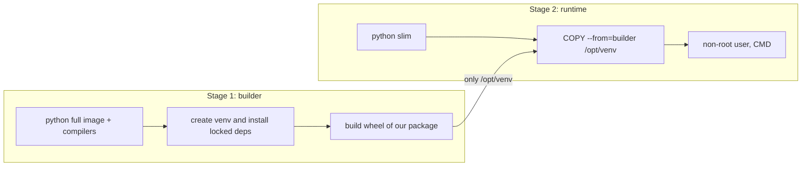

# Dockerfiles for ML: best practices and multi-stage builds

## What makes ML images hard

A typical web service image is 100–200 MB. A naive ML image can be 8–15 GB: CUDA libraries (several GB),
PyTorch wheels (2+ GB with bundled CUDA), build toolchains, model weights. Big images mean slow CI, slow
autoscaling (a new pod must pull the image before serving — painful during a traffic spike), higher
storage bills and a larger attack surface. This lesson is a checklist of techniques, ending with a
production-grade Dockerfile.

## 1. Choose the right base image

| Base | Size | Use when |
|---|---|---|
| `python:3.11-slim` (Debian) | ~50 MB compressed | default for CPU inference and APIs |
| `python:3.11` (full) | ~350 MB | you need compilers at build time (use only in a build stage) |
| `python:3.11-alpine` | tiny | **avoid for ML**: musl libc means no manylinux wheels, so NumPy/pandas compile from source — slow builds and odd bugs |
| `nvidia/cuda:12.x-base` / `-runtime` / `-devel` | 0.1 / 1–3 / 4–8 GB | GPU. `runtime` includes CUDA libs for inference; `devel` adds compilers and headers (build stage only) |
| `pytorch/pytorch:*-runtime`, `tensorflow/tensorflow:*-gpu` | multi-GB | convenient, framework preinstalled |
| distroless / chainguard | minimal | hardened runtime with no shell or package manager |

Pin the base precisely (`python:3.11.9-slim`) and ideally by digest for reproducibility (lesson 11).

> [!TIP]
> PyTorch's default Linux wheels bundle their own CUDA libraries. For **CPU-only** inference, install
> from the CPU index (`--index-url https://download.pytorch.org/whl/cpu`) to save roughly 2 GB.

## 2. Order layers for the cache; lock dependencies

Copy the lockfile, install, then copy code (lesson 16). Install from a **lockfile** so builds are
deterministic. Use a BuildKit cache mount so rebuilt dependency layers do not re-download wheels.

## 3. Multi-stage builds

A multi-stage Dockerfile has several `FROM` instructions. Early stages contain compilers, build tools and
caches; the final stage copies only the *results*. Build-time clutter never reaches the shipped image.



```dockerfile
# syntax=docker/dockerfile:1.7

############ Stage 1: build dependencies ############
FROM python:3.11.9-slim AS builder
ENV PIP_DISABLE_PIP_VERSION_CHECK=1 \
    PYTHONDONTWRITEBYTECODE=1
RUN apt-get update && apt-get install -y --no-install-recommends build-essential \
    && rm -rf /var/lib/apt/lists/*
RUN python -m venv /opt/venv
ENV PATH="/opt/venv/bin:$PATH"
WORKDIR /build
COPY requirements.lock .
RUN --mount=type=cache,target=/root/.cache/pip \
    pip install --require-hashes -r requirements.lock
COPY pyproject.toml README.md ./
COPY src ./src
RUN pip install --no-deps .

############ Stage 2: runtime ############
FROM python:3.11.9-slim AS runtime
ARG GIT_SHA=unknown
LABEL org.opencontainers.image.revision=$GIT_SHA \
      org.opencontainers.image.source="https://github.com/acme/churn"
ENV PYTHONUNBUFFERED=1 \
    PYTHONDONTWRITEBYTECODE=1 \
    PATH="/opt/venv/bin:$PATH" \
    GIT_SHA=$GIT_SHA
# runtime-only system libs (e.g., libgomp for LightGBM/XGBoost/scikit-learn OpenMP)
RUN apt-get update && apt-get install -y --no-install-recommends libgomp1 curl \
    && rm -rf /var/lib/apt/lists/*
RUN groupadd --system app && useradd --system --gid app --uid 10001 --create-home app
COPY --from=builder /opt/venv /opt/venv
WORKDIR /app
COPY --chown=app:app configs ./configs
USER 10001
EXPOSE 8000
HEALTHCHECK --interval=30s --timeout=3s --start-period=20s --retries=3 \
    CMD curl -fsS http://localhost:8000/healthz || exit 1
ENTRYPOINT ["uvicorn", "churn.serve.app:app"]
CMD ["--host", "0.0.0.0", "--port", "8000", "--workers", "2"]
```

What each choice buys:

- **`builder` stage** has compilers; the runtime stage does not.
- A **virtualenv at `/opt/venv`** is a single directory that is trivially copied between stages.
- `--require-hashes` verifies every wheel against the lockfile (supply-chain safety).
- `PYTHONUNBUFFERED=1` makes logs appear immediately (important for `docker logs`/Kubernetes).
- **Non-root user** with a numeric UID (Kubernetes `runAsNonRoot` can verify numeric UIDs).
- **Labels** with the git SHA give traceability from a running container back to code.
- `ENTRYPOINT` + `CMD` split: the executable is fixed; arguments can be overridden at `docker run`.
- `HEALTHCHECK` for plain Docker/Compose (Kubernetes uses its own probes, lesson 22).

Build with: `docker build --build-arg GIT_SHA=$(git rev-parse HEAD) -t churn-api:$(git rev-parse --short HEAD) .`

You can also target a stage: `docker build --target builder -t churn-test .` to run tests in the build
environment.

## 4. Where do the model weights go?

Three patterns, each with trade-offs:

| Pattern | How | Pros | Cons |
|---|---|---|---|
| **Bake into the image** | `COPY model/ /models/` or download at build time | image is self-contained and immutable; simple rollbacks; fast cold start after pull | image rebuild per model version; huge images for LLMs |
| **Download at startup** | entrypoint or app pulls `models:/churn@champion` from registry/S3 | small, model-agnostic image; model swaps without rebuild | slower startup; runtime dependency on registry; must pin exact version for reproducibility |
| **Mount a volume** | init container or CSI driver fetches weights to a shared volume; KServe's storage initializer does this | separates concerns; caches on node | more moving parts |

Rule of thumb: bake small models (< ~1 GB) into the image tagged with both code SHA and model version;
download or mount large ones (LLMs), pinned by exact version/revision, with a readiness probe that only
passes once the model is loaded.

If you bake, copy the model in a **late layer** (after dependencies) so that a new model does not
invalidate the dependency layers.

## 5. GPU images

```dockerfile
FROM nvidia/cuda:12.4.1-cudnn-runtime-ubuntu22.04 AS runtime
RUN apt-get update && apt-get install -y --no-install-recommends python3.11 python3.11-venv \
    && rm -rf /var/lib/apt/lists/*
COPY --from=builder /opt/venv /opt/venv
ENV PATH="/opt/venv/bin:$PATH" NVIDIA_VISIBLE_DEVICES=all NVIDIA_DRIVER_CAPABILITIES=compute,utility
```

- Use `-runtime` (not `-devel`) for the final stage.
- The image carries CUDA userland libraries; the **driver comes from the host** via the NVIDIA Container
  Toolkit (`docker run --gpus all ...`; on Kubernetes, the NVIDIA device plugin and
  `resources.limits: nvidia.com/gpu: 1`).
- Match framework wheel ↔ CUDA version ↔ minimum driver version.

## 6. Security hygiene

- **Never bake secrets** (`ENV API_KEY=...`, `COPY .env`) — they persist in layers and history. Inject at
  runtime; for build-time private indexes use `RUN --mount=type=secret,id=pip_conf ...`.
- **Run as non-root**; drop capabilities; read-only root filesystem where possible
  (`docker run --read-only --tmpfs /tmp`).
- **Scan images** for CVEs in CI (Trivy, Grype, Docker Scout) and rebuild regularly to pick up base
  image patches.
- **Minimise contents**: no compilers, no package caches, no test data in the final image.
- **Pickle is code execution**: `pickle.load`/`torch.load` on an untrusted model file can run arbitrary
  code. Only load artifacts from your trusted registry; prefer safer formats (safetensors, ONNX) where
  possible.
- Generate an **SBOM** and sign images (cosign) for supply-chain provenance.

## 7. Size diagnostics

```bash
docker history --no-trunc churn-api:dev    # size per layer
docker run --rm -it wagoodman/dive churn-api:dev   # explore layers interactively
pip list --format=freeze | wc -l           # how many packages are really needed?
```

```python-run
# Where do the gigabytes come from? (illustrative sizes in MB)
naive = {"python:3.11 full base": 1010, "build-essential + headers": 350, "pip cache": 900,
         "torch (CUDA wheels)": 4600, "other deps": 700, ".git + data + notebooks via COPY . .": 2300,
         "model weights": 440}
optimised = {"python:3.11-slim base": 130, "torch (CPU wheels)": 800, "other deps": 700, "model weights": 440,
             "app code": 2}
for name, layers in [("naive", naive), ("multi-stage, slim, CPU wheels, .dockerignore", optimised)]:
    total = sum(layers.values())
    print(f"{name}: {total/1000:.1f} GB")
    for k, v in sorted(layers.items(), key=lambda kv: -kv[1]):
        print(f"   {v:5d} MB  {k}")
pull_mbps = 100  # MB/s effective pull+extract speed
print(f"cold-start pull time: naive ~{sum(naive.values())/pull_mbps:.0f}s vs optimised ~{sum(optimised.values())/pull_mbps:.0f}s")
```

Smaller images directly shorten autoscaling reaction time: a new node must pull the image before the pod
can become ready.

## 8. One image, many roles

Avoid separate images for training, batch scoring and serving when they share the same code and
dependencies: build once, run with different commands. This guarantees the feature code used for
training is byte-identical to the one serving (no skew).

```bash
docker run churn:9f3c1e2 python -m churn.train --config configs/train.yaml
docker run churn:9f3c1e2 python -m churn.score --date 2025-01-15
docker run -p 8000:8000 churn:9f3c1e2          # default CMD serves the API
```

When training needs heavy extras (GPU, Spark) and serving must be lean, use multi-stage targets sharing a
common base stage instead.

> [!INTERVIEW]
> "How do you reduce a 10 GB ML image?" — Slim/runtime base instead of full/devel; multi-stage build so
> compilers and caches stay in the builder; CPU-only wheels when no GPU; `.dockerignore`; `--no-cache-dir`
> or cache mounts; combine and clean apt in one RUN; do not bake huge weights (download/mount, pinned);
> inspect with `docker history`/dive. Then name the *why*: faster CI, faster scale-out, smaller attack
> surface.

## Worked example: shrinking a naive image step by step

Start from what many first ML Dockerfiles look like:

```dockerfile
# v0 - naive
FROM python:3.11
WORKDIR /app
COPY . .
RUN pip install -r requirements.txt
CMD python -m uvicorn churn.serve.app:app --host 0.0.0.0
```

Problems: full base image; whole repository (including `.git`, data and notebooks) copied; dependencies
reinstalled on every code change; pip cache kept; runs as root; shell-form `CMD`; unpinned everything.

| Step | Change | Effect |
|---|---|---|
| v1 | add `.dockerignore` (`.git`, `data/`, `notebooks/`, `.venv`) | context from GBs to KBs; no data leak |
| v2 | copy lockfile → install → copy source | code edits no longer reinstall dependencies |
| v3 | `python:3.11-slim` base, `--no-cache-dir` | hundreds of MB smaller |
| v4 | multi-stage: build in one stage, copy `/opt/venv` | compilers and headers gone |
| v5 | CPU-only wheels for torch / drop unused extras (`.[serve]` only) | often the biggest single saving |
| v6 | non-root user, exec-form entrypoint, labels, pinned base digest | secure, traceable, graceful shutdown |

```python-run
steps = [("v0 naive", 9400, 240), ("v1 .dockerignore", 7100, 235), ("v2 layer order", 7100, 12),
         ("v3 slim base, no pip cache", 5600, 12), ("v4 multi-stage", 5100, 12),
         ("v5 CPU wheels, serve extras only", 1450, 9), ("v6 hardening", 1450, 9)]
print(f"{'step':34s} {'image MB':>9s} {'rebuild after code edit (s)':>28s}")
for name, mb, rebuild in steps:
    print(f"{name:34s} {mb:9d} {rebuild:28d}")
first, last = steps[0], steps[-1]
print(f"\nsize: {first[1]/last[1]:.1f}x smaller; inner-loop rebuild: {first[2]/last[2]:.0f}x faster")
```

(Numbers are representative of a PyTorch-based service; yours will differ.) The two changes with the
largest payoff are usually **layer ordering** (developer speed) and **not shipping what you do not use**
(size).

## Health, startup and shutdown inside the container

The Dockerfile sets up how the process behaves under an orchestrator:

- **PID 1 and signals.** The exec-form `ENTRYPOINT` makes your server PID 1 so it receives SIGTERM.
  If you need a wrapper script, end it with `exec "$@"` so the server *replaces* the shell; otherwise the
  shell swallows the signal and the container is killed after the grace period (exit code 137),
  dropping in-flight requests.

```bash
#!/usr/bin/env sh
# docker-entrypoint.sh
set -eu
echo "starting churn-api git=${GIT_SHA:-unknown} model=${CHURN_MODEL_URI:-unset}"
exec "$@"                      # hand over PID 1 to the server process
```

- **Zombie reaping.** If your process spawns children (data-loader workers, subprocess calls), run with
  an init such as `tini` (`docker run --init`, or `ENTRYPOINT ["tini", "--", ...]`).
- **Read-only root filesystem.** Write only to explicit volumes or `/tmp`; set caches
  (`HF_HOME`, `MPLCONFIGDIR`, `XDG_CACHE_HOME`) to a writable path, or libraries will crash when they try
  to write to the home directory of a non-root user.
- **Logs to stdout/stderr**, unbuffered; never to files inside the container.

## Supply-chain security in one page

An image is a bundle of other people's software. Controls, in the order teams usually adopt them:

1. **Lockfile with hashes** — the build fails if a package's content changes.
2. **Pinned, minimal base** — fewer packages, fewer CVEs.
3. **Vulnerability scanning in CI** (Trivy/Grype) with a policy: fail on fixable critical/high findings.
4. **Scheduled rebuilds** to absorb base-image patches.
5. **SBOM** (software bill of materials) generated at build time (`docker buildx build --sbom=true`,
   Syft) so you can answer "which images contain library X?" during the next big vulnerability.
6. **Signing and provenance** (cosign, SLSA attestations) and an admission policy that only runs signed
   images from your registry.
7. **Model artifacts are part of the supply chain**: pull weights only from trusted registries, pin
   revisions, verify checksums, and prefer formats that cannot execute code on load.

```bash
trivy image --severity HIGH,CRITICAL --ignore-unfixed --exit-code 1 ghcr.io/acme/churn-api:9f3c1e2
syft ghcr.io/acme/churn-api:9f3c1e2 -o spdx-json > sbom.json
cosign sign ghcr.io/acme/churn-api@sha256:77ab...
```

## Testing the image itself

The image is an artifact and deserves tests beyond the code's unit tests:

```bash
# smoke test in CI: does the container start, become ready and answer?
cid=$(docker run -d -p 8000:8000 -e CHURN_MODEL_URI=/models/fixture churn-api:$SHA)
for i in $(seq 1 30); do curl -fsS localhost:8000/readyz && break || sleep 1; done
curl -fsS -X POST localhost:8000/predict -H 'content-type: application/json' -d @tests/fixtures/request.json
test "$(docker exec "$cid" id -u)" != "0"            # not running as root
docker stop "$cid" && test "$(docker inspect "$cid" --format '{{.State.ExitCode}}')" = "0"   # graceful shutdown
```

The last line checks something easy to break and hard to notice: that the service exits cleanly on
SIGTERM instead of being killed.

## Summary

- Pick slim/runtime bases (not Alpine for ML); pin them.
- Multi-stage builds keep toolchains out of the runtime image; copy a venv across stages.
- Decide deliberately how weights ship: baked, downloaded (pinned) or mounted.
- GPU images carry CUDA userland; the driver is on the host.
- Non-root, no secrets in layers, scan and sign, minimal contents.
- Build one image for train/score/serve where possible to eliminate skew.

```quiz
[
  {"q": "Why is Alpine a poor base image for most ML workloads?",
   "options": ["It lacks Python", "It uses musl libc, so manylinux wheels are unusable and packages compile from source", "It is too large", "It cannot run as root"],
   "answer": 1, "explain": "NumPy/pandas/PyTorch wheels target glibc; on Alpine pip builds from source (slow, fragile)."},
  {"q": "What is the main benefit of a multi-stage build?",
   "options": ["Faster inference", "Build tools and caches stay in early stages; only needed artifacts are copied to the final image", "It enables GPU access", "It avoids needing a Dockerfile"],
   "answer": 1, "explain": "The final image is smaller and has a reduced attack surface."},
  {"q": "Which CUDA image flavour belongs in the final stage of an inference image?",
   "options": ["-devel", "-runtime", "Full Ubuntu desktop", "None; CUDA cannot be containerised"],
   "answer": 1, "explain": "runtime has the libraries needed to run; devel adds compilers and headers for building."},
  {"q": "You set `ENV API_KEY=abc123` in a Dockerfile and later remove it with another ENV. Is the key safe?",
   "options": ["Yes, it is gone", "No, it remains visible in image history/layers", "Only if the image is tagged latest", "Only on Linux"],
   "answer": 1, "explain": "Image metadata and layers preserve earlier values; inject secrets at runtime."},
  {"q": "A trade-off of baking model weights into the image is...",
   "options": ["The model cannot be loaded", "A new image must be built for each model version and large weights bloat the image", "It prevents rollbacks", "It requires root"],
   "answer": 1, "explain": "Baking gives immutability and simple rollbacks, at the cost of rebuilds and size."},
  {"q": "Why run the container process as a non-root numeric UID?",
   "options": ["It speeds up Python", "It limits damage if the process is compromised, and Kubernetes can verify runAsNonRoot with numeric UIDs", "It is required by pip", "It reduces image size"],
   "answer": 1, "explain": "Least privilege; numeric UIDs are verifiable by the kubelet."},
  {"q": "Why can using the same image for training and serving reduce training/serving skew?",
   "options": ["Images are cached", "The identical feature/preprocessing code and dependency versions run in both paths", "It doubles memory", "It disables randomness"],
   "answer": 1, "explain": "One build artifact means no divergence in code or library versions."}
]
```

> **Source:** Docker documentation (*Multi-stage builds*, *Building best practices*, *Build secrets*); FastAPI documentation (*FastAPI in Containers*); Bill Lubanovic, *FastAPI*, ch. 13; NVIDIA Container Toolkit and `nvidia/cuda` image documentation; Hugging Face safetensors documentation.
