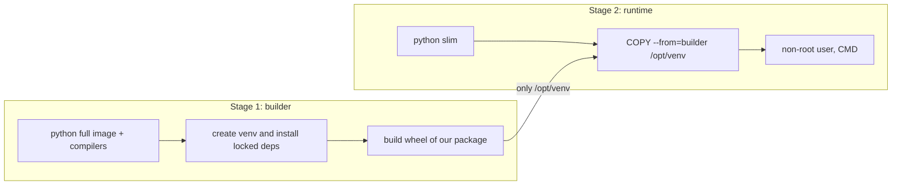

# Dockerfiles for ML: best practices and multi-stage builds

> **Before this lesson:** read [Docker fundamentals: images, layers and the build cache](#/lesson/mlops/docker-fundamentals).
> This lesson assumes you know what an image, a layer, the build cache, a tag and a digest are.
> GPU terms (CUDA, driver) come from [Distributed training and GPUs](#/lesson/mlops/distributed-gpus).

## In plain words

The previous lesson explained what a container image is. This one is about packing it *well* for
a machine-learning service. A badly packed image works, but it is huge, slow to build, slow to
start and full of things an attacker could use.

Think of packing for a mountain hike. A beginner throws the whole wardrobe into the bag,
including the sewing kit used to repair the jacket before leaving. An experienced hiker repairs
the jacket at home and carries only the jacket. The central technique of this lesson, the
**multi-stage build**, is exactly that: use the heavy tools in a workshop stage, then carry only
the finished result into the image that ships.

Why this matters for a job: image size is not cosmetic. When traffic rises and the platform
starts another copy of your service, that copy cannot answer anything until its image has been
downloaded, and a 10 GB image takes minutes. "How would you reduce a 10 GB ML image?" is a
standard interview question, and the eight numbered sections below are the answer.

## What makes ML images hard

A typical web service image is 100 to 200 MB. A carelessly built ML image can be 8 to 15 GB. The
weight comes from the GPU libraries (CUDA, several GB), PyTorch packages (over 2 GB when they
bundle CUDA), compilers and other build tools, and the model's weight files. Large images mean
slow CI, slow **autoscaling** (the automatic starting of extra copies under load, each of which
must first download the image), higher storage bills and a larger **attack surface**, meaning
more installed software in which a security hole might be found. This lesson is a checklist of
techniques, ending with a production-grade Dockerfile.

## 1. Choose the right base image

| Base | Size | Use when |
|---|---|---|
| `python:3.11-slim` (Debian) | ~50 MB compressed | default for CPU inference and APIs |
| `python:3.11` (full) | ~350 MB | you need compilers at build time (use only in a build stage) |
| `python:3.11-alpine` | tiny | **avoid for ML**: musl libc means no manylinux wheels, so NumPy/pandas compile from source — slow builds and odd bugs |
| `nvidia/cuda:12.x-base` / `-runtime` / `-devel` | 0.1 / 1–3 / 4–8 GB | GPU. `runtime` includes CUDA libs for inference; `devel` adds compilers and headers (build stage only) |
| `pytorch/pytorch:*-runtime`, `tensorflow/tensorflow:*-gpu` | multi-GB | convenient, framework preinstalled |
| distroless / chainguard | minimal | hardened runtime with no shell or package manager |

Some words in that table. A **base image** is the image named in `FROM`, on top of which yours is
built. **Debian** and **Alpine** are Linux distributions; Alpine is tiny because it uses a
different core C library (**musl** where most of Linux uses **glibc**). Python packages are
usually downloaded as **wheels**, files already compiled for a particular system, and the
standard Linux wheels ("manylinux") are compiled for glibc. On Alpine they cannot be used, so
`pip` falls back to compiling NumPy and pandas from source code, which takes a long time and
fails in odd ways. A **distroless** image contains your program's runtime and almost nothing
else, not even a shell.

Name the base image precisely (`python:3.11.9-slim`, not `python:3`) and ideally by digest, for
reproducibility (lesson 11).
> [!TIP]
> PyTorch's default Linux wheels bundle their own CUDA libraries. For **CPU-only** inference, install
> from the CPU index (`--index-url https://download.pytorch.org/whl/cpu`) to save roughly 2 GB.

## 2. Order layers for the cache; lock dependencies

Copy the lockfile, install, then copy code (lesson 16). Install from a **lockfile** so builds are
deterministic. Use a BuildKit cache mount so rebuilt dependency layers do not re-download wheels.

## 3. Multi-stage builds

A Dockerfile may contain several `FROM` instructions, and each one begins a new **stage** with
its own file system. Early stages hold compilers, build tools and download caches. The final
stage starts from a clean, small base and copies in only the *results* of the earlier stages
with `COPY --from=<stage>`. Only the final stage becomes the shipped image; the earlier ones are
discarded. Build-time clutter never reaches production.



```dockerfile
# syntax=docker/dockerfile:1.7

############ Stage 1: build dependencies ############
FROM python:3.11.9-slim AS builder
ENV PIP_DISABLE_PIP_VERSION_CHECK=1 \
    PYTHONDONTWRITEBYTECODE=1
RUN apt-get update && apt-get install -y --no-install-recommends build-essential \
    && rm -rf /var/lib/apt/lists/*
RUN python -m venv /opt/venv
ENV PATH="/opt/venv/bin:$PATH"
WORKDIR /build
COPY requirements.lock .
RUN --mount=type=cache,target=/root/.cache/pip \
    pip install --require-hashes -r requirements.lock
COPY pyproject.toml README.md ./
COPY src ./src
RUN pip install --no-deps .

############ Stage 2: runtime ############
FROM python:3.11.9-slim AS runtime
ARG GIT_SHA=unknown
LABEL org.opencontainers.image.revision=$GIT_SHA \
      org.opencontainers.image.source="https://github.com/acme/churn"
ENV PYTHONUNBUFFERED=1 \
    PYTHONDONTWRITEBYTECODE=1 \
    PATH="/opt/venv/bin:$PATH" \
    GIT_SHA=$GIT_SHA
# runtime-only system libs (e.g., libgomp for LightGBM/XGBoost/scikit-learn OpenMP)
RUN apt-get update && apt-get install -y --no-install-recommends libgomp1 curl \
    && rm -rf /var/lib/apt/lists/*
RUN groupadd --system app && useradd --system --gid app --uid 10001 --create-home app
COPY --from=builder /opt/venv /opt/venv
WORKDIR /app
COPY --chown=app:app configs ./configs
USER 10001
EXPOSE 8000
HEALTHCHECK --interval=30s --timeout=3s --start-period=20s --retries=3 \
    CMD curl -fsS http://localhost:8000/healthz || exit 1
ENTRYPOINT ["uvicorn", "churn.serve.app:app"]
CMD ["--host", "0.0.0.0", "--port", "8000", "--workers", "2"]
```

A guided reading, top to bottom:

- `FROM python:3.11.9-slim AS builder` opens the first stage and names it `builder`.
- The first `RUN` installs `build-essential` (a C compiler and friends), needed only when some
  package has to be compiled.
- `python -m venv /opt/venv` creates a virtual environment in one known folder, and the `ENV
  PATH=...` line makes its Python the default.
- The lockfile is copied and installed *before* the source code (the cache rule from lesson 16).
  `--mount=type=cache` keeps pip's download cache outside the image.
- `pip install --no-deps .` installs our own package into the same virtual environment.
- `FROM python:3.11.9-slim AS runtime` opens the second, final stage from a fresh slim base.
- `ARG GIT_SHA` is a value supplied at build time; the `LABEL` lines stamp it on the image.
- `COPY --from=builder /opt/venv /opt/venv` is the handover: one folder crosses from the workshop
  to the shipped image. The compiler does not.
- `groupadd`/`useradd` create an unprivileged account and `USER 10001` switches to it.
- `HEALTHCHECK` tells Docker how to test that the service is alive.
- `ENTRYPOINT` fixes the program; `CMD` supplies default arguments that can be replaced.

What each choice buys:
- **`builder` stage** has compilers; the runtime stage does not.
- A **virtualenv at `/opt/venv`** is a single directory that is trivially copied between stages.
- `--require-hashes` verifies every wheel against the lockfile (supply-chain safety).
- `PYTHONUNBUFFERED=1` makes logs appear immediately (important for `docker logs`/Kubernetes).
- **Non-root user** with a numeric UID (Kubernetes `runAsNonRoot` can verify numeric UIDs).
- **Labels** with the git SHA give traceability from a running container back to code.
- `ENTRYPOINT` + `CMD` split: the executable is fixed; arguments can be overridden at `docker run`.
- `HEALTHCHECK` for plain Docker/Compose (Kubernetes uses its own probes, lesson 22).

Build with: `docker build --build-arg GIT_SHA=$(git rev-parse HEAD) -t churn-api:$(git rev-parse --short HEAD) .`

You can also target a stage: `docker build --target builder -t churn-test .` to run tests in the build
environment.

## 4. Where do the model weights go?

Three patterns, each with trade-offs:

| Pattern | How | Pros | Cons |
|---|---|---|---|
| **Bake into the image** | `COPY model/ /models/` or download at build time | image is self-contained and immutable; simple rollbacks; fast cold start after pull | image rebuild per model version; huge images for LLMs |
| **Download at startup** | entrypoint or app pulls `models:/churn@champion` from registry/S3 | small, model-agnostic image; model swaps without rebuild | slower startup; runtime dependency on registry; must pin exact version for reproducibility |
| **Mount a volume** | init container or CSI driver fetches weights to a shared volume; KServe's storage initializer does this | separates concerns; caches on node | more moving parts |

Rule of thumb: bake small models (< ~1 GB) into the image tagged with both code SHA and model version;
download or mount large ones (LLMs), pinned by exact version/revision, with a readiness probe that only
passes once the model is loaded.

If you bake, copy the model in a **late layer** (after dependencies) so that a new model does not
invalidate the dependency layers.

## 5. GPU images

```dockerfile
FROM nvidia/cuda:12.4.1-cudnn-runtime-ubuntu22.04 AS runtime
RUN apt-get update && apt-get install -y --no-install-recommends python3.11 python3.11-venv \
    && rm -rf /var/lib/apt/lists/*
COPY --from=builder /opt/venv /opt/venv
ENV PATH="/opt/venv/bin:$PATH" NVIDIA_VISIBLE_DEVICES=all NVIDIA_DRIVER_CAPABILITIES=compute,utility
```

- Use `-runtime` (not `-devel`) for the final stage.
- The image carries CUDA userland libraries; the **driver comes from the host** via the NVIDIA Container
  Toolkit (`docker run --gpus all ...`; on Kubernetes, the NVIDIA device plugin and
  `resources.limits: nvidia.com/gpu: 1`).
- Match framework wheel ↔ CUDA version ↔ minimum driver version.

## 6. Security hygiene

- **Never put secrets in an image** (`ENV API_KEY=...`, `COPY .env`). They stay in the layers and
  in the image history even if a later instruction removes them. Supply secrets when the
  container starts. If the *build* needs a secret, for example to reach a private package index,
  use `RUN --mount=type=secret,id=pip_conf ...`, which makes it available during that one
  instruction without storing it.
- **Run as a non-root user**, remove unneeded privileges, and make the container's file system
  read-only where possible (`docker run --read-only --tmpfs /tmp`). If the process is taken over,
  the attacker can do less.
- **Scan images** in CI for **CVEs** (publicly catalogued vulnerabilities) with a scanner such as
  Trivy, Grype or Docker Scout, and rebuild regularly so fixes in the base image arrive.
- **Minimise contents**: no compilers, no package caches, no test data in the final image.
- **A pickle file is executable code.** Loading one with `pickle.load` or `torch.load` can run
  any instructions hidden inside it. Only load model files from your own trusted registry, and
  prefer formats that hold numbers only and cannot execute anything, such as safetensors or ONNX.
- Generate an **SBOM** (software bill of materials, the list of every component in the image) and
  **sign** images with a tool such as cosign, so that their origin can be verified.

## 7. Size diagnostics

```bash
docker history --no-trunc churn-api:dev    # size per layer
docker run --rm -it wagoodman/dive churn-api:dev   # explore layers interactively
pip list --format=freeze | wc -l           # how many packages are really needed?
```

```python-run
# Where do the gigabytes come from? (illustrative sizes in MB)
naive = {"python:3.11 full base": 1010, "build-essential + headers": 350, "pip cache": 900,
         "torch (CUDA wheels)": 4600, "other deps": 700, ".git + data + notebooks via COPY . .": 2300,
         "model weights": 440}
optimised = {"python:3.11-slim base": 130, "torch (CPU wheels)": 800, "other deps": 700, "model weights": 440,
             "app code": 2}
for name, layers in [("naive", naive), ("multi-stage, slim, CPU wheels, .dockerignore", optimised)]:
    total = sum(layers.values())
    print(f"{name}: {total/1000:.1f} GB")
    for k, v in sorted(layers.items(), key=lambda kv: -kv[1]):
        print(f"   {v:5d} MB  {k}")
pull_mbps = 100  # MB/s effective pull+extract speed
print(f"cold-start pull time: naive ~{sum(naive.values())/pull_mbps:.0f}s vs optimised ~{sum(optimised.values())/pull_mbps:.0f}s")
```

The two dictionaries list, in megabytes, what a careless image and a careful image contain. The
loop prints each total and its items, largest first, and the last line estimates the download
time at 100 MB per second:

```text
naive: 10.3 GB
    4600 MB  torch (CUDA wheels)
    2300 MB  .git + data + notebooks via COPY . .
    1010 MB  python:3.11 full base
     900 MB  pip cache
     700 MB  other deps
     440 MB  model weights
     350 MB  build-essential + headers
multi-stage, slim, CPU wheels, .dockerignore: 2.1 GB
     800 MB  torch (CPU wheels)
     700 MB  other deps
     440 MB  model weights
     130 MB  python:3.11-slim base
       2 MB  app code
cold-start pull time: naive ~103s vs optimised ~21s
```

Almost half of the naive image is GPU libraries that a CPU-only service never calls, and nearly a
quarter is the repository's own clutter copied in by `COPY . .`. The application code is 2 MB.
The difference in pull time, 103 seconds against 21, is the extra time users wait for new
capacity during a traffic spike. A **cold start** is the delay before a freshly started copy can
serve.

## 8. One image, many roles

Avoid separate images for training, batch scoring and serving when they share the same code and
dependencies: build once, run with different commands. This guarantees the feature code used for
training is byte-identical to the one serving (no skew).

```bash
docker run churn:9f3c1e2 python -m churn.train --config configs/train.yaml
docker run churn:9f3c1e2 python -m churn.score --date 2025-01-15
docker run -p 8000:8000 churn:9f3c1e2          # default CMD serves the API
```

When training needs heavy extras (GPU, Spark) and serving must be lean, use multi-stage targets sharing a
common base stage instead.

> [!INTERVIEW]
> "How do you reduce a 10 GB ML image?" — Slim/runtime base instead of full/devel; multi-stage build so
> compilers and caches stay in the builder; CPU-only wheels when no GPU; `.dockerignore`; `--no-cache-dir`
> or cache mounts; combine and clean apt in one RUN; do not bake huge weights (download/mount, pinned);
> inspect with `docker history`/dive. Then name the *why*: faster CI, faster scale-out, smaller attack
> surface.

## Worked example: shrinking a naive image step by step

Start from what many first ML Dockerfiles look like:

```dockerfile
# v0 - naive
FROM python:3.11
WORKDIR /app
COPY . .
RUN pip install -r requirements.txt
CMD python -m uvicorn churn.serve.app:app --host 0.0.0.0
```

Problems: full base image; whole repository (including `.git`, data and notebooks) copied; dependencies
reinstalled on every code change; pip cache kept; runs as root; shell-form `CMD`; unpinned everything.

| Step | Change | Effect |
|---|---|---|
| v1 | add `.dockerignore` (`.git`, `data/`, `notebooks/`, `.venv`) | context from GBs to KBs; no data leak |
| v2 | copy lockfile → install → copy source | code edits no longer reinstall dependencies |
| v3 | `python:3.11-slim` base, `--no-cache-dir` | hundreds of MB smaller |
| v4 | multi-stage: build in one stage, copy `/opt/venv` | compilers and headers gone |
| v5 | CPU-only wheels for torch / drop unused extras (`.[serve]` only) | often the biggest single saving |
| v6 | non-root user, exec-form entrypoint, labels, pinned base digest | secure, traceable, graceful shutdown |

```python-run
steps = [("v0 naive", 9400, 240), ("v1 .dockerignore", 7100, 235), ("v2 layer order", 7100, 12),
         ("v3 slim base, no pip cache", 5600, 12), ("v4 multi-stage", 5100, 12),
         ("v5 CPU wheels, serve extras only", 1450, 9), ("v6 hardening", 1450, 9)]
print(f"{'step':34s} {'image MB':>9s} {'rebuild after code edit (s)':>28s}")
for name, mb, rebuild in steps:
    print(f"{name:34s} {mb:9d} {rebuild:28d}")
first, last = steps[0], steps[-1]
print(f"\nsize: {first[1]/last[1]:.1f}x smaller; inner-loop rebuild: {first[2]/last[2]:.0f}x faster")
```

The table printed by the program:

```text
step                                image MB  rebuild after code edit (s)
v0 naive                                9400                          240
v1 .dockerignore                        7100                          235
v2 layer order                          7100                           12
v3 slim base, no pip cache              5600                           12
v4 multi-stage                          5100                           12
v5 CPU wheels, serve extras only        1450                            9
v6 hardening                            1450                            9

size: 6.5x smaller; inner-loop rebuild: 27x faster
```

(The numbers are representative of a PyTorch-based service; yours will differ.) Two steps stand
out. Step v2, **layer ordering**, does nothing for size and cuts the rebuild after a code edit
from four minutes to twelve seconds, which is what a developer feels all day. Step v5, **not
shipping what you do not use**, removes most of the remaining size.

## Health, startup and shutdown inside the container

The Dockerfile sets up how the process behaves under an orchestrator:

- **PID 1 and signals.** The exec-form `ENTRYPOINT` makes your server PID 1 so it receives SIGTERM.
  If you need a wrapper script, end it with `exec "$@"` so the server *replaces* the shell; otherwise the
  shell swallows the signal and the container is killed after the grace period (exit code 137),
  dropping in-flight requests.

```bash
#!/usr/bin/env sh
# docker-entrypoint.sh
set -eu
echo "starting churn-api git=${GIT_SHA:-unknown} model=${CHURN_MODEL_URI:-unset}"
exec "$@"                      # hand over PID 1 to the server process
```

- **Zombie reaping.** If your process spawns children (data-loader workers, subprocess calls), run with
  an init such as `tini` (`docker run --init`, or `ENTRYPOINT ["tini", "--", ...]`).
- **Read-only root filesystem.** Write only to explicit volumes or `/tmp`; set caches
  (`HF_HOME`, `MPLCONFIGDIR`, `XDG_CACHE_HOME`) to a writable path, or libraries will crash when they try
  to write to the home directory of a non-root user.
- **Logs to stdout/stderr**, unbuffered; never to files inside the container.

## Supply-chain security in one page

An image is a bundle of other people's software. Controls, in the order teams usually adopt them:

1. **Lockfile with hashes** — the build fails if a package's content changes.
2. **Pinned, minimal base** — fewer packages, fewer CVEs.
3. **Vulnerability scanning in CI** (Trivy/Grype) with a policy: fail on fixable critical/high findings.
4. **Scheduled rebuilds** to absorb base-image patches.
5. **SBOM** (software bill of materials) generated at build time (`docker buildx build --sbom=true`,
   Syft) so you can answer "which images contain library X?" during the next big vulnerability.
6. **Signing and provenance** (cosign, SLSA attestations) and an admission policy that only runs signed
   images from your registry.
7. **Model artifacts are part of the supply chain**: pull weights only from trusted registries, pin
   revisions, verify checksums, and prefer formats that cannot execute code on load.

```bash
trivy image --severity HIGH,CRITICAL --ignore-unfixed --exit-code 1 ghcr.io/acme/churn-api:9f3c1e2
syft ghcr.io/acme/churn-api:9f3c1e2 -o spdx-json > sbom.json
cosign sign ghcr.io/acme/churn-api@sha256:77ab...
```

## Testing the image itself

The image is an artifact and deserves tests beyond the code's unit tests:

```bash
# smoke test in CI: does the container start, become ready and answer?
cid=$(docker run -d -p 8000:8000 -e CHURN_MODEL_URI=/models/fixture churn-api:$SHA)
for i in $(seq 1 30); do curl -fsS localhost:8000/readyz && break || sleep 1; done
curl -fsS -X POST localhost:8000/predict -H 'content-type: application/json' -d @tests/fixtures/request.json
test "$(docker exec "$cid" id -u)" != "0"            # not running as root
docker stop "$cid" && test "$(docker inspect "$cid" --format '{{.State.ExitCode}}')" = "0"   # graceful shutdown
```

The last line checks something easy to break and hard to notice: that the service exits cleanly on
SIGTERM instead of being killed.

## Summary

- Pick slim/runtime bases (not Alpine for ML); pin them.
- Multi-stage builds keep toolchains out of the runtime image; copy a venv across stages.
- Decide deliberately how weights ship: baked, downloaded (pinned) or mounted.
- GPU images carry CUDA userland; the driver is on the host.
- Non-root, no secrets in layers, scan and sign, minimal contents.
- Build one image for train/score/serve where possible to eliminate skew.

## Glossary

- **Base image** - the image named in `FROM`, on which yours is built.
- **Slim / runtime / devel** - image variants: minimal, with libraries needed to run, with
  compilers and headers for building.
- **glibc / musl** - the standard C library of most Linux systems / Alpine's smaller alternative.
- **Wheel** - a pre-compiled Python package file.
- **Multi-stage build** - a Dockerfile with several `FROM` stages; only the last is shipped.
- **Stage** - one `FROM` section with its own file system.
- **`COPY --from`** - copying files from an earlier stage into the current one.
- **`ARG` / `LABEL`** - a build-time value / metadata stamped on the image.
- **`ENTRYPOINT` / `CMD`** - the fixed program / its default, overridable arguments.
- **Non-root user** - an unprivileged account the container process runs as.
- **Attack surface** - everything in a system that an attacker could try to exploit.
- **CVE** - a publicly catalogued security vulnerability.
- **SBOM** - the list of all software components in an image.
- **Image signing** - attaching a verifiable proof of who built an image.
- **Baking weights** - copying model files into the image at build time.
- **Cold start** - the delay before a newly started instance can serve requests.
- **Autoscaling** - automatically adding or removing instances as load changes.
- **safetensors** - a model file format that stores numbers only and cannot run code.

```quiz
[
  {"q": "Why is Alpine a poor base image for most ML workloads?",
   "options": ["It lacks Python", "It uses musl libc, so manylinux wheels are unusable and packages compile from source", "It is too large", "It cannot run as root"],
   "answer": 1, "explain": "NumPy/pandas/PyTorch wheels target glibc; on Alpine pip builds from source (slow, fragile)."},
  {"q": "What is the main benefit of a multi-stage build?",
   "options": ["Faster inference", "Build tools and caches stay in early stages; only needed artifacts are copied to the final image", "It enables GPU access", "It avoids needing a Dockerfile"],
   "answer": 1, "explain": "The final image is smaller and has a reduced attack surface."},
  {"q": "Which CUDA image flavour belongs in the final stage of an inference image?",
   "options": ["-devel", "-runtime", "Full Ubuntu desktop", "None; CUDA cannot be containerised"],
   "answer": 1, "explain": "runtime has the libraries needed to run; devel adds compilers and headers for building."},
  {"q": "You set `ENV API_KEY=abc123` in a Dockerfile and later remove it with another ENV. Is the key safe?",
   "options": ["Yes, it is gone", "No, it remains visible in image history/layers", "Only if the image is tagged latest", "Only on Linux"],
   "answer": 1, "explain": "Image metadata and layers preserve earlier values; inject secrets at runtime."},
  {"q": "A trade-off of baking model weights into the image is...",
   "options": ["The model cannot be loaded", "A new image must be built for each model version and large weights bloat the image", "It prevents rollbacks", "It requires root"],
   "answer": 1, "explain": "Baking gives immutability and simple rollbacks, at the cost of rebuilds and size."},
  {"q": "Why run the container process as a non-root numeric UID?",
   "options": ["It speeds up Python", "It limits damage if the process is compromised, and Kubernetes can verify runAsNonRoot with numeric UIDs", "It is required by pip", "It reduces image size"],
   "answer": 1, "explain": "Least privilege; numeric UIDs are verifiable by the kubelet."},
  {"q": "Why can using the same image for training and serving reduce training/serving skew?",
   "options": ["Images are cached", "The identical feature/preprocessing code and dependency versions run in both paths", "It doubles memory", "It disables randomness"],
   "answer": 1, "explain": "One build artifact means no divergence in code or library versions."}
]
```

> **Source:** Docker documentation (*Multi-stage builds*, *Building best practices*, *Build secrets*); FastAPI documentation (*FastAPI in Containers*); Bill Lubanovic, *FastAPI*, ch. 13; NVIDIA Container Toolkit and `nvidia/cuda` image documentation; Hugging Face safetensors documentation.
