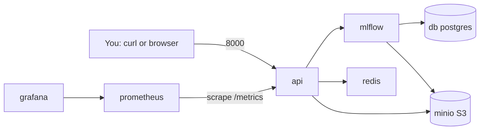

# Docker Compose for local ML stacks

## One command to bring up the whole system

A realistic ML service is never one container. Even locally you want: the model API, a tracking server
(MLflow) with its database and artifact store, perhaps Redis for caching or online features, Prometheus
and Grafana for metrics. Starting each with long `docker run` commands — in the right order, on the same
network, with the right environment variables — is error-prone.

**Docker Compose** describes a multi-container application in one YAML file (`compose.yaml`) and manages
it with one command: `docker compose up`. It is the standard tool for **local development, integration
tests in CI, and demos**. (For production orchestration across machines, use Kubernetes — module 8.)

## Anatomy of a compose file

```yaml
# compose.yaml
name: churn

services:
  api:
    build:
      context: .
      target: runtime                 # stage of the multi-stage Dockerfile
      args:
        GIT_SHA: ${GIT_SHA:-dev}
    image: churn-api:${GIT_SHA:-dev}
    ports:
      - "8000:8000"                   # host:container
    environment:
      CHURN_MODEL_URI: models:/churn@champion
      MLFLOW_TRACKING_URI: http://mlflow:5000     # service name = DNS name on the compose network
      REDIS_URL: redis://redis:6379/0
      AWS_ACCESS_KEY_ID: minio
      AWS_SECRET_ACCESS_KEY: minio12345
      MLFLOW_S3_ENDPOINT_URL: http://minio:9000
    depends_on:
      mlflow:
        condition: service_healthy
      redis:
        condition: service_started
    healthcheck:
      test: ["CMD", "curl", "-fsS", "http://localhost:8000/healthz"]
      interval: 10s
      timeout: 3s
      retries: 5
      start_period: 20s
    deploy:
      resources:
        limits: {cpus: "2", memory: 2g}
    restart: unless-stopped

  mlflow:
    image: ghcr.io/mlflow/mlflow:v2.14.1
    command: >
      mlflow server --host 0.0.0.0 --port 5000
      --backend-store-uri postgresql://mlflow:mlflow@db:5432/mlflow
      --artifacts-destination s3://mlflow
    environment:
      AWS_ACCESS_KEY_ID: minio
      AWS_SECRET_ACCESS_KEY: minio12345
      MLFLOW_S3_ENDPOINT_URL: http://minio:9000
    ports: ["5000:5000"]
    depends_on:
      db: {condition: service_healthy}
      minio: {condition: service_started}
    healthcheck:
      test: ["CMD", "python", "-c", "import urllib.request; urllib.request.urlopen('http://localhost:5000/health')"]
      interval: 10s
      retries: 10

  db:
    image: postgres:16
    environment:
      POSTGRES_USER: mlflow
      POSTGRES_PASSWORD: mlflow
      POSTGRES_DB: mlflow
    volumes:
      - pgdata:/var/lib/postgresql/data          # named volume: survives container removal
    healthcheck:
      test: ["CMD-SHELL", "pg_isready -U mlflow"]
      interval: 5s
      retries: 10

  minio:                                          # S3-compatible object store for artifacts
    image: minio/minio:RELEASE.2024-06-13T22-53-53Z
    command: server /data --console-address ":9001"
    environment:
      MINIO_ROOT_USER: minio
      MINIO_ROOT_PASSWORD: minio12345
    ports: ["9000:9000", "9001:9001"]
    volumes: [miniodata:/data]

  redis:
    image: redis:7-alpine

  prometheus:
    image: prom/prometheus:v2.53.0
    volumes:
      - ./ops/prometheus.yml:/etc/prometheus/prometheus.yml:ro    # bind mount, read-only
    ports: ["9090:9090"]

  grafana:
    image: grafana/grafana:11.1.0
    ports: ["3000:3000"]
    depends_on: [prometheus]

volumes:
  pgdata:
  miniodata:
```



### Key concepts

- **Services**: each becomes one (or more) containers. Either `build:` from a Dockerfile or use an `image:`.
- **Networking**: Compose creates a default network; services reach each other **by service name**
  (`http://mlflow:5000`). `ports:` is only needed to reach a service from the *host*.
- **Volumes**: *named volumes* (`pgdata:`) are managed by Docker and persist across `down`/`up`; *bind
  mounts* (`./ops/prometheus.yml:/etc/...`) map host paths, great for config and live code reload.
- **`depends_on` with `condition: service_healthy`**: controls start order *and* waits for health. Without
  the condition, Compose only waits for the container to *start*, not to be *ready* — the classic "API
  crashed because the database was not accepting connections yet" bug.
- **`healthcheck`**: a command run periodically inside the container.
- **Environment**: `environment:` inline, `env_file: .env` for local secrets, and `${VAR:-default}`
  interpolation from your shell or the project's `.env` file.
- **Profiles**: mark optional services (`profiles: ["monitoring"]`) and enable them with
  `docker compose --profile monitoring up`.

## Everyday commands

```bash
docker compose up -d --build          # build images if needed and start everything in the background
docker compose ps                     # status and health
docker compose logs -f api            # follow one service's logs
docker compose exec api bash          # shell into a running service
docker compose run --rm api pytest    # one-off command in a fresh container
docker compose restart api
docker compose down                   # stop and remove containers and network (volumes kept)
docker compose down -v                # ... and delete named volumes (wipes the database!)
docker compose config                 # print the fully-resolved configuration
docker compose up -d --scale api=3    # run 3 replicas (remove fixed host port mapping first)
```

## Development overrides

Compose merges multiple files. Keep the base production-like and add a development override that mounts
source code and enables autoreload:

```yaml
# compose.override.yaml  (picked up automatically by `docker compose up`)
services:
  api:
    build:
      target: builder
    command: ["uvicorn", "churn.serve.app:app", "--host", "0.0.0.0", "--port", "8000", "--reload"]
    volumes:
      - ./src:/build/src                 # live-edit code without rebuilding
    environment:
      CHURN_LOG_LEVEL: DEBUG
```

Compose also supports `develop.watch` (`docker compose watch`) to sync files or rebuild on change.

## GPUs in Compose

```yaml
services:
  trainer:
    image: churn-train:dev
    deploy:
      resources:
        reservations:
          devices:
            - driver: nvidia
              count: 1
              capabilities: [gpu]
```

The host needs the NVIDIA driver and Container Toolkit, as in lesson 14.

## Integration tests in CI with Compose

Compose shines for integration tests: bring up the stack, wait for health, run tests against the real
API, tear down.

```bash
set -euo pipefail
docker compose up -d --build --wait          # --wait blocks until services are healthy
trap 'docker compose logs --no-color > compose.log; docker compose down -v' EXIT
curl -fsS localhost:8000/healthz
pytest tests/integration -q                  # hits http://localhost:8000/predict
```

## Why readiness ordering matters — a simulation

```python-run
import random
random.seed(2)
def startup(wait_for_healthy):
    db_ready_at = random.uniform(2, 8)          # seconds until postgres accepts connections
    api_start = db_ready_at if wait_for_healthy else 0.5   # depends_on without condition: just "started"
    return api_start >= db_ready_at             # True = API finds DB ready

for mode in (False, True):
    ok = sum(startup(mode) for _ in range(1000))
    label = "condition: service_healthy" if mode else "plain depends_on        "
    print(f"{label} -> API starts cleanly in {ok/10:.0f}% of runs")
print("Mitigations: healthcheck + condition, and app-level retry with backoff on startup.")
```

Even with health-gated start order, make services **resilient**: retry connections with exponential
backoff at startup (the database can restart later too). Kubernetes has no `depends_on` at all — it
relies on exactly this pattern plus readiness probes.

## From Compose to Kubernetes

Compose concepts map onto Kubernetes objects, which is why Compose is a good stepping stone:

| Compose | Kubernetes |
|---|---|
| service (container spec) | Deployment / StatefulSet (+ Pod template) |
| service name DNS | Service |
| `ports:` to host | Service type LoadBalancer / Ingress |
| `environment`, `env_file` | ConfigMap, Secret |
| named volume | PersistentVolumeClaim |
| `healthcheck` | liveness / readiness / startup probes |
| `deploy.resources` | `resources.requests/limits` |
| `--scale api=3` | `replicas: 3`, HPA |

> [!WARNING]
> Do not run stateful production databases from a hand-rolled Compose file on a single VM without
> backups, monitoring and an upgrade plan. Compose has no self-healing across hosts, no rolling updates
> across nodes and no autoscaling. It is a development and CI tool first.

> [!INTERVIEW]
> "How do you test an ML service locally end to end?" — A Compose stack with the API, a model
> registry/tracking server, object storage (MinIO), cache and monitoring; health checks and
> `depends_on: condition: service_healthy`; `docker compose up --wait`, run integration tests against real
> HTTP endpoints, tear down with `down -v`. The same compose file runs in CI.

## Summary

- Compose defines multi-container apps declaratively; services talk by name on a shared network.
- Use health checks and health-gated `depends_on`; still make apps retry.
- Named volumes persist state; bind mounts are for config and live code.
- Override files and profiles tailor the stack for dev, CI and optional components.
- Compose is for dev/CI; its concepts map directly to Kubernetes objects.

```quiz
[
  {"q": "How does the `api` service reach the `mlflow` service in the same compose project?",
   "options": ["Via localhost:5000", "Via the service name as hostname, e.g. http://mlflow:5000", "Via the host's public IP", "It cannot"],
   "answer": 1, "explain": "Compose provides DNS for service names on the project network; localhost refers to the container itself."},
  {"q": "What does `depends_on: db: {condition: service_healthy}` add over a plain `depends_on: [db]`?",
   "options": ["Nothing", "It waits until the db's healthcheck passes, not merely until the container has started", "It restarts the db", "It exposes the db port"],
   "answer": 1, "explain": "Started is not ready; health-gating avoids connection-refused crashes at startup."},
  {"q": "Which command removes containers AND named volumes?",
   "options": ["docker compose stop", "docker compose down", "docker compose down -v", "docker compose restart"],
   "answer": 2, "explain": "-v deletes named volumes, wiping persisted data like the database."},
  {"q": "When is the `ports:` mapping required?",
   "options": ["For any service-to-service communication", "Only to reach a service from the host machine", "To enable DNS", "To mount volumes"],
   "answer": 1, "explain": "Containers on the same network communicate directly; ports publish to the host."},
  {"q": "What is a bind mount best used for in development?",
   "options": ["Persisting production databases", "Mounting local source code or config into the container for live editing", "Storing secrets in the image", "Scaling services"],
   "answer": 1, "explain": "Bind mounts map host paths, enabling autoreload without rebuilding."},
  {"q": "Why is Compose not a production orchestrator for most systems?",
   "options": ["It cannot run containers", "It lacks multi-node scheduling, self-healing across hosts, rolling updates and autoscaling", "It does not support environment variables", "It only works on Windows"],
   "answer": 1, "explain": "Kubernetes provides those capabilities."},
  {"q": "The Compose `healthcheck` corresponds to which Kubernetes concept?",
   "options": ["Ingress", "Liveness/readiness probes", "ConfigMap", "Namespace"],
   "answer": 1, "explain": "Probes tell Kubernetes whether a container is alive and ready for traffic."}
]
```

> **Source:** Docker Compose documentation (*Compose file reference*, *Startup order*, *Profiles*, *GPU support*, `compose watch`); MLflow documentation (*Tracking server with remote artifact store*); Bill Lubanovic, *FastAPI*, ch. 13 (Production).
