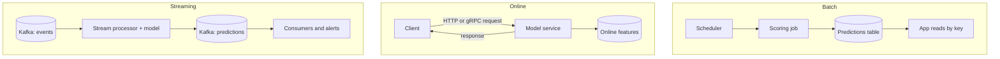
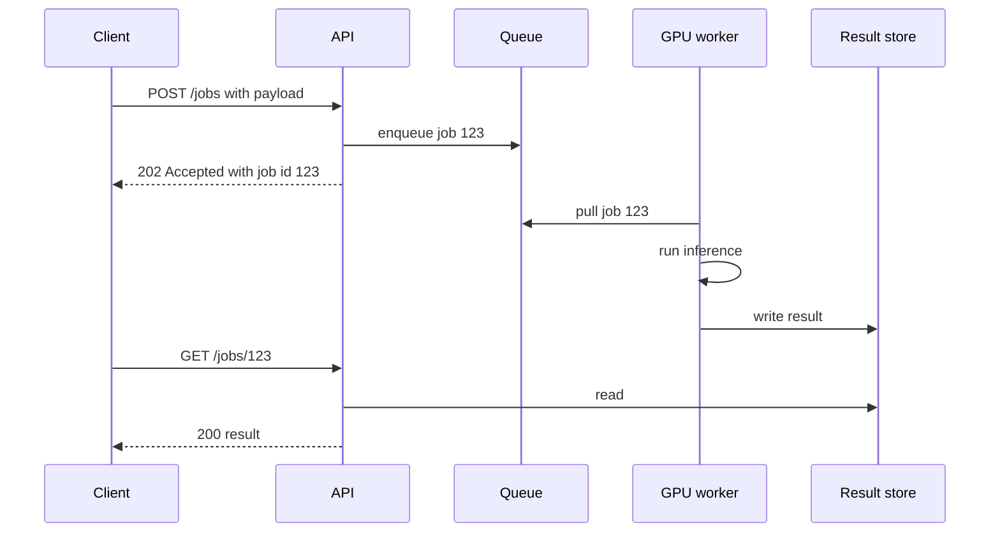
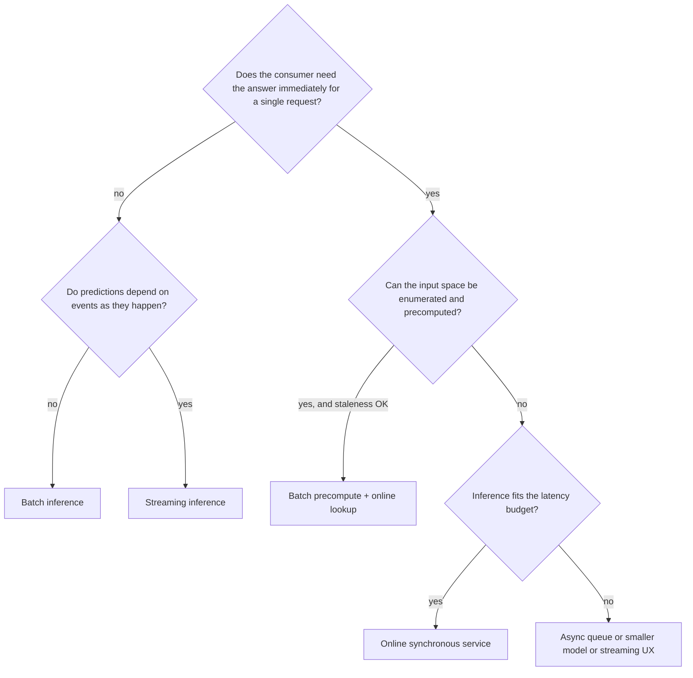

# Serving patterns: batch, online and streaming

## The first architectural question

"How will predictions reach the consumer?" decides most of your serving architecture, cost and
operational burden. There are three basic patterns, plus edge deployment:

| Pattern | Trigger | Latency | Typical examples |
|---|---|---|---|
| **Batch (offline) inference** | schedule | minutes–hours | churn scores, nightly recommendations, lead scoring, embeddings backfill |
| **Online (real-time, synchronous)** | a request | milliseconds–seconds | fraud check at checkout, search ranking, chatbots |
| **Streaming (asynchronous, near-real-time)** | an event on a stream | sub-second–seconds | anomaly detection on sensor data, real-time feature + score pipelines |
| **Edge / on-device** | local event | milliseconds, no network | keyboard prediction, camera models |



## Batch inference

A scheduled job loads a model, scores a large table, and writes results to storage keyed by entity
(customer, product). Consumers read the precomputed predictions.

**Strengths**

- Simple and cheap: no always-on service, can use spot instances, throughput-optimised hardware.
- Easy to validate before publishing: check the distribution of scores, compare with yesterday, then
  swap the table atomically.
- Heavy models are fine; latency is irrelevant.

**Weaknesses**

- Predictions are stale: a user who signed up an hour ago has none (**cold start**).
- You compute predictions for *everyone*, even entities that will never be looked at.
- Cannot use request-time context (current query, session).

```python
# batch scoring skeleton (chunked, idempotent partition overwrite)
import mlflow, pandas as pd

def score(day: str, model_uri: str = "models:/churn@champion") -> None:
    model = mlflow.pyfunc.load_model(model_uri)
    version = model.metadata.run_id
    out = []
    for chunk in pd.read_parquet(f"s3://acme/features/dt={day}/").pipe(iter_chunks, size=100_000):
        chunk["score"] = model.predict(chunk[FEATURES])
        out.append(chunk[["customer_id", "score"]])
    result = pd.concat(out).assign(model_run=version, scored_for=day)
    validate_scores(result)                                     # row count, null rate, score distribution
    result.to_parquet(f"s3://acme/predictions/churn/dt={day}/part-0.parquet")   # overwrite partition
```

For large volumes, run the model inside the data engine: Spark with `mlflow.pyfunc.spark_udf`, Ray Data
`map_batches`, or warehouse-native ML. Kleppmann's batch principles (DDIA ch. 10) apply directly:
immutable inputs, outputs written to a fresh location, safe retries.

> [!TIP]
> A common hybrid: **batch-precompute, online-serve**. Scores (or embeddings / candidate lists) are
> computed nightly and loaded into a key-value store (Redis, DynamoDB, Bigtable). The online path is a
> ~1 ms lookup, with a cheap fallback model or default for unseen keys.

## Online inference

A long-running service exposes an endpoint; each request carries inputs (or keys to look up features)
and gets a prediction back synchronously.

**Strengths:** fresh predictions; can use real-time context; only computes what is requested.

**Weaknesses:** you now own a low-latency, highly available distributed system: capacity planning,
autoscaling, tail latency, timeouts, fallbacks, feature freshness, and training/serving skew risks.

### The latency budget

A product requirement such as "p99 under 150 ms end to end" must be split across the request path:

```python-run
budget_ms = 150
path = [("network + TLS + gateway", 20), ("auth + validation", 5), ("feature lookup (online store)", 15),
        ("feature transform", 5), ("model inference", 60), ("post-processing + business rules", 5),
        ("logging (async)", 0)]
used = 0
for step, ms in path:
    used += ms
    print(f"{step:34s} {ms:4d} ms   cumulative {used:4d} ms")
print(f"headroom: {budget_ms - used} ms of {budget_ms} ms budget")
```

The model usually gets less than half the budget. If inference alone needs 300 ms, no amount of
infrastructure fixes it: you need a smaller/faster model (distillation, quantization), hardware
acceleration, caching — or a different pattern (precompute, async).

### Synchronous vs asynchronous request handling

- **Synchronous**: client waits on an open connection. Good up to a few seconds.
- **Asynchronous (queue-based)**: client submits a job, gets an ID, and polls or receives a
  webhook/callback. Workers pull from a queue (SQS, RabbitMQ, Kafka, Celery). Use for long inference
  (video, large documents, big LLM jobs), bursty load (the queue absorbs spikes), and when you want
  retries without the client holding a connection. Lubanovic (*FastAPI*, ch. 13) suggests handing any
  task longer than a fraction of a second to a job queue.
- **Streaming responses**: for LLMs, stream tokens via server-sent events so the user sees output
  immediately; the metric that matters becomes time to first token (module 12).



## Streaming inference

Events flow through a log-based broker; a stream processor (Flink, Kafka Streams, Spark Structured
Streaming) or a consumer service applies the model to each event (or micro-batch) and emits predictions
to another topic.

- Decoupled: producers do not wait for the model; consumers subscribe to predictions.
- Natural for **stateful features** (windowed aggregates per key) computed in the same pipeline —
  see DDIA ch. 11 on windows and stream joins.
- Back-pressure and replay: if the model is slow or was wrong, the log lets you catch up or reprocess.
- Delivery semantics matter: at-least-once delivery means predictions may be emitted twice; make
  consumers idempotent (dedupe by event ID).

The model can be embedded in the stream job (lowest latency, but couples model deploys to job deploys)
or called as an external online service (independent scaling and deployment, extra network hop).

## Edge inference

Running on the device avoids network latency, works offline and keeps data private. Constraints: memory,
battery, heterogeneous hardware, and difficult updates. Typical toolchain: export to ONNX / TFLite /
Core ML / ExecuTorch, quantize, and ship via the app release or over-the-air model downloads. Monitoring
is harder — telemetry must be sampled and privacy-preserving.

## Choosing a pattern



### Worked examples

| Use case | Pattern | Why |
|---|---|---|
| Weekly churn campaign | batch | consumer is a weekly process |
| Home-page recommendations | batch candidates + online re-ranking | precompute heavy retrieval; re-rank with session context in ~50 ms |
| Card fraud at authorisation | online with streaming features | decision needed in < 100 ms using last-minutes activity |
| Predictive maintenance on sensors | streaming | continuous events, alerts within seconds |
| Document summarisation (long PDFs) | async queue | tens of seconds per job |
| Chat assistant | online with token streaming | perceived latency via time to first token |

## Cross-cutting concerns for every pattern

- **Model loading**: load once at startup (not per request); warm up with a dummy prediction so the first
  user does not pay JIT/lazy-initialisation cost.
- **Versioning**: every prediction is logged with model version and feature snapshot/time.
- **Fallbacks**: on timeout or error, return a default, cached, or simpler-model prediction rather than
  failing the user journey (graceful degradation).
- **Prediction logging**: inputs, outputs, version, latency, request ID — the raw material for
  monitoring, debugging and retraining (module 10). Log asynchronously.
- **Throughput vs latency**: batch optimises throughput (large batches, full GPUs); online optimises tail
  latency (small/dynamic batches, headroom). Huyen (*AI Engineering*, ch. 9) notes providers offer
  cheaper **batch APIs** precisely because relaxing latency lets them optimise utilisation.

```python-run
# Cost intuition: batch job vs always-on online service for 5M predictions per day.
preds_per_day = 5_000_000
# batch: 1 GPU spot instance processes 4000 preds/s
batch_hours = preds_per_day / 4000 / 3600
batch_cost = batch_hours * 0.35                      # $/h spot
# online: must provision for peak (3x average) with 50% headroom, replicas handle 150 rps each, on-demand
avg_rps = preds_per_day / 86400
replicas = -(-avg_rps * 3 * 1.5 // 150)
online_cost = replicas * 24 * 1.00
print(f"batch : {batch_hours:.2f} GPU-hours/day  -> ${batch_cost:.2f}/day")
print(f"online: avg {avg_rps:.0f} rps, {replicas:.0f} replicas for peak -> ${online_cost:.2f}/day")
```

Online serving pays for idle headroom and peak capacity; batch pays only for work done. Choose online
only when freshness or request-time context earns its cost.

> [!INTERVIEW]
> "Batch or online?" is a staple system-design question. Ask: who consumes the prediction and how fast?
> can inputs be enumerated in advance? how stale can it be? what request-time context is needed? what is
> the latency budget? Then propose the simplest pattern that satisfies the answers, and mention hybrids
> (precompute + lookup, retrieval offline + re-rank online) and fallbacks.

## Summary

- Batch: scheduled, cheap, simple, stale. Online: fresh and contextual but operationally demanding.
  Streaming: event-driven, stateful, decoupled. Edge: private and offline but constrained.
- Split the latency budget across the whole request path; the model gets only part of it.
- Use async queues for slow jobs and bursty load; stream tokens for LLMs.
- Hybrids (precompute + online lookup/re-rank) are extremely common.
- Always load once, warm up, version, log predictions and provide fallbacks.

```quiz
[
  {"q": "Which use case is best served by batch inference?",
   "options": ["Fraud decision during card authorisation", "Weekly churn scores for a marketing campaign", "Autocomplete while typing", "Chatbot replies"],
   "answer": 1, "explain": "No one waits interactively and weekly staleness is acceptable."},
  {"q": "What is the main weakness of pure batch inference?",
   "options": ["High serving latency per request", "Stale predictions and no coverage for new entities or request-time context", "It needs GPUs", "It cannot be scheduled"],
   "answer": 1, "explain": "Predictions exist only for entities scored in the last run, with features as of that run."},
  {"q": "When is a queue-based asynchronous API preferable to a synchronous one?",
   "options": ["When inference takes tens of seconds or load is very bursty", "When latency must be under 10 ms", "When there is only one user", "Never"],
   "answer": 0, "explain": "Queues absorb bursts and decouple long jobs from client connections."},
  {"q": "In the 'batch precompute + online lookup' hybrid, what happens at request time?",
   "options": ["The model is retrained", "A key-value lookup returns the precomputed prediction, with a fallback for missing keys", "A Spark job starts", "The client waits for the nightly job"],
   "answer": 1, "explain": "Serving is a fast lookup; heavy computation happened offline."},
  {"q": "With at-least-once delivery in streaming inference, consumers should be...",
   "options": ["Stateless only", "Idempotent, e.g. dedupe by event ID", "Written in Java", "Synchronous"],
   "answer": 1, "explain": "Duplicates can occur after retries or restarts."},
  {"q": "Model inference takes 300 ms but the end-to-end p99 budget is 150 ms. Which is NOT a valid remedy?",
   "options": ["Use a distilled or quantized model", "Precompute predictions where possible", "Add more replicas behind the load balancer", "Cache frequent results"],
   "answer": 2, "explain": "More replicas raise throughput, not the speed of a single inference."},
  {"q": "Why warm up a model at service startup?",
   "options": ["To retrain it", "So lazy initialisation costs are not paid by the first real request", "To reduce image size", "To change its version"],
   "answer": 1, "explain": "First-call overhead (JIT, memory allocation, cache loading) can be large."}
]
```

> **Source:** Chip Huyen, *AI Engineering*, ch. 9 (online vs batch inference APIs, latency/throughput) and ch. 10 (architecture); Martin Kleppmann, *DDIA*, ch. 10–11 (batch outputs, stream processing semantics); Bill Lubanovic, *FastAPI*, ch. 13 (performance, queues); Chip Huyen, *Designing Machine Learning Systems*, ch. 7 (batch vs online prediction).
