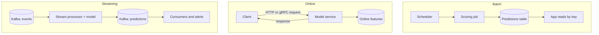
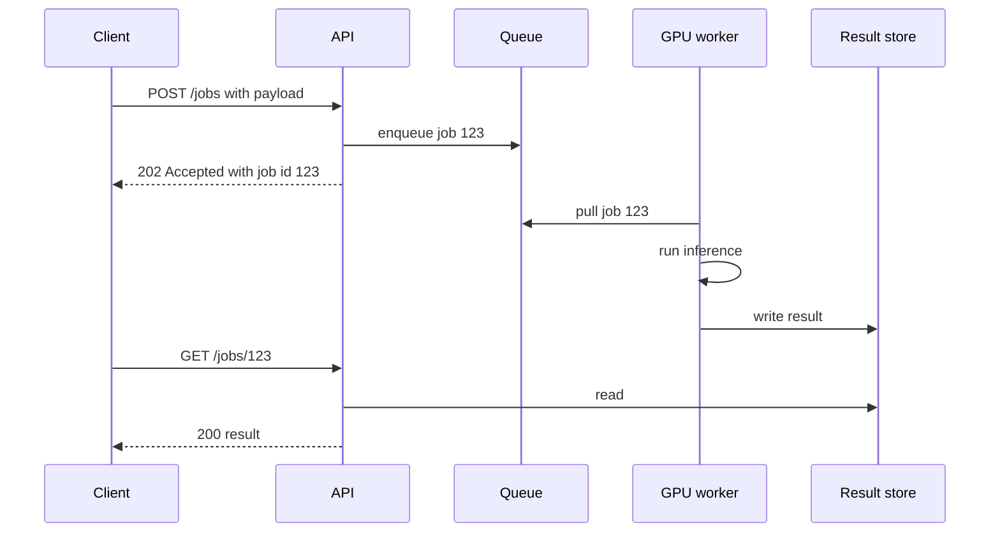
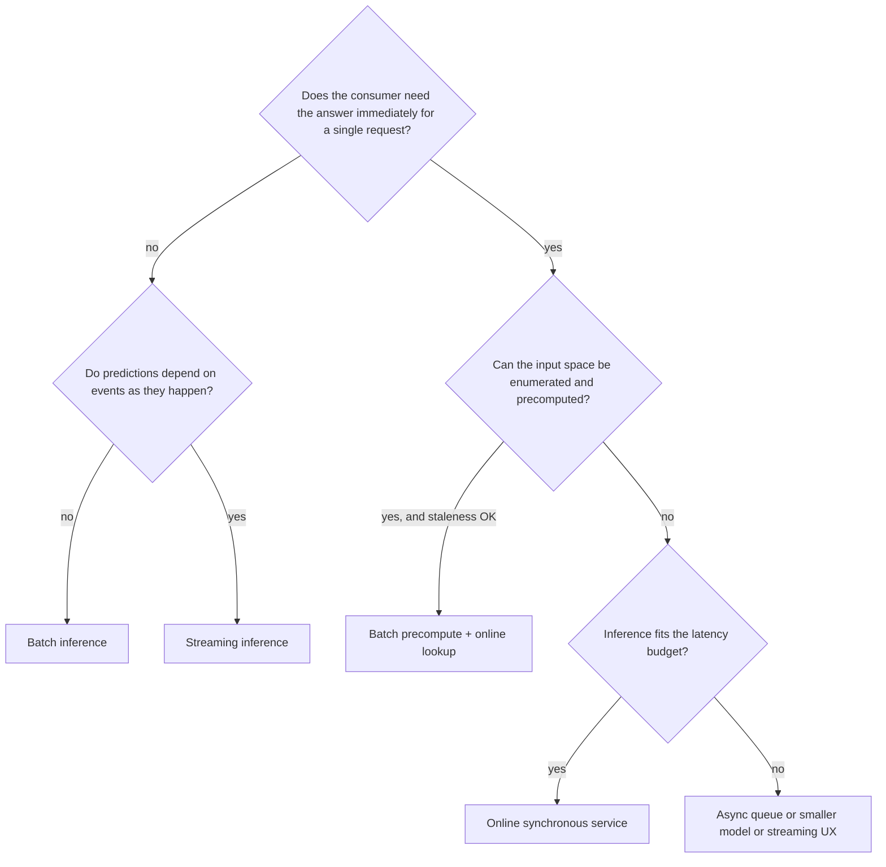

# Serving patterns: batch, online and streaming

> **Before this lesson:** read [Model registry, model cards and governance](#/lesson/mlops/model-registry)
> (what a registered model version and an alias such as `@champion` are) and
> [Feature stores, training/serving skew and labeling](#/lesson/mlops/feature-stores) (online and
> offline feature storage). It also helps to have met containers in
> [Docker fundamentals](#/lesson/mlops/docker-fundamentals), though no Docker is needed here.

## In plain words

A trained model sitting in a registry helps nobody. Somebody, or some program, has to ask it a
question and receive the answer. **Serving** is the name for that delivery: getting predictions from
the model to whoever needs them. The model's act of producing a prediction is called
**inference**, and whoever uses the result is the **consumer** (a web page, a marketing tool,
another service, a person).

There are only a few ways to organise the delivery, and choosing between them is one of the first
decisions in any ML project. An everyday picture is a bakery. It can bake everything at 5 a.m. and
put it on the shelves (**batch**: cheap, efficient, but the bread is a few hours old by lunch). It
can bake to order while the customer waits (**online**: fresh and personalised, but the oven must
be hot all day and the queue must stay short). Or it can watch the delivery trucks arriving and bake
as each load of flour comes in, sending loaves to shops without anyone placing an order
(**streaming**). A fourth option is to sell bread machines so customers bake at home (**edge**).

Why this matters for a job: "should this model run in batch or online?" is one of the most common
questions in ML system design interviews, and in practice it decides most of the cost, the
hardware and the amount of on-call work a model creates. This lesson gives you the vocabulary, the
trade-offs and a decision procedure.

## The first architectural question

The question to ask first is: **how will predictions reach the consumer, and how quickly must they
arrive?** Two words keep coming up when answering it. **Latency** is the time between asking for
one prediction and receiving it. **Throughput** is how many predictions the system completes per
second (or per hour). Batch systems are tuned for throughput; online systems are tuned for latency.

There are three basic patterns, plus running the model on the user's own device:

| Pattern | Trigger | Latency | Typical examples |
|---|---|---|---|
| **Batch (offline) inference** | schedule | minutes–hours | churn scores, nightly recommendations, lead scoring, embeddings backfill |
| **Online (real-time, synchronous)** | a request | milliseconds–seconds | fraud check at checkout, search ranking, chatbots |
| **Streaming (asynchronous, near-real-time)** | an event on a stream | sub-second–seconds | anomaly detection on sensor data, real-time feature + score pipelines |
| **Edge / on-device** | local event | milliseconds, no network | keyboard prediction, camera models |

The **trigger** column says what starts the work: a clock (a schedule), a request from a consumer
who is waiting, or an **event**, a record that something happened (a click, a payment, a sensor
reading). An **embedding** in the first row is a list of numbers that represents an item or user;
a "backfill" recomputes them for every historical row.



Read each box from left to right. In batch, a **scheduler** (a program that starts jobs at set
times, such as cron or Airflow from lesson 13) starts a scoring job, which writes a table that the
app later reads. In online serving, a **client** (the program asking) sends a request over **HTTP**
(the protocol web browsers use) or **gRPC** (a faster binary protocol, lesson 20) and waits for the
response. In streaming, events arrive in **Kafka**, a widely used system that stores streams of
events in order, a processor applies the model, and the predictions go into another stream for
whoever is interested.

## Batch inference

A batch job runs on a schedule. It loads a model, scores a large table, and writes the results to
storage, one row per **entity** (the thing being predicted about: a customer, a product, a store).
Consumers later read the precomputed predictions by looking up their entity's row.

**Strengths**

- Simple and cheap: there is no service that must stay up all day. The job can run on **spot
  instances** (spare cloud machines rented at a steep discount that the provider may reclaim with
  little notice, lesson 31) and on hardware chosen for throughput.
- Easy to check before anyone sees the results: inspect the distribution of scores, compare with
  yesterday's run, and only then replace the old table in one step.
- Heavy, slow models are fine, because nobody is waiting on any single prediction.

**Weaknesses**

- Predictions are **stale**, meaning computed from data that is hours or days old. A user who signed
  up an hour ago has no prediction at all: this gap is called the **cold start** problem.
- You compute predictions for *everyone*, including entities nobody will look at.
- The model cannot use **request-time context**, the information that only exists at the moment of
  asking, such as the words a user has typed into a search box or the pages viewed in this session.

Here is the outline of a real batch scoring job. It uses MLflow (lesson 10) and pandas, so it is
shown as static code and not as a runnable demo.

```python
# batch scoring skeleton (chunked, idempotent partition overwrite)
import mlflow, pandas as pd

def score(day: str, model_uri: str = "models:/churn@champion") -> None:
    model = mlflow.pyfunc.load_model(model_uri)
    version = model.metadata.run_id
    out = []
    for chunk in pd.read_parquet(f"s3://acme/features/dt={day}/").pipe(iter_chunks, size=100_000):
        chunk["score"] = model.predict(chunk[FEATURES])
        out.append(chunk[["customer_id", "score"]])
    result = pd.concat(out).assign(model_run=version, scored_for=day)
    validate_scores(result)                                     # row count, null rate, score distribution
    result.to_parquet(f"s3://acme/predictions/churn/dt={day}/part-0.parquet")   # overwrite partition
```

What each part does:

- `model_uri = "models:/churn@champion"` names the model by its registry alias. `load_model`
  downloads that version once, at the start of the job.
- `version = model.metadata.run_id` records exactly which training run produced the model, so
  every output row can say which model scored it.
- The loop reads the day's features in **chunks** of 100,000 rows, so a table of fifty million rows
  never has to fit in memory at once. `iter_chunks` and `FEATURES` are helpers defined elsewhere.
- `validate_scores` checks the output before publishing (more on this below).
- The output path contains `dt={day}`. A folder per day is called a **partition**. Writing to that
  exact folder makes the job **idempotent**: running it twice for the same day replaces the first
  result instead of adding duplicate rows, so a failed run can be retried without fear.

For very large volumes, run the model inside the data engine itself: Spark with
`mlflow.pyfunc.spark_udf`, Ray Data's `map_batches`, or the machine-learning functions built into
data warehouses. Kleppmann's principles for batch processing (*DDIA*, ch. 10) carry over directly:
treat inputs as read-only, write outputs to a fresh location, and design every step so that
retrying it is harmless.

> [!TIP]
> A very common hybrid is **batch-precompute, online-serve**. Scores (or embeddings, or candidate
> lists) are computed nightly and loaded into a **key-value store**, a database that returns the
> value stored under a key extremely quickly (Redis, DynamoDB, Bigtable). The online path then
> becomes a lookup of about 1 ms, with a cheap fallback model or a default value for keys that were
> not precomputed.

## Online inference

In online serving, a long-running program called a **model service** listens for requests at an
**endpoint** (an address such as `https://api.example.com/predict`). Each request carries the
inputs, or keys used to look the inputs up, and the service sends a prediction back while the
client waits. Waiting for the answer on the same connection is what **synchronous** means.

**Strengths:** predictions are fresh, they can use request-time context, and only the predictions
someone asked for are computed.

**Weaknesses:** you now run a distributed system that must answer quickly and almost never be down.
That brings capacity planning (how many machines for the busiest hour), **autoscaling** (adding and
removing copies of the service as load changes), **tail latency** (the slowest few percent of
requests), timeouts, fallbacks, keeping features fresh, and the risk of training/serving skew from
lesson 9.

### The latency budget

Latency targets are written using **percentiles**. The **p99 latency** is the value that 99 out of
every 100 requests stay under; p50 is the median. A product requirement such as "p99 under 150 ms
end to end" is a **latency budget**: the total time allowed from the moment the request leaves the
user to the moment the answer arrives. That total has to be shared among every step of the request
path, and the model gets only part of it. The demo adds up a typical path.

```python-run
budget_ms = 150
path = [("network + TLS + gateway", 20), ("auth + validation", 5), ("feature lookup (online store)", 15),
        ("feature transform", 5), ("model inference", 60), ("post-processing + business rules", 5),
        ("logging (async)", 0)]
used = 0
for step, ms in path:
    used += ms
    print(f"{step:34s} {ms:4d} ms   cumulative {used:4d} ms")
print(f"headroom: {budget_ms - used} ms of {budget_ms} ms budget")
```

Line by line: `path` is a list of pairs, each a step name and the milliseconds it costs. The loop
adds each step's cost to the running total `used` and prints both; `{step:34s}` pads the name to 34
characters so the columns line up. The last line prints what is left over. The output ends with:

```text
model inference                      60 ms   cumulative  105 ms
post-processing + business rules      5 ms   cumulative  110 ms
logging (async)                       0 ms   cumulative  110 ms
headroom: 40 ms of 150 ms budget
```

Some of the step names deserve a sentence. **TLS** (Transport Layer Security) is the encryption
behind `https`, and setting it up costs a little time per connection. A **gateway** is the front
door that every request passes through for routing and authentication. Logging costs 0 ms here
because it is **asynchronous**: the service hands the log line to a background writer and does not
wait for it. The 40 ms of **headroom** absorbs bad moments such as a slow network hop.

The model usually gets less than half the budget. If inference alone needs 300 ms, no amount of
infrastructure fixes it, because adding machines lets you answer *more* requests, not answer *one*
request faster. You need a smaller or faster model (**distillation**, training a small model to
imitate a large one; **quantization**, storing the model's numbers with fewer bits), faster
hardware, caching, or a different pattern altogether (precompute, or an asynchronous job).

### Synchronous vs asynchronous request handling

- **Synchronous**: the client waits on an open connection until the answer arrives. Reasonable up
  to a few seconds.
- **Asynchronous (queue-based)**: the client submits a job, immediately gets back a **job ID**, and
  later either asks for the result (**polling**) or is called back at an address it supplied (a
  **webhook**). Between the two, the job waits in a **queue**, a list of pending work that
  **workers** (programs that do the work) take items from one at a time. SQS, RabbitMQ, Kafka and
  Celery are common queue tools. Use this for long inference (video, large documents, big language
  model jobs), for **bursty load** (sudden spikes, which the queue absorbs), and when you want
  failed jobs retried without a client holding a connection open. Lubanovic (*FastAPI*, ch. 13)
  recommends handing any task that takes more than a fraction of a second to a job queue.
- **Streaming responses**: a large language model produces its answer one **token** (a word or
  piece of a word) at a time. Sending each token as soon as it exists, for example with
  **server-sent events** (a simple way for a server to push a series of messages over one HTTP
  connection), lets the user start reading immediately. The latency that matters then becomes the
  **time to first token** (module 12).

The sequence diagram shows the asynchronous flow. Time runs downward; each arrow is a message.



`POST` and `GET` are the HTTP verbs for "send data" and "fetch data". The status code `202
Accepted` means "received, not finished yet"; `200` means "here is the result". The client is free
between the third and seventh messages, which is the whole point.

## Streaming inference

In streaming, events flow through a **message broker**, a system that receives events from
**producers** and keeps them in order until **consumers** read them. Kafka is the best-known
log-based broker: it appends each event to a durable log and remembers, for each consumer, how far
it has read (its **offset**). Events of one kind are grouped into a **topic**. A **stream
processor** (Flink, Kafka Streams, Spark Structured Streaming) or an ordinary consumer service reads
each event, or a small group of events called a **micro-batch**, applies the model, and writes
predictions to another topic.

- **Decoupled:** producers never wait for the model, and any number of consumers can subscribe to
  the predictions.
- **Natural home for stateful features:** a **windowed aggregate** such as "number of card payments
  by this customer in the last 10 minutes" needs memory of recent events per key, which stream
  processors provide. Kleppmann covers windows and stream joins in *DDIA* ch. 11.
- **Back-pressure and replay:** if the model is slow, events wait in the log instead of being lost
  (that waiting is **back-pressure** at work); if the model was wrong, you can rewind the offset and
  **replay** old events through a fixed model.
- **Delivery guarantees matter:** most setups promise **at-least-once delivery**, meaning every
  event is processed, but after a crash or retry some events are processed twice. Consumers must
  therefore be **idempotent**: processing the same event twice must have the same effect as once,
  usually by remembering event IDs and skipping duplicates.

The model can be **embedded** in the stream job (lowest latency, but every model release now means
redeploying the job) or **called** as an external online service (the two can be scaled and
released independently, at the price of an extra network hop).

## Edge inference

**Edge** inference means running the model on the user's device: a phone, a camera, a car. It
avoids network latency, works offline and keeps raw data on the device, which helps privacy. The
constraints are limited memory and battery, many different kinds of hardware, and slow updates. The
usual toolchain exports the model to a portable format (ONNX, TFLite, Core ML or ExecuTorch),
quantizes it, and ships it either inside the app release or as a separate download. Monitoring is
harder, because **telemetry** (usage data sent back from devices) must be sampled and stripped of
personal information.

## Choosing a pattern

The flowchart below turns the trade-offs into a series of questions. Diamonds are questions; follow
the arrow labelled with your answer.



"Can the input space be enumerated" asks whether you could list every possible input ahead of time.
The set of your customers can be listed; the set of all sentences a user might type cannot.

### Worked examples

| Use case | Pattern | Why |
|---|---|---|
| Weekly churn campaign | batch | consumer is a weekly process |
| Home-page recommendations | batch candidates + online re-ranking | precompute heavy retrieval; re-rank with session context in ~50 ms |
| Card fraud at authorisation | online with streaming features | decision needed in < 100 ms using last-minutes activity |
| Predictive maintenance on sensors | streaming | continuous events, alerts within seconds |
| Document summarisation (long PDFs) | async queue | tens of seconds per job |
| Chat assistant | online with token streaming | perceived latency via time to first token |

The recommendation row uses two terms worth defining. **Candidate retrieval** picks a few hundred
possibly relevant items out of millions; **re-ranking** orders that short list carefully. The first
is heavy and can be done overnight; the second is light and benefits from knowing what the user is
doing right now.

## Cross-cutting concerns for every pattern

Whatever the pattern, the same five habits apply.

- **Model loading**: load the model once when the service starts, never once per request. Then
  **warm it up** by running one dummy prediction, so the first real user does not pay one-off setup
  costs such as **JIT compilation** (code compiled the first time it runs) or memory allocation.
- **Versioning**: log every prediction with the model version and the time (or snapshot) of the
  features it used.
- **Fallbacks**: on a timeout or error, return a default, a cached value or a simpler model's
  prediction instead of failing the user's whole journey. Continuing with reduced quality instead
  of breaking is called **graceful degradation**.
- **Prediction logging**: record inputs, outputs, model version, latency and a **request ID** (a
  unique label for each request). These logs are the raw material for monitoring, debugging and
  retraining (module 10). Write them asynchronously so they never slow down the answer.
- **Throughput vs latency**: batch work favours throughput (large batches, fully used GPUs); online
  work favours tail latency (small or dynamic batches, spare capacity). Huyen (*AI Engineering*,
  ch. 9) points out that model providers sell cheaper **batch APIs** for exactly this reason: when
  the customer can wait, the provider can pack the hardware more fully.

To see the cost difference, the next demo compares one day of 5 million predictions done as a batch
job against the same load served online.

```python-run
# Cost intuition: batch job vs always-on online service for 5M predictions per day.
preds_per_day = 5_000_000
# batch: 1 GPU spot instance processes 4000 preds/s
batch_hours = preds_per_day / 4000 / 3600
batch_cost = batch_hours * 0.35                      # $/h spot
# online: must provision for peak (3x average) with 50% headroom, replicas handle 150 rps each, on-demand
avg_rps = preds_per_day / 86400
replicas = -(-avg_rps * 3 * 1.5 // 150)
online_cost = replicas * 24 * 1.00
print(f"batch : {batch_hours:.2f} GPU-hours/day  -> ${batch_cost:.2f}/day")
print(f"online: avg {avg_rps:.0f} rps, {replicas:.0f} replicas for peak -> ${online_cost:.2f}/day")
```

How it works: the batch job's machine handles 4,000 predictions per second, so 5 million take
`5_000_000 / 4000 / 3600` = about 0.35 hours, billed at a spot price of \$0.35 an hour. For online,
`avg_rps` is the average load in **requests per second** (5 million spread over 86,400 seconds,
about 58). The service must be sized for the busiest hour, assumed to be three times the average,
plus 50% spare capacity. Each **replica** (one running copy of the service) handles 150 requests
per second. The odd-looking `-(-x // 150)` is a way to divide and round *up* in Python, because
you cannot run a fraction of a replica. The output:

```text
batch : 0.35 GPU-hours/day  -> $0.12/day
online: avg 58 rps, 2 replicas for peak -> $48.00/day
```

Online serving pays around the clock for idle headroom and peak capacity; batch pays only for work
done. Choose online only when freshness or request-time context is worth the difference.

> [!INTERVIEW]
> "Batch or online?" is a staple system-design question. Ask: who consumes the prediction and how fast?
> can inputs be enumerated in advance? how stale can it be? what request-time context is needed? what is
> the latency budget? Then propose the simplest pattern that satisfies the answers, and mention hybrids
> (precompute + lookup, retrieval offline + re-rank online) and fallbacks.

## Designing a batch scoring job properly

Batch inference looks easy, which is exactly why its failure modes get neglected. A batch job you
can trust in production has five properties.

1. **Idempotent and partitioned**: output is keyed by `(scoring_date, model_version)`, so a rerun
   overwrites instead of duplicating.
2. **Pinned model**: resolve `@champion` to a concrete version *once* at job start and record it.
   If the alias moved halfway through, half the rows would be scored by one model and half by
   another.
3. **Validated inputs and outputs**: before scoring, check that features are fresh and row counts
   are plausible; after scoring, check the score distribution.
4. **Atomic publish**: write to a **staging** location (a holding area that consumers do not read),
   validate, then switch consumers over in one step. **Atomic** means the switch either happens
   completely or not at all, so nobody ever reads a half-written table.
5. **Observable**: report rows scored, run time, share of missing values and a summary of the score
   distribution; alert on **staleness** (the table was not refreshed by its deadline).

The demo simulates properties 3 and 4. Read it once, run it, then read the explanation.

```python-run
import numpy as np
rng = np.random.default_rng(0)

def score_batch(features, model_version):
    w = {"v7": 0.9, "v8": 1.1}[model_version]
    return 1 / (1 + np.exp(-(w * features - 1.0)))

def publish(table, staging, key, checks):
    """Validate the staged output, then swap atomically."""
    problems = [name for name, ok in checks(staging).items() if not ok]
    if problems:
        return f"REJECTED {problems}: previous partition kept"
    table[key] = staging                       # single pointer swap
    return f"published {len(staging)} rows"

yesterday = score_batch(rng.normal(0, 1, 10_000), "v7")
def checks(staged):
    return {"row count within 10% of yesterday": abs(len(staged) / len(yesterday) - 1) < 0.10,
            "no NaN scores": not np.isnan(staged).any(),
            "mean score within 0.05 of yesterday": abs(staged.mean() - yesterday.mean()) < 0.05}

table = {("2025-01-14", "v7"): yesterday}
good = score_batch(rng.normal(0, 1, 10_050), "v7")
print("normal run        :", publish(table, good, ("2025-01-15", "v7"), checks))
truncated = score_batch(rng.normal(0, 1, 4_000), "v7")              # upstream delivered a partial file
print("partial input     :", publish(table, truncated, ("2025-01-16", "v7"), checks))
shifted = score_batch(rng.normal(0, 1, 10_000) * 100, "v7")         # unit bug upstream
print("unit bug upstream :", publish(table, shifted, ("2025-01-16", "v7"), checks))
print("partitions served :", sorted(k[0] for k in table))
```

What each piece does:

- `score_batch` is a stand-in model: a **sigmoid** function, `1 / (1 + e^-z)`, which squeezes any
  number into a score between 0 and 1. The weight `w` depends on the model version.
- `publish` runs every check on the staged scores. If any check fails it returns `REJECTED` and
  leaves `table` untouched; otherwise it stores the new partition with one assignment, the
  in-memory equivalent of an atomic swap.
- `checks` compares the staged output with yesterday's: row count within 10%, no `NaN` ("not a
  number", the marker for a missing or broken value), and a mean score within 0.05.
- Three runs follow: a normal day, a day when the upstream file arrived truncated (4,000 rows), and
  a day when an upstream bug multiplied a feature by 100 (a units mistake, such as cents instead of
  dollars).

The output:

```text
normal run        : published 10050 rows
partial input     : REJECTED ['row count within 10% of yesterday']: previous partition kept
unit bug upstream : REJECTED ['mean score within 0.05 of yesterday']: previous partition kept
partitions served : ['2025-01-14', '2025-01-15']
```

Neither broken run crashed: the scoring code ran happily on bad inputs. Only the checks noticed.
When a run is rejected, consumers keep reading the last good predictions, stale but sensible, while
an alert goes out. That is almost always better than publishing garbage on time.

### Throughput for batch on GPUs

To keep a **GPU** (graphics processing unit, the chip that runs model arithmetic fastest) busy,
sort or group text inputs by length so each batch holds items of similar size, use the largest
batch that fits in memory, load the next batch while the current one is computing, and write
results in large files rather than row by row. Batch jobs are also where spot instances shine:
split the work into numbered chunks and record each finished chunk ID (a **checkpoint**). If the
provider reclaims the machine, the restarted job skips the chunks already done.

## Request path design for online serving: precompute vs compute

Inside one online request, each piece of work could happen at one of three times:

| When | Examples | Trade-off |
|---|---|---|
| **Offline (batch)** | user embeddings, item embeddings, candidate lists, aggregate features | cheapest, stale |
| **Nearline (streaming, seconds)** | counters over recent events, session features | fresher, operationally heavier |
| **Online (at request time)** | features from the request itself, final ranking, business rules | freshest, inside the latency budget |

**Nearline** means updated continuously from a stream, a few seconds behind reality, but not
computed inside the request. A good design moves work as far toward the *top* of this table (as
early as possible) as freshness requirements allow. A typical recommender builds embeddings and the
candidate retrieval index offline, keeps recent-activity features nearline, and runs a light ranker
online over a few hundred candidates.

## Failure modes and fallbacks by pattern

| Pattern | Typical failure | Detection | Fallback |
|---|---|---|---|
| Batch | job did not run / partial input / wrong model version | freshness and volume alerts, output validation | keep serving the last good partition |
| Online | dependency timeout, overload, bad deploy | error rate, latency SLO, canary analysis | default prediction, cached value, simpler model, rules |
| Streaming | consumer lag grows, poison message, state corruption | lag metrics, dead-letter queue size | scale consumers, skip to DLQ, replay from offset |
| Async queue | queue grows unbounded, workers crash on one job | queue depth and age of oldest message | autoscale on depth, max retries then DLQ, reject new jobs |
| Edge | model/app version mismatch, device too weak | telemetry sampling, crash reports | bundled smaller model, server-side fallback |

A few terms from the table: an **SLO** (service level objective) is a written target such as "p99
under 150 ms on 99.9% of days" (lesson 27). **Canary analysis** compares a new version receiving a
small slice of traffic against the old one (lesson 26). **Consumer lag** is how far a stream
consumer has fallen behind the newest event. A **poison message** is an event that crashes the
consumer every time it is read. A **dead-letter queue** (DLQ) is a side queue where such messages
are parked after a few failed attempts so the rest of the stream keeps flowing.

Design the fallback **before** launch and exercise it on purpose: a fallback path that has never run
in production will not work the day you need it.

## Summary

- Batch: scheduled, cheap, simple, stale. Online: fresh and contextual but operationally demanding.
  Streaming: event-driven, stateful, decoupled. Edge: private and offline but constrained.
- Split the latency budget across the whole request path; the model gets only part of it.
- Use asynchronous queues for slow jobs and bursty load; stream tokens for language models.
- Hybrids (precompute plus online lookup or re-ranking) are extremely common.
- Always load once, warm up, version, log predictions and provide fallbacks.
- A batch job you can trust is idempotent, pinned to one model version, validated and published
  atomically.

## Glossary

- **Serving / inference** - delivering predictions to consumers / the model computing one.
- **Consumer** - the person or program that uses a prediction.
- **Latency / throughput** - time for one prediction / predictions completed per second.
- **Percentile (p50, p99)** - the value that 50% or 99% of requests stay under.
- **Latency budget** - the total time allowed for a request, shared among all steps.
- **Batch inference** - scoring a whole table on a schedule and storing the results.
- **Online inference** - a service that answers each request while the client waits.
- **Streaming inference** - applying the model to events as they flow through a broker.
- **Edge inference** - running the model on the user's own device.
- **Entity** - the thing a prediction is about, such as a customer.
- **Cold start** - having no prediction for a new entity.
- **Partition** - one slice of a table, such as one day's folder.
- **Idempotent** - safe to repeat: doing it twice has the same effect as once.
- **Atomic publish** - switching consumers to new output in one all-or-nothing step.
- **Key-value store** - a database that returns the value stored under a key very quickly.
- **Spot instance** - a discounted cloud machine that the provider may reclaim.
- **Queue / worker / job ID** - a list of pending work / a program that takes items from it / the
  label a client uses to fetch a result later.
- **Webhook** - a callback address the server calls when a job is finished.
- **Token** - a word or piece of a word produced by a language model.
- **Message broker / topic / offset** - a system that stores events in order / a named stream /
  how far a consumer has read.
- **At-least-once delivery** - every event is processed, possibly more than once.
- **Graceful degradation** - continuing with reduced quality instead of failing.
- **Nearline** - updated continuously from a stream, slightly behind real time.
- **Dead-letter queue (DLQ)** - a holding queue for messages that keep failing.

```quiz
[
  {"q": "Which use case is best served by batch inference?",
   "options": ["Fraud decision during card authorisation", "Weekly churn scores for a marketing campaign", "Autocomplete while typing", "Chatbot replies"],
   "answer": 1, "explain": "No one waits interactively and weekly staleness is acceptable."},
  {"q": "What is the main weakness of pure batch inference?",
   "options": ["High serving latency per request", "Stale predictions and no coverage for new entities or request-time context", "It needs GPUs", "It cannot be scheduled"],
   "answer": 1, "explain": "Predictions exist only for entities scored in the last run, with features as of that run."},
  {"q": "When is a queue-based asynchronous API preferable to a synchronous one?",
   "options": ["When inference takes tens of seconds or load is very bursty", "When latency must be under 10 ms", "When there is only one user", "Never"],
   "answer": 0, "explain": "Queues absorb bursts and decouple long jobs from client connections."},
  {"q": "In the 'batch precompute + online lookup' hybrid, what happens at request time?",
   "options": ["The model is retrained", "A key-value lookup returns the precomputed prediction, with a fallback for missing keys", "A Spark job starts", "The client waits for the nightly job"],
   "answer": 1, "explain": "Serving is a fast lookup; heavy computation happened offline."},
  {"q": "With at-least-once delivery in streaming inference, consumers should be...",
   "options": ["Stateless only", "Idempotent, e.g. dedupe by event ID", "Written in Java", "Synchronous"],
   "answer": 1, "explain": "Duplicates can occur after retries or restarts."},
  {"q": "Model inference takes 300 ms but the end-to-end p99 budget is 150 ms. Which is NOT a valid remedy?",
   "options": ["Use a distilled or quantized model", "Precompute predictions where possible", "Add more replicas behind the load balancer", "Cache frequent results"],
   "answer": 2, "explain": "More replicas raise throughput, not the speed of a single inference."},
  {"q": "Why warm up a model at service startup?",
   "options": ["To retrain it", "So lazy initialisation costs are not paid by the first real request", "To reduce image size", "To change its version"],
   "answer": 1, "explain": "First-call overhead (JIT, memory allocation, cache loading) can be large."}
]
```

> **Source:** Chip Huyen, *AI Engineering*, ch. 9 (online vs batch inference APIs, latency/throughput) and ch. 10 (architecture); Martin Kleppmann, *DDIA*, ch. 10–11 (batch outputs, stream processing semantics); Bill Lubanovic, *FastAPI*, ch. 13 (performance, queues); Chip Huyen, *Designing Machine Learning Systems*, ch. 7 (batch vs online prediction).
