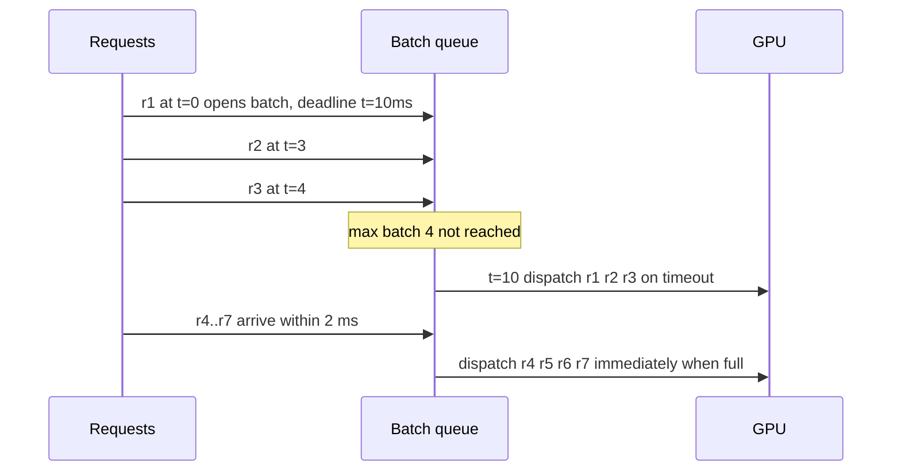

# Model servers, batching, autoscaling and caching

## When a hand-written API is not enough

A FastAPI app wrapping `model.predict` is perfect for small CPU models. As soon as you serve GPU models,
several models, or need high utilisation, you want a **model server**: purpose-built software that
handles model loading and versioning, request batching, concurrency across GPUs, standard protocols and
metrics.

| Server | Sweet spot | Notable features |
|---|---|---|
| **TorchServe** | PyTorch models | `.mar` archives, custom handlers, batching, management API |
| **TensorFlow Serving** | TF SavedModels | version policies, batching, gRPC/REST |
| **NVIDIA Triton Inference Server** | multi-framework GPU serving | backends for TensorRT, ONNX Runtime, PyTorch, TF, Python; **dynamic batching**; concurrent model instances; model ensembles/pipelines; model repository with versions |
| **BentoML** | Python-first packaging and serving | "Bentos" (code + models + deps), adaptive batching, easy containerisation, BentoCloud |
| **Ray Serve** | composing many models/business logic in Python | deployments with replicas, autoscaling, `@serve.batch`, model composition graphs, runs on Ray clusters |
| **KServe** | Kubernetes-native serving layer | `InferenceService` CRD wrapping the servers above, scale-to-zero, canary (lesson 23) |
| **vLLM** | LLM text generation | PagedAttention, continuous batching, OpenAI-compatible API |
| **TGI** (Hugging Face Text Generation Inference) | LLMs | continuous batching, token streaming, powers HF Inference Endpoints |
| **llama.cpp / Ollama** | local and CPU/edge LLMs | GGUF quantized models |

Triton organises models in a **model repository**:

```text
model_repository/
└── churn_onnx/
    ├── config.pbtxt
    ├── 1/model.onnx
    └── 2/model.onnx
```

```protobuf
# config.pbtxt
name: "churn_onnx"
platform: "onnxruntime_onnx"
max_batch_size: 64
input  [{ name: "features" data_type: TYPE_FP32 dims: [ 12 ] }]
output [{ name: "proba"    data_type: TYPE_FP32 dims: [ 1 ] }]
dynamic_batching { preferred_batch_size: [ 16, 32 ] max_queue_delay_microseconds: 5000 }
instance_group [{ count: 2 kind: KIND_GPU }]
version_policy: { latest { num_versions: 2 } }
```

BentoML expresses the same ideas in Python:

```python
import bentoml, numpy as np

@bentoml.service(resources={"cpu": "2"}, traffic={"timeout": 5})
class ChurnService:
    def __init__(self):
        self.model = bentoml.sklearn.load_model("churn:latest")

    @bentoml.api(batchable=True, max_batch_size=64, max_latency_ms=10)
    def predict(self, features: np.ndarray) -> np.ndarray:
        return self.model.predict_proba(features)[:, 1]
```

## The two metrics: latency and throughput

- **Latency**: time for one request. Because it is a distribution, look at **percentiles** (p50, p95,
  p99), not the mean. Huyen's example (*AI Engineering*, ch. 9): ten requests where nine take about
  100 ms and one takes 3,000 ms have a mean of 390 ms — a number that describes none of them.
- **Throughput**: requests (or tokens) per second the system completes.
- **Utilisation**: fraction of hardware capacity doing useful work — the bridge to **cost**.

They trade off. Batching raises throughput and utilisation but adds waiting time. Huyen also introduces
**goodput**: the throughput of requests that *meet the SLO*. A server completing 100 requests per minute
of which only 30 satisfy the latency objectives has a goodput of 30.

```python-run
import numpy as np
lat = np.array([100, 102, 100, 100, 99, 104, 110, 90, 3000, 95])
print("mean :", lat.mean())
for p in (50, 90, 95, 99):
    print(f"p{p}  :", np.percentile(lat, p, method="nearest"))
slo = 200
print(f"goodput fraction at SLO {slo} ms: {(lat <= slo).mean():.0%}")
```

### Tail latency amplification

If one user request fans out to several backend calls, the chance that *at least one* is slow grows
quickly: with 10 parallel calls each having a 1% chance of exceeding the p99, about 9.6% of user requests
see a slow call. This is why the p99 of each component matters, and why hedged requests and timeouts with
fallbacks exist.

## Batching

GPUs (and vectorised CPU code) process a batch of 32 inputs in barely more time than one input. Huyen's
analogy: batching puts passengers on a bus instead of in separate cars — more people moved, but each trip
may take longer.

- **Static batching**: wait until the batch has exactly N requests. The first request waits for the last;
  under low traffic it may wait forever.
- **Dynamic batching**: dispatch when the batch is full **or** a maximum wait time has passed, whichever
  comes first — "a bus that leaves when full or on schedule". Latency stays bounded; batches may be
  partly empty at low load.
- **Continuous (in-flight) batching**, for LLMs: sequences finish at different times; as soon as one
  completes it leaves the batch and a waiting request takes its slot, so short answers are not held
  hostage by long ones (introduced in the Orca paper; used by vLLM and TGI).



```python-run
import numpy as np
rng = np.random.default_rng(0)

def simulate(rate_rps, max_batch, max_wait_ms, n=4000, base_ms=8.0, per_item_ms=0.5):
    """Single GPU. Batch cost = base + per_item * size. Returns (throughput-capable?, p50, p95, mean batch)."""
    arrivals = np.cumsum(rng.exponential(1000 / rate_rps, n))
    lat, sizes, gpu_free, i = [], [], 0.0, 0
    while i < n:
        t0 = arrivals[i]
        start_earliest = max(t0, gpu_free)
        deadline = max(t0 + max_wait_ms, gpu_free)       # can keep collecting while GPU is busy
        j = i
        while j < n and j - i < max_batch and arrivals[j] <= deadline:
            j += 1
        dispatch = max(start_earliest, arrivals[j - 1]) if j - i == max_batch else deadline
        done = dispatch + base_ms + per_item_ms * (j - i)
        lat.extend(done - arrivals[i:j]); sizes.append(j - i)
        gpu_free, i = done, j
    return np.percentile(lat, 50), np.percentile(lat, 95), np.mean(sizes)

print("rate   config              p50      p95   mean batch")
for rate in (50, 400):
    for mb, mw in ((1, 0), (16, 5), (64, 20)):
        p50, p95, mbs = simulate(rate, mb, mw)
        print(f"{rate:4d}   batch<={mb:<2d} wait {mw:2d}ms   {p50:7.1f}  {p95:7.1f}   {mbs:5.1f}")
```

At low load (50 rps) batching only adds waiting. At high load (400 rps), no batching cannot keep up at
all — the queue grows without bound and latency explodes — while dynamic batching serves the load with
bounded latency. Tune `max_batch_size` to your GPU memory and `max_wait` to your latency budget. You
will implement the scheduler logic in `mlops-dynamic-batching`.

## Concurrency and replicas

- **Instances per GPU**: multiple copies of a small model can share one GPU (Triton `instance_group`).
- **Replicas**: independent copies of the server behind a load balancer.
- **Load balancing**: round-robin is fine for uniform requests; **least-outstanding-requests** is better
  when request cost varies (LLMs).
- **Queueing**: bound the queue; reject (429) beyond it — unbounded queues turn overload into timeouts for
  everyone.

## Autoscaling

Autoscaling adjusts replicas to load. Design questions:

1. **Which signal?** CPU utilisation works for CPU models. For GPU/LLM serving prefer **concurrency /
   in-flight requests per replica, queue length, requests per second, or GPU utilisation** — CPU usage
   says little about a GPU-bound server.
2. **How fast can you add capacity?** New replica time = node provisioning (minutes for GPU nodes) +
   image pull (large images!) + model load + warm-up. If that is 5 minutes, autoscaling cannot absorb a
   30-second spike: keep **headroom** (target 50–70% utilisation), use queues/async, or pre-scale on a
   schedule.
3. **Scale to zero?** Great for cost on rarely used models (Knative/KServe serverless, KEDA); the price is
   **cold starts**.
4. **Stability**: scale up fast, scale down slowly (stabilisation windows) to avoid flapping.

The Kubernetes HPA formula — which you will simulate in `mlops-hpa-replicas` — is

$$\text{desired} = \left\lceil \text{current} \times \frac{\text{current metric}}{\text{target metric}} \right\rceil$$

```python-run
import math
def replicas_needed(rps, per_replica_rps, target_util=0.6, min_r=2):
    return max(min_r, math.ceil(rps / (per_replica_rps * target_util)))
for rps in (20, 120, 480, 900):
    print(f"{rps:4d} rps -> {replicas_needed(rps, 100)} replicas at 60% target utilisation (100 rps capacity each)")
```

## Caching

"The fastest inference is the one you do not run."

- **Prediction cache**: key = hash(model version + canonicalised input) → output. Effective when inputs
  repeat (popular items, repeated queries). Must include the **model version** in the key so a deployment
  does not serve stale predictions; canonicalise field order and float precision so equal requests match
  (`mlops-feature-cache-key`).
- **Feature cache**: cache expensive feature lookups with a TTL matched to feature freshness.
- **Embedding cache**: store embeddings of documents/items; recompute only on change.
- **LLM-specific**: exact and semantic response caches, prompt/prefix caching, KV cache (module 12).

Cache design checklist: TTL, eviction policy (Huyen lists LRU, LFU, FIFO), size bound, invalidation on
model/feature change, stampede protection, and **privacy** — never cache personalised responses under a
key that another user could hit (Huyen warns of exactly this leak for a user-specific answer cached as if
generic).

```python-run
from collections import OrderedDict
import hashlib, json

class LRUCache:
    def __init__(self, capacity): self.cap, self.d, self.hits, self.miss = capacity, OrderedDict(), 0, 0
    def get(self, k):
        if k in self.d:
            self.d.move_to_end(k); self.hits += 1; return self.d[k]
        self.miss += 1; return None
    def put(self, k, v):
        self.d[k] = v; self.d.move_to_end(k)
        if len(self.d) > self.cap: self.d.popitem(last=False)

def key(version, features):
    canon = json.dumps({"v": version, "f": features}, sort_keys=True, separators=(",", ":"))
    return hashlib.sha256(canon.encode()).hexdigest()[:16]

import random
random.seed(0)
cache = LRUCache(100)
items = list(range(1000)); weights = [1 / (i + 1) for i in items]      # Zipf-like popularity
for _ in range(20000):
    item = random.choices(items, weights)[0]
    k = key("v7", {"item_id": item})
    if cache.get(k) is None:
        cache.put(k, 0.5)                                              # pretend we ran the model
print(f"hit rate with 100-entry LRU over 1000 items (skewed popularity): {cache.hits/(cache.hits+cache.miss):.0%}")
```

A cache holding 10% of the items serves most of the traffic when popularity is skewed — which it usually is.

## Model-level speedups (preview)

Serving-level tricks do not change the model. Model-level ones do: **quantization** (FP32 → INT8/FP16),
**pruning**, **distillation** into a smaller student, **graph compilation** (ONNX Runtime, TensorRT,
OpenVINO, `torch.compile`). Huyen (ch. 9) splits inference optimisation into exactly these two levels;
module 12 goes deeper for LLMs.

> [!INTERVIEW]
> "Your GPU model server has high latency at peak. What do you check?" — Is the GPU saturated or idle
> (utilisation, queue length)? Enable/tune **dynamic batching**; add instances/replicas; autoscale on
> concurrency or queue depth rather than CPU; shorten cold start (smaller image, pre-pulled, model on local
> disk); cache repeat requests; apply model-level optimisation (quantization, TensorRT); shed load beyond
> capacity. Frame it with p95/p99 and goodput rather than averages.

## Capacity planning: a worked example

*Requirement: 600 requests/s at peak, p95 under 150 ms, one model on GPUs. How many replicas?*

1. **Measure** one replica under load with your real batching settings. Suppose a load test finds the
   p95 stays under 150 ms up to 220 rps, and breaks beyond that.
2. **Apply headroom**: plan to run at about 65% of that knee to absorb bursts and the loss of a replica —
   roughly 140 rps per replica.
3. **Replicas for peak**: 600 / 140 ≈ 4.3 → 5.
4. **Failure tolerance (N+1)**: with 5 replicas, losing one leaves 4 × 220 = 880 rps of raw capacity —
   still above peak. Fine. Across three zones, check that losing a whole zone is survivable.
5. **Scale-up time**: if a new GPU replica takes 4 minutes to serve, the autoscaler must trigger well
   before saturation: set the target at the 65% point, and set `minReplicas` to cover the fastest
   expected ramp.
6. **Cost check**: 5 GPUs at peak, fewer off-peak via autoscaling; compare with a smaller/quantized model
   on fewer GPUs.

```python-run
import math
def plan(peak_rps, knee_rps, headroom=0.65, zones=3):
    per_replica = knee_rps * headroom
    n = math.ceil(peak_rps / per_replica)
    n_minus_one_ok = (n - 1) * knee_rps >= peak_rps
    per_zone = math.ceil(n / zones)
    zone_loss_ok = (n - per_zone) * knee_rps >= peak_rps
    return n, per_replica, n_minus_one_ok, zone_loss_ok
for peak in (150, 600, 2400):
    n, per, ok1, okz = plan(peak, 220)
    print(f"peak {peak:5d} rps -> {n:2d} replicas at ~{per:.0f} rps each | survives 1 replica loss: {ok1} | survives zone loss: {okz}")
```

The method — find the knee by load testing, apply headroom, check failure scenarios — matters more than
the particular numbers. Never size from the *average* latency or the *average* traffic.

## Summary

- Model servers (Triton, TorchServe, BentoML, Ray Serve, vLLM/TGI) provide batching, concurrency,
  versioning, protocols and metrics.
- Track latency percentiles, throughput and utilisation; goodput counts only SLO-compliant requests.
- Dynamic batching bounds waiting time; continuous batching suits LLMs.
- Autoscale on a signal that reflects real load; account for slow scale-up; scale down conservatively.
- Cache with version-aware, canonical keys and careful invalidation and privacy.

```quiz
[
  {"q": "What distinguishes dynamic batching from static batching?",
   "options": ["Dynamic batching uses larger batches always", "Dynamic batching dispatches when the batch is full OR a maximum wait time elapses", "Static batching is only for LLMs", "Dynamic batching disables the GPU queue"],
   "answer": 1, "explain": "The time limit keeps latency bounded when traffic is low."},
  {"q": "Why is the mean a poor summary of latency?",
   "options": ["It is hard to compute", "A few outliers distort it; percentiles describe what fractions of users experience", "It ignores fast requests", "It is always lower than p50"],
   "answer": 1, "explain": "One 3 s request among ten 100 ms requests gives a 390 ms mean that describes no request."},
  {"q": "What is goodput?",
   "options": ["Total tokens generated", "Throughput of requests that satisfy the SLO", "GPU memory utilisation", "Cache hit rate"],
   "answer": 1, "explain": "It excludes completed requests that were too slow to be useful."},
  {"q": "Which autoscaling signal is generally best for a GPU-bound model server?",
   "options": ["CPU utilisation", "Concurrency / queue length / GPU utilisation", "Disk usage", "Number of log lines"],
   "answer": 1, "explain": "CPU usage poorly reflects load when the GPU is the bottleneck."},
  {"q": "Why must a prediction cache key include the model version?",
   "options": ["To make keys longer", "Otherwise a newly deployed model would return predictions cached from the old one", "To speed hashing", "Because Redis requires it"],
   "answer": 1, "explain": "Version-aware keys make deployments invalidate old entries implicitly."},
  {"q": "A new GPU replica takes 5 minutes to become ready. How do you handle 30-second traffic spikes?",
   "options": ["Rely on autoscaling alone", "Keep headroom, queue or shed load, or pre-scale; autoscaling is too slow for the spike", "Reduce replicas", "Disable batching"],
   "answer": 1, "explain": "Reactive scaling cannot beat provisioning time."},
  {"q": "Continuous batching helps LLM serving because...",
   "options": ["All sequences have the same length", "Finished sequences leave the batch immediately and new requests take their place", "It removes the need for a GPU", "It increases the context window"],
   "answer": 1, "explain": "Short responses are not delayed by long ones and GPU slots stay full."}
]
```

> **Source:** Chip Huyen, *AI Engineering*, ch. 9 (inference performance metrics: latency percentiles, throughput, goodput; batching: static, dynamic, continuous) and ch. 10 (caching, eviction policies, cache data-leak warning); NVIDIA Triton, TorchServe, BentoML, Ray Serve and vLLM documentation; Kubernetes documentation (*Horizontal Pod Autoscaling*); Dean & Barroso, *The Tail at Scale* (2013).
