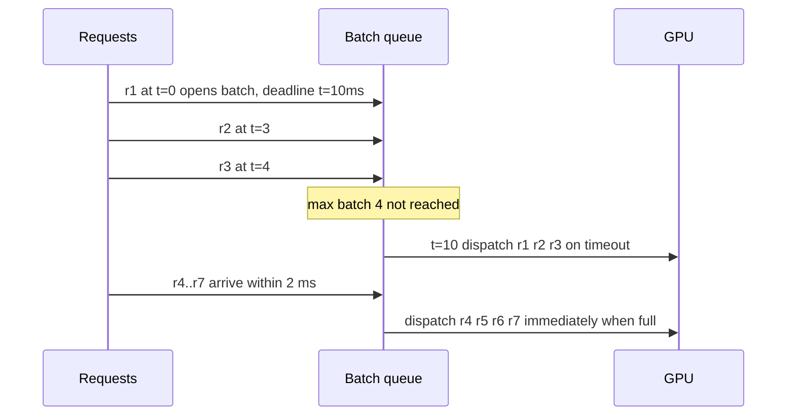

# Model servers, batching, autoscaling and caching

> **Before this lesson:** read [REST and gRPC serving with FastAPI](#/lesson/mlops/fastapi-grpc)
> (endpoints, workers, load shedding, goodput) and
> [Serving patterns: batch, online and streaming](#/lesson/mlops/serving-patterns) (latency,
> throughput, percentiles such as p99). A rough idea of what a GPU is helps; it is defined again
> below.

## In plain words

In the previous lesson you wrote a prediction service by hand. That works well for a small model on
an ordinary processor. Once a model needs a **GPU** (graphics processing unit, a chip that performs
the arithmetic of machine learning many times faster than a normal processor and costs far more),
or once one service must host several models, you usually reach for a **model server**: ready-made
software whose whole job is to load models, accept requests, group them efficiently, and report
what it is doing.

The everyday picture is an airport shuttle. Driving each traveller to the hotel in a private car
gives the fastest single trip and wastes a lot of fuel. A shuttle bus that leaves when it is full,
or every ten minutes even if half-empty, moves far more people per litre while keeping everyone's
wait bounded. Grouping requests into a **batch** is the shuttle. Deciding how many buses to run
during rush hour is **autoscaling**. Noticing that half the travellers go to the same three hotels
and printing their directions in advance is **caching**.

Why this matters for a job: GPU time is usually the largest line on an ML team's cloud bill, and
"our model server is slow at peak, what do you do?" is a classic interview question. Batching,
autoscaling and caching are the three levers you will be expected to reason about with numbers.

## When a hand-written API is not enough

A FastAPI app wrapping `model.predict` is a fine choice for small CPU models. When you serve GPU
models, several models at once, or need the hardware to stay busy, a **model server** pays for
itself. It handles loading and versioning models, grouping requests into batches, running work on
several GPUs at once, standard protocols (REST and gRPC) and metrics.

| Server | Sweet spot | Notable features |
|---|---|---|
| **TorchServe** | PyTorch models | `.mar` archives, custom handlers, batching, management API |
| **TensorFlow Serving** | TF SavedModels | version policies, batching, gRPC/REST |
| **NVIDIA Triton Inference Server** | multi-framework GPU serving | backends for TensorRT, ONNX Runtime, PyTorch, TF, Python; **dynamic batching**; concurrent model instances; model ensembles/pipelines; model repository with versions |
| **BentoML** | Python-first packaging and serving | "Bentos" (code + models + deps), adaptive batching, easy containerisation, BentoCloud |
| **Ray Serve** | composing many models/business logic in Python | deployments with replicas, autoscaling, `@serve.batch`, model composition graphs, runs on Ray clusters |
| **KServe** | Kubernetes-native serving layer | `InferenceService` CRD wrapping the servers above, scale-to-zero, canary (lesson 23) |
| **vLLM** | LLM text generation | PagedAttention, continuous batching, OpenAI-compatible API |
| **TGI** (Hugging Face Text Generation Inference) | LLMs | continuous batching, token streaming, powers HF Inference Endpoints |
| **llama.cpp / Ollama** | local and CPU/edge LLMs | GGUF quantized models |

A few names in the table need a sentence each. A **framework** is the library a model was built
with (PyTorch, TensorFlow). **ONNX** (Open Neural Network Exchange) is a framework-neutral file
format for models, and **ONNX Runtime** runs it. **TensorRT** is NVIDIA's compiler that rewrites a
model to run as fast as possible on its GPUs. A **backend** is the plug-in that runs one kind of
model inside Triton. An **ensemble** chains several models (for example a tokenizer, then a
classifier) into one call. An **LLM** (large language model) generates text one token at a time;
**PagedAttention** and **GGUF** are LLM-specific memory and file-format techniques covered in
lesson 34. A **CRD** (custom resource definition) is a way to teach Kubernetes a new kind of object
(lesson 23).

### A Triton model repository

Triton reads models from a folder layout called a **model repository**:

```text
model_repository/
└── churn_onnx/
    ├── config.pbtxt
    ├── 1/model.onnx
    └── 2/model.onnx
```

Each model has its own folder; each numbered subfolder is one version of it; `config.pbtxt` says
how to serve it.

```protobuf
# config.pbtxt
name: "churn_onnx"
platform: "onnxruntime_onnx"
max_batch_size: 64
input  [{ name: "features" data_type: TYPE_FP32 dims: [ 12 ] }]
output [{ name: "proba"    data_type: TYPE_FP32 dims: [ 1 ] }]
dynamic_batching { preferred_batch_size: [ 16, 32 ] max_queue_delay_microseconds: 5000 }
instance_group [{ count: 2 kind: KIND_GPU }]
version_policy: { latest { num_versions: 2 } }
```

Line by line:

- `platform: "onnxruntime_onnx"` tells Triton to run the file with ONNX Runtime.
- `max_batch_size: 64` allows up to 64 requests to be grouped into one call.
- `input` and `output` declare the tensors (arrays of numbers): 12 features in, one probability
  out, both as `TYPE_FP32`, 32-bit floating-point numbers.
- `dynamic_batching` turns on grouping. Triton prefers batches of 16 or 32 and lets a request wait
  at most 5,000 microseconds (5 ms) for companions before running anyway.
- `instance_group` loads two copies of the model on the GPU so two batches can run at once.
- `version_policy` keeps the two newest versions loaded, which makes a quick rollback possible.

### The same ideas in BentoML

BentoML expresses the same ideas in Python:

```python
import bentoml, numpy as np

@bentoml.service(resources={"cpu": "2"}, traffic={"timeout": 5})
class ChurnService:
    def __init__(self):
        self.model = bentoml.sklearn.load_model("churn:latest")

    @bentoml.api(batchable=True, max_batch_size=64, max_latency_ms=10)
    def predict(self, features: np.ndarray) -> np.ndarray:
        return self.model.predict_proba(features)[:, 1]
```

A **decorator** is the `@name(...)` line above a class or function; it wraps the thing below it
with extra behaviour. `@bentoml.service` declares a service that needs two CPU cores and gives up on
a request after 5 seconds. `__init__` loads the model once, from BentoML's own model store.
`@bentoml.api(batchable=True, max_batch_size=64, max_latency_ms=10)` lets BentoML merge concurrent
requests into one array of up to 64 rows, waiting at most 10 ms. Inside, `predict_proba(...)[:, 1]`
returns the probability of the positive class for every row at once.

## The two metrics: latency and throughput

- **Latency** is the time one request takes. Because requests differ, latency is a
  **distribution**, so look at **percentiles**: p50 (half of requests are faster), p95, p99, and
  not at the mean. Huyen's example (*AI Engineering*, ch. 9): ten requests, nine taking about
  100 ms and one taking 3,000 ms, have a mean of 390 ms, a number that describes none of them.
- **Throughput** is how many requests (or, for LLMs, tokens) the system completes per second.
- **Utilisation** is the fraction of the hardware's capacity doing useful work. It is the bridge to
  **cost**: an idle GPU costs as much per hour as a busy one.

The three pull against each other. Batching raises throughput and utilisation but adds waiting
time. Huyen also uses **goodput**, the throughput counting only requests that *meet the SLO*. A
server completing 100 requests per minute of which only 30 meet the latency objective has a goodput
of 30.

```python-run
import numpy as np
lat = np.array([100, 102, 100, 100, 99, 104, 110, 90, 3000, 95])
print("mean :", lat.mean())
for p in (50, 90, 95, 99):
    print(f"p{p}  :", np.percentile(lat, p, method="nearest"))
slo = 200
print(f"goodput fraction at SLO {slo} ms: {(lat <= slo).mean():.0%}")
```

`lat` holds ten latencies in milliseconds. `np.percentile(lat, p, method="nearest")` returns the
measured value nearest to the p-th percentile position, so it is always one of the real numbers.
`(lat <= slo)` produces an array of `True`/`False`, and its mean is the share of `True` values. The
output:

```text
mean : 390.0
p50  : 100
p90  : 110
p95  : 3000
p99  : 3000
goodput fraction at SLO 200 ms: 90%
```

The median says a typical user waits 100 ms; p95 and p99 reveal the one user who waited 3 seconds.
The mean (390 ms) describes nobody.

### Tail latency amplification

Many user requests **fan out**: one page load calls ten backend services in parallel and must wait
for the slowest. Suppose each call has a 1% chance of being slower than its own p99. The chance
that *all ten* are fast is $0.99^{10} \approx 0.904$, so about 9.6% of user requests hit at least
one slow call. Rare slowness in each part becomes common slowness for the whole. This is why the
p99 of every component matters, and why two defences exist: **timeouts with fallbacks**, and
**hedged requests**, where a second copy of a slow call is sent to another replica and whichever
answers first wins (Dean and Barroso, *The Tail at Scale*).

## Batching

A GPU (and well-written vectorised CPU code) can process a batch of 32 inputs in barely more time
than one input, because the same arithmetic runs on many numbers side by side. Huyen's comparison:
batching puts passengers on a bus instead of in separate cars. More people move per trip, but each
trip may start a little later.

- **Static batching** waits until exactly N requests have arrived. The first request waits for the
  last one; under low traffic it could wait forever.
- **Dynamic batching** sends the batch when it is full **or** when the oldest request has waited a
  maximum time, whichever comes first: a bus that leaves when full or on schedule. Waiting time
  stays bounded; at low load batches leave partly empty.
- **Continuous (in-flight) batching** is for LLMs. Answers have different lengths, so a fixed batch
  would hold short answers hostage until the longest finishes. Instead, as soon as one sequence
  completes it leaves the batch and a waiting request takes its slot. The idea comes from the Orca
  paper and is used by vLLM and TGI.

The sequence diagram follows a dynamic batcher with a maximum batch of 4 and a 10 ms wait.



The first batch leaves on the timer with three requests; the second leaves the instant it fills.

The simulation below measures the effect on one GPU. Each batch costs a fixed 8 ms plus 0.5 ms per
item, so a batch of 16 costs 16 ms where 16 single calls would cost 136 ms.

```python-run
import numpy as np
rng = np.random.default_rng(0)

def simulate(rate_rps, max_batch, max_wait_ms, n=4000, base_ms=8.0, per_item_ms=0.5):
    """Single GPU. Batch cost = base + per_item * size. Returns (throughput-capable?, p50, p95, mean batch)."""
    arrivals = np.cumsum(rng.exponential(1000 / rate_rps, n))
    lat, sizes, gpu_free, i = [], [], 0.0, 0
    while i < n:
        t0 = arrivals[i]
        start_earliest = max(t0, gpu_free)
        deadline = max(t0 + max_wait_ms, gpu_free)       # can keep collecting while GPU is busy
        j = i
        while j < n and j - i < max_batch and arrivals[j] <= deadline:
            j += 1
        dispatch = max(start_earliest, arrivals[j - 1]) if j - i == max_batch else deadline
        done = dispatch + base_ms + per_item_ms * (j - i)
        lat.extend(done - arrivals[i:j]); sizes.append(j - i)
        gpu_free, i = done, j
    return np.percentile(lat, 50), np.percentile(lat, 95), np.mean(sizes)

print("rate   config              p50      p95   mean batch")
for rate in (50, 400):
    for mb, mw in ((1, 0), (16, 5), (64, 20)):
        p50, p95, mbs = simulate(rate, mb, mw)
        print(f"{rate:4d}   batch<={mb:<2d} wait {mw:2d}ms   {p50:7.1f}  {p95:7.1f}   {mbs:5.1f}")
```

How it works: `rng.exponential(1000 / rate_rps, n)` draws random gaps between arrivals (the usual
model for independent users), and `np.cumsum` adds them up into arrival times. The loop opens a
batch at the first waiting request, collects later arrivals until the batch is full or the deadline
passes, and computes when the GPU finishes it. The deadline also stretches while the GPU is still
busy with the previous batch, since nothing could start earlier anyway. Each request's latency is
its finish time minus its arrival time. The output:

```text
rate   config              p50      p95   mean batch
  50   batch<=1  wait  0ms       8.5     21.7     1.0
  50   batch<=16 wait  5ms      13.5     16.2     1.3
  50   batch<=64 wait 20ms      28.5     29.5     2.0
 400   batch<=1  wait  0ms   12019.1  22951.6     1.0
 400   batch<=16 wait  5ms      15.4     20.8     4.2
 400   batch<=64 wait 20ms      24.2     33.5     9.1
```

At low load (50 requests per second) batching only adds waiting: the median goes from 8.5 ms to
28.5 ms. At high load (400 per second) the server without batching cannot keep up at all. Each
request costs 8.5 ms, so the GPU can do at most about 118 per second; the queue grows without limit
and the median wait reaches 12 seconds. Dynamic batching serves the same load with a p95 of 21 ms.
Tune `max_batch_size` to your GPU's memory and the maximum wait to your latency budget. You will
write the scheduler logic yourself in the problem `mlops-dynamic-batching`.

## Concurrency and replicas

- **Instances per GPU**: several copies of a small model can share one GPU (Triton's
  `instance_group`), so one copy computes while another is loading its next batch.
- **Replicas**: independent copies of the whole server, each on its own machine or GPU, sitting
  behind a **load balancer** that spreads requests across them.
- **Load-balancing rule**: **round-robin** (each replica in turn) is fine when requests cost about
  the same. **Least-outstanding-requests** (send to the replica with the fewest unfinished requests)
  is better when cost varies a lot, as with LLM requests of very different lengths.
- **Queueing**: put a limit on the queue and reject (429) beyond it. An unlimited queue turns
  overload into timeouts for everyone, as the load-shedding demo in lesson 20 showed.

## Autoscaling

**Autoscaling** changes the number of replicas automatically as load changes. Four design
questions:

1. **Which signal?** CPU utilisation works for CPU models. For GPU or LLM serving, prefer
   **concurrency** (requests in progress per replica), queue length, requests per second, or GPU
   utilisation. CPU usage says little about a server whose bottleneck is the GPU.
2. **How fast can capacity arrive?** A new replica needs a machine (minutes for GPU machines), the
   container image downloaded (slow for large images), the model loaded and warmed up. If the total
   is 5 minutes, autoscaling cannot absorb a 30-second spike. Keep **headroom** (run at 50-70% of
   capacity), use queues or asynchronous APIs, or **pre-scale** on a schedule before a known busy
   period.
3. **Scale to zero?** Running no replicas when nobody calls is great for cost on rarely used models
   (Knative and KServe serverless mode, KEDA). The price is **cold starts**: the first request after
   a quiet period waits for a replica to start.
4. **Stability**: scale up fast and scale down slowly, using a **stabilisation window** (a period
   the autoscaler must observe low load before removing replicas). Otherwise the count bounces up
   and down every minute, which is called **flapping**.

Kubernetes' **Horizontal Pod Autoscaler** (HPA, lesson 23), which you will simulate in the problem
`mlops-hpa-replicas`, uses this rule:

$$\text{desired} = \left\lceil \text{current} \times \frac{\text{current metric}}{\text{target metric}} \right\rceil$$

The brackets $\lceil\ \rceil$ mean "round up". Example: 4 replicas are running at 90% CPU and the
target is 60%. Desired = ceil(4 x 90 / 60) = ceil(6) = 6 replicas. Spreading the same work over 6
replicas brings each one down to 60%.

A simpler planning version asks how many replicas a given traffic level needs if each should stay
at a target utilisation:

```python-run
import math
def replicas_needed(rps, per_replica_rps, target_util=0.6, min_r=2):
    return max(min_r, math.ceil(rps / (per_replica_rps * target_util)))
for rps in (20, 120, 480, 900):
    print(f"{rps:4d} rps -> {replicas_needed(rps, 100)} replicas at 60% target utilisation (100 rps capacity each)")
```

Each replica can handle 100 requests per second, but we only want to load it to 60%, so it is
planned at 60. `math.ceil` rounds up and `max(min_r, ...)` never goes below 2 replicas, so one crash
does not take the service down. The output:

```text
  20 rps -> 2 replicas at 60% target utilisation (100 rps capacity each)
 120 rps -> 2 replicas at 60% target utilisation (100 rps capacity each)
 480 rps -> 8 replicas at 60% target utilisation (100 rps capacity each)
 900 rps -> 15 replicas at 60% target utilisation (100 rps capacity each)
```

## Caching

"The fastest inference is the one you do not run." A **cache** stores answers that were computed
before so a repeated question can be answered by lookup. A cache **hit** finds the answer; a
**miss** does not, and the real work runs.

- **Prediction cache**: key = a **hash** (a short fingerprint computed from data) of the model
  version plus the input, value = the output. Effective when inputs repeat (popular items, repeated
  queries). The **model version must be in the key**, so a newly deployed model never returns
  answers cached from the old one. Inputs must be **canonicalised**, written in one standard form
  (sorted field names, fixed number precision), so equal requests produce equal keys. The problem
  `mlops-feature-cache-key` practises this.
- **Feature cache**: store expensive feature lookups with a **TTL** (time to live: how long an
  entry stays valid) matched to how fresh the feature must be.
- **Embedding cache**: store embeddings of documents or items and recompute only when they change.
- **LLM-specific caches**: exact and semantic response caches, prompt prefix caching and the KV
  cache (module 12).

Cache design checklist:

- **TTL** and a **size limit**.
- **Eviction policy**, the rule for what to throw out when full. Huyen lists **LRU** (least recently
  used goes first), **LFU** (least frequently used goes first) and **FIFO** (first in, first out).
- **Invalidation** when the model or features change.
- **Stampede protection**: when a popular entry expires, thousands of requests may miss at once and
  all hit the model together. Let only one recompute while the others wait or get the old value.
- **Privacy**: never cache a personalised answer under a key another user could produce. Huyen warns
  about exactly this leak, where a user-specific response was cached as if it were generic.

The demo builds an LRU cache and measures its hit rate when item popularity is skewed.

```python-run
from collections import OrderedDict
import hashlib, json

class LRUCache:
    def __init__(self, capacity): self.cap, self.d, self.hits, self.miss = capacity, OrderedDict(), 0, 0
    def get(self, k):
        if k in self.d:
            self.d.move_to_end(k); self.hits += 1; return self.d[k]
        self.miss += 1; return None
    def put(self, k, v):
        self.d[k] = v; self.d.move_to_end(k)
        if len(self.d) > self.cap: self.d.popitem(last=False)

def key(version, features):
    canon = json.dumps({"v": version, "f": features}, sort_keys=True, separators=(",", ":"))
    return hashlib.sha256(canon.encode()).hexdigest()[:16]

import random
random.seed(0)
cache = LRUCache(100)
items = list(range(1000)); weights = [1 / (i + 1) for i in items]      # Zipf-like popularity
for _ in range(20000):
    item = random.choices(items, weights)[0]
    k = key("v7", {"item_id": item})
    if cache.get(k) is None:
        cache.put(k, 0.5)                                              # pretend we ran the model
print(f"hit rate with 100-entry LRU over 1000 items (skewed popularity): {cache.hits/(cache.hits+cache.miss):.0%}")
```

Line by line:

- An `OrderedDict` is a dictionary that remembers the order of its keys. `get` moves a found key to
  the end ("most recently used"); `put` adds a key at the end and, if the cache is over capacity,
  `popitem(last=False)` removes the key at the front, the least recently used one.
- `key` builds the canonical form with `json.dumps(..., sort_keys=True)`, so `{"a":1,"b":2}` and
  `{"b":2,"a":1}` give the same text, then hashes it with SHA-256 and keeps 16 hex characters.
- Popularity follows a **Zipf-like** curve: item `i` is chosen with weight `1/(i+1)`, so item 0 is
  twice as popular as item 1 and a thousand times as popular as item 999. Real catalogues usually
  look like this.

The output:

```text
hit rate with 100-entry LRU over 1000 items (skewed popularity): 57%
```

A cache holding 10% of the items answers more than half of all requests without running the model,
because popularity is skewed, as it usually is.

## Model-level speedups (preview)

Batching, replicas and caching leave the model itself untouched. Model-level techniques change it:

- **Quantization**: store weights with fewer bits, for example 32-bit floats (FP32) as 8-bit
  integers (INT8) or 16-bit floats (FP16). Smaller and faster, sometimes a little less accurate.
- **Pruning**: remove weights that contribute little.
- **Distillation**: train a small "student" model to imitate a large "teacher".
- **Graph compilation**: rewrite the model's computation for specific hardware (ONNX Runtime,
  TensorRT, OpenVINO, `torch.compile`).

Huyen (ch. 9) splits inference optimisation into exactly these two levels, service-level and
model-level; module 12 goes deeper for LLMs.

> [!INTERVIEW]
> "Your GPU model server has high latency at peak. What do you check?" — Is the GPU saturated or idle
> (utilisation, queue length)? Enable/tune **dynamic batching**; add instances/replicas; autoscale on
> concurrency or queue depth rather than CPU; shorten cold start (smaller image, pre-pulled, model on local
> disk); cache repeat requests; apply model-level optimisation (quantization, TensorRT); shed load beyond
> capacity. Frame it with p95/p99 and goodput rather than averages.

## Capacity planning: a worked example

*Requirement: 600 requests per second at peak, p95 under 150 ms, one model on GPUs. How many
replicas?*

1. **Measure** one replica under load with your real batching settings. Suppose a load test finds
   that p95 stays under 150 ms up to 220 requests per second and breaks beyond that. That breaking
   point is called the **knee** of the latency curve.
2. **Apply headroom**: plan to run at about 65% of the knee, to absorb bursts and the loss of a
   replica: roughly 140 requests per second per replica.
3. **Replicas for peak**: 600 / 140 is about 4.3, rounded up to 5.
4. **Failure tolerance (N+1)**: "N+1" means having one more replica than the load needs. With 5
   replicas, losing one leaves 4 x 220 = 880 requests per second of raw capacity, still above the
   peak. Clouds split each region into **availability zones** (separate data centres); if replicas
   are spread across three zones, check that losing a whole zone is survivable too.
5. **Scale-up time**: if a new GPU replica needs 4 minutes before it serves, the autoscaler must
   react well before saturation. Set its target at the 65% point and set `minReplicas` (the floor)
   high enough to cover the fastest ramp you expect.
6. **Cost check**: 5 GPUs at peak and fewer off-peak through autoscaling. Compare with a smaller or
   quantized model on fewer GPUs.

```python-run
import math
def plan(peak_rps, knee_rps, headroom=0.65, zones=3):
    per_replica = knee_rps * headroom
    n = math.ceil(peak_rps / per_replica)
    n_minus_one_ok = (n - 1) * knee_rps >= peak_rps
    per_zone = math.ceil(n / zones)
    zone_loss_ok = (n - per_zone) * knee_rps >= peak_rps
    return n, per_replica, n_minus_one_ok, zone_loss_ok
for peak in (150, 600, 2400):
    n, per, ok1, okz = plan(peak, 220)
    print(f"peak {peak:5d} rps -> {n:2d} replicas at ~{per:.0f} rps each | survives 1 replica loss: {ok1} | survives zone loss: {okz}")
```

`plan` turns the steps into code: the planned load per replica is 65% of the knee, `n` replicas
cover the peak, and two checks ask whether the remaining replicas still exceed the peak at full
(knee) capacity after losing one replica, or after losing the share of replicas in one zone. The
output:

```text
peak   150 rps ->  2 replicas at ~143 rps each | survives 1 replica loss: True | survives zone loss: True
peak   600 rps ->  5 replicas at ~143 rps each | survives 1 replica loss: True | survives zone loss: True
peak  2400 rps -> 17 replicas at ~143 rps each | survives 1 replica loss: True | survives zone loss: True
```

The method (find the knee by load testing, apply headroom, check failure scenarios) matters more
than the particular numbers. Never size from the *average* latency or the *average* traffic.

## Summary

- Model servers (Triton, TorchServe, BentoML, Ray Serve, vLLM, TGI) provide batching, concurrency,
  versioning, protocols and metrics.
- Track latency percentiles, throughput and utilisation; goodput counts only requests that meet the
  SLO.
- Dynamic batching bounds waiting time; continuous batching suits LLMs.
- Autoscale on a signal that reflects real load, allow for slow scale-up, and scale down
  conservatively.
- Cache with version-aware, canonical keys, and plan invalidation, stampedes and privacy.

## Glossary

- **GPU** - a chip specialised in the parallel arithmetic of machine learning.
- **Model server** - ready-made software for loading models and serving predictions efficiently.
- **Model repository** - a folder layout with one subfolder per model and per version.
- **ONNX / TensorRT** - a portable model file format / NVIDIA's GPU optimiser.
- **Utilisation** - the share of hardware capacity doing useful work.
- **Goodput** - throughput counting only requests that meet the SLO.
- **Fan-out / tail latency amplification** - one request calling many services / rare slowness in
  each part becoming common slowness overall.
- **Hedged request** - a duplicate call sent to another replica when the first is slow.
- **Static / dynamic / continuous batching** - wait for N requests / leave when full or on a timer
  / swap finished LLM sequences out mid-batch.
- **Replica / load balancer** - one running copy of a server / the component that spreads requests
  over replicas.
- **Autoscaling / HPA** - changing replica count with load / Kubernetes' built-in autoscaler.
- **Headroom** - spare capacity kept for bursts and failures.
- **Cold start** - the delay while a new replica starts and loads its model.
- **Stabilisation window / flapping** - a wait before scaling down / replica counts bouncing up and
  down.
- **Cache hit / miss** - the answer was / was not already stored.
- **TTL** - how long a cache entry stays valid.
- **LRU / LFU / FIFO** - eviction rules: least recently used, least frequently used, first in
  first out.
- **Cache stampede** - many simultaneous misses on one expired key.
- **Canonicalise** - rewrite data into one standard form so equal inputs look identical.
- **Quantization / pruning / distillation** - fewer bits per weight / removing weights / a small
  model imitating a large one.
- **Knee** - the load at which latency starts rising steeply.
- **N+1 / availability zone** - one spare replica beyond need / a separate data centre within a
  cloud region.

```quiz
[
  {"q": "What distinguishes dynamic batching from static batching?",
   "options": ["Dynamic batching uses larger batches always", "Dynamic batching dispatches when the batch is full OR a maximum wait time elapses", "Static batching is only for LLMs", "Dynamic batching disables the GPU queue"],
   "answer": 1, "explain": "The time limit keeps latency bounded when traffic is low."},
  {"q": "Why is the mean a poor summary of latency?",
   "options": ["It is hard to compute", "A few outliers distort it; percentiles describe what fractions of users experience", "It ignores fast requests", "It is always lower than p50"],
   "answer": 1, "explain": "One 3 s request among ten 100 ms requests gives a 390 ms mean that describes no request."},
  {"q": "What is goodput?",
   "options": ["Total tokens generated", "Throughput of requests that satisfy the SLO", "GPU memory utilisation", "Cache hit rate"],
   "answer": 1, "explain": "It excludes completed requests that were too slow to be useful."},
  {"q": "Which autoscaling signal is generally best for a GPU-bound model server?",
   "options": ["CPU utilisation", "Concurrency / queue length / GPU utilisation", "Disk usage", "Number of log lines"],
   "answer": 1, "explain": "CPU usage poorly reflects load when the GPU is the bottleneck."},
  {"q": "Why must a prediction cache key include the model version?",
   "options": ["To make keys longer", "Otherwise a newly deployed model would return predictions cached from the old one", "To speed hashing", "Because Redis requires it"],
   "answer": 1, "explain": "Version-aware keys make deployments invalidate old entries implicitly."},
  {"q": "A new GPU replica takes 5 minutes to become ready. How do you handle 30-second traffic spikes?",
   "options": ["Rely on autoscaling alone", "Keep headroom, queue or shed load, or pre-scale; autoscaling is too slow for the spike", "Reduce replicas", "Disable batching"],
   "answer": 1, "explain": "Reactive scaling cannot beat provisioning time."},
  {"q": "Continuous batching helps LLM serving because...",
   "options": ["All sequences have the same length", "Finished sequences leave the batch immediately and new requests take their place", "It removes the need for a GPU", "It increases the context window"],
   "answer": 1, "explain": "Short responses are not delayed by long ones and GPU slots stay full."},
  {"q": "4 replicas run at 90% CPU with an HPA target of 60%. How many replicas does the HPA formula ask for?",
   "options": ["4", "5", "6", "9"],
   "answer": 2, "explain": "ceil(4 x 90 / 60) = ceil(6.0) = 6; the same work spread over 6 replicas lands near 60% each."}
]
```

> **Source:** Chip Huyen, *AI Engineering*, ch. 9 (inference performance metrics: latency percentiles, throughput, goodput; batching: static, dynamic, continuous) and ch. 10 (caching, eviction policies, cache data-leak warning); NVIDIA Triton, TorchServe, BentoML, Ray Serve and vLLM documentation; Kubernetes documentation (*Horizontal Pod Autoscaling*); Dean & Barroso, *The Tail at Scale* (2013).
