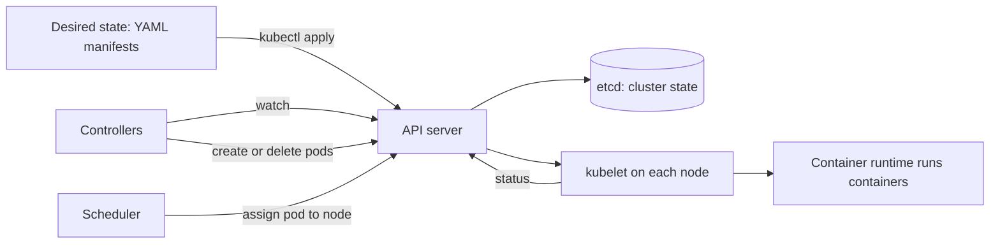

# Kubernetes core objects

> **Before this lesson:** read [Docker fundamentals: images, layers and the build cache](#/lesson/mlops/docker-fundamentals)
> for what a container and an image are, and [REST and gRPC serving with FastAPI](#/lesson/mlops/fastapi-grpc)
> for the `/healthz` and `/readyz` endpoints that Kubernetes probes. You should be able to read a
> short YAML file (lesson 5 introduced the format).

## In plain words

A **container** is a packaged program together with everything it needs to run (lesson 16). Docker
runs containers on one machine. A real product needs many machines, and someone must decide which
container runs on which machine, restart it when it crashes, move it when a machine dies, send
traffic only to healthy copies, swap in a new version without downtime, and add copies when traffic
grows. **Kubernetes** (often written **K8s**: K, eight letters, s) is the system that does all of
that automatically. Software in this role is called a **container orchestrator**.

The everyday picture is a thermostat. You do not switch the heater on and off yourself; you set
the temperature you want, and the thermostat keeps checking the room and acting until reality
matches. With Kubernetes you write down what you want ("three copies of the churn API, each with
half a CPU and 1 GB of memory, reachable at this name"), and it keeps checking the cluster and
acting until reality matches, forever.

Why this matters for a job: Kubernetes is the default platform for running ML services, batch jobs
and even training at most mid-size and large companies. An ML engineer is expected to read and
write its configuration files, understand why a pod is stuck or crashing, and explain health
probes in an interview. This lesson covers the core objects; the next adds autoscaling, GPUs and
KServe.

## What Kubernetes is for

Lubanovic (*FastAPI*, ch. 13) describes the change in mindset well: instead of telling the system
*how* to do each thing, you tell it *what you want*: keep this service running, add servers when
traffic spikes. That is the central idea of Kubernetes: **declarative desired state plus
reconciliation loops**.

- **Declarative** means you describe the end state, not the steps. The descriptions are files
  called **manifests**, usually written in YAML.
- A **reconciliation loop** is a program that forever compares the actual state with the desired
  state and acts to close the gap. These programs are called **controllers**.



Read it left to right: you send manifests to the API server with the `kubectl` command-line tool;
the API server stores them; controllers and the scheduler watch for changes and record their
decisions back through the API server; on each machine an agent called the kubelet starts the
containers and reports their status. Every component talks through the API server, never directly
to each other.

## Cluster architecture

A **cluster** is the whole set of machines Kubernetes manages. Each machine is a **node**.

- **Control plane** (the brain):
  - `kube-apiserver`, the only component everything talks to.
  - `etcd`, a reliable key-value store that holds the entire cluster state.
  - `kube-scheduler`, which picks a node for each new pod based on the resources it requests and
    on placement rules (affinities and taints, covered below).
  - `kube-controller-manager`, which runs the built-in controllers (for Deployments, ReplicaSets,
    Jobs, Nodes and more).
- **Worker nodes** (the muscle):
  - `kubelet`, which starts the containers for pods assigned to its node, runs their health
    probes and reports status.
  - a **container runtime** such as containerd, the low-level program that actually runs
    containers.
  - networking components (`kube-proxy` and a **CNI** plug-in, the Container Network Interface)
    that give pods addresses and route traffic between them.
- Cloud providers sell **managed Kubernetes** (EKS on AWS, GKE on Google Cloud, AKS on Azure) in
  which they run the control plane for you, so you only look after the worker nodes, or not even
  those.

## Pods

A **pod** is the smallest thing Kubernetes runs: one or more containers that are always placed
together on the same node, share one network identity (one IP address, and they reach each other
on `localhost`), and can share storage **volumes** (folders mounted into containers). Most pods
have one main container. Sometimes there are helpers:

- **Init containers** run to completion *before* the main container starts, for example to
  download model weights into a shared volume.
- **Sidecars** run *alongside* the main container for its whole life, for example a log shipper or
  a network proxy.

Pods are disposable. Engineers say they are "cattle, not pets": a pet server has a name and is
nursed back to health; cattle are numbered and replaced. A recreated pod gets a new name and a new
IP address, and you almost never create a bare pod yourself. A controller creates and replaces pods
for you.

## Deployments and ReplicaSets

A **Deployment** says "keep N identical copies (**replicas**) of this pod running" and manages
**rolling updates**, replacing old pods with new ones a few at a time. Under the hood a Deployment
owns one **ReplicaSet** per version of the pod template, and each ReplicaSet owns its pods.

Here is a realistic Deployment for the churn API. It looks long, so we read it in parts afterwards.

```yaml
apiVersion: apps/v1
kind: Deployment
metadata:
  name: churn-api
  labels: {app: churn-api}
spec:
  replicas: 3
  selector:
    matchLabels: {app: churn-api}
  strategy:
    type: RollingUpdate
    rollingUpdate: {maxSurge: 1, maxUnavailable: 0}   # add one new pod before removing an old one
  template:
    metadata:
      labels: {app: churn-api, version: "9f3c1e2"}
      annotations:
        prometheus.io/scrape: "true"
        prometheus.io/port: "8000"
    spec:
      securityContext: {runAsNonRoot: true, runAsUser: 10001}
      terminationGracePeriodSeconds: 30
      containers:
        - name: api
          image: ghcr.io/acme/churn-api@sha256:77ab...        # deploy by digest
          ports: [{containerPort: 8000, name: http}]
          envFrom:
            - configMapRef: {name: churn-config}
            - secretRef: {name: churn-secrets}
          resources:
            requests: {cpu: "500m", memory: "1Gi"}
            limits:   {memory: "2Gi"}
          startupProbe:                 # give a slow model load up to 30 x 5 s before other probes begin
            httpGet: {path: /readyz, port: http}
            periodSeconds: 5
            failureThreshold: 30
          readinessProbe:               # failing -> removed from Service endpoints (no traffic)
            httpGet: {path: /readyz, port: http}
            periodSeconds: 5
            failureThreshold: 3
          livenessProbe:                # failing -> container restarted
            httpGet: {path: /healthz, port: http}
            periodSeconds: 10
            failureThreshold: 3
          lifecycle:
            preStop: {exec: {command: ["sleep", "5"]}}   # let endpoints update before SIGTERM
```

Reading it in parts:

- **Header.** `apiVersion` and `kind` say what sort of object this is. `metadata.name` names it.
  `{app: churn-api}` is YAML's short inline form of a dictionary.
- **`spec.replicas: 3`** is the desired number of pods.
- **`selector.matchLabels`** tells the Deployment which pods belong to it: those labelled
  `app: churn-api`.
- **`strategy`** controls rolling updates. `maxSurge: 1` allows one pod above the desired count
  during an update; `maxUnavailable: 0` forbids dropping below it. Together: start one new pod, wait
  until it is ready, then remove one old pod, and repeat.
- **`template`** is the pod blueprint. Its labels must match the selector. The `version` label
  records which code it runs. **Annotations** are non-identifying notes for other tools; these tell
  Prometheus to collect metrics from port 8000.
- **`securityContext`** refuses to run the container as the all-powerful `root` user.
- **`terminationGracePeriodSeconds: 30`** gives the app 30 seconds to finish in-flight requests
  after being asked to stop (the SIGTERM signal from lesson 20) before it is killed.
- **`image: ...@sha256:77ab...`** pins the image by **digest**, a fingerprint of its exact contents
  (lesson 16). A tag such as `:latest` can be moved to different contents; a digest cannot.
- **`envFrom`** turns every key of a ConfigMap and a Secret (both explained below) into environment
  variables.
- **`resources`**, the three **probes** and **`preStop`** each get their own section next.

### Labels and selectors

**Labels** are key-value tags attached to objects (`app: churn-api`). **Selectors** are queries
that match labels. This loose coupling is how a Deployment finds its pods and how a Service (below)
finds its back-end pods. If `selector.matchLabels` and the template labels disagree, nothing
matches: a classic cause of the "my Service has no endpoints" bug.

### Probes: get these right for ML

A **probe** is a health check the kubelet runs against a container on a timer, here an HTTP `GET`
to a path. Kubernetes has three, and they answer different questions:

| Probe | Question | On failure |
|---|---|---|
| **startupProbe** | has the app finished starting? | keep waiting (other probes disabled); restart after threshold |
| **readinessProbe** | can it serve traffic now? | removed from Service endpoints; not restarted |
| **livenessProbe** | is it deadlocked/broken? | container restarted |

In the manifest, the startup probe checks `/readyz` every 5 seconds and tolerates 30 failures, so a
model has up to 150 seconds to load. Only after it succeeds do the other two probes begin. The
readiness probe then keeps checking `/readyz`; three failures in a row take the pod out of traffic
without killing it. The liveness probe checks the cheap `/healthz` every 10 seconds; three failures
restart the container.

ML services often need a long time to load a model. Without a startup probe, or with an impatient
liveness probe, Kubernetes kills the pod halfway through loading, starts it again, kills it again,
forever. That state is called **CrashLoopBackOff**. Keep liveness checks cheap and independent of
other services: if liveness depended on the database and the database hiccupped for ten seconds,
Kubernetes would restart *every* pod at once and turn a blip into an outage.

`preStop: sleep 5` delays shutdown by 5 seconds so that traffic routing has time to stop sending
new requests to a pod that is about to stop.

### Requests and limits

- **Requests** are what the scheduler reserves for the pod. It places a pod only on a node with that
  much unreserved capacity, and the HPA (lesson 23) measures CPU utilisation as a percentage of the
  request. `cpu: "500m"` means 500 **millicores**, half a CPU core; `1Gi` is one gibibyte
  (1,073,741,824 bytes) of memory.
- **Limits** are hard caps. A container that exceeds its **memory** limit is killed by the system,
  shown as **OOMKilled** (out of memory). A container that exceeds its **CPU** limit is
  **throttled**, slowed down, which inflates tail latency. Many teams therefore set CPU requests but
  no CPU limit on latency-sensitive services, as the manifest above does.
- Kubernetes sorts pods into three **QoS** (quality of service) classes: *Guaranteed* (requests
  equal limits), *Burstable* (some requests set) and *BestEffort* (nothing set). When a node runs
  short of memory, BestEffort pods are evicted first.

The demo imitates the scheduler's core job, placing pods by their requests, with a simple
**first-fit** rule: try nodes in order and take the first with enough room.

```python-run
# Tiny scheduler: first-fit placement by CPU/memory requests.
nodes = {"node-a": {"cpu": 4000, "mem": 16}, "node-b": {"cpu": 4000, "mem": 16}}
pods = [("churn-api-1", 500, 1), ("churn-api-2", 500, 1), ("trainer", 3500, 12), ("embedder", 3000, 14), ("big", 3800, 8)]
free = {n: dict(v) for n, v in nodes.items()}
for name, cpu, mem in pods:
    placed = None
    for n in sorted(free):
        if free[n]["cpu"] >= cpu and free[n]["mem"] >= mem:
            free[n]["cpu"] -= cpu; free[n]["mem"] -= mem; placed = n; break
    print(f"{name:12s} requests cpu={cpu:4d}m mem={mem:2d}Gi -> {placed or 'Pending (Insufficient resources)'}")
print("free:", free)
```

Each node starts with 4,000 millicores and 16 GiB. `free` is a copy that the loop subtracts from.
For each pod, the inner loop checks the nodes in name order and places the pod on the first that
still has enough CPU *and* memory. The output:

```text
churn-api-1  requests cpu= 500m mem= 1Gi -> node-a
churn-api-2  requests cpu= 500m mem= 1Gi -> node-a
trainer      requests cpu=3500m mem=12Gi -> node-b
embedder     requests cpu=3000m mem=14Gi -> node-a
big          requests cpu=3800m mem= 8Gi -> Pending (Insufficient resources)
free: {'node-a': {'cpu': 0, 'mem': 0}, 'node-b': {'cpu': 500, 'mem': 4}}
```

The trainer does not fit on node-a (only 3,000 millicores left there), so it goes to node-b. The
last pod needs 3,800 millicores, and although the cluster has 500 free in total on node-b, no
single node has enough. It stays **Pending**. In a real cluster a pod stuck in `Pending` nearly
always means no node satisfies its requests or its placement rules, and `kubectl describe pod`
prints the scheduler's reason.

## Services

Pods come and go and change IP addresses, so other programs need a fixed address to call. A
**Service** provides one: a stable virtual IP address and a **DNS** name (DNS is the internet's
naming system, which turns names into addresses), such as
`churn-api.default.svc.cluster.local`. The Service spreads traffic across the *ready* pods that
match its selector; that current list of pods is called its **endpoints**.

```yaml
apiVersion: v1
kind: Service
metadata: {name: churn-api}
spec:
  type: ClusterIP
  selector: {app: churn-api}
  ports: [{name: http, port: 80, targetPort: http}]
```

This Service selects pods labelled `app: churn-api` and forwards its port 80 to the container port
named `http` (8000 in the Deployment). Other pods in the cluster can now call
`http://churn-api/predict`.

| Type | Reachable from | Use |
|---|---|---|
| `ClusterIP` (default) | inside the cluster | service-to-service |
| `NodePort` | node IP:port | debugging, simple setups |
| `LoadBalancer` | internet/VPC via cloud load balancer | exposing one service |
| headless (`clusterIP: None`) | DNS returns pod IPs | StatefulSets, client-side balancing (gRPC) |

A **VPC** (virtual private cloud) is your private network inside a cloud provider. To accept web
traffic from outside, an **Ingress** or the newer **Gateway API** routes external HTTP(S) requests
by host name and path to Services and handles TLS encryption. A separate **controller** program
(NGINX, Traefik, a cloud load balancer, Istio) does the actual routing.

> [!NOTE]
> gRPC keeps one long-lived HTTP/2 connection open. A ClusterIP Service balances *connections* (this
> is called layer-4, or L4, balancing), so each client sticks to one pod for good. To balance gRPC per
> *request*, use a headless Service with balancing in the client, or a layer-7 (L7) proxy or a
> **service mesh** (a layer of proxies that handles traffic between all services).

## Configuration: ConfigMaps and Secrets

Settings should live outside the image so the same image can run in staging and production. A
**ConfigMap** holds ordinary settings; a **Secret** holds sensitive ones such as passwords.

```yaml
apiVersion: v1
kind: ConfigMap
metadata: {name: churn-config}
data:
  CHURN_MODEL_URI: "models:/churn@champion"
  CHURN_LOG_LEVEL: "INFO"
---
apiVersion: v1
kind: Secret
metadata: {name: churn-secrets}
type: Opaque
stringData:
  MLFLOW_TRACKING_PASSWORD: "change-me"
```

The `---` line separates two objects in one file. With `envFrom` in the Deployment, the container
sees `CHURN_MODEL_URI`, `CHURN_LOG_LEVEL` and `MLFLOW_TRACKING_PASSWORD` as environment variables.

A Secret is less secret than its name suggests: by default it is only **base64-encoded**, a
reversible text encoding that anyone can decode. Enable **encryption at rest** in etcd, restrict who
can read Secrets with **RBAC** (role-based access control, Kubernetes' permission system), and
preferably sync them from a real secret manager (External Secrets Operator, the CSI secrets store).
Never commit Secret manifests with real values to Git; tools such as Sealed Secrets or SOPS encrypt
them for Git-based workflows.

## Other workload types you will meet

- **Job**: runs pods until they finish successfully (a training run, a batch scoring run), retrying
  failures up to `backoffLimit` times.
- **CronJob**: creates a Job on a schedule (nightly scoring).
- **StatefulSet**: pods with stable names and their own persistent storage (databases, some
  distributed training setups).
- **DaemonSet**: exactly one pod on every node (log collectors, the NVIDIA device plugin, node
  metric exporters).

```yaml
apiVersion: batch/v1
kind: CronJob
metadata: {name: churn-batch-score}
spec:
  schedule: "0 2 * * *"
  concurrencyPolicy: Forbid
  jobTemplate:
    spec:
      backoffLimit: 2
      template:
        spec:
          restartPolicy: Never
          containers:
            - name: score
              image: ghcr.io/acme/churn@sha256:77ab...
              args: ["python", "-m", "churn.score", "--date", "$(DATE)"]
```

`schedule` uses **cron syntax**: five fields for minute, hour, day of month, month and day of week.
`"0 2 * * *"` means minute 0 of hour 2, every day: 02:00. `concurrencyPolicy: Forbid` skips a run
if yesterday's is still going, so two scoring runs never overlap. `backoffLimit: 2` allows two
retries, and `restartPolicy: Never` creates a fresh pod for each retry instead of restarting the
container in place.

A few more objects: **Namespaces** divide one cluster into separate areas (per team or per
environment) with their own quotas and permissions. A **PersistentVolumeClaim** (PVC) requests
durable storage that survives pod restarts. **Helm** (templated "charts") and **Kustomize**
(patches layered on a base) manage manifests across environments, as shown at the end of this
lesson.

## Rolling updates and rollbacks

Changing the pod template, for example to a new image digest, starts a **rollout**: the new
ReplicaSet scales up while the old one scales down, and each step waits for readiness probes. With
`maxUnavailable: 0`, serving capacity never drops.

```bash
kubectl apply -f k8s/                          # declare desired state
kubectl rollout status deployment/churn-api   # watch the rollout
kubectl rollout history deployment/churn-api
kubectl rollout undo deployment/churn-api     # roll back to the previous ReplicaSet
```

`apply` sends every manifest in the `k8s/` folder; `rollout status` waits and reports progress;
`rollout history` lists previous versions; `rollout undo` switches back to the previous ReplicaSet.

A readiness probe that says OK before the model is loaded defeats this whole safety net, because
traffic moves to pods that cannot serve. Readiness must mean *ready*.

## kubectl survival kit

```bash
kubectl get pods -o wide -l app=churn-api
kubectl describe pod <pod>                    # events: scheduling, pulls, probe failures, OOMKilled
kubectl logs <pod> -f --previous              # logs; --previous shows the crashed container's logs
kubectl exec -it <pod> -- sh
kubectl port-forward svc/churn-api 8000:80    # reach a ClusterIP service from your laptop
kubectl top pods                              # CPU/memory usage (needs metrics-server)
kubectl get events --sort-by=.lastTimestamp
kubectl diff -f k8s/                          # what would change?
```

In order: list the API's pods with their nodes (`-l` filters by label); show a pod's details and
recent events; stream logs (`-f` follows, `--previous` shows the container that crashed); open a
shell inside a container; forward a local port to a Service; show live resource use; list recent
cluster events; preview what `apply` would change.

| Symptom | Likely cause |
|---|---|
| `Pending` | insufficient CPU/memory/GPU, unsatisfied node selector/taint, unbound PVC |
| `ImagePullBackOff` | wrong image name/tag, missing registry credentials |
| `CrashLoopBackOff` | app exits on start (bad config, missing env/secret) or liveness kills slow start |
| `OOMKilled` | memory limit too low for model + batch |
| Running but no traffic | readiness failing, or Service selector does not match labels |

> [!INTERVIEW]
> "Explain liveness vs readiness vs startup probes for a model server." — Startup protects slow model
> loading from premature restarts; readiness gates traffic until the model is loaded and warm (and removes
> the pod during temporary overload); liveness restarts a hung process and should be cheap and free of
> external dependencies. Then mention `maxUnavailable: 0` rolling updates and `rollout undo`.

## Worked example: following a rollout and a failure

Watching the controllers at work makes the ideas concrete. Deploy a new image and watch the two
ReplicaSets (`-w` means watch for changes):

```text
$ kubectl set image deployment/churn-api api=ghcr.io/acme/churn-api@sha256:9c1d...
$ kubectl get rs -l app=churn-api -w
NAME                    DESIRED   CURRENT   READY
churn-api-6d5f7c9b8     3         3         3        # old ReplicaSet
churn-api-7b8c6d4f5     1         1         0        # new ReplicaSet: surge of 1 (maxSurge=1)
churn-api-7b8c6d4f5     1         1         1        # new pod passed readiness
churn-api-6d5f7c9b8     2         2         2        # only now is one old pod removed (maxUnavailable=0)
churn-api-7b8c6d4f5     2         2         1
...
churn-api-6d5f7c9b8     0         0         0
churn-api-7b8c6d4f5     3         3         3
```

Now the failing case: the new image cannot load its model because of a typo in the model name.

```text
$ kubectl rollout status deployment/churn-api --timeout=120s
Waiting for deployment "churn-api" rollout to finish: 1 out of 3 new replicas have been updated...
error: timed out waiting for the condition

$ kubectl get pods -l app=churn-api
NAME                         READY   STATUS             RESTARTS      AGE
churn-api-6d5f7c9b8-2xk7p    1/1     Running            0             3d
churn-api-6d5f7c9b8-8hmq4    1/1     Running            0             3d
churn-api-6d5f7c9b8-tz9wd    1/1     Running            0             3d
churn-api-7b8c6d4f5-lp2vn    0/1     CrashLoopBackOff   4 (30s ago)   2m

$ kubectl logs churn-api-7b8c6d4f5-lp2vn --previous | tail -2
mlflow.exceptions.MlflowException: Registered Model with name=chrun not found
$ kubectl rollout undo deployment/churn-api
```

Because `maxUnavailable: 0` and the new pod never became Ready, **all three old pods kept
serving**, and users noticed nothing. That is the protection a truthful readiness probe buys, and it
is why deployment pipelines run `kubectl rollout status` with a timeout and roll back on failure.
`CrashLoopBackOff` means the container keeps exiting and the kubelet restarts it with growing
delays (10 s, 20 s, 40 s and so on, capped at 5 minutes). The `--previous` logs reveal the cause:
`chrun` instead of `churn`.

## Scheduling controls you will use for ML

| Mechanism | Purpose | Example |
|---|---|---|
| `nodeSelector` / node affinity | require or prefer nodes with certain labels | run on `gpu=a10` nodes |
| Taints + tolerations | keep pods *off* nodes unless they opt in | GPU nodes tainted so only GPU workloads land there |
| Pod anti-affinity / topology spread | spread replicas across nodes and zones | survive a node or zone failure |
| Priority classes | decide who is evicted under pressure | serving outranks batch training |
| Resource quotas / limit ranges | cap what a namespace may request | team GPU budgets |

Plain-words versions: **node affinity** says "put me on nodes with this label". A **taint** on a
node repels pods, and only pods carrying a matching **toleration** may land there. **Anti-affinity**
and **topology spread** keep replicas apart so one failure cannot take them all. A **priority
class** decides who is evicted first when space runs out.

```yaml
spec:
  priorityClassName: serving-critical
  topologySpreadConstraints:
    - maxSkew: 1
      topologyKey: topology.kubernetes.io/zone
      whenUnsatisfiable: ScheduleAnyway
      labelSelector: {matchLabels: {app: churn-api}}
```

This pod-spec fragment gives the API a high priority and asks the scheduler to spread
`app: churn-api` pods across zones so that no zone has more than one pod more than any other
(`maxSkew: 1`). `ScheduleAnyway` means "prefer this, but do not leave a pod Pending over it".

## Managing manifests across environments

Copy-pasting YAML for each environment brings back the old problem of configurations that slowly
drift apart. Two standard tools solve it.

**Kustomize** keeps a base plus **overlays** that patch it, and is built into `kubectl`:

```text
k8s/
├── base/{deployment.yaml,service.yaml,kustomization.yaml}
└── overlays/
    ├── staging/kustomization.yaml       # replicas: 1, staging config
    └── production/kustomization.yaml    # replicas: 3, HPA, PDB, production config
```

```yaml
# k8s/overlays/production/kustomization.yaml
resources: ["../../base", "hpa.yaml", "pdb.yaml"]
images:
  - name: ghcr.io/acme/churn-api
    digest: sha256:9c1d...                 # CD updates only this line
replicas:
  - {name: churn-api, count: 3}
configMapGenerator:
  - name: churn-config
    literals: ["CHURN_LOG_LEVEL=WARNING", "CHURN_MODEL_URI=models:/churn/12"]
```

The production overlay pulls in the base plus two extra files (an autoscaler and a **PDB**, a pod
disruption budget that limits how many pods maintenance may take down at once), pins the image
digest, sets three replicas and generates the ConfigMap. Apply it with
`kubectl apply -k k8s/overlays/production`. The generated ConfigMap gets a content-hash suffix in
its name, so a configuration change produces a new name and **triggers a rolling update
automatically**. Without that, pods would keep running with stale environment variables until
something restarted them.

**Helm** packages manifests as templated **charts** with a `values.yaml` file per environment, and
keeps a release history for rollback (`helm upgrade --install churn ./chart -f values-prod.yaml`,
`helm rollback churn 3`). Most third-party software (Prometheus, MLflow, KServe) is distributed as
Helm charts.

### Security basics for ML workloads

- **RBAC**: give the CI system an account that can update Deployments in one namespace and nothing
  else.
- **Pod security**: `runAsNonRoot`, `readOnlyRootFilesystem`, drop Linux capabilities, no privilege
  escalation.
- **NetworkPolicies** (firewall rules between pods): the model service may call the feature store
  and the registry, and nothing else.
- **Workload identity**: let pods access cloud services through their Kubernetes identity instead
  of static keys stored in Secrets.
- **Image policy**: run only signed images from your own registry.

## Summary

- Kubernetes reconciles declared desired state: API server, etcd, scheduler, controllers, kubelets.
- Pods are disposable; Deployments manage replicas and rolling updates; Services provide stable
  names and load balancing; Ingress exposes HTTP to the outside.
- Requests drive scheduling; exceeding a memory limit kills the container; exceeding a CPU limit
  throttles it.
- Startup, readiness and liveness probes are critical for slow-loading models.
- ConfigMaps and Secrets inject configuration; Jobs and CronJobs run batch work.

## Glossary

- **Container orchestrator** - software that runs and heals containers across many machines.
- **Cluster / node** - all machines Kubernetes manages / one of them.
- **Manifest** - a YAML file describing desired state.
- **Controller / reconciliation loop** - a program that keeps moving actual state toward desired
  state.
- **Control plane** - API server, etcd, scheduler and controller manager.
- **kubelet** - the agent on each node that runs pods and probes.
- **Pod** - one or more containers scheduled together, sharing network and volumes.
- **Init container / sidecar** - runs before the main container / runs beside it.
- **Deployment / ReplicaSet** - keeps N pods running and rolls out versions / one version's set of
  pods.
- **maxSurge / maxUnavailable** - how many pods above / below the desired count a rollout may use.
- **Label / selector / annotation** - a tag / a query over tags / a note for tools.
- **Digest** - a fingerprint that identifies one exact image.
- **Startup / readiness / liveness probe** - has it started / can it take traffic / is it alive.
- **CrashLoopBackOff** - a container that keeps exiting and is restarted with growing delays.
- **Request / limit** - reserved resources / hard cap. **OOMKilled / throttled** - killed for memory
  / slowed for CPU.
- **Millicore** - one thousandth of a CPU core.
- **Service / endpoints** - a stable name and address for a set of pods / the ready pods behind it.
- **Ingress / Gateway API** - routing of outside HTTP traffic to Services.
- **ConfigMap / Secret** - ordinary / sensitive settings injected into pods.
- **RBAC** - role-based access control.
- **Job / CronJob / StatefulSet / DaemonSet** - run to completion / on a schedule / stable identity
  and storage / one per node.
- **Namespace / PVC** - a partition of the cluster / a request for durable storage.
- **Taint / toleration / affinity** - repels pods / lets a pod ignore a taint / attracts pods.
- **Kustomize / Helm** - patch-based / template-based manifest management.

```quiz
[
  {"q": "What is the core operating principle of Kubernetes?",
   "options": ["Imperative scripts run once", "Declarative desired state continuously reconciled by controllers", "Manual SSH to nodes", "Polling Docker Hub"],
   "answer": 1, "explain": "You declare what you want; control loops make reality match."},
  {"q": "A model takes 90 seconds to load. Which probe prevents Kubernetes from killing the pod during startup?",
   "options": ["livenessProbe", "startupProbe", "readinessProbe", "preStop hook"],
   "answer": 1, "explain": "The startup probe holds off liveness/readiness checks until startup completes."},
  {"q": "What happens when a container exceeds its memory limit?",
   "options": ["It is throttled", "It is OOMKilled", "It is moved to another node", "Nothing"],
   "answer": 1, "explain": "Memory is incompressible; CPU over-limit is throttled instead."},
  {"q": "A Service has no endpoints even though pods are Running. The most likely cause is...",
   "options": ["etcd is full", "The Service selector does not match pod labels, or pods are not Ready", "The image is too large", "The Deployment has too many replicas"],
   "answer": 1, "explain": "Services route only to Ready pods matching the selector."},
  {"q": "What does a failing readiness probe cause?",
   "options": ["Container restart", "Pod removal from Service endpoints without restart", "Node drain", "Image re-pull"],
   "answer": 1, "explain": "Readiness controls traffic; liveness controls restarts."},
  {"q": "Which object runs a nightly batch scoring task?",
   "options": ["Deployment", "CronJob", "Service", "ConfigMap"],
   "answer": 1, "explain": "CronJobs create Jobs on a schedule."},
  {"q": "Why can a liveness probe that checks the database make outages worse?",
   "options": ["It uses too much CPU", "A database blip makes all pods fail liveness and restart simultaneously", "It leaks secrets", "It disables readiness"],
   "answer": 1, "explain": "Liveness should reflect the process's own health, not dependencies."},
  {"q": "With rollingUpdate maxSurge=1 and maxUnavailable=0 on 3 replicas, during a rollout the number of ready pods is at least...",
   "options": ["0", "2", "3", "4"],
   "answer": 2, "explain": "No old pod is removed until a new one is ready, so capacity never drops below 3."}
]
```

> **Source:** Kubernetes documentation (*Concepts: Pods, Deployments, Services, ConfigMaps, Secrets, Jobs*; *Configure liveness, readiness and startup probes*; *Resource management for pods and containers*); Bill Lubanovic, *FastAPI*, ch. 13 (Kubernetes); Burns et al., *Kubernetes: Up and Running*.
