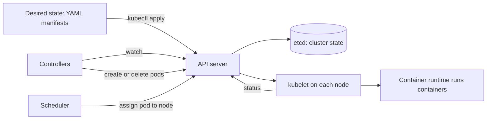

# Kubernetes core objects

## What Kubernetes is for

Docker runs containers on one machine. Production needs many machines, and someone has to decide which
container runs where, restart it when it crashes, replace it when a node dies, route traffic to healthy
copies, roll out new versions without downtime and add copies under load. **Kubernetes (K8s)** automates
all of that. As Lubanovic puts it (*FastAPI*, ch. 13), the shift is from telling the system *how* to do
things to telling it *what you want* — keep this service running, add servers when traffic spikes.

That is the central idea: **declarative desired state + reconciliation loops**. You submit objects
(YAML) describing the desired state; controllers continuously compare actual state with desired state
and act to close the gap.



## Cluster architecture

- **Control plane**: `kube-apiserver` (the only component everything talks to), `etcd` (consistent
  key-value store holding all cluster state), `kube-scheduler` (chooses a node for each new pod based on
  resource requests, affinities, taints), `kube-controller-manager` (runs controllers: Deployment,
  ReplicaSet, Job, Node...).
- **Nodes** (workers): `kubelet` (starts containers for pods assigned to the node, runs probes, reports
  status), a container runtime (containerd), and `kube-proxy`/CNI for networking.
- Managed offerings (EKS, GKE, AKS) run the control plane for you.

## Pods

A **pod** is the smallest deployable unit: one or more containers that share a network namespace (one IP,
`localhost` between them) and can share volumes. Usually one main container per pod, sometimes with
helpers: **init containers** (run to completion before the main container — e.g., download model
weights) and **sidecars** (log shippers, proxies).

Pods are **ephemeral cattle**: they get a new IP every time they are recreated, and you almost never
create bare pods — a controller manages them.

## Deployments and ReplicaSets

A **Deployment** declares "run N replicas of this pod template" and manages **rolling updates**. It owns
ReplicaSets (one per template version), which own pods.

```yaml
apiVersion: apps/v1
kind: Deployment
metadata:
  name: churn-api
  labels: {app: churn-api}
spec:
  replicas: 3
  selector:
    matchLabels: {app: churn-api}
  strategy:
    type: RollingUpdate
    rollingUpdate: {maxSurge: 1, maxUnavailable: 0}   # add one new pod before removing an old one
  template:
    metadata:
      labels: {app: churn-api, version: "9f3c1e2"}
      annotations:
        prometheus.io/scrape: "true"
        prometheus.io/port: "8000"
    spec:
      securityContext: {runAsNonRoot: true, runAsUser: 10001}
      terminationGracePeriodSeconds: 30
      containers:
        - name: api
          image: ghcr.io/acme/churn-api@sha256:77ab...        # deploy by digest
          ports: [{containerPort: 8000, name: http}]
          envFrom:
            - configMapRef: {name: churn-config}
            - secretRef: {name: churn-secrets}
          resources:
            requests: {cpu: "500m", memory: "1Gi"}
            limits:   {memory: "2Gi"}
          startupProbe:                 # give a slow model load up to 30 x 5 s before other probes begin
            httpGet: {path: /readyz, port: http}
            periodSeconds: 5
            failureThreshold: 30
          readinessProbe:               # failing -> removed from Service endpoints (no traffic)
            httpGet: {path: /readyz, port: http}
            periodSeconds: 5
            failureThreshold: 3
          livenessProbe:                # failing -> container restarted
            httpGet: {path: /healthz, port: http}
            periodSeconds: 10
            failureThreshold: 3
          lifecycle:
            preStop: {exec: {command: ["sleep", "5"]}}   # let endpoints update before SIGTERM
```

### Labels and selectors

Labels are key-value tags; selectors match on them. This loose coupling is how a Deployment finds its
pods and how a Service finds its backends. A mismatch between `selector.matchLabels` and the template
labels is a classic "my Service has no endpoints" bug.

### Probes — get these right for ML

| Probe | Question | On failure |
|---|---|---|
| **startupProbe** | has the app finished starting? | keep waiting (other probes disabled); restart after threshold |
| **readinessProbe** | can it serve traffic now? | removed from Service endpoints; not restarted |
| **livenessProbe** | is it deadlocked/broken? | container restarted |

ML services often take a long time to load a model. Without a startup probe (or with too-aggressive
liveness settings), Kubernetes kills the pod mid-load, forever: a **CrashLoopBackOff**. Keep liveness
checks cheap and independent of downstream dependencies — if liveness depends on the database and the
database blips, Kubernetes restarts all your pods and makes the outage worse.

### Requests and limits

- **Requests**: what the scheduler reserves for the pod; used for bin-packing and as the denominator for
  HPA CPU utilisation.
- **Limits**: hard caps. Exceeding the **memory** limit gets the container **OOMKilled**; exceeding the
  **CPU** limit gets it **throttled** (which inflates tail latency — many teams set CPU requests but no
  CPU limit for latency-sensitive services).
- QoS classes: *Guaranteed* (requests = limits), *Burstable*, *BestEffort* — the last is evicted first
  under node pressure.

```python-run
# Tiny scheduler: first-fit placement by CPU/memory requests.
nodes = {"node-a": {"cpu": 4000, "mem": 16}, "node-b": {"cpu": 4000, "mem": 16}}
pods = [("churn-api-1", 500, 1), ("churn-api-2", 500, 1), ("trainer", 3500, 12), ("embedder", 3000, 14), ("big", 3800, 8)]
free = {n: dict(v) for n, v in nodes.items()}
for name, cpu, mem in pods:
    placed = None
    for n in sorted(free):
        if free[n]["cpu"] >= cpu and free[n]["mem"] >= mem:
            free[n]["cpu"] -= cpu; free[n]["mem"] -= mem; placed = n; break
    print(f"{name:12s} requests cpu={cpu:4d}m mem={mem:2d}Gi -> {placed or 'Pending (Insufficient resources)'}")
print("free:", free)
```

A pod stuck in `Pending` almost always means no node satisfies its requests (or its node
selector/tolerations) — `kubectl describe pod` shows the scheduler's reason.

## Services

Pods come and go; a **Service** gives a stable virtual IP and DNS name (`churn-api.default.svc.cluster.local`)
and load-balances across the *ready* pods matching its selector.

```yaml
apiVersion: v1
kind: Service
metadata: {name: churn-api}
spec:
  type: ClusterIP
  selector: {app: churn-api}
  ports: [{name: http, port: 80, targetPort: http}]
```

| Type | Reachable from | Use |
|---|---|---|
| `ClusterIP` (default) | inside the cluster | service-to-service |
| `NodePort` | node IP:port | debugging, simple setups |
| `LoadBalancer` | internet/VPC via cloud load balancer | exposing one service |
| headless (`clusterIP: None`) | DNS returns pod IPs | StatefulSets, client-side balancing (gRPC) |

**Ingress** / **Gateway API** route external HTTP(S) by host and path to Services and terminate TLS,
via a controller (NGINX, Traefik, cloud ALB, Istio).

> [!NOTE]
> gRPC uses long-lived HTTP/2 connections, so connection-level (L4) balancing by a ClusterIP Service pins
> each client to one pod. Use a headless Service with client-side balancing, or an L7 proxy / service
> mesh, to balance gRPC per request.

## Configuration: ConfigMaps and Secrets

```yaml
apiVersion: v1
kind: ConfigMap
metadata: {name: churn-config}
data:
  CHURN_MODEL_URI: "models:/churn@champion"
  CHURN_LOG_LEVEL: "INFO"
---
apiVersion: v1
kind: Secret
metadata: {name: churn-secrets}
type: Opaque
stringData:
  MLFLOW_TRACKING_PASSWORD: "change-me"
```

Secrets are only base64-encoded by default — enable encryption at rest, restrict with RBAC, and prefer
syncing from a real secret manager (External Secrets Operator, CSI secrets store). Never commit Secret
manifests with real values to Git (use Sealed Secrets or SOPS for GitOps).

## Other workload types you will meet

- **Job**: run pods to completion (a training run, a batch scoring run), with retries (`backoffLimit`).
- **CronJob**: Jobs on a schedule (nightly scoring).
- **StatefulSet**: stable identities and per-pod storage (databases, some distributed training setups).
- **DaemonSet**: one pod per node (log collectors, the NVIDIA device plugin, node exporters).

```yaml
apiVersion: batch/v1
kind: CronJob
metadata: {name: churn-batch-score}
spec:
  schedule: "0 2 * * *"
  concurrencyPolicy: Forbid
  jobTemplate:
    spec:
      backoffLimit: 2
      template:
        spec:
          restartPolicy: Never
          containers:
            - name: score
              image: ghcr.io/acme/churn@sha256:77ab...
              args: ["python", "-m", "churn.score", "--date", "$(DATE)"]
```

**Namespaces** partition a cluster (per team or environment) with their own quotas and RBAC.
**PersistentVolumeClaims** request durable storage. **Helm** (templated charts) and **Kustomize**
(overlays) manage manifests across environments.

## Rolling updates and rollbacks

Changing the pod template (e.g., a new image digest) triggers a rollout: new ReplicaSet scales up, old
scales down, gated by readiness probes. With `maxUnavailable: 0`, capacity never drops.

```bash
kubectl apply -f k8s/                          # declare desired state
kubectl rollout status deployment/churn-api   # watch the rollout
kubectl rollout history deployment/churn-api
kubectl rollout undo deployment/churn-api     # roll back to the previous ReplicaSet
```

A readiness probe that returns OK before the model is loaded defeats this safety: traffic shifts to pods
that cannot serve. Readiness must mean *ready*.

## kubectl survival kit

```bash
kubectl get pods -o wide -l app=churn-api
kubectl describe pod <pod>                    # events: scheduling, pulls, probe failures, OOMKilled
kubectl logs <pod> -f --previous              # logs; --previous shows the crashed container's logs
kubectl exec -it <pod> -- sh
kubectl port-forward svc/churn-api 8000:80    # reach a ClusterIP service from your laptop
kubectl top pods                              # CPU/memory usage (needs metrics-server)
kubectl get events --sort-by=.lastTimestamp
kubectl diff -f k8s/                          # what would change?
```

| Symptom | Likely cause |
|---|---|
| `Pending` | insufficient CPU/memory/GPU, unsatisfied node selector/taint, unbound PVC |
| `ImagePullBackOff` | wrong image name/tag, missing registry credentials |
| `CrashLoopBackOff` | app exits on start (bad config, missing env/secret) or liveness kills slow start |
| `OOMKilled` | memory limit too low for model + batch |
| Running but no traffic | readiness failing, or Service selector does not match labels |

> [!INTERVIEW]
> "Explain liveness vs readiness vs startup probes for a model server." — Startup protects slow model
> loading from premature restarts; readiness gates traffic until the model is loaded and warm (and removes
> the pod during temporary overload); liveness restarts a hung process and should be cheap and free of
> external dependencies. Then mention `maxUnavailable: 0` rolling updates and `rollout undo`.

## Worked example: following a rollout and a failure

Watching what the controllers do makes the abstractions concrete. Deploy a new image and observe:

```text
$ kubectl set image deployment/churn-api api=ghcr.io/acme/churn-api@sha256:9c1d...
$ kubectl get rs -l app=churn-api -w
NAME                    DESIRED   CURRENT   READY
churn-api-6d5f7c9b8     3         3         3        # old ReplicaSet
churn-api-7b8c6d4f5     1         1         0        # new ReplicaSet: surge of 1 (maxSurge=1)
churn-api-7b8c6d4f5     1         1         1        # new pod passed readiness
churn-api-6d5f7c9b8     2         2         2        # only now is one old pod removed (maxUnavailable=0)
churn-api-7b8c6d4f5     2         2         1
...
churn-api-6d5f7c9b8     0         0         0
churn-api-7b8c6d4f5     3         3         3
```

Now the failing case: the new image cannot load its model (wrong URI).

```text
$ kubectl rollout status deployment/churn-api --timeout=120s
Waiting for deployment "churn-api" rollout to finish: 1 out of 3 new replicas have been updated...
error: timed out waiting for the condition

$ kubectl get pods -l app=churn-api
NAME                         READY   STATUS             RESTARTS      AGE
churn-api-6d5f7c9b8-2xk7p    1/1     Running            0             3d
churn-api-6d5f7c9b8-8hmq4    1/1     Running            0             3d
churn-api-6d5f7c9b8-tz9wd    1/1     Running            0             3d
churn-api-7b8c6d4f5-lp2vn    0/1     CrashLoopBackOff   4 (30s ago)   2m

$ kubectl logs churn-api-7b8c6d4f5-lp2vn --previous | tail -2
mlflow.exceptions.MlflowException: Registered Model with name=chrun not found
$ kubectl rollout undo deployment/churn-api
```

Because `maxUnavailable: 0` and the new pod never became Ready, **all three old pods kept serving** —
users noticed nothing. This is the protection the readiness probe buys you, and it is why CD pipelines
run `kubectl rollout status` with a timeout and roll back on failure. `CrashLoopBackOff` means the
container keeps exiting and the kubelet restarts it with exponentially increasing delays (10 s, 20 s,
40 s... capped at 5 minutes).

## Scheduling controls you will use for ML

| Mechanism | Purpose | Example |
|---|---|---|
| `nodeSelector` / node affinity | require or prefer nodes with certain labels | run on `gpu=a10` nodes |
| Taints + tolerations | keep pods *off* nodes unless they opt in | GPU nodes tainted so only GPU workloads land there |
| Pod anti-affinity / topology spread | spread replicas across nodes and zones | survive a node or zone failure |
| Priority classes | decide who is evicted under pressure | serving outranks batch training |
| Resource quotas / limit ranges | cap what a namespace may request | team GPU budgets |

```yaml
spec:
  priorityClassName: serving-critical
  topologySpreadConstraints:
    - maxSkew: 1
      topologyKey: topology.kubernetes.io/zone
      whenUnsatisfiable: ScheduleAnyway
      labelSelector: {matchLabels: {app: churn-api}}
```

## Managing manifests across environments

Copy-pasting YAML per environment recreates the "drifting config" problem. Two standard tools:

**Kustomize** — a base plus overlays that patch it, built into `kubectl`:

```text
k8s/
├── base/{deployment.yaml,service.yaml,kustomization.yaml}
└── overlays/
    ├── staging/kustomization.yaml       # replicas: 1, staging config
    └── production/kustomization.yaml    # replicas: 3, HPA, PDB, production config
```

```yaml
# k8s/overlays/production/kustomization.yaml
resources: ["../../base", "hpa.yaml", "pdb.yaml"]
images:
  - name: ghcr.io/acme/churn-api
    digest: sha256:9c1d...                 # CD updates only this line
replicas:
  - {name: churn-api, count: 3}
configMapGenerator:
  - name: churn-config
    literals: ["CHURN_LOG_LEVEL=WARNING", "CHURN_MODEL_URI=models:/churn/12"]
```

`kubectl apply -k k8s/overlays/production`. The generated ConfigMap gets a content-hash suffix, so a
config change produces a new name and **triggers a rolling update automatically** — otherwise pods keep
running with stale environment variables until something restarts them.

**Helm** — templated charts with a `values.yaml` per environment, plus release history and rollback
(`helm upgrade --install churn ./chart -f values-prod.yaml`, `helm rollback churn 3`). Most third-party
software (Prometheus, MLflow, KServe) is distributed as Helm charts.

### Security basics for ML workloads

- **RBAC**: give CI a service account that can update Deployments in one namespace, nothing else.
- **Pod security**: `runAsNonRoot`, `readOnlyRootFilesystem`, drop capabilities, no privilege
  escalation.
- **NetworkPolicies**: the model service may call the feature store and registry; nothing else.
- **Workload identity** for cloud access instead of static keys in Secrets.
- **Image policy**: only signed images from your registry.

## Summary

- Kubernetes reconciles declared desired state: API server, etcd, scheduler, controllers, kubelets.
- Pods are ephemeral; Deployments manage replicas and rolling updates; Services provide stable discovery
  and load balancing; Ingress exposes HTTP.
- Requests drive scheduling; memory limits OOM-kill; CPU limits throttle.
- Startup/readiness/liveness probes are critical for slow-loading models.
- ConfigMaps and Secrets inject config; Jobs/CronJobs run batch work.

```quiz
[
  {"q": "What is the core operating principle of Kubernetes?",
   "options": ["Imperative scripts run once", "Declarative desired state continuously reconciled by controllers", "Manual SSH to nodes", "Polling Docker Hub"],
   "answer": 1, "explain": "You declare what you want; control loops make reality match."},
  {"q": "A model takes 90 seconds to load. Which probe prevents Kubernetes from killing the pod during startup?",
   "options": ["livenessProbe", "startupProbe", "readinessProbe", "preStop hook"],
   "answer": 1, "explain": "The startup probe holds off liveness/readiness checks until startup completes."},
  {"q": "What happens when a container exceeds its memory limit?",
   "options": ["It is throttled", "It is OOMKilled", "It is moved to another node", "Nothing"],
   "answer": 1, "explain": "Memory is incompressible; CPU over-limit is throttled instead."},
  {"q": "A Service has no endpoints even though pods are Running. The most likely cause is...",
   "options": ["etcd is full", "The Service selector does not match pod labels, or pods are not Ready", "The image is too large", "The Deployment has too many replicas"],
   "answer": 1, "explain": "Services route only to Ready pods matching the selector."},
  {"q": "What does a failing readiness probe cause?",
   "options": ["Container restart", "Pod removal from Service endpoints without restart", "Node drain", "Image re-pull"],
   "answer": 1, "explain": "Readiness controls traffic; liveness controls restarts."},
  {"q": "Which object runs a nightly batch scoring task?",
   "options": ["Deployment", "CronJob", "Service", "ConfigMap"],
   "answer": 1, "explain": "CronJobs create Jobs on a schedule."},
  {"q": "Why can a liveness probe that checks the database make outages worse?",
   "options": ["It uses too much CPU", "A database blip makes all pods fail liveness and restart simultaneously", "It leaks secrets", "It disables readiness"],
   "answer": 1, "explain": "Liveness should reflect the process's own health, not dependencies."},
  {"q": "With rollingUpdate maxSurge=1 and maxUnavailable=0 on 3 replicas, during a rollout the number of ready pods is at least...",
   "options": ["0", "2", "3", "4"],
   "answer": 2, "explain": "No old pod is removed until a new one is ready, so capacity never drops below 3."}
]
```

> **Source:** Kubernetes documentation (*Concepts: Pods, Deployments, Services, ConfigMaps, Secrets, Jobs*; *Configure liveness, readiness and startup probes*; *Resource management for pods and containers*); Bill Lubanovic, *FastAPI*, ch. 13 (Kubernetes); Burns et al., *Kubernetes: Up and Running*.
