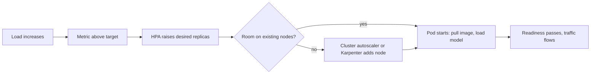
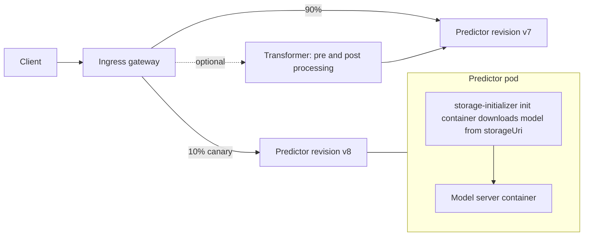

# Scaling, GPUs and KServe on Kubernetes

> **Before this lesson:** read [Kubernetes core objects](#/lesson/mlops/k8s-core) (pods,
> Deployments, requests and limits, probes, taints) and
> [Model servers, batching, autoscaling and caching](#/lesson/mlops/model-servers) (why we
> autoscale, headroom, cold starts and the HPA formula).

## In plain words

The previous lesson showed how Kubernetes keeps a fixed number of copies of a service running. Real
traffic is not fixed: it doubles at lunchtime and nearly vanishes at night. This lesson covers three
things ML teams add on top of the basics:

1. **Autoscaling**: letting Kubernetes change the number of copies, and even the number of
   machines, as load changes.
2. **GPUs**: asking for these expensive chips, keeping other work off them, and sharing them.
3. **KServe**: a Kubernetes add-on that turns "serve this model file from this storage bucket" into
   about fifteen lines of configuration, with autoscaling and gradual rollouts built in.

An everyday picture: a supermarket opens more checkout lanes when queues grow (adding pods), calls
in staff from home when every lane is open and queues still grow (adding machines), and closes
lanes when the shop is quiet, though not the moment one lane is empty, or it would be opening and
closing them all day. Some lanes have special equipment, such as the pharmacy counter, and only
certain customers are sent there (GPU nodes).

Why this matters for a job: GPU machines often cost tens of dollars per hour, and they take minutes
to start. Teams that scale them badly either waste money all night or make users wait every
morning. Interviewers ask how the autoscaler decides, which metric to scale a GPU service on, and
what scale-to-zero costs you.

## Three kinds of autoscaling

| Autoscaler | Scales | Based on |
|---|---|---|
| **Horizontal Pod Autoscaler (HPA)** | number of pod replicas | CPU/memory utilisation, custom or external metrics |
| **Vertical Pod Autoscaler (VPA)** | a pod's CPU/memory requests | observed usage (recommendation or automatic) |
| **Cluster Autoscaler / Karpenter** | number (and type) of nodes | pending pods that cannot be scheduled; underused nodes |

"Horizontal" means more copies; "vertical" means bigger copies. The **Cluster Autoscaler** and
**Karpenter** (a newer, faster node provisioner that started at AWS) add and remove whole
machines.

They work as a chain: load rises, so the HPA adds pods; the new pods are `Pending` because the nodes
are full; the cluster autoscaler adds a node; the pods are scheduled, download their image, load the
model and become Ready. For GPU nodes the whole chain can take several minutes, which is why
headroom matters (lesson 21).



## The Horizontal Pod Autoscaler

The HPA is itself a Kubernetes object. This one manages the `churn-api` Deployment from lesson 22.

```yaml
apiVersion: autoscaling/v2
kind: HorizontalPodAutoscaler
metadata: {name: churn-api}
spec:
  scaleTargetRef: {apiVersion: apps/v1, kind: Deployment, name: churn-api}
  minReplicas: 3
  maxReplicas: 30
  metrics:
    - type: Resource
      resource:
        name: cpu
        target: {type: Utilization, averageUtilization: 60}     # % of the CPU *request*
    - type: Pods
      pods:
        metric: {name: http_requests_in_flight}                  # custom metric via an adapter
        target: {type: AverageValue, averageValue: "8"}
  behavior:
    scaleUp:
      stabilizationWindowSeconds: 0
      policies: [{type: Percent, value: 100, periodSeconds: 30}] # at most double every 30 s
    scaleDown:
      stabilizationWindowSeconds: 300                            # wait 5 min of lower recommendations
      policies: [{type: Pods, value: 2, periodSeconds: 60}]
```

Reading it:

- `scaleTargetRef` names the Deployment whose replica count the HPA controls.
- `minReplicas` and `maxReplicas` are the floor and ceiling.
- `metrics` lists two signals. The first aims for average CPU use of 60% of each pod's CPU
  *request*. The second is a **custom metric**, the number of requests currently being processed
  per pod, aiming for 8. Custom metrics reach the HPA through an **adapter**, such as the Prometheus
  Adapter, that translates monitoring data into the form Kubernetes expects.
- `behavior` shapes the speed. Scale-up reacts at once but at most doubles the count every 30
  seconds. Scale-down waits for 5 minutes of lower recommendations and then removes at most 2 pods
  per minute.

### The algorithm

Every **sync period** (15 seconds by default) the controller computes, for each metric:

$$\text{desiredReplicas} = \left\lceil \text{currentReplicas} \times \frac{\text{currentMetricValue}}{\text{desiredMetricValue}} \right\rceil$$

The idea is proportional: if pods are working at twice the target, you need twice as many pods. A
few refinements:

- If the ratio is within a **tolerance** of 1.0 (10% by default), nothing changes. This prevents
  constant tiny adjustments.
- With several metrics, the **largest** desired count wins, so the busiest signal is respected.
- The result is **clamped** (forced into the range) to `[minReplicas, maxReplicas]`.
- **Scale-down stabilisation**: the controller remembers its recent recommendations and uses the
  *highest* one in the window (300 s by default). A brief dip therefore does not remove pods you
  will need again a minute later.
- CPU *utilisation* is measured against the pod's CPU **request**: no request, no utilisation
  metric.
- Pods that are not yet Ready are treated cautiously so that freshly starting pods do not distort
  the average.

The demo applies the formula with and without a stabilisation window to the same load pattern.

```python-run
import math
from collections import deque

def hpa(initial, metrics, target, min_r, max_r, window):
    cur, recent, out = initial, deque(maxlen=window), []
    for m in metrics:
        rec = cur if abs(m - target) * 10 <= target else max(min_r, min(max_r, math.ceil(cur * m / target)))
        recent.append(rec)
        cur = rec if rec > cur else min(cur, max(recent))
        out.append(cur)
    return out

# per-pod CPU% observed each period: a spike then a quiet spell with one blip
load = [60, 120, 150, 90, 40, 35, 80, 30, 30, 30, 30, 30]
print("metric  :", load)
print("no window:", hpa(4, load, 60, 2, 20, 1))
print("window=4 :", hpa(4, load, 60, 2, 20, 4))
```

Line by line:

- `deque(maxlen=window)` is a list that keeps only the last `window` items; older ones fall off.
- `rec` is this period's recommendation. `abs(m - target) * 10 <= target` is the 10% tolerance
  written without decimals: if the metric is within 10% of the target, keep the current count.
  Otherwise apply the formula and clamp between 2 and 20.
- `cur = rec if rec > cur else min(cur, max(recent))`: scaling *up* happens at once; scaling
  *down* only goes as low as the highest recommendation still in the window.

The output:

```text
metric  : [60, 120, 150, 90, 40, 35, 80, 30, 30, 30, 30, 30]
no window: [4, 8, 20, 20, 14, 9, 12, 6, 3, 2, 2, 2]
window=4 : [4, 8, 20, 20, 20, 20, 20, 20, 20, 20, 10, 10]
```

(The load list is fixed in advance to keep the demo short; in a real cluster adding pods would also
lower the per-pod metric.) Without a window the count jumps around with every blip: 20, 14, 9,
then back up to 12 for one busy period. With a window, scale-up is still instant, but scale-down
waits for a sustained drop. You will implement this logic in the problem `mlops-hpa-replicas`.

### Choosing metrics for ML services

- **CPU utilisation**: fine for CPU-bound models whose cost per request is steady.
- **Requests per second or in-flight requests per pod**: a better stand-in for load, and essential
  for GPU-bound servers where CPU says nothing. Exposed through the Prometheus Adapter or **KEDA**
  (Kubernetes Event-Driven Autoscaling, an add-on that scales from many external signals).
- **Queue length or consumer lag** (KEDA has scalers for Kafka, SQS and RabbitMQ): suits
  asynchronous workers, and allows **scale to zero** when the queue is empty.
- **GPU utilisation or time spent waiting in the batch queue**, from NVIDIA's **DCGM** exporter (a
  program that publishes GPU metrics) or from the model server's own metrics.

> [!WARNING]
> Do not let HPA and VPA both act on CPU/memory for the same workload — they fight each other. A common
> split: HPA on a custom metric (RPS/concurrency), VPA in recommendation mode to right-size requests.

Planned interruptions, such as node upgrades or the autoscaler removing a node, are called
**voluntary disruptions**. Protect availability during them with a **PodDisruptionBudget**
(`minAvailable: 2` means "never take me below two running pods on purpose"), and spread replicas
across nodes and zones with **topology spread constraints** (lesson 22).

## GPUs on Kubernetes

Kubernetes knows about CPU and memory out of the box but not about GPUs. The **NVIDIA device
plugin** teaches it: it runs on every GPU node and advertises the GPUs as an **extended resource**
named `nvidia.com/gpu`. It is usually installed by the **NVIDIA GPU Operator**, which also installs
the GPU **drivers** (the low-level software that lets the operating system use the card), the
container toolkit that exposes GPUs inside containers, and the DCGM exporter.

```yaml
spec:
  nodeSelector: {node.kubernetes.io/instance-type: g5.xlarge}
  tolerations:
    - {key: nvidia.com/gpu, operator: Exists, effect: NoSchedule}   # GPU nodes are tainted to keep other pods off
  containers:
    - name: llm
      image: vllm/vllm-openai:v0.5.3
      args: ["--model", "/models/mistral-7b", "--max-model-len", "8192"]
      resources:
        limits:
          nvidia.com/gpu: 1          # whole GPUs only; requests default to limits
          memory: 32Gi
      volumeMounts: [{name: models, mountPath: /models}, {name: shm, mountPath: /dev/shm}]
  volumes:
    - {name: models, persistentVolumeClaim: {claimName: model-cache}}
    - {name: shm, emptyDir: {medium: Memory}}                        # PyTorch dataloaders need shared memory
```

Reading it:

- `nodeSelector` picks nodes of the AWS **instance type** `g5.xlarge` (a machine size with one
  NVIDIA A10G GPU).
- The `tolerations` entry lets this pod onto nodes carrying the `nvidia.com/gpu` taint, which keeps
  ordinary pods away from expensive GPU machines.
- The container runs vLLM, an LLM server, with a 7-billion-parameter model read from `/models`.
- `nvidia.com/gpu: 1` asks for one whole GPU.
- Two volumes are mounted: a PersistentVolumeClaim holding cached model weights, and an
  `emptyDir` in memory mounted at `/dev/shm`, the **shared memory** area that PyTorch worker
  processes use to pass data to each other. The default is tiny, and running out of it causes
  confusing crashes.

Key facts:

- GPUs are requested in **whole units** via `limits` and are not **overcommitted** (promised to
  more pods than exist) by default.
- **Taints and tolerations** keep non-GPU pods off expensive GPU nodes; **node selectors or
  affinity** choose the GPU type.
- **Sharing** one GPU among several small workloads raises utilisation. *Time-slicing* lets pods
  take turns, with no memory isolation between them. *MPS* (Multi-Process Service) lets several
  processes run on the GPU at the same time. *MIG* (Multi-Instance GPU) splits supported cards
  (A100, H100) into isolated hardware slices.
- **Batch scheduling**: a distributed training job with 8 workers is useless if only 5 can start.
  **Gang scheduling** starts all workers or none. **Kueue** and **Volcano** add queues and gang
  scheduling; the **Kubeflow Training Operator** provides objects such as `PyTorchJob`.
- **Cold start**: GPU images and model weights are huge. Pre-pull images onto nodes, cache weights
  on node-local disks or on a shared volume that many pods can read (a ReadWriteMany volume), and
  use startup probes.

## KServe

**KServe** is an add-on that defines a new Kubernetes object type, `InferenceService`, through a
CRD (custom resource definition). Writing one `InferenceService` creates everything needed to serve
a model: the Deployment, the networking, the autoscaling. It wraps standard serving **runtimes**
(scikit-learn, XGBoost, ONNX, Triton, TorchServe, Hugging Face and vLLM-based LLM runtimes) and adds
autoscaling, canary rollouts and a standard request protocol.

```yaml
apiVersion: serving.kserve.io/v1beta1
kind: InferenceService
metadata:
  name: churn
  annotations:
    serving.kserve.io/deploymentMode: Serverless     # Knative-based; or RawDeployment (plain Deployment + HPA)
spec:
  predictor:
    minReplicas: 1            # 0 enables scale-to-zero in serverless mode
    maxReplicas: 10
    scaleTarget: 8            # target concurrent requests per replica
    scaleMetric: concurrency
    canaryTrafficPercent: 10  # send 10% to the latest revision, 90% to the previous one
    model:
      modelFormat: {name: sklearn}
      storageUri: s3://acme-models/churn/v8/
      resources:
        requests: {cpu: "1", memory: 2Gi}
        limits: {memory: 4Gi}
  transformer:                # optional pre/post-processing container
    containers:
      - name: kserve-container
        image: ghcr.io/acme/churn-transformer@sha256:1c2d...
```

Reading it:

- `deploymentMode: Serverless` runs the service on **Knative**, a Kubernetes add-on for
  request-driven services that can scale to zero. `RawDeployment` would use a plain Deployment and
  an HPA instead.
- The `predictor` is the part that runs the model. It scales between 1 and 10 replicas, aiming for
  8 requests in progress per replica.
- `canaryTrafficPercent: 10` sends 10% of traffic to the newest **revision** (each change to the
  spec creates a new, numbered revision) and 90% to the previous one.
- `modelFormat: sklearn` picks the scikit-learn runtime, and `storageUri` says where the model files
  are. No Docker image is written for the predictor at all.
- The optional `transformer` is your own container that converts raw requests into model inputs and
  model outputs into responses.



What KServe gives you:

- **Storage initializer**: an init container that downloads the model from `storageUri` (S3, GCS,
  Azure, a PVC, the Hugging Face Hub or an OCI image) into the pod before the server starts, the
  "mount the model, do not bake it in" pattern from lesson 17.
- **Standard protocols**: the V1 protocol (`/v1/models/<name>:predict`) and the **Open Inference
  Protocol (V2)** over REST and gRPC, shared with Triton and others, plus OpenAI-compatible
  endpoints for LLM runtimes.
- **Autoscaling**: based on request concurrency (Knative's autoscaler) with **scale-to-zero**, or
  HPA/KEDA in raw deployment mode.
- **Canary rollouts**: `canaryTrafficPercent` splits traffic between the last good revision and the
  new one. Promote by removing the field; roll back by setting it to 0.
- **Components**: the predictor, an optional **transformer** (pre- and post-processing) and an
  optional **explainer** (which returns reasons for a prediction).
- **InferenceGraph** chains or combines several models; **ModelMesh** packs many small models
  densely into shared servers.

```bash
kubectl apply -f churn-isvc.yaml
kubectl get inferenceservice churn          # READY, URL, traffic split
curl -s -H "Host: churn.default.example.com" http://$INGRESS/v1/models/churn:predict \
     -d '{"instances": [[12, 59.9, 1, 0]]}'
```

The first command creates the service; the second shows whether it is ready, its URL and the
current traffic split; the third sends one prediction request. The `Host` header tells the shared
ingress gateway which service the request is for.

Alternatives in the same space: **Seldon Core**, **Ray Serve on KubeRay**, **BentoML with Yatai**,
and the managed endpoints of SageMaker, Vertex AI and Azure ML, which provide similar abstractions
without running a cluster yourself (lesson 30).

## Scale-to-zero economics

Scale-to-zero removes every replica after an idle period and starts one again on the next request.
When does that save money, and what does it cost users?

```python-run
# When does scale-to-zero pay off? (illustrative)
gpu_cost_per_hour = 1.20
cold_start_s = 75                       # node ready + image pull + model load
for requests_per_hour in (2, 20, 200, 2000):
    avg_gap_s = 3600 / requests_per_hour
    idle_timeout_s = 300                # scale to zero after 5 idle minutes
    # crude: fraction of hours the replica must be up
    up_fraction = min(1.0, (idle_timeout_s + 30) * requests_per_hour / 3600) if avg_gap_s > idle_timeout_s else 1.0
    cold_fraction = 1.0 if avg_gap_s > idle_timeout_s else 0.0
    print(f"{requests_per_hour:5d} req/h: always-on ${gpu_cost_per_hour*24:5.2f}/day  "
          f"scale-to-zero ~${gpu_cost_per_hour*24*up_fraction:5.2f}/day  "
          f"requests hitting a {cold_start_s}s cold start: {cold_fraction:.0%}")
```

For each traffic level the code computes the average gap between requests. If the gap is longer
than the 5-minute idle timeout, the replica shuts down between requests: it is up for roughly the
timeout plus 30 seconds after each request, and every request finds it cold. If the gap is shorter,
the replica never gets a chance to shut down. The output:

```text
    2 req/h: always-on $28.80/day  scale-to-zero ~$ 5.28/day  requests hitting a 75s cold start: 100%
   20 req/h: always-on $28.80/day  scale-to-zero ~$28.80/day  requests hitting a 75s cold start: 0%
  200 req/h: always-on $28.80/day  scale-to-zero ~$28.80/day  requests hitting a 75s cold start: 0%
 2000 req/h: always-on $28.80/day  scale-to-zero ~$28.80/day  requests hitting a 75s cold start: 0%
```

For a rarely used model, scale-to-zero saves most of the cost, but nearly every request waits 75
seconds. That is acceptable for an internal tool or an asynchronous job and unacceptable for an
interactive product. For a busy model the replica never idles, so scale-to-zero changes nothing.

## A production checklist for an ML Deployment

- Image referenced by digest; runs as non-root; resource requests set from measurements.
- Startup, readiness and liveness probes tuned to the model's load time.
- `maxUnavailable: 0` rolling updates or a canary controller (Argo Rollouts, KServe, Flagger).
- HPA on a metric that represents load; `minReplicas` of at least 2; a PodDisruptionBudget;
  topology spread.
- Graceful shutdown (`preStop` sleep plus SIGTERM handling) so in-flight requests finish.
- Prometheus scraping, and structured logs carrying the model version and request ID.
- Secrets from a secret manager; network policies; namespace quotas.

> [!INTERVIEW]
> "How does the HPA decide the replica count?" — `ceil(current × currentMetric / target)`, with a 10%
> tolerance, max across metrics, clamped to min/max, and a scale-down stabilisation window (default
> 5 minutes). CPU utilisation is relative to requests. For GPU inference, scale on concurrency/queue
> metrics (custom metrics or KEDA). Mention the pod → node autoscaling chain and cold-start time.

## Worked example: sizing and autoscaling a GPU LLM endpoint

*One 24 GB GPU per replica runs a 7-billion-parameter model with vLLM. A load test shows each
replica sustains about 12 concurrent generations within the latency SLO, measured as TTFT (time to
first token) and TPOT (time per output token, lesson 34). Beyond 12, requests queue. Peak demand is
around 60 concurrent generations; nights are near zero.*

1. **Scaling metric**: concurrency, meaning requests running plus requests waiting per replica,
   exported by the server and given to the autoscaler through the Prometheus Adapter or KEDA. CPU
   utilisation would be useless here: the pod's CPU is nearly idle while the GPU is saturated.
2. **Target**: 8 concurrent per replica, about 65% of the measured limit of 12.
3. **Bounds**: `minReplicas: 2` in business hours, because a cold start takes about 4 minutes (node
   provisioning, a 10 GB image and loading the weights); `maxReplicas: 9`.
4. **Behaviour**: scale up aggressively and down slowly (a 10-minute stabilisation window), because
   each mistaken scale-down costs a 4-minute recovery.
5. **Schedule**: a time-based trigger raises the floor before the morning ramp and lowers it at
   night.

```yaml
apiVersion: keda.sh/v1alpha1
kind: ScaledObject
metadata: {name: llm}
spec:
  scaleTargetRef: {name: llm}
  minReplicaCount: 1
  maxReplicaCount: 9
  cooldownPeriod: 600
  triggers:
    - type: prometheus
      metadata:
        serverAddress: http://prometheus.monitoring:9090
        query: sum(vllm:num_requests_running{app="llm"}) + sum(vllm:num_requests_waiting{app="llm"})
        threshold: "8"                       # target per replica
    - type: cron                             # keep at least 2 warm during business hours
      metadata: {timezone: Europe/Berlin, start: "0 7 * * 1-5", end: "0 19 * * 1-5", desiredReplicas: "2"}
```

A KEDA **ScaledObject** is KEDA's equivalent of an HPA. The first trigger runs a Prometheus query
that adds running and waiting requests across all pods and aims for 8 per replica. The second
trigger uses cron syntax: from 07:00 to 19:00, Monday to Friday (`1-5`), keep at least 2 replicas.
`cooldownPeriod: 600` waits 10 minutes before scaling down.

The simulation below asks how many minutes of overload a fast morning ramp causes, depending on the
replica floor, when each new replica needs 4 minutes to become ready.

```python-run
import math
def simulate(load, target=8, limit=12, min_r=1, max_r=9, startup_steps=4, down_window=10):
    """load[t] = concurrent demand. New replicas take `startup_steps` to become ready."""
    ready, pending, recs, overload_steps = min_r, [], [], 0
    for t, demand in enumerate(load):
        ready += sum(1 for due in pending if due == t); pending = [d for d in pending if d > t]
        desired = max(min_r, min(max_r, math.ceil(demand / target)))
        recs.append(desired); stable = max(recs[-down_window:])
        total = ready + len(pending)
        if desired > total:
            pending += [t + startup_steps] * (desired - total)        # scale up immediately
        elif stable < ready:
            ready = stable                                             # scale down after the window
        if demand > ready * limit: overload_steps += 1
    return overload_steps
morning = [2] * 5 + [10, 25, 45, 60, 60, 60, 55, 50] + [40] * 10
print("steps in overload during a fast morning ramp (each step ~ 1 minute):")
for min_r in (1, 2, 4):
    print(f"  minReplicas={min_r}: {simulate(morning, min_r=min_r)} minutes of overload")
```

Each step is one minute. `pending` holds the minute at which each starting replica will be ready.
Every minute the code computes the desired count, starts new replicas if needed, scales down only
to the highest recommendation of the last 10 minutes, and counts a minute of overload whenever
demand exceeds what the ready replicas can handle (12 each). The output:

```text
steps in overload during a fast morning ramp (each step ~ 1 minute):
  minReplicas=1: 5 minutes of overload
  minReplicas=2: 5 minutes of overload
  minReplicas=4: 3 minutes of overload
```

With slow-starting replicas, reactive scaling alone cannot follow a steep ramp. A higher floor, or a
scheduled pre-scale, trades idle GPU cost for fewer minutes of degraded service. That trade-off,
worked out with your real numbers, is the heart of GPU autoscaling design.

### Reducing cold start for large models

| Component of cold start | Typical | Mitigation |
|---|---|---|
| Node provisioning | 1–3 min | warm node pool, overprovisioning pause pods, Karpenter fast provisioning |
| Image pull (5–15 GB) | 1–5 min | smaller images, pre-pulled images on nodes, lazy-pulling snapshotters, registry in-region |
| Weights download | 1–10 min | weights on a node-local or shared volume, object-store streaming, baked into the image for moderate sizes |
| Model load to GPU + warm-up | 0.5–3 min | faster formats (safetensors), memory-mapped loading, avoid recompilation |

Some of the mitigations need a sentence. A **warm node pool** keeps spare machines running. **Pause
pods** are low-priority placeholder pods that hold spare capacity and are evicted instantly when a
real pod needs the room. **Lazy-pulling** starts a container before its whole image has downloaded.
**safetensors** is a model file format designed for fast, safe loading, and **memory-mapped
loading** reads weights straight from disk into memory without extra copies.

## Running many models: multi-model serving

A platform with hundreds of small models cannot afford one Deployment, with at least one idle
replica, per model. Options:

- **Multi-model servers**: Triton and others load many models in one process and share the GPU;
  KServe **ModelMesh** routes requests and loads or unloads models on demand, evicting the least
  recently used.
- **Scale to zero per model** with Knative or KEDA, accepting cold starts for rarely used ones.
- **One shared base, many adapters**: for LLMs, serve one base model and attach a small
  per-customer **LoRA adapter** (a compact set of fine-tuned extra weights) at request time.

The trade-offs are isolation (a noisy model slows its neighbours), **blast radius** (how much breaks
when one thing crashes) and per-model observability. Label metrics with the model name, but keep
**cardinality** (the number of distinct label values) within limits, because every distinct value
creates a new time series to store.

## KServe request and response, concretely

An Open Inference Protocol (V2) request for a tabular model looks like this:

```json
POST /v2/models/churn/infer
{
  "inputs": [
    {"name": "features", "shape": [2, 4], "datatype": "FP32",
     "data": [12, 59.9, 1, 0,   3, 95.0, 4, 1]}
  ]
}
```

`shape: [2, 4]` says the flat `data` list is really 2 rows of 4 features; `FP32` says they are
32-bit floats. The response mirrors it:

```json
{
  "model_name": "churn", "model_version": "8",
  "outputs": [{"name": "proba", "shape": [2, 1], "datatype": "FP32", "data": [0.12, 0.81]}]
}
```

One probability per row: 0.12 for the first customer, 0.81 for the second. Because Triton,
MLServer, TorchServe and the KServe runtimes all speak this protocol, a client written against it
does not change when you swap the serving runtime behind the `InferenceService`.

## Summary

- The HPA scales replicas with a proportional formula plus tolerance and stabilisation; the VPA
  right-sizes requests; the Cluster Autoscaler or Karpenter adds nodes.
- Choose scaling metrics that reflect real load, and keep headroom for slow GPU scale-up.
- GPUs are extended resources requested through limits, isolated with taints, and shareable through
  time-slicing, MPS or MIG.
- KServe's `InferenceService` provides model download, standard protocols, autoscaling including
  scale to zero, and canary traffic splitting.

## Glossary

- **HPA / VPA** - changes the number of pods / changes each pod's resource requests.
- **Cluster Autoscaler / Karpenter** - add and remove nodes.
- **Sync period / tolerance** - how often the HPA recalculates / the band around the target in which
  it does nothing.
- **Clamp** - force a value into a minimum-maximum range.
- **Stabilisation window** - the period whose highest recommendation limits scale-down.
- **Custom metric / adapter** - an application metric used for scaling / the bridge that feeds it
  to Kubernetes.
- **KEDA / ScaledObject** - an event-driven autoscaling add-on / its scaling object.
- **PodDisruptionBudget** - a floor on pods during planned interruptions.
- **Device plugin / extended resource** - teaches Kubernetes about GPUs / the resulting
  `nvidia.com/gpu` resource.
- **GPU Operator / DCGM** - installs NVIDIA drivers and tools / exports GPU metrics.
- **Time-slicing / MPS / MIG** - ways to share one GPU among workloads.
- **Gang scheduling** - starting all workers of a job or none.
- **KServe / InferenceService** - a Kubernetes model-serving add-on / its object type.
- **Knative / revision** - request-driven serverless platform / one numbered version of a service.
- **Predictor / transformer / explainer** - runs the model / pre- and post-processing / explains
  predictions.
- **Storage initializer** - an init container that downloads the model.
- **Open Inference Protocol (V2)** - a standard request format shared by many model servers.
- **Scale-to-zero / cold start** - removing all replicas when idle / the delay to bring one back.
- **Pause pod / warm pool** - placeholder capacity / spare machines kept running.
- **LoRA adapter** - a small set of extra weights that specialises a shared LLM.
- **Cardinality** - the number of distinct values a metric label takes.

```quiz
[
  {"q": "Current replicas = 4, average CPU utilisation = 90%, target = 60%. What does the HPA compute?",
   "options": ["4", "5", "6", "9"],
   "answer": 2, "explain": "ceil(4 x 90 / 60) = ceil(6.0) = 6."},
  {"q": "What is CPU utilisation measured relative to in an HPA Resource metric?",
   "options": ["The node's total CPU", "The pod's CPU request", "The CPU limit only", "The cluster average"],
   "answer": 1, "explain": "Without a CPU request the utilisation metric is undefined."},
  {"q": "What does the scale-down stabilisation window do?",
   "options": ["Delays scale-ups", "Uses the highest recent recommendation so brief dips do not remove pods", "Disables autoscaling at night", "Restarts pods periodically"],
   "answer": 1, "explain": "It prevents flapping by making scale-down conservative."},
  {"q": "How are NVIDIA GPUs requested by a pod?",
   "options": ["cpu: gpu", "resources.limits with nvidia.com/gpu: N", "An environment variable only", "A ConfigMap"],
   "answer": 1, "explain": "The device plugin advertises nvidia.com/gpu as an extended resource."},
  {"q": "Why are GPU nodes usually tainted?",
   "options": ["To make them faster", "To keep pods that do not need GPUs from occupying expensive nodes", "Because GPUs are unreliable", "To disable autoscaling"],
   "answer": 1, "explain": "Only pods with matching tolerations schedule there."},
  {"q": "In KServe, what does `canaryTrafficPercent: 10` do?",
   "options": ["Uses 10% of the GPU", "Routes 10% of traffic to the newest revision and the rest to the previous one", "Scales to 10 replicas", "Samples 10% of logs"],
   "answer": 1, "explain": "It is a built-in canary rollout mechanism."},
  {"q": "What is the main cost of scale-to-zero?",
   "options": ["Higher GPU prices", "Cold-start latency for the first request after idling", "Loss of metrics", "No HTTPS"],
   "answer": 1, "explain": "A replica must be scheduled, pull the image and load the model before answering."},
  {"q": "Which component adds nodes when pods are Pending for lack of resources?",
   "options": ["HPA", "VPA", "Cluster Autoscaler or Karpenter", "kube-proxy"],
   "answer": 2, "explain": "HPA changes pod count; node autoscalers provision capacity."}
]
```

> **Source:** Kubernetes documentation (*Horizontal Pod Autoscaling* — algorithm details, tolerance, stabilisation window, `behavior`; *Schedule GPUs*; *Taints and tolerations*); KServe documentation (*InferenceService*, *Canary rollout*, *Autoscaling*, *Open Inference Protocol*); NVIDIA GPU Operator and KEDA documentation.
