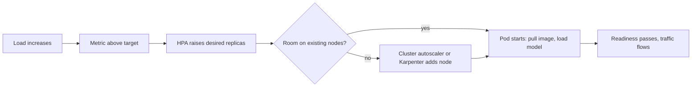
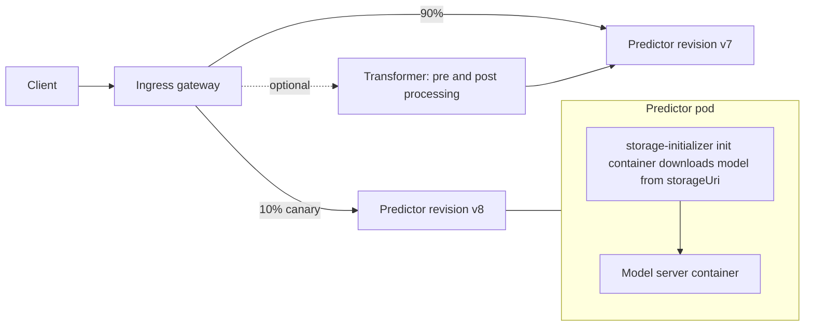

# Scaling, GPUs and KServe on Kubernetes

## Three kinds of autoscaling

| Autoscaler | Scales | Based on |
|---|---|---|
| **Horizontal Pod Autoscaler (HPA)** | number of pod replicas | CPU/memory utilisation, custom or external metrics |
| **Vertical Pod Autoscaler (VPA)** | a pod's CPU/memory requests | observed usage (recommendation or automatic) |
| **Cluster Autoscaler / Karpenter** | number (and type) of nodes | pending pods that cannot be scheduled; underused nodes |

They work as a chain: load rises → HPA adds pods → pods are `Pending` because nodes are full → the
cluster autoscaler adds a node → pods schedule, pull the image, load the model, become Ready. The whole
chain can take minutes for GPU nodes, which is why headroom matters (lesson 21).



## The Horizontal Pod Autoscaler

```yaml
apiVersion: autoscaling/v2
kind: HorizontalPodAutoscaler
metadata: {name: churn-api}
spec:
  scaleTargetRef: {apiVersion: apps/v1, kind: Deployment, name: churn-api}
  minReplicas: 3
  maxReplicas: 30
  metrics:
    - type: Resource
      resource:
        name: cpu
        target: {type: Utilization, averageUtilization: 60}     # % of the CPU *request*
    - type: Pods
      pods:
        metric: {name: http_requests_in_flight}                  # custom metric via an adapter
        target: {type: AverageValue, averageValue: "8"}
  behavior:
    scaleUp:
      stabilizationWindowSeconds: 0
      policies: [{type: Percent, value: 100, periodSeconds: 30}] # at most double every 30 s
    scaleDown:
      stabilizationWindowSeconds: 300                            # wait 5 min of lower recommendations
      policies: [{type: Pods, value: 2, periodSeconds: 60}]
```

### The algorithm

Every sync period (15 s by default) the controller computes, for each metric,

$$\text{desiredReplicas} = \left\lceil \text{currentReplicas} \times \frac{\text{currentMetricValue}}{\text{desiredMetricValue}} \right\rceil$$

- If the ratio is within a **tolerance** of 1.0 (10% by default), no scaling happens.
- With several metrics, the **largest** desired count wins.
- The result is clamped to `[minReplicas, maxReplicas]`.
- **Scale-down stabilisation**: the controller remembers recent recommendations and uses the *highest*
  one in the window (300 s default), so a brief dip does not remove pods you will need again in a minute.
- CPU *utilisation* is measured relative to the pod's CPU **request** — no request, no utilisation metric.
- Pods that are not yet Ready are handled conservatively so that starting pods do not distort the average.

```python-run
import math
from collections import deque

def hpa(initial, metrics, target, min_r, max_r, window):
    cur, recent, out = initial, deque(maxlen=window), []
    for m in metrics:
        rec = cur if abs(m - target) * 10 <= target else max(min_r, min(max_r, math.ceil(cur * m / target)))
        recent.append(rec)
        cur = rec if rec > cur else min(cur, max(recent))
        out.append(cur)
    return out

# per-pod CPU% observed each period: a spike then a quiet spell with one blip
load = [60, 120, 150, 90, 40, 35, 80, 30, 30, 30, 30, 30]
print("metric  :", load)
print("no window:", hpa(4, load, 60, 2, 20, 1))
print("window=4 :", hpa(4, load, 60, 2, 20, 4))
```

Without the window the replica count oscillates with every blip; with it, scale-up is instant and
scale-down waits for a sustained drop. You will implement exactly this in `mlops-hpa-replicas`.

### Choosing metrics for ML services

- **CPU utilisation**: fine for CPU-bound models with steady per-request cost.
- **Requests per second or in-flight requests per pod** (via Prometheus Adapter or **KEDA**): better proxy
  for load, essential for GPU-bound servers where CPU says nothing.
- **Queue length / consumer lag** (KEDA scalers for Kafka, SQS, RabbitMQ): for async workers; allows
  **scale to zero** when the queue is empty.
- **GPU utilisation / batch queue time** (from DCGM exporter or the model server's metrics).

> [!WARNING]
> Do not let HPA and VPA both act on CPU/memory for the same workload — they fight each other. A common
> split: HPA on a custom metric (RPS/concurrency), VPA in recommendation mode to right-size requests.

Protect availability during voluntary disruptions (node upgrades, scale-down) with a
**PodDisruptionBudget** (`minAvailable: 2`), and spread replicas across nodes/zones with **topology
spread constraints**.

## GPUs on Kubernetes

GPUs are exposed as an **extended resource** by the NVIDIA device plugin (usually installed through the
NVIDIA GPU Operator, which also manages drivers, the container toolkit and the DCGM metrics exporter).

```yaml
spec:
  nodeSelector: {node.kubernetes.io/instance-type: g5.xlarge}
  tolerations:
    - {key: nvidia.com/gpu, operator: Exists, effect: NoSchedule}   # GPU nodes are tainted to keep other pods off
  containers:
    - name: llm
      image: vllm/vllm-openai:v0.5.3
      args: ["--model", "/models/mistral-7b", "--max-model-len", "8192"]
      resources:
        limits:
          nvidia.com/gpu: 1          # whole GPUs only; requests default to limits
          memory: 32Gi
      volumeMounts: [{name: models, mountPath: /models}, {name: shm, mountPath: /dev/shm}]
  volumes:
    - {name: models, persistentVolumeClaim: {claimName: model-cache}}
    - {name: shm, emptyDir: {medium: Memory}}                        # PyTorch dataloaders need shared memory
```

Key facts:

- GPUs are requested in **whole units** via `limits`; they are not overcommitted by default.
- **Taints and tolerations** keep non-GPU pods off expensive GPU nodes; **node selectors/affinity** pick
  GPU types.
- **Sharing**: *time-slicing* (several pods take turns, no memory isolation), *MPS*, and *MIG*
  (Multi-Instance GPU: hardware-partitioned slices on supported cards) raise utilisation for small models.
- **Batch scheduling**: training jobs benefit from queueing and gang scheduling (all workers start or
  none) with **Kueue** or **Volcano**; the **Kubeflow Training Operator** provides `PyTorchJob`.
- **Cold start**: GPU images and weights are huge — pre-pull images, cache weights on node-local disks or
  a ReadWriteMany volume, and use startup probes.

## KServe

**KServe** adds a Kubernetes custom resource, `InferenceService`, that turns "serve this model" into a
few lines of YAML. It wraps standard runtimes (scikit-learn, XGBoost, ONNX, Triton, TorchServe, Hugging
Face, vLLM-based LLM runtimes) and adds autoscaling, canary rollouts and a standard protocol.

```yaml
apiVersion: serving.kserve.io/v1beta1
kind: InferenceService
metadata:
  name: churn
  annotations:
    serving.kserve.io/deploymentMode: Serverless     # Knative-based; or RawDeployment (plain Deployment + HPA)
spec:
  predictor:
    minReplicas: 1            # 0 enables scale-to-zero in serverless mode
    maxReplicas: 10
    scaleTarget: 8            # target concurrent requests per replica
    scaleMetric: concurrency
    canaryTrafficPercent: 10  # send 10% to the latest revision, 90% to the previous one
    model:
      modelFormat: {name: sklearn}
      storageUri: s3://acme-models/churn/v8/
      resources:
        requests: {cpu: "1", memory: 2Gi}
        limits: {memory: 4Gi}
  transformer:                # optional pre/post-processing container
    containers:
      - name: kserve-container
        image: ghcr.io/acme/churn-transformer@sha256:1c2d...
```



What KServe gives you:

- **Storage initializer**: an init container pulls the model from `storageUri` (S3, GCS, Azure, PVC, HF
  Hub, OCI image) into the pod — the "mount" pattern from lesson 17.
- **Standard protocols**: the V1 protocol (`/v1/models/<name>:predict`) and the **Open Inference
  Protocol (V2)** over REST and gRPC, shared with Triton and others; OpenAI-compatible endpoints for LLM
  runtimes.
- **Autoscaling**: request-concurrency based (Knative autoscaler) with **scale-to-zero**, or HPA/KEDA in
  raw deployment mode.
- **Canary rollouts**: `canaryTrafficPercent` splits traffic between the last good revision and the new
  one; promote by removing the field, roll back by setting it to 0.
- **Components**: predictor, optional **transformer** (pre/post-processing) and **explainer**.
- **InferenceGraph** for chaining/ensembling models; **ModelMesh** for packing many small models densely.

```bash
kubectl apply -f churn-isvc.yaml
kubectl get inferenceservice churn          # READY, URL, traffic split
curl -s -H "Host: churn.default.example.com" http://$INGRESS/v1/models/churn:predict \
     -d '{"instances": [[12, 59.9, 1, 0]]}'
```

Alternatives in the same space: **Seldon Core**, **Ray Serve on KubeRay**, **BentoML/Yatai**, and managed
endpoints (SageMaker, Vertex AI, Azure ML) which provide similar abstractions without running the
cluster yourself.

## Scale-to-zero economics

```python-run
# When does scale-to-zero pay off? (illustrative)
gpu_cost_per_hour = 1.20
cold_start_s = 75                       # node ready + image pull + model load
for requests_per_hour in (2, 20, 200, 2000):
    avg_gap_s = 3600 / requests_per_hour
    idle_timeout_s = 300                # scale to zero after 5 idle minutes
    # crude: fraction of hours the replica must be up
    up_fraction = min(1.0, (idle_timeout_s + 30) * requests_per_hour / 3600) if avg_gap_s > idle_timeout_s else 1.0
    cold_fraction = 1.0 if avg_gap_s > idle_timeout_s else 0.0
    print(f"{requests_per_hour:5d} req/h: always-on ${gpu_cost_per_hour*24:5.2f}/day  "
          f"scale-to-zero ~${gpu_cost_per_hour*24*up_fraction:5.2f}/day  "
          f"requests hitting a {cold_start_s}s cold start: {cold_fraction:.0%}")
```

For rarely used models, scale-to-zero saves most of the cost but nearly every request pays the cold
start — acceptable for internal tools or async use, not for interactive products. For busy models the
replica never idles, so it changes nothing.

## A production checklist for an ML Deployment

- Image by digest; non-root; resource requests set from measurements.
- Startup + readiness + liveness probes tuned to model load time.
- `maxUnavailable: 0` rolling updates or a canary controller (Argo Rollouts, KServe, Flagger).
- HPA on a load-representative metric; `minReplicas ≥ 2`; PodDisruptionBudget; topology spread.
- Graceful shutdown (`preStop` sleep + SIGTERM handling) so in-flight requests finish.
- Prometheus scraping, structured logs with model version and request ID.
- Secrets from a secret manager; network policies; namespace quotas.

> [!INTERVIEW]
> "How does the HPA decide the replica count?" — `ceil(current × currentMetric / target)`, with a 10%
> tolerance, max across metrics, clamped to min/max, and a scale-down stabilisation window (default
> 5 minutes). CPU utilisation is relative to requests. For GPU inference, scale on concurrency/queue
> metrics (custom metrics or KEDA). Mention the pod → node autoscaling chain and cold-start time.

## Worked example: sizing and autoscaling a GPU LLM endpoint

*One 24 GB GPU per replica runs a 7B model with vLLM. A load test shows each replica sustains about 12
concurrent generations within the TTFT/TPOT SLO; beyond that, requests queue. Peak demand is around 60
concurrent generations; nights are near zero.*

1. **Scaling metric**: concurrency (running + waiting requests per replica), exported by the server and
   exposed to the HPA through the Prometheus Adapter or KEDA. CPU utilisation would be useless here —
   the pod's CPU is nearly idle while the GPU is saturated.
2. **Target**: 8 concurrent per replica (about 65% of the measured limit of 12).
3. **Bounds**: `minReplicas: 2` in business hours (cold start is ~4 minutes: node provisioning + 10 GB
   image + weights load), `maxReplicas: 9`.
4. **Behaviour**: scale up aggressively, scale down slowly (10-minute stabilisation), because each wrong
   scale-down costs a 4-minute recovery.
5. **Schedule**: a cron-based scaler raises the floor before the morning ramp and lowers it at night.

```yaml
apiVersion: keda.sh/v1alpha1
kind: ScaledObject
metadata: {name: llm}
spec:
  scaleTargetRef: {name: llm}
  minReplicaCount: 1
  maxReplicaCount: 9
  cooldownPeriod: 600
  triggers:
    - type: prometheus
      metadata:
        serverAddress: http://prometheus.monitoring:9090
        query: sum(vllm:num_requests_running{app="llm"}) + sum(vllm:num_requests_waiting{app="llm"})
        threshold: "8"                       # target per replica
    - type: cron                             # keep at least 2 warm during business hours
      metadata: {timezone: Europe/Berlin, start: "0 7 * * 1-5", end: "0 19 * * 1-5", desiredReplicas: "2"}
```

```python-run
import math
def simulate(load, target=8, limit=12, min_r=1, max_r=9, startup_steps=4, down_window=10):
    """load[t] = concurrent demand. New replicas take `startup_steps` to become ready."""
    ready, pending, recs, overload_steps = min_r, [], [], 0
    for t, demand in enumerate(load):
        ready += sum(1 for due in pending if due == t); pending = [d for d in pending if d > t]
        desired = max(min_r, min(max_r, math.ceil(demand / target)))
        recs.append(desired); stable = max(recs[-down_window:])
        total = ready + len(pending)
        if desired > total:
            pending += [t + startup_steps] * (desired - total)        # scale up immediately
        elif stable < ready:
            ready = stable                                             # scale down after the window
        if demand > ready * limit: overload_steps += 1
    return overload_steps
morning = [2] * 5 + [10, 25, 45, 60, 60, 60, 55, 50] + [40] * 10
print("steps in overload during a fast morning ramp (each step ~ 1 minute):")
for min_r in (1, 2, 4):
    print(f"  minReplicas={min_r}: {simulate(morning, min_r=min_r)} minutes of overload")
```

With slow-starting replicas, reactive scaling alone cannot follow a steep ramp; a higher floor (or a
scheduled pre-scale) trades idle GPU cost for fewer minutes of degraded service. That trade-off, with
your real numbers, is the heart of GPU autoscaling design.

### Reducing cold start for large models

| Component of cold start | Typical | Mitigation |
|---|---|---|
| Node provisioning | 1–3 min | warm node pool, overprovisioning pause pods, Karpenter fast provisioning |
| Image pull (5–15 GB) | 1–5 min | smaller images, pre-pulled images on nodes, lazy-pulling snapshotters, registry in-region |
| Weights download | 1–10 min | weights on a node-local or shared volume, object-store streaming, baked into the image for moderate sizes |
| Model load to GPU + warm-up | 0.5–3 min | faster formats (safetensors), memory-mapped loading, avoid recompilation |

## Running many models: multi-model serving

A platform with hundreds of small models cannot afford one Deployment (and one idle replica) per model.
Options:

- **Multi-model servers**: Triton and others load many models in one process and share the GPU; KServe
  **ModelMesh** routes requests and loads/unloads models on demand with an LRU policy.
- **Scale to zero per model** with Knative/KEDA, accepting cold starts for rarely used ones.
- **Shared base, many adapters**: for LLMs, serve one base model and attach per-tenant LoRA adapters at
  request time.

The trade-offs are isolation (a noisy model affects its neighbours), blast radius of a crash, and
per-model observability — label metrics with the model name, within cardinality limits.

## KServe request and response, concretely

The Open Inference Protocol (V2) request for a tabular model:

```json
POST /v2/models/churn/infer
{
  "inputs": [
    {"name": "features", "shape": [2, 4], "datatype": "FP32",
     "data": [12, 59.9, 1, 0,   3, 95.0, 4, 1]}
  ]
}
```

```json
{
  "model_name": "churn", "model_version": "8",
  "outputs": [{"name": "proba", "shape": [2, 1], "datatype": "FP32", "data": [0.12, 0.81]}]
}
```

Because Triton, MLServer, TorchServe and KServe runtimes share this protocol, a client written against
it does not change when you swap the serving runtime behind the `InferenceService`.

## Summary

- HPA scales replicas with a proportional formula plus tolerance and stabilisation; VPA right-sizes
  requests; the cluster autoscaler/Karpenter adds nodes.
- Choose scaling metrics that reflect real load; keep headroom for slow GPU scale-up.
- GPUs are extended resources requested via limits, isolated by taints, shareable via time-slicing/MIG.
- KServe's `InferenceService` provides model download, standard protocols, autoscaling (incl. scale to
  zero) and canary traffic splitting.

```quiz
[
  {"q": "Current replicas = 4, average CPU utilisation = 90%, target = 60%. What does the HPA compute?",
   "options": ["4", "5", "6", "9"],
   "answer": 2, "explain": "ceil(4 x 90 / 60) = ceil(6.0) = 6."},
  {"q": "What is CPU utilisation measured relative to in an HPA Resource metric?",
   "options": ["The node's total CPU", "The pod's CPU request", "The CPU limit only", "The cluster average"],
   "answer": 1, "explain": "Without a CPU request the utilisation metric is undefined."},
  {"q": "What does the scale-down stabilisation window do?",
   "options": ["Delays scale-ups", "Uses the highest recent recommendation so brief dips do not remove pods", "Disables autoscaling at night", "Restarts pods periodically"],
   "answer": 1, "explain": "It prevents flapping by making scale-down conservative."},
  {"q": "How are NVIDIA GPUs requested by a pod?",
   "options": ["cpu: gpu", "resources.limits with nvidia.com/gpu: N", "An environment variable only", "A ConfigMap"],
   "answer": 1, "explain": "The device plugin advertises nvidia.com/gpu as an extended resource."},
  {"q": "Why are GPU nodes usually tainted?",
   "options": ["To make them faster", "To keep pods that do not need GPUs from occupying expensive nodes", "Because GPUs are unreliable", "To disable autoscaling"],
   "answer": 1, "explain": "Only pods with matching tolerations schedule there."},
  {"q": "In KServe, what does `canaryTrafficPercent: 10` do?",
   "options": ["Uses 10% of the GPU", "Routes 10% of traffic to the newest revision and the rest to the previous one", "Scales to 10 replicas", "Samples 10% of logs"],
   "answer": 1, "explain": "It is a built-in canary rollout mechanism."},
  {"q": "What is the main cost of scale-to-zero?",
   "options": ["Higher GPU prices", "Cold-start latency for the first request after idling", "Loss of metrics", "No HTTPS"],
   "answer": 1, "explain": "A replica must be scheduled, pull the image and load the model before answering."},
  {"q": "Which component adds nodes when pods are Pending for lack of resources?",
   "options": ["HPA", "VPA", "Cluster Autoscaler or Karpenter", "kube-proxy"],
   "answer": 2, "explain": "HPA changes pod count; node autoscalers provision capacity."}
]
```

> **Source:** Kubernetes documentation (*Horizontal Pod Autoscaling* — algorithm details, tolerance, stabilisation window, `behavior`; *Schedule GPUs*; *Taints and tolerations*); KServe documentation (*InferenceService*, *Canary rollout*, *Autoscaling*, *Open Inference Protocol*); NVIDIA GPU Operator and KEDA documentation.
