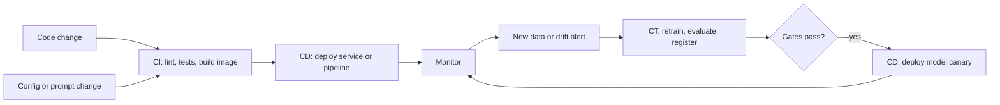

# CI/CD with GitHub Actions

> **Before this lesson:** read [Git workflows for ML teams](#/lesson/mlops/git-workflows) (commits,
> branches, pull requests), [Dockerfiles for ML](#/lesson/mlops/dockerfile-ml) (building an image)
> and [Kubernetes core objects](#/lesson/mlops/k8s-core) (`kubectl rollout`). You should be able to
> read YAML.

## In plain words

Every time someone changes the code of an ML system, a long list of chores should happen: check the
style, run the tests, build the container image, scan it for known security holes, deploy it to a
test environment, try it, and finally release it. Done by hand, these chores get skipped on busy
days, which is exactly when mistakes happen. **CI/CD** means having machines do the whole list
automatically, every time, in the same order.

An everyday picture is an airport's pre-flight routine. No pilot decides on the day whether to
check the fuel; a fixed checklist runs before every departure, and the plane does not leave until
every item is ticked. **GitHub Actions** is the checklist runner built into GitHub: you write the
checklist as a YAML file in your repository, and GitHub runs it on its own machines whenever the
trigger you chose happens.

Why this matters for a job: "describe the CI/CD pipeline for a model" is one of the most frequent
MLOps interview questions, and in practice the CI configuration is where a team's quality rules
become real. A rule that is not in CI is a suggestion.

## CI, CD and CT

- **Continuous Integration (CI)**: every change is automatically built and tested when it is
  pushed, so the main branch always works.
- **Continuous Delivery / Deployment (CD)**: every change that passes CI is automatically packaged
  and released to an environment. In continuous *delivery* a person presses the final button for
  production; in continuous *deployment* nobody does.
- **Continuous Training (CT)**: specific to ML. The model is automatically retrained and checked
  again when data or code changes (lesson 3).

An **environment** here means a separate copy of the system for a purpose: **staging** (a
production-like copy for final testing) and **production** (the real one).

In ML there are **three things that change**, and each can trigger a **pipeline** (an automated
sequence of steps):



A **gate** is an automatic check that must pass before the pipeline continues. A **canary**
deployment sends a small share of traffic to the new version first (lesson 26).

## GitHub Actions concepts

- **Workflow**: a YAML file in the folder `.github/workflows/`. It is started by **events**: a
  `push`, a `pull_request`, a `schedule`, a manual `workflow_dispatch`, a `release`, or a
  `repository_dispatch` sent by another system through GitHub's API.
- **Job**: a group of steps that runs on one **runner**, a machine that executes the job. Hosted
  runners are fresh **virtual machines** (VMs, software-simulated computers) such as
  `ubuntu-latest`, thrown away after each job. **Self-hosted** runners are your own machines, for
  example one with a GPU. Jobs run in parallel unless linked with `needs:`.
- **Step**: one shell command (`run:`) or one reusable **action**, a packaged step someone has
  published (`uses: actions/checkout@v4` checks out your code).
- **Matrix**: run the same job across combinations, such as two Python versions.
- **Secrets and variables**: encrypted values used as `${{ secrets.NAME }}`, stored per repository,
  per organisation or per environment. The `${{ ... }}` syntax is an **expression** that GitHub
  fills in before running the step.
- **Environments**: named targets (`staging`, `production`) with protection rules, such as required
  reviewers or a waiting period, and their own secrets.
- **Artifacts and caches**: an artifact passes files between jobs or keeps reports after the run
  (`upload-artifact`); a cache keeps downloaded dependencies between runs (`actions/cache`, or
  `cache: pip` in `setup-python`) so installs are faster.
- **Concurrency groups**: cancel older runs that a newer commit has made pointless, or make sure two
  deployments never run at once.
- **Permissions**: each run gets an automatic credential, `GITHUB_TOKEN`; the `permissions:` key
  limits what it may do, following the **least privilege** rule (grant only what is needed).

## A CI workflow for an ML service

Here is a complete CI workflow. We read it in parts below.

```yaml
# .github/workflows/ci.yml
name: ci
on:
  pull_request:
  push:
    branches: [main]

concurrency:
  group: ci-${{ github.ref }}
  cancel-in-progress: true          # a new push cancels the previous run for the same branch

permissions:
  contents: read

jobs:
  lint-test:
    runs-on: ubuntu-latest
    strategy:
      matrix:
        python-version: ["3.11", "3.12"]
    steps:
      - uses: actions/checkout@v4
      - uses: actions/setup-python@v5
        with:
          python-version: ${{ matrix.python-version }}
          cache: pip
      - name: Install
        run: pip install -e ".[dev,serve]"
      - name: Lint and type-check
        run: |
          ruff check src tests
          ruff format --check src tests
          mypy src
      - name: Unit tests
        run: pytest tests/unit --cov=churn --cov-report=xml --cov-fail-under=80
      - name: Data and model tests on a small fixture
        run: pytest tests/data tests/model -m "not slow"
      - uses: actions/upload-artifact@v4
        if: always()
        with:
          name: coverage-${{ matrix.python-version }}
          path: coverage.xml

  build-image:
    needs: lint-test
    runs-on: ubuntu-latest
    permissions:
      contents: read
      packages: write               # push to GHCR
    outputs:
      digest: ${{ steps.build.outputs.digest }}
    steps:
      - uses: actions/checkout@v4
      - uses: docker/setup-buildx-action@v3
      - uses: docker/login-action@v3
        with:
          registry: ghcr.io
          username: ${{ github.actor }}
          password: ${{ secrets.GITHUB_TOKEN }}
      - id: build
        uses: docker/build-push-action@v6
        with:
          context: .
          push: ${{ github.event_name == 'push' }}       # build on PRs, push only on main
          tags: ghcr.io/${{ github.repository }}/churn-api:${{ github.sha }}
          build-args: GIT_SHA=${{ github.sha }}
          cache-from: type=gha
          cache-to: type=gha,mode=max                    # persist Docker layer cache between runs
      - name: Scan image
        uses: aquasecurity/trivy-action@0.24.0
        with:
          image-ref: ghcr.io/${{ github.repository }}/churn-api:${{ github.sha }}
          severity: CRITICAL,HIGH
          exit-code: "1"

  integration:
    needs: build-image
    runs-on: ubuntu-latest
    steps:
      - uses: actions/checkout@v4
      - name: Start stack and run API tests
        run: |
          docker compose up -d --build --wait
          pytest tests/integration -q
      - if: always()
        run: docker compose logs --no-color > compose.log && docker compose down -v
```

Reading it in parts:

- **Triggers (`on:`)**: run on every pull request and on every push to `main`.
- **`concurrency`**: runs for the same branch (`github.ref`) share a group, and a new push cancels
  the older, now-pointless run.
- **`permissions: contents: read`**: by default the token may only read the code.
- **Job `lint-test`** runs twice in parallel, once per Python version in the matrix. Its steps check
  out the code, install Python with a pip cache, install the package with its extras (lesson 5), run
  the linter, formatter check and type checker, then the unit tests. `--cov-fail-under=80` fails the
  step if tests execute less than 80% of the code lines (**coverage**). The data and model tests run
  on a small **fixture**, a tiny fixed data set kept for testing, and skip tests marked slow. The
  coverage report is uploaded as an artifact; `if: always()` uploads it even when tests failed,
  which is when you need it most.
- **Job `build-image`** starts only if `lint-test` succeeded (`needs:`). It may write packages so it
  can push to **GHCR** (GitHub Container Registry, an image store). It sets up **Buildx** (Docker's
  advanced builder), logs in using the automatic token, then builds the image. On pull requests it
  only builds; on pushes to main it also pushes. The tag is the **commit SHA** (the unique ID Git
  gives each commit). `cache-from/cache-to: type=gha` keeps Docker's layer cache (lesson 16) in
  GitHub's cache between runs. Finally **Trivy**, a vulnerability scanner, checks the image for known
  security flaws (**CVEs**) and fails the job on critical or high ones.
- **Job `integration`** starts the whole stack with Docker Compose (lesson 18), waits until the
  services are healthy, runs integration tests against them, and always collects logs and cleans up.

Design points:

- **Fast feedback first**: lint and unit tests run before the expensive image build.
- **Fail-fast gates**: a coverage threshold, type errors and scan failures block the merge. Make them
  binding with **branch protection**, a repository setting that refuses to merge a pull request until
  the required checks pass.
- **Layer caching** in CI plus a well-ordered Dockerfile keeps image builds to seconds.
- The image is tagged with the **commit SHA**, and later stages deploy that exact image: **build once,
  promote everywhere**. Rebuilding for each environment risks shipping something slightly different
  from what was tested.

## CD: deploy with environments and approvals

```yaml
# .github/workflows/deploy.yml
name: deploy
on:
  workflow_run:
    workflows: [ci]
    types: [completed]
    branches: [main]

jobs:
  staging:
    if: ${{ github.event.workflow_run.conclusion == 'success' }}
    runs-on: ubuntu-latest
    environment: staging
    permissions:
      id-token: write               # OIDC: short-lived cloud credentials, no stored keys
      contents: read
    steps:
      - uses: actions/checkout@v4
      - uses: aws-actions/configure-aws-credentials@v4
        with:
          role-to-assume: arn:aws:iam::123456789012:role/gha-deploy-staging
          aws-region: eu-west-1
      - name: Deploy to staging
        run: |
          aws eks update-kubeconfig --name staging
          kubectl set image deployment/churn-api api=ghcr.io/${{ github.repository }}/churn-api:${{ github.event.workflow_run.head_sha }}
          kubectl rollout status deployment/churn-api --timeout=300s
      - name: Smoke test
        run: ./scripts/smoke_test.sh https://staging.api.acme.example
  production:
    needs: staging
    runs-on: ubuntu-latest
    environment: production         # protection rule: required reviewers approve here
    concurrency: deploy-production  # never run two production deploys at once
    steps:
      - uses: actions/checkout@v4
      - name: Canary rollout
        run: ./scripts/deploy_canary.sh ${{ github.event.workflow_run.head_sha }}
```

This workflow starts when the `ci` workflow finishes on `main`, and its staging job runs only if CI
succeeded. The staging job obtains temporary AWS credentials (explained in the tip below), points
`kubectl` at the staging cluster, swaps in the image built for that commit, waits up to 5 minutes
for the rollout, and runs a **smoke test**: a handful of quick requests that confirm the basics work
("does it turn on without smoke?"). The production job waits for staging, then pauses until a
required reviewer approves it in GitHub's interface, and uses a concurrency group so two production
deployments can never overlap.

> [!TIP]
> Use **OIDC federation** (`id-token: write` + a cloud IAM role that trusts GitHub) instead of long-lived
> cloud keys in secrets. Credentials are short-lived and scoped to the repo/branch/environment.

**OIDC** (OpenID Connect) is a standard way for one system to prove its identity to another. GitHub
issues the job a signed identity token; the cloud's **IAM** (identity and access management) system
is configured to trust tokens from your repository and branch and hands back credentials that expire
within the hour. There is no stored password to leak.

**GitOps alternative**: instead of CI pushing changes into the cluster with `kubectl`, CI commits the
new image digest to a configuration repository, and a controller running inside the cluster (Argo CD
or Flux) notices the commit and applies it. The Git history becomes the audit log, and a rollback is
a `git revert`.

## CT: a scheduled or triggered training workflow

```yaml
# .github/workflows/train.yml
name: train
on:
  schedule:
    - cron: "0 3 * * 1"             # Mondays 03:00 UTC
  workflow_dispatch:                # manual trigger with parameters
    inputs:
      data_version: {description: "dataset snapshot", required: false, default: "latest"}
  repository_dispatch:
    types: [drift-detected]         # monitoring system calls the GitHub API to trigger retraining

jobs:
  train:
    runs-on: [self-hosted, gpu]     # or submit to SageMaker/Vertex/Kubeflow instead of training on the runner
    timeout-minutes: 240
    env:
      MLFLOW_TRACKING_URI: ${{ vars.MLFLOW_TRACKING_URI }}
      MLFLOW_TRACKING_PASSWORD: ${{ secrets.MLFLOW_TRACKING_PASSWORD }}
    steps:
      - uses: actions/checkout@v4
      - uses: actions/setup-python@v5
        with: {python-version: "3.11", cache: pip}
      - run: pip install -e ".[dev]" "dvc[s3]"
      - run: dvc pull                                   # fetch the pinned data version
      - run: python -m churn.validate_data               # fail fast on bad data
      - run: python -m churn.train --config configs/train.yaml
      - name: Evaluate against champion and register
        run: python -m churn.promote --min-delta 0.0 --alias challenger
      - name: Publish metrics report to the run summary
        run: cat reports/metrics.md >> "$GITHUB_STEP_SUMMARY"
```

Three triggers start it: a weekly schedule in cron syntax (minute 0, hour 3, any day of month, any
month, day 1 = Monday; GitHub schedules are in **UTC**, Coordinated Universal Time), a manual button
with an optional data version, and a `drift-detected` event that a monitoring system can send. The
job runs on a self-hosted GPU runner for at most 4 hours. It fetches the exact data version with DVC
(lesson 8), validates the data, trains, compares the new model with the current champion and
registers it as a **challenger** (a candidate to replace the champion, lesson 12), then writes a
Markdown report to the run's summary page.

For heavy training, the GitHub runner should only **submit and monitor** a job on proper compute (a
Kubernetes Job, a SageMaker or Vertex training job, a Kubeflow pipeline run) and not train on the
runner itself: hosted runners are small, have no GPU and are time-limited. **CML** (Continuous
Machine Learning, from the DVC team) can post metric tables and plots as pull-request comments, so
reviewers see the model's change next to the code diff.

## What runs when: a sensible split

| Trigger | Checks | Budget |
|---|---|---|
| Every PR | lint, types, unit tests, data-contract tests on fixtures, tiny training smoke test, image build | < 10 min |
| Merge to main | all of the above + integration tests, image push and scan, deploy to staging | < 20 min |
| Nightly | full training on recent data, full evaluation suite, slow/property tests, dependency audit | hours |
| On drift/new data | CT pipeline: validate → train → evaluate → register challenger | hours |
| Release | canary → progressive rollout to production with automated analysis | minutes–hours |

Not every change needs every job. **Path filters** choose jobs by which files changed: a README edit
should not retrain a model. GitHub's `on.push.paths` and the `dorny/paths-filter` action do this with
**glob patterns**, where `*` matches anything within one folder level and `**` matches across
levels. The demo imitates the idea.

```python-run
# Path filters: decide which jobs to run from the changed files (what `on.push.paths` / dorny/paths-filter do).
from fnmatch import fnmatch
rules = {
    "unit-tests":   ["src/**", "tests/**", "pyproject.toml"],
    "build-image":  ["src/**", "Dockerfile", "pyproject.toml", "uv.lock"],
    "retrain":      ["src/churn/train.py", "src/churn/features.py", "configs/train.yaml", "data/*.dvc"],
    "docs":         ["docs/**", "*.md"],
}
def jobs_for(changed):
    return sorted(j for j, pats in rules.items()
                  if any(fnmatch(f, p) or fnmatch(f, p.replace("/**", "/*")) or f.startswith(p.replace("**", ""))
                         for f in changed for p in pats))
for change in (["README.md"], ["src/churn/serve/app.py"], ["configs/train.yaml"], ["data/customers.parquet.dvc", "src/churn/features.py"]):
    print(f"{str(change):62s} -> {jobs_for(change)}")
```

`rules` maps each job to the patterns that should trigger it. `jobs_for` keeps a job if any changed
file matches any of its patterns; `fnmatch` is Python's glob matcher, and the extra conditions
handle `**` as "anything below this folder". The output:

```text
['README.md']                                                  -> ['docs']
['src/churn/serve/app.py']                                     -> ['build-image', 'unit-tests']
['configs/train.yaml']                                         -> ['retrain']
['data/customers.parquet.dvc', 'src/churn/features.py']        -> ['build-image', 'retrain', 'unit-tests']
```

A documentation edit runs only the docs job; a serving change runs tests and the image build but no
retraining; a new data pointer (`.dvc` file) plus a feature change triggers retraining. Path
filtering keeps CI fast in a **monorepo** (one repository holding many projects) and makes "a
change to the data pointer triggers retraining" an explicit, reviewable rule.

## Security and hygiene

- **Pin third-party actions** to a commit SHA, because a tag such as `v4` can be moved by its owner
  to different code.
- **Least privilege**: narrow `permissions:`, secrets only in the jobs that need them, and never
  print a secret in logs.
- **Pull requests from forks** (copies of the repository owned by outsiders) do not receive secrets.
  Be careful with the `pull_request_target` trigger, which does run with secrets.
- **Protected environments** for production, with required reviewers.
- **Dependency updates** via Dependabot or Renovate (bots that open pull requests to update
  libraries), and `pip-audit` (a scanner for vulnerable Python packages) in nightly CI.
- **Reproducible builds**: lockfiles and pinned base images.

> [!INTERVIEW]
> "Describe a CI/CD pipeline for an ML model." — PR: lint, type-check, unit tests, data/feature tests,
> a fast training smoke test, build the image. Main: integration tests, push image tagged with SHA, scan,
> deploy to staging, smoke test. CT: scheduled or drift-triggered pipeline that validates data, trains,
> evaluates against the champion with slice gates, registers a challenger. CD of the model: shadow/canary
> with automated metrics analysis and automatic rollback, human approval gate for production. Mention
> OIDC, build once/promote, and GitOps.

## Reusable workflows and composite actions

As the number of model repositories grows, copy-pasted workflows drift apart. GitHub offers two ways
to share instead:

- **Reusable workflows** (`on: workflow_call`): a whole workflow called from another one, with typed
  inputs and secrets. Ideal for a platform team's standard "build, scan and push an ML image"
  pipeline.
- **Composite actions**: several steps packaged as one action, for example "set up Python and uv and
  restore the cache".

```yaml
# .github/workflows/_build-image.yml   (in a shared repo: acme/ml-workflows)
on:
  workflow_call:
    inputs:
      image-name: {required: true, type: string}
      context: {required: false, type: string, default: "."}
    outputs:
      digest: {value: "${{ jobs.build.outputs.digest }}"}
jobs:
  build:
    runs-on: ubuntu-latest
    permissions: {contents: read, packages: write}
    outputs: {digest: "${{ steps.push.outputs.digest }}"}
    steps:
      - uses: actions/checkout@v4
      - uses: docker/setup-buildx-action@v3
      - uses: docker/login-action@v3
        with: {registry: ghcr.io, username: "${{ github.actor }}", password: "${{ secrets.GITHUB_TOKEN }}"}
      - id: push
        uses: docker/build-push-action@v6
        with:
          context: ${{ inputs.context }}
          push: true
          tags: ghcr.io/${{ github.repository_owner }}/${{ inputs.image-name }}:${{ github.sha }}
          cache-from: type=gha
          cache-to: type=gha,mode=max
```

```yaml
# in a model repository
jobs:
  image:
    uses: acme/ml-workflows/.github/workflows/_build-image.yml@v3     # pinned version of the shared workflow
    with: {image-name: churn-api}
  deploy-staging:
    needs: image
    runs-on: ubuntu-latest
    steps:
      - run: ./scripts/deploy.sh staging "${{ needs.image.outputs.digest }}"
```

The shared workflow declares its inputs (an image name and an optional build folder) and one output,
the image digest. A model repository calls it with `uses:` plus a pinned version tag and passes the
digest to its own deploy job. The platform team improves the shared workflow once (adds scanning,
**SBOMs**, a software bill of materials listing every component in the image, or image signing) and
every model repository inherits the improvement on its next version bump.

## Passing data between steps and jobs

| Need | Mechanism |
|---|---|
| Value from one step to a later step | `echo "run_id=abc" >> "$GITHUB_OUTPUT"` then `${{ steps.<id>.outputs.run_id }}` |
| Value between jobs | job `outputs:` + `needs.<job>.outputs.<name>` |
| Files between jobs | `actions/upload-artifact` / `download-artifact` |
| Environment variable for later steps | `echo "KEY=value" >> "$GITHUB_ENV"` |
| Human-readable report | append Markdown to `$GITHUB_STEP_SUMMARY` |
| Speed up installs | `actions/cache` keyed on the lockfile hash |

The names in capitals are files that GitHub gives each step; writing `key=value` lines into them is
how a step talks to later steps. A cache example:

```yaml
      - uses: actions/cache@v4
        with:
          path: ~/.cache/uv
          key: uv-${{ runner.os }}-${{ hashFiles('uv.lock') }}       # new lockfile -> new cache
          restore-keys: uv-${{ runner.os }}-
```

The cache **key** includes a hash of the lockfile, so changing dependencies produces a new key and a
fresh cache. `restore-keys` is a fallback: if no exact match exists, the newest cache whose key
starts with `uv-Linux-` is restored, which is usually close enough to save most of the download.

## A model-quality gate in the pull request

CI for ML should show reviewers the **effect on the model**, not only green ticks. A pull-request job
can train on a fixed sample, compare with the metrics stored on `main`, fail on a regression, and
post the comparison table:

```yaml
  model-check:
    runs-on: ubuntu-latest
    steps:
      - uses: actions/checkout@v4
        with: {fetch-depth: 0}
      - uses: actions/setup-python@v5
        with: {python-version: "3.11", cache: pip}
      - run: pip install -e ".[dev,train]"
      - run: dvc pull data/sample.parquet && python -m churn.train --params params.ci.yaml
      - name: Compare with main
        run: |
          git show origin/main:metrics.ci.json > base.json
          python scripts/compare_metrics.py base.json metrics.json --max-drop 0.01 >> "$GITHUB_STEP_SUMMARY"
```

`fetch-depth: 0` downloads the full Git history so that `git show origin/main:metrics.ci.json` can
read the metrics file as it is on `main`. The comparison script is the heart of the gate; here is a
runnable version.

```python-run
import json
def compare(base, cand, max_drop=0.01, higher_is_better=("pr_auc", "roc_auc")):
    rows, failed = [], False
    for k in sorted(set(base) | set(cand)):
        b, c = base.get(k), cand.get(k)
        if b is None or c is None:
            rows.append((k, b, c, "new/removed")); continue
        delta = c - b
        bad = any(k.startswith(m) for m in higher_is_better) and delta < -max_drop
        failed |= bad
        rows.append((k, b, c, "REGRESSION" if bad else "ok"))
    return rows, failed

base = {"pr_auc": 0.712, "roc_auc": 0.861, "pr_auc__plan=basic": 0.701, "pr_auc__plan=premium": 0.655, "latency_ms_p95": 18.0}
cand = {"pr_auc": 0.724, "roc_auc": 0.866, "pr_auc__plan=basic": 0.719, "pr_auc__plan=premium": 0.631, "latency_ms_p95": 19.5}
rows, failed = compare(base, cand)
print("| metric | main | PR | status |\n|---|---|---|---|")
for k, b, c, s in rows:
    print(f"| {k} | {b} | {c} | {s} |")
print("\nexit code:", 1 if failed else 0, "(non-zero blocks the merge)")
```

`compare` walks through every metric name found in either dictionary. For metrics where higher is
better (names starting with `pr_auc` or `roc_auc`), a drop of more than 0.01 is a regression. Names
like `pr_auc__plan=premium` are **slice metrics**: the same score computed only on one group of
customers. The output is a Markdown table:

```text
| metric | main | PR | status |
|---|---|---|---|
| latency_ms_p95 | 18.0 | 19.5 | ok |
| pr_auc | 0.712 | 0.724 | ok |
| pr_auc__plan=basic | 0.701 | 0.719 | ok |
| pr_auc__plan=premium | 0.655 | 0.631 | REGRESSION |
| roc_auc | 0.861 | 0.866 | ok |

exit code: 1 (non-zero blocks the merge)
```

The candidate improves overall but loses 0.024 on premium customers, more than the allowed margin,
so the pull request is blocked with the evidence on its summary page. An overall average would have
hidden this. Keep the job fast (a fixed small sample, minutes) and **deterministic** (fixed random
seed, so the same code always gives the same numbers); the full evaluation belongs to the training
pipeline.

## Debugging and operating workflows

- **Re-run with debug logging** turned on and read the raw logs.
- **Reproduce locally**: if the workflow calls `make` targets and scripts, the same commands run on
  your machine; the tool `act` can imitate runners for quick experiments.
- **Flaky tests**, tests that pass or fail at random, must be quarantined and fixed. Re-running until
  the light turns green on the default branch hides real bugs.
- **Runner choice**: hosted runners are clean and thrown away after each job. Self-hosted runners
  give GPUs and access to private systems, but must be isolated and recreated for every job when the
  code is untrusted; never attach them to public repositories.
- **Cost and speed**: path filters, cancelling superseded runs, caching, and splitting the test suite
  across a matrix keep pull-request feedback under ten minutes, roughly the point beyond which people
  stop waiting and switch to other work.
- **Scheduled workflows** run on the default branch and can start late when GitHub is busy, so do
  not rely on exact timing. GitHub also disables schedules automatically in repositories with no
  activity for a long period.

## Summary

- CI validates every change; CD ships validated artifacts; CT retrains and re-validates models.
- GitHub Actions: workflows contain jobs, jobs contain steps; events, matrices, secrets,
  environments, caches and concurrency control the rest.
- Order jobs for fast feedback, cache dependencies and Docker layers, and build once, then promote
  the same image by its SHA.
- Use environments with approvals, OIDC for cloud access, and schedule or dispatch triggers for CT.
- Put a model-quality gate with slice metrics into pull requests.

## Glossary

- **CI / CD / CT** - automatic testing of every change / automatic release / automatic retraining.
- **Pipeline** - an automated sequence of steps.
- **Staging / production** - the production-like test environment / the real one.
- **Gate** - an automatic check that must pass before continuing.
- **Workflow / job / step / action** - a YAML automation file / a group of steps on one machine / one
  command / a reusable published step.
- **Event / trigger** - what starts a workflow (push, pull request, schedule, dispatch).
- **Runner** - the machine that runs a job; hosted or self-hosted.
- **Matrix** - running one job over several combinations of settings.
- **Secret / variable** - an encrypted / plain value made available to workflows.
- **Artifact / cache** - files kept from a run / dependencies reused across runs.
- **Concurrency group** - a name that stops two runs of the same kind overlapping.
- **Least privilege** - granting only the permissions a job needs.
- **Coverage** - the share of code lines executed by tests.
- **Branch protection** - a setting that blocks merges until required checks pass.
- **Container registry / GHCR** - an image store / GitHub's image store.
- **Vulnerability scan / CVE** - checking an image for known flaws / one catalogued flaw.
- **Build once, promote everywhere** - deploy the same tested image to every environment.
- **Smoke test** - a few quick checks that the basics work.
- **OIDC / IAM** - a standard for proving identity / a cloud's permission system.
- **GitOps** - deployment by committing desired state to Git, applied by an in-cluster controller.
- **Challenger / champion** - a candidate model / the model currently in production.
- **Path filter / glob** - choosing jobs by changed files / a wildcard file pattern.
- **Reusable workflow / composite action** - a shared workflow / a shared bundle of steps.
- **SBOM** - a list of every component inside a software artifact.
- **Slice metric** - a score computed on one subgroup of the data.
- **Flaky test** - a test that passes or fails at random.

```quiz
[
  {"q": "What does CT add to CI/CD in ML systems?",
   "options": ["Container testing", "Automatic retraining and re-validation of models when data or code changes", "Code translation", "Continuous tagging"],
   "answer": 1, "explain": "Continuous training handles the data-driven change axis unique to ML."},
  {"q": "In GitHub Actions, how do you make job B run only after job A succeeds?",
   "options": ["Put B in a different file", "Add `needs: A` to job B", "Use a matrix", "Add a cache"],
   "answer": 1, "explain": "`needs` defines job dependencies; otherwise jobs run in parallel."},
  {"q": "Why tag the image with the commit SHA and reuse it for staging and production?",
   "options": ["To save disk", "Build once, promote everywhere: the exact tested artifact is what ships", "Because tags must be 40 characters", "To avoid Docker Hub limits"],
   "answer": 1, "explain": "Rebuilding per environment risks shipping something different from what was tested."},
  {"q": "What is the benefit of OIDC federation over storing cloud access keys in secrets?",
   "options": ["Faster builds", "Short-lived, scoped credentials with no long-lived keys to leak or rotate", "Free compute", "It disables approvals"],
   "answer": 1, "explain": "The cloud trusts GitHub's identity token for a specific repo/branch/environment."},
  {"q": "Which trigger lets a monitoring system start a retraining workflow via the GitHub API?",
   "options": ["pull_request", "repository_dispatch (or workflow_dispatch)", "push", "release"],
   "answer": 1, "explain": "Dispatch events are fired by API calls with a custom payload."},
  {"q": "Where should heavy GPU training triggered from CI usually run?",
   "options": ["On the default GitHub-hosted runner", "On dedicated compute (K8s Job, SageMaker/Vertex, Kubeflow) submitted and monitored by the workflow", "In a pre-commit hook", "In the Dockerfile RUN step"],
   "answer": 1, "explain": "Hosted runners are small, time-limited and have no GPUs."},
  {"q": "What does `concurrency: {group: ci-${{ github.ref }}, cancel-in-progress: true}` achieve?",
   "options": ["Runs jobs on more CPUs", "Cancels an older in-flight run when a new commit arrives on the same branch", "Shares secrets across repos", "Disables caching"],
   "answer": 1, "explain": "It saves runner minutes and avoids stale results."},
  {"q": "In GitOps, how is a deployment performed?",
   "options": ["CI runs kubectl apply directly against production", "A commit to a config repo is pulled and applied by an in-cluster controller such as Argo CD", "By SSH", "By editing pods manually"],
   "answer": 1, "explain": "Git is the source of truth; rollback is a git revert."}
]
```

> **Source:** GitHub Actions documentation (*Workflow syntax*, *Environments*, *OpenID Connect*, *Caching dependencies*, *Security hardening*); Docker `build-push-action` documentation; Google Cloud, *MLOps: Continuous delivery and automation pipelines in machine learning*; Bill Lubanovic, *FastAPI*, ch. 12 (testing); CML and Argo CD documentation.
