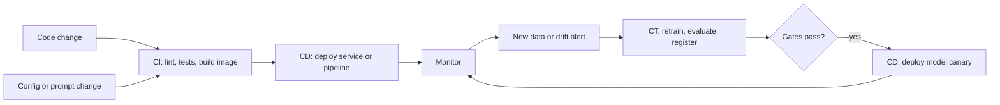

# CI/CD with GitHub Actions

## CI, CD and CT

- **Continuous Integration (CI)**: every change is automatically built and tested when pushed, so that
  `main` is always in a working state.
- **Continuous Delivery/Deployment (CD)**: every change that passes CI is automatically packaged and
  released to an environment (delivery = a human presses the final button; deployment = no human).
- **Continuous Training (CT)**: unique to ML — the model is automatically retrained and re-validated when
  data or code changes (lesson 3).

In ML there are **three things that change** and each can trigger a pipeline:



## GitHub Actions concepts

- **Workflow**: a YAML file in `.github/workflows/`, triggered by **events** (`push`, `pull_request`,
  `schedule`, `workflow_dispatch`, `release`, `repository_dispatch`...).
- **Job**: a set of steps that runs on one **runner** (a fresh VM such as `ubuntu-latest`, or a
  self-hosted machine — e.g., one with a GPU). Jobs run in parallel unless linked with `needs:`.
- **Step**: a shell command (`run:`) or a reusable **action** (`uses: actions/checkout@v4`).
- **Matrix**: run a job across combinations (Python versions, OSes).
- **Secrets and variables**: encrypted values exposed as `${{ secrets.NAME }}`; scoped to repo,
  organisation or **environment**.
- **Environments**: named targets (`staging`, `production`) with protection rules (required reviewers,
  wait timers) and their own secrets.
- **Artifacts and caches**: pass files between jobs / keep reports (`upload-artifact`); speed up installs
  (`actions/cache`, or `cache: pip` in `setup-python`).
- **Concurrency groups**: cancel superseded runs or serialise deployments.
- **Permissions**: least-privilege `GITHUB_TOKEN` scopes per workflow or job.

## A CI workflow for an ML service

```yaml
# .github/workflows/ci.yml
name: ci
on:
  pull_request:
  push:
    branches: [main]

concurrency:
  group: ci-${{ github.ref }}
  cancel-in-progress: true          # a new push cancels the previous run for the same branch

permissions:
  contents: read

jobs:
  lint-test:
    runs-on: ubuntu-latest
    strategy:
      matrix:
        python-version: ["3.11", "3.12"]
    steps:
      - uses: actions/checkout@v4
      - uses: actions/setup-python@v5
        with:
          python-version: ${{ matrix.python-version }}
          cache: pip
      - name: Install
        run: pip install -e ".[dev,serve]"
      - name: Lint and type-check
        run: |
          ruff check src tests
          ruff format --check src tests
          mypy src
      - name: Unit tests
        run: pytest tests/unit --cov=churn --cov-report=xml --cov-fail-under=80
      - name: Data and model tests on a small fixture
        run: pytest tests/data tests/model -m "not slow"
      - uses: actions/upload-artifact@v4
        if: always()
        with:
          name: coverage-${{ matrix.python-version }}
          path: coverage.xml

  build-image:
    needs: lint-test
    runs-on: ubuntu-latest
    permissions:
      contents: read
      packages: write               # push to GHCR
    outputs:
      digest: ${{ steps.build.outputs.digest }}
    steps:
      - uses: actions/checkout@v4
      - uses: docker/setup-buildx-action@v3
      - uses: docker/login-action@v3
        with:
          registry: ghcr.io
          username: ${{ github.actor }}
          password: ${{ secrets.GITHUB_TOKEN }}
      - id: build
        uses: docker/build-push-action@v6
        with:
          context: .
          push: ${{ github.event_name == 'push' }}       # build on PRs, push only on main
          tags: ghcr.io/${{ github.repository }}/churn-api:${{ github.sha }}
          build-args: GIT_SHA=${{ github.sha }}
          cache-from: type=gha
          cache-to: type=gha,mode=max                    # persist Docker layer cache between runs
      - name: Scan image
        uses: aquasecurity/trivy-action@0.24.0
        with:
          image-ref: ghcr.io/${{ github.repository }}/churn-api:${{ github.sha }}
          severity: CRITICAL,HIGH
          exit-code: "1"

  integration:
    needs: build-image
    runs-on: ubuntu-latest
    steps:
      - uses: actions/checkout@v4
      - name: Start stack and run API tests
        run: |
          docker compose up -d --build --wait
          pytest tests/integration -q
      - if: always()
        run: docker compose logs --no-color > compose.log && docker compose down -v
```

Design points:

- **Fast feedback first**: lint and unit tests run before the expensive image build (`needs:`).
- **Fail-fast gates**: coverage threshold, type errors and vulnerability scan failures block the merge
  (enforce with branch protection: "require status checks to pass").
- **Layer caching** in CI (`type=gha`) plus a well-ordered Dockerfile keeps image builds to seconds.
- The image is tagged with the **commit SHA**; later stages deploy that exact artifact (**build once,
  promote everywhere**).

## CD: deploy with environments and approvals

```yaml
# .github/workflows/deploy.yml
name: deploy
on:
  workflow_run:
    workflows: [ci]
    types: [completed]
    branches: [main]

jobs:
  staging:
    if: ${{ github.event.workflow_run.conclusion == 'success' }}
    runs-on: ubuntu-latest
    environment: staging
    permissions:
      id-token: write               # OIDC: short-lived cloud credentials, no stored keys
      contents: read
    steps:
      - uses: actions/checkout@v4
      - uses: aws-actions/configure-aws-credentials@v4
        with:
          role-to-assume: arn:aws:iam::123456789012:role/gha-deploy-staging
          aws-region: eu-west-1
      - name: Deploy to staging
        run: |
          aws eks update-kubeconfig --name staging
          kubectl set image deployment/churn-api api=ghcr.io/${{ github.repository }}/churn-api:${{ github.event.workflow_run.head_sha }}
          kubectl rollout status deployment/churn-api --timeout=300s
      - name: Smoke test
        run: ./scripts/smoke_test.sh https://staging.api.acme.example

  production:
    needs: staging
    runs-on: ubuntu-latest
    environment: production         # protection rule: required reviewers approve here
    concurrency: deploy-production  # never run two production deploys at once
    steps:
      - uses: actions/checkout@v4
      - name: Canary rollout
        run: ./scripts/deploy_canary.sh ${{ github.event.workflow_run.head_sha }}
```

> [!TIP]
> Use **OIDC federation** (`id-token: write` + a cloud IAM role that trusts GitHub) instead of long-lived
> cloud keys in secrets. Credentials are short-lived and scoped to the repo/branch/environment.

**GitOps alternative**: instead of CI pushing to the cluster with `kubectl`, CI commits the new image
digest to a config repository and a controller inside the cluster (Argo CD, Flux) pulls and applies it.
The Git history becomes the audit log and rollback is `git revert`.

## CT: a scheduled / triggered training workflow

```yaml
# .github/workflows/train.yml
name: train
on:
  schedule:
    - cron: "0 3 * * 1"             # Mondays 03:00 UTC
  workflow_dispatch:                # manual trigger with parameters
    inputs:
      data_version: {description: "dataset snapshot", required: false, default: "latest"}
  repository_dispatch:
    types: [drift-detected]         # monitoring system calls the GitHub API to trigger retraining

jobs:
  train:
    runs-on: [self-hosted, gpu]     # or submit to SageMaker/Vertex/Kubeflow instead of training on the runner
    timeout-minutes: 240
    env:
      MLFLOW_TRACKING_URI: ${{ vars.MLFLOW_TRACKING_URI }}
      MLFLOW_TRACKING_PASSWORD: ${{ secrets.MLFLOW_TRACKING_PASSWORD }}
    steps:
      - uses: actions/checkout@v4
      - uses: actions/setup-python@v5
        with: {python-version: "3.11", cache: pip}
      - run: pip install -e ".[dev]" "dvc[s3]"
      - run: dvc pull                                   # fetch the pinned data version
      - run: python -m churn.validate_data               # fail fast on bad data
      - run: python -m churn.train --config configs/train.yaml
      - name: Evaluate against champion and register
        run: python -m churn.promote --min-delta 0.0 --alias challenger
      - name: Publish metrics report to the run summary
        run: cat reports/metrics.md >> "$GITHUB_STEP_SUMMARY"
```

For heavy training, the GitHub runner should only **submit and monitor** a job on proper compute (a
Kubernetes Job, a SageMaker/Vertex training job, a Kubeflow pipeline run), not train on the runner
itself. **CML** (Continuous Machine Learning, from the DVC team) can post metric tables and plots as PR
comments so reviewers see model impact next to the code diff.

## What runs when — a sensible split

| Trigger | Checks | Budget |
|---|---|---|
| Every PR | lint, types, unit tests, data-contract tests on fixtures, tiny training smoke test, image build | < 10 min |
| Merge to main | all of the above + integration tests, image push and scan, deploy to staging | < 20 min |
| Nightly | full training on recent data, full evaluation suite, slow/property tests, dependency audit | hours |
| On drift/new data | CT pipeline: validate → train → evaluate → register challenger | hours |
| Release | canary → progressive rollout to production with automated analysis | minutes–hours |

```python-run
# Path filters: decide which jobs to run from the changed files (what `on.push.paths` / dorny/paths-filter do).
from fnmatch import fnmatch
rules = {
    "unit-tests":   ["src/**", "tests/**", "pyproject.toml"],
    "build-image":  ["src/**", "Dockerfile", "pyproject.toml", "uv.lock"],
    "retrain":      ["src/churn/train.py", "src/churn/features.py", "configs/train.yaml", "data/*.dvc"],
    "docs":         ["docs/**", "*.md"],
}
def jobs_for(changed):
    return sorted(j for j, pats in rules.items()
                  if any(fnmatch(f, p) or fnmatch(f, p.replace("/**", "/*")) or f.startswith(p.replace("**", ""))
                         for f in changed for p in pats))
for change in (["README.md"], ["src/churn/serve/app.py"], ["configs/train.yaml"], ["data/customers.parquet.dvc", "src/churn/features.py"]):
    print(f"{str(change):62s} -> {jobs_for(change)}")
```

Path filtering keeps CI fast in monorepos and makes "a change to the data pointer triggers retraining"
explicit.

## Security and hygiene

- **Pin third-party actions** to a commit SHA (tags can be moved).
- **Least privilege** `permissions:`; secrets only in jobs that need them; never echo secrets.
- **Untrusted PRs** from forks do not receive secrets; be careful with `pull_request_target`.
- **Protected environments** for production with required reviewers.
- **Dependency updates** via Dependabot/Renovate; `pip-audit` in nightly CI.
- **Reproducible builds**: lockfiles, pinned base images.

> [!INTERVIEW]
> "Describe a CI/CD pipeline for an ML model." — PR: lint, type-check, unit tests, data/feature tests,
> a fast training smoke test, build the image. Main: integration tests, push image tagged with SHA, scan,
> deploy to staging, smoke test. CT: scheduled or drift-triggered pipeline that validates data, trains,
> evaluates against the champion with slice gates, registers a challenger. CD of the model: shadow/canary
> with automated metrics analysis and automatic rollback, human approval gate for production. Mention
> OIDC, build once/promote, and GitOps.

## Summary

- CI validates every change; CD ships validated artifacts; CT retrains and re-validates models.
- GitHub Actions: workflows → jobs → steps; events, matrices, secrets, environments, caches, concurrency.
- Order jobs for fast feedback, cache dependencies and Docker layers, build once and promote by SHA.
- Use environments with approvals, OIDC for cloud access, and scheduled/dispatch triggers for CT.

```quiz
[
  {"q": "What does CT add to CI/CD in ML systems?",
   "options": ["Container testing", "Automatic retraining and re-validation of models when data or code changes", "Code translation", "Continuous tagging"],
   "answer": 1, "explain": "Continuous training handles the data-driven change axis unique to ML."},
  {"q": "In GitHub Actions, how do you make job B run only after job A succeeds?",
   "options": ["Put B in a different file", "Add `needs: A` to job B", "Use a matrix", "Add a cache"],
   "answer": 1, "explain": "`needs` defines job dependencies; otherwise jobs run in parallel."},
  {"q": "Why tag the image with the commit SHA and reuse it for staging and production?",
   "options": ["To save disk", "Build once, promote everywhere: the exact tested artifact is what ships", "Because tags must be 40 characters", "To avoid Docker Hub limits"],
   "answer": 1, "explain": "Rebuilding per environment risks shipping something different from what was tested."},
  {"q": "What is the benefit of OIDC federation over storing cloud access keys in secrets?",
   "options": ["Faster builds", "Short-lived, scoped credentials with no long-lived keys to leak or rotate", "Free compute", "It disables approvals"],
   "answer": 1, "explain": "The cloud trusts GitHub's identity token for a specific repo/branch/environment."},
  {"q": "Which trigger lets a monitoring system start a retraining workflow via the GitHub API?",
   "options": ["pull_request", "repository_dispatch (or workflow_dispatch)", "push", "release"],
   "answer": 1, "explain": "Dispatch events are fired by API calls with a custom payload."},
  {"q": "Where should heavy GPU training triggered from CI usually run?",
   "options": ["On the default GitHub-hosted runner", "On dedicated compute (K8s Job, SageMaker/Vertex, Kubeflow) submitted and monitored by the workflow", "In a pre-commit hook", "In the Dockerfile RUN step"],
   "answer": 1, "explain": "Hosted runners are small, time-limited and have no GPUs."},
  {"q": "What does `concurrency: {group: ci-${{ github.ref }}, cancel-in-progress: true}` achieve?",
   "options": ["Runs jobs on more CPUs", "Cancels an older in-flight run when a new commit arrives on the same branch", "Shares secrets across repos", "Disables caching"],
   "answer": 1, "explain": "It saves runner minutes and avoids stale results."},
  {"q": "In GitOps, how is a deployment performed?",
   "options": ["CI runs kubectl apply directly against production", "A commit to a config repo is pulled and applied by an in-cluster controller such as Argo CD", "By SSH", "By editing pods manually"],
   "answer": 1, "explain": "Git is the source of truth; rollback is a git revert."}
]
```

> **Source:** GitHub Actions documentation (*Workflow syntax*, *Environments*, *OpenID Connect*, *Caching dependencies*, *Security hardening*); Docker `build-push-action` documentation; Google Cloud, *MLOps: Continuous delivery and automation pipelines in machine learning*; Bill Lubanovic, *FastAPI*, ch. 12 (testing); CML and Argo CD documentation.
