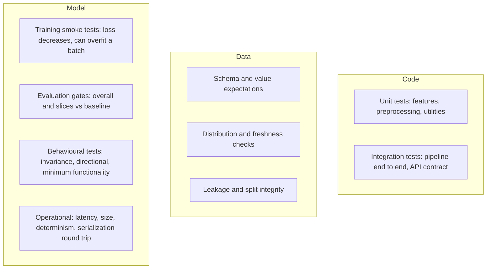

# Testing ML systems: code, data and models

> **Before this lesson:** read [CI/CD with GitHub Actions](#/lesson/mlops/github-actions) (where
> tests run), [Data validation and versioning with DVC](#/lesson/mlops/validation-versioning)
> (expectation suites) and [Model registry, model cards and governance](#/lesson/mlops/model-registry)
> (champion models and slice metrics). The FastAPI `TestClient` from
> [REST and gRPC serving with FastAPI](#/lesson/mlops/fastapi-grpc) appears once.

## In plain words

A **test** is a small program that checks another program and complains loudly if something is
wrong. In ordinary software a test can say "`add(2, 2)` must return 4" and that settles it. An ML
system is harder to pin down: its behaviour comes from code *plus* the data it learned from *plus*
the numbers (weights) training produced, and "correct" is a matter of statistics. A churn model that
is right 85% of the time is working; one that is right 60% of the time is broken; no single
prediction tells you which.

The everyday picture is a restaurant inspection. The inspector checks the equipment (does the oven
reach temperature? that is testing the **code**), the ingredients arriving at the back door (are
they fresh and labelled? that is testing the **data**), and the dishes (taste a sample: do they meet
the standard, and is the soup still salty when the chef changes? that is testing the **model**). No
single check is enough; together they catch most problems before a customer does.

Why this matters for a job: teams that ship ML without tests find their bugs in production, where
they are silent and expensive. Interviewers frequently ask "how would you test a model before
deploying it?", and a layered answer (code, data, model, integration, production) is what they hope
to hear.

## Words you need first

- An **assertion** is a line such as `assert x > 0` that stops the program with an error if the
  condition is false. Tests are built from assertions.
- **pytest** is Python's standard test runner: it finds functions whose names start with `test_`,
  runs them, and reports which assertions failed.
- A **unit test** checks one small piece (a function) in isolation. An **integration test** checks
  that several pieces work together. An **end-to-end test** checks the whole system from input to
  output.
- A **fixture** is prepared test data or a prepared object that tests share, such as a small table
  of fake customers.
- An **edge case** is an unusual input at the boundary of what is expected: an empty list, a zero, a
  missing value, a date at midnight.

## Why ML testing is different

Because behaviour comes from **code + data + trained weights**, outputs are probabilistic, and
correctness is statistical, we test at three levels:



The **ML Test Score** (Breck and colleagues at Google) organises the same ideas into a checklist of
tests for data, model, infrastructure and monitoring. Lubanovic's *FastAPI* testing chapter gives the
classic **test pyramid** for the code layer: many fast unit tests at the bottom, fewer integration
tests in the middle, a few full end-to-end tests at the top. It still applies.

## 1. Unit tests for feature and preprocessing code

Feature code is ordinary **deterministic** code (same input, same output every time), so test it with
pytest like any other code. Concentrate on **edge cases that silently corrupt training data**:
missing values (nulls), empty groups, division by zero, time zones, categories the code has never
seen, and the order of rows.

```python
# tests/unit/test_features.py
import numpy as np
import pandas as pd
import pytest
from churn.features import days_since_last_purchase, spend_ratio

def test_spend_ratio_handles_zero_denominator():
    df = pd.DataFrame({"spend_30d": [10.0, 0.0], "spend_90d": [0.0, 0.0]})
    out = spend_ratio(df)
    assert out.tolist() == [0.0, 0.0]            # defined behaviour, not inf/NaN

def test_days_since_uses_as_of_date_not_now():
    df = pd.DataFrame({"last_purchase": pd.to_datetime(["2025-01-10"])})
    assert days_since_last_purchase(df, as_of="2025-01-15").iloc[0] == 5

@pytest.mark.parametrize("plan,expected", [("pro", 1), ("basic", 0), ("unknown-new-plan", 0)])
def test_plan_encoding_tolerates_unseen_category(plan, expected):
    ...
```

What each test protects against:

- The first builds a two-row table where the denominator is zero and checks that the ratio comes out
  as 0.0, a deliberate decision, instead of infinity or `NaN` ("not a number"), either of which would
  quietly poison training.
- The second checks that "days since last purchase" is measured from a given `as_of` date and not
  from today's clock. Otherwise the same data would give different features on different days, and
  training features could not be reproduced.
- The third uses `@pytest.mark.parametrize` to run one test three times with different inputs,
  including a plan name the code has never seen. The `...` means the body is left out here.

**Property-based testing** turns the idea around. Instead of writing a few examples by hand, you
state a **property**, a rule that must hold for *every* valid input, and a library generates hundreds
of inputs trying to break it. Hypothesis is the Python library for this:

```python
from hypothesis import given, strategies as st

@given(st.lists(st.floats(min_value=0, max_value=1e6, allow_nan=False), min_size=1, max_size=200))
def test_minmax_scale_bounds(values):
    scaled = minmax_scale(values)
    assert all(0.0 <= v <= 1.0 for v in scaled)
    assert len(scaled) == len(values)
```

`@given(...)` describes the inputs (a **strategy**): lists of 1 to 200 floats between 0 and a
million, never `NaN`. The test states two properties of min-max scaling (stretching values so the
smallest becomes 0 and the largest 1): every output lies between 0 and 1, and the list keeps its
length. The demo below does the same thing with plain `random`, so it runs in your browser.

```python-run
# A tiny property-based test without external libraries.
import random
def minmax_scale(xs):
    lo, hi = min(xs), max(xs)
    if hi == lo:                      # the bug most implementations forget
        return [0.0 for _ in xs]
    return [(x - lo) / (hi - lo) for x in xs]

random.seed(0)
for trial in range(2000):
    n = random.randint(1, 20)
    xs = [random.choice([0.0, 1.0, 5.5, -3.0, 1e6]) if random.random() < 0.5 else random.uniform(-1e3, 1e3) for _ in range(n)]
    out = minmax_scale(xs)
    assert len(out) == n
    assert all(0.0 <= v <= 1.0 for v in out), (xs, out)
    # order-preserving property
    assert all((a <= b) == (fa <= fb) or fa == fb for a, fa in zip(xs, out) for b, fb in zip(xs, out))
print("2000 random cases passed (including constant lists that would divide by zero)")
```

The generator mixes a few "nasty" fixed values (0, a negative, a million) with random ones, so
lists in which every value is the same turn up regularly. That is the case where `hi - lo` is zero
and a careless implementation divides by zero; the `if hi == lo` line handles it. The third property
says scaling must not change the order of values. The output:

```text
2000 random cases passed (including constant lists that would divide by zero)
```

Delete the `if hi == lo` branch and run again: within a few trials the test crashes with
`ZeroDivisionError`, which is exactly the point of generating inputs instead of hand-picking them.

## 2. Data tests

Lesson 8 introduced expectation suites. In a test strategy they appear in two places, and it helps
to keep them apart:

- **In CI, on small fixture data**: check that the pipeline's *output* has the right schema (using
  **pandera**, a library for declaring the expected columns, types and value ranges of a DataFrame),
  no missing keys, the expected row counts. These are tests of *your code*.
- **In the pipeline, on real data**: check that the *incoming* data meets expectations. These are
  tests of *the world*.

Some data tests are specific to ML:

```python
def test_no_overlap_between_train_and_test(train, test):
    assert set(train.customer_id).isdisjoint(test.customer_id)      # entity leakage

def test_temporal_split(train, test):
    assert train.event_ts.max() < test.event_ts.min()               # no future in training

def test_label_rate_in_expected_range(train):
    assert 0.02 < train.churned.mean() < 0.30                       # catches broken label joins

def test_no_feature_perfectly_predicts_label(train):
    for col in FEATURES:                                             # leakage smoke alarm
        assert abs(train[col].corr(train.churned)) < 0.98
```

- **Entity leakage**: if the same customer appears in both training and test data, the model is
  partly tested on people it has already seen, and the score is too optimistic. `isdisjoint` checks
  that the two sets of IDs share nothing.
- **Temporal split**: the newest training event must be older than the oldest test event, so the
  model never learns from the future it is later tested on.
- **Label rate**: if roughly 8% of customers churn, a training set with 0% or 60% churners points to
  a broken **join** (the step that attaches labels to features).
- **Too-good feature**: a **correlation** (a number from -1 to 1 measuring how closely two columns
  move together) of 0.98 or more between a feature and the label almost always means the feature
  secretly contains the answer, a form of **data leakage** (lesson 1).

## 3. Model tests

### Training smoke tests (fast, on every pull request)

A **smoke test** is a quick check that nothing is badly broken. For training:

- The training function runs end to end on a tiny data set in seconds.
- The **loss** (the error number training tries to shrink) decreases over a few steps, with no
  `NaN`s.
- The model **can overfit a single small batch**. **Overfitting** means memorising the training
  examples instead of learning general rules; on a batch of 32 rows any working model should manage
  it. If it cannot, something is wired wrong: the labels are shuffled against the features, the
  learning rate is zero, the loss is computed on the wrong column.
- Output shapes and ranges are right (probabilities between 0 and 1; class probabilities in a row
  sum to 1).
- **Serialization round trip**: save the model to a file, load it back, and get identical
  predictions. (**Serialization** means converting an object into bytes for storage.)
- **Determinism**: the same random seed gives the same metrics, within a small tolerance.

```python
def test_model_roundtrip(tmp_path, tiny_data):
    X, y = tiny_data
    model = train(X, y, seed=0)
    mlflow.sklearn.save_model(model, tmp_path / "m")
    loaded = mlflow.pyfunc.load_model(str(tmp_path / "m"))
    np.testing.assert_allclose(model.predict_proba(X)[:, 1], loaded.predict(X), rtol=1e-6)

def test_can_overfit_tiny_batch(tiny_data):
    X, y = tiny_data
    model = train(X[:32], y[:32], seed=0, max_iter=500)
    assert (model.predict(X[:32]) == y[:32]).mean() > 0.95
```

`tmp_path` is a fixture pytest provides: a fresh temporary folder per test. The first test saves the
model with MLflow (lesson 10), loads it back through the generic interface that serving uses, and
checks the two sets of probabilities agree to a relative tolerance of one in a million
(`assert_allclose` compares arrays of floats, which are rarely exactly equal). The second trains on
32 rows with plenty of iterations and requires more than 95% of them to be predicted correctly.

### Evaluation gates (in the training pipeline)

An **evaluation gate** compares the new model with a **baseline** (a cheap alternative such as a
rule) and with the **current champion**, on a pinned test set, both overall and for each **slice**
(a subgroup such as new users or mobile users, lesson 12). Mueller and Guido (ch. 5) stress picking
metrics that reflect the business goal. On **imbalanced** data, where one class is rare, accuracy
misleads: a model that predicts "nobody churns" is 92% accurate when 8% churn. Use **precision**
(of those flagged, how many were right), **recall** (of the real cases, how many were caught),
F-scores (a combination of the two), PR and ROC curves, and choose the **operating threshold** (the
probability above which you act) on purpose.

```python
def test_beats_baseline(metrics, baseline_metrics):
    assert metrics["pr_auc"] >= baseline_metrics["pr_auc"] + 0.02

def test_no_slice_regression(metrics, champion_metrics):
    for s in ["new_users", "returning", "mobile"]:
        assert metrics[f"pr_auc_{s}"] >= champion_metrics[f"pr_auc_{s}"] - 0.01
```

The first gate requires a clear margin over the baseline (0.02 of PR-AUC). The second allows each
slice to fall by at most 0.01 compared with the champion, so an overall gain cannot hide damage to
one group.

### Behavioural tests

Inspired by *CheckList* (Ribeiro and colleagues, 2020), behavioural tests treat the model as a black
box and probe it the way a careful user would:

- **Invariance**: changes that should not matter do not change the prediction (a customer's name;
  swapping a word for a synonym in text; a tiny nudge to a numeric feature).
- **Directional expectation**: changes that should move the prediction a known way do so (more
  support tickets should not *lower* churn risk; adding "not" flips the sentiment of a sentence).
- **Minimum functionality**: simple, unambiguous cases the model must get right ("I love this" is
  positive).

```python-run
import numpy as np
rng = np.random.default_rng(0)
# A toy "model": logistic score over [tenure_months, support_tickets, monthly_charges]
w = np.array([-0.04, 0.35, 0.01]); b = -0.5
predict = lambda X: 1 / (1 + np.exp(-(X @ w + b)))

X = np.column_stack([rng.integers(1, 72, 500), rng.integers(0, 8, 500), rng.uniform(20, 120, 500)]).astype(float)

# Directional: +2 support tickets must never lower churn probability
X_more = X.copy(); X_more[:, 1] += 2
assert (predict(X_more) >= predict(X) - 1e-12).all()
# Invariance: a 1-cent change in monthly charges must not move the score by more than 0.001
X_eps = X.copy(); X_eps[:, 2] += 0.01
assert np.abs(predict(X_eps) - predict(X)).max() < 1e-3
# Minimum functionality: a clearly loyal vs a clearly at-risk customer
loyal, at_risk = np.array([[70, 0, 30.0]]), np.array([[1, 7, 110.0]])
assert predict(loyal)[0] < 0.2 < 0.6 < predict(at_risk)[0]
# Output contract
p = predict(X); assert ((p >= 0) & (p <= 1)).all() and not np.isnan(p).any()
print("behavioural tests passed; score range:", p.min().round(3), "-", p.max().round(3))
```

Line by line:

- The "model" is a **logistic** formula: multiply each feature by a weight (`X @ w` is matrix
  multiplication, one weighted sum per row), add `b`, and squeeze through `1 / (1 + e^-z)` into a
  probability. Long tenure lowers risk (weight -0.04); tickets raise it (+0.35).
- `X` is 500 made-up customers: tenure 1 to 71 months, 0 to 7 tickets, charges between 20 and 120.
- Directional test: add 2 tickets to everyone and require that no probability goes down (the
  `- 1e-12` allows for rounding).
- Invariance test: add one cent to every monthly charge and require that no score moves by 0.001 or
  more.
- Minimum functionality: a 70-month customer with no tickets must score below 0.2; a one-month
  customer with 7 tickets must score above 0.6.
- Output contract: every probability between 0 and 1 and none missing.

The output:

```text
behavioural tests passed; score range: 0.053 - 0.947
```

Try changing the ticket weight from `0.35` to `-0.35`: the directional assertion fails at once,
which is the kind of sign error that overall accuracy might never reveal.

### Operational tests

- **Latency** on reference hardware: the p95 of 1,000 predictions stays within budget.
- **Model size and memory** stay under limits.
- **Input contract**: predictions fail loudly, not silently, on missing columns or wrong data types.
- **Fairness**: where it applies, compare error rates across protected groups (characteristics such
  as age or gender that law or policy says must not drive unequal treatment).

## 4. Integration and end-to-end tests

- **Pipeline integration test**: run the whole training **DAG** (the graph of pipeline steps from
  lesson 13) on a small sample, in CI or nightly: load data, validate, build features, train,
  evaluate, register into a temporary registry. It catches broken hand-offs between steps.
- **API contract tests**: `TestClient` checks status codes, schemas and error handling (lesson 20).
  Schemathesis, as Lubanovic notes, can **fuzz** an OpenAPI schema: generate large numbers of
  unexpected requests automatically and report any that crash the service.
- **Training/serving consistency test**: run the *same raw records* through the offline feature
  pipeline and through the online serving path, and require identical feature vectors and
  predictions. This is the single most valuable ML integration test, because it catches
  training/serving skew (lesson 9) before users do.
- **Load tests** (Locust, k6) before release: find the throughput at which p95 or p99 breaks the SLO.

```python
def test_offline_online_feature_parity(sample_raw_events, offline_pipeline, client):
    offline = offline_pipeline.transform(sample_raw_events)                      # training path
    for i, raw in enumerate(sample_raw_events.to_dict("records")):
        online = client.post("/debug/features", json=raw).json()                 # serving path
        for name in FEATURES:
            assert online[name] == pytest.approx(offline.iloc[i][name], rel=1e-6), name
```

The test computes features for a batch of raw events with the training code, then sends each raw
event to a debug endpoint of the service that returns the features it would use. Each feature must
match to within one part in a million; if not, the failure message names the feature.

## 5. Testing in production

Offline tests cannot prove online behaviour. Progressive delivery (**shadow**, **canary**, **A/B**:
the next lesson) is testing with real traffic and safety limits. Monitoring (module 10) is the test
suite that never stops running.

## Organising the suite

```text
tests/
├── unit/           # ms each; pure functions; run on every commit
├── data/           # schema/contract tests on fixtures
├── model/          # smoke + behavioural tests on a tiny trained model (seconds)
├── integration/    # API + pipeline on small data (minutes)
└── slow/           # full training/eval gates (nightly / CT pipeline)
```

Use pytest **markers** (`@pytest.mark.slow`) to label tests so CI can include or skip groups, and
fixtures with small, version-controlled sample data. Keep tests **deterministic** (seed every random
generator) and **hermetic** (no network access; replace external services with **mocks**, stand-ins
that return canned answers) so that a failure always means something.

> [!WARNING]
> Asserting exact metric values (`assert auc == 0.8731`) creates flaky tests that break on harmless
> changes. Assert **bounds and relations**: above a baseline, within tolerance of the previous value, no
> slice regression beyond δ.

> [!INTERVIEW]
> "How do you test an ML model before deployment?" — Layer the answer: unit tests for feature code
> (edge cases, property-based); data tests (schema, ranges, leakage, split integrity); model tests
> (smoke: overfit a batch, round-trip, determinism; evaluation gates vs baseline and champion incl.
> slices; behavioural invariance/directional tests; latency/size); integration (pipeline on sample data,
> API contract, offline/online parity); then online validation via shadow/canary.

## Fixtures: small, deterministic, shared

Most of the pain in ML testing comes from data. A few well-designed pytest fixtures remove most of
it:

```python
# tests/conftest.py
import numpy as np, pandas as pd, pytest

@pytest.fixture(scope="session")
def tiny_customers() -> pd.DataFrame:
    """300 synthetic rows with the production schema and a learnable signal. Deterministic."""
    rng = np.random.default_rng(0)
    n = 300
    df = pd.DataFrame({
        "customer_id": np.arange(n),
        "tenure_months": rng.integers(0, 72, n),
        "monthly_charges": rng.uniform(20, 120, n).round(2),
        "plan": rng.choice(["basic", "pro", "premium"], n),
        "support_tickets_30d": rng.poisson(1.0, n),
        "last_login_days": np.where(rng.random(n) < 0.05, np.nan, rng.integers(0, 60, n)),
    })
    logit = -1.0 - 0.04 * df.tenure_months + 0.5 * df.support_tickets_30d
    df["churned"] = (rng.random(n) < 1 / (1 + np.exp(-logit))).astype(int)
    return df

@pytest.fixture(scope="session")
def tiny_model(tiny_customers):
    from churn.train import make_pipeline
    from churn.features import RAW_INPUTS
    return make_pipeline({"max_iter": 30}, seed=0).fit(tiny_customers[RAW_INPUTS], tiny_customers["churned"])

@pytest.fixture
def tiny_model_uri(tmp_path, tiny_model):
    import mlflow
    path = tmp_path / "model"
    mlflow.sklearn.save_model(tiny_model, str(path), pyfunc_predict_fn="predict_proba")
    return str(path)
```

`conftest.py` is the file where pytest looks for shared fixtures. `tiny_customers` builds 300 fake
customers with the real column names; about 5% have a missing `last_login_days`, so the
missing-value path is exercised. The churn label is drawn from a known formula, so there is a real
pattern to learn. `tiny_model` trains on it, and `tiny_model_uri` saves it to a temporary folder.
A test asks for a fixture by naming it as a parameter.

Design rules: **synthetic or anonymised** (no production **PII**, personally identifiable
information, in the repository), **small** (the whole suite runs in seconds), **seeded** (identical
on every machine), with **the production schema** (validated by the same pandera model as real data,
so a schema change breaks tests immediately), and containing **a real signal**, so "can the model
learn?" tests mean something. `scope="session"` trains the tiny model once per test run instead of
once per test.

## Testing the tests: mutation thinking

A test suite is only as good as the bugs it catches. A cheap way to measure it: inject realistic bugs
on purpose (each modified version is called a **mutant**) and count how many the suite notices
("kills").

```python-run
import numpy as np
rng = np.random.default_rng(0)

def features_correct(tenure, tickets):
    t = np.maximum(tenure, 1)
    return np.column_stack([tenure / 72, tickets / t])

MUTANTS = {
    "divide by raw tenure (div by zero)": lambda tenure, tickets: np.column_stack([tenure / 72, tickets / tenure]),
    "swapped columns":                    lambda tenure, tickets: np.column_stack([tickets / np.maximum(tenure, 1), tenure / 72]),
    "wrong normaliser (months vs years)": lambda tenure, tickets: np.column_stack([tenure / 6, tickets / np.maximum(tenure, 1)]),
    "integer division":                   lambda tenure, tickets: np.column_stack([tenure // 72, tickets / np.maximum(tenure, 1)]),
}

def weak_suite(f):                         # only checks the shape
    out = f(np.array([12, 24]), np.array([1, 2]))
    assert out.shape == (2, 2)

def strong_suite(f):
    with np.errstate(divide="ignore", invalid="ignore"):
        out = f(np.array([0, 12, 72]), np.array([3, 6, 0]))
    assert out.shape == (3, 2)
    assert np.isfinite(out).all()                                   # zero tenure must not blow up
    np.testing.assert_allclose(out[1], [12 / 72, 6 / 12])           # known-answer test fixes column order and scale
    assert 0 <= out[:, 0].min() and out[:, 0].max() <= 1            # range contract

for suite in (weak_suite, strong_suite):
    suite(features_correct)                                         # both pass on the correct code
    killed = 0
    for name, mutant in MUTANTS.items():
        try:
            suite(mutant)
        except AssertionError:
            killed += 1
    print(f"{suite.__name__:13s} catches {killed}/{len(MUTANTS)} injected bugs")
```

`features_correct` computes two features: tenure scaled to 0..1 (72 months is the maximum) and
tickets per month of tenure, guarding against zero tenure. The four mutants are typical real bugs.
The weak suite checks only the output shape; the strong suite includes a zero-tenure edge case, a
**known-answer test** (a row whose correct result was worked out by hand: 12/72 and 6/12) and a
range check. `np.errstate` silences NumPy's division warnings so the assertions do the talking. The
output:

```text
weak_suite    catches 0/4 injected bugs
strong_suite  catches 4/4 injected bugs
```

The weak suite has 100% **line coverage** of the feature function (every line runs) and catches
nothing. **Coverage measures what was executed, not what was verified.** Known-answer tests on
hand-computed examples, plus range and finiteness contracts, are what catch real feature bugs.
(Tools such as `mutmut` automate mutation testing.)

## What to test where: a decision table

| Risk | Cheapest effective test | Runs |
|---|---|---|
| Feature computed wrong | unit test with hand-computed expected values and edge cases | every commit |
| Schema of pipeline output changed | pandera/contract test on fixture output | every commit |
| Upstream data broken | expectation suite on the real batch | in the pipeline, before training |
| Train/test contamination | split-integrity assertions | in the pipeline |
| Model cannot learn (wiring bug) | overfit-a-batch / tiny-data smoke test | every commit |
| New model worse than current | evaluation gate vs champion with slices | training pipeline |
| Model violates domain logic | directional/invariance tests | training pipeline, PR sample |
| Serving differs from training | offline/online parity test | CI integration + shadow traffic |
| API contract broken | TestClient / schema-based fuzzing | every commit |
| Too slow / too big | latency and size budgets on reference hardware | CI nightly, pre-release |
| Works offline, fails with real traffic | shadow and canary | release |
| Degrades over time | monitoring and alerting | continuously |

Read the table as a series of nets with ever finer mesh: each catches what the earlier ones cannot,
and the further a bug travels down the list before it is caught, the more it costs.

## Testing non-deterministic and LLM components

Some components cannot be checked against an exact expected value. Techniques:

- **Seed and pin** what you can. Turn what you cannot into statistical tests with tolerances and
  enough samples that random failures become negligible.
- **Record and replay** external calls (LLM APIs, feature services) in unit tests, so they are fast,
  free and repeatable; run a small live suite on a schedule.
- **Assert properties, not exact strings**: valid JSON matching a schema, contains a citation, stays
  within a length budget, passes a groundedness check. The evaluation methods of module 12 are tests
  of this kind.
- **Golden files with review**: store an expected output in the repository; when it changes, a
  person reviews the difference instead of the test accepting it automatically.

## Summary

- Test code, data and models, each with its own techniques.
- Feature code deserves the most unit tests; property-based tests find edge cases you would not
  think of.
- Data tests guard schema, ranges, leakage and split integrity.
- Model tests include smoke tests, evaluation gates with slices, behavioural tests and operational
  checks.
- Integration tests cover the pipeline, the API contract and offline/online parity; production
  testing continues with shadow and canary releases and monitoring.
- Coverage says what ran, not what was checked: known-answer tests and contracts catch bugs.

## Glossary

- **Test / assertion** - a program that checks another / a line that fails if a condition is false.
- **Unit / integration / end-to-end test** - one function / several parts together / the whole
  system.
- **Test pyramid** - many unit tests, fewer integration tests, few end-to-end tests.
- **pytest / fixture / marker** - the test runner / shared prepared data or objects / a label for
  grouping tests.
- **Edge case** - an unusual input at the boundary of what is expected.
- **Property-based testing** - generating many inputs and checking a rule holds for all.
- **pandera** - a library for declaring and checking DataFrame schemas.
- **Entity leakage / temporal split** - the same entity in train and test / training strictly
  before testing in time.
- **Smoke test** - a quick check that nothing is badly broken.
- **Loss / overfitting** - the error training minimises / memorising instead of generalising.
- **Serialization round trip** - save, load, and get identical predictions.
- **Evaluation gate / baseline / champion / slice** - a pass/fail comparison / a cheap alternative /
  the current production model / a subgroup of the data.
- **Precision / recall** - share of flagged cases that were right / share of real cases caught.
- **Behavioural tests** - invariance, directional and minimum-functionality probes of a model.
- **Fuzzing** - sending many unexpected inputs to find crashes.
- **Parity test** - comparing training-path and serving-path features on the same records.
- **Deterministic / hermetic / mock** - same result every run / no outside dependencies / a
  stand-in for an external service.
- **Flaky test** - one that passes or fails at random.
- **Mutation testing / mutant** - injecting bugs to see whether tests notice / one modified version.
- **Coverage** - the share of lines executed by tests.
- **Known-answer test** - a test against a result worked out by hand.
- **PII** - personally identifiable information.
- **Golden file** - a stored expected output that changes only after human review.

```quiz
[
  {"q": "Which test best detects training/serving skew before release?",
   "options": ["A linter", "An offline/online parity test feeding the same raw records through both paths", "A unit test of the logger", "A coverage report"],
   "answer": 1, "explain": "It directly compares the features and predictions of the two code paths."},
  {"q": "What does 'the model can overfit a single small batch' verify?",
   "options": ["That the model generalises well", "That the training loop, loss and data wiring are functional", "That the data is balanced", "That the GPU is fast"],
   "answer": 1, "explain": "Failure to memorise a tiny batch indicates a bug in the training setup."},
  {"q": "A directional expectation test for a churn model could assert that...",
   "options": ["Changing the customer's name changes the score", "Increasing support tickets does not decrease predicted churn risk", "AUC equals exactly 0.87", "The model file is under 1 KB"],
   "answer": 1, "explain": "Known monotonic relationships should hold under controlled perturbations."},
  {"q": "Why avoid asserting exact metric values in tests?",
   "options": ["Metrics are secret", "They make tests flaky; harmless changes shift values slightly — assert bounds and relations instead", "pytest cannot compare floats", "They slow CI"],
   "answer": 1, "explain": "Use thresholds, tolerances and comparisons to baselines."},
  {"q": "Which data test guards against entity leakage?",
   "options": ["Checking that train and test share no customer IDs", "Checking column names are lowercase", "Checking file size", "Checking the label is an integer"],
   "answer": 0, "explain": "The same entity in train and test inflates evaluation."},
  {"q": "What is property-based testing?",
   "options": ["Testing real-estate models", "Generating many inputs automatically and asserting invariants hold for all of them", "Testing object properties with getters", "Manual exploratory testing"],
   "answer": 1, "explain": "Libraries such as Hypothesis search for counterexamples to stated properties."},
  {"q": "On imbalanced data, why is accuracy a poor gate metric?",
   "options": ["It is slow to compute", "Predicting the majority class yields high accuracy while missing the cases that matter", "It requires probabilities", "It cannot be logged to MLflow"],
   "answer": 1, "explain": "Use precision/recall-based metrics aligned with the business goal."},
  {"q": "A test suite reaches 100% line coverage of a feature function but checks only the output shape. What does the mutation demo show about it?",
   "options": ["It is excellent because coverage is 100%", "It can miss every realistic bug: coverage measures what ran, not what was verified", "It will catch division by zero automatically", "Coverage and mutation score are the same thing"],
   "answer": 1, "explain": "The weak suite caught 0 of 4 injected bugs; known-answer and range tests caught all 4."}
]
```

> **Source:** Breck et al., *The ML Test Score* (2017); Ribeiro et al., *Beyond Accuracy: Behavioral Testing of NLP Models with CheckList* (ACL 2020); Bill Lubanovic, *FastAPI*, ch. 12 (Testing: unit, integration, full tests, Schemathesis, Locust); Mueller & Guido, *Introduction to Machine Learning with Python*, ch. 5 (evaluation metrics, imbalanced data); Hypothesis and pandera documentation.
