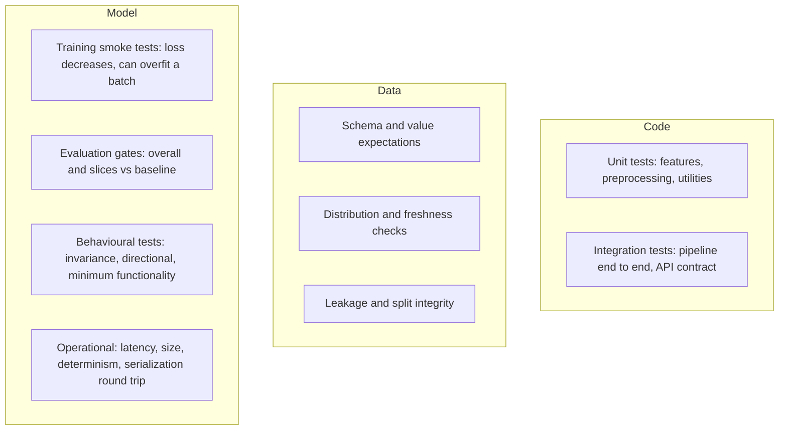

# Testing ML systems: code, data and models

## Why ML testing is different

In ordinary software you assert `f(2) == 4`. An ML system's behaviour comes from **code + data + trained
weights**, its outputs are probabilistic, and "correct" is statistical. So we test at three levels:



The **ML Test Score** (Breck et al.) organises the same ideas into tests for data, model, infrastructure
and monitoring. Lubanovic's *FastAPI* testing chapter gives the classic software pyramid — many fast unit
tests, fewer integration tests, few full end-to-end tests — which still applies to the code layer.

## 1. Unit tests for feature and preprocessing code

Feature code is ordinary deterministic code: test it with pytest. Focus on **edge cases that silently
corrupt training data**: nulls, empty groups, division by zero, time zones, unseen categories, ordering.

```python
# tests/unit/test_features.py
import numpy as np
import pandas as pd
import pytest
from churn.features import days_since_last_purchase, spend_ratio

def test_spend_ratio_handles_zero_denominator():
    df = pd.DataFrame({"spend_30d": [10.0, 0.0], "spend_90d": [0.0, 0.0]})
    out = spend_ratio(df)
    assert out.tolist() == [0.0, 0.0]            # defined behaviour, not inf/NaN

def test_days_since_uses_as_of_date_not_now():
    df = pd.DataFrame({"last_purchase": pd.to_datetime(["2025-01-10"])})
    assert days_since_last_purchase(df, as_of="2025-01-15").iloc[0] == 5

@pytest.mark.parametrize("plan,expected", [("pro", 1), ("basic", 0), ("unknown-new-plan", 0)])
def test_plan_encoding_tolerates_unseen_category(plan, expected):
    ...
```

**Property-based testing** (Hypothesis) generates many inputs and checks invariants:

```python
from hypothesis import given, strategies as st

@given(st.lists(st.floats(min_value=0, max_value=1e6, allow_nan=False), min_size=1, max_size=200))
def test_minmax_scale_bounds(values):
    scaled = minmax_scale(values)
    assert all(0.0 <= v <= 1.0 for v in scaled)
    assert len(scaled) == len(values)
```

```python-run
# A tiny property-based test without external libraries.
import random
def minmax_scale(xs):
    lo, hi = min(xs), max(xs)
    if hi == lo:                      # the bug most implementations forget
        return [0.0 for _ in xs]
    return [(x - lo) / (hi - lo) for x in xs]

random.seed(0)
for trial in range(2000):
    n = random.randint(1, 20)
    xs = [random.choice([0.0, 1.0, 5.5, -3.0, 1e6]) if random.random() < 0.5 else random.uniform(-1e3, 1e3) for _ in range(n)]
    out = minmax_scale(xs)
    assert len(out) == n
    assert all(0.0 <= v <= 1.0 for v in out), (xs, out)
    # order-preserving property
    assert all((a <= b) == (fa <= fb) or fa == fb for a, fa in zip(xs, out) for b, fb in zip(xs, out))
print("2000 random cases passed (including constant lists that would divide by zero)")
```

## 2. Data tests

Lesson 8 covered expectation suites. In a test suite they appear in two places:

- **In CI, on small fixture data**: assert that the pipeline's *output* has the right schema
  (`pandera`), no nulls in keys, expected row counts — tests of your code.
- **In the pipeline, on real data**: assert that the *incoming* data meets expectations — tests of the
  world.

Additional data tests specific to ML:

```python
def test_no_overlap_between_train_and_test(train, test):
    assert set(train.customer_id).isdisjoint(test.customer_id)      # entity leakage

def test_temporal_split(train, test):
    assert train.event_ts.max() < test.event_ts.min()               # no future in training

def test_label_rate_in_expected_range(train):
    assert 0.02 < train.churned.mean() < 0.30                       # catches broken label joins

def test_no_feature_perfectly_predicts_label(train):
    for col in FEATURES:                                             # leakage smoke alarm
        assert abs(train[col].corr(train.churned)) < 0.98
```

## 3. Model tests

### Training smoke tests (fast, run on every PR)

- The training function runs end to end on a tiny dataset in seconds.
- **Loss decreases** over a few steps; no NaNs.
- The model **can overfit a single small batch** (if it cannot, something is wired wrong).
- Output shapes and ranges are right (probabilities in [0, 1], rows sum to 1).
- **Serialization round trip**: save → load → identical predictions.
- **Determinism**: same seed → same metrics within tolerance.

```python
def test_model_roundtrip(tmp_path, tiny_data):
    X, y = tiny_data
    model = train(X, y, seed=0)
    mlflow.sklearn.save_model(model, tmp_path / "m")
    loaded = mlflow.pyfunc.load_model(str(tmp_path / "m"))
    np.testing.assert_allclose(model.predict_proba(X)[:, 1], loaded.predict(X), rtol=1e-6)

def test_can_overfit_tiny_batch(tiny_data):
    X, y = tiny_data
    model = train(X[:32], y[:32], seed=0, max_iter=500)
    assert (model.predict(X[:32]) == y[:32]).mean() > 0.95
```

### Evaluation gates (run in the training pipeline)

Compare against a **baseline** and the **current champion** on a pinned test set — overall and per slice
(lesson 12). Mueller & Guido (ch. 5) stress choosing metrics that reflect the business goal: accuracy is
misleading on imbalanced data; use precision/recall, F-scores, PR/ROC curves, and pick the operating
threshold deliberately.

```python
def test_beats_baseline(metrics, baseline_metrics):
    assert metrics["pr_auc"] >= baseline_metrics["pr_auc"] + 0.02

def test_no_slice_regression(metrics, champion_metrics):
    for s in ["new_users", "returning", "mobile"]:
        assert metrics[f"pr_auc_{s}"] >= champion_metrics[f"pr_auc_{s}"] - 0.01
```

### Behavioural tests

Inspired by *CheckList* (Ribeiro et al., 2020):

- **Invariance**: changes that should not matter do not change the prediction (a customer's name; swapping
  a synonym in text; a tiny perturbation of a numeric feature).
- **Directional expectation**: changes that should move the prediction in a known direction do so (more
  support tickets should not *decrease* churn risk; adding "not" flips sentiment).
- **Minimum functionality**: simple, unambiguous cases the model must get right ("I love this" →
  positive).

```python-run
import numpy as np
rng = np.random.default_rng(0)
# A toy "model": logistic score over [tenure_months, support_tickets, monthly_charges]
w = np.array([-0.04, 0.35, 0.01]); b = -0.5
predict = lambda X: 1 / (1 + np.exp(-(X @ w + b)))

X = np.column_stack([rng.integers(1, 72, 500), rng.integers(0, 8, 500), rng.uniform(20, 120, 500)]).astype(float)

# Directional: +2 support tickets must never lower churn probability
X_more = X.copy(); X_more[:, 1] += 2
assert (predict(X_more) >= predict(X) - 1e-12).all()
# Invariance: a 1-cent change in monthly charges must not move the score by more than 0.001
X_eps = X.copy(); X_eps[:, 2] += 0.01
assert np.abs(predict(X_eps) - predict(X)).max() < 1e-3
# Minimum functionality: an obviously loyal vs obviously at-risk customer
loyal, at_risk = np.array([[70, 0, 30.0]]), np.array([[1, 7, 110.0]])
assert predict(loyal)[0] < 0.2 < 0.6 < predict(at_risk)[0]
# Output contract
p = predict(X); assert ((p >= 0) & (p <= 1)).all() and not np.isnan(p).any()
print("behavioural tests passed; score range:", p.min().round(3), "-", p.max().round(3))
```

### Operational tests

- **Latency** on reference hardware: p95 of 1,000 predictions under budget.
- **Model size / memory** under limits.
- **Input contract**: predictions fail loudly (not silently) on missing columns or wrong dtypes.
- **Fairness** metrics across protected groups where applicable.

## 4. Integration and end-to-end tests

- **Pipeline integration test**: run the whole training DAG on a small sample in CI or nightly: data
  load → validate → features → train → evaluate → register (to a temporary registry). Catches interface
  breaks between steps.
- **API contract tests**: `TestClient` checks status codes, schemas, error handling (lesson 20);
  Schemathesis can fuzz an OpenAPI schema automatically, as Lubanovic notes.
- **Training/serving consistency test**: run the *same raw records* through the offline feature pipeline
  and the online serving path; assert the feature vectors and predictions match. This is the single most
  valuable ML integration test.
- **Load tests** (Locust, k6) before release: find the throughput where p95/p99 breach the SLO.

```python
def test_offline_online_feature_parity(sample_raw_events, offline_pipeline, client):
    offline = offline_pipeline.transform(sample_raw_events)                      # training path
    for i, raw in enumerate(sample_raw_events.to_dict("records")):
        online = client.post("/debug/features", json=raw).json()                 # serving path
        for name in FEATURES:
            assert online[name] == pytest.approx(offline.iloc[i][name], rel=1e-6), name
```

## 5. Testing in production

Offline tests cannot prove online behaviour. Progressive delivery — **shadow**, **canary**, **A/B** — is
testing with real traffic and guardrails (next lesson). Monitoring (module 10) is the test suite that
never stops running.

## Organising the suite

```text
tests/
├── unit/           # ms each; pure functions; run on every commit
├── data/           # schema/contract tests on fixtures
├── model/          # smoke + behavioural tests on a tiny trained model (seconds)
├── integration/    # API + pipeline on small data (minutes)
└── slow/           # full training/eval gates (nightly / CT pipeline)
```

Use pytest markers (`@pytest.mark.slow`) and fixtures with small, version-controlled sample data. Keep
tests **deterministic** (seed everything) and **hermetic** (no network; mock external services) so
failures mean something.

> [!WARNING]
> Asserting exact metric values (`assert auc == 0.8731`) creates flaky tests that break on harmless
> changes. Assert **bounds and relations**: above a baseline, within tolerance of the previous value, no
> slice regression beyond δ.

> [!INTERVIEW]
> "How do you test an ML model before deployment?" — Layer the answer: unit tests for feature code
> (edge cases, property-based); data tests (schema, ranges, leakage, split integrity); model tests
> (smoke: overfit a batch, round-trip, determinism; evaluation gates vs baseline and champion incl.
> slices; behavioural invariance/directional tests; latency/size); integration (pipeline on sample data,
> API contract, offline/online parity); then online validation via shadow/canary.

## Fixtures: small, deterministic, shared

Most ML test pain comes from data. A few well-designed pytest fixtures remove it:

```python
# tests/conftest.py
import numpy as np, pandas as pd, pytest

@pytest.fixture(scope="session")
def tiny_customers() -> pd.DataFrame:
    """300 synthetic rows with the production schema and a learnable signal. Deterministic."""
    rng = np.random.default_rng(0)
    n = 300
    df = pd.DataFrame({
        "customer_id": np.arange(n),
        "tenure_months": rng.integers(0, 72, n),
        "monthly_charges": rng.uniform(20, 120, n).round(2),
        "plan": rng.choice(["basic", "pro", "premium"], n),
        "support_tickets_30d": rng.poisson(1.0, n),
        "last_login_days": np.where(rng.random(n) < 0.05, np.nan, rng.integers(0, 60, n)),
    })
    logit = -1.0 - 0.04 * df.tenure_months + 0.5 * df.support_tickets_30d
    df["churned"] = (rng.random(n) < 1 / (1 + np.exp(-logit))).astype(int)
    return df

@pytest.fixture(scope="session")
def tiny_model(tiny_customers):
    from churn.train import make_pipeline
    from churn.features import RAW_INPUTS
    return make_pipeline({"max_iter": 30}, seed=0).fit(tiny_customers[RAW_INPUTS], tiny_customers["churned"])

@pytest.fixture
def tiny_model_uri(tmp_path, tiny_model):
    import mlflow
    path = tmp_path / "model"
    mlflow.sklearn.save_model(tiny_model, str(path), pyfunc_predict_fn="predict_proba")
    return str(path)
```

Design rules: **synthetic or anonymised** (no production PII in the repository), **small** (the whole
suite should run in seconds), **seeded** (identical on every machine), with **the production schema**
(validated by the same pandera model as real data, so schema changes break tests immediately), and
containing **a real signal** so "can the model learn?" tests are meaningful. `scope="session"` trains the
tiny model once per test run.

## Testing the tests: mutation thinking

A test suite is only as good as the bugs it catches. A cheap way to evaluate it: deliberately inject
realistic bugs and see whether anything fails.

```python-run
import numpy as np
rng = np.random.default_rng(0)

def features_correct(tenure, tickets):
    t = np.maximum(tenure, 1)
    return np.column_stack([tenure / 72, tickets / t])

MUTANTS = {
    "divide by raw tenure (div by zero)": lambda tenure, tickets: np.column_stack([tenure / 72, tickets / tenure]),
    "swapped columns":                    lambda tenure, tickets: np.column_stack([tickets / np.maximum(tenure, 1), tenure / 72]),
    "wrong normaliser (months vs years)": lambda tenure, tickets: np.column_stack([tenure / 6, tickets / np.maximum(tenure, 1)]),
    "integer division":                   lambda tenure, tickets: np.column_stack([tenure // 72, tickets / np.maximum(tenure, 1)]),
}

def weak_suite(f):                         # only checks the shape
    out = f(np.array([12, 24]), np.array([1, 2]))
    assert out.shape == (2, 2)

def strong_suite(f):
    with np.errstate(divide="ignore", invalid="ignore"):
        out = f(np.array([0, 12, 72]), np.array([3, 6, 0]))
    assert out.shape == (3, 2)
    assert np.isfinite(out).all()                                   # zero tenure must not blow up
    np.testing.assert_allclose(out[1], [12 / 72, 6 / 12])           # known-answer test fixes column order and scale
    assert 0 <= out[:, 0].min() and out[:, 0].max() <= 1            # range contract

for suite in (weak_suite, strong_suite):
    suite(features_correct)                                         # both pass on the correct code
    killed = 0
    for name, mutant in MUTANTS.items():
        try:
            suite(mutant)
        except AssertionError:
            killed += 1
    print(f"{suite.__name__:13s} catches {killed}/{len(MUTANTS)} injected bugs")
```

The weak suite has 100% line coverage of the feature function and catches nothing. **Coverage measures
what was executed, not what was verified.** Known-answer tests on hand-computed examples, plus range and
finiteness contracts, are what kill real feature bugs. (Tools such as `mutmut` automate mutation
testing.)

## What to test where: a decision table

| Risk | Cheapest effective test | Runs |
|---|---|---|
| Feature computed wrong | unit test with hand-computed expected values and edge cases | every commit |
| Schema of pipeline output changed | pandera/contract test on fixture output | every commit |
| Upstream data broken | expectation suite on the real batch | in the pipeline, before training |
| Train/test contamination | split-integrity assertions | in the pipeline |
| Model cannot learn (wiring bug) | overfit-a-batch / tiny-data smoke test | every commit |
| New model worse than current | evaluation gate vs champion with slices | training pipeline |
| Model violates domain logic | directional/invariance tests | training pipeline, PR sample |
| Serving differs from training | offline/online parity test | CI integration + shadow traffic |
| API contract broken | TestClient / schema-based fuzzing | every commit |
| Too slow / too big | latency and size budgets on reference hardware | CI nightly, pre-release |
| Works offline, fails with real traffic | shadow and canary | release |
| Degrades over time | monitoring and alerting | continuously |

Read the table as a sequence of nets with decreasing mesh size: each catches what the previous one
cannot, and the further right a bug travels the more it costs to catch.

## Testing non-deterministic and LLM components

Some components cannot be asserted exactly. Techniques:

- **Seed and pin** what you can; mark what you cannot as statistical tests with tolerances and enough
  samples to make flakiness negligible.
- **Record and replay** external calls (LLM APIs, feature services) in unit tests so they are fast,
  free and deterministic; run a small live suite on a schedule.
- **Assert properties, not strings**: valid JSON matching a schema, contains a citation, within a length
  budget, passes a groundedness check — the evaluation methods of module 12 are tests of this kind.
- **Golden files with review**: store an expected output; when it changes, the diff is reviewed by a
  human rather than auto-accepted.

## Summary

- Test code, data and models — each with different techniques.
- Feature code deserves the most unit tests; property-based tests find edge cases.
- Data tests guard schema, ranges, leakage and split integrity.
- Model tests include smoke tests, evaluation gates with slices, behavioural tests and operational checks.
- Integration tests cover the pipeline, the API contract and offline/online parity; production testing
  continues with shadow/canary and monitoring.

```quiz
[
  {"q": "Which test best detects training/serving skew before release?",
   "options": ["A linter", "An offline/online parity test feeding the same raw records through both paths", "A unit test of the logger", "A coverage report"],
   "answer": 1, "explain": "It directly compares the features and predictions of the two code paths."},
  {"q": "What does 'the model can overfit a single small batch' verify?",
   "options": ["That the model generalises well", "That the training loop, loss and data wiring are functional", "That the data is balanced", "That the GPU is fast"],
   "answer": 1, "explain": "Failure to memorise a tiny batch indicates a bug in the training setup."},
  {"q": "A directional expectation test for a churn model could assert that...",
   "options": ["Changing the customer's name changes the score", "Increasing support tickets does not decrease predicted churn risk", "AUC equals exactly 0.87", "The model file is under 1 KB"],
   "answer": 1, "explain": "Known monotonic relationships should hold under controlled perturbations."},
  {"q": "Why avoid asserting exact metric values in tests?",
   "options": ["Metrics are secret", "They make tests flaky; harmless changes shift values slightly — assert bounds and relations instead", "pytest cannot compare floats", "They slow CI"],
   "answer": 1, "explain": "Use thresholds, tolerances and comparisons to baselines."},
  {"q": "Which data test guards against entity leakage?",
   "options": ["Checking that train and test share no customer IDs", "Checking column names are lowercase", "Checking file size", "Checking the label is an integer"],
   "answer": 0, "explain": "The same entity in train and test inflates evaluation."},
  {"q": "What is property-based testing?",
   "options": ["Testing real-estate models", "Generating many inputs automatically and asserting invariants hold for all of them", "Testing object properties with getters", "Manual exploratory testing"],
   "answer": 1, "explain": "Libraries such as Hypothesis search for counterexamples to stated properties."},
  {"q": "On imbalanced data, why is accuracy a poor gate metric?",
   "options": ["It is slow to compute", "Predicting the majority class yields high accuracy while missing the cases that matter", "It requires probabilities", "It cannot be logged to MLflow"],
   "answer": 1, "explain": "Use precision/recall-based metrics aligned with the business goal."}
]
```

> **Source:** Breck et al., *The ML Test Score* (2017); Ribeiro et al., *Beyond Accuracy: Behavioral Testing of NLP Models with CheckList* (ACL 2020); Bill Lubanovic, *FastAPI*, ch. 12 (Testing: unit, integration, full tests, Schemathesis, Locust); Mueller & Guido, *Introduction to Machine Learning with Python*, ch. 5 (evaluation metrics, imbalanced data); Hypothesis and pandera documentation.
