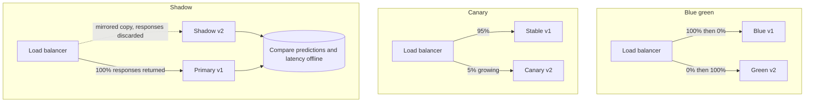
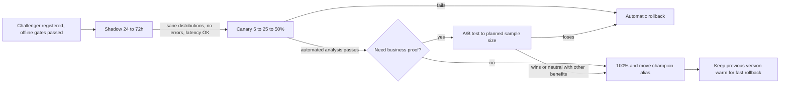

# Deployment strategies: canary, shadow, blue-green and A/B

> **Before this lesson:** read [Kubernetes core objects](#/lesson/mlops/k8s-core) (rolling updates
> and readiness probes), [Scaling, GPUs and KServe on Kubernetes](#/lesson/mlops/k8s-ml) (KServe's
> traffic split) and [Testing ML systems](#/lesson/mlops/testing-ml) (what offline tests can and
> cannot prove). The statistics section assumes only that you know what a percentage and an average
> are.

## In plain words

Swapping the model behind a live product is like changing the engine of a plane while it flies.
Offline tests tell you the new engine ran well on the test bench (yesterday's data). They cannot
tell you whether it starts in the cold, whether it stays fast at full load, whether the live inputs
look like the bench inputs, or whether passengers prefer it. **Deployment strategies** are the
standard ways of putting a new version in front of real traffic *gradually*, measuring as you go,
with a quick way back if something looks wrong.

An everyday picture is a restaurant trying a new recipe. It can cook the new dish quietly in the
kitchen and compare it with the old one without serving it (**shadow**); serve it to one table in
twenty and watch their faces (**canary**); prepare a second, complete kitchen and switch all orders
over at once, keeping the old kitchen ready (**blue-green**); or give half the customers each dish
for a month and compare how often they come back (**A/B test**).

Why this matters for a job: a model that is excellent offline can still fail in production, and the
worst failures are silent: the service is healthy, the predictions are wrong. Interviewers love
"canary versus shadow versus A/B" because answering well shows you understand risk, measurement and
statistics together.

## Deployment is a risk-management problem

**Progressive delivery** means exposing a new version to production gradually, with measurement at
each step and a fast way back. It rests on separating two words that are often used as synonyms:

- **Deployment**: the new version is running on production infrastructure.
- **Release**: users are actually affected by it.

Good strategies pull these apart: you can deploy without releasing (shadow), and you can release to
1% of users before 100% (canary). The share of users or requests that could be hurt if the new
version is bad is called the **blast radius**; keeping it small is the whole game.

## The strategies at a glance

| Strategy | What happens | Risk to users | Extra cost | Answers |
|---|---|---|---|---|
| **Recreate** | stop old, start new | downtime, full exposure | none | — |
| **Rolling update** | replace pods gradually | all users get new version within minutes | small surge | "does it start and pass probes?" |
| **Blue-green** | full new environment, switch traffic at once | full exposure at switch, instant rollback | 2× capacity temporarily | "does it work at full scale?" |
| **Canary** | small % of real traffic to new, increase stepwise | limited blast radius | small | "is it operationally healthy on real traffic?" |
| **Shadow (mirroring)** | copy traffic to new; discard its responses | none (users unaffected) | 2× inference compute | "does it behave sanely on live inputs? how do predictions differ?" |
| **A/B test** | randomised user split for long enough to measure outcomes | half the users on the variant | experiment infra | "is it *better* for the business?" |
| **Interleaving / bandits** | mix results or adapt allocation dynamically | low | complexity | faster ranking comparisons; less regret |

The last row is explained near the end of the lesson. The diagram shows how traffic flows in the
three most common strategies.



## Rolling updates

The Kubernetes default (lesson 22): pods are replaced a few at a time, each step waiting for
readiness probes. It is simple and needs little extra capacity, but **both versions serve at the
same time** during the update, there is no gate based on metrics beyond "the pod is ready", and
undoing it means another rollout. That is fine for low-risk changes. It is not enough for model
changes, whose typical failure is "healthy pod, bad predictions": the readiness probe passes
happily while the model is wrong.

## Blue-green

Run the new version (**green**) next to the old one (**blue**) at full capacity, test green
privately, then switch the **router** (the component deciding where requests go, such as the
Kubernetes Service selector) from blue to green in one move. Rollback is switching back, which
takes seconds.

The costs: double capacity during the switch, and all users move at once, so a problem that only
shows up under real traffic hits everyone. Database or schema changes must be **backward
compatible** (the old version must still work with them), because both versions may run during the
switch. Blue-green also suits batch pipelines: write the new scores to a new table, validate it,
then repoint a database **view** (a named query that consumers read instead of the table itself).

## Canary releases

The name comes from the canaries miners carried underground: the bird reacted to bad air before
the miners did. A **canary release** sends a small share of traffic to the new version, compares it
with the **baseline**, the old version, *running at the same time*, raises the share in steps (for
example 5%, then 25%, 50%, 100%) while automated analysis passes, and rolls back automatically if it
fails.

What to compare at each step:

- **Operational**: error rate, timeouts, latency p95 and p99, CPU, memory and GPU use, and
  **saturation** (how close a resource is to its limit).
- **Model-level proxies**: a **proxy** is a measurable signal that stands in for something you
  cannot measure yet, such as true accuracy before the labels arrive. Examples: the distribution of
  predictions (mean score, share above the decision threshold), the rate of missing values or
  fallbacks, and feature-skew metrics.
- **Fast business signals** where available: **click-through rate** (the share of shown items that
  get clicked), acceptance rate.

Guidelines:

- Compare the canary with the **concurrent baseline**, not with last week: traffic at 3 p.m. on a
  Monday looks nothing like 3 a.m. on a Sunday.
- Require a **minimum sample size** per step before judging; 20 requests prove nothing.
- Use **relative thresholds**, such as "canary error rate at most baseline + 0.5 percentage points"
  and "canary p95 at most 1.2 times baseline". A **percentage point** (pp) is an absolute difference
  between percentages: going from 1.0% to 1.5% is +0.5 pp.
- Keep each step for a **bake time** long enough to reveal slow failures such as memory leaks or a
  cache that slowly fills up.
- Use **sticky routing** (the same user always reaches the same version) if a user seeing both
  versions would be confusing.

Tooling: **Argo Rollouts** and **Flagger** automate stepwise traffic shifting with analysis based on
Prometheus queries. **Service meshes** (Istio, Linkerd) and API gateways do the actual traffic
splitting. **KServe** has `canaryTrafficPercent` (lesson 23), and SageMaker and Vertex AI endpoints
can split traffic between model variants.

```yaml
# Argo Rollouts canary with automated analysis (sketch)
apiVersion: argoproj.io/v1alpha1
kind: Rollout
metadata: {name: churn-api}
spec:
  replicas: 10
  strategy:
    canary:
      steps:
        - setWeight: 5
        - pause: {duration: 10m}
        - analysis: {templates: [{templateName: error-rate-and-latency}]}
        - setWeight: 25
        - pause: {duration: 15m}
        - analysis: {templates: [{templateName: error-rate-and-latency}]}
        - setWeight: 50
        - pause: {duration: 15m}
---
apiVersion: argoproj.io/v1alpha1
kind: AnalysisTemplate
metadata: {name: error-rate-and-latency}
spec:
  metrics:
    - name: error-rate
      interval: 1m
      failureLimit: 1
      successCondition: result[0] < 0.01
      provider:
        prometheus:
          address: http://prometheus:9090
          query: |
            sum(rate(predict_requests_total{status="error",track="canary"}[5m]))
            / sum(rate(predict_requests_total{track="canary"}[5m]))
```

A `Rollout` replaces the ordinary Deployment. Its `steps` read like a recipe: send 5% of traffic to
the new version, wait 10 minutes, run the analysis; then 25%, wait, analyse; then 50%. The
`AnalysisTemplate` runs a Prometheus query every minute that divides the canary's error requests by
all its requests over the last 5 minutes (`rate(...[5m])` is the per-second rate over a 5-minute
window, lesson 27). If the result is not below 1% more than once (`failureLimit: 1`), Argo aborts
and sends all traffic back to the stable version.

The decision logic of such a controller fits in a few lines. This is the logic you will implement in
the problem `mlops-canary-decision`.

```python-run
# A canary controller in miniature (the logic of problem mlops-canary-decision).
def decide(schedule, observations, max_err_increase=0.005, max_p95_ratio=1.2, min_requests=500):
    rate = lambda e, n: e / n if n else 0.0
    for i, w in enumerate(schedule):
        if i >= len(observations): return ("CONTINUE", w)
        o = observations[i]
        if o["can_req"] < min_requests: return ("HOLD", w)
        if rate(o["can_err"], o["can_req"]) - rate(o["base_err"], o["base_req"]) > max_err_increase:
            return ("ROLLBACK", 0)
        if o["can_p95"] > o["base_p95"] * max_p95_ratio: return ("ROLLBACK", 0)
    return ("PROMOTE", 100)

steps = [5, 25, 50, 100]
healthy = dict(base_req=9500, base_err=19, can_req=600, can_err=1, base_p95=80, can_p95=84)
slow    = dict(base_req=7500, base_err=15, can_req=2500, can_err=5, base_p95=80, can_p95=131)
thin    = dict(base_req=9500, base_err=19, can_req=40, can_err=3, base_p95=80, can_p95=82)
print("after step 1 healthy       :", decide(steps, [healthy]))
print("step 2 latency regression  :", decide(steps, [healthy, slow]))
print("too few canary requests    :", decide(steps, [thin]))
```

How it reads: `schedule` is the list of traffic weights and `observations` holds one dictionary of
measurements per completed step (requests, errors and p95 for baseline and canary). For each step
the controller first checks the sample size, then compares error rates (an increase of more than
0.005, half a percentage point, fails), then latency (more than 1.2 times the baseline p95 fails).
If observations run out, it continues to the next weight; if every step passed, it promotes. The
output:

```text
after step 1 healthy       : ('CONTINUE', 25)
step 2 latency regression  : ('ROLLBACK', 0)
too few canary requests    : ('HOLD', 5)
```

In the second case the canary's p95 is 131 ms against 80 ms, far over 1.2 times (96 ms), so it rolls
back. The third case is the instructive one: 3 errors in 40 requests looks like a 7.5% error rate,
yet the controller *holds* instead of rolling back, because 40 requests are too few to tell noise
from a real problem.

## Shadow deployment

In a **shadow deployment** (also called **traffic mirroring**), the new model receives a copy of
live requests; its responses are logged and never returned to users. It is the safest way to check a
model against **real production inputs**:

- It shows whether the new version crashes, times out or runs out of memory under real load and
  real input quirks.
- It reveals **training/serving skew**: live features that differ from those seen in training.
- It lets you compare **prediction distributions** and **disagreement** with the current model, and
  compute accuracy later when the true labels arrive.

The limits: it doubles inference cost; it cannot measure **user response**, since users never see
its output; and systems with **side effects** (sending emails, charging cards, writing to databases)
need those effects **stubbed out** (replaced by harmless fakes), or the shadow would email customers
twice. Mirror at the gateway or service mesh (Istio's `mirror` setting) or asynchronously inside the
application, so shadow latency never slows the user's request.

The demo compares a champion's scores with a shadow candidate's on the same 5,000 mirrored requests.

```python-run
import numpy as np
rng = np.random.default_rng(0)
n = 5000
champion = np.clip(rng.beta(2, 8, n), 0, 1)                       # live model scores
shadow = np.clip(champion + rng.normal(0.02, 0.05, n), 0, 1)      # candidate, mirrored traffic
thr = 0.5
print(f"mean score      champion={champion.mean():.3f}  shadow={shadow.mean():.3f}")
print(f"flag rate >{thr} champion={(champion>thr).mean():.3%}  shadow={(shadow>thr).mean():.3%}")
print(f"decision disagreement: {((champion>thr) != (shadow>thr)).mean():.2%}")
print(f"correlation of scores: {np.corrcoef(champion, shadow)[0,1]:.3f}")
```

`rng.beta(2, 8, n)` draws scores between 0 and 1 that are mostly low (a **beta distribution** is a
common way to generate values in that range), standing in for the champion. The shadow's scores are
the champion's plus a small upward shift and some noise, and `np.clip` keeps them within 0 and 1.
The four lines compare average score, the share of requests above the 0.5 threshold (the **flag
rate**), the share of requests where the two models would make different decisions, and the
**correlation** of the scores. The output:

```text
mean score      champion=0.202  shadow=0.222
flag rate >0.5 champion=2.000%  shadow=3.440%
decision disagreement: 1.92%
correlation of scores: 0.924
```

The scores are highly correlated, yet the shadow would flag 72% more customers (3.44% against
2.00%). If each flag triggers a retention offer, that is a large change in cost that no aggregate
accuracy number would have warned about. A jump in flag rate or disagreement is a reason to
investigate *before* any user is affected.

## A/B testing

A canary asks "is it safe?"; an **A/B test** asks "is it better?" Users are **randomly assigned** to
the **control** group (A, the current version) or the **treatment** group (B, the new version). The
usual way is to **hash** a stable user ID together with an experiment-specific **salt** (an extra
string, so different experiments split users differently) and use the result to pick a group; the
same user then always lands in the same group. A business metric, declared before the test starts,
is compared once a sample size, also computed in advance, has been reached.

### The statistics

Suppose the metric is **conversion**, the share of users who do something (buy, click, stay). Group
A converts at 2.0% and group B at 2.6%. Is B really better, or did B get lucky? A **hypothesis
test** answers this by asking: if there were truly no difference (the **null hypothesis**), how
surprising would a gap this large be? That probability is the **p-value**. If it is below a
threshold chosen in advance, the **significance level** $\alpha$ (usually 0.05), we call the result
**statistically significant**.

For conversion rates the standard tool is the pooled **two-proportion z-test**:

$$z = \frac{\hat p_B - \hat p_A}{\sqrt{\hat p(1-\hat p)\left(\frac{1}{n_A}+\frac{1}{n_B}\right)}}, \qquad \hat p = \frac{x_A + x_B}{n_A + n_B}$$

In words: $x_A$ and $n_A$ are conversions and users in group A, and $\hat p_A = x_A / n_A$ is its
conversion rate (likewise for B). $\hat p$ is the **pooled** rate of both groups together, which is
what the rate would be if the null hypothesis were true. The bottom of the fraction is the
**standard error**, the size of the gap you would expect from luck alone. So $z$ measures the
observed gap in units of "typical luck". A $z$ beyond about 1.96 in either direction corresponds to
a p-value below 0.05.

```python-run
import math
def ab_test(xa, na, xb, nb, alpha=0.05):
    pa, pb = xa / na, xb / nb
    p = (xa + xb) / (na + nb)
    se = math.sqrt(p * (1 - p) * (1 / na + 1 / nb))
    z = (pb - pa) / se
    pval = 2 * (1 - 0.5 * (1 + math.erf(abs(z) / math.sqrt(2))))
    return pa, pb, z, pval, ("significant" if pval < alpha else "not significant")

print("A=2.00% B=2.60% n=10k each :", [round(v, 4) if isinstance(v, float) else v for v in ab_test(200, 10000, 260, 10000)])
print("A=2.00% B=2.10% n=10k each :", [round(v, 4) if isinstance(v, float) else v for v in ab_test(200, 10000, 210, 10000)])

def sample_size(p, mde, alpha=0.05, power=0.8):
    z_a, z_b = 1.96, 0.8416                        # two-sided 5%, 80% power
    p2 = p + mde
    return math.ceil((z_a + z_b) ** 2 * (p * (1 - p) + p2 * (1 - p2)) / mde ** 2)
for mde in (0.006, 0.003, 0.001):
    print(f"baseline 2%, detect +{mde*100:.1f} pp -> need ~{sample_size(0.02, mde):,} users per arm")
```

`ab_test` follows the formula line by line. `math.erf` is the error function, from which the normal
distribution's probabilities are computed; doubling the tail gives a **two-sided** p-value (a
difference in either direction counts). `sample_size` answers the planning question: how many users
per group (**arm**) are needed to detect a given **minimum detectable effect** (MDE), the smallest
improvement worth finding, with 80% **power** (an 80% chance of detecting the effect if it really
exists)? The output:

```text
A=2.00% B=2.60% n=10k each : [0.02, 0.026, 2.8303, 0.0047, 'significant']
A=2.00% B=2.10% n=10k each : [0.02, 0.021, 0.499, 0.6178, 'not significant']
baseline 2%, detect +0.6 pp -> need ~9,795 users per arm
baseline 2%, detect +0.3 pp -> need ~36,691 users per arm
baseline 2%, detect +0.1 pp -> need ~315,207 users per arm
```

A gap of 0.6 points with 10,000 users per group gives $z \approx 2.83$ and $p \approx 0.005$: very
unlikely to be luck. A gap of 0.1 points gives $p \approx 0.62$: entirely consistent with luck. Small
effects need very large samples: halving the detectable effect roughly quadruples the sample size,
because the required size grows with one over the effect squared.

### Pitfalls

- **Peeking**: checking every day and stopping at the first p < 0.05 inflates false positives
  dramatically, because with enough looks luck will eventually cross the line. Fix the sample size
  in advance, or use **sequential methods** designed for continuous monitoring.
- **Sample ratio mismatch (SRM)**: if a planned 50/50 split comes out 50.9/49.1 over a million users,
  assignment or logging is broken. Do not trust the results until you find out why.
- **Multiple comparisons**: test 20 metrics at $\alpha = 0.05$ and one will look "significant" by
  chance. Declare one **primary metric** in advance, plus **guardrail metrics** (things that must not
  get worse, such as latency or complaints).
- **Novelty and primacy effects**: users react to anything new (novelty) or cling to what they know
  (primacy) at first. Run for full weekly cycles.
- **Interference**: in marketplaces and social feeds, users in one group affect users in the other.
  Use **cluster** designs (randomise whole cities or groups) or **switchback** designs (alternate the
  whole system between versions over time).
- **Offline/online mismatch**: a model with better offline AUC can lose online, which is precisely
  why you test.

**Multi-armed bandits** shift traffic toward the better-performing variant as evidence accumulates,
reducing **regret** (the value lost by sending users to the worse variant) when the goal is to
optimise rather than to measure cleanly. **Interleaving** mixes the results of two rankers into one
list for the same user and sees which ranker's items get clicked, giving far more sensitive
comparisons for search and recommendation than splitting users.

## Putting it together: a rollout pipeline for a model



A new model passes its offline gates, runs in shadow for one to three days, goes through a canary,
optionally an A/B test, and finally takes 100% of traffic while the registry's champion alias moves
to it (lesson 12). Rollback readiness is part of the design: keep the previous model version
deployed or deployable in seconds, make rollback one command or automatic, and practise it.

**Feature flags** complement all of this inside the application: a flag service decides per request
which model version or code path to use, which gives you an instant **kill switch** (turn the new
model off) without redeploying anything.

> [!INTERVIEW]
> "Canary vs shadow vs A/B?" — **Shadow**: zero user risk, validates behaviour on live inputs, cannot
> measure user impact, doubles compute. **Canary**: limited real exposure, validates operational health
> with automated rollback, short duration. **A/B**: randomised, statistically powered measurement of
> business impact, longer duration. A typical sequence is shadow → canary → A/B → full rollout. Mention
> comparing against a concurrent baseline, minimum sample sizes and peeking.

## Summary

- Separate deployment from release; expose new versions gradually, with measurement and fast
  rollback.
- Blue-green: instant switch and rollback at twice the capacity. Canary: stepwise traffic with
  automated analysis relative to a concurrent baseline. Shadow: mirrored traffic, zero user risk. A/B:
  randomised measurement of business outcomes.
- Statistics matter: sample sizes, concurrent baselines, no peeking, SRM checks, a primary metric.

## Glossary

- **Progressive delivery** - releasing gradually with measurement and a fast way back.
- **Deployment / release** - running in production / affecting users.
- **Blast radius** - how much is harmed if the new version is bad.
- **Rolling update / recreate** - replace pods a few at a time / stop everything then start.
- **Blue-green** - two full environments with a one-step switch.
- **Canary** - a small, growing share of traffic to the new version, compared with the baseline.
- **Shadow / mirroring** - sending a copy of traffic to the new version and discarding its answers.
- **Baseline (in a canary)** - the old version measured at the same time.
- **Proxy metric** - a measurable stand-in for an outcome you cannot see yet.
- **Percentage point (pp)** - an absolute difference between two percentages.
- **Bake time** - how long each canary step lasts before judging.
- **Sticky routing** - the same user always reaches the same version.
- **Side effect / stub** - an action with outside consequences / a harmless fake replacing it.
- **A/B test / control / treatment** - a randomised comparison / the current version / the new one.
- **Salt** - an extra string mixed into a hash so experiments split users independently.
- **Conversion** - the share of users who take a target action.
- **Null hypothesis / p-value / significance level** - "no real difference" / how surprising the
  data would be if that were true / the p-value threshold, usually 0.05.
- **Standard error** - the size of difference expected from chance alone.
- **Power / MDE** - the chance of detecting a real effect / the smallest effect worth detecting.
- **Peeking** - stopping a test early at the first significant look.
- **SRM** - sample ratio mismatch: group sizes that do not match the planned split.
- **Guardrail metric** - a metric that must not get worse.
- **Bandit / regret / interleaving** - adaptive traffic allocation / value lost to the worse variant /
  mixing two rankers' results in one list.
- **Feature flag / kill switch** - a runtime switch choosing a code path / turning a feature off
  instantly.

```quiz
[
  {"q": "Which strategy exposes NO users to the new model's outputs?",
   "options": ["Canary", "Shadow (traffic mirroring)", "Blue-green", "A/B test"],
   "answer": 1, "explain": "Shadow responses are logged and discarded."},
  {"q": "What can shadow deployment NOT tell you?",
   "options": ["Whether the model crashes on live inputs", "Whether latency is acceptable", "How users respond to the new predictions", "How predictions differ from the champion"],
   "answer": 2, "explain": "Users never see shadow outputs, so user impact is unmeasured."},
  {"q": "Why compare a canary against a baseline running at the same time rather than last week's metrics?",
   "options": ["Last week's data is deleted", "Traffic mix and load vary over time; a concurrent baseline controls for that", "It is cheaper", "Kubernetes requires it"],
   "answer": 1, "explain": "Time-of-day and seasonal effects would otherwise confound the comparison."},
  {"q": "What is the main cost of blue-green deployment?",
   "options": ["Slow rollback", "Temporarily running two full-capacity environments", "No health checks", "It needs a service mesh"],
   "answer": 1, "explain": "Both environments must be able to serve full traffic at the switch."},
  {"q": "What is 'peeking' in A/B testing?",
   "options": ["Looking at the code", "Repeatedly checking results and stopping when significant, inflating false positives", "Using a holdout set", "Sampling logs"],
   "answer": 1, "explain": "Fixed-horizon tests assume one look at the planned sample size."},
  {"q": "A planned 50/50 experiment shows 52/48 assignment over 2 million users. What should you do?",
   "options": ["Ignore it", "Treat it as a sample ratio mismatch and investigate before trusting any result", "Stop and ship B", "Increase alpha"],
   "answer": 1, "explain": "SRM indicates a bug in assignment or logging."},
  {"q": "To detect half as large an effect in an A/B test you need roughly...",
   "options": ["Half the sample", "The same sample", "Twice the sample", "Four times the sample"],
   "answer": 3, "explain": "Required sample size scales with 1/effect^2."},
  {"q": "A canary shows 3 errors in 40 requests at the first step. The best automated action is...",
   "options": ["Promote", "Hold until the minimum sample size is reached", "Delete the baseline", "Scale to zero"],
   "answer": 1, "explain": "The sample is too small to distinguish noise from a real regression."}
]
```

> **Source:** Argo Rollouts, Flagger, Istio (traffic mirroring) and KServe documentation; Kohavi, Tang & Xu, *Trustworthy Online Controlled Experiments* (peeking, SRM, guardrail metrics); Chip Huyen, *AI Engineering*, ch. 4 and ch. 10 (online evaluation and feedback); Google SRE Workbook, *Canarying Releases*.
