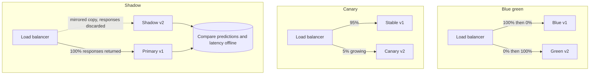
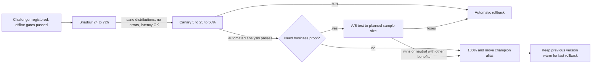

# Deployment strategies: canary, shadow, blue-green and A/B

## Deployment is a risk-management problem

Offline evaluation tells you the model is good on yesterday's data. It cannot tell you whether the new
image starts, whether latency holds under real traffic, whether live feature values match training, or
whether users respond better. **Progressive delivery** exposes a new version to production gradually,
with measurement and a fast way back.

Two terms to separate:

- **Deployment**: the new version is running in production infrastructure.
- **Release**: users are actually affected by it.

Good strategies decouple the two — you can deploy without releasing (shadow), and release to 1% before
100% (canary).

## The strategies at a glance

| Strategy | What happens | Risk to users | Extra cost | Answers |
|---|---|---|---|---|
| **Recreate** | stop old, start new | downtime, full exposure | none | — |
| **Rolling update** | replace pods gradually | all users get new version within minutes | small surge | "does it start and pass probes?" |
| **Blue-green** | full new environment, switch traffic at once | full exposure at switch, instant rollback | 2× capacity temporarily | "does it work at full scale?" |
| **Canary** | small % of real traffic to new, increase stepwise | limited blast radius | small | "is it operationally healthy on real traffic?" |
| **Shadow (mirroring)** | copy traffic to new; discard its responses | none (users unaffected) | 2× inference compute | "does it behave sanely on live inputs? how do predictions differ?" |
| **A/B test** | randomised user split for long enough to measure outcomes | half the users on the variant | experiment infra | "is it *better* for the business?" |
| **Interleaving / bandits** | mix results or adapt allocation dynamically | low | complexity | faster ranking comparisons; less regret |



## Rolling updates

The Kubernetes default (lesson 22): pods are replaced a few at a time, gated by readiness probes.
Simple and capacity-efficient, but **both versions serve at once**, there is no metric-based gate beyond
"the pod is ready", and rollback is another rollout. Fine for low-risk changes; insufficient for model
changes whose failure mode is "healthy pod, bad predictions".

## Blue-green

Run the new version (green) alongside the old (blue) at full capacity, test green privately, then switch
the router/Service selector. Rollback is switching back — seconds. Costs: double capacity during the
switch, and all users move at once. Database/schema changes must be backward compatible because both
versions may run concurrently during the switch. Useful for batch pipelines too: write the new scores
to a new table, validate, then repoint a view.

## Canary releases

Send a small share of traffic to the new version; compare it against the **baseline running at the same
time**; increase the share in steps (e.g., 5 → 25 → 50 → 100%) while automated analysis passes, and roll
back automatically if it fails.

What to compare at each step:

- **Operational**: error rate, timeouts, latency p95/p99, CPU/memory/GPU, saturation.
- **Model-level proxies**: prediction distribution (mean score, share above threshold), rate of
  nulls/fallbacks, feature-skew metrics.
- **Fast business signals** where available: click-through, acceptance rate.

Guidelines:

- Compare canary vs **concurrent baseline**, not vs last week — time-of-day effects are huge.
- Require a **minimum sample size** per step before judging; 20 requests prove nothing.
- Use **relative thresholds** (canary error rate at most baseline + 0.5 pp; p95 at most 1.2× baseline).
- Keep each step for a **bake time** long enough to see slow failures (memory leaks, cache effects).
- **Sticky routing** by user/session if consistency matters.

Tooling: **Argo Rollouts** and **Flagger** automate stepwise traffic shifting with analysis from
Prometheus queries; service meshes (Istio, Linkerd) and gateways do the traffic splitting; **KServe**
has `canaryTrafficPercent` (lesson 23); SageMaker and Vertex endpoints support traffic splitting between
variants.

```yaml
# Argo Rollouts canary with automated analysis (sketch)
apiVersion: argoproj.io/v1alpha1
kind: Rollout
metadata: {name: churn-api}
spec:
  replicas: 10
  strategy:
    canary:
      steps:
        - setWeight: 5
        - pause: {duration: 10m}
        - analysis: {templates: [{templateName: error-rate-and-latency}]}
        - setWeight: 25
        - pause: {duration: 15m}
        - analysis: {templates: [{templateName: error-rate-and-latency}]}
        - setWeight: 50
        - pause: {duration: 15m}
---
apiVersion: argoproj.io/v1alpha1
kind: AnalysisTemplate
metadata: {name: error-rate-and-latency}
spec:
  metrics:
    - name: error-rate
      interval: 1m
      failureLimit: 1
      successCondition: result[0] < 0.01
      provider:
        prometheus:
          address: http://prometheus:9090
          query: |
            sum(rate(predict_requests_total{status="error",track="canary"}[5m]))
            / sum(rate(predict_requests_total{track="canary"}[5m]))
```

```python-run
# A canary controller in miniature (the logic of problem mlops-canary-decision).
def decide(schedule, observations, max_err_increase=0.005, max_p95_ratio=1.2, min_requests=500):
    rate = lambda e, n: e / n if n else 0.0
    for i, w in enumerate(schedule):
        if i >= len(observations): return ("CONTINUE", w)
        o = observations[i]
        if o["can_req"] < min_requests: return ("HOLD", w)
        if rate(o["can_err"], o["can_req"]) - rate(o["base_err"], o["base_req"]) > max_err_increase:
            return ("ROLLBACK", 0)
        if o["can_p95"] > o["base_p95"] * max_p95_ratio: return ("ROLLBACK", 0)
    return ("PROMOTE", 100)

steps = [5, 25, 50, 100]
healthy = dict(base_req=9500, base_err=19, can_req=600, can_err=1, base_p95=80, can_p95=84)
slow    = dict(base_req=7500, base_err=15, can_req=2500, can_err=5, base_p95=80, can_p95=131)
thin    = dict(base_req=9500, base_err=19, can_req=40, can_err=3, base_p95=80, can_p95=82)
print("after step 1 healthy       :", decide(steps, [healthy]))
print("step 2 latency regression  :", decide(steps, [healthy, slow]))
print("too few canary requests    :", decide(steps, [thin]))
```

Note the third case: 3 errors in 40 requests looks like a 7.5% error rate, but the controller *holds*
rather than rolling back — the sample is too small to judge.

## Shadow deployment

The new model receives a copy of live requests; its responses are logged, never returned. This is the
safest way to validate a model against **real production inputs**:

- Verifies it does not crash, time out or exhaust memory under real load and real input quirks.
- Reveals **training/serving skew** — live features differ from training.
- Lets you compare **prediction distributions** and disagreement with the current model, and compute
  offline metrics later when labels arrive.

Limits: it doubles inference cost; it cannot measure **user response** (users never see its output); and
shadowing systems with **side effects** (sending emails, charging cards, writing to databases) requires
stubbing those effects out. Mirror at the gateway/mesh (Istio `mirror`), or in the application
asynchronously so that shadow latency never affects the user.

```python-run
import numpy as np
rng = np.random.default_rng(0)
n = 5000
champion = np.clip(rng.beta(2, 8, n), 0, 1)                       # live model scores
shadow = np.clip(champion + rng.normal(0.02, 0.05, n), 0, 1)      # candidate, mirrored traffic
thr = 0.5
print(f"mean score      champion={champion.mean():.3f}  shadow={shadow.mean():.3f}")
print(f"flag rate >{thr} champion={(champion>thr).mean():.3%}  shadow={(shadow>thr).mean():.3%}")
print(f"decision disagreement: {((champion>thr) != (shadow>thr)).mean():.2%}")
print(f"correlation of scores: {np.corrcoef(champion, shadow)[0,1]:.3f}")
```

A jump in flag rate or disagreement is a reason to investigate *before* any user is affected.

## A/B testing

A canary asks "is it safe?"; an **A/B test** asks "is it better?" Users are **randomly assigned** to
control (A) or treatment (B), typically by hashing a stable user ID with an experiment salt, and a
pre-declared business metric is compared after a pre-computed sample size is reached.

### The statistics

For a conversion metric, the pooled two-proportion z-test:

$$z = \frac{\hat p_B - \hat p_A}{\sqrt{\hat p(1-\hat p)\left(\frac{1}{n_A}+\frac{1}{n_B}\right)}}, \qquad \hat p = \frac{x_A + x_B}{n_A + n_B}$$

```python-run
import math
def ab_test(xa, na, xb, nb, alpha=0.05):
    pa, pb = xa / na, xb / nb
    p = (xa + xb) / (na + nb)
    se = math.sqrt(p * (1 - p) * (1 / na + 1 / nb))
    z = (pb - pa) / se
    pval = 2 * (1 - 0.5 * (1 + math.erf(abs(z) / math.sqrt(2))))
    return pa, pb, z, pval, ("significant" if pval < alpha else "not significant")

print("A=2.00% B=2.60% n=10k each :", [round(v, 4) if isinstance(v, float) else v for v in ab_test(200, 10000, 260, 10000)])
print("A=2.00% B=2.10% n=10k each :", [round(v, 4) if isinstance(v, float) else v for v in ab_test(200, 10000, 210, 10000)])

def sample_size(p, mde, alpha=0.05, power=0.8):
    z_a, z_b = 1.96, 0.8416                        # two-sided 5%, 80% power
    p2 = p + mde
    return math.ceil((z_a + z_b) ** 2 * (p * (1 - p) + p2 * (1 - p2)) / mde ** 2)
for mde in (0.006, 0.003, 0.001):
    print(f"baseline 2%, detect +{mde*100:.1f} pp -> need ~{sample_size(0.02, mde):,} users per arm")
```

Small effects need very large samples: halving the detectable effect roughly quadruples the sample size.

### Pitfalls

- **Peeking**: checking daily and stopping at the first p < 0.05 inflates false positives dramatically.
  Fix the sample size in advance or use sequential methods designed for continuous monitoring.
- **Sample ratio mismatch (SRM)**: if a 50/50 split yields 50.9/49.1 on a million users, assignment or
  logging is broken — distrust the results.
- **Multiple comparisons**: testing 20 metrics yields one "significant" result by chance; pre-register a
  primary metric and guardrail metrics.
- **Novelty and primacy effects**: early behaviour differs; run for full weekly cycles.
- **Interference**: users influence each other (marketplaces, social feeds); use cluster or
  switchback designs.
- **Offline/online mismatch**: a model with better offline AUC can lose online — which is precisely why
  you test.

**Multi-armed bandits** shift traffic toward better variants as evidence accumulates, reducing regret
when the goal is optimisation rather than a clean estimate. **Interleaving** mixes two rankers' results
in one list for the same user, giving far more sensitive comparisons for search and recommendation.

## Putting it together: a rollout pipeline for a model



Rollback readiness is part of the design: keep the previous model version deployed (or deployable in
seconds), make rollback one command or automatic, and practise it.

**Feature flags** complement all of this at the application layer: a flag service decides per request
which model version or code path to use, enabling instant kill switches without redeploying.

> [!INTERVIEW]
> "Canary vs shadow vs A/B?" — **Shadow**: zero user risk, validates behaviour on live inputs, cannot
> measure user impact, doubles compute. **Canary**: limited real exposure, validates operational health
> with automated rollback, short duration. **A/B**: randomised, statistically powered measurement of
> business impact, longer duration. A typical sequence is shadow → canary → A/B → full rollout. Mention
> comparing against a concurrent baseline, minimum sample sizes and peeking.

## Summary

- Separate deployment from release; expose new versions gradually with measurement and fast rollback.
- Blue-green: instant switch and rollback at 2× capacity. Canary: stepwise traffic with automated,
  baseline-relative analysis. Shadow: mirrored traffic, zero user risk. A/B: randomised measurement of
  business outcomes.
- Statistics matter: sample sizes, concurrent baselines, no peeking, SRM checks.

```quiz
[
  {"q": "Which strategy exposes NO users to the new model's outputs?",
   "options": ["Canary", "Shadow (traffic mirroring)", "Blue-green", "A/B test"],
   "answer": 1, "explain": "Shadow responses are logged and discarded."},
  {"q": "What can shadow deployment NOT tell you?",
   "options": ["Whether the model crashes on live inputs", "Whether latency is acceptable", "How users respond to the new predictions", "How predictions differ from the champion"],
   "answer": 2, "explain": "Users never see shadow outputs, so user impact is unmeasured."},
  {"q": "Why compare a canary against a baseline running at the same time rather than last week's metrics?",
   "options": ["Last week's data is deleted", "Traffic mix and load vary over time; a concurrent baseline controls for that", "It is cheaper", "Kubernetes requires it"],
   "answer": 1, "explain": "Time-of-day and seasonal effects would otherwise confound the comparison."},
  {"q": "What is the main cost of blue-green deployment?",
   "options": ["Slow rollback", "Temporarily running two full-capacity environments", "No health checks", "It needs a service mesh"],
   "answer": 1, "explain": "Both environments must be able to serve full traffic at the switch."},
  {"q": "What is 'peeking' in A/B testing?",
   "options": ["Looking at the code", "Repeatedly checking results and stopping when significant, inflating false positives", "Using a holdout set", "Sampling logs"],
   "answer": 1, "explain": "Fixed-horizon tests assume one look at the planned sample size."},
  {"q": "A planned 50/50 experiment shows 52/48 assignment over 2 million users. What should you do?",
   "options": ["Ignore it", "Treat it as a sample ratio mismatch and investigate before trusting any result", "Stop and ship B", "Increase alpha"],
   "answer": 1, "explain": "SRM indicates a bug in assignment or logging."},
  {"q": "To detect half as large an effect in an A/B test you need roughly...",
   "options": ["Half the sample", "The same sample", "Twice the sample", "Four times the sample"],
   "answer": 3, "explain": "Required sample size scales with 1/effect^2."},
  {"q": "A canary shows 3 errors in 40 requests at the first step. The best automated action is...",
   "options": ["Promote", "Hold until the minimum sample size is reached", "Delete the baseline", "Scale to zero"],
   "answer": 1, "explain": "The sample is too small to distinguish noise from a real regression."}
]
```

> **Source:** Argo Rollouts, Flagger, Istio (traffic mirroring) and KServe documentation; Kohavi, Tang & Xu, *Trustworthy Online Controlled Experiments* (peeking, SRM, guardrail metrics); Chip Huyen, *AI Engineering*, ch. 4 and ch. 10 (online evaluation and feedback); Google SRE Workbook, *Canarying Releases*.
