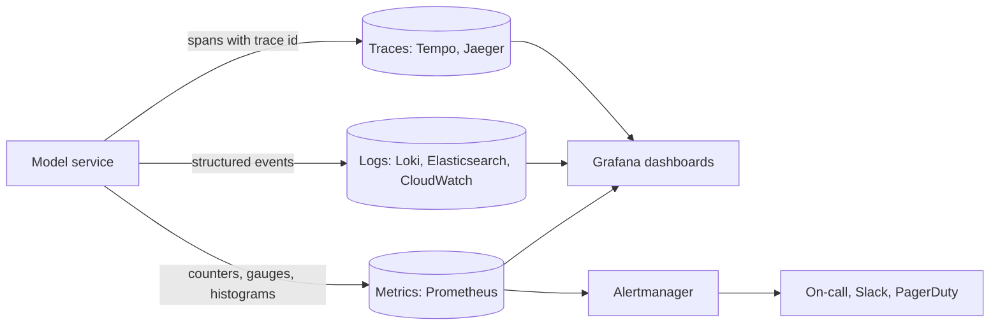

# Metrics, logs, traces and Prometheus

> **Before this lesson:** read [REST and gRPC serving with FastAPI](#/lesson/mlops/fastapi-grpc)
> (the service exposes a Prometheus counter and histogram at `/metrics`) and
> [Model servers, batching, autoscaling and caching](#/lesson/mlops/model-servers) (latency
> percentiles such as p95). [Kubernetes core objects](#/lesson/mlops/k8s-core) explains the pod
> annotations that tell Prometheus what to collect.

## In plain words

Once a model is live, you need to know what it is doing without standing over it. A car dashboard
is the everyday picture: a speedometer and fuel gauge show numbers that change over time
(**metrics**); the trip computer keeps a record of individual events such as "engine warning at
14:02" (**logs**); and a mechanic's diagnostic tool can follow one problem through every part of the
engine (**traces**). Warning lights that switch on when a number crosses a line are **alerts**.

This lesson is about building that dashboard for an ML service: what to measure, how the standard
tool, **Prometheus**, collects and queries numbers, how to write logs that can be searched, how
traces show where time goes, and how to turn a reliability promise into numbers using SLOs and error
budgets.

Why this matters for a job: ML systems fail quietly. A broken model still answers every request with
status 200 and a believable number, so the only way to notice is to watch the right signals. "What
would you monitor for a deployed model?" is one of the most common MLOps interview questions, and a
good answer is organised in layers, exactly as this lesson is.

## Monitoring vs observability

Huyen (*AI Engineering*, ch. 10) separates two ideas that people often blur:

- **Monitoring** watches what a system puts out (error counts, latency) so that you notice when
  something goes wrong. It does not promise to tell you *why*.
- **Observability** is the stronger property: the system emits enough information that you can work
  out what is happening inside it, and diagnose a new kind of problem from the data you already
  collect, without deploying new code to investigate.

She also borrows three measures from DevOps for judging how well a team can see and fix problems:

- **MTTD**, mean time to detection: how long, on average, between a problem starting and someone
  noticing.
- **MTTR**, mean time to response or resolution: how long until it is fixed.
- **CFR**, change failure rate: the share of deployments that need a fix or a rollback.

Her warning for ML teams is that observability has to be designed in from the start, and that
evaluation and monitoring should be one connected loop: the metrics that mattered when the model was
evaluated offline should be tracked online, and problems found in production should be added to the
offline evaluation set.

## The three pillars



The service sends three kinds of data to three kinds of storage. **Grafana** draws dashboards from
all three. **Alertmanager** receives alerts from Prometheus and routes them to the **on-call**
engineer (the person responsible for responding to incidents at that moment) through chat or a
paging service such as PagerDuty.

| Pillar | What it is | Good for | Cost profile |
|---|---|---|---|
| **Metrics** | numeric time series, aggregated | dashboards, alerting, trends, SLOs | cheap; fixed per series |
| **Logs** | timestamped records of discrete events | detail, debugging, audit, ad hoc questions | grows with traffic |
| **Traces** | the path of one request across components as linked spans | finding *where* time or errors come from | usually sampled |

A **time series** is a sequence of numbers with timestamps, such as "requests per second, every 15
seconds". **Sampled** means only a fraction is kept.

In Huyen's terms, metrics compress information into aggregates; logs are a record of events that is
only ever appended to; and a trace stitches related events together into the complete story of one
request. Her advice on logging is to record as much as you can (configuration, inputs, outputs,
intermediate steps, timings), each tagged with identifiers that let you trace where it came from,
and still to read samples of raw production traffic by hand on a regular basis.

## What to measure in an ML service

Four layers, from generic to ML-specific:

1. **Infrastructure**: CPU, memory, GPU utilisation and GPU memory, disk, network, pod restarts.
2. **Service**: the **RED** method: **R**ate (requests per second), **E**rrors (the failing
   fraction), **D**uration (latency percentiles); plus **saturation** (queue depth, in-flight
   requests, meaning how close the service is to full). Google's "four golden signals" are
   latency, traffic, errors and saturation.
3. **Model and data**: the distribution of predictions, the distributions of input features, rates
   of missing or default values, drift scores (lesson 28), the share of fallbacks, which model
   version is serving, how fresh the features are, batch sizes.
4. **Business and quality**: metrics computed once the **ground truth** (the real outcome) arrives,
   such as precision and **calibration** (whether predicted probabilities match observed
   frequencies: of customers given 0.3, do about 30% churn?); click-through, conversion, user
   feedback; and **cost**, per thousand predictions or, for LLMs, per token.

For LLM services add: time to first token, time per output token, tokens in and out, cache hit rate
and how often guardrails trigger (module 12).

## Prometheus

**Prometheus** is a time-series database built for monitoring. It **pulls** metrics: every few
seconds it makes an HTTP request (a **scrape**) to each target's `/metrics` page, stores the numbers,
evaluates rules on them and fires alerts. Pulling means services do not need to know where
Prometheus is; they only publish a page.

### Metric types

| Type | Behaviour | Example |
|---|---|---|
| **Counter** | only goes up (resets on restart) | `predict_requests_total` |
| **Gauge** | goes up and down | `in_flight_requests`, `model_loaded_timestamp` |
| **Histogram** | counts observations into cumulative buckets (`_bucket{le="0.1"}`), plus `_sum`, `_count` | `predict_latency_seconds` |
| **Summary** | client-side quantiles | rarely preferred: cannot be aggregated across pods |

A histogram's buckets are **cumulative**: the bucket `le="0.1"` ("less than or equal to 0.1 seconds")
counts every request that took 0.1 s or less, including those also counted in the 0.05 s bucket.

Every sample carries **labels**, key-value pairs such as `{model_version="8", status="ok"}`, and each
unique combination of label values is a separate time series.

> [!WARNING]
> **Cardinality kills Prometheus.** Never put unbounded values — user IDs, request IDs, raw feature
> values, prompts — in labels. Keep labels to small fixed sets (version, endpoint, status class). High
> cardinality detail belongs in logs and traces.

**Cardinality** is the number of distinct values. A `status` label with values `ok` and `error` adds
two series; a `user_id` label with a million users adds a million, and Prometheus runs out of
memory.

### Instrumenting a model service

**Instrumenting** means adding code that records metrics.

```python
from prometheus_client import Counter, Gauge, Histogram

REQUESTS = Counter("predict_requests_total", "Prediction requests", ["model_version", "status"])
LATENCY = Histogram("predict_latency_seconds", "End-to-end latency",
                    ["model_version"], buckets=[.005, .01, .025, .05, .1, .25, .5, 1, 2.5, 5])
SCORE = Histogram("prediction_score", "Distribution of predicted probabilities",
                  ["model_version"], buckets=[i / 10 for i in range(1, 11)])
MISSING = Counter("feature_missing_total", "Missing feature values at serving", ["feature"])
IN_FLIGHT = Gauge("in_flight_requests", "Requests currently being processed")
MODEL_INFO = Gauge("model_info", "Static model metadata", ["model_version", "git_sha"])

def predict(features, version):
    with IN_FLIGHT.track_inprogress(), LATENCY.labels(version).time():
        for name, value in features.items():
            if value is None:
                MISSING.labels(name).inc()
        p = model.predict(features)
        SCORE.labels(version).observe(p)
        REQUESTS.labels(version, "ok").inc()
        return p
```

Line by line:

- Each metric gets a name, a help text and the names of its labels. By convention counters end in
  `_total` and units appear in the name (`_seconds`).
- `LATENCY` has buckets from 5 ms to 5 s. `SCORE` is a histogram of predicted probabilities with ten
  buckets (0.1, 0.2, ..., 1.0), a cheap way to watch the prediction distribution.
- `MODEL_INFO` is a common trick: a gauge always set to 1 whose labels carry metadata, so dashboards
  can show which version and commit are running.
- Inside `predict`, `track_inprogress()` raises the in-flight gauge on entry and lowers it on exit,
  and `.time()` measures how long the block takes and records it in the latency histogram.
  `.labels(...)` picks the series; `.inc()` adds one; `.observe(p)` records a value in a histogram.

The scrape target returns plain text:

```text
# HELP predict_requests_total Prediction requests
# TYPE predict_requests_total counter
predict_requests_total{model_version="8",status="ok"} 182311
predict_latency_seconds_bucket{model_version="8",le="0.05"} 170002
predict_latency_seconds_bucket{model_version="8",le="0.1"} 180450
predict_latency_seconds_bucket{model_version="8",le="+Inf"} 182311
predict_latency_seconds_sum{model_version="8"} 6120.4
predict_latency_seconds_count{model_version="8"} 182311
```

Reading it: 182,311 successful requests since the process started; 170,002 took 50 ms or less;
180,450 took 100 ms or less; all of them are below infinity (`+Inf`); together they took 6,120.4
seconds, an average of about 34 ms.

### PromQL essentials

**PromQL** is Prometheus's query language.

```promql
# request rate (per second) over the last 5 minutes, by version
sum by (model_version) (rate(predict_requests_total[5m]))

# error ratio
sum(rate(predict_requests_total{status="error"}[5m])) / sum(rate(predict_requests_total[5m]))

# p95 latency estimated from histogram buckets, aggregated across pods
histogram_quantile(0.95, sum by (le) (rate(predict_latency_seconds_bucket[5m])))

# mean predicted score (a cheap prediction-drift signal)
sum(rate(prediction_score_sum[1h])) / sum(rate(prediction_score_count[1h]))

# share of requests with a missing 'income' feature
rate(feature_missing_total{feature="income"}[15m]) / ignoring(feature) sum(rate(predict_requests_total[15m]))
```

Key ideas:

- `[5m]` selects the last 5 minutes of samples. `rate()` turns an ever-growing counter into a
  per-second rate over that window and copes with counters that reset when a pod restarts.
- `sum by (model_version)` adds up the series from all pods, keeping one result per version.
- `histogram_quantile(0.95, ...)` estimates the 95th percentile from bucket counts. Always add up
  the **buckets** across pods first (`sum by (le)`), because percentiles themselves cannot be
  averaged.
- The quantile is an **estimate** obtained by **linear interpolation** inside one bucket (assuming
  values are spread evenly within it), so put bucket boundaries near your SLO thresholds.

The demo shows how good or bad that estimate is.

```python-run
import numpy as np
rng = np.random.default_rng(0)
lat = rng.lognormal(mean=-3.2, sigma=0.6, size=50_000)             # seconds
buckets = [.005, .01, .025, .05, .1, .25, .5, 1, 2.5]
counts = [(lat <= b).sum() for b in buckets] + [len(lat)]           # cumulative, last = +Inf

def histogram_quantile(q, buckets, counts):
    rank = q * counts[-1]
    prev_b, prev_c = 0.0, 0
    for b, c in zip(buckets, counts):
        if c >= rank:
            return prev_b + (b - prev_b) * (rank - prev_c) / (c - prev_c)   # linear interpolation in bucket
        prev_b, prev_c = b, c
    return buckets[-1]

for q in (0.5, 0.95, 0.99):
    print(f"p{int(q*100):2d}: exact={np.quantile(lat, q)*1000:6.1f} ms   from buckets={histogram_quantile(q, buckets, counts)*1000:6.1f} ms")
print("Two pods with p95 = 80 ms and 300 ms do NOT have a combined p95 of 190 ms -- aggregate buckets, not percentiles.")
```

`rng.lognormal` draws 50,000 latencies with the long right tail that real latencies have (a
**log-normal** distribution: most values are small, a few are much larger). `counts` builds
cumulative bucket counts as Prometheus would. `histogram_quantile` finds the first bucket whose
count reaches the target rank (for p95, 95% of all requests) and interpolates between that bucket's
lower and upper boundary. The output:

```text
p50: exact=  40.7 ms   from buckets=  42.3 ms
p95: exact= 108.9 ms   from buckets= 139.0 ms
p99: exact= 166.0 ms   from buckets= 230.1 ms
```

The median lands in the narrow 25-50 ms bucket and is estimated well. p95 and p99 land in the wide
100-250 ms bucket, so the estimates are off by 30-60 ms. Adding boundaries at 150 and 200 ms would
fix that. Computing exact rolling percentiles from raw samples is the problem `mlops-rolling-p95`.

### Scrape configuration and Grafana

```yaml
# prometheus.yml
global: {scrape_interval: 15s, evaluation_interval: 15s}
rule_files: ["alerts.yml"]
scrape_configs:
  - job_name: churn-api
    kubernetes_sd_configs: [{role: pod}]
    relabel_configs:
      - source_labels: [__meta_kubernetes_pod_annotation_prometheus_io_scrape]
        action: keep
        regex: "true"
```

Prometheus scrapes every 15 seconds and loads alert rules from `alerts.yml`. Instead of listing
targets by hand, `kubernetes_sd_configs` uses **service discovery**: it asks Kubernetes for every
pod. The **relabeling** rule then keeps only pods with the annotation `prometheus.io/scrape: "true"`,
the annotation the Deployment in lesson 22 set.

**Grafana** queries Prometheus (and Loki for logs, Tempo for traces) to draw dashboards. A useful
model dashboard reads from top to bottom: traffic and errors, then latency percentiles, then
saturation (CPU, GPU, queue), then prediction distribution and drift, then business and feedback
metrics. Deployment markers drawn on every panel let changes line up with releases. Batch jobs are
too short-lived to be scraped; they can push metrics to the **Pushgateway**, or, often better, write
one row per run into a table.

## SLIs, SLOs and error budgets

- An **SLI** (service level indicator) is a measured ratio of good events, for example *requests
  answered successfully within 200 ms divided by all requests*.
- An **SLO** (service level objective) is a target for the SLI over a window, for example *99.5%
  over 30 days*.
- The **error budget** is the failure the SLO allows: here 0.5% of requests. Burning through it fast
  should trigger alerts; having budget left is permission to take risks such as releases and
  experiments.

The **burn rate** says how fast the budget is being used: a burn rate of 1 uses it up exactly at the
end of the window; a burn rate of 10 uses it up in a tenth of the window.

```python-run
slo, window_days, rps = 0.995, 30, 120
total = rps * 86400 * window_days
budget = total * (1 - slo)
print(f"requests in window: {total:,.0f}; error budget: {budget:,.0f} bad requests")
for err_rate in (0.001, 0.005, 0.02, 0.10):
    burn = err_rate / (1 - slo)                       # 1.0 = budget lasts exactly the window
    print(f"error rate {err_rate:6.1%} -> burn rate {burn:5.1f}x -> budget exhausted in {window_days / burn:6.1f} days")
```

At 120 requests per second for 30 days there are 311 million requests, and 0.5% of them, about 1.56
million, may fail. Burn rate is the current error rate divided by the allowed error rate. The
output:

```text
requests in window: 311,040,000; error budget: 1,555,200 bad requests
error rate   0.1% -> burn rate   0.2x -> budget exhausted in  150.0 days
error rate   0.5% -> burn rate   1.0x -> budget exhausted in   30.0 days
error rate   2.0% -> burn rate   4.0x -> budget exhausted in    7.5 days
error rate  10.0% -> burn rate  20.0x -> budget exhausted in    1.5 days
```

Alerting on **burn rate**, for example paging when the burn is 14 times or more over both the last
hour and the last 5 minutes, catches real incidents quickly without paging on brief blips (lesson
29). A problem in module 10 asks you to implement exactly this multi-window rule.

## Logs

Emit **structured logs**: one event per line, written as JSON with named fields, to **stdout** (the
program's standard output). Let the platform collect them with an agent such as Fluent Bit or
Vector and ship them to Loki, Elasticsearch or CloudWatch. Named fields mean you can later search
"all predictions by model version 8 slower than 500 ms" instead of grepping free text.

```python
import json, logging, sys, time, uuid

class JsonFormatter(logging.Formatter):
    def format(self, record):
        payload = {"ts": time.time(), "level": record.levelname, "msg": record.getMessage()}
        payload.update(getattr(record, "extra_fields", {}))
        return json.dumps(payload)

handler = logging.StreamHandler(sys.stdout); handler.setFormatter(JsonFormatter())
log = logging.getLogger("churn"); log.addHandler(handler); log.setLevel(logging.INFO)

log.info("prediction", extra={"extra_fields": {
    "request_id": str(uuid.uuid4()), "trace_id": "4bf92f35...", "model_version": "8",
    "latency_ms": 23.4, "score": 0.81, "n_missing_features": 1}})
```

`JsonFormatter` turns each log record into one JSON line with a timestamp, a **log level** (INFO,
WARNING, ERROR...) and the message, plus any extra fields. The handler writes to stdout, and the
final call logs one prediction event with its request ID, trace ID, model version, latency, score
and the number of missing features. The emitted line looks like
`{"ts": 1736900000.1, "level": "INFO", "msg": "prediction", "request_id": "...", "model_version": "8", ...}`.

### The prediction log

Separate from application logs, an ML service needs a durable **prediction log**, written to Kafka,
object storage or a warehouse table: request ID, timestamp, model version, the **feature vector as it
was served**, the prediction and, later, the joined outcome. It powers drift detection, skew
detection, performance measurement once labels arrive, debugging, audits and retraining (lesson 9's
"log and wait" pattern). For high volume, **sample** it; for privacy, **redact** (remove) or hash
personal data, set a **retention** period after which records are deleted, and restrict who can read
it.

## Traces

A **trace** follows one request through the system. It is a tree of **spans**: each span is one
timed operation with a name, start and end times, **attributes** (key-value details) and a parent
span. The trace ID travels between services in a request header (the W3C standard `traceparent`
header), so every service's spans join the same tree. **OpenTelemetry** (OTel) is the
vendor-neutral standard and toolkit for producing traces, metrics and logs.

```python
from opentelemetry import trace
tracer = trace.get_tracer("churn")

async def predict(req):
    with tracer.start_as_current_span("predict") as span:
        span.set_attribute("model.version", "8")
        with tracer.start_as_current_span("feature_lookup"):
            feats = await store.get(req.customer_id)
        with tracer.start_as_current_span("inference") as s:
            s.set_attribute("batch.size", 1)
            p = model.predict(feats)
        return p
```

Each `with tracer.start_as_current_span(...)` block becomes one span; blocks nested inside it become
its children. A trace viewer then draws the result as a timeline:

```text
trace 4bf92f35...                      0ms                                   92ms
gateway    POST /predict               |====================================|
churn-api    validate                   |=|                                      (4-6 ms)
churn-api    feature_lookup               |======================|               (6-61 ms)
churn-api    inference                                           |=========|     (61-84 ms)
churn-api    log (async)                                                   |=|   (84-86 ms)
```

The trace makes the culprit easy to spot: 55 of the 92 ms are spent in the feature lookup, not in the
model. Without it, a team might spend a week optimising a model that was never the problem. For LLM
applications, Huyen stresses that a trace should show every step a query passes through (retrieval,
the final assembled prompt, tool calls, the model's output) with timings and costs, so that a bad
answer can be pinned to the exact step that caused it.

> [!INTERVIEW]
> "What would you monitor for a deployed model?" — Structure it in layers: infrastructure; service RED
> metrics and SLOs; model/data (prediction and feature distributions, missing rates, drift, version);
> quality and business (delayed labels, feedback, cost). Then the plumbing: Prometheus histograms with
> low-cardinality labels, structured logs with request and trace IDs, a prediction log for joining
> labels, traces for latency breakdown, and burn-rate alerts.

## Dashboard design: from "wall of graphs" to answers

A dashboard should answer questions in the order an on-call engineer asks them:

1. **Is something wrong right now?** SLO status, error-budget burn, request rate compared with
   normal.
2. **Is it us or a dependency?** Latency by stage (from traces or per-stage histograms), error rates
   of dependencies.
3. **Did we change something?** Deployment and model-version markers on every time axis.
4. **Is it the model?** Score distribution, missing-feature rate, fallback rate, drift score.
5. **Who is affected?** A breakdown by a few bounded dimensions (region, client, model version).

Useful PromQL for those panels:

```promql
# traffic compared with the same time last week (ratio near 1 is normal)
sum(rate(predict_requests_total[5m])) / sum(rate(predict_requests_total[5m] offset 7d))

# latency SLI: share of requests faster than 100 ms
sum(rate(predict_latency_seconds_bucket{le="0.1"}[5m])) / sum(rate(predict_latency_seconds_count[5m]))

# which model versions are serving, and how much
sum by (model_version) (rate(predict_requests_total[5m]))

# share of predictions above the decision threshold (bucket boundary at 0.5)
1 - sum(rate(prediction_score_bucket{le="0.5"}[1h])) / sum(rate(prediction_score_count[1h]))
```

`offset 7d` reads the same expression as it was seven days ago, so the first query compares today
with the same moment last week. The latency SLI divides the rate of requests in the 100 ms bucket by
the rate of all requests. The last query uses the score histogram: one minus the share at or below
0.5 is the share above the threshold.

**Recording rules** precompute expensive expressions on a schedule and store the result as a new
series, so dashboards and alerts stay fast and use identical definitions:

```yaml
groups:
  - name: churn-api-recording
    rules:
      - record: job:predict_error_ratio:rate5m
        expr: sum(rate(predict_requests_total{status="error"}[5m])) / sum(rate(predict_requests_total[5m]))
      - record: job:predict_latency_seconds:p95_5m
        expr: histogram_quantile(0.95, sum by (le) (rate(predict_latency_seconds_bucket[5m])))
```

### Sampling: what to keep when you cannot keep everything

At scale you cannot store every trace and every payload. Reasonable defaults:

- Keep **all metrics**: they are cheap and aggregated.
- Keep **all prediction-log records** if volume allows; otherwise a uniform random sample plus *all*
  errors and low-confidence predictions.
- Use **tail-based trace sampling**: decide whether to keep a trace *after* the request finishes,
  keeping every slow or failed trace and a small percentage of normal ones.

**Uniform** sampling (every record has the same chance) keeps statistics unbiased. Biased sampling,
such as keeping only errors, is for debugging and must never be used to compute rates.

## Summary

- Observability lets you explain failures from data you already emit; judge it by MTTD, MTTR and
  CFR.
- Metrics for alerting and trends, logs for detail, traces for where the time went.
- Prometheus scrapes counters, gauges and histograms; keep label cardinality low; add up buckets
  before computing quantiles.
- Define SLIs and SLOs and alert on error-budget burn.
- Keep a prediction log with the served features and model version: the foundation of ML monitoring.

## Glossary

- **Monitoring / observability** - watching outputs to notice problems / being able to explain them
  from emitted data.
- **MTTD / MTTR / CFR** - mean time to detect / to resolve / change failure rate.
- **Metric / time series** - a number tracked over time / the sequence of its timestamped values.
- **Log / structured log** - a record of one event / one written as named fields, usually JSON.
- **Trace / span / attribute** - one request's path / one timed step in it / a detail attached to a
  span.
- **Prometheus / scrape** - a pull-based monitoring database / one collection request.
- **Counter / gauge / histogram / summary** - only increases / goes up and down / counts values into
  buckets / quantiles computed in the client.
- **Bucket (cumulative)** - a count of observations at or below a boundary.
- **Label / cardinality** - a key-value tag on a series / the number of distinct values.
- **PromQL / rate()** - Prometheus's query language / per-second rate of a counter over a window.
- **Linear interpolation** - estimating a value between two known points by a straight line.
- **Service discovery / relabeling** - finding targets automatically / filtering and renaming them.
- **Grafana / Alertmanager** - dashboards / alert routing.
- **On-call** - the engineer currently responsible for responding to incidents.
- **RED / golden signals** - rate, errors, duration / latency, traffic, errors, saturation.
- **Saturation** - how close a resource is to full.
- **Ground truth / calibration** - the real outcome / whether probabilities match frequencies.
- **SLI / SLO / error budget / burn rate** - measured good-event ratio / its target / allowed
  failures / speed of using them up.
- **Prediction log** - durable record of served features, prediction and version per request.
- **Retention / redaction** - how long data is kept / removing sensitive parts.
- **OpenTelemetry** - the open standard for traces, metrics and logs.
- **Recording rule** - a precomputed PromQL expression stored as a new series.
- **Tail-based sampling** - deciding which traces to keep after they finish.

```quiz
[
  {"q": "Which Prometheus metric type should record request latency so that p95 can be computed across pods?",
   "options": ["Counter", "Gauge", "Histogram", "Summary"],
   "answer": 2, "explain": "Histogram buckets can be summed across pods before histogram_quantile; summaries cannot be aggregated."},
  {"q": "Why must user IDs never be used as Prometheus label values?",
   "options": ["They are secret by law", "Each unique label value creates a new time series, exploding cardinality", "Prometheus only accepts numbers", "Labels are limited to 3 characters"],
   "answer": 1, "explain": "Unbounded label values overwhelm the time-series database."},
  {"q": "What does `rate(predict_requests_total[5m])` return?",
   "options": ["The total count", "The per-second average increase of the counter over the last 5 minutes", "The p95 latency", "The number of pods"],
   "answer": 1, "explain": "rate() converts a monotonically increasing counter into a per-second rate."},
  {"q": "Pod A has p95 = 80 ms and pod B has p95 = 300 ms. The service p95 is...",
   "options": ["190 ms", "Unknown from these two numbers; aggregate histogram buckets instead", "300 ms", "80 ms"],
   "answer": 1, "explain": "Percentiles are not averageable; they depend on the full distributions and traffic shares."},
  {"q": "An SLO of 99.5% success over 30 days means the error budget is...",
   "options": ["99.5% of requests", "0.5% of requests may fail", "5% of requests may fail", "No failures allowed"],
   "answer": 1, "explain": "The budget is 1 minus the SLO target."},
  {"q": "Which pillar is best for discovering that most of a request's latency is spent in the feature lookup?",
   "options": ["Metrics", "Logs", "Traces", "Dashboards"],
   "answer": 2, "explain": "Traces break a single request into timed spans across components."},
  {"q": "What must a prediction log contain to support later performance measurement?",
   "options": ["Only the prediction", "Request ID, model version, served features and prediction, joinable with later outcomes", "The Docker image only", "CPU usage"],
   "answer": 1, "explain": "Labels arrive later and must be joined to the exact prediction and inputs."},
  {"q": "CFR (change failure rate) measures...",
   "options": ["CPU failure rate", "The share of deployments that require a fix or rollback", "Cache fill ratio", "Cost per request"],
   "answer": 1, "explain": "It is one of the DevOps metrics Huyen cites for judging observability and release quality."}
]
```

> **Source:** Chip Huyen, *AI Engineering*, ch. 10 (Monitoring and Observability: MTTD/MTTR/CFR, monitoring vs observability, metrics, logs and traces); Prometheus documentation (*Metric types*, *Histograms and summaries*, PromQL, `histogram_quantile`); Google SRE Book (golden signals, SLOs, error budgets); OpenTelemetry documentation; Grafana documentation.
