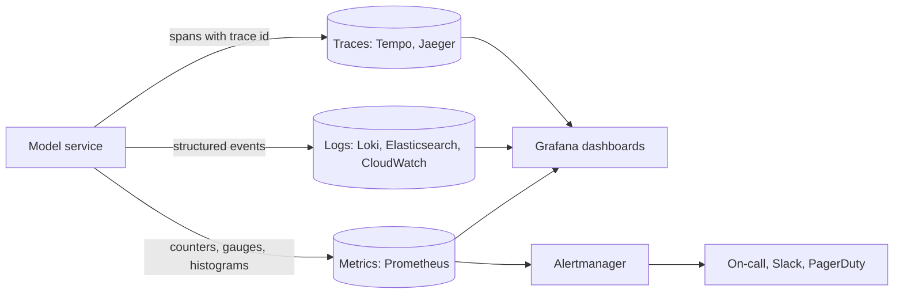

# Metrics, logs, traces and Prometheus

## Monitoring vs observability

Huyen (*AI Engineering*, ch. 10) draws the distinction this way: **monitoring** tracks a system's
external outputs to notice when something goes wrong, with no promise that those outputs explain *why*;
**observability** is the stronger property that the system's internal state can be inferred from what it
emits, so you can diagnose a problem from logs and metrics **without shipping new code**. She also
borrows three DevOps measures of how good your observability is:

- **MTTD** — mean time to detection,
- **MTTR** — mean time to response/resolution,
- **CFR** — change failure rate: the share of deployments that need a fix or rollback.

Her warning for ML teams: observability must be designed in from the start, and evaluation and
monitoring should be connected — metrics that mattered offline should be tracked online, and issues
found in production should flow back into the evaluation set.

## The three pillars



| Pillar | What it is | Good for | Cost profile |
|---|---|---|---|
| **Metrics** | numeric time series, aggregated | dashboards, alerting, trends, SLOs | cheap; fixed per series |
| **Logs** | timestamped records of discrete events | detail, debugging, audit, ad hoc questions | grows with traffic |
| **Traces** | the path of one request across components as linked spans | finding *where* time or errors come from | usually sampled |

Huyen's phrasing: metrics are aggregated and condense information; logs are an append-only record of
events; a trace links related events into the complete timeline of a request. Her advice on logging is
blunt — log everything you can (configurations, inputs, outputs, intermediate steps, timings), tagged
with IDs so you can find where it came from — and still look at raw production samples by hand
regularly.

## What to measure in an ML service

Four layers, from generic to ML-specific:

1. **Infrastructure**: CPU, memory, GPU utilisation and memory, disk, network, pod restarts.
2. **Service**: the **RED** method — **R**ate (requests/s), **E**rrors (failed fraction), **D**uration
   (latency percentiles); plus saturation (queue depth, in-flight requests). Google's "four golden
   signals" are latency, traffic, errors, saturation.
3. **Model/data**: prediction distribution, input feature distributions, missing/default rates, drift
   scores, share of fallbacks, model version in use, feature freshness, batch sizes.
4. **Business/quality**: delayed ground-truth metrics (precision, calibration), click-through,
   conversion, user feedback, and **cost** (per 1k predictions; tokens for LLMs).

For LLM services add: time to first token, time per output token, tokens in/out, cache hit rate,
guardrail trigger rate (module 12).

## Prometheus

Prometheus is a time-series database that **pulls** (scrapes) metrics over HTTP from each target's
`/metrics` endpoint at a fixed interval, stores them, evaluates rules and fires alerts.

### Metric types

| Type | Behaviour | Example |
|---|---|---|
| **Counter** | only goes up (resets on restart) | `predict_requests_total` |
| **Gauge** | goes up and down | `in_flight_requests`, `model_loaded_timestamp` |
| **Histogram** | counts observations into cumulative buckets (`_bucket{le="0.1"}`), plus `_sum`, `_count` | `predict_latency_seconds` |
| **Summary** | client-side quantiles | rarely preferred: cannot be aggregated across pods |

Every sample has **labels** (`{model_version="8", status="ok"}`); each unique label combination is a
separate time series.

> [!WARNING]
> **Cardinality kills Prometheus.** Never put unbounded values — user IDs, request IDs, raw feature
> values, prompts — in labels. Keep labels to small fixed sets (version, endpoint, status class). High
> cardinality detail belongs in logs and traces.

### Instrumenting a model service

```python
from prometheus_client import Counter, Gauge, Histogram

REQUESTS = Counter("predict_requests_total", "Prediction requests", ["model_version", "status"])
LATENCY = Histogram("predict_latency_seconds", "End-to-end latency",
                    ["model_version"], buckets=[.005, .01, .025, .05, .1, .25, .5, 1, 2.5, 5])
SCORE = Histogram("prediction_score", "Distribution of predicted probabilities",
                  ["model_version"], buckets=[i / 10 for i in range(1, 11)])
MISSING = Counter("feature_missing_total", "Missing feature values at serving", ["feature"])
IN_FLIGHT = Gauge("in_flight_requests", "Requests currently being processed")
MODEL_INFO = Gauge("model_info", "Static model metadata", ["model_version", "git_sha"])

def predict(features, version):
    with IN_FLIGHT.track_inprogress(), LATENCY.labels(version).time():
        for name, value in features.items():
            if value is None:
                MISSING.labels(name).inc()
        p = model.predict(features)
        SCORE.labels(version).observe(p)
        REQUESTS.labels(version, "ok").inc()
        return p
```

The scrape target returns plain text:

```text
# HELP predict_requests_total Prediction requests
# TYPE predict_requests_total counter
predict_requests_total{model_version="8",status="ok"} 182311
predict_latency_seconds_bucket{model_version="8",le="0.05"} 170002
predict_latency_seconds_bucket{model_version="8",le="0.1"} 180450
predict_latency_seconds_bucket{model_version="8",le="+Inf"} 182311
predict_latency_seconds_sum{model_version="8"} 6120.4
predict_latency_seconds_count{model_version="8"} 182311
```

### PromQL essentials

```promql
# request rate (per second) over the last 5 minutes, by version
sum by (model_version) (rate(predict_requests_total[5m]))

# error ratio
sum(rate(predict_requests_total{status="error"}[5m])) / sum(rate(predict_requests_total[5m]))

# p95 latency estimated from histogram buckets, aggregated across pods
histogram_quantile(0.95, sum by (le) (rate(predict_latency_seconds_bucket[5m])))

# mean predicted score (a cheap prediction-drift signal)
sum(rate(prediction_score_sum[1h])) / sum(rate(prediction_score_count[1h]))

# share of requests with a missing 'income' feature
rate(feature_missing_total{feature="income"}[15m]) / ignoring(feature) sum(rate(predict_requests_total[15m]))
```

Key ideas: `rate()` turns a counter into a per-second rate and handles restarts; always aggregate
histogram **buckets** before `histogram_quantile` (you cannot average percentiles across pods); the
quantile is an **estimate** interpolated inside a bucket, so choose bucket boundaries near your SLO.

```python-run
import numpy as np
rng = np.random.default_rng(0)
lat = rng.lognormal(mean=-3.2, sigma=0.6, size=50_000)             # seconds
buckets = [.005, .01, .025, .05, .1, .25, .5, 1, 2.5]
counts = [(lat <= b).sum() for b in buckets] + [len(lat)]           # cumulative, last = +Inf

def histogram_quantile(q, buckets, counts):
    rank = q * counts[-1]
    prev_b, prev_c = 0.0, 0
    for b, c in zip(buckets, counts):
        if c >= rank:
            return prev_b + (b - prev_b) * (rank - prev_c) / (c - prev_c)   # linear interpolation in bucket
        prev_b, prev_c = b, c
    return buckets[-1]

for q in (0.5, 0.95, 0.99):
    print(f"p{int(q*100):2d}: exact={np.quantile(lat, q)*1000:6.1f} ms   from buckets={histogram_quantile(q, buckets, counts)*1000:6.1f} ms")
print("Two pods with p95 = 80 ms and 300 ms do NOT have a combined p95 of 190 ms -- aggregate buckets, not percentiles.")
```

The bucket-based estimate is close near well-placed boundaries and coarse elsewhere — which is why
bucket design matters. Computing exact rolling percentiles from raw samples is the `mlops-rolling-p95`
problem.

### Scrape configuration and Grafana

```yaml
# prometheus.yml
global: {scrape_interval: 15s, evaluation_interval: 15s}
rule_files: ["alerts.yml"]
scrape_configs:
  - job_name: churn-api
    kubernetes_sd_configs: [{role: pod}]
    relabel_configs:
      - source_labels: [__meta_kubernetes_pod_annotation_prometheus_io_scrape]
        action: keep
        regex: "true"
```

**Grafana** queries Prometheus (and Loki, Tempo...) to draw dashboards. A useful model dashboard reads
top to bottom: traffic and errors → latency percentiles → saturation (CPU/GPU/queue) → prediction
distribution and drift → business/feedback metrics, with deployment markers annotated on every panel so
that changes line up with releases. Batch jobs, which are too short-lived to scrape, push metrics via the
Pushgateway or — better — write a row per run to a table.

## SLIs, SLOs and error budgets

- **SLI** (indicator): a measured ratio of good events, e.g. *requests answered successfully within
  200 ms / all requests*.
- **SLO** (objective): a target for the SLI over a window, e.g. *99.5% over 30 days*.
- **Error budget**: the allowed failures, here 0.5% of requests. Burning it fast triggers alerts; having
  budget left permits risk (releases, experiments).

```python-run
slo, window_days, rps = 0.995, 30, 120
total = rps * 86400 * window_days
budget = total * (1 - slo)
print(f"requests in window: {total:,.0f}; error budget: {budget:,.0f} bad requests")
for err_rate in (0.001, 0.005, 0.02, 0.10):
    burn = err_rate / (1 - slo)                       # 1.0 = budget lasts exactly the window
    print(f"error rate {err_rate:6.1%} -> burn rate {burn:5.1f}x -> budget exhausted in {window_days / burn:6.1f} days")
```

Alerting on **burn rate** (e.g., page when burning at 14× over both the last hour and the last 5
minutes) catches real incidents quickly without paging on brief blips (lesson 29).

## Logs

Emit **structured logs** (JSON), one event per line, to stdout; let the platform collect them (Fluent
Bit, Vector → Loki/Elasticsearch/CloudWatch).

```python
import json, logging, sys, time, uuid

class JsonFormatter(logging.Formatter):
    def format(self, record):
        payload = {"ts": time.time(), "level": record.levelname, "msg": record.getMessage()}
        payload.update(getattr(record, "extra_fields", {}))
        return json.dumps(payload)

handler = logging.StreamHandler(sys.stdout); handler.setFormatter(JsonFormatter())
log = logging.getLogger("churn"); log.addHandler(handler); log.setLevel(logging.INFO)

log.info("prediction", extra={"extra_fields": {
    "request_id": str(uuid.uuid4()), "trace_id": "4bf92f35...", "model_version": "8",
    "latency_ms": 23.4, "score": 0.81, "n_missing_features": 1}})
```

### The prediction log

Separate from application logs, an ML service needs a durable **prediction log** (to Kafka / object
storage / a warehouse table): request ID, timestamp, model version, the **feature vector as served**, the
prediction, and later the joined outcome. It powers drift detection, skew detection, performance
measurement when labels arrive, debugging, audits and retraining (lesson 9's "log and wait"). Apply
sampling for volume, and privacy controls: redact or hash PII, set retention, restrict access.

## Traces

A **trace** is a tree of **spans**; each span has a name, start/end time, attributes and a parent. The
trace ID propagates across services in headers (W3C `traceparent`). **OpenTelemetry (OTel)** is the
vendor-neutral standard for traces, metrics and logs.

```python
from opentelemetry import trace
tracer = trace.get_tracer("churn")

async def predict(req):
    with tracer.start_as_current_span("predict") as span:
        span.set_attribute("model.version", "8")
        with tracer.start_as_current_span("feature_lookup"):
            feats = await store.get(req.customer_id)
        with tracer.start_as_current_span("inference") as s:
            s.set_attribute("batch.size", 1)
            p = model.predict(feats)
        return p
```

```text
trace 4bf92f35...                      0ms                                   92ms
gateway    POST /predict               |====================================|
churn-api    validate                   |=|                                      (4-6 ms)
churn-api    feature_lookup               |======================|               (6-61 ms)
churn-api    inference                                           |=========|     (61-84 ms)
churn-api    log (async)                                                   |=|   (84-86 ms)
```

The trace makes the culprit obvious: 55 of 92 ms are spent in the feature lookup, not the model. For LLM
applications, Huyen stresses that tracing should show each step a query goes through — retrieval, the
final prompt, tool calls, the model's output — with timings and costs, so a failure can be pinned to the
exact step.

> [!INTERVIEW]
> "What would you monitor for a deployed model?" — Structure it in layers: infrastructure; service RED
> metrics and SLOs; model/data (prediction and feature distributions, missing rates, drift, version);
> quality and business (delayed labels, feedback, cost). Then the plumbing: Prometheus histograms with
> low-cardinality labels, structured logs with request and trace IDs, a prediction log for joining
> labels, traces for latency breakdown, and burn-rate alerts.

## Dashboard design: from "wall of graphs" to answers

A dashboard should answer a question in the order an on-call engineer asks it:

1. **Is something wrong right now?** — SLO status, error-budget burn, request rate vs normal.
2. **Is it us or a dependency?** — latency by stage (from traces or per-stage histograms), dependency
   error rates.
3. **Did we change something?** — deployment and model-version annotations on every time axis.
4. **Is it the model?** — score distribution, missing-feature rate, fallback rate, drift score.
5. **Who is affected?** — breakdown by a few bounded dimensions (region, client, model version).

Useful PromQL for those panels:

```promql
# traffic compared with the same time last week (ratio near 1 is normal)
sum(rate(predict_requests_total[5m])) / sum(rate(predict_requests_total[5m] offset 7d))

# latency SLI: share of requests faster than 100 ms
sum(rate(predict_latency_seconds_bucket{le="0.1"}[5m])) / sum(rate(predict_latency_seconds_count[5m]))

# which model versions are serving, and how much
sum by (model_version) (rate(predict_requests_total[5m]))

# share of predictions above the decision threshold (bucket boundary at 0.5)
1 - sum(rate(prediction_score_bucket{le="0.5"}[1h])) / sum(rate(prediction_score_count[1h]))
```

**Recording rules** precompute expensive expressions so dashboards and alerts stay fast and consistent:

```yaml
groups:
  - name: churn-api-recording
    rules:
      - record: job:predict_error_ratio:rate5m
        expr: sum(rate(predict_requests_total{status="error"}[5m])) / sum(rate(predict_requests_total[5m]))
      - record: job:predict_latency_seconds:p95_5m
        expr: histogram_quantile(0.95, sum by (le) (rate(predict_latency_seconds_bucket[5m])))
```

### Sampling: what to keep when you cannot keep everything

At scale you cannot store every trace and every payload. Reasonable defaults: keep **all metrics**
(cheap, aggregated); keep **all prediction-log records** if volume allows, else a uniform random sample
plus *all* errors and low-confidence predictions; use **tail-based trace sampling** — decide after the
request finishes, keeping every slow or failed trace and a small percentage of normal ones. Uniform
sampling keeps statistics unbiased; biased sampling (errors only) is for debugging and must not be used
to compute rates.

## Summary

- Observability lets you explain failures from emitted data; judge it by MTTD, MTTR and CFR.
- Metrics for alerting and trends, logs for detail, traces for where time went.
- Prometheus scrapes counters, gauges and histograms; keep label cardinality low; aggregate buckets before
  computing quantiles.
- Define SLIs/SLOs and alert on error-budget burn.
- Keep a prediction log with served features and model version — the foundation of ML monitoring.

```quiz
[
  {"q": "Which Prometheus metric type should record request latency so that p95 can be computed across pods?",
   "options": ["Counter", "Gauge", "Histogram", "Summary"],
   "answer": 2, "explain": "Histogram buckets can be summed across pods before histogram_quantile; summaries cannot be aggregated."},
  {"q": "Why must user IDs never be used as Prometheus label values?",
   "options": ["They are secret by law", "Each unique label value creates a new time series, exploding cardinality", "Prometheus only accepts numbers", "Labels are limited to 3 characters"],
   "answer": 1, "explain": "Unbounded label values overwhelm the time-series database."},
  {"q": "What does `rate(predict_requests_total[5m])` return?",
   "options": ["The total count", "The per-second average increase of the counter over the last 5 minutes", "The p95 latency", "The number of pods"],
   "answer": 1, "explain": "rate() converts a monotonically increasing counter into a per-second rate."},
  {"q": "Pod A has p95 = 80 ms and pod B has p95 = 300 ms. The service p95 is...",
   "options": ["190 ms", "Unknown from these two numbers; aggregate histogram buckets instead", "300 ms", "80 ms"],
   "answer": 1, "explain": "Percentiles are not averageable; they depend on the full distributions and traffic shares."},
  {"q": "An SLO of 99.5% success over 30 days means the error budget is...",
   "options": ["99.5% of requests", "0.5% of requests may fail", "5% of requests may fail", "No failures allowed"],
   "answer": 1, "explain": "The budget is 1 minus the SLO target."},
  {"q": "Which pillar is best for discovering that most of a request's latency is spent in the feature lookup?",
   "options": ["Metrics", "Logs", "Traces", "Dashboards"],
   "answer": 2, "explain": "Traces break a single request into timed spans across components."},
  {"q": "What must a prediction log contain to support later performance measurement?",
   "options": ["Only the prediction", "Request ID, model version, served features and prediction, joinable with later outcomes", "The Docker image only", "CPU usage"],
   "answer": 1, "explain": "Labels arrive later and must be joined to the exact prediction and inputs."},
  {"q": "CFR (change failure rate) measures...",
   "options": ["CPU failure rate", "The share of deployments that require a fix or rollback", "Cache fill ratio", "Cost per request"],
   "answer": 1, "explain": "It is one of the DevOps metrics Huyen cites for judging observability and release quality."}
]
```

> **Source:** Chip Huyen, *AI Engineering*, ch. 10 (Monitoring and Observability: MTTD/MTTR/CFR, monitoring vs observability, metrics, logs and traces); Prometheus documentation (*Metric types*, *Histograms and summaries*, PromQL, `histogram_quantile`); Google SRE Book (golden signals, SLOs, error budgets); OpenTelemetry documentation; Grafana documentation.
