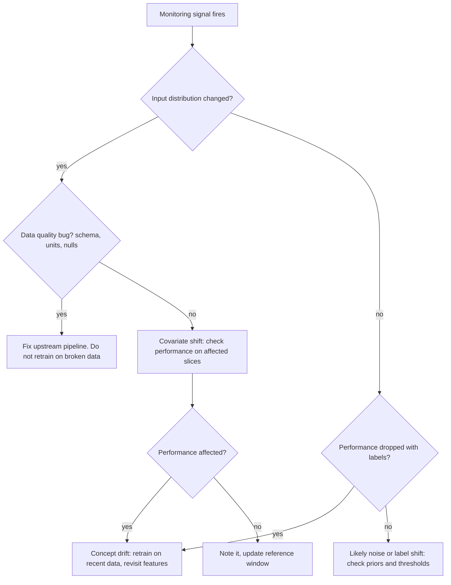

# Data drift, concept drift and statistical tests

## Models assume the future looks like the past

Supervised learning assumes training and production data come from the same joint distribution
$P(X, y)$. Production violates this constantly: seasons change, marketing brings a new customer
segment, a competitor launches, a sensor is recalibrated, an upstream team changes a unit. Because the
service keeps returning HTTP 200, nothing crashes — quality just erodes. Detecting that erosion is the
ML-specific half of monitoring.

## A taxonomy of drift

Write $P(X, y) = P(y \mid X)\,P(X) = P(X \mid y)\,P(y)$. Different parts can move:

| Name | What changes | Example | Does the model need retraining? |
|---|---|---|---|
| **Covariate shift** (data/feature drift) | $P(X)$, with $P(y\mid X)$ stable | more mobile users than at training time | maybe — only if the model is weak in the newly common region |
| **Label shift** (prior shift) | $P(y)$, with $P(X\mid y)$ stable | fraud rate doubles during holidays | recalibrate thresholds/priors; often retrain |
| **Concept drift** | $P(y\mid X)$ — the relationship itself | the same basket that signalled "loyal" now signals "about to churn" | yes — the learned mapping is wrong |
| **Prediction drift** | distribution of model outputs | mean score rises from 0.12 to 0.19 | a symptom; investigate cause |
| **Upstream/schema change** | data pipeline semantics | dollars → cents, new category value, null explosion | fix the pipeline (it is a bug, not drift) |

Concept drift also comes in temporal shapes: **sudden** (a policy change), **gradual**, **incremental**,
and **recurring/seasonal**.



> [!WARNING]
> **Most "drift" alerts in practice are data pipeline bugs.** Check data quality first (nulls, ranges,
> schema, units, duplicates, freshness). Retraining on corrupted data makes things worse.

## What you can measure, and when

The best signal — **actual model performance** — needs ground truth, which may arrive late (label
latency) or never. So monitoring is layered by availability:

1. **Immediately**: data quality, input drift, prediction drift (no labels needed).
2. **Soon**: proxy/feedback signals — click-through, acceptance of a suggestion, user corrections.
3. **Later**: true performance metrics once labels are joined to the prediction log; estimated
   performance methods (e.g., confidence-based estimation in NannyML) try to bridge the gap.

Drift in inputs is a *leading indicator*, not proof of harm. Treat it as a reason to look, weight it by
feature importance, and confirm with performance when you can.

## Setting up a comparison

- **Reference window**: what "normal" looks like — usually the training set or a recent healthy
  production period.
- **Current window**: the most recent hour/day/week of production data.
- **Window size**: small windows are noisy; large windows are slow to react. Sliding windows with a
  fixed reference are the simplest; compare current vs a *rolling* reference to track gradual change, or
  vs *training* to track distance from what the model learned.
- Compute per feature, plus on the model output, and on important slices.

## Statistical tools

### Population Stability Index (PSI)

Bin both samples with the **same bins** (defined on the reference), then

$$\mathrm{PSI} = \sum_{i=1}^{B} (a_i - e_i)\,\ln\frac{a_i}{e_i}$$

with $e_i$, $a_i$ the reference and current fractions in bin $i$. PSI is a symmetrised KL divergence.
Folklore thresholds from credit scoring: **< 0.1** no significant change, **0.1–0.25** moderate,
**> 0.25** significant. Details that matter: floor zero fractions with a small epsilon; put out-of-range
values into the edge bins (dropping them hides the drift); results depend on the binning scheme (equal
width vs quantile, number of bins) — keep it fixed.

### Kolmogorov–Smirnov (KS) test

The two-sample KS statistic is the largest gap between the empirical CDFs:

$$D = \sup_x |F_{\text{ref}}(x) - F_{\text{cur}}(x)|$$

It is distribution-free and needs no binning. The catch: the p-value shrinks with sample size, so with
hundreds of thousands of rows *any* trivial difference is "significant". For large samples, threshold
the **statistic** (effect size), not the p-value.

### Others

- **Chi-squared test** and **PSI / Jensen–Shannon divergence** on category frequencies for categorical
  features (watch for new, unseen categories).
- **Wasserstein (earth mover's) distance**: how far mass must move; interpretable in the feature's units
  (often normalised by the reference standard deviation).
- **Jensen–Shannon divergence**: symmetric, bounded version of KL.
- **Domain classifier**: train a model to distinguish reference from current rows; AUC near 0.5 means no
  detectable multivariate drift, and its feature importances point at *what* drifted.
- For embeddings / text / images: drift on embedding distributions (domain classifier, MMD, distance
  between centroids) and on simple descriptors (text length, language, share of out-of-vocabulary
  tokens).

```python-run
import numpy as np, math
rng = np.random.default_rng(0)

def psi(expected, actual, bins=10):
    lo, hi = expected.min(), expected.max()
    def frac(x):
        idx = np.clip(np.floor((x - lo) / (hi - lo) * bins).astype(int), 0, bins - 1)
        return np.maximum(np.bincount(idx, minlength=bins) / len(x), 1e-4)
    e, a = frac(expected), frac(actual)
    return float(np.sum((a - e) * np.log(a / e)))

def ks(a, b):
    a, b = np.sort(a), np.sort(b)
    grid = np.concatenate([a, b])
    return float(np.max(np.abs(np.searchsorted(a, grid, side="right") / len(a)
                               - np.searchsorted(b, grid, side="right") / len(b))))

ref = rng.normal(50, 10, 20_000)
scenarios = {
    "no drift":                 rng.normal(50, 10, 5_000),
    "small mean shift (+2)":    rng.normal(52, 10, 5_000),
    "moderate mean shift (+5)": rng.normal(55, 10, 5_000),
    "variance doubles":         rng.normal(50, 20, 5_000),
    "unit bug (x100)":          rng.normal(50, 10, 5_000) * 100,
}
print(f"{'scenario':26s} {'PSI':>7s} {'KS D':>7s}")
for name, cur in scenarios.items():
    print(f"{name:26s} {psi(ref, cur):7.3f} {ks(ref, cur):7.3f}")
```

Both statistics rise smoothly with the size of the shift and explode for the unit bug. You will
implement both from scratch in `mlops-psi` and `mlops-ks-statistic`.

### Large samples make everything "significant"

```python-run
import numpy as np, math
rng = np.random.default_rng(1)
def ks_stat_p(a, b):
    a, b = np.sort(a), np.sort(b); grid = np.concatenate([a, b])
    d = np.max(np.abs(np.searchsorted(a, grid, side="right") / len(a) - np.searchsorted(b, grid, side="right") / len(b)))
    ne = len(a) * len(b) / (len(a) + len(b))
    lam = (math.sqrt(ne) + 0.12 + 0.11 / math.sqrt(ne)) * d
    p = 2 * sum((-1) ** (k - 1) * math.exp(-2 * k * k * lam * lam) for k in range(1, 101))
    return d, min(max(p, 0.0), 1.0)
for n in (500, 5_000, 50_000, 500_000):
    a, b = rng.normal(0, 1, n), rng.normal(0.02, 1, n)      # a practically irrelevant shift of 0.02 sigma
    d, p = ks_stat_p(a, b)
    print(f"n={n:7d}  D={d:.4f}  p-value={p:.4f}  ->  {'ALERT' if p < 0.05 else 'ok'} by p-value, "
          f"{'ALERT' if d > 0.1 else 'ok'} by D>0.1")
```

The same negligible shift becomes "statistically significant" as n grows. Alert on effect sizes (D, PSI,
normalised Wasserstein), calibrated to what actually hurts your model.

### Many features, many false alarms

Testing 200 features daily at α = 0.05 yields about 10 false alarms a day. Mitigations: correct for
multiple comparisons (Bonferroni, false discovery rate), alert on the **share of drifted features** or on
drift in the **top-k important features**, and require persistence over consecutive windows (next
lesson).

## Monitoring model performance

When labels arrive, compute the real thing per time window and per slice: precision/recall, AUC,
calibration, MAE — the same metrics as offline, on the same definitions. Watch out for:

- **Label delay**: the latest windows are incomplete (not all outcomes observed yet).
- **Selection bias / feedback loops**: you only observe outcomes for cases the model acted on (loans
  approved, items shown). Keep a small random exploration/holdout slice to get unbiased labels.
- **Calibration drift**: scores stop meaning probabilities even when ranking (AUC) holds — critical if a
  threshold drives decisions.

```python-run
import numpy as np
rng = np.random.default_rng(2)
print("week  feature PSI  accuracy   (concept drift without covariate drift)")
ref = rng.normal(0, 1, 5000)
for week in range(0, 9, 2):
    x = rng.normal(0, 1, 5000)                              # inputs look the same every week
    boundary = 0.12 * week                                  # ...but the true relationship moves
    y = (x + rng.normal(0, 0.3, 5000) > boundary)
    pred = x > 0                                            # model learned boundary = 0
    lo, hi = ref.min(), ref.max()
    f = lambda v: np.maximum(np.bincount(np.clip(((v - lo) / (hi - lo) * 10).astype(int), 0, 9), minlength=10) / len(v), 1e-4)
    e, a = f(ref), f(x)
    print(f"{week:4d}  {np.sum((a - e) * np.log(a / e)):10.4f}  {np.mean(pred == y):8.3f}")
```

Input drift statistics stay flat while accuracy falls: **pure concept drift is invisible without
labels**. That is why feedback pipelines and label collection (next lesson) are not optional.

## LLM applications drift too

Huyen (*AI Engineering*, ch. 10) lists changes specific to foundation-model applications: the **system
prompt** changing (a template edited, a coworker "fixing a typo"), **user behaviour** adapting to the
product, and the **underlying model** changing behind an unchanged API. Mitigations: version and hash
prompts, pin model versions where the provider allows, rerun the evaluation suite on a schedule, and
track input/output characteristics (length, language, refusal rate, topic mix).

## Tools

**Evidently** (reports and test suites for data drift, data quality, target drift, classification and
regression performance; chooses a default test per column type and sample size), **NannyML**
(performance estimation without labels), **WhyLabs/whylogs**, **Alibi Detect**, **Great Expectations**
for quality, and cloud-native monitors (SageMaker Model Monitor, Vertex AI Model Monitoring, Azure ML
data drift).

```python
from evidently import Report
from evidently.presets import DataDriftPreset

report = Report([DataDriftPreset()])
result = report.run(reference_data=train_df, current_data=last_week_df)
result.save_html("drift_report.html")        # per-feature tests, drift share, distribution plots
```

(Evidently's API differs between versions — consult the docs for the one you install.)

> [!INTERVIEW]
> "Data drift vs concept drift?" — Data (covariate) drift: $P(X)$ changes; detect without labels using
> PSI/KS/JS per feature or a domain classifier; may or may not hurt. Concept drift: $P(y|X)$ changes;
> inputs can look identical; only detectable through labels/feedback or proxies; requires retraining or
> re-engineering. Add: check data-quality bugs first, alert on effect size not p-values at large n, and
> monitor predictions and slices.

## Summary

- Drift types: covariate, label, concept, prediction; plus pipeline bugs masquerading as drift.
- Layer signals by availability: quality and input/prediction drift now, proxies soon, performance later.
- PSI (binned, 0.1/0.25 rules of thumb) and KS (max ECDF gap) are the workhorses; prefer effect-size
  thresholds at large sample sizes and control false alarms across many features.
- Concept drift can be invisible in inputs — collect labels and feedback.

```quiz
[
  {"q": "Which drift type is a change in P(y | X)?",
   "options": ["Covariate shift", "Label shift", "Concept drift", "Schema drift"],
   "answer": 2, "explain": "The relationship between inputs and target changes."},
  {"q": "A PSI of 0.31 on a key feature is conventionally interpreted as...",
   "options": ["No change", "Moderate change", "Significant change worth investigating", "Impossible value"],
   "answer": 2, "explain": "Rules of thumb: <0.1 stable, 0.1-0.25 moderate, >0.25 significant."},
  {"q": "Why can a KS-test p-value mislead with 1 million rows per window?",
   "options": ["KS cannot handle large samples", "Tiny, practically irrelevant differences become statistically significant", "The statistic becomes negative", "It requires normal data"],
   "answer": 1, "explain": "Use the statistic (effect size) rather than the p-value for alerting at scale."},
  {"q": "Input distributions are stable, but accuracy (from delayed labels) is dropping. What is the likely cause?",
   "options": ["Covariate shift", "Concept drift", "A Docker cache miss", "Label encoding"],
   "answer": 1, "explain": "The mapping from X to y changed without X changing."},
  {"q": "What should you check FIRST when a drift alert fires?",
   "options": ["Retrain immediately", "Whether a data quality or pipeline bug (nulls, units, schema) caused it", "Increase the threshold", "Scale up the cluster"],
   "answer": 1, "explain": "Most alerts trace to upstream data issues; retraining on broken data is harmful."},
  {"q": "When computing PSI, values in production outside the reference range should be...",
   "options": ["Dropped", "Clipped into the first/last bin so the shift is counted", "Set to zero", "Replaced with the mean"],
   "answer": 1, "explain": "Dropping them hides exactly the drift you want to detect."},
  {"q": "A domain classifier separating reference from current data achieves AUC 0.52. This suggests...",
   "options": ["Severe drift", "Little to no detectable drift", "Label leakage", "The model is overfit"],
   "answer": 1, "explain": "AUC near 0.5 means the two samples are indistinguishable."},
  {"q": "Monitoring 200 features daily with alpha=0.05 and no correction produces roughly how many false alerts per day when nothing changed?",
   "options": ["0", "About 10", "About 100", "200"],
   "answer": 1, "explain": "200 x 0.05 = 10 expected false positives."}
]
```

> **Source:** Chip Huyen, *AI Engineering*, ch. 10 (drift detection: prompt, user-behaviour and underlying-model changes); Evidently documentation (*Data drift*, default drift methods); Gama et al., *A Survey on Concept Drift Adaptation* (2014); Rabanser et al., *Failing Loudly* (NeurIPS 2019); Chip Huyen, *Designing Machine Learning Systems*, ch. 8 (data distribution shifts and monitoring).
