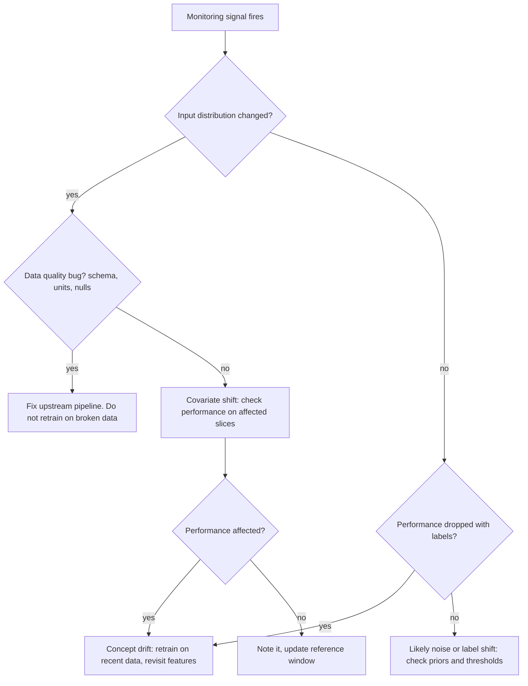

# Data drift, concept drift and statistical tests

> **Before this lesson:** read [Metrics, logs, traces and Prometheus](#/lesson/mlops/observability)
> (the prediction log and what to monitor) and
> [Feature stores, training/serving skew and labeling](#/lesson/mlops/feature-stores) (label
> latency). [The ML lifecycle](#/lesson/mlops/ml-lifecycle) gave a first taste of drift with a
> threshold model that decayed month by month. A histogram and an average are the only statistics
> assumed; everything else is built up here.

## In plain words

A model is a summary of the past. It works as long as the future keeps resembling the data it was
trained on. In production the world keeps moving: seasons change, a marketing campaign brings in a
new kind of customer, a competitor launches, prices rise, a sensor is recalibrated, an upstream team
switches a column from dollars to cents. **Drift** is the general name for the live data, or the
relationship between inputs and answers, moving away from what the model learned.

An everyday picture is a weather-forecasting rule of thumb learned in one town ("red sky at night
means a fine day tomorrow") and then used after moving to a different climate. Either the skies
themselves look different (the inputs drifted), or the same red sky now means something else (the
relationship drifted). The rule still produces a forecast every evening; it is quietly wrong more
often.

Why this matters for a job: drift is how most deployed models die, and because the service keeps
answering with status 200, nothing crashes and nobody is paged unless someone built the monitoring
this lesson describes. Interviewers almost always ask "what is the difference between data drift
and concept drift, and how would you detect each?"

## Models assume the future looks like the past

Supervised learning assumes that training data and production data come from the same **joint
distribution** $P(X, y)$: the pattern of how often each combination of inputs $X$ and answer $y$
occurs. Production violates this constantly. Detecting the resulting erosion of quality is the
ML-specific half of monitoring.

A short note on the notation, because it makes the different kinds of drift precise:

- $P(X)$ is the **distribution of inputs**: how common each kind of customer is.
- $P(y)$ is the **distribution of answers**: for example, what share of customers churn.
- $P(y \mid X)$, read "probability of $y$ given $X$", is the **relationship** the model learns: for
  a customer who looks like *this*, how likely is churn?
- $P(X \mid y)$ is the reverse: among churners, what do customers look like?

The rules of probability let us split the joint distribution two ways:
$P(X, y) = P(y \mid X)\,P(X) = P(X \mid y)\,P(y)$. Each kind of drift is a change in one of these
pieces while the other stays put.

## A taxonomy of drift

| Name | What changes | Example | Does the model need retraining? |
|---|---|---|---|
| **Covariate shift** (data/feature drift) | $P(X)$, with $P(y\mid X)$ stable | more mobile users than at training time | maybe — only if the model is weak in the newly common region |
| **Label shift** (prior shift) | $P(y)$, with $P(X\mid y)$ stable | fraud rate doubles during holidays | recalibrate thresholds/priors; often retrain |
| **Concept drift** | $P(y\mid X)$ — the relationship itself | the same basket that signalled "loyal" now signals "about to churn" | yes — the learned mapping is wrong |
| **Prediction drift** | distribution of model outputs | mean score rises from 0.12 to 0.19 | a symptom; investigate cause |
| **Upstream/schema change** | data pipeline semantics | dollars → cents, new category value, null explosion | fix the pipeline (it is a bug, not drift) |

In words:

- **Covariate shift**: the mix of inputs changes, but the rule linking inputs to answers does not.
  ("Covariate" is a statistician's word for an input variable.) If the model already handles the
  newly common inputs well, nothing is lost.
- **Label shift**: the overall rate of the answer changes. A **prior** is the base rate before
  looking at any inputs; when it moves, a fixed decision threshold may stop making sense.
- **Concept drift**: the rule itself changes. The model's learned mapping is now wrong, even for
  inputs it has seen many times.
- **Prediction drift**: the model's outputs change. It is a symptom of one of the others, and a
  very useful one, because you can measure it immediately.
- **Upstream or schema change**: not drift at all, but a bug that looks like drift.

Concept drift also has shapes over time: **sudden** (a policy change overnight), **gradual** (old
and new behaviour mixed, with the new slowly winning), **incremental** (a slow continuous slide) and
**recurring** or **seasonal** (the pattern returns every winter).

The flowchart is a triage procedure for when a monitor fires.



> [!WARNING]
> **Most "drift" alerts in practice are data pipeline bugs.** Check data quality first (nulls, ranges,
> schema, units, duplicates, freshness). Retraining on corrupted data makes things worse.

## What you can measure, and when

The best signal, the model's **actual performance**, needs ground truth, which may arrive late
(**label latency**: a churn label is known only 30 days later) or never. So monitoring is layered by
when each signal becomes available:

1. **Immediately**: data quality, input drift and prediction drift. None needs labels.
2. **Soon**: **proxy** or feedback signals: click-through, whether a suggestion was accepted, user
   corrections.
3. **Later**: true performance metrics, once labels are joined to the prediction log. **Performance
   estimation** methods, such as the confidence-based estimation in the NannyML library, try to
   bridge the gap by predicting accuracy from the model's own confidence scores.

Input drift is a **leading indicator** (a signal that tends to come before the harm), not proof of
harm. Treat it as a reason to look, weight it by **feature importance** (how much the model relies
on that feature), and confirm with real performance when you can.

## Setting up a comparison

Every drift statistic compares two samples:

- The **reference window**: what "normal" looks like. Usually the training data, or a recent healthy
  period of production.
- The **current window**: the most recent hour, day or week of production data.
- **Window size** is a trade-off: small windows are noisy; large windows are slow to react. A fixed
  reference with a sliding current window is the simplest set-up. Comparing with a *rolling*
  reference (for example last month) tracks recent change; comparing with the *training* data
  measures how far the world has moved from what the model learned.
- Compute the statistics for each feature, for the model's output, and on important **slices** (such
  as one region), because a shift confined to one slice can vanish in the overall numbers.

## Statistical tools

### Population Stability Index (PSI)

**PSI** comes from credit scoring. Cut the range of the feature into **bins** (intervals), using bin
edges defined on the reference sample, and use the **same bins** for both samples. Let $e_i$ be the
fraction of reference values in bin $i$ ("expected") and $a_i$ the fraction of current values in that
bin ("actual"). Then

$$\mathrm{PSI} = \sum_{i=1}^{B} (a_i - e_i)\,\ln\frac{a_i}{e_i}$$

Each term is never negative: if a bin grew ($a_i > e_i$), both factors are positive; if it shrank,
both are negative. So PSI is 0 when the two histograms match and grows as they diverge. (For the
mathematically curious, it is a symmetrised version of the **KL divergence**, a standard measure of
how different two distributions are.)

Rules of thumb inherited from credit scoring: **below 0.1** no significant change, **0.1 to 0.25**
moderate change, **above 0.25** significant change. Details that matter in practice:

- A bin with zero current values would make $\ln(0)$ undefined, so **floor** each fraction at a tiny
  value (an **epsilon** such as 0.0001).
- Put current values that fall outside the reference range into the first or last bin. Dropping them
  hides exactly the drift you want to see.
- The number depends on the binning: equal-width bins versus **quantile** bins (each holding the same
  share of reference values), and how many bins. Choose once and keep it fixed, or values are not
  comparable over time.

### Kolmogorov-Smirnov (KS) test

An **empirical CDF** (cumulative distribution function) of a sample answers, for any value $x$,
"what fraction of the sample is at most $x$?". It rises from 0 to 1 as $x$ increases. The two-sample
**KS statistic** is the largest vertical gap between the two empirical CDFs:

$$D = \sup_x |F_{\text{ref}}(x) - F_{\text{cur}}(x)|$$

($\sup$, "supremum", means the largest value over all $x$.) $D$ is between 0 (identical samples) and
1 (no overlap at all). KS is **distribution-free** (it makes no assumption about the shape of the
data) and needs no bins. The catch: its **p-value** shrinks as samples grow, so with hundreds of
thousands of rows *any* trivial difference becomes "statistically significant". For large samples,
put the threshold on the **statistic** itself, which measures the **effect size** (how big the
difference is), not on the p-value.

### Others

- **Chi-squared test**, **PSI** or **Jensen-Shannon divergence** on category frequencies for
  categorical features (columns holding labels such as plan names). Watch for new, unseen categories.
- **Wasserstein distance** (also called **earth mover's distance**): how much "probability mass" must
  be moved, and how far, to turn one histogram into the other. It is measured in the feature's own
  units, often divided by the reference's standard deviation.
- **Jensen-Shannon divergence**: a symmetric, bounded relative of KL divergence.
- **Domain classifier**: train a model to tell reference rows from current rows. An **AUC** near 0.5
  means it cannot tell them apart (no detectable drift, even across combinations of features); its
  feature importances point at *what* drifted.
- For **embeddings**, text and images: measure drift on the embedding vectors (domain classifier,
  **MMD** or maximum mean discrepancy, the distance between the average vectors or **centroids**) and
  on simple descriptors such as text length, language, or the share of **out-of-vocabulary** tokens
  (words the model's vocabulary does not contain).

The demo computes PSI and KS from scratch on five scenarios.

```python-run
import numpy as np, math
rng = np.random.default_rng(0)

def psi(expected, actual, bins=10):
    lo, hi = expected.min(), expected.max()
    def frac(x):
        idx = np.clip(np.floor((x - lo) / (hi - lo) * bins).astype(np.intp), 0, bins - 1)
        return np.maximum(np.bincount(idx, minlength=bins) / len(x), 1e-4)
    e, a = frac(expected), frac(actual)
    return float(np.sum((a - e) * np.log(a / e)))

def ks(a, b):
    a, b = np.sort(a), np.sort(b)
    grid = np.concatenate([a, b])
    return float(np.max(np.abs(np.searchsorted(a, grid, side="right") / len(a)
                               - np.searchsorted(b, grid, side="right") / len(b))))

ref = rng.normal(50, 10, 20_000)
scenarios = {
    "no drift":                 rng.normal(50, 10, 5_000),
    "small mean shift (+2)":    rng.normal(52, 10, 5_000),
    "moderate mean shift (+5)": rng.normal(55, 10, 5_000),
    "variance doubles":         rng.normal(50, 20, 5_000),
    "unit bug (x100)":          rng.normal(50, 10, 5_000) * 100,
}
print(f"{'scenario':26s} {'PSI':>7s} {'KS D':>7s}")
for name, cur in scenarios.items():
    print(f"{name:26s} {psi(ref, cur):7.3f} {ks(ref, cur):7.3f}")
```

How the two functions work:

- `psi` builds 10 equal-width bins between the reference minimum and maximum. For a sample `x`, the
  expression `(x - lo) / (hi - lo) * bins` maps each value to a position between 0 and 10; `floor`
  turns it into a bin number; `np.clip(..., 0, bins - 1)` pushes out-of-range values into the edge
  bins. `np.bincount` counts values per bin (its input must be an integer array of type `np.intp`),
  dividing by the sample size gives fractions, and `np.maximum(..., 1e-4)` applies the epsilon floor.
- `ks` sorts both samples and, at every observed value, computes each sample's empirical CDF with
  `np.searchsorted(..., side="right")`, which counts how many sorted values are at most that value.
  The largest absolute difference is $D$.
- `ref` is 20,000 values from a bell curve centred at 50 with spread 10; each scenario is a current
  sample of 5,000.

The output:

```text
scenario                       PSI    KS D
no drift                     0.002   0.013
small mean shift (+2)        0.040   0.078
moderate mean shift (+5)     0.248   0.203
variance doubles             1.027   0.176
unit bug (x100)             15.133   1.000
```

Both statistics rise with the size of the shift and explode for the unit bug. Notice the "variance
doubles" row: the average did not move at all, yet PSI is huge, because many values now land in the
edge bins. A monitor that only tracked the mean would have missed it. You will implement both
statistics yourself in the problems `mlops-psi` and `mlops-ks-statistic`.

### Large samples make everything "significant"

```python-run
import numpy as np, math
rng = np.random.default_rng(1)
def ks_stat_p(a, b):
    a, b = np.sort(a), np.sort(b); grid = np.concatenate([a, b])
    d = np.max(np.abs(np.searchsorted(a, grid, side="right") / len(a) - np.searchsorted(b, grid, side="right") / len(b)))
    ne = len(a) * len(b) / (len(a) + len(b))
    lam = (math.sqrt(ne) + 0.12 + 0.11 / math.sqrt(ne)) * d
    p = 2 * sum((-1) ** (k - 1) * math.exp(-2 * k * k * lam * lam) for k in range(1, 101))
    return d, min(max(p, 0.0), 1.0)
for n in (500, 5_000, 50_000, 500_000):
    a, b = rng.normal(0, 1, n), rng.normal(0.02, 1, n)      # a practically irrelevant shift of 0.02 sigma
    d, p = ks_stat_p(a, b)
    print(f"n={n:7d}  D={d:.4f}  p-value={p:.4f}  ->  {'ALERT' if p < 0.05 else 'ok'} by p-value, "
          f"{'ALERT' if d > 0.1 else 'ok'} by D>0.1")
```

`ks_stat_p` computes $D$ as before, then the standard approximation of its p-value (the
`lam` line and the alternating sum are the textbook formula; you do not need to memorise them). Each
round draws two samples whose true means differ by 0.02 standard deviations, a difference far too
small to matter to any model. The output:

```text
n=    500  D=0.0700  p-value=0.1658  ->  ok by p-value, ok by D>0.1
n=   5000  D=0.0100  p-value=0.9632  ->  ok by p-value, ok by D>0.1
n=  50000  D=0.0129  p-value=0.0005  ->  ALERT by p-value, ok by D>0.1
n= 500000  D=0.0091  p-value=0.0000  ->  ALERT by p-value, ok by D>0.1
```

The statistic $D$ stays tiny throughout, but once samples reach tens of thousands the p-value calls
the same negligible shift "highly significant". Alert on effect sizes ($D$, PSI, normalised
Wasserstein) with thresholds calibrated to what actually hurts your model.

### Many features, many false alarms

Testing 200 features every day at a significance level of 0.05 produces about 200 x 0.05 = 10 false
alarms a day even when nothing changed. Mitigations: correct for **multiple comparisons** (the
**Bonferroni** correction divides the significance level by the number of tests; **false discovery
rate** methods are less strict), alert on the **share of drifted features** or only on drift in the
**top-k most important features**, and require the condition to persist over several consecutive
windows (next lesson).

## Monitoring model performance

When labels arrive, compute the real metrics per time window and per slice: precision and recall,
AUC, calibration, **MAE** (mean absolute error, for regression), with the same definitions as
offline. Watch out for:

- **Label delay**: the newest windows are incomplete, because not all outcomes are known yet.
- **Selection bias and feedback loops**: you only observe outcomes for cases the model acted on
  (loans that were approved, items that were shown). Keep a small random **holdout** or
  **exploration** slice that is treated without the model, to collect unbiased labels.
- **Calibration drift**: scores stop meaning probabilities even while ranking quality (AUC) holds.
  This is critical when a fixed threshold drives decisions.

The next demo shows the most dangerous case: concept drift with no input drift at all.

```python-run
import numpy as np
rng = np.random.default_rng(2)
print("week  feature PSI  accuracy   (concept drift without covariate drift)")
ref = rng.normal(0, 1, 5000)
for week in range(0, 9, 2):
    x = rng.normal(0, 1, 5000)                              # inputs look the same every week
    boundary = 0.12 * week                                  # ...but the true relationship moves
    y = (x + rng.normal(0, 0.3, 5000) > boundary)
    pred = x > 0                                            # model learned boundary = 0
    lo, hi = ref.min(), ref.max()
    f = lambda v: np.maximum(np.bincount(np.clip(((v - lo) / (hi - lo) * 10).astype(np.intp), 0, 9), minlength=10) / len(v), 1e-4)
    e, a = f(ref), f(x)
    print(f"{week:4d}  {np.sum((a - e) * np.log(a / e)):10.4f}  {np.mean(pred == y):8.3f}")
```

Every week the inputs `x` are drawn from exactly the same distribution, but the true boundary that
decides the label moves by 0.12 per week. The model keeps predicting with its old boundary of 0. The
loop prints the PSI of the input against the reference and the accuracy against the true labels:

```text
week  feature PSI  accuracy   (concept drift without covariate drift)
   0      0.0047     0.905
   2      0.0021     0.884
   4      0.0012     0.817
   6      0.0027     0.739
   8      0.0043     0.676
```

Input drift stays flat near zero while accuracy falls from 0.905 to 0.676: **pure concept drift is
invisible without labels**. That is why feedback pipelines and label collection (next lesson) are
not optional.

## LLM applications drift too

Huyen (*AI Engineering*, ch. 10) lists changes specific to applications built on large language
models: the **system prompt** (the standing instructions given to the model) changes, perhaps
because a template was edited or a colleague "fixed a typo"; **user behaviour** adapts to the
product; and the **underlying model** changes behind an API whose name did not change. Mitigations:
version and hash prompts, pin model versions where the provider allows it, rerun the evaluation
suite on a schedule, and track characteristics of inputs and outputs (length, language, how often
the model refuses, the mix of topics).

## Tools

**Evidently** produces reports and test suites for data drift, data quality, target drift and
classification or regression performance, and picks a default test per column type and sample size.
**NannyML** estimates performance without labels. Others: **WhyLabs/whylogs**, **Alibi Detect**,
**Great Expectations** for data quality, and the monitors built into the clouds (SageMaker Model
Monitor, Vertex AI Model Monitoring, Azure ML data drift).

```python
from evidently import Report
from evidently.presets import DataDriftPreset

report = Report([DataDriftPreset()])
result = report.run(reference_data=train_df, current_data=last_week_df)
result.save_html("drift_report.html")        # per-feature tests, drift share, distribution plots
```

The three lines build a report from a preset of drift checks, run it on a reference and a current
DataFrame, and save an HTML page with one test result and chart per feature. (Evidently's interface
differs between versions; check the documentation for the one you install.)

> [!INTERVIEW]
> "Data drift vs concept drift?" — Data (covariate) drift: $P(X)$ changes; detect without labels using
> PSI/KS/JS per feature or a domain classifier; may or may not hurt. Concept drift: $P(y|X)$ changes;
> inputs can look identical; only detectable through labels/feedback or proxies; requires retraining or
> re-engineering. Add: check data-quality bugs first, alert on effect size not p-values at large n, and
> monitor predictions and slices.

## A drift investigation, step by step

*Alert: PSI on `monthly_charges` in the EU segment = 0.38 for two consecutive days (threshold 0.25);
the all-traffic PSI is only about 0.11.*

1. **Data quality first.** The null rate is unchanged; the minimum and maximum moved from (20, 120)
   to (20, 150); row volume is normal; no schema change. No sign of a pipeline bug.
2. **Characterise the shift.** Compare histograms: the whole distribution moved up by about 25%, not
   only a tail. All regions or one? Only EU customers, which is why the global statistic stayed
   under the threshold and the per-segment monitor caught it.
3. **Find the cause.** The deployment log and the upstream changelog show a price increase for EU
   plans that took effect three days ago. This is a **real covariate shift**, not a bug.
4. **Estimate impact.** `monthly_charges` is the third most important feature. There are no labels
   yet for the affected period (the label window is 30 days). Proxies: the mean predicted churn
   score for the EU rose from 0.11 to 0.16, and the share above the campaign threshold rose 40%. Is
   that plausible (price rises do increase churn), or is the model **extrapolating**, making
   predictions for values outside the range it was trained on? Many values now exceed the training
   maximum, so extrapolation is likely.
5. **Decide.** Short term: mark EU predictions as lower confidence, cap the campaign volume, keep
   monitoring. Medium term: retrain once enough post-change labels exist, giving recent data more
   weight. Record the decision and the update to the reference window.

The alert was right, the answer was not "retrain immediately", and the valuable work was steps 2-4:
**slice, find the cause, estimate impact.** The demo reproduces the numbers.

```python-run
import numpy as np
rng = np.random.default_rng(5)
ref = {"EU": rng.uniform(20, 120, 6000), "US": rng.uniform(20, 120, 6000)}
cur = {"EU": rng.uniform(20, 120, 2000) * 1.25, "US": rng.uniform(20, 120, 2000)}
def psi(e, a, bins=10):
    lo, hi = e.min(), e.max()
    f = lambda x: np.maximum(np.bincount(np.clip(np.floor((x - lo) / (hi - lo) * bins).astype(np.intp), 0, bins - 1), minlength=bins) / len(x), 1e-4)
    p, q = f(e), f(a); return float(np.sum((q - p) * np.log(q / p)))
all_ref, all_cur = np.concatenate(list(ref.values())), np.concatenate(list(cur.values()))
print(f"overall PSI: {psi(all_ref, all_cur):.3f}")
for region in ref:
    out_of_range = (cur[region] > ref[region].max()).mean()
    print(f"  {region}: PSI={psi(ref[region], cur[region]):.3f}  share of values above training max: {out_of_range:.1%}")
```

Monthly charges are drawn evenly between 20 and 120 in both regions for the reference; in the
current window EU values are multiplied by 1.25 (the price rise). The code computes PSI over all
traffic and per region, plus the share of current values above the largest reference value. The
output:

```text
overall PSI: 0.108
  EU: PSI=0.377  share of values above training max: 23.8%
  US: PSI=0.005  share of values above training max: 0.1%
```

The overall number (0.108) would barely register; slicing shows the shift sits entirely in one
region (0.377), and the out-of-range share (23.8%) quantifies how much the model is extrapolating.

## Summary

- Drift types: covariate, label, concept and prediction drift, plus pipeline bugs pretending to be
  drift.
- Layer signals by availability: quality and input or prediction drift now, proxies soon,
  performance later.
- PSI (binned, rules of thumb 0.1 and 0.25) and KS (largest gap between empirical CDFs) are the
  workhorses; use effect-size thresholds at large sample sizes and control false alarms across many
  features.
- Concept drift can be invisible in the inputs: collect labels and feedback.
- Slice before you conclude: overall statistics hide local shifts.

## Glossary

- **Drift** - live data, or the input-answer relationship, moving away from what the model learned.
- **Joint distribution P(X, y)** - how often each combination of inputs and answer occurs.
- **Conditional probability P(y | X)** - the chance of an answer given particular inputs.
- **Covariate shift** - the input distribution changes; the relationship stays.
- **Label (prior) shift** - the base rate of the answer changes.
- **Concept drift** - the relationship between inputs and answer changes.
- **Prediction drift** - the distribution of model outputs changes.
- **Label latency** - the delay before true outcomes are known.
- **Proxy / leading indicator** - a stand-in signal / one that tends to move before the harm.
- **Reference / current window** - the "normal" sample / the recent sample compared with it.
- **Bin / quantile bin** - an interval of values / one holding an equal share of reference data.
- **PSI** - population stability index, a binned measure of distribution change.
- **Epsilon floor** - a tiny minimum fraction that avoids taking the log of zero.
- **Empirical CDF** - the share of a sample at or below each value.
- **KS statistic** - the largest gap between two empirical CDFs.
- **p-value / effect size** - how surprising a difference is under "no change" / how big it is.
- **Wasserstein distance** - the cost of moving one distribution's mass into the other's shape.
- **Domain classifier** - a model trained to tell reference rows from current rows.
- **Multiple comparisons / Bonferroni** - the false-alarm problem of many tests / dividing alpha by
  the number of tests.
- **Selection bias / holdout** - seeing outcomes only where the model acted / a slice kept free of
  the model's decisions.
- **Calibration drift** - scores no longer matching observed frequencies.
- **Extrapolation** - predicting for inputs outside the training range.

```quiz
[
  {"q": "Which drift type is a change in P(y | X)?",
   "options": ["Covariate shift", "Label shift", "Concept drift", "Schema drift"],
   "answer": 2, "explain": "The relationship between inputs and target changes."},
  {"q": "A PSI of 0.31 on a key feature is conventionally interpreted as...",
   "options": ["No change", "Moderate change", "Significant change worth investigating", "Impossible value"],
   "answer": 2, "explain": "Rules of thumb: <0.1 stable, 0.1-0.25 moderate, >0.25 significant."},
  {"q": "Why can a KS-test p-value mislead with 1 million rows per window?",
   "options": ["KS cannot handle large samples", "Tiny, practically irrelevant differences become statistically significant", "The statistic becomes negative", "It requires normal data"],
   "answer": 1, "explain": "Use the statistic (effect size) rather than the p-value for alerting at scale."},
  {"q": "Input distributions are stable, but accuracy (from delayed labels) is dropping. What is the likely cause?",
   "options": ["Covariate shift", "Concept drift", "A Docker cache miss", "Label encoding"],
   "answer": 1, "explain": "The mapping from X to y changed without X changing."},
  {"q": "What should you check FIRST when a drift alert fires?",
   "options": ["Retrain immediately", "Whether a data quality or pipeline bug (nulls, units, schema) caused it", "Increase the threshold", "Scale up the cluster"],
   "answer": 1, "explain": "Most alerts trace to upstream data issues; retraining on broken data is harmful."},
  {"q": "When computing PSI, values in production outside the reference range should be...",
   "options": ["Dropped", "Clipped into the first/last bin so the shift is counted", "Set to zero", "Replaced with the mean"],
   "answer": 1, "explain": "Dropping them hides exactly the drift you want to detect."},
  {"q": "A domain classifier separating reference from current data achieves AUC 0.52. This suggests...",
   "options": ["Severe drift", "Little to no detectable drift", "Label leakage", "The model is overfit"],
   "answer": 1, "explain": "AUC near 0.5 means the two samples are indistinguishable."},
  {"q": "Monitoring 200 features daily with alpha=0.05 and no correction produces roughly how many false alerts per day when nothing changed?",
   "options": ["0", "About 10", "About 100", "200"],
   "answer": 1, "explain": "200 x 0.05 = 10 expected false positives."}
]
```

> **Source:** Chip Huyen, *AI Engineering*, ch. 10 (drift detection: prompt, user-behaviour and underlying-model changes); Evidently documentation (*Data drift*, default drift methods); Gama et al., *A Survey on Concept Drift Adaptation* (2014); Rabanser et al., *Failing Loudly* (NeurIPS 2019); Chip Huyen, *Designing Machine Learning Systems*, ch. 8 (data distribution shifts and monitoring).
