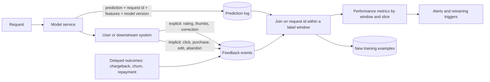
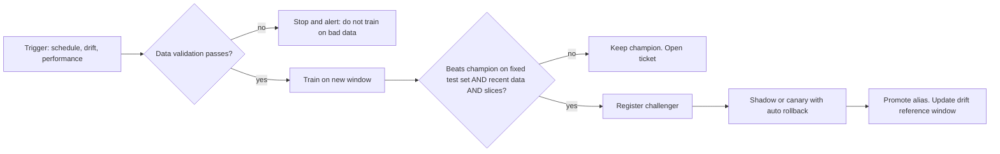

# Alerting, feedback loops and retraining triggers

> **Before this lesson:** read [Metrics, logs, traces and Prometheus](#/lesson/mlops/observability)
> (PromQL, SLOs, error budgets and burn rates) and
> [Data drift, concept drift and statistical tests](#/lesson/mlops/drift) (PSI, label latency and
> concept drift). [Deployment strategies](#/lesson/mlops/deployment-strategies) explains the canary
> and shadow releases that retrained models go through.

## In plain words

Dashboards help only when someone is looking at them. An **alert** is a message that fetches a
person, or triggers an automatic action, when a problem appears that nobody is watching. Monitoring
only pays off when a signal leads to a decision: roll back, fix a pipeline, retrain the model, or
consciously do nothing.

An everyday picture is a smoke detector. A good one goes off when there is a fire and stays quiet
when you make toast. One that shrieks every morning gets its battery removed, and then the real fire
goes unnoticed. Alerting is the craft of building smoke detectors that people trust.

This lesson covers three connected topics: how to alert without drowning the team in noise; how to
collect **feedback**, the true outcomes that make real performance measurable; and **retraining**:
when to train a new version of the model, and how to do it automatically without breaking anything.

Why this matters for a job: an ML system without well-designed alerts and a feedback loop decays
silently. Interviewers ask "when would you retrain?" to see whether you think beyond "every week"
toward triggers, safety gates and the economics of staleness.

## From dashboards to decisions

Every monitoring signal should map to one of four outcomes: **roll back** (the last change broke
something), **fix a pipeline** (the data is wrong), **retrain** (the world moved), or **do nothing on
purpose** (noise, or a change that does not hurt). The rest of this lesson is about getting from
signal to the right outcome quickly and reliably.

## Principles of good alerting

1. **Alert on symptoms users feel**, not on every possible cause. "The error budget is burning 14
   times too fast" is a **symptom**; "CPU is at 85%" is a possible **cause** that may be perfectly
   harmless.
2. **Every alert must be actionable.** If the right response is "ignore it", delete the alert. If it
   is "look at it tomorrow", make it a ticket, not a page.
3. **Severity tiers**: a **page** (an urgent notification that wakes the on-call engineer: act now,
   for a user-visible outage or a fast budget burn), a **ticket** (an item in the team's work queue:
   act this week, for a slow burn or moderate drift), and **log or dashboard only** (information).
4. **Each alert links to a runbook**: a short document saying what the alert means, how to confirm
   it, the first things to try, and who owns it.
5. **Reduce noise**: require the condition to persist for a while (Prometheus's `for:`), group related
   alerts, **inhibit** (suppress) downstream alerts when the upstream cause is already firing, and
   add **hysteresis**: use a lower threshold to clear an alert than to raise it, so a value hovering
   at the line does not flip the alert on and off.

**Alert fatigue** is a reliability risk in its own right: a team that receives fifty alerts a day
stops reading them, and the one that matters is missed.

### Prometheus alerting rules

```yaml
# alerts.yml
groups:
  - name: churn-api
    rules:
      - alert: HighErrorBudgetBurn
        expr: |
          (sum(rate(predict_requests_total{status="error"}[5m])) / sum(rate(predict_requests_total[5m]))) > (14.4 * 0.005)
          and
          (sum(rate(predict_requests_total{status="error"}[1h])) / sum(rate(predict_requests_total[1h]))) > (14.4 * 0.005)
        for: 2m
        labels: {severity: page}
        annotations:
          summary: "churn-api burning error budget 14x (SLO 99.5%)"
          runbook_url: https://runbooks.acme.example/churn-api/error-burn

      - alert: LatencyP95High
        expr: histogram_quantile(0.95, sum by (le) (rate(predict_latency_seconds_bucket[5m]))) > 0.2
        for: 10m
        labels: {severity: ticket}

      - alert: PredictionMeanShift
        expr: |
          abs(
            sum(rate(prediction_score_sum[1h])) / sum(rate(prediction_score_count[1h]))
            - sum(rate(prediction_score_sum[1h] offset 7d)) / sum(rate(prediction_score_count[1h] offset 7d))
          ) > 0.05
        for: 2h
        labels: {severity: ticket}
        annotations:
          summary: "mean predicted score moved >0.05 vs same hour last week"

      - alert: FeatureMissingRateHigh
        expr: sum by (feature) (rate(feature_missing_total[15m])) / ignoring(feature) group_left sum(rate(predict_requests_total[15m])) > 0.05
        for: 15m
        labels: {severity: ticket}

      - alert: NoPredictions
        expr: sum(rate(predict_requests_total[10m])) == 0
        for: 10m
        labels: {severity: page}
```

Each rule has a name, an `expr` (a PromQL condition; the alert is active while it is true), a `for:`
duration, labels such as `severity` that decide where the alert is sent, and annotations with a
human-readable summary and a runbook link. Rule by rule:

- **HighErrorBudgetBurn** pages when the error ratio is above 14.4 times the allowed 0.5% over *both*
  the last 5 minutes *and* the last hour. Where does 14.4 come from? One hour is 1/720 of a 30-day
  window, so a burn rate of 14.4 consumes 14.4 / 720 = 2% of the whole month's budget in a single
  hour, a common threshold for "wake someone up" in the Google SRE workbook.
- **LatencyP95High** opens a ticket if p95 latency stays above 200 ms for 10 minutes.
- **PredictionMeanShift** compares the mean predicted score over the last hour with the same hour a
  week earlier (`offset 7d`) and opens a ticket if the difference stays above 0.05 for 2 hours.
- **FeatureMissingRateHigh** opens a ticket if any single feature is missing in more than 5% of
  requests for 15 minutes. `group_left` lets each per-feature series be divided by the one total.
- **NoPredictions** pages if no predictions were made for 10 minutes.

Points worth remembering:

- `for:` requires the expression to stay true for the whole duration before firing: the **patience**
  you implement in the problem `mlops-drift-alerts`.
- **Multi-window burn-rate** alerts (a long window AND a short window) fire quickly on real incidents,
  because the short window reacts fast, and stop firing soon after recovery, because the short window
  also clears fast. The long window prevents paging on a 2-minute blip. The problem
  `mlops-burn-rate-alerts` asks you to implement this rule.
- Comparing with `offset 7d` handles **weekly seasonality**: Monday morning is compared with last
  Monday morning, not with Sunday night.
- "Absence of data" alerts such as `NoPredictions` catch the failure in which everything looks quiet
  because nothing is running at all.

**Alertmanager** receives firing alerts and handles **grouping** (one notification for thirty
failing pods, not thirty), **inhibition** (suppress pod alerts while the whole node is down),
**silences** (mute alerts during planned maintenance) and **routing** (pages to PagerDuty, tickets to
Slack or Jira).

### Patience and hysteresis

The demo shows the trade-off that patience controls.

```python-run
import numpy as np
rng = np.random.default_rng(0)
psi = np.abs(rng.normal(0.08, 0.06, 60))            # noisy daily PSI with no real drift ...
psi[40:] += 0.25                                     # ... then a real shift from day 40

def alerts(scores, threshold, patience):
    fired, active, run = [], [], 0
    for t, s in enumerate(scores):
        run = run + 1 if s >= threshold else 0
        if run == patience:
            fired.append(t)              # notification sent once per streak
        if run >= patience:
            active.append(t)             # alert is in the firing state
    return fired, active

for patience in (1, 2, 3):
    fired, active = alerts(psi, 0.15, patience)
    false = [t for t in fired if t < 38]
    first_true = next(t for t in active if t >= 40)
    print(f"patience={patience}: false notifications before the shift: {len(false)}   "
          f"detection delay after day 40: {first_true - 40} days")
```

`psi` is 60 days of a noisy drift score around 0.08, with a real jump of 0.25 from day 40. In
`alerts`, `run` counts consecutive days at or above the threshold and resets to zero on any quiet
day. A notification goes out on the day the streak reaches `patience`. The loop counts false
notifications before the real shift and the delay before the alert is firing after day 40. The
output:

```text
patience=1: false notifications before the shift: 2   detection delay after day 40: 0 days
patience=2: false notifications before the shift: 0   detection delay after day 40: 0 days
patience=3: false notifications before the shift: 0   detection delay after day 40: 1 days
```

With no patience, two random spikes cause false alarms. Requiring two days removes them (here at no
cost, because day 39 happened to be high by chance); requiring three adds a day of delay. In general,
higher patience removes false alarms at the price of a longer detection delay, which is your MTTD.
Choose it per signal: no patience for hard failures, days for slow statistical drift.

### Alerts for batch pipelines

Batch systems need different alerts:

- **Freshness**: the predictions table was not updated by 06:00.
- **Volume**: the row count differs by more than 20% from the recent average.
- **Duration**: the job took three times its usual time.
- **Validation failures** from the data checks.
- **SLA misses** reported by the orchestrator (an **SLA**, service level agreement, is a deadline
  promised to the consumers of the data).

## Feedback loops: getting ground truth

Real performance monitoring needs the true outcome (the **label**) joined to each prediction. Design
this loop on day one; adding it later means months without measurable performance.



The service writes every prediction to the prediction log (lesson 27). Feedback arrives later from
users and from delayed business outcomes (a **chargeback** is a disputed card payment, the usual
fraud label). A join on the request ID, within a **label window** (the period in which an outcome
counts, such as "churned within 30 days"), produces both performance metrics and new training
examples.

### Kinds of feedback

Huyen (*AI Engineering*, ch. 10) divides feedback into two kinds:

- **Explicit**: the user is asked: thumbs up or down, star ratings, "did this solve your problem?".
  The meaning is clear, but it is **sparse** (few people answer) and skewed toward people with strong
  opinions.
- **Implicit**: inferred from behaviour: purchases after a recommendation, clicks, **dwell time**
  (how long someone stays on an item), and, in conversational products, signals inside the
  conversation itself. A user who rephrases the question, corrects the model ("no, I meant..."),
  asks for a new answer, edits the output, stops the answer halfway or leaves the session is telling
  you something. Implicit feedback is plentiful but noisy and needs interpretation.

She also stresses that feedback is **proprietary data**: data only your product collects, which
feeds a **data flywheel** (better model, more use, more feedback, better model) that competitors
cannot copy. It is also *user data*, so privacy rules and consent apply.

### Feedback pitfalls

- **Delay**: define a label window and only score windows that are complete. Report metrics with
  their **maturity** (what share of outcomes are already known).
- **Selection bias**: outcomes exist only where the model acted. Keep a randomised holdout or
  exploration slice for unbiased estimates (lesson 28).
- **Degenerate feedback loops**: the model's own outputs shape its future training data and
  reinforce its early favourites, as in the **popularity bias** of recommenders. Counter it with
  exploration, corrections for position bias, and diversity rules.
- **Position and presentation bias**: the first suggestion gets clicked more regardless of quality.
- **Adversarial feedback**: users or bots gaming ratings. Never retrain blindly on raw feedback.

The demo shows a degenerate feedback loop in a recommender with five equally good items.

```python-run
import numpy as np
rng = np.random.default_rng(3)
# Degenerate feedback loop: 5 equally good items; the system shows the most-clicked item so far.
true_ctr = np.array([0.10, 0.10, 0.10, 0.10, 0.10])
def simulate(explore, steps=20000):
    clicks, shows = np.zeros(5), np.zeros(5)
    for _ in range(steps):
        item = rng.integers(5) if rng.random() < explore else int(np.argmax(clicks))
        shows[item] += 1
        clicks[item] += rng.random() < true_ctr[item]
    return shows.astype(int), clicks.astype(int)
for label, eps in (("greedy, no exploration", 0.0), ("10% exploration", 0.10)):
    shows, clicks = simulate(eps)
    print(label)
    print("  impressions per item:", shows.tolist())
    print("  clicks per item     :", clicks.tolist())
    print("  items with enough data (>=200 impressions) to estimate CTR:", int((shows >= 200).sum()), "of 5")
```

Every item has the same true **click-through rate** (CTR) of 10%. On each of 20,000 steps the system
either picks a random item (with probability `explore`) or shows the item with the most clicks so
far. Each showing is an **impression**. This "show the best so far, explore a little" rule is called
**epsilon-greedy**. The output:

```text
greedy, no exploration
  impressions per item: [20000, 0, 0, 0, 0]
  clicks per item     : [2046, 0, 0, 0, 0]
  items with enough data (>=200 impressions) to estimate CTR: 1 of 5
10% exploration
  impressions per item: [18358, 412, 392, 414, 424]
  clicks per item     : [1888, 43, 39, 40, 43]
  items with enough data (>=200 impressions) to estimate CTR: 5 of 5
```

With no exploration, item 0 wins the first tie and captures every impression, although all five are
equally good. The logged data then "proves" it is the best, and a model retrained on those logs can
never learn otherwise. A 10% exploration budget still favours the incumbent but gathers enough data
on every item to estimate its true quality (about 10% each).

## Retraining triggers

| Trigger | How | Pros | Cons |
|---|---|---|---|
| **Scheduled** | cron: daily/weekly/monthly | simple, predictable, catches gradual drift | wasteful if nothing changed; too slow for sudden shifts |
| **Performance-based** | metric from joined labels falls below threshold | directly tied to what matters | needs timely labels |
| **Drift-based** | PSI/KS on key features or predictions exceeds threshold persistently | works without labels | drift ≠ harm; false triggers |
| **Volume-based** | N new labelled examples accumulated | cheap, data-driven | ignores whether data differs |
| **Event-based** | known change: new product, policy, market, upstream schema | proactive | needs humans in the loop |
| **On demand** | code/feature change merged | captures improvements | not about staleness |

Most teams combine a **schedule** as the baseline with **performance or drift triggers** for early
action.

### How often? An economic view

Retraining has a cost (compute, validation, rollout effort); not retraining has a cost too, because
a stale model loses money every day, and the loss grows as the model ages. The demo finds the
cheapest interval under a simple linear decay model.

```python-run
import numpy as np
# Value lost to staleness grows as the model ages; each retrain has a fixed cost.
decay_per_day = 20.0         # extra $ lost per day for each day of model age (linear decay model)
retrain_cost = 4000.0        # compute + validation + rollout effort per retrain
horizon = 360
print("interval(days)  staleness cost   retrain cost     total / year")
best = None
for interval in (7, 14, 30, 60, 90, 180):
    cycles = horizon / interval
    stale = cycles * decay_per_day * interval * (interval - 1) / 2      # sum of 0..interval-1 days of age
    total = stale + cycles * retrain_cost
    best = min(best or (total, interval), (total, interval))
    print(f"{interval:13d}  {stale:14,.0f}  {cycles * retrain_cost:13,.0f}  {total:15,.0f}")
print(f"cheapest: every {best[1]} days   (analytic optimum ~ sqrt(2*cost/decay) = {np.sqrt(2 * retrain_cost / decay_per_day):.0f} days)")
```

A model that is `d` days old loses `20 * d` dollars that day, so one cycle of `interval` days loses
`20 * (0 + 1 + ... + (interval - 1))`, which the code computes with the formula for the sum of
consecutive numbers. Multiplying by the number of cycles in a year gives the staleness cost; each
cycle also pays the fixed retrain cost. The output:

```text
interval(days)  staleness cost   retrain cost     total / year
            7          21,600        205,714          227,314
           14          46,800        102,857          149,657
           30         104,400         48,000          152,400
           60         212,400         24,000          236,400
           90         320,400         16,000          336,400
          180         644,400          8,000          652,400
cheapest: every 14 days   (analytic optimum ~ sqrt(2*cost/decay) = 20 days)
```

Retraining weekly wastes money on retraining; retraining twice a year wastes far more on staleness.
Among the tested intervals, two weeks is cheapest, and calculus puts the true optimum near
$\sqrt{2 \times 4000 / 20} = 20$ days. The optimum moves when either number changes, which is why
measuring your model's real decay rate (by evaluating old model versions on newer data) is worth the
effort.

### What "retraining" can mean

- **Refit** the same pipeline and hyperparameters on a newer window of data: the most common form,
  and easy to automate.
- **Stateless** (train from scratch) versus **stateful** (**warm start** or fine-tune: continue
  training the existing model on new data). Stateful is cheaper but can drift, or forget older
  patterns.
- **Window choice**: a **sliding window** uses only recent data and adapts fast; an **expanding
  window** uses all history and is more stable; or keep all data but give recent rows more weight.
- **Re-tune** hyperparameters or **re-engineer** features and architecture: a human project, started
  when refits stop helping.
- For LLM applications: update the retrieval index, the prompts or the examples, and fine-tune
  occasionally.

### Automated retraining needs automated safety

A triggered retrain must pass the same gates as any other release:



Evaluate challengers on both a **fixed benchmark** (to catch regressions on cases that used to work)
and a **recent holdout** (to measure the benefit of fresh data). After promotion, **update the
monitoring reference** to the new training data; otherwise the drift alert that triggered the
retrain keeps firing forever.

Guard against **retraining storms**, where a persistent alert triggers retrain after retrain: add a
**cooldown** (a minimum time between triggered retrains), a cap per week, and a human checkpoint
when several retrains in a row fail the gates.

## Incident response for ML

An **incident** is an unplanned event that hurts users or the business. When an alert fires:

1. **Mitigate first**, which means reduce the harm before understanding it: roll back to the
   previous model version (move the alias), switch to a fallback (rules, cached predictions), or turn
   off the feature flag.
2. **Diagnose**: any recent deployments? Is the data pipeline healthy? Which slices are affected?
   Which features drifted? Check traces and the prediction log.
3. **Fix** the root cause (pipeline bug, retrain, feature fix).
4. **Blameless postmortem**: a written review of the timeline, the impact, the root cause, what
   detected it (or should have), and follow-up actions, focused on improving the system rather than
   blaming people. Add the failing cases to your tests and evaluation set, which closes the loop
   between monitoring and evaluation that Huyen recommends.

> [!INTERVIEW]
> "When would you retrain a model?" — Describe a baseline schedule justified by measured decay, plus
> triggers on performance (when labels are timely) and on persistent drift in important features or
> predictions (when they are not). Emphasise gates: validate data first, challenger must beat champion on
> fixed and recent test sets and slices, progressive rollout with rollback, update the drift reference,
> and cooldowns to avoid retraining loops. Mention feedback collection and selection bias.

## Summary

- Alerts must be symptom-based, actionable, tiered and linked to runbooks; use persistence, grouping
  and multi-window burn rates to fight noise.
- Build the feedback loop early: prediction log plus explicit and implicit feedback plus delayed
  outcomes, joined by request ID. Beware delay, selection bias and degenerate loops.
- Combine scheduled retraining with performance- and drift-based triggers, and choose the frequency
  from the economics of decay versus retraining cost.
- Automated retraining needs automated validation, progressive rollout, reference updates and
  cooldowns.
- In an incident, mitigate first, then diagnose, fix and write a blameless postmortem.

## Glossary

- **Alert** - a notification or automatic action triggered by a monitoring condition.
- **Symptom / cause** - what users feel / a possible reason behind it.
- **Page / ticket** - an urgent notification / an item in the work queue.
- **Runbook** - a document explaining an alert and the first steps to take.
- **Patience (`for:`)** - how long a condition must hold before an alert fires.
- **Hysteresis** - different thresholds for raising and clearing an alert.
- **Grouping / inhibition / silence** - merging notifications / suppressing dependent alerts /
  muting alerts for a period.
- **Alert fatigue** - people ignoring alerts because there are too many.
- **Multi-window burn-rate alert** - fires only when both a long and a short window burn fast.
- **Seasonality** - patterns that repeat daily, weekly or yearly.
- **Freshness / SLA** - how recently data was updated / a promised deadline.
- **Label window** - the period within which an outcome counts as the label.
- **Explicit / implicit feedback** - asked of the user / inferred from behaviour.
- **Dwell time** - how long a user stays on an item.
- **Data flywheel** - more use, more feedback, better model, more use.
- **Degenerate feedback loop / popularity bias** - a model's outputs reinforcing its own choices /
  popular items getting ever more exposure.
- **Impression / CTR** - one showing of an item / clicks divided by impressions.
- **Exploration / epsilon-greedy** - deliberately trying other options / exploiting the best so far
  except for a small random share.
- **Retraining trigger** - the condition that starts training a new model version.
- **Stateless / stateful retraining** - from scratch / continuing from the current model.
- **Sliding / expanding window** - recent data only / all history.
- **Retraining storm / cooldown** - repeated triggered retrains / a minimum gap between them.
- **Incident / mitigation** - an unplanned harmful event / reducing harm before fixing the cause.
- **Blameless postmortem** - a written review that improves systems instead of blaming people.

```quiz
[
  {"q": "What does the `for: 10m` clause in a Prometheus alert rule do?",
   "options": ["Delays evaluation by 10 minutes once", "Requires the condition to hold continuously for 10 minutes before the alert fires", "Silences the alert for 10 minutes", "Sets the scrape interval"],
   "answer": 1, "explain": "It filters out brief blips, trading detection delay for fewer false alarms."},
  {"q": "Which is the best candidate for a paging alert?",
   "options": ["CPU at 85% on one pod", "Fast error-budget burn affecting users", "PSI of 0.12 on a minor feature", "A successful deployment"],
   "answer": 1, "explain": "Page on user-visible symptoms requiring immediate action."},
  {"q": "A user rephrases their question and regenerates the answer twice. This is...",
   "options": ["Explicit feedback", "Implicit negative feedback", "Not feedback", "A guardrail violation"],
   "answer": 1, "explain": "Behavioural signals such as rephrasing and regeneration imply dissatisfaction."},
  {"q": "Why keep a small randomised holdout or exploration slice?",
   "options": ["To save compute", "To obtain unbiased outcome data not shaped by the model's own decisions", "To test Docker", "To reduce latency"],
   "answer": 1, "explain": "Otherwise labels exist only for cases the model selected (selection bias)."},
  {"q": "A drift-triggered retrain should begin with...",
   "options": ["Deploying to 100%", "Data validation, to avoid training on corrupted data", "Deleting the champion", "Hyperparameter search"],
   "answer": 1, "explain": "Many drift alerts are data bugs; training on them makes things worse."},
  {"q": "After promoting a retrained model, why update the drift reference window?",
   "options": ["To reduce storage", "Otherwise drift is still measured against the old training data and the alert keeps firing", "To change the SLO", "To reset Prometheus"],
   "answer": 1, "explain": "The reference should represent what the current model was trained on."},
  {"q": "What is a degenerate feedback loop?",
   "options": ["A loop in the DAG", "The model's outputs bias the data it is later trained on, reinforcing its own choices", "A retry storm", "A circular import"],
   "answer": 1, "explain": "Popularity bias in recommenders is the classic example."},
  {"q": "Increasing alert patience from 1 to 3 windows will generally...",
   "options": ["Increase false alarms and reduce delay", "Reduce false alarms and increase detection delay", "Have no effect", "Disable the alert"],
   "answer": 1, "explain": "Persistence filters noise at the cost of slower detection."}
]
```

> **Source:** Chip Huyen, *AI Engineering*, ch. 10 (user feedback: explicit vs implicit, conversational feedback signals, feedback as proprietary data; linking monitoring to evaluation); Prometheus documentation (*Alerting rules*, Alertmanager grouping/inhibition); Google SRE Workbook (*Alerting on SLOs*, multi-window burn rates); Chip Huyen, *Designing Machine Learning Systems*, ch. 9 (continual learning, retraining triggers, degenerate feedback loops).
