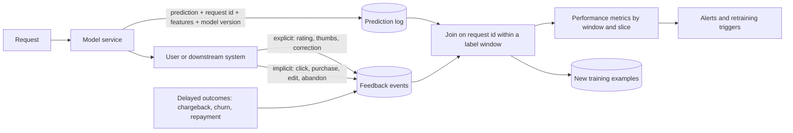
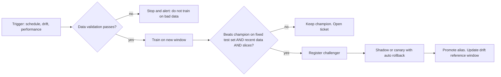

# Alerting, feedback loops and retraining triggers

## From dashboards to decisions

Dashboards are for humans who are already looking. **Alerts** bring a human (or an automated action) to
a problem nobody is looking at. Monitoring only creates value when a signal leads to a decision:
roll back, fix a pipeline, retrain, or deliberately do nothing. This lesson covers how to alert without
drowning the team, how to collect the feedback that makes real performance measurable, and when and how
to retrain.

## Principles of good alerting

1. **Alert on symptoms users feel**, not on every possible cause. "Error-budget burn is 14×" is a
   symptom; "CPU is 85%" is a cause that may be harmless.
2. **Every alert must be actionable.** If the response is "ignore it", delete the alert. If it is "look
   tomorrow", make it a ticket, not a page.
3. **Severity tiers**: *page* (act now — user-visible outage, fast budget burn), *ticket* (act this week
   — slow burn, moderate drift), *log/dashboard* (informational).
4. **Each alert links to a runbook**: what it means, how to verify, first mitigations, who owns it.
5. **Reduce noise**: require the condition to persist (`for:`), group related alerts, inhibit downstream
   alerts when the upstream cause is already firing, add hysteresis.

Alert fatigue is a reliability risk: a team that receives fifty alerts a day stops reading them, and the
one that matters is missed.

### Prometheus alerting rules

```yaml
# alerts.yml
groups:
  - name: churn-api
    rules:
      - alert: HighErrorBudgetBurn
        expr: |
          (sum(rate(predict_requests_total{status="error"}[5m])) / sum(rate(predict_requests_total[5m]))) > (14.4 * 0.005)
          and
          (sum(rate(predict_requests_total{status="error"}[1h])) / sum(rate(predict_requests_total[1h]))) > (14.4 * 0.005)
        for: 2m
        labels: {severity: page}
        annotations:
          summary: "churn-api burning error budget 14x (SLO 99.5%)"
          runbook_url: https://runbooks.acme.example/churn-api/error-burn

      - alert: LatencyP95High
        expr: histogram_quantile(0.95, sum by (le) (rate(predict_latency_seconds_bucket[5m]))) > 0.2
        for: 10m
        labels: {severity: ticket}

      - alert: PredictionMeanShift
        expr: |
          abs(
            sum(rate(prediction_score_sum[1h])) / sum(rate(prediction_score_count[1h]))
            - sum(rate(prediction_score_sum[1h] offset 7d)) / sum(rate(prediction_score_count[1h] offset 7d))
          ) > 0.05
        for: 2h
        labels: {severity: ticket}
        annotations:
          summary: "mean predicted score moved >0.05 vs same hour last week"

      - alert: FeatureMissingRateHigh
        expr: sum by (feature) (rate(feature_missing_total[15m])) / ignoring(feature) group_left sum(rate(predict_requests_total[15m])) > 0.05
        for: 15m
        labels: {severity: ticket}

      - alert: NoPredictions
        expr: sum(rate(predict_requests_total[10m])) == 0
        for: 10m
        labels: {severity: page}
```

- `for:` requires the expression to stay true for the duration before firing — the **patience** you
  implement in `mlops-drift-alerts`.
- **Multi-window burn-rate** alerts (long window AND short window) fire fast on real incidents and stop
  firing soon after recovery.
- Comparing to `offset 7d` handles weekly seasonality.
- "Absence of data" alerts (`NoPredictions`) catch the failure where everything looks quiet because
  nothing is running.

**Alertmanager** receives firing alerts and handles **grouping** (one notification for 30 pods),
**inhibition** (suppress pod alerts when the node is down), **silences** (during maintenance) and
**routing** (page → PagerDuty; ticket → Slack/Jira).

### Patience and hysteresis

```python-run
import numpy as np
rng = np.random.default_rng(0)
psi = np.abs(rng.normal(0.08, 0.06, 60))            # noisy daily PSI with no real drift ...
psi[40:] += 0.25                                     # ... then a real shift from day 40

def alerts(scores, threshold, patience):
    fired, active, run = [], [], 0
    for t, s in enumerate(scores):
        run = run + 1 if s >= threshold else 0
        if run == patience:
            fired.append(t)              # notification sent once per streak
        if run >= patience:
            active.append(t)             # alert is in the firing state
    return fired, active

for patience in (1, 2, 3):
    fired, active = alerts(psi, 0.15, patience)
    false = [t for t in fired if t < 38]
    first_true = next(t for t in active if t >= 40)
    print(f"patience={patience}: false notifications before the shift: {len(false)}   "
          f"detection delay after day 40: {first_true - 40} days")
```

Higher patience removes false alarms at the price of detection delay (your MTTD). Choose it per signal:
no patience for hard failures, days for slow statistical drift.

### Alerts for batch pipelines

Batch systems need different alerts: **freshness** (the predictions table was not updated by 06:00),
**volume** (row count deviates more than 20% from the trailing average), **duration** (job took 3× its
usual time), **validation failures**, and **SLA misses** from the orchestrator.

## Feedback loops: getting ground truth

Real performance monitoring needs labels joined to predictions. Design the loop on day one:



### Kinds of feedback

Huyen (*AI Engineering*, ch. 10) describes feedback as explicit or implicit:

- **Explicit**: the user is asked — thumbs up/down, star ratings, "did this solve your problem?". Clear
  but sparse and biased toward users with strong opinions.
- **Implicit**: inferred from behaviour — purchases after a recommendation, clicks, dwell time, and, in
  conversational products, signals inside the dialogue itself: the user rephrases, corrects the model
  ("no, I meant..."), regenerates the answer, edits the output, stops mid-generation, or abandons the
  session. Abundant but noisy and needs interpretation.

She also stresses that feedback is **proprietary data** — the fuel of a data flywheel that competitors
cannot copy — and that it is *user data*: privacy and consent apply.

### Feedback pitfalls

- **Delay**: define a label window (e.g., "churned within 30 days") and only score windows that are
  complete; report metrics with their maturity.
- **Selection bias**: outcomes exist only where the model acted. Keep a randomised holdout/exploration
  slice for unbiased estimates.
- **Degenerate feedback loops**: the model's own outputs shape its future training data, reinforcing
  early winners (popularity bias in recommenders). Mitigate with exploration, position-bias correction
  and diversity constraints.
- **Position and presentation bias**: the first suggestion gets clicked more regardless of quality.
- **Adversarial feedback**: users or bots gaming ratings. Never retrain blindly on raw feedback.

```python-run
import numpy as np
rng = np.random.default_rng(3)
# Degenerate feedback loop: 5 equally good items; the system shows the most-clicked item so far.
true_ctr = np.array([0.10, 0.10, 0.10, 0.10, 0.10])
def simulate(explore, steps=20000):
    clicks, shows = np.zeros(5), np.zeros(5)
    for _ in range(steps):
        item = rng.integers(5) if rng.random() < explore else int(np.argmax(clicks))
        shows[item] += 1
        clicks[item] += rng.random() < true_ctr[item]
    return shows.astype(int), clicks.astype(int)
for label, eps in (("greedy, no exploration", 0.0), ("10% exploration", 0.10)):
    shows, clicks = simulate(eps)
    print(label)
    print("  impressions per item:", shows.tolist())
    print("  clicks per item     :", clicks.tolist())
    print("  items with enough data (>=200 impressions) to estimate CTR:", int((shows >= 200).sum()), "of 5")
```

With no exploration, one arbitrary item captures every impression even though all five are equally good;
the logged data then "proves" it is the best, and the system can never learn otherwise. A small
exploration budget still favours the incumbent but gathers enough data on every item to estimate its
true quality.

## Retraining triggers

| Trigger | How | Pros | Cons |
|---|---|---|---|
| **Scheduled** | cron: daily/weekly/monthly | simple, predictable, catches gradual drift | wasteful if nothing changed; too slow for sudden shifts |
| **Performance-based** | metric from joined labels falls below threshold | directly tied to what matters | needs timely labels |
| **Drift-based** | PSI/KS on key features or predictions exceeds threshold persistently | works without labels | drift ≠ harm; false triggers |
| **Volume-based** | N new labelled examples accumulated | cheap, data-driven | ignores whether data differs |
| **Event-based** | known change: new product, policy, market, upstream schema | proactive | needs humans in the loop |
| **On demand** | code/feature change merged | captures improvements | not about staleness |

Most teams combine a **schedule** as the baseline with **performance/drift triggers** for early action.

### How often? An economic view

```python-run
import numpy as np
# Value lost to staleness grows as the model ages; each retrain has a fixed cost.
decay_per_day = 20.0         # extra $ lost per day for each day of model age (linear decay model)
retrain_cost = 4000.0        # compute + validation + rollout effort per retrain
horizon = 360
print("interval(days)  staleness cost   retrain cost     total / year")
best = None
for interval in (7, 14, 30, 60, 90, 180):
    cycles = horizon / interval
    stale = cycles * decay_per_day * interval * (interval - 1) / 2      # sum of 0..interval-1 days of age
    total = stale + cycles * retrain_cost
    best = min(best or (total, interval), (total, interval))
    print(f"{interval:13d}  {stale:14,.0f}  {cycles * retrain_cost:13,.0f}  {total:15,.0f}")
print(f"cheapest: every {best[1]} days   (analytic optimum ~ sqrt(2*cost/decay) = {np.sqrt(2 * retrain_cost / decay_per_day):.0f} days)")
```

The optimum balances staleness loss against retraining cost — and it moves when either changes, which is
why measuring your model's actual decay rate (by evaluating old models on newer data) is worth doing.

### What "retraining" can mean

- **Refit** the same pipeline and hyperparameters on a newer window (most common, automatable).
- **Stateless (from scratch)** vs **stateful (fine-tune/warm start)** on new data — the latter is cheaper
  but risks drifting or forgetting.
- **Window choice**: sliding window (recent data only, adapts fast) vs expanding window (all history,
  stabler); or weight recent data more.
- **Re-tune** hyperparameters or **re-engineer** features/architecture — a human project, triggered when
  refits stop helping.
- For LLM apps: update the retrieval index, prompts or examples; fine-tune occasionally.

### Automated retraining needs automated safety

A triggered retrain must go through the same gates as any release:



Evaluate challengers on both a **fixed benchmark** (to detect regressions on what used to work) and a
**recent holdout** (to measure the benefit of fresh data). After promotion, **update the monitoring
reference** to the new training data — otherwise the drift alert that triggered retraining keeps firing.

Guard against retraining storms: a cooldown between triggered retrains, a cap per week, and a human
checkpoint if several consecutive retrains fail the gates.

## Incident response for ML

When an alert fires:

1. **Mitigate first**: roll back to the previous model version (alias move), switch to a fallback
   (rules, cached predictions), or disable the feature flag.
2. **Diagnose**: recent deployments? data pipeline health? which slices? which features drifted? check
   traces and the prediction log.
3. **Fix** the root cause (pipeline bug, retrain, feature fix).
4. **Blameless postmortem**: timeline, impact, root cause, what detected it (or should have), action
   items — and add the failing cases to your tests and evaluation set, as Huyen recommends linking
   monitoring back to evaluation.

> [!INTERVIEW]
> "When would you retrain a model?" — Describe a baseline schedule justified by measured decay, plus
> triggers on performance (when labels are timely) and on persistent drift in important features or
> predictions (when they are not). Emphasise gates: validate data first, challenger must beat champion on
> fixed and recent test sets and slices, progressive rollout with rollback, update the drift reference,
> and cooldowns to avoid retraining loops. Mention feedback collection and selection bias.

## Summary

- Alerts must be symptom-based, actionable, tiered and tied to runbooks; use persistence, grouping and
  burn rates to fight noise.
- Build the feedback loop early: prediction log + explicit/implicit feedback + delayed outcomes, joined
  by request ID; beware delay, selection bias and degenerate loops.
- Combine scheduled retraining with performance- and drift-based triggers; choose frequency by the
  economics of decay vs retraining cost.
- Automated retraining requires automated validation, progressive rollout, reference updates and cooldowns.

```quiz
[
  {"q": "What does the `for: 10m` clause in a Prometheus alert rule do?",
   "options": ["Delays evaluation by 10 minutes once", "Requires the condition to hold continuously for 10 minutes before the alert fires", "Silences the alert for 10 minutes", "Sets the scrape interval"],
   "answer": 1, "explain": "It filters out brief blips, trading detection delay for fewer false alarms."},
  {"q": "Which is the best candidate for a paging alert?",
   "options": ["CPU at 85% on one pod", "Fast error-budget burn affecting users", "PSI of 0.12 on a minor feature", "A successful deployment"],
   "answer": 1, "explain": "Page on user-visible symptoms requiring immediate action."},
  {"q": "A user rephrases their question and regenerates the answer twice. This is...",
   "options": ["Explicit feedback", "Implicit negative feedback", "Not feedback", "A guardrail violation"],
   "answer": 1, "explain": "Behavioural signals such as rephrasing and regeneration imply dissatisfaction."},
  {"q": "Why keep a small randomised holdout or exploration slice?",
   "options": ["To save compute", "To obtain unbiased outcome data not shaped by the model's own decisions", "To test Docker", "To reduce latency"],
   "answer": 1, "explain": "Otherwise labels exist only for cases the model selected (selection bias)."},
  {"q": "A drift-triggered retrain should begin with...",
   "options": ["Deploying to 100%", "Data validation, to avoid training on corrupted data", "Deleting the champion", "Hyperparameter search"],
   "answer": 1, "explain": "Many drift alerts are data bugs; training on them makes things worse."},
  {"q": "After promoting a retrained model, why update the drift reference window?",
   "options": ["To reduce storage", "Otherwise drift is still measured against the old training data and the alert keeps firing", "To change the SLO", "To reset Prometheus"],
   "answer": 1, "explain": "The reference should represent what the current model was trained on."},
  {"q": "What is a degenerate feedback loop?",
   "options": ["A loop in the DAG", "The model's outputs bias the data it is later trained on, reinforcing its own choices", "A retry storm", "A circular import"],
   "answer": 1, "explain": "Popularity bias in recommenders is the classic example."},
  {"q": "Increasing alert patience from 1 to 3 windows will generally...",
   "options": ["Increase false alarms and reduce delay", "Reduce false alarms and increase detection delay", "Have no effect", "Disable the alert"],
   "answer": 1, "explain": "Persistence filters noise at the cost of slower detection."}
]
```

> **Source:** Chip Huyen, *AI Engineering*, ch. 10 (user feedback: explicit vs implicit, conversational feedback signals, feedback as proprietary data; linking monitoring to evaluation); Prometheus documentation (*Alerting rules*, Alertmanager grouping/inhibition); Google SRE Workbook (*Alerting on SLOs*, multi-window burn rates); Chip Huyen, *Designing Machine Learning Systems*, ch. 9 (continual learning, retraining triggers, degenerate feedback loops).
