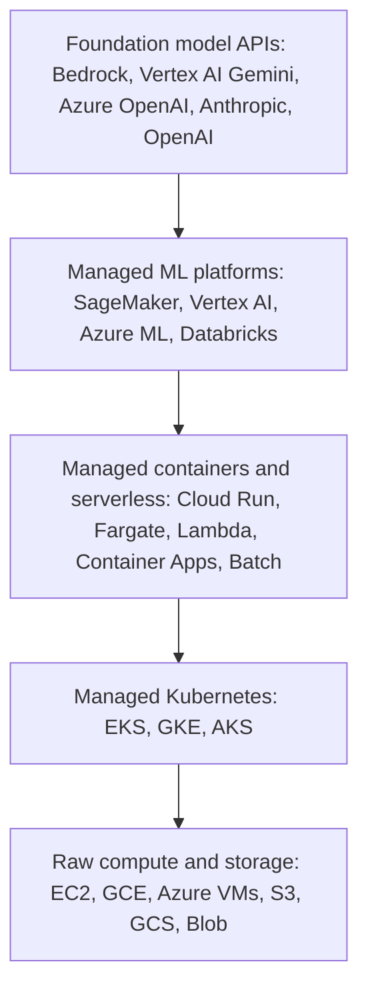
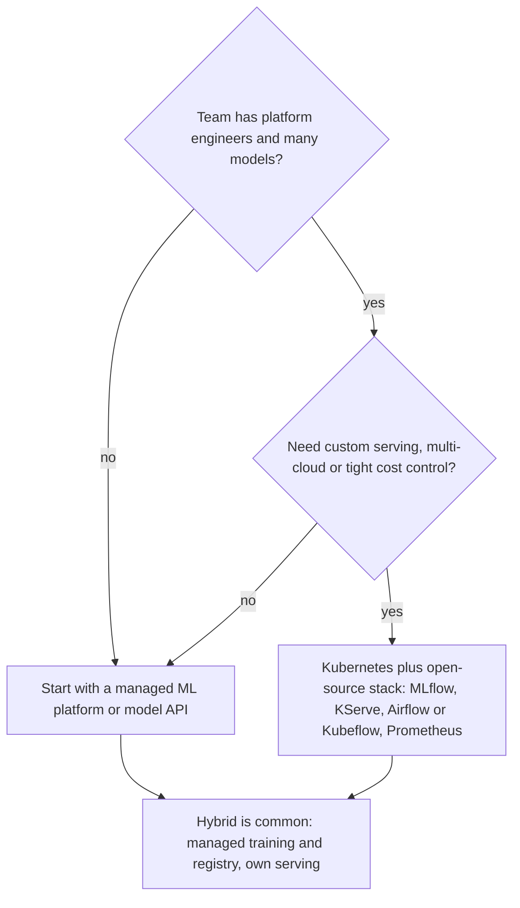

# Cloud ML platforms and serverless

## Why the cloud matters for ML

ML workloads are **spiky and heterogeneous**: a training run needs eight GPUs for six hours and then
nothing; an HPO sweep needs a hundred machines for an afternoon; serving needs a few always-on replicas
that double at lunchtime. Buying hardware for the peak wastes money; the cloud's elasticity (rent by the
second) and managed services (someone else operates Kubernetes, the registry, the GPU drivers) fit
naturally.

The trade-offs are cost at steady high utilisation, lock-in, data-residency constraints and less control.
This lesson maps the landscape so you can read any architecture diagram and choose a level of
abstraction deliberately.

## Layers of abstraction



Going up: less operational work, faster start, less control, higher unit price. Going down: the
opposite. Mature teams mix layers — e.g., a managed platform for training jobs and the registry, their
own Kubernetes for serving, and a model API for LLM features.

## The same building blocks, three vocabularies

| Capability | AWS | Google Cloud | Azure |
|---|---|---|---|
| Object storage | S3 | Cloud Storage (GCS) | Blob Storage / ADLS |
| Data warehouse | Redshift, Athena | BigQuery | Synapse, Fabric |
| Streaming | Kinesis, MSK (Kafka) | Pub/Sub, Dataflow | Event Hubs, Stream Analytics |
| Container registry | ECR | Artifact Registry | ACR |
| Managed Kubernetes | EKS | GKE | AKS |
| Serverless containers | Fargate, App Runner | Cloud Run | Container Apps |
| Functions | Lambda | Cloud Functions | Azure Functions |
| Batch compute | AWS Batch | Batch | Azure Batch |
| **ML platform** | **SageMaker** | **Vertex AI** | **Azure Machine Learning** |
| Notebooks | SageMaker Studio | Vertex AI Workbench / Colab Enterprise | Azure ML notebooks |
| Training jobs | SageMaker Training | Vertex AI Custom Training | Azure ML jobs |
| HPO | Automatic Model Tuning | Vertex AI Vizier | Sweep jobs |
| Pipelines | SageMaker Pipelines | Vertex AI Pipelines (KFP) | Azure ML pipelines |
| Feature store | SageMaker Feature Store | Vertex AI Feature Store | Azure ML managed feature store |
| Model registry | SageMaker Model Registry | Vertex AI Model Registry | Azure ML registry |
| Online endpoints | SageMaker real-time / serverless / async endpoints | Vertex AI endpoints | Managed online endpoints |
| Batch inference | Batch Transform | Batch prediction | Batch endpoints |
| Monitoring | Model Monitor, Clarify | Model Monitoring | Azure ML monitoring |
| Foundation models | Bedrock, JumpStart | Vertex AI Model Garden, Gemini API | Azure OpenAI / AI Foundry |
| Secrets | Secrets Manager | Secret Manager | Key Vault |
| IAM for workloads | IAM roles (IRSA for EKS) | Workload Identity | Managed identities |
| Orchestration | MWAA (Airflow), Step Functions | Cloud Composer (Airflow), Workflows | Data Factory, managed Airflow |

Cloud-neutral platforms sit across these: **Databricks** (lakehouse + managed MLflow + model serving),
**Snowflake** (Snowpark ML), **Hugging Face** (Hub, Inference Endpoints, Spaces), plus GPU-focused
clouds and "serverless GPU" providers.

## Anatomy of a managed training job

All three platforms follow the same recipe: you provide a **container image** (or pick a prebuilt
framework image) and an **entry point**, choose **instance type and count**, point at **input data** in
object storage, and the service provisions machines, runs the container, streams logs, uploads outputs
and tears everything down.

```python
# AWS SageMaker (Python SDK) — sketch
from sagemaker.estimator import Estimator

estimator = Estimator(
    image_uri="123456789012.dkr.ecr.eu-west-1.amazonaws.com/churn-train:9f3c1e2",
    role="arn:aws:iam::123456789012:role/sagemaker-train",
    instance_type="ml.g5.xlarge", instance_count=1,
    use_spot_instances=True, max_run=4 * 3600, max_wait=6 * 3600,      # managed spot training
    checkpoint_s3_uri="s3://acme-ml/checkpoints/churn/",              # resume after interruption
    hyperparameters={"learning_rate": 0.05, "max_iter": 400},
    output_path="s3://acme-ml/models/churn/",
)
estimator.fit({"train": "s3://acme-ml/data/churn/train/2025-01-15/"})
```

```python
# Google Vertex AI — sketch
from google.cloud import aiplatform
aiplatform.init(project="acme-ml", location="europe-west4", staging_bucket="gs://acme-ml-staging")
job = aiplatform.CustomContainerTrainingJob(
    display_name="churn-train",
    container_uri="europe-west4-docker.pkg.dev/acme-ml/ml/churn-train:9f3c1e2")
job.run(args=["--learning-rate", "0.05"], machine_type="n1-standard-8",
        accelerator_type="NVIDIA_TESLA_T4", accelerator_count=1, replica_count=1)
```

```yaml
# Azure ML (CLI v2 job YAML) — sketch
$schema: https://azuremlschemas.azureedge.net/latest/commandJob.schema.json
command: python -m churn.train --learning-rate ${{inputs.lr}} --data ${{inputs.train}}
environment: azureml:churn-train-env:12
compute: azureml:gpu-cluster
inputs:
  lr: 0.05
  train: {type: uri_folder, path: azureml://datastores/main/paths/churn/train/2025-01-15/}
```

The MLOps skills from earlier modules transfer directly: the image is your Dockerfile, the tracker can
be MLflow (Azure ML and Databricks expose MLflow-compatible tracking natively; SageMaker offers managed
MLflow), the registry and pipeline concepts are the same.

## Managed endpoints

A managed online endpoint wraps: a model artifact + an inference container + instance type/count +
autoscaling policy + traffic split across **variants/deployments** (for canary and blue-green) + built-in
metrics and data capture.

Endpoint flavours you will see on every cloud:

- **Real-time (provisioned)**: always-on instances, lowest latency, pay for uptime.
- **Serverless**: scales to zero, pay per request/compute-second; cold starts; limits on memory/GPU.
- **Asynchronous**: requests queued, results written to storage; scale to zero when idle; for large
  payloads and long inference.
- **Batch**: offline scoring of a dataset.

## Serverless for ML

"Serverless" means you do not manage servers and you pay only while your code runs.

| Option | Good for | Limits |
|---|---|---|
| Functions (Lambda, Cloud Functions, Azure Functions) | glue, lightweight CPU models, event triggers (file landed → validate → trigger pipeline) | package/memory/time limits (Lambda: 15 min, ≤10 GB memory), cold starts, generally no GPU |
| Serverless containers (Cloud Run, Fargate, Container Apps) | any container; HTTP APIs; scale to zero; Cloud Run offers GPUs | request timeouts, cold start grows with image/model size |
| Serverless endpoints (SageMaker Serverless, etc.) | spiky/low-traffic model APIs | cold starts, size limits |
| Model APIs (Bedrock, Vertex AI, Azure OpenAI, HF Inference Providers) | LLM features with zero infra; pay per token | data leaves your boundary (check terms), rate limits, model changes outside your control |

### Cold starts

The first request after scale-to-zero pays: provision a sandbox → pull the image → start the runtime →
**load the model** → warm up. For ML the model load dominates. Mitigations: smaller images and models;
keep a minimum of one warm instance (**provisioned concurrency** / `min-instances=1`); lazy-load rarely
used components; store weights on fast local/network disks; snapshot-restore features where offered.

```python-run
# Break-even: serverless (pay per use) vs one always-on instance.
always_on_per_hour = 0.23                 # small CPU instance, $/hour
serverless_per_gb_second = 0.0000166667   # illustrative per GB-second price
serverless_per_million_req = 0.20
mem_gb, seconds_per_request = 2.0, 0.12

def serverless_cost(req_per_month):
    compute = req_per_month * seconds_per_request * mem_gb * serverless_per_gb_second
    return compute + req_per_month / 1e6 * serverless_per_million_req

always = always_on_per_hour * 730
print(f"always-on instance: ${always:,.2f}/month regardless of traffic")
for rpm in (10_000, 1_000_000, 10_000_000, 50_000_000, 100_000_000):
    c = serverless_cost(rpm)
    print(f"{rpm:>12,} req/month -> serverless ${c:>9,.2f}  ({'serverless' if c < always else 'always-on'} cheaper)")
```

Serverless wins at low and spiky volume; steady high volume favours provisioned capacity. The crossover
is worth computing for your own numbers rather than guessing.

## Hugging Face Hub and Inference Endpoints

The **Hub** hosts models, datasets and demo Spaces as Git repositories with model cards (lesson 12).
**Inference Endpoints** deploy a Hub model onto dedicated, autoscaling infrastructure (your choice of
cloud, region, CPU/GPU instance) with TGI/vLLM-style runtimes for LLMs, including scale-to-zero. It is
the quickest path from "an open model on the Hub" to "a private HTTPS endpoint", at a higher unit price
than running it yourself.

## Security and networking basics

- **IAM least privilege**: each job/service gets its own role with only the buckets and secrets it needs;
  use workload identity (IRSA, GKE Workload Identity, managed identities) instead of static keys.
- **Network isolation**: private subnets/VPC endpoints for training and serving; no public buckets.
- **Encryption** at rest (KMS) and in transit (TLS).
- **Data residency**: choose regions to satisfy regulation; watch where managed model APIs process data.
- **Audit logs** (CloudTrail, Cloud Audit Logs, Azure Activity Log).

## Infrastructure as code

Click-ops is not reproducible. Define cloud resources declaratively with **Terraform/OpenTofu**, Pulumi,
CloudFormation/CDK or Bicep; review changes in pull requests; apply through CI.

```hcl
resource "aws_s3_bucket" "ml_artifacts" {
  bucket = "acme-ml-artifacts"
}
resource "aws_ecr_repository" "churn" {
  name                 = "churn-api"
  image_tag_mutability = "IMMUTABLE"          # tags cannot be overwritten
  image_scanning_configuration { scan_on_push = true }
}
```

## Build vs buy



Consider: team size and skills, number of models, latency/customisation needs, compliance, cost at your
scale, and lock-in (mitigated by open formats — containers, MLflow, ONNX, Parquet — and keeping your
core logic in your own packages rather than platform-specific SDK calls).

> [!INTERVIEW]
> "SageMaker vs running on EKS?" — Managed platform: fast start, integrated training/endpoint/monitoring,
> managed spot training, less ops; costs a premium per instance-hour and couples you to its APIs.
> Kubernetes: full control, portable open-source stack, bin-packing and custom autoscaling, but you run
> it. Many teams go hybrid. Show you know the equivalents across AWS/GCP/Azure and the serverless
> trade-off (scale-to-zero vs cold start).

## Summary

- Clouds offer the same primitives under different names; ML platforms (SageMaker, Vertex AI, Azure ML)
  bundle training jobs, pipelines, registries, endpoints and monitoring.
- Managed training = your container + instance choice + data in object storage; it provisions, runs and
  tears down.
- Endpoints come in real-time, serverless, async and batch flavours; serverless trades cold starts for
  scale-to-zero economics.
- Use least-privilege identity, private networking and infrastructure as code.
- Choose the abstraction level by team, scale, control and cost; hybrids are normal.

```quiz
[
  {"q": "Which trio are the flagship managed ML platforms of AWS, Google Cloud and Azure?",
   "options": ["Lambda, Cloud Run, Functions", "SageMaker, Vertex AI, Azure Machine Learning", "S3, GCS, Blob", "EKS, GKE, AKS"],
   "answer": 1, "explain": "They bundle training, pipelines, registry, endpoints and monitoring."},
  {"q": "What do you typically provide to a managed training job?",
   "options": ["A physical server", "A container image/entry point, instance type and count, and input data location", "Only a notebook screenshot", "A Kubernetes cluster"],
   "answer": 1, "explain": "The service provisions compute, runs your container and uploads outputs."},
  {"q": "What dominates cold-start time for serverless model inference?",
   "options": ["DNS lookup", "Pulling the image and loading the model into memory", "TLS handshake", "Logging"],
   "answer": 1, "explain": "Large images and weights take seconds to minutes to pull and load."},
  {"q": "When is an asynchronous endpoint the right choice?",
   "options": ["Sub-10 ms latency requirements", "Large payloads or long-running inference where results can be fetched later", "When no storage is available", "For static websites"],
   "answer": 1, "explain": "Requests are queued and results written to storage; it can scale to zero."},
  {"q": "Why prefer workload identity over static access keys?",
   "options": ["Keys are faster", "Short-lived, automatically rotated credentials scoped to the workload reduce leak risk", "Keys cannot access S3", "Identity is cheaper per request"],
   "answer": 1, "explain": "Static keys leak and must be rotated manually."},
  {"q": "At steady, high request volume, which is usually cheaper?",
   "options": ["Per-request serverless", "Provisioned always-on capacity", "They always cost the same", "Neither can serve high volume"],
   "answer": 1, "explain": "Serverless premiums add up at sustained load; break-even depends on your numbers."},
  {"q": "What reduces lock-in when using a managed ML platform?",
   "options": ["Using only the vendor's proprietary model format", "Open formats and tools (containers, MLflow, ONNX, Parquet) and keeping logic in your own packages", "Avoiding version control", "Using click-ops"],
   "answer": 1, "explain": "Portable artifacts and thin platform-specific glue make migration feasible."}
]
```

> **Source:** AWS SageMaker, Google Vertex AI and Azure Machine Learning documentation (training jobs, endpoints, pipelines, model registries); AWS Lambda, Google Cloud Run documentation (limits, cold starts, minimum instances); Hugging Face Hub and Inference Endpoints documentation; Bill Lubanovic, *FastAPI*, ch. 13 (cloud services); Chip Huyen, *AI Engineering*, ch. 4 (build vs buy: model APIs vs self-hosting).
