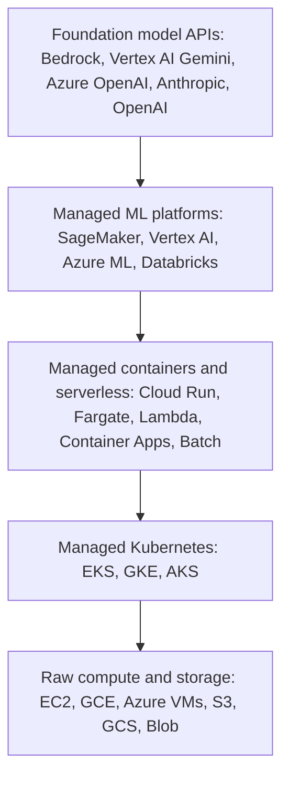
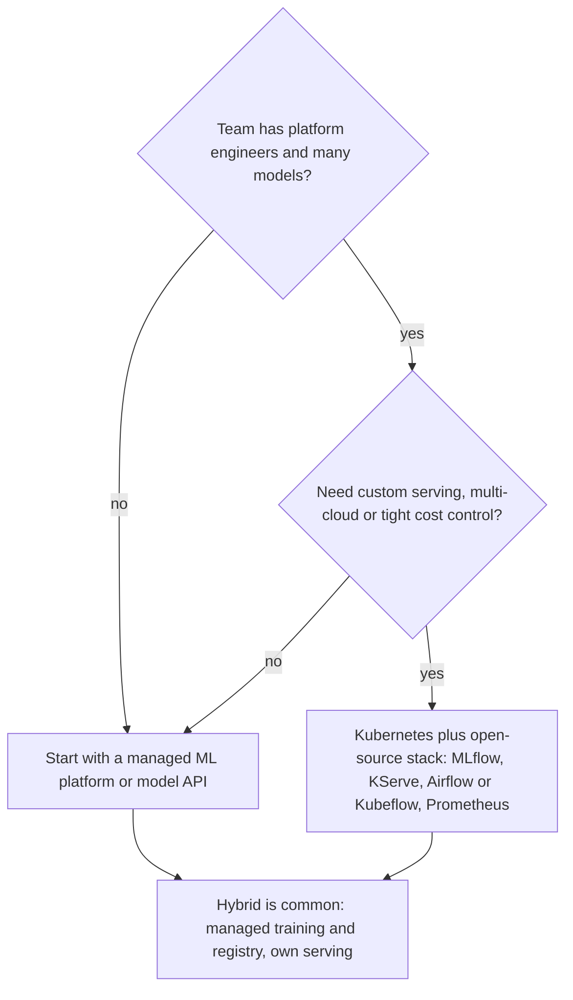

# Cloud ML platforms and serverless

> **Before this lesson:** read [Scaling, GPUs and KServe on Kubernetes](#/lesson/mlops/k8s-ml)
> (managed Kubernetes, scale-to-zero, cold starts), [CI/CD with GitHub Actions](#/lesson/mlops/github-actions)
> (OIDC and IAM roles) and [Model registry, model cards and governance](#/lesson/mlops/model-registry).
> No cloud account is needed; all cloud code here is shown, not run.

## In plain words

The **cloud** is computing rented over the internet: instead of buying servers, you rent machines,
storage and ready-made services from a provider (Amazon Web Services, Google Cloud or Microsoft
Azure are the big three), and pay for what you use, often by the second. Each provider also sells a
**managed ML platform**: a bundle of services for notebooks, training jobs, pipelines, a model
registry, prediction endpoints and monitoring, all operated for you.

An everyday picture is the choice between owning a car, leasing one, using a taxi, or taking the
train. Owning gives total control and is cheapest if you drive all day every day; a taxi costs more
per kilometre but you never think about maintenance or parking, and you pay nothing while you are
not riding. Cloud services form the same ladder, from raw rented machines you manage yourself up to
fully managed APIs that you call and forget.

Why this matters for a job: almost every company runs ML on one of these clouds, and job adverts
name the platforms (SageMaker, Vertex AI, Azure ML). Interviewers expect you to translate between
the three vocabularies, to explain when serverless is cheaper, and to argue "managed platform versus
our own Kubernetes" with trade-offs rather than preferences.

## Why the cloud matters for ML

ML workloads are **spiky and varied**: a training run needs eight GPUs for six hours and then
nothing; a hyperparameter search (lesson 15) needs a hundred machines for an afternoon; serving needs
a few always-on replicas that double at lunchtime. Buying hardware for the peak wastes money most of
the time. Two cloud properties fit this shape well:

- **Elasticity**: renting more or less capacity within minutes, billed by the second.
- **Managed services**: someone else operates Kubernetes, the registry, the GPU drivers and the
  databases.

The trade-offs: renting costs more than owning when utilisation is steadily high; **lock-in** (your
system depends on one provider's proprietary services, making a move expensive); **data residency**
rules (laws requiring some data to stay in a particular country or region); and less control. This
lesson maps the landscape so you can read any architecture diagram and choose a level of abstraction
on purpose.

## Layers of abstraction



Read from the bottom up:

- **Raw compute and storage**: rented **virtual machines** (VMs, such as EC2 on AWS) and **object
  storage** (S3, GCS, Blob), a service that stores files of any size under names called keys.
- **Managed Kubernetes**: the provider runs the Kubernetes control plane (lesson 22).
- **Managed containers and serverless**: you hand over a container image or a function and the
  provider runs it, scaling it for you, even down to zero.
- **Managed ML platforms**: training jobs, pipelines, registries and endpoints as services.
- **Foundation model APIs**: a large pretrained model (a **foundation model**) offered behind an API,
  paid per token.

Going up means less operational work, a faster start, less control and a higher unit price. Going
down means the opposite. Mature teams mix layers: for example a managed platform for training jobs
and the registry, their own Kubernetes for serving, and a model API for LLM features.

## The same building blocks, three vocabularies

| Capability | AWS | Google Cloud | Azure |
|---|---|---|---|
| Object storage | S3 | Cloud Storage (GCS) | Blob Storage / ADLS |
| Data warehouse | Redshift, Athena | BigQuery | Synapse, Fabric |
| Streaming | Kinesis, MSK (Kafka) | Pub/Sub, Dataflow | Event Hubs, Stream Analytics |
| Container registry | ECR | Artifact Registry | ACR |
| Managed Kubernetes | EKS | GKE | AKS |
| Serverless containers | Fargate, App Runner | Cloud Run | Container Apps |
| Functions | Lambda | Cloud Functions | Azure Functions |
| Batch compute | AWS Batch | Batch | Azure Batch |
| **ML platform** | **SageMaker** | **Vertex AI** | **Azure Machine Learning** |
| Notebooks | SageMaker Studio | Vertex AI Workbench / Colab Enterprise | Azure ML notebooks |
| Training jobs | SageMaker Training | Vertex AI Custom Training | Azure ML jobs |
| HPO | Automatic Model Tuning | Vertex AI Vizier | Sweep jobs |
| Pipelines | SageMaker Pipelines | Vertex AI Pipelines (KFP) | Azure ML pipelines |
| Feature store | SageMaker Feature Store | Vertex AI Feature Store | Azure ML managed feature store |
| Model registry | SageMaker Model Registry | Vertex AI Model Registry | Azure ML registry |
| Online endpoints | SageMaker real-time / serverless / async endpoints | Vertex AI endpoints | Managed online endpoints |
| Batch inference | Batch Transform | Batch prediction | Batch endpoints |
| Monitoring | Model Monitor, Clarify | Model Monitoring | Azure ML monitoring |
| Foundation models | Bedrock, JumpStart | Vertex AI Model Garden, Gemini API | Azure OpenAI / AI Foundry |
| Secrets | Secrets Manager | Secret Manager | Key Vault |
| IAM for workloads | IAM roles (IRSA for EKS) | Workload Identity | Managed identities |
| Orchestration | MWAA (Airflow), Step Functions | Cloud Composer (Airflow), Workflows | Data Factory, managed Airflow |

Do not memorise the table; learn to read it across. Every row is a concept from earlier lessons with
three brand names. **HPO** is hyperparameter optimisation. **IAM** (identity and access management)
is each cloud's permission system; **IRSA** (IAM roles for service accounts) lets Kubernetes pods on
EKS use IAM roles.

Some platforms sit across all three clouds: **Databricks** (a **lakehouse**, which combines a data
lake's cheap file storage with a warehouse's tables, plus managed MLflow and model serving),
**Snowflake** (a cloud data warehouse with Snowpark ML), **Hugging Face** (the Hub, Inference
Endpoints, Spaces), and GPU-focused clouds and "serverless GPU" providers.

## Anatomy of a managed training job

All three platforms follow the same recipe. You provide a **container image** (or pick a prebuilt
one for your framework) and an **entry point** (the command to run); you choose the **instance type**
(machine size) and how many; you point at **input data** in object storage. The service then starts
the machines, runs your container, streams its logs, uploads its outputs and shuts everything down,
so you pay only for the duration of the job.

```python
# AWS SageMaker (Python SDK) — sketch
from sagemaker.estimator import Estimator

estimator = Estimator(
    image_uri="123456789012.dkr.ecr.eu-west-1.amazonaws.com/churn-train:9f3c1e2",
    role="arn:aws:iam::123456789012:role/sagemaker-train",
    instance_type="ml.g5.xlarge", instance_count=1,
    use_spot_instances=True, max_run=4 * 3600, max_wait=6 * 3600,      # managed spot training
    checkpoint_s3_uri="s3://acme-ml/checkpoints/churn/",              # resume after interruption
    hyperparameters={"learning_rate": 0.05, "max_iter": 400},
    output_path="s3://acme-ml/models/churn/",
)
estimator.fit({"train": "s3://acme-ml/data/churn/train/2025-01-15/"})
```

Line by line: `image_uri` is the training image in AWS's container registry, tagged with a commit
SHA. `role` is the IAM role the job runs as (an **ARN**, Amazon Resource Name, identifies any AWS
resource). One `ml.g5.xlarge` machine has one GPU. `use_spot_instances=True` rents discounted spare
capacity that AWS may reclaim (lesson 31); `max_run` caps the training time at 4 hours and
`max_wait` caps the total including waiting for spot capacity at 6 hours; checkpoints saved to
`checkpoint_s3_uri` let an interrupted job resume. `hyperparameters` are passed to your training
script, and the trained model is uploaded to `output_path`. `fit` starts the job with the training
data folder mounted as the channel `train`.

```python
# Google Vertex AI — sketch
from google.cloud import aiplatform
aiplatform.init(project="acme-ml", location="europe-west4", staging_bucket="gs://acme-ml-staging")
job = aiplatform.CustomContainerTrainingJob(
    display_name="churn-train",
    container_uri="europe-west4-docker.pkg.dev/acme-ml/ml/churn-train:9f3c1e2")
job.run(args=["--learning-rate", "0.05"], machine_type="n1-standard-8",
        accelerator_type="NVIDIA_TESLA_T4", accelerator_count=1, replica_count=1)
```

The same recipe on Google Cloud: choose a project and region, name the image, then run it with
command-line arguments on an 8-CPU machine with one NVIDIA T4 GPU (an **accelerator**).

```yaml
# Azure ML (CLI v2 job YAML) — sketch
$schema: https://azuremlschemas.azureedge.net/latest/commandJob.schema.json
command: python -m churn.train --learning-rate ${{inputs.lr}} --data ${{inputs.train}}
environment: azureml:churn-train-env:12
compute: azureml:gpu-cluster
inputs:
  lr: 0.05
  train: {type: uri_folder, path: azureml://datastores/main/paths/churn/train/2025-01-15/}
```

And on Azure, as a YAML file: the command to run (with `${{inputs...}}` placeholders filled from the
`inputs` section), a registered environment (version 12), and a named GPU cluster.

The MLOps skills from earlier modules carry over directly: the image is your Dockerfile, the tracker
can be MLflow (Azure ML and Databricks expose MLflow-compatible tracking natively, and SageMaker
offers managed MLflow), and the registry and pipeline ideas are the same.

## Managed endpoints

A managed online endpoint bundles: a model artifact, an inference container, an instance type and
count, an autoscaling policy, a traffic split across **variants** or **deployments** (for canary and
blue-green releases, lesson 26), built-in metrics, and **data capture** (automatic logging of requests
and responses to storage, which feeds monitoring).

Endpoint flavours you will see on every cloud:

- **Real-time (provisioned)**: always-on instances, lowest latency, you pay for uptime.
- **Serverless**: scales to zero, you pay per request and per compute-second; cold starts; limits on
  memory and usually no GPU.
- **Asynchronous**: requests are queued and results written to storage; scales to zero when idle;
  for large payloads and long inference.
- **Batch**: offline scoring of a whole data set.

These are the patterns of lesson 19 offered as products.

## Serverless for ML

**Serverless** means you do not manage servers and you pay only while your code runs.

| Option | Good for | Limits |
|---|---|---|
| Functions (Lambda, Cloud Functions, Azure Functions) | glue, lightweight CPU models, event triggers (file landed → validate → trigger pipeline) | package/memory/time limits (Lambda: 15 min, ≤10 GB memory), cold starts, generally no GPU |
| Serverless containers (Cloud Run, Fargate, Container Apps) | any container; HTTP APIs; scale to zero; Cloud Run offers GPUs | request timeouts, cold start grows with image/model size |
| Serverless endpoints (SageMaker Serverless, etc.) | spiky/low-traffic model APIs | cold starts, size limits |
| Model APIs (Bedrock, Vertex AI, Azure OpenAI, HF Inference Providers) | LLM features with zero infra; pay per token | data leaves your boundary (check terms), rate limits, model changes outside your control |

A **function** here is a small piece of code the provider runs in response to an event, such as a
file arriving in a bucket. "Glue" means small connecting jobs between larger systems.

### Cold starts

The first request after scaling to zero pays for: creating an isolated sandbox, pulling the image,
starting the language runtime, **loading the model**, and warming up. For ML, loading the model
dominates. Mitigations:

- smaller images and smaller models;
- keep at least one warm instance (**provisioned concurrency** on Lambda, `min-instances=1` on Cloud
  Run);
- load rarely used components only when first needed;
- keep weights on fast local or network disks;
- use snapshot-and-restore features where the platform offers them.

When is serverless cheaper than a machine that runs all month? The demo computes the break-even.

```python-run
# Break-even: serverless (pay per use) vs one always-on instance.
always_on_per_hour = 0.23                 # small CPU instance, $/hour
serverless_per_gb_second = 0.0000166667   # illustrative per GB-second price
serverless_per_million_req = 0.20
mem_gb, seconds_per_request = 2.0, 0.12

def serverless_cost(req_per_month):
    compute = req_per_month * seconds_per_request * mem_gb * serverless_per_gb_second
    return compute + req_per_month / 1e6 * serverless_per_million_req

always = always_on_per_hour * 730
print(f"always-on instance: ${always:,.2f}/month regardless of traffic")
for rpm in (10_000, 1_000_000, 10_000_000, 50_000_000, 100_000_000):
    c = serverless_cost(rpm)
    print(f"{rpm:>12,} req/month -> serverless ${c:>9,.2f}  ({'serverless' if c < always else 'always-on'} cheaper)")
```

Serverless functions are billed in **GB-seconds**: memory allocated (in GB) times seconds of running
time. Each request here uses 2 GB for 0.12 seconds, plus a small per-request fee. The always-on
machine costs \$0.23 an hour for the roughly 730 hours in a month. The output:

```text
always-on instance: $167.90/month regardless of traffic
      10,000 req/month -> serverless $     0.04  (serverless cheaper)
   1,000,000 req/month -> serverless $     4.20  (serverless cheaper)
  10,000,000 req/month -> serverless $    42.00  (serverless cheaper)
  50,000,000 req/month -> serverless $   210.00  (always-on cheaper)
 100,000,000 req/month -> serverless $   420.00  (always-on cheaper)
```

Serverless costs almost nothing at low volume and grows in a straight line with traffic; the machine
costs the same every month. With these prices the lines cross at roughly 40 million requests a month.
Serverless wins at low and spiky volume, while steady high volume favours provisioned capacity.
Compute the crossover with your own numbers instead of guessing.

## Hugging Face Hub and Inference Endpoints

The **Hub** hosts models, data sets and demo apps (**Spaces**) as Git repositories, each with a
model card (lesson 12). **Inference Endpoints** deploy a model from the Hub onto dedicated,
autoscaling infrastructure (you choose the cloud, region and CPU or GPU instance), with TGI- or
vLLM-style runtimes for LLMs and optional scale-to-zero. It is the quickest route from "an open model
on the Hub" to "a private HTTPS endpoint", at a higher unit price than running it yourself.

## Security and networking basics

- **IAM least privilege**: each job or service gets its own role with access only to the buckets and
  secrets it needs. Use workload identity (IRSA, GKE Workload Identity, Azure managed identities)
  instead of static keys.
- **Network isolation**: run training and serving in **private subnets** (network segments with no
  direct internet access), reach cloud services through **VPC endpoints** (private connections that
  never cross the public internet), and never make buckets public.
- **Encryption** at rest, with keys held in a key management service (KMS), and in transit (TLS).
- **Data residency**: choose regions that satisfy regulation, and check where managed model APIs
  process your data.
- **Audit logs** that record who did what (CloudTrail, Cloud Audit Logs, Azure Activity Log).

## Infrastructure as code

Creating resources by clicking in a web console ("click-ops") cannot be reviewed or repeated.
**Infrastructure as code** (IaC) describes cloud resources in files, declaratively, with
**Terraform** (or its open-source fork OpenTofu), Pulumi, CloudFormation/CDK or Bicep. Changes are
reviewed in pull requests and applied through CI, like application code.

```hcl
resource "aws_s3_bucket" "ml_artifacts" {
  bucket = "acme-ml-artifacts"
}
resource "aws_ecr_repository" "churn" {
  name                 = "churn-api"
  image_tag_mutability = "IMMUTABLE"          # tags cannot be overwritten
  image_scanning_configuration { scan_on_push = true }
}
```

This is Terraform's language, **HCL**. Each `resource` block declares one thing that should exist: a
bucket for ML artifacts and a container repository whose tags can never be overwritten (so `v1.4`
always means the same image) and whose images are scanned for vulnerabilities when pushed. Running
`terraform plan` shows what would change; `terraform apply` makes it so.

## Build vs buy



Things to weigh: team size and skills, number of models, latency and customisation needs,
compliance, cost at your scale, and lock-in. Lock-in is reduced by **open formats** (containers,
MLflow, ONNX, Parquet) and by keeping your core logic in your own packages rather than in
platform-specific SDK calls.

> [!INTERVIEW]
> "SageMaker vs running on EKS?" — Managed platform: fast start, integrated training/endpoint/monitoring,
> managed spot training, less ops; costs a premium per instance-hour and couples you to its APIs.
> Kubernetes: full control, portable open-source stack, bin-packing and custom autoscaling, but you run
> it. Many teams go hybrid. Show you know the equivalents across AWS/GCP/Azure and the serverless
> trade-off (scale-to-zero vs cold start).

## Reference architecture: the churn system on one cloud

To see how the pieces fit, here is the capstone churn system mapped onto AWS, with the Google Cloud
and Azure equivalents alongside.

```mermaid
flowchart LR
  SRC[(App DB and events)] --> ING[Ingestion: DMS or Kinesis]
  ING --> S3[(Object storage: raw and curated)]
  S3 --> WH[(Warehouse or Athena)]
  WH --> PIPE[Pipeline orchestrator]
  PIPE --> TJ[Managed training job on spot GPUs or CPUs]
  TJ --> TRK[(Tracking and model registry)]
  TRK --> CD[CI/CD with OIDC]
  CD --> EP[Serving: managed endpoint or Kubernetes]
  EP --> CAP[(Prediction capture to object storage)]
  CAP --> MONJ[Scheduled monitoring job]
  MONJ --> AL[Alerts and retraining trigger]
  AL --> PIPE
```



Data flows from the application database and event stream (copied by DMS, AWS's database migration
service, or Kinesis) into object storage, is queried through a warehouse, and feeds an orchestrated
training job. The model goes to the registry, CI/CD deploys it, captured predictions feed a scheduled
monitoring job, and its alerts can trigger the pipeline again.

| Role | AWS | Google Cloud | Azure |
|---|---|---|---|
| Raw/curated storage | S3 | GCS | ADLS Gen2 |
| Query engine | Athena / Redshift | BigQuery | Synapse / Fabric |
| Orchestrator | SageMaker Pipelines / MWAA | Vertex AI Pipelines / Composer | Azure ML pipelines / Data Factory |
| Training | SageMaker training job (managed spot) | Vertex custom job (Spot VMs) | Azure ML job (low-priority VMs) |
| Tracking + registry | SageMaker managed MLflow / Model Registry | Vertex Experiments / Model Registry | Azure ML (MLflow-native) |
| Serving | SageMaker endpoint or EKS | Vertex endpoint, Cloud Run or GKE | Managed online endpoint or AKS |
| Data capture | endpoint data capture → S3 | request/response logging → BigQuery | data collector → Blob |
| Monitoring job | Model Monitor / scheduled processing job | Model Monitoring / scheduled job | Azure ML monitoring |
| Alerts | CloudWatch alarms → SNS | Cloud Monitoring | Azure Monitor |
| Identity for CI | IAM role via GitHub OIDC | Workload Identity Federation | Federated credentials |

### A minimal IAM policy for the training job

Least privilege in practice means the training role can read its inputs, write its outputs, and do
nothing else:

```json
{
  "Version": "2012-10-17",
  "Statement": [
    {"Sid": "ReadTrainingData", "Effect": "Allow", "Action": ["s3:GetObject", "s3:ListBucket"],
     "Resource": ["arn:aws:s3:::acme-ml-data", "arn:aws:s3:::acme-ml-data/churn/*"]},
    {"Sid": "WriteArtifacts", "Effect": "Allow", "Action": ["s3:PutObject"],
     "Resource": ["arn:aws:s3:::acme-ml-artifacts/churn/*"]},
    {"Sid": "PullImage", "Effect": "Allow",
     "Action": ["ecr:GetDownloadUrlForLayer", "ecr:BatchGetImage", "ecr:GetAuthorizationToken"], "Resource": "*"},
    {"Sid": "Logs", "Effect": "Allow", "Action": ["logs:CreateLogStream", "logs:PutLogEvents"], "Resource": "*"}
  ]
}
```

An IAM **policy** is a list of statements; each says whether to `Allow` a set of `Action`s on a set of
`Resource`s (identified by ARNs, with `*` as a wildcard). This one allows reading the churn training
data, writing artifacts under one prefix, pulling container images and writing logs. Anything not
allowed is denied. The serving role, by contrast, needs *read* access to model artifacts and no access
to raw training data at all. Separate roles per stage limit the damage if any one component is
compromised.

## Migrating between levels of abstraction

Teams rarely stay where they started. Typical moves and what prompts them:

| Move | Trigger | What makes it easy |
|---|---|---|
| Model API → self-hosted open model | cost at volume, latency, data-residency, need to fine-tune | an internal gateway abstraction (lesson 33) and an eval suite to verify parity |
| Managed endpoint → own Kubernetes | need custom routing/batching, multi-model packing, lower unit cost | containerised model server, standard inference protocol |
| Own Kubernetes → managed platform | small team drowning in ops | models in an open format, registry-centric workflow |
| One cloud → another / multi-cloud | acquisition, negotiation leverage, GPU availability | Terraform, containers, MLflow, Parquet; thin cloud-specific layer |

The portable core is always the same: **container images, open model and data formats, a registry
with lineage, and pipeline logic written as plain Python functions**, wrapped by thin
platform-specific adapters.

A **weighted scoring** table is a simple, honest way to make the choice explicit: list criteria, give
each a weight that reflects what matters to your team, score each option, and add up.

```python-run
# Decision sketch: weighted scoring of platform options for a hypothetical team.
criteria = {"time to first production model": 0.25, "ops burden": 0.25, "unit cost at our scale": 0.20,
            "flexibility / custom serving": 0.15, "portability": 0.15}
# scores 1 (bad) .. 5 (good)
options = {
    "Managed ML platform":        [5, 5, 3, 3, 2],
    "Own Kubernetes + OSS stack": [2, 2, 4, 5, 5],
    "Hybrid (managed train, own serve)": [4, 3, 4, 4, 4],
}
def rank(weights):
    return sorted(((sum(w * s for w, s in zip(weights, sc)), name) for name, sc in options.items()), reverse=True)
print("3-person team, first models:")
for score, name in rank(list(criteria.values())): print(f"  {score:.2f}  {name}")
print("platform team of 8, 60 models, cost pressure (reweighted):")
for score, name in rank([0.10, 0.15, 0.30, 0.25, 0.20]): print(f"  {score:.2f}  {name}")
```

Each option's score is the sum of weight times score over the five criteria; `rank` sorts the
options from best to worst. The second call uses different weights, as a larger platform team under
cost pressure would. The output:

```text
3-person team, first models:
  3.85  Managed ML platform
  3.75  Hybrid (managed train, own serve)
  3.30  Own Kubernetes + OSS stack
platform team of 8, 60 models, cost pressure (reweighted):
  3.95  Own Kubernetes + OSS stack
  3.85  Hybrid (managed train, own serve)
  3.30  Managed ML platform
```

The ranking flips with the weights, which is the point. There is no universally right platform, only
a right one for a team's size, model count and constraints, and the answer changes as they change.

## Summary

- Clouds offer the same building blocks under different names; ML platforms (SageMaker, Vertex AI,
  Azure ML) bundle training jobs, pipelines, registries, endpoints and monitoring.
- A managed training job is your container plus an instance choice plus data in object storage; the
  service starts, runs and tears down the machines.
- Endpoints come in real-time, serverless, asynchronous and batch flavours; serverless trades cold
  starts for scale-to-zero economics.
- Use least-privilege identity, private networking and infrastructure as code.
- Choose the level of abstraction by team, scale, control and cost; hybrids are normal.

## Glossary

- **Cloud / elasticity** - computing rented over the internet / growing and shrinking capacity on
  demand.
- **Managed service** - a service the provider operates for you.
- **Lock-in** - dependence on one provider that makes moving expensive.
- **Data residency** - rules about where data may be stored and processed.
- **Virtual machine (VM)** - a rented, software-simulated computer.
- **Object storage** - storage for files of any size addressed by keys (S3, GCS, Blob).
- **Managed ML platform** - a bundle of ML services (SageMaker, Vertex AI, Azure ML).
- **Foundation model API** - a large pretrained model offered as a pay-per-token service.
- **Lakehouse** - data-lake storage with warehouse-style tables on top.
- **Instance type** - a named machine size with fixed CPU, memory and GPUs.
- **Entry point** - the command a job runs.
- **ARN** - Amazon Resource Name, the identifier of an AWS resource.
- **Accelerator** - a GPU or similar chip attached to a machine.
- **Endpoint variant / data capture** - one deployment behind a traffic split / automatic logging of
  requests and responses.
- **Serverless / function** - pay-per-use compute with no server management / small code run on an
  event.
- **GB-second** - the billing unit of memory times running time.
- **Provisioned concurrency / min-instances** - instances kept warm to avoid cold starts.
- **Break-even** - the volume at which two pricing models cost the same.
- **Private subnet / VPC endpoint** - a network segment without internet access / a private path to
  a cloud service.
- **KMS** - key management service for encryption keys.
- **Infrastructure as code / Terraform / HCL** - resources defined in reviewed files / the most
  common IaC tool / its language.
- **IAM policy** - a list of allowed actions on resources.
- **Weighted scoring** - ranking options by summing weight times score per criterion.

```quiz
[
  {"q": "Which trio are the flagship managed ML platforms of AWS, Google Cloud and Azure?",
   "options": ["Lambda, Cloud Run, Functions", "SageMaker, Vertex AI, Azure Machine Learning", "S3, GCS, Blob", "EKS, GKE, AKS"],
   "answer": 1, "explain": "They bundle training, pipelines, registry, endpoints and monitoring."},
  {"q": "What do you typically provide to a managed training job?",
   "options": ["A physical server", "A container image/entry point, instance type and count, and input data location", "Only a notebook screenshot", "A Kubernetes cluster"],
   "answer": 1, "explain": "The service provisions compute, runs your container and uploads outputs."},
  {"q": "What dominates cold-start time for serverless model inference?",
   "options": ["DNS lookup", "Pulling the image and loading the model into memory", "TLS handshake", "Logging"],
   "answer": 1, "explain": "Large images and weights take seconds to minutes to pull and load."},
  {"q": "When is an asynchronous endpoint the right choice?",
   "options": ["Sub-10 ms latency requirements", "Large payloads or long-running inference where results can be fetched later", "When no storage is available", "For static websites"],
   "answer": 1, "explain": "Requests are queued and results written to storage; it can scale to zero."},
  {"q": "Why prefer workload identity over static access keys?",
   "options": ["Keys are faster", "Short-lived, automatically rotated credentials scoped to the workload reduce leak risk", "Keys cannot access S3", "Identity is cheaper per request"],
   "answer": 1, "explain": "Static keys leak and must be rotated manually."},
  {"q": "At steady, high request volume, which is usually cheaper?",
   "options": ["Per-request serverless", "Provisioned always-on capacity", "They always cost the same", "Neither can serve high volume"],
   "answer": 1, "explain": "Serverless premiums add up at sustained load; break-even depends on your numbers."},
  {"q": "What reduces lock-in when using a managed ML platform?",
   "options": ["Using only the vendor's proprietary model format", "Open formats and tools (containers, MLflow, ONNX, Parquet) and keeping logic in your own packages", "Avoiding version control", "Using click-ops"],
   "answer": 1, "explain": "Portable artifacts and thin platform-specific glue make migration feasible."}
]
```

> **Source:** AWS SageMaker, Google Vertex AI and Azure Machine Learning documentation (training jobs, endpoints, pipelines, model registries); AWS Lambda, Google Cloud Run documentation (limits, cold starts, minimum instances); Hugging Face Hub and Inference Endpoints documentation; Bill Lubanovic, *FastAPI*, ch. 13 (cloud services); Chip Huyen, *AI Engineering*, ch. 4 (build vs buy: model APIs vs self-hosting).
