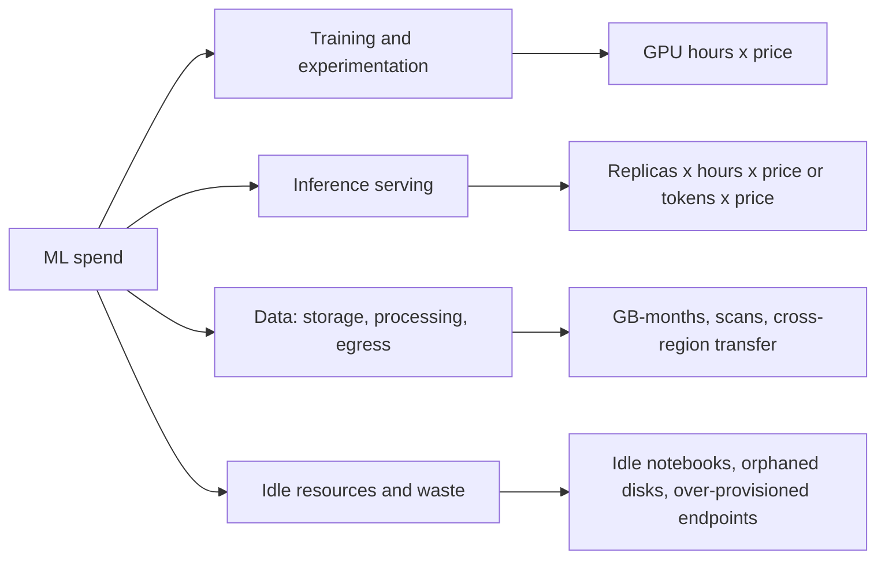

# Cost optimisation for ML workloads

> **Before this lesson:** read [Cloud ML platforms and serverless](#/lesson/mlops/cloud-platforms)
> (spot instances, serverless break-even, IAM and tags) and
> [Model servers, batching, autoscaling and caching](#/lesson/mlops/model-servers) (utilisation,
> batching, caching). Checkpointing comes from
> [Distributed training and GPUs](#/lesson/mlops/distributed-gpus), and early stopping of trials
> from [Hyperparameter tuning at scale](#/lesson/mlops/hpo).

## In plain words

ML systems are expensive to run, mostly because of GPUs, and the bills have a habit of surprising
people. **Cost optimisation** is the discipline of spending less for the same result: finding where
the money goes, removing waste, and making the work itself cheaper.

An everyday picture is a household electricity bill. Some savings need no cleverness at all: switch
off the lights in empty rooms (idle machines). Some need a choice of tariff: cheaper night-time rates
if you can run the washing machine late (spot instances for work that can wait). Some need better
equipment: an efficient fridge (a smaller, faster model). And the first step is always the same:
read the meter, so you know which appliance is eating the money.

Why this matters for a job: a model that costs more to run than it earns will be switched off,
however accurate it is. Interviewers ask "our inference bill doubled, what do you do?" to see whether
you attribute the cost first and then pull the right levers in the right order.

## Cost is an engineering metric

A forgotten GPU notebook can cost more per month than a junior engineer's laptop costs per year; a
hyperparameter sweep can burn a quarter's budget over a weekend; an LLM feature that "worked great in
the demo" can cost more per user than the subscription price. Treat cost like latency: **measure it,
attribute it, set budgets, and optimise the biggest term first.** The practice of running cloud
spending this way, with engineering and finance working together, is called **FinOps**.

## Where the money goes



Four buckets: training and experiments, serving, data, and waste. **Egress** is the fee clouds charge
for data leaving a region or the cloud; a **GB-month** is one gigabyte stored for one month;
**orphaned disks** are storage volumes still billed after the machine that used them was deleted.

For most production systems **inference dominates over time**: training happens periodically, but
serving runs around the clock. For research-heavy teams, experimentation dominates. Know which you
are before optimising.

The fundamental equation:

$$\text{cost} = \text{resource-hours} \times \text{unit price} \;=\; \frac{\text{work}}{\text{throughput} \times \text{utilisation}} \times \text{unit price}$$

In words: how many machine-hours you pay for equals the work to be done divided by how fast a machine
does it when busy (**throughput**) and by what fraction of the time it is busy (**utilisation**).
Multiply by the price per hour. So there are exactly four levers: **do less work**, **raise
throughput**, **raise utilisation**, and **pay a lower unit price**. The rest of the lesson takes them
one at a time.

## Lever 1: pay a lower unit price

### Purchase options

| Option | Discount vs on-demand | Catch |
|---|---|---|
| **On-demand** | 0% | most flexible |
| **Spot / preemptible** (AWS Spot, GCP Spot VMs, Azure Spot) | often 60–90% | can be reclaimed with short notice (≈2 min on AWS, 30 s on GCP/Azure) |
| **Savings plans / committed-use / reservations** | roughly 30–70% for 1–3 year commitments | you pay whether you use it or not |
| **Cheaper regions / instance generations / ARM (Graviton)** | 10–40% | data gravity, compatibility |

- **On-demand**: the list price, paid by the second, with no commitment.
- **Spot** (Google calls it **preemptible**): the provider's spare capacity at a deep discount. The
  catch is that the provider can **reclaim** (take back) the machine with a short warning when it
  needs the capacity, which is called an **interruption**.
- **Commitments**: a discount in exchange for promising to pay for a certain amount of capacity for
  one to three years, used or not.
- **Cheaper regions, newer machine generations and ARM processors** (such as AWS's Graviton chips):
  often cheaper for the same work. **Data gravity** is the pull to keep compute where the data already
  is, because moving data costs money and time.

### Using spot safely

Spot fits work that is **interruptible and restartable**:

- **Training** with regular **checkpoints** (saved snapshots of the model and optimiser state) and
  automatic resume (lesson 14).
- **Hyperparameter trials**: each is small and independent, so losing one costs little.
- **Batch inference** and data processing with idempotent, partitioned outputs (lesson 19).
- **Stateless serving replicas** *on top of* an on-demand baseline, spread across instance types and
  zones so one reclaim wave cannot remove them all.

It is a poor fit for single-replica services that hold state, and for long jobs that cannot
checkpoint.

How much does spot really save once interruptions waste some work? The simulation runs a 24-hour job
thousands of times with random interruptions.

```python-run
import random
random.seed(7)
def expected_cost(job_hours, on_demand_price, spot_discount, interrupts_per_hour, ckpt_every_h, ckpt_overhead=0.02, trials=3000):
    spot_price = on_demand_price * (1 - spot_discount)
    total = 0.0
    for _ in range(trials):
        done = elapsed = 0.0
        while done < job_hours:
            t = random.expovariate(interrupts_per_hour) if interrupts_per_hour else float("inf")
            if done + t >= job_hours:
                elapsed += job_hours - done; break
            elapsed += t + 0.1                                 # 6 minutes to get a new instance and restart
            done = (done + t) // ckpt_every_h * ckpt_every_h    # lose progress since last checkpoint
        total += elapsed * (1 + ckpt_overhead) * spot_price
    return total / trials

od = 24 * 3.0
print(f"on-demand: 24h x $3.00 = ${od:.2f}")
for rate in (0.02, 0.05, 0.2):
    for ck in (0.25, 2.0):
        c = expected_cost(24, 3.0, 0.70, rate, ck)
        print(f"spot (70% off), {rate:.2f} interruptions/h, checkpoint every {ck:4.2f}h -> ${c:6.2f}  (saves {1 - c/od:5.1%})")
```

How it works: in each trial, `random.expovariate(rate)` draws the time until the next interruption
(the standard model for random, independent events). If the job finishes first, the trial ends.
Otherwise the clock advances by the time worked plus 6 minutes to get a new machine and restart, and
the progress falls back to the last completed checkpoint (`// ckpt_every_h * ckpt_every_h` rounds
down to a multiple of the checkpoint interval). Every billed hour is charged at the spot price plus
2% for the time spent writing checkpoints. The output:

```text
on-demand: 24h x $3.00 = $72.00
spot (70% off), 0.02 interruptions/h, checkpoint every 0.25h -> $ 22.14  (saves 69.3%)
spot (70% off), 0.02 interruptions/h, checkpoint every 2.00h -> $ 22.52  (saves 68.7%)
spot (70% off), 0.05 interruptions/h, checkpoint every 0.25h -> $ 22.28  (saves 69.1%)
spot (70% off), 0.05 interruptions/h, checkpoint every 2.00h -> $ 23.29  (saves 67.7%)
spot (70% off), 0.20 interruptions/h, checkpoint every 0.25h -> $ 23.04  (saves 68.0%)
spot (70% off), 0.20 interruptions/h, checkpoint every 2.00h -> $ 27.73  (saves 61.5%)
```

With frequent checkpoints, spot stays close to its full 70% discount even when the machine is taken
away about every five hours (0.2 per hour). With rare checkpoints and frequent interruptions, more
work is redone and the saving shrinks. The checkpoint interval is a cost parameter; the problem
`mlops-spot-checkpointing` lets you compute it exactly.

## Lever 2: raise utilisation

Idle capacity is the largest avoidable cost.

- **Autoscale** serving on a metric that represents load, and **scale to zero** development and
  staging environments and rarely used endpoints (lessons 21 and 23).
- **Right-size**: compare the CPU, memory and GPU each workload requested with what it uses (VPA
  recommendations, the clouds' right-sizing tools). A model using 3 GB of a 24 GB GPU should share
  the GPU or move to a CPU.
- **Bin-pack** on Kubernetes (fit workloads tightly onto as few machines as possible): sensible
  requests, node autoscaling with **consolidation** (Karpenter moves pods so emptier nodes can be
  removed), GPU sharing (time-slicing, MIG) for small models, and multi-model servers.
- **Batch more**: dynamic batching raises GPU throughput per dollar.
- **Schedule**: shut down notebooks and development clusters outside working hours; stop idle
  notebooks automatically.
- **Queue** training jobs on a shared pool (Kueue, Volcano, Slurm) instead of giving each team its
  own cluster with its own idle headroom.

```python-run
# Utilisation is the hidden multiplier in cost per prediction.
gpu_price_per_hour = 1.20
peak_throughput = 400            # predictions/s when the GPU is fully busy
for util in (0.05, 0.2, 0.5, 0.8):
    preds_per_hour = peak_throughput * 3600 * util
    print(f"utilisation {util:4.0%} -> ${gpu_price_per_hour / preds_per_hour * 1e6:7.2f} per million predictions")
```

A GPU costing \$1.20 an hour can make 400 predictions per second when fully busy. At utilisation
`util`, it makes `400 * 3600 * util` predictions per hour, and the cost per million is the hourly
price divided by that, times a million. The output:

```text
utilisation   5% -> $  16.67 per million predictions
utilisation  20% -> $   4.17 per million predictions
utilisation  50% -> $   1.67 per million predictions
utilisation  80% -> $   1.04 per million predictions
```

The same hardware is 16 times more expensive per prediction at 5% utilisation than at 80%
(0.80 / 0.05 = 16). Nothing about the model changed; only how busy it was kept. Computing cost per
thousand predictions from a fleet's numbers is the problem `mlops-cost-per-1k`.

## Lever 3: raise throughput (make the model cheaper to run)

- **Smaller models**: distillation, pruning, or a gradient-boosted tree instead of a deep network
  where it matches the quality.
- **Quantization** (32-bit floats to 16-bit or 8-bit) and **compilation** (ONNX Runtime, TensorRT,
  OpenVINO), from lesson 21.
- **The right hardware**: many classic models are cheapest on CPUs; a small GPU (NVIDIA T4 or L4)
  often beats a large one per dollar for modest models. Do not pay for A100s to serve logistic
  regression.
- **Model cascades and routing**: a cheap model handles the easy cases and passes only uncertain ones
  to the expensive model. Huyen (*AI Engineering*, ch. 10) describes **routers** that send simpler
  queries to cheaper models as a core cost technique.
- For LLMs: shorter prompts, prompt caching, smaller contexts through better retrieval, caps on
  output length, and batch APIs for work that is not urgent (module 12).

## Lever 4: do less work

- **Cache** predictions, features and embeddings (lesson 21).
- **Precompute in batch** where freshness allows; batch is far cheaper than online (lesson 19).
- **Retrain only when it pays** (lesson 29), and use **incremental processing**: compute features
  only for new partitions, not the whole history every night.
- **Stop bad trials early** in hyperparameter searches (ASHA, Hyperband) and set trial budgets
  (lesson 15).
- **Sample** while experimenting: iterate on 5% of the data, and train final models on all of it.
- **Fail fast**: validate the data and run a smoke test before launching an 8-GPU job that would
  crash at hour three.

## Data costs

- **Storage tiers**: move old raw data and old checkpoints to cheaper infrequent-access or archive
  storage classes with **lifecycle rules** (policies that move or delete objects automatically by
  age); delete intermediate artifacts; keep the last few checkpoints plus the best one, not all.
- **Columnar formats and partitioning** (Parquet, **partition pruning**, which lets a query skip
  folders it does not need) cut warehouse costs, because BigQuery and Athena bill by bytes scanned.
- **Egress and cross-region transfer** are the classic surprise: keep compute in the same region as
  the data, and avoid shipping data sets between clouds.
- **Logging and metrics volume**: high-cardinality metrics and verbose logs are billed by volume;
  sample them.

## LLM cost model

For LLMs used through an API, cost is tokens times price, and **output tokens** usually cost several
times more than **input tokens** (the prompt). For self-hosted LLMs, Huyen's worked example
(*AI Engineering*, ch. 9) is a machine costing \$2 an hour that generates 100 tokens per second:
about \$5.56 per million output tokens. Throughput directly sets the unit cost.

```python-run
def api_cost(req_per_day, in_tok, out_tok, in_price_per_m, out_price_per_m, cache_hit=0.0, cached_discount=0.9):
    eff_in = in_tok * (1 - cache_hit * cached_discount)
    return req_per_day * (eff_in * in_price_per_m + out_tok * out_price_per_m) / 1e6

def self_host_cost_per_m_output(dollars_per_hour, tokens_per_second, utilisation=1.0):
    return dollars_per_hour / (tokens_per_second * 3600 * utilisation) * 1e6

base = api_cost(100_000, 3000, 400, 3.0, 15.0)
print(f"API, 100k req/day, 3000 in + 400 out tokens      : ${base:,.0f}/day")
print(f"  ... trim prompt to 1500 tokens                  : ${api_cost(100_000, 1500, 400, 3.0, 15.0):,.0f}/day")
print(f"  ... + 80% of input tokens served from prompt cache: ${api_cost(100_000, 1500, 400, 3.0, 15.0, cache_hit=0.8):,.0f}/day")
print(f"  ... route 70% of traffic to a 10x cheaper model : ${0.3*api_cost(100_000,1500,400,3.0,15.0,0.8)+0.7*api_cost(100_000,1500,400,0.3,1.5,0.8):,.0f}/day")
print(f"self-hosted: $2/h at 100 tok/s, fully used -> ${self_host_cost_per_m_output(2, 100):.2f} per 1M output tokens")
print(f"self-hosted at 20% utilisation             -> ${self_host_cost_per_m_output(2, 100, 0.2):.2f} per 1M output tokens")
```

`api_cost` multiplies requests per day by the tokens per request and the price per million tokens;
cached input tokens are charged 90% less (`cached_discount`). Prices are given per million tokens:
\$3 input and \$15 output for the large model, a tenth of that for the small one. The
`self_host_cost_per_m_output` function is Huyen's calculation, with an optional utilisation. The
output:

```text
API, 100k req/day, 3000 in + 400 out tokens      : $1,500/day
  ... trim prompt to 1500 tokens                  : $1,050/day
  ... + 80% of input tokens served from prompt cache: $726/day
  ... route 70% of traffic to a 10x cheaper model : $269/day
self-hosted: $2/h at 100 tok/s, fully used -> $5.56 per 1M output tokens
self-hosted at 20% utilisation             -> $27.78 per 1M output tokens
```

Two lessons. Prompt length, caching and routing together cut this API bill from \$1,500 to \$269 a
day, more than five-fold. And self-hosting is only cheap while the GPUs are **busy**: at 20%
utilisation the same server costs five times more per token, often more than an API. (Prices here are
illustrative; check current pricing.)

## Visibility and governance

You cannot optimise what you cannot attribute.

- **Tag or label everything** (team, project, environment, model) and enforce tags by policy.
  Kubernetes cost tools (OpenCost, Kubecost) split cluster cost by namespace and label.
- **Unit economics**: track cost per thousand predictions, per training run, per active user and per
  experiment, not only the monthly total. Put cost panels next to latency and quality on dashboards.
- **Budgets and alerts**: cloud budgets that notify at 50%, 80% and 100%, and anomaly detection on
  spend (a sudden jump compared with the usual pattern).
- **Quotas and guardrails**: GPU quotas per team, a maximum job duration, automatic shutdown of idle
  resources, and a **TTL** (time to live, an expiry date) on development resources.
- **Log the cost of each run** in the experiment tracker (GPU-hours times price), so a "+0.2% AUC" can
  be weighed against its price.
- **Regular hygiene**: orphaned volumes, old snapshots, unused endpoints, stale container images.

## A prioritised checklist

1. Turn off what is idle (notebooks, development endpoints, forgotten clusters).
2. Right-size and autoscale serving; scale non-production environments to zero.
3. Move training, hyperparameter searches and batch jobs to spot, with checkpointing.
4. Make the model cheaper: batching, quantization, smaller or cascaded models, the right hardware.
5. Cache and precompute.
6. Commit (savings plans, reservations) only for the stable baseline that remains.
7. Fix data costs: lifecycle rules, partitioning, keeping compute next to data.
8. Make it permanent: tags, unit-cost dashboards, budgets, quotas.

Order matters: committing to a three-year reservation *before* right-sizing locks in the waste.

> [!INTERVIEW]
> "Our inference bill doubled. What do you do?" — First attribute it (which model/endpoint/team; traffic
> growth vs efficiency loss) and compute cost per 1k predictions. Then pull levers in order: utilisation
> (autoscaling targets, idle replicas, right-sizing, batching), throughput (quantization, smaller model,
> cheaper hardware, cascade/routing), less work (caching, batch precompute), unit price (spot for
> stateless overflow, commitments for baseline). Close with guardrails: budgets, alerts, cost dashboards.

## Worked example: a cost review of the churn system

Numbers make the levers concrete. Here is one month of spend for the capstone system before any
optimisation (illustrative prices):

| Item | Detail | Monthly |
|---|---|---|
| Serving | 6 × 4-vCPU replicas on-demand, 24/7, average CPU 14% | \$830 |
| Dev/staging endpoints | 3 replicas each, 24/7 | \$830 |
| Training | weekly retrain on a GPU instance, on-demand, 3 h; plus a 200-trial HPO sweep monthly | \$410 |
| Notebooks | 4 GPU notebooks left running | \$2,300 |
| Storage | 6 TB raw + every checkpoint ever, standard tier | \$190 |
| Logging/metrics | full request payload logging, high-cardinality metrics | \$520 |
| **Total** | | **\$5,080** |

A **vCPU** is one virtual processor core. Walking the checklist in order:

```python-run
items = {"serving": 830, "dev/staging": 830, "training+HPO": 410, "notebooks": 2300, "storage": 190, "logging": 520}
actions = [
    ("auto-stop idle notebooks (used ~25% of the time)",      "notebooks",    0.75),
    ("scale dev/staging to zero outside working hours (~70%)", "dev/staging",  0.70),
    ("right-size serving: HPA at 60% CPU, min 3 replicas",     "serving",      0.50),
    ("training + HPO on spot with checkpoints; ASHA pruning",  "training+HPO", 0.70),
    ("sample payload logs 10%, drop high-cardinality labels",  "logging",      0.60),
    ("lifecycle rules: old raw to infrequent access, keep last 5 checkpoints", "storage", 0.45),
]
total0 = sum(items.values()); cur = dict(items)
print(f"{'action':70s} {'saves':>8s} {'new total':>10s}")
for desc, key, cut in actions:
    saved = cur[key] * cut; cur[key] -= saved
    print(f"{desc:70s} {saved:8.0f} {sum(cur.values()):10.0f}")
print(f"\nmonthly cost: ${total0:,.0f} -> ${sum(cur.values()):,.0f}  ({1 - sum(cur.values())/total0:.0%} lower)")
print("biggest remaining item:", max(cur, key=cur.get))
```

Each action removes a fraction of one line item (for example, notebooks used about 25% of the time can
stop the other 75%). The loop applies them in order and prints the running total. The output:

```text
action                                                                    saves  new total
auto-stop idle notebooks (used ~25% of the time)                           1725       3355
scale dev/staging to zero outside working hours (~70%)                      581       2774
right-size serving: HPA at 60% CPU, min 3 replicas                          415       2359
training + HPO on spot with checkpoints; ASHA pruning                       287       2072
sample payload logs 10%, drop high-cardinality labels                       312       1760
lifecycle rules: old raw to infrequent access, keep last 5 checkpoints       86       1674

monthly cost: $5,080 -> $1,674  (67% lower)
biggest remaining item: notebooks
```

Two observations generalise. First, **the largest saving was not an ML optimisation at all**: it was
turning off idle notebooks. Hunting waste beats clever engineering in most first cost reviews. Second,
after the easy wins, what remains is capacity that is genuinely used (the notebooks people really work
in, and serving), and further reductions need the harder levers: a cheaper model, batching, caching,
or moving to batch scoring.

## Is the model worth what it costs?

Cost is one side of a ratio; the other side is value. A simple unit-economics check for any model in
production:

$$\text{net value per month} = (\text{value per correct action} \times \text{actions}) - (\text{cost of errors}) - (\text{inference} + \text{training} + \text{people})$$

For the churn model: suppose targeted offers keep 180 extra customers a month at \$40 margin each
(\$7,200), offers wasted on customers who would have stayed anyway cost \$1,500, and the system costs
\$1,700 to run plus a quarter of an engineer's time. The model clears its costs. But a "better" model
that keeps 2% more of those customers (worth \$144 a month) does not justify a GPU endpoint that adds
\$1,000 a month. Knowing what one point of a metric is worth is what lets you say no to expensive
accuracy.

## Guardrails that prevent the next surprise

```yaml
# Budget alert (AWS Budgets via CloudFormation, abridged)
Resources:
  MlMonthlyBudget:
    Type: AWS::Budgets::Budget
    Properties:
      Budget:
        BudgetName: ml-churn-monthly
        BudgetType: COST
        TimeUnit: MONTHLY
        BudgetLimit: {Amount: 3000, Unit: USD}
        CostFilters: {TagKeyValue: ["user:project$churn"]}
      NotificationsWithSubscribers:
        - Notification: {NotificationType: ACTUAL, ComparisonOperator: GREATER_THAN, Threshold: 80}
          Subscribers: [{SubscriptionType: EMAIL, Address: ml-leads@acme.example}]
        - Notification: {NotificationType: FORECASTED, ComparisonOperator: GREATER_THAN, Threshold: 100}
          Subscribers: [{SubscriptionType: EMAIL, Address: ml-leads@acme.example}]
```

This CloudFormation template (AWS's infrastructure-as-code format) creates a monthly budget of \$3,000
covering only resources tagged `project=churn`. It emails the ML leads when actual spend passes 80%,
and when AWS's *forecast* for the month passes 100%, which gives a warning before the money is gone.

Complement budgets with **preventive** controls: a maximum runtime on training jobs, quotas on GPU
instance types per team, mandatory tags enforced by policy (untagged resources cannot be created),
idle shutdown on notebooks, TTL labels on development namespaces, and a spending limit per key on LLM
gateways (lesson 33). Alerts tell you after the money is spent; limits stop it being spent.

### Cost anti-patterns

- **GPU by default**: serving a tree model or a small transformer on GPUs when CPUs meet the SLO.
- **Over-provisioning for a peak that happens twice a year** instead of autoscaling or queueing.
- **A cluster per team**, each with its own idle headroom, instead of a shared pool with quotas.
- **Re-processing all history nightly** instead of only new partitions.
- **Logging everything forever** at full detail.
- **Optimising the cheap thing**: weeks spent shaving training time while inference is 90% of the
  bill.
- **Commitments based on last quarter's unoptimised usage.**

## Summary

- Cost = work ÷ (throughput × utilisation) × unit price: four levers.
- Spot plus checkpointing slashes the cost of training, hyperparameter searches and batch jobs;
  commitments suit the stable baseline.
- Utilisation is the hidden multiplier: autoscale, right-size, bin-pack, shut down idle resources.
- Cheaper models, caching, batching and routing reduce the work per prediction; for LLMs, tokens are
  the unit.
- Attribute costs with tags and unit economics; set budgets and quotas; weigh cost against value.

## Glossary

- **FinOps** - managing cloud spending as a shared engineering and finance discipline.
- **Utilisation / throughput** - share of time hardware is busy / work done per unit time when busy.
- **On-demand / spot / commitment** - list price / discounted reclaimable capacity / discount for a
  long-term promise to pay.
- **Interruption (reclaim)** - the provider taking back a spot machine.
- **Checkpoint** - a saved snapshot that lets interrupted work resume.
- **Data gravity** - the pull to keep compute where the data is.
- **Egress** - fees for data leaving a region or cloud.
- **Right-sizing** - matching requested resources to real use.
- **Bin-packing / consolidation** - fitting workloads onto few machines / moving them so empty
  machines can be removed.
- **Model cascade / router** - cheap model first, expensive model for hard cases / a component that
  picks the model per request.
- **Incremental processing** - computing only new partitions.
- **Storage tier / lifecycle rule** - a price class of storage / an automatic move or delete by age.
- **Partition pruning** - skipping data folders a query does not need.
- **Input / output tokens** - prompt tokens / generated tokens, priced separately.
- **Prompt caching** - reusing the processed form of a repeated prompt prefix at a discount.
- **Unit economics** - cost and value per prediction, run or user.
- **Tag** - a key-value label used to attribute cost.
- **Budget alert / quota / TTL** - a spend notification / a hard usage cap / an expiry date on a
  resource.
- **vCPU** - one virtual processor core.

```quiz
[
  {"q": "Which workload is the BEST fit for spot/preemptible instances?",
   "options": ["A single-replica stateful database", "Checkpointed training jobs and independent HPO trials", "A latency-critical service with one replica", "A job that cannot be restarted"],
   "answer": 1, "explain": "Interruptible, restartable work tolerates reclamation."},
  {"q": "A GPU endpoint runs at 5% utilisation. Compared with 80% utilisation, cost per prediction is roughly...",
   "options": ["The same", "16 times higher", "Half", "5% higher"],
   "answer": 1, "explain": "Cost per prediction scales with 1/utilisation: 0.8/0.05 = 16."},
  {"q": "Why right-size and autoscale BEFORE buying multi-year commitments?",
   "options": ["Commitments are illegal otherwise", "Otherwise you lock in payment for wasted capacity", "Commitments disable autoscaling", "Spot becomes unavailable"],
   "answer": 1, "explain": "Commit only to the stable baseline that remains after removing waste."},
  {"q": "A self-hosted LLM server costs $2/hour and generates 100 tokens/s when fully used. Cost per 1M output tokens is about...",
   "options": ["$0.56", "$5.56", "$55.60", "$2.00"],
   "answer": 1, "explain": "2 / (100 x 3600) x 1e6 = 5.56, the worked example from Huyen ch. 9."},
  {"q": "Which is a common surprise in data costs?",
   "options": ["CPU cache misses", "Cross-region or cross-cloud data egress charges", "Git commits", "Unit tests"],
   "answer": 1, "explain": "Moving data out of a region or cloud is billed per GB."},
  {"q": "What is a model cascade?",
   "options": ["Training models sequentially", "A cheap model handles easy cases and escalates uncertain ones to an expensive model", "A deployment rollback", "A feature pipeline"],
   "answer": 1, "explain": "It reduces average cost per request while preserving quality on hard cases."},
  {"q": "What makes cost optimisation actionable across teams?",
   "options": ["One shared bill with no breakdown", "Tagging resources and tracking unit costs (per 1k predictions, per run) per team/model", "Disabling monitoring", "Yearly reviews only"],
   "answer": 1, "explain": "Attribution turns a total into decisions someone owns."},
  {"q": "In the churn cost review, what produced the single largest saving?",
   "options": ["Quantizing the model", "Auto-stopping idle GPU notebooks", "Buying a three-year reservation", "Switching to gRPC"],
   "answer": 1, "explain": "Removing waste (\\$1,725 of \\$5,080) beat every ML-specific optimisation in the first review."}
]
```

> **Source:** Chip Huyen, *AI Engineering*, ch. 9 (throughput and cost per token, batch APIs) and ch. 10 (routers and gateways for cost control, caching); AWS, Google Cloud and Azure documentation on Spot/preemptible instances, savings plans and committed-use discounts; FinOps Foundation framework; Kubernetes OpenCost documentation.
