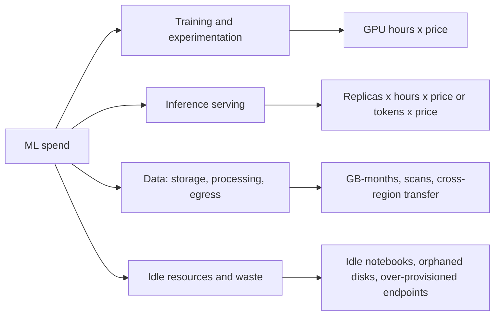

# Cost optimisation for ML workloads

## Cost is an engineering metric

ML bills surprise people. A forgotten GPU notebook costs more per month than a junior engineer's laptop
per year; an HPO sweep can burn a quarter's budget in a weekend; an LLM feature that "worked great in the
demo" can cost more per user than the subscription price. Treat cost like latency: **measure it,
attribute it, set budgets, optimise the biggest term first.** This practice is often called **FinOps**.

## Where the money goes



For most production systems **inference dominates over time**: training is periodic, serving is 24/7.
For research-heavy teams, experimentation dominates. Know which you are before optimising.

The fundamental equation:

$$\text{cost} = \text{resource-hours} \times \text{unit price} \;=\; \frac{\text{work}}{\text{throughput} \times \text{utilisation}} \times \text{unit price}$$

So there are exactly four levers: **do less work**, **raise throughput**, **raise utilisation**, **pay a
lower unit price**.

## Lever 1: pay a lower unit price

### Purchase options

| Option | Discount vs on-demand | Catch |
|---|---|---|
| **On-demand** | 0% | most flexible |
| **Spot / preemptible** (AWS Spot, GCP Spot VMs, Azure Spot) | often 60–90% | can be reclaimed with short notice (≈2 min on AWS, 30 s on GCP/Azure) |
| **Savings plans / committed-use / reservations** | roughly 30–70% for 1–3 year commitments | you pay whether you use it or not |
| **Cheaper regions / instance generations / ARM (Graviton)** | 10–40% | data gravity, compatibility |

### Using spot safely

Spot fits workloads that are **interruptible and restartable**:

- **Training** with regular checkpoints and auto-resume (lesson 14).
- **HPO trials** — each trial is small and independent.
- **Batch inference** and data processing with idempotent, partitioned outputs.
- **Stateless serving replicas** *above* an on-demand baseline, spread across instance types and zones.

Not a fit: single-replica stateful services, long jobs that cannot checkpoint.

```python-run
import random
random.seed(7)
def expected_cost(job_hours, on_demand_price, spot_discount, interrupts_per_hour, ckpt_every_h, ckpt_overhead=0.02, trials=3000):
    spot_price = on_demand_price * (1 - spot_discount)
    total = 0.0
    for _ in range(trials):
        done = elapsed = 0.0
        while done < job_hours:
            t = random.expovariate(interrupts_per_hour) if interrupts_per_hour else float("inf")
            if done + t >= job_hours:
                elapsed += job_hours - done; break
            elapsed += t + 0.1                                 # 6 minutes to get a new instance and restart
            done = (done + t) // ckpt_every_h * ckpt_every_h    # lose progress since last checkpoint
        total += elapsed * (1 + ckpt_overhead) * spot_price
    return total / trials

od = 24 * 3.0
print(f"on-demand: 24h x $3.00 = ${od:.2f}")
for rate in (0.02, 0.05, 0.2):
    for ck in (0.25, 2.0):
        c = expected_cost(24, 3.0, 0.70, rate, ck)
        print(f"spot (70% off), {rate:.2f} interruptions/h, checkpoint every {ck:4.2f}h -> ${c:6.2f}  (saves {1 - c/od:5.1%})")
```

With frequent checkpoints, spot stays far cheaper even at high interruption rates; with rare checkpoints
and frequent interruptions the savings erode. Checkpoint interval is a cost parameter.

## Lever 2: raise utilisation

Idle capacity is the largest avoidable cost.

- **Autoscale** serving on a load-representative metric; **scale to zero** dev/staging and rarely used
  endpoints (lessons 21, 23).
- **Right-size**: compare requested vs used CPU/memory/GPU (VPA recommendations, cloud right-sizing
  tools). A model using 3 GB on a 24 GB GPU should share the GPU or move to CPU.
- **Bin-pack** on Kubernetes: sensible requests, node autoscaling with consolidation (Karpenter), GPU
  sharing (time-slicing, MIG) for small models, multi-model servers.
- **Batch more**: dynamic batching raises GPU throughput per dollar.
- **Schedule**: shut down notebooks and dev clusters outside working hours; auto-stop idle notebooks.
- **Queue** training jobs on a shared pool (Kueue/Volcano/Slurm) instead of one cluster per team.

```python-run
# Utilisation is the hidden multiplier in cost per prediction.
gpu_price_per_hour = 1.20
peak_throughput = 400            # predictions/s when the GPU is fully busy
for util in (0.05, 0.2, 0.5, 0.8):
    preds_per_hour = peak_throughput * 3600 * util
    print(f"utilisation {util:4.0%} -> ${gpu_price_per_hour / preds_per_hour * 1e6:7.2f} per million predictions")
```

The same hardware is 16× more expensive per prediction at 5% utilisation than at 80%.

## Lever 3: raise throughput (make the model cheaper to run)

- **Smaller models**: distillation, pruning, a gradient-boosted tree instead of a deep net where it
  matches quality.
- **Quantization** (FP32 → FP16/INT8) and **compilation** (ONNX Runtime, TensorRT, OpenVINO).
- **Right hardware**: many classic models are cheapest on CPU; a small GPU (T4/L4) often beats a large
  one per dollar for modest models; do not pay for A100s to serve logistic regression.
- **Model cascades / routing**: a cheap model handles easy cases, escalating only uncertain ones to the
  expensive model. Huyen (*AI Engineering*, ch. 10) describes routers that send simpler queries to cheaper
  models as a core cost technique.
- For LLMs: shorter prompts, prompt caching, smaller context via better retrieval, output length caps,
  batch APIs for non-urgent work (module 12).

## Lever 4: do less work

- **Cache** predictions, features and embeddings (lesson 21).
- **Precompute in batch** where freshness allows — batch is far cheaper than online (lesson 19).
- **Retrain only when it pays** (lesson 29); **incremental processing** — compute features for new
  partitions only, not the whole history.
- **Early stopping and pruning** in HPO (ASHA/Hyperband); set trial budgets (lesson 15).
- **Sample** for experimentation: iterate on 5% of the data, train finals on all of it.
- **Fail fast**: validate data and run a smoke test before launching an 8-GPU job that crashes at hour 3.

## Data costs

- **Storage tiers**: move old raw data and old checkpoints to infrequent-access/archive classes with
  lifecycle rules; delete intermediate artifacts; keep "last K + best" checkpoints, not all.
- **Columnar formats and partitioning** (Parquet, partition pruning) cut warehouse scan costs — BigQuery
  and Athena bill by bytes scanned.
- **Egress and cross-region transfer** are the classic surprise: keep compute in the same region as the
  data; avoid shipping datasets between clouds.
- **Logging/metrics volume**: high-cardinality metrics and verbose logs are billed by volume; sample.

## LLM cost model

For API-based LLMs, cost is tokens × price, with output tokens usually several times more expensive than
input tokens. For self-hosted LLMs, Huyen's worked example (*AI Engineering*, ch. 9): a machine costing
\$2/hour generating 100 tokens/s yields about \$5.56 per million output tokens — throughput directly
sets unit cost.

```python-run
def api_cost(req_per_day, in_tok, out_tok, in_price_per_m, out_price_per_m, cache_hit=0.0, cached_discount=0.9):
    eff_in = in_tok * (1 - cache_hit * cached_discount)
    return req_per_day * (eff_in * in_price_per_m + out_tok * out_price_per_m) / 1e6

def self_host_cost_per_m_output(dollars_per_hour, tokens_per_second, utilisation=1.0):
    return dollars_per_hour / (tokens_per_second * 3600 * utilisation) * 1e6

base = api_cost(100_000, 3000, 400, 3.0, 15.0)
print(f"API, 100k req/day, 3000 in + 400 out tokens      : ${base:,.0f}/day")
print(f"  ... trim prompt to 1500 tokens                  : ${api_cost(100_000, 1500, 400, 3.0, 15.0):,.0f}/day")
print(f"  ... + 80% of input tokens served from prompt cache: ${api_cost(100_000, 1500, 400, 3.0, 15.0, cache_hit=0.8):,.0f}/day")
print(f"  ... route 70% of traffic to a 10x cheaper model : ${0.3*api_cost(100_000,1500,400,3.0,15.0,0.8)+0.7*api_cost(100_000,1500,400,0.3,1.5,0.8):,.0f}/day")
print(f"self-hosted: $2/h at 100 tok/s, fully used -> ${self_host_cost_per_m_output(2, 100):.2f} per 1M output tokens")
print(f"self-hosted at 20% utilisation             -> ${self_host_cost_per_m_output(2, 100, 0.2):.2f} per 1M output tokens")
```

Two lessons: prompt length, caching and routing can cut an API bill several-fold; and self-hosting is
only cheap if the GPUs are **busy** — an idle self-hosted model is far more expensive per token than an
API. (Prices here are illustrative; check current pricing.)

## Visibility and governance

You cannot optimise what you cannot attribute.

- **Tag/label everything** (team, project, environment, model) and enforce tags by policy; Kubernetes
  cost tools (OpenCost/Kubecost) allocate cluster cost by namespace and label.
- **Unit economics**: track cost per 1k predictions, per training run, per active user, per experiment —
  not just the monthly total. Put cost panels next to latency and quality on dashboards.
- **Budgets and alerts**: cloud budgets with notifications at 50/80/100%; anomaly detection on spend.
- **Quotas and guardrails**: per-team GPU quotas, maximum job duration, automatic idle shutdown, TTL on
  dev resources.
- **Log cost per run** in the experiment tracker (GPU-hours × price) so the "+0.2% AUC" can be weighed
  against its price.
- **Regular hygiene**: orphaned volumes, old snapshots, unused endpoints, stale container images.

## A prioritised checklist

1. Turn off what is idle (notebooks, dev endpoints, forgotten clusters).
2. Right-size and autoscale serving; scale non-prod to zero.
3. Move training, HPO and batch to spot with checkpointing.
4. Make the model cheaper: batching, quantization, smaller/cascaded models, right hardware.
5. Cache and precompute.
6. Commit (savings plans/reservations) only for the stable baseline that remains.
7. Fix data costs: lifecycle rules, partitioning, co-location.
8. Institutionalise: tags, unit-cost dashboards, budgets, quotas.

Order matters: committing to a three-year reservation *before* right-sizing locks in waste.

> [!INTERVIEW]
> "Our inference bill doubled. What do you do?" — First attribute it (which model/endpoint/team; traffic
> growth vs efficiency loss) and compute cost per 1k predictions. Then pull levers in order: utilisation
> (autoscaling targets, idle replicas, right-sizing, batching), throughput (quantization, smaller model,
> cheaper hardware, cascade/routing), less work (caching, batch precompute), unit price (spot for
> stateless overflow, commitments for baseline). Close with guardrails: budgets, alerts, cost dashboards.

## Worked example: a cost review of the churn system

Numbers make the levers tangible. A month of spend for the capstone system before optimisation
(illustrative prices):

| Item | Detail | Monthly |
|---|---|---|
| Serving | 6 × 4-vCPU replicas on-demand, 24/7, average CPU 14% | \$830 |
| Dev/staging endpoints | 3 replicas each, 24/7 | \$830 |
| Training | weekly retrain on a GPU instance, on-demand, 3 h; plus a 200-trial HPO sweep monthly | \$410 |
| Notebooks | 4 GPU notebooks left running | \$2,300 |
| Storage | 6 TB raw + every checkpoint ever, standard tier | \$190 |
| Logging/metrics | full request payload logging, high-cardinality metrics | \$520 |
| **Total** | | **\$5,080** |

Walking the checklist in order:

```python-run
items = {"serving": 830, "dev/staging": 830, "training+HPO": 410, "notebooks": 2300, "storage": 190, "logging": 520}
actions = [
    ("auto-stop idle notebooks (used ~25% of the time)",      "notebooks",    0.75),
    ("scale dev/staging to zero outside working hours (~70%)", "dev/staging",  0.70),
    ("right-size serving: HPA at 60% CPU, min 3 replicas",     "serving",      0.50),
    ("training + HPO on spot with checkpoints; ASHA pruning",  "training+HPO", 0.70),
    ("sample payload logs 10%, drop high-cardinality labels",  "logging",      0.60),
    ("lifecycle rules: old raw to infrequent access, keep last 5 checkpoints", "storage", 0.45),
]
total0 = sum(items.values()); cur = dict(items)
print(f"{'action':70s} {'saves':>8s} {'new total':>10s}")
for desc, key, cut in actions:
    saved = cur[key] * cut; cur[key] -= saved
    print(f"{desc:70s} {saved:8.0f} {sum(cur.values()):10.0f}")
print(f"\nmonthly cost: ${total0:,.0f} -> ${sum(cur.values()):,.0f}  ({1 - sum(cur.values())/total0:.0%} lower)")
print("biggest remaining item:", max(cur, key=cur.get))
```

Two observations generalise. First, **the largest saving was not an ML optimisation at all** — it was
turning off idle notebooks. Waste hunting beats clever engineering in most first cost reviews. Second,
after the easy wins, serving becomes the largest remaining item, and further reduction needs the
harder levers: a cheaper model, batching, caching, or moving to batch scoring.

## Is the model worth what it costs?

Cost optimisation is one side of a ratio; the other is value. A simple unit-economics check for any
model in production:

$$\text{net value per month} = (\text{value per correct action} \times \text{actions}) - (\text{cost of errors}) - (\text{inference} + \text{training} + \text{people})$$

For the churn model: suppose targeted offers retain 180 extra customers a month at \$40 margin each
(\$7,200), offers wasted on customers who would have stayed cost \$1,500, and the system costs \$1,700
to run plus a quarter of an engineer. The model clears its costs — and a "better" model that adds 2% of
retained customers (\$144/month) does not justify a GPU endpoint that adds \$1,000/month. Knowing the
value of a metric point is what lets you say no to expensive accuracy.

## Guardrails that prevent the next surprise

```yaml
# Budget alert (AWS Budgets via CloudFormation, abridged)
Resources:
  MlMonthlyBudget:
    Type: AWS::Budgets::Budget
    Properties:
      Budget:
        BudgetName: ml-churn-monthly
        BudgetType: COST
        TimeUnit: MONTHLY
        BudgetLimit: {Amount: 3000, Unit: USD}
        CostFilters: {TagKeyValue: ["user:project$churn"]}
      NotificationsWithSubscribers:
        - Notification: {NotificationType: ACTUAL, ComparisonOperator: GREATER_THAN, Threshold: 80}
          Subscribers: [{SubscriptionType: EMAIL, Address: ml-leads@acme.example}]
        - Notification: {NotificationType: FORECASTED, ComparisonOperator: GREATER_THAN, Threshold: 100}
          Subscribers: [{SubscriptionType: EMAIL, Address: ml-leads@acme.example}]
```

Complement budgets with **preventive** controls: maximum runtime on training jobs, quotas on GPU
instance types per team, mandatory tags enforced by policy (untagged resources cannot be created),
idle-shutdown on notebooks, TTL labels on dev namespaces, and a per-key spending limit on LLM gateways.
Alerts tell you after the money is spent; limits stop it being spent.

### Cost anti-patterns

- **GPU by default**: serving a tree model or a small transformer on GPUs when CPUs meet the SLO.
- **Over-provisioning for a peak that happens twice a year** instead of autoscaling or queueing.
- **Per-team clusters** each with their own idle headroom, instead of a shared pool with quotas.
- **Re-processing all history nightly** instead of incremental partitions.
- **Logging everything forever** at full fidelity.
- **Optimising the cheap thing**: weeks spent shaving training time while inference is 90% of the bill.
- **Commitments made on last quarter's unoptimised usage.**

## Summary

- Cost = work ÷ (throughput × utilisation) × unit price: four levers.
- Spot plus checkpointing slashes training/HPO/batch cost; commitments suit the stable baseline.
- Utilisation is the hidden multiplier — autoscale, right-size, bin-pack, shut down idle resources.
- Cheaper models, caching, batching and routing reduce work per prediction; for LLMs, tokens are the unit.
- Attribute costs with tags and unit economics; set budgets and quotas.

```quiz
[
  {"q": "Which workload is the BEST fit for spot/preemptible instances?",
   "options": ["A single-replica stateful database", "Checkpointed training jobs and independent HPO trials", "A latency-critical service with one replica", "A job that cannot be restarted"],
   "answer": 1, "explain": "Interruptible, restartable work tolerates reclamation."},
  {"q": "A GPU endpoint runs at 5% utilisation. Compared with 80% utilisation, cost per prediction is roughly...",
   "options": ["The same", "16 times higher", "Half", "5% higher"],
   "answer": 1, "explain": "Cost per prediction scales with 1/utilisation: 0.8/0.05 = 16."},
  {"q": "Why right-size and autoscale BEFORE buying multi-year commitments?",
   "options": ["Commitments are illegal otherwise", "Otherwise you lock in payment for wasted capacity", "Commitments disable autoscaling", "Spot becomes unavailable"],
   "answer": 1, "explain": "Commit only to the stable baseline that remains after removing waste."},
  {"q": "A self-hosted LLM server costs $2/hour and generates 100 tokens/s when fully used. Cost per 1M output tokens is about...",
   "options": ["$0.56", "$5.56", "$55.60", "$2.00"],
   "answer": 1, "explain": "2 / (100 x 3600) x 1e6 = 5.56, the worked example from Huyen ch. 9."},
  {"q": "Which is a common surprise in data costs?",
   "options": ["CPU cache misses", "Cross-region or cross-cloud data egress charges", "Git commits", "Unit tests"],
   "answer": 1, "explain": "Moving data out of a region or cloud is billed per GB."},
  {"q": "What is a model cascade?",
   "options": ["Training models sequentially", "A cheap model handles easy cases and escalates uncertain ones to an expensive model", "A deployment rollback", "A feature pipeline"],
   "answer": 1, "explain": "It reduces average cost per request while preserving quality on hard cases."},
  {"q": "What makes cost optimisation actionable across teams?",
   "options": ["One shared bill with no breakdown", "Tagging resources and tracking unit costs (per 1k predictions, per run) per team/model", "Disabling monitoring", "Yearly reviews only"],
   "answer": 1, "explain": "Attribution turns a total into decisions someone owns."}
]
```

> **Source:** Chip Huyen, *AI Engineering*, ch. 9 (throughput and cost per token, batch APIs) and ch. 10 (routers and gateways for cost control, caching); AWS, Google Cloud and Azure documentation on Spot/preemptible instances, savings plans and committed-use discounts; FinOps Foundation framework; Kubernetes OpenCost documentation.
