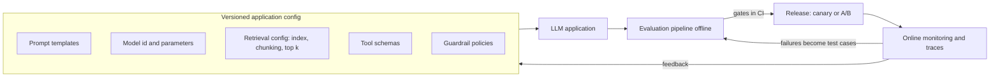
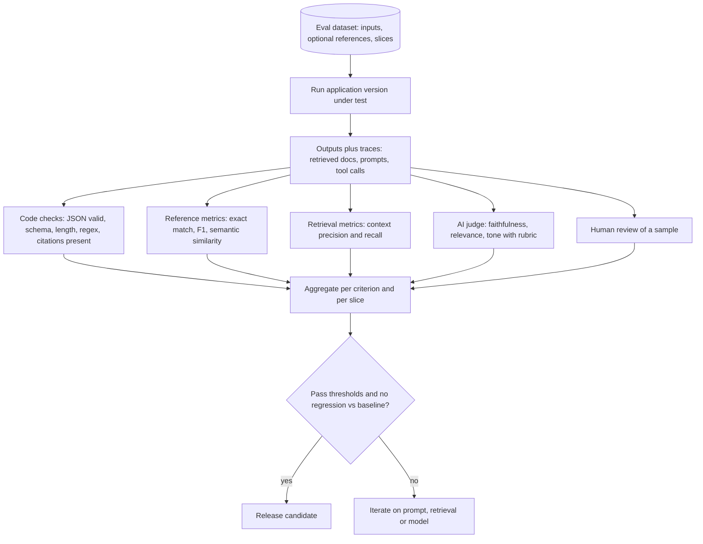

# Prompt management and evaluation pipelines

> **Before this lesson:** read [Testing ML systems](#/lesson/mlops/testing-ml) (gates, slices,
> golden files, testing non-deterministic components),
> [Model registry, model cards and governance](#/lesson/mlops/model-registry) (versions and aliases)
> and [CI/CD with GitHub Actions](#/lesson/mlops/github-actions) (quality gates in pull requests).
> [Data drift, concept drift and statistical tests](#/lesson/mlops/drift) mentioned prompt drift.

## In plain words

A **large language model** (LLM) is a model trained on huge amounts of text that continues a piece
of text, one **token** (a word or part of a word) at a time. Most companies do not train their own:
they take a **foundation model** that someone else trained and adapt it to their product. The main
tool for that is the **prompt**, the instructions and context sent to the model with each request.
**LLMOps** is MLOps for applications built this way.

An everyday picture: the model is a brilliant new employee who has read everything but knows nothing
about your company. The prompt is the briefing you hand them before each task. Change one sentence
in the briefing and every answer they give changes. So the briefing deserves the same care as code:
written down, versioned, reviewed, and tested before it goes out. And because the employee's answers
are free text, "testing" means checking them against a clear description of what a good answer looks
like.

Why this matters for a job: nearly every product team is shipping LLM features, and most of the
failures come from untracked prompt changes and the absence of a real evaluation suite. "How would
you evaluate an LLM application before release?" is now a standard interview question for ML and AI
engineers.

## What changes with LLMs, and what does not

Much of MLOps carries over unchanged: version everything, test before release, roll out
progressively, monitor, control cost. What is new, following the framing of Huyen's *AI
Engineering*:

- You usually **adapt** a model someone else trained instead of training one: by prompting, by
  **retrieval** (fetching relevant documents and adding them to the prompt), and sometimes by
  **fine-tuning** (further training on your own examples). What you ship are **prompts, context
  pipelines, tool definitions and configuration**, and occasionally small **adapter weights**.
- **Outputs are open-ended.** There is rarely one correct answer to compare with, so evaluation is
  much harder. Huyen considers evaluation one of the hardest parts of building AI applications and
  gives it two full chapters.
- **Non-determinism**: the model picks each token by **sampling** from probabilities, so the same
  input can give different outputs. The **temperature** setting controls how random that choice is
  (0 is nearly deterministic). The provider can also change the model behind an API.
- **Cost and latency are per token**, and both grow with prompt and output length.
- **New failure modes**: **hallucination** (fluent, confident statements that are false), **prompt
  injection** (inputs that smuggle in instructions to override yours, lesson 33), toxic or off-brand
  output, and leaks of private data.



The left box lists everything that defines the application's behaviour and must be versioned
together: prompt templates, the model and its settings, the retrieval configuration (which document
index, how documents are cut into **chunks**, how many results, **top k**, are fetched), the
**schemas** of tools the model may call, and guardrail policies. The loop on the right is the same
release cycle as for classic models, with one addition: production failures become new test cases.

## Prompts are code: manage them like code

A one-word prompt edit can change behaviour across the whole product. In her discussion of drift,
Huyen points out that a system prompt can change without anyone noticing, for example when someone
updates a template or "fixes a typo", and that even a simple automated check for such changes is
worth having. Treat prompts as versioned artifacts of the first rank.

### Practices

1. **Separate prompts from application code**: keep templates in their own files or in a **prompt
   registry**, loaded by name and version, not as strings scattered through the code.
2. **Version and hash**: every prompt has an ID, a version number and a **content hash** (a short
   fingerprint of its text), and every logged request records them, along with the model ID and
   sampling parameters.
3. **Template with explicit variables**, and check that every variable is supplied before sending.
4. **Pin the model version** (a dated name such as `...-2024-08-06`, not a floating alias that the
   provider may move) where the provider allows it, and record it. Re-evaluate before moving to a new
   model version.
5. **Review prompt changes** in pull requests, with an **evaluation diff** attached: how did the scores
   change?
6. **Separate release from deploy**: a registry with aliases (`@production`, `@candidate`) lets you
   move a prompt forward or back without redeploying code, and such a move needs the same gates as any
   release.

A prompt file might look like this:

```python
# prompts/support_answer/v7.yaml
# id: support_answer
# version: 7
# model: provider-model-2025-01-15
# params: {temperature: 0.2, max_tokens: 500}
# template: |
#   You are a support assistant for {product}. Answer ONLY from the context.
#   If the context does not contain the answer, say you don't know.
#   <context>{context}</context>
#   Question: {question}
```

It names the prompt, its version, the pinned model, the sampling settings (low temperature;
`max_tokens` caps the answer length) and the template. Words in braces, such as `{question}`, are
variables filled in for each request.

The demo builds a tiny prompt object that computes its own hash and refuses to render with missing
variables.

```python-run
import hashlib, json, string

class PromptTemplate:
    def __init__(self, prompt_id, version, template, model, params):
        self.id, self.version, self.template, self.model, self.params = prompt_id, version, template, model, params
        self.variables = sorted({f for _, f, _, _ in string.Formatter().parse(template) if f})
        blob = json.dumps({"t": template, "m": model, "p": params}, sort_keys=True)
        self.hash = hashlib.sha256(blob.encode()).hexdigest()[:12]
    def render(self, **kw):
        missing = [v for v in self.variables if v not in kw]
        if missing:
            raise KeyError(f"missing variables: {missing}")
        return self.template.format(**kw)

v6 = PromptTemplate("support_answer", 6, "Answer the question using the context.\n{context}\nQ: {question}",
                    "model-2025-01-15", {"temperature": 0.2})
v7 = PromptTemplate("support_answer", 7, "Answer ONLY from the context. If unsure, say you don't know.\n{context}\nQ: {question}",
                    "model-2025-01-15", {"temperature": 0.2})
for p in (v6, v7):
    print(p.id, "v%d" % p.version, "hash", p.hash, "vars", p.variables)
print("\nlog line:", json.dumps({"request_id": "r-123", "prompt_id": v7.id, "prompt_version": v7.version,
                                "prompt_hash": v7.hash, "model": v7.model, "input_tokens": 812, "output_tokens": 96}))
try:
    v7.render(question="How do I reset my password?")
except KeyError as e:
    print("render check:", e)
```

Line by line:

- `string.Formatter().parse(template)` splits a template into pieces and reports the name of each
  `{variable}`; the set comprehension collects them.
- The hash is computed over a JSON blob of the template *and* the model *and* the parameters, with
  `sort_keys=True` so the same content always gives the same text.
- `render` lists any variables not supplied and raises an error instead of sending a broken prompt.
- The script prints both versions, a log line of the kind every request should produce, and the
  result of rendering without `context`.

The output:

```text
support_answer v6 hash c0814e0b350c vars ['context', 'question']
support_answer v7 hash 47cebac5cc22 vars ['context', 'question']

log line: {"request_id": "r-123", "prompt_id": "support_answer", "prompt_version": 7, "prompt_hash": "47cebac5cc22", "model": "model-2025-01-15", "input_tokens": 812, "output_tokens": 96}
render check: "missing variables: ['context']"
```

Because the hash covers template, model and parameters, changing any of them changes the
fingerprint. An alert on "unexpected prompt hash in production" catches silent edits.

Tools for this include the MLflow Prompt Registry, LangSmith, Langfuse, PromptLayer, Humanloop and
Braintrust; plain Git plus a small loader works too. The tool matters less than the discipline.

## Why evaluating LLM applications is hard

- **Open-ended outputs**: many different responses can be acceptable.
- **No ground truth** for many tasks, or ground truth that is expensive to create.
- **Quality has many dimensions**: correct? supported by the context? relevant? complete? safe? the
  right tone and format? fast and cheap enough?
- **Public benchmarks** (standard shared test sets) get **saturated** (top models all score near the
  maximum) and leak into training data, and they rarely reflect *your* application.
- **System complexity**: retrieval, tool calls and multi-step flows each fail in their own places.

## Building an evaluation pipeline

Chapter 4 of Huyen's book organises an evaluation pipeline into three steps. In our own words:

### Step 1: evaluate every component, not only the final answer

Score the end-to-end output *and* the intermediate output of each component separately. Huyen's
illustration is an application that reads a person's current employer from a résumé PDF in two
steps: convert the PDF to text, then extract the employer from the text. When the final answer is
wrong, only separate scores for each step reveal which one failed. For a **RAG** system
(retrieval-augmented generation: fetch documents, then generate an answer from them), this means
judging **retrieval** (were the right documents fetched?) separately from **generation** (given the
right documents, is the answer faithful to them?). You can also evaluate per conversational turn or
per whole task.

### Step 2: write down what "good" means

Write an **evaluation guideline**: what a good response is for *your* application, and what a bad one
is. Choose the **criteria** (for example relevance, factual consistency with the context, safety),
write a **scoring rubric** for each (a description of what earns each score, with examples), and
**connect evaluation metrics to business metrics** (what resolution rate does 90% factual consistency
buy us?). A correct answer is not always a good one: it may be rude, too long, or off-brand. Vague
guidelines give unreliable scores, whether the scorer is a person or a model.

### Step 3: choose methods and data

Pick a method per criterion: a small specialised classifier for toxicity, semantic similarity for
relevance, an AI judge for factual consistency. Mix cheap and expensive methods; Huyen's example is a
cheap classifier on all traffic and an expensive AI judge on 1% of it. Where the API provides
**log-probabilities** (the model's own probability for each token it produced), use them as a
confidence signal.

Then build the data: curate **annotated evaluation sets** (inputs with expected answers or labels),
**slice** them (by user tier, topic, input length, known failure types), and make sure they are large
enough to detect the differences you care about. Finally, **evaluate the evaluation**: is it reliable
(the same input gets the same score)? Do its metrics move with what you actually care about? How much
cost and latency does it add?



The application under test runs over the evaluation set, producing outputs and traces. Five families
of checks score them; scores are aggregated per criterion and per slice; a gate compares them with
thresholds and with the current baseline. A **regex** (regular expression) is a text pattern, used
here for simple format checks.

## Evaluation methods in more detail

| Method | Use | Limits |
|---|---|---|
| **Functional / code-based checks** | parses as JSON, matches schema, SQL executes, unit tests pass for generated code, required fields present | only for verifiable properties |
| **Exact / lexical match** (EM, F1, BLEU, ROUGE) | closed-ended answers, extraction | penalises valid paraphrases |
| **Semantic similarity** (embeddings, BERTScore) | closeness to a reference answer | needs references; similarity ≠ correctness |
| **AI as a judge** | open-ended criteria with a rubric: faithfulness, relevance, tone | judge is itself a model: biased, non-deterministic, prompt-sensitive, costs tokens |
| **Human evaluation** | gold standard, guideline creation, judge calibration | slow, expensive, inconsistent without clear rubrics |
| **Comparative evaluation** | "is A or B better?" pairwise preferences, rankings | does not say whether either is *good enough* |

Some names: **EM** (exact match) and token-level **F1** compare answer words with a reference;
**BLEU** and **ROUGE** are word-overlap scores from translation and summarisation. **Semantic
similarity** compares meanings using embeddings (lists of numbers representing text), so two
paraphrases score as close. **AI as a judge** means asking a model to grade another model's output
against a rubric.

### Using AI judges responsibly

Huyen's caution (ch. 3): AI judges are fast and much cheaper than human graders, but their scores
are *subjective*, depending on the judge model **and on the judge's prompt**. A judge is therefore
not a fixed ruler unless you version it.

- **Version the judge** (model plus prompt plus rubric) exactly like application prompts. Changing
  the judge changes every score, so never compare numbers across judge versions.
- **Ask narrow, concrete questions** with discrete answers (yes or no; 1 to 5 with a rubric and
  examples) instead of "rate the quality from 1 to 100".
- **Calibrate against humans**: have people label a sample, measure how often the judge agrees,
  refine the rubric until agreement is acceptable, and re-check periodically.
- Watch the known biases: **self-preference** (judges favour outputs from their own model family),
  **position bias** (in pairwise comparisons, favouring whichever answer is shown first) and
  **verbosity bias** (favouring longer answers).
- Low temperature and fixed seeds reduce judge variance but do not remove it, so measure it.

### RAG-specific metrics

- **Context precision**: what share of the retrieved chunks are relevant?
- **Context recall**: did retrieval find the information needed to answer?
- **Faithfulness (groundedness)**: is every claim in the answer supported by the retrieved context?
- **Answer relevance**: does the answer address the question asked?

Low recall means fix retrieval (chunking, embeddings, **hybrid search** that combines keyword and
embedding search, top k). High recall but low faithfulness means the right documents were found and
the model strayed from them, so fix the generation prompt or the model.

## A runnable miniature eval harness

The harness below compares two versions of a toy support assistant. Instead of a real LLM, each
"version" is a small deterministic function, so the demo runs anywhere and always gives the same
numbers.

```python-run
import json, re, statistics

# Two "application versions": deterministic stand-ins for prompt v6 and v7 over a tiny knowledge base.
KB = {"refund": "Refunds are available within 30 days of purchase.",
      "shipping": "Standard shipping takes 3-5 business days.",
      "warranty": "Hardware has a 2-year warranty."}
def retrieve(q):
    return [text for key, text in KB.items() if key in q.lower()]
def app_v6(q):
    ctx = retrieve(q)
    return {"answer": ctx[0] if ctx else "Refunds are available within 90 days.", "context": ctx}   # hallucinates when no context
def app_v7(q):
    ctx = retrieve(q)
    return {"answer": ctx[0] if ctx else "I don't know based on the available information.", "context": ctx}

dataset = [
    {"q": "What is your refund policy?",        "must_include": "30 days",   "slice": "answerable"},
    {"q": "How long does shipping take?",       "must_include": "3-5",       "slice": "answerable"},
    {"q": "Tell me about the warranty",         "must_include": "2-year",    "slice": "answerable"},
    {"q": "Do you price match competitors?",    "must_include": "don't know", "slice": "unanswerable"},
    {"q": "Can I pay with cryptocurrency?",     "must_include": "don't know", "slice": "unanswerable"},
]

def grounded(answer, context):       # crude faithfulness check: every number in the answer appears in the context
    nums = re.findall(r"\d+", answer)
    return all(any(n in c for c in context) for n in nums)

def evaluate(app):
    rows = []
    for ex in dataset:
        out = app(ex["q"])
        rows.append({"slice": ex["slice"],
                     "correct": ex["must_include"].lower() in out["answer"].lower(),
                     "grounded": grounded(out["answer"], out["context"])})
    report = {}
    for s in ("answerable", "unanswerable", "all"):
        sub = [r for r in rows if s == "all" or r["slice"] == s]
        report[s] = {m: round(statistics.mean(r[m] for r in sub), 2) for m in ("correct", "grounded")}
    return report

base, cand = evaluate(app_v6), evaluate(app_v7)
print("v6:", json.dumps(base)); print("v7:", json.dumps(cand))
gate = all(cand[s][m] >= base[s][m] for s in cand for m in cand[s]) and cand["all"]["grounded"] >= 0.95
print("release gate:", "PASS" if gate else "FAIL")
```

How it is put together:

- `KB` is a three-entry knowledge base and `retrieve` returns the entries whose keyword appears in
  the question: a crude retriever.
- `app_v6` answers from the context when there is one, but invents a refund policy ("90 days") when
  there is none, the classic hallucination. `app_v7` says it does not know instead.
- The `dataset` has five questions in two slices: three answerable from the knowledge base, two not.
  `must_include` is the text a correct answer must contain.
- `grounded` is a crude faithfulness check: every number in the answer must appear in the retrieved
  context. `re.findall(r"\d+", answer)` finds all digit sequences.
- `evaluate` runs one version over the data set and averages each criterion per slice and overall.
- The gate requires the candidate to be at least as good as the baseline on every criterion and slice,
  and grounded at least 95% of the time overall.

The output:

```text
v6: {"answerable": {"correct": 1, "grounded": 1}, "unanswerable": {"correct": 0, "grounded": 0}, "all": {"correct": 0.6, "grounded": 0.6}}
v7: {"answerable": {"correct": 1, "grounded": 1}, "unanswerable": {"correct": 1, "grounded": 1}, "all": {"correct": 1, "grounded": 1}}
release gate: PASS
```

The harness has the essential shape of a real one: a fixed data set with slices, several criteria, a
comparison with a baseline, and a gate. Version 6 is perfect on answerable questions and fails only on
the unanswerable slice, which an overall average (0.6) would have blurred into "decent". The problem
`mlops-eval-gate` asks you to write a gate like this with per-case regression rules.

## Evaluation in the delivery pipeline

- **In CI**: every change to a prompt, a retrieval setting, a tool or a model version runs the
  evaluation suite; the pull request shows a score difference per criterion and slice; regressions
  block the merge. Keep a fast subset for pull requests and run the full suite nightly, because judge
  calls cost tokens.
- **Regression set**: every production failure you find becomes a permanent test case. Huyen stresses
  this connection: problems detected in monitoring should flow back into the evaluation pipeline.
- **Online**: good offline scores justify a canary or an A/B test, not a full launch. Track
  user-facing metrics and feedback (lesson 29), plus online judging of a sample.
- **Scheduled re-evaluation**: rerun the suite against production on a schedule to catch model changes
  on the provider's side.
- **Statistical care**: with 50 examples, a 4-point difference is noise. Report **confidence
  intervals** (a range that likely contains the true score) or use **paired comparisons** (both
  versions on the same examples, counting wins and losses), and grow the set where decisions are close.

```python-run
import math
def ci95(p, n):
    se = math.sqrt(p * (1 - p) / n)
    return max(0, p - 1.96 * se), min(1, p + 1.96 * se)
for n in (50, 200, 1000):
    lo, hi = ci95(0.86, n)
    print(f"n={n:4d}: observed 86% -> 95% CI [{lo:.1%}, {hi:.1%}]")
```

For a pass rate `p` measured on `n` examples, the standard error is `sqrt(p(1-p)/n)`, and the 95%
confidence interval is about 1.96 standard errors either side. The output:

```text
n=  50: observed 86% -> 95% CI [76.4%, 95.6%]
n= 200: observed 86% -> 95% CI [81.2%, 90.8%]
n=1000: observed 86% -> 95% CI [83.8%, 88.2%]
```

With 50 examples, a measured 86% is consistent with anything from about 76% to 96%, so 86% against
82% proves nothing. With 1,000 examples the interval narrows to under 5 points either way.

> [!INTERVIEW]
> "How do you evaluate an LLM application before release?" — Define criteria and rubrics tied to business
> goals; build a sliced evaluation set that includes hard and adversarial cases and past failures;
> evaluate components separately (retrieval vs generation); combine code checks, reference metrics and a
> versioned, human-calibrated AI judge; gate changes in CI against a baseline; then validate online with a
> canary/A-B and user feedback. Mention pinning model versions and hashing prompts.

## Summary

- LLMOps ships prompts, context pipelines and configuration; treat them as versioned, reviewed,
  hashed artifacts with pinned model versions.
- Evaluation is the core discipline: evaluate every component, write guidelines with rubrics, and
  choose methods and data on purpose (Huyen's three steps).
- Mix cheap deterministic checks, reference metrics, AI judges (versioned and calibrated against
  humans) and human review.
- Wire the suite into CI with baselines and slices; turn production failures into regression tests;
  respect sample-size noise.

## Glossary

- **LLM / foundation model** - a large text-generating model / a large pretrained model that others
  adapt.
- **Token** - a word or piece of a word, the unit LLMs read, write and bill by.
- **Prompt / system prompt / template** - the input sent to the model / standing instructions /
  a prompt with variables to fill.
- **LLMOps** - MLOps for applications built on foundation models.
- **Retrieval / RAG** - fetching relevant documents / retrieval-augmented generation.
- **Fine-tuning / adapter weights** - further training on your data / small extra weights it
  produces.
- **Sampling / temperature** - choosing each token at random by probability / how random that is.
- **Hallucination** - a fluent but false statement.
- **Prompt injection** - input that tries to override the application's instructions.
- **Prompt registry / content hash** - a versioned store of prompts / a fingerprint of the content.
- **Chunk / top k** - a piece of a document stored for retrieval / how many pieces are fetched.
- **Benchmark saturation** - top models all scoring near the maximum on a shared test.
- **Evaluation guideline / rubric** - a written definition of good and bad / what earns each score.
- **Log-probability** - the model's probability for a token it produced, on a log scale.
- **EM / F1 / BLEU / ROUGE** - lexical scores comparing words with a reference.
- **Semantic similarity** - closeness of meaning, usually via embeddings.
- **AI judge** - a model grading another model's outputs.
- **Self-preference / position / verbosity bias** - judge biases toward its own family, the first
  answer, or longer answers.
- **Context precision / recall** - share of retrieved chunks that are relevant / whether needed
  information was retrieved.
- **Faithfulness (groundedness)** - every claim supported by the retrieved context.
- **Regression set** - past failures kept as permanent test cases.
- **Confidence interval / paired comparison** - a plausible range for a true score / comparing two
  versions on the same examples.

```quiz
[
  {"q": "Why should every production request log the prompt version/hash and model version?",
   "options": ["To increase token usage", "So behaviour changes can be traced to a specific prompt or model change and silent edits detected", "Providers require it", "It improves latency"],
   "answer": 1, "explain": "Without it you cannot attribute a regression or reproduce a response."},
  {"q": "In Huyen's resume-PDF example, why evaluate the PDF-to-text step separately from employer extraction?",
   "options": ["It is cheaper", "Otherwise you cannot tell which component caused a wrong final answer", "PDFs cannot be evaluated end to end", "To avoid using an AI judge"],
   "answer": 1, "explain": "Component-level evaluation localises failures in multi-step systems."},
  {"q": "A RAG system has high context recall but low faithfulness. Where is the problem?",
   "options": ["Retrieval", "Generation: the model is not sticking to the retrieved context", "The vector database is down", "The evaluation set is too large"],
   "answer": 1, "explain": "The right context was retrieved, but the answer contains unsupported claims."},
  {"q": "What is a key risk of using an AI judge?",
   "options": ["It cannot read text", "Scores depend on the judge model and prompt; changing either makes scores incomparable", "It is always slower than humans", "It needs GPUs on your laptop"],
   "answer": 1, "explain": "Version and calibrate the judge like any other prompt."},
  {"q": "Why slice the evaluation set?",
   "options": ["To make it smaller", "Averages hide failures concentrated in subsets such as unanswerable questions or a user tier", "Slices reduce token cost", "To avoid references"],
   "answer": 1, "explain": "Per-slice metrics reveal regressions that the overall mean masks."},
  {"q": "An eval set of 50 examples shows 86% vs 82% for two prompts. What is the right conclusion?",
   "options": ["The first prompt is clearly better", "The difference is within noise; collect more data or use a paired analysis", "The second is better", "Both are bad"],
   "answer": 1, "explain": "With n=50 the 95% interval is roughly plus or minus 10 points."},
  {"q": "What should happen to a failure discovered in production?",
   "options": ["Nothing if it was fixed", "It is added to the regression evaluation set", "It is deleted from logs", "The model is retrained from scratch"],
   "answer": 1, "explain": "Monitoring feeds evaluation so the same failure is caught automatically next time."},
  {"q": "Why mix a cheap classifier on 100% of traffic with an expensive AI judge on 1%?",
   "options": ["To confuse attackers", "To get broad coverage cheaply plus high-quality signal on a sample, keeping cost manageable", "Because judges cannot scale", "To avoid logging"],
   "answer": 1, "explain": "This is Huyen's suggested way to balance evaluation quality and cost."}
]
```

> **Source:** Chip Huyen, *AI Engineering*, ch. 3 (evaluation methodology: exact evaluation, AI as a judge and its limitations, comparative evaluation), ch. 4 (evaluation criteria and the three-step evaluation pipeline: evaluate all components, create a guideline, define methods and data), ch. 5 (prompt engineering best practices, prompt versioning), ch. 10 (drift detection for prompts and models); MLflow, Langfuse and LangSmith documentation on prompt registries and evaluation.
