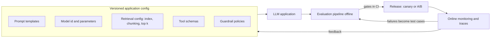
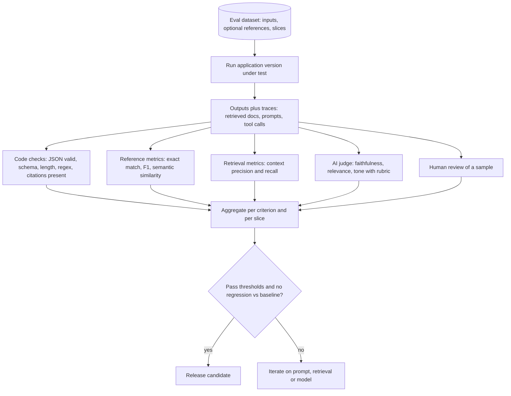

# Prompt management and evaluation pipelines

## What changes with LLMs — and what does not

**LLMOps** is MLOps for applications built on large foundation models. Much carries over unchanged:
version everything, test before release, deploy progressively, monitor, control cost. What is new,
following Huyen's framing in *AI Engineering*:

- You usually **adapt** a model someone else trained (prompting, retrieval, sometimes fine-tuning) rather
  than train from scratch. The artefacts you ship are **prompts, context pipelines, tool definitions and
  configuration** — and occasionally adapter weights.
- **Outputs are open-ended**. There is rarely a single correct answer to compare with, so evaluation is
  much harder; Huyen calls evaluation one of the hardest challenges of AI engineering and devotes two
  chapters to it.
- **Non-determinism**: the same input can yield different outputs (sampling), and the provider can change
  the model behind an API.
- **Cost and latency are per token**, and both scale with prompt and output length.
- **New failure modes**: hallucination, prompt injection, toxic or off-brand output, data leakage.



## Prompts are code — manage them like code

A one-word prompt edit can change behaviour across the whole product. Huyen notes in her discussion of
drift that a system prompt can change without anyone noticing — a template updated, a coworker fixing a
typo — and that you need at least simple logic to detect it. Treat prompts as first-class, versioned
artefacts.

### Practices

1. **Separate prompts from application code**: templates in dedicated files or a prompt registry, loaded
   by name and version — not string literals scattered through the codebase.
2. **Version and hash**: every prompt has an ID, a version and a content hash; every logged request
   records them, with the model ID and sampling parameters.
3. **Template with explicit variables** and validate that all variables are supplied.
4. **Pin the model version** (`...-2024-08-06`, not a floating alias) where the provider allows, and
   record it. Re-evaluate before moving to a new model version.
5. **Review prompt changes** in pull requests, with an **evaluation diff** attached (how did scores
   change?).
6. **Decouple release from deploy**: a registry with aliases (`@production`, `@candidate`) lets you roll a
   prompt forward or back without redeploying code — and demands the same gates as any release.

```python
# prompts/support_answer/v7.yaml
# id: support_answer
# version: 7
# model: provider-model-2025-01-15
# params: {temperature: 0.2, max_tokens: 500}
# template: |
#   You are a support assistant for {product}. Answer ONLY from the context.
#   If the context does not contain the answer, say you don't know.
#   <context>{context}</context>
#   Question: {question}
```

```python-run
import hashlib, json, string

class PromptTemplate:
    def __init__(self, prompt_id, version, template, model, params):
        self.id, self.version, self.template, self.model, self.params = prompt_id, version, template, model, params
        self.variables = sorted({f for _, f, _, _ in string.Formatter().parse(template) if f})
        blob = json.dumps({"t": template, "m": model, "p": params}, sort_keys=True)
        self.hash = hashlib.sha256(blob.encode()).hexdigest()[:12]
    def render(self, **kw):
        missing = [v for v in self.variables if v not in kw]
        if missing:
            raise KeyError(f"missing variables: {missing}")
        return self.template.format(**kw)

v6 = PromptTemplate("support_answer", 6, "Answer the question using the context.\n{context}\nQ: {question}",
                    "model-2025-01-15", {"temperature": 0.2})
v7 = PromptTemplate("support_answer", 7, "Answer ONLY from the context. If unsure, say you don't know.\n{context}\nQ: {question}",
                    "model-2025-01-15", {"temperature": 0.2})
for p in (v6, v7):
    print(p.id, "v%d" % p.version, "hash", p.hash, "vars", p.variables)
print("\nlog line:", json.dumps({"request_id": "r-123", "prompt_id": v7.id, "prompt_version": v7.version,
                                "prompt_hash": v7.hash, "model": v7.model, "input_tokens": 812, "output_tokens": 96}))
try:
    v7.render(question="How do I reset my password?")
except KeyError as e:
    print("render check:", e)
```

The hash covers template *and* model *and* parameters: if any of them changes, the fingerprint changes,
and an alert on "unexpected prompt hash in production" catches silent edits.

Tools: MLflow Prompt Registry, LangSmith, Langfuse, PromptLayer, Humanloop, Braintrust, or simply Git
plus a small loader. The tool matters less than the discipline.

## Why evaluating LLM applications is hard

- **Open-ended outputs**: many different responses are acceptable.
- **No ground truth** for many tasks, or ground truth that is expensive to create.
- **Multi-dimensional quality**: correct? grounded in the context? relevant? complete? safe? right tone
  and format? fast and cheap enough?
- **Public benchmarks** saturate and leak into training data, and rarely reflect *your* application.
- **System complexity**: retrieval, tools and multi-step flows fail in different places.

## Building an evaluation pipeline

Huyen's chapter 4 lays out a pipeline in three steps. Paraphrased:

### Step 1 — Evaluate all components of the system

Evaluate the end-to-end output *and* each component's intermediate output independently. Her example: an
application that extracts a person's current employer from a résumé PDF does it in two steps —
PDF-to-text, then extraction from the text. If the final answer is wrong, you cannot tell which step
failed unless each is evaluated separately. For a RAG system, that means evaluating **retrieval**
(did we fetch the right documents?) separately from **generation** (given the right documents, is the
answer faithful?). Evaluation can also be per turn or per whole task.

### Step 2 — Create an evaluation guideline

Define what a *good* response is for your application — and what a bad one is. Decide the **criteria**
(e.g., relevance, factual consistency with context, safety), write **scoring rubrics with examples** for
each, and **tie evaluation metrics to business metrics** (what resolution rate does 90% factual
consistency buy us?). A correct answer is not necessarily a good one; ambiguous guidelines produce
unreliable scores from humans and AI judges alike.

### Step 3 — Define evaluation methods and data

Pick methods per criterion — a small specialised classifier for toxicity, semantic similarity for
relevance, an AI judge for factual consistency — and mix cheap and expensive ones: Huyen suggests, for
example, a cheap classifier on 100% of traffic and an expensive AI judge on 1%. Use log-probabilities
when available, as a confidence signal. Curate **annotated evaluation sets**, **slice** them (by user
tier, topic, input length, known failure types), make sure the set is large enough for the differences
you care about, and **evaluate your evaluation pipeline**: is it reliable (same input → same score)? do
its metrics correlate with what you actually care about? how much cost and latency does it add?



## Evaluation methods in more detail

| Method | Use | Limits |
|---|---|---|
| **Functional / code-based checks** | parses as JSON, matches schema, SQL executes, unit tests pass for generated code, required fields present | only for verifiable properties |
| **Exact / lexical match** (EM, F1, BLEU, ROUGE) | closed-ended answers, extraction | penalises valid paraphrases |
| **Semantic similarity** (embeddings, BERTScore) | closeness to a reference answer | needs references; similarity ≠ correctness |
| **AI as a judge** | open-ended criteria with a rubric: faithfulness, relevance, tone | judge is itself a model: biased, non-deterministic, prompt-sensitive, costs tokens |
| **Human evaluation** | gold standard, guideline creation, judge calibration | slow, expensive, inconsistent without clear rubrics |
| **Comparative evaluation** | "is A or B better?" pairwise preferences, rankings | does not say whether either is *good enough* |

### Using AI judges responsibly

Huyen's caution (ch. 3) is that AI judges are fast and far cheaper than human evaluators, but they are
*subjective* metrics whose scores depend on the judge model **and its prompt** — so a judge is not a
fixed yardstick unless you version it.

- **Version the judge** (model + prompt + rubric) exactly like application prompts. Changing the judge
  changes every score; do not compare numbers across judge versions.
- **Prefer narrow, concrete questions** with discrete outputs (yes/no, 1–5 with a rubric and examples)
  over "rate the quality from 1 to 100".
- **Calibrate against humans**: label a sample by hand and measure agreement; fix the rubric until it is
  acceptable; re-check periodically.
- Watch known biases (self-preference, position bias in pairwise comparisons, verbosity bias).
- Low temperature and fixed seeds reduce, but do not remove, judge variance — measure it.

### RAG-specific metrics

- **Context precision**: what share of retrieved chunks is relevant?
- **Context recall**: did retrieval find the information needed to answer?
- **Faithfulness / groundedness**: is every claim in the answer supported by the retrieved context?
- **Answer relevance**: does the answer address the question?

Low recall → fix retrieval (chunking, embeddings, hybrid search, top-k). High recall but low
faithfulness → fix the generation prompt or model.

## A runnable miniature eval harness

```python-run
import json, re, statistics

# Two "application versions": deterministic stand-ins for prompt v6 and v7 over a tiny knowledge base.
KB = {"refund": "Refunds are available within 30 days of purchase.",
      "shipping": "Standard shipping takes 3-5 business days.",
      "warranty": "Hardware has a 2-year warranty."}
def retrieve(q):
    return [text for key, text in KB.items() if key in q.lower()]
def app_v6(q):
    ctx = retrieve(q)
    return {"answer": ctx[0] if ctx else "Refunds are available within 90 days.", "context": ctx}   # hallucinates when no context
def app_v7(q):
    ctx = retrieve(q)
    return {"answer": ctx[0] if ctx else "I don't know based on the available information.", "context": ctx}

dataset = [
    {"q": "What is your refund policy?",        "must_include": "30 days",   "slice": "answerable"},
    {"q": "How long does shipping take?",       "must_include": "3-5",       "slice": "answerable"},
    {"q": "Tell me about the warranty",         "must_include": "2-year",    "slice": "answerable"},
    {"q": "Do you price match competitors?",    "must_include": "don't know", "slice": "unanswerable"},
    {"q": "Can I pay with cryptocurrency?",     "must_include": "don't know", "slice": "unanswerable"},
]

def grounded(answer, context):       # crude faithfulness check: every number in the answer appears in the context
    nums = re.findall(r"\d+", answer)
    return all(any(n in c for c in context) for n in nums)

def evaluate(app):
    rows = []
    for ex in dataset:
        out = app(ex["q"])
        rows.append({"slice": ex["slice"],
                     "correct": ex["must_include"].lower() in out["answer"].lower(),
                     "grounded": grounded(out["answer"], out["context"])})
    report = {}
    for s in ("answerable", "unanswerable", "all"):
        sub = [r for r in rows if s == "all" or r["slice"] == s]
        report[s] = {m: round(statistics.mean(r[m] for r in sub), 2) for m in ("correct", "grounded")}
    return report

base, cand = evaluate(app_v6), evaluate(app_v7)
print("v6:", json.dumps(base)); print("v7:", json.dumps(cand))
gate = all(cand[s][m] >= base[s][m] for s in cand for m in cand[s]) and cand["all"]["grounded"] >= 0.95
print("release gate:", "PASS" if gate else "FAIL")
```

The harness shows the essential shape: a fixed dataset with slices, several criteria, a baseline
comparison, and a gate. Version 6 looks fine on answerable questions and fails only on the unanswerable
slice — which the overall average would have blurred.

## Evaluation in the delivery pipeline

- **In CI**: every change to a prompt, retrieval setting, tool or model version runs the eval suite; the
  PR shows a score diff per criterion and slice; regressions block the merge. Keep a fast subset for PRs
  and the full suite nightly — judge calls cost tokens.
- **Regression set**: every production failure you find becomes a permanent test case. Huyen stresses
  this link: issues detected in monitoring should feed back into the evaluation pipeline.
- **Online**: offline scores justify a canary or A/B test, not a full launch. Track user-facing metrics
  and feedback (lesson 29), plus sampled online judging.
- **Scheduled re-evaluation**: rerun the suite against production on a schedule to catch provider-side
  model changes.
- **Statistical care**: with 50 examples, a 4-point difference is noise. Report confidence intervals or
  use paired comparisons; grow the set where decisions are close.

```python-run
import math
def ci95(p, n):
    se = math.sqrt(p * (1 - p) / n)
    return max(0, p - 1.96 * se), min(1, p + 1.96 * se)
for n in (50, 200, 1000):
    lo, hi = ci95(0.86, n)
    print(f"n={n:4d}: observed 86% -> 95% CI [{lo:.1%}, {hi:.1%}]")
```

> [!INTERVIEW]
> "How do you evaluate an LLM application before release?" — Define criteria and rubrics tied to business
> goals; build a sliced evaluation set that includes hard and adversarial cases and past failures;
> evaluate components separately (retrieval vs generation); combine code checks, reference metrics and a
> versioned, human-calibrated AI judge; gate changes in CI against a baseline; then validate online with a
> canary/A-B and user feedback. Mention pinning model versions and hashing prompts.

## Summary

- LLMOps ships prompts, context pipelines and configs; treat them as versioned, reviewed, hashed artefacts
  with pinned model versions.
- Evaluation is the core discipline: evaluate every component, write guidelines with rubrics, choose
  methods and data deliberately (Huyen's three steps).
- Mix cheap deterministic checks, reference metrics, AI judges (versioned and calibrated) and human review.
- Wire the suite into CI with baselines and slices; feed production failures back as regression tests.

```quiz
[
  {"q": "Why should every production request log the prompt version/hash and model version?",
   "options": ["To increase token usage", "So behaviour changes can be traced to a specific prompt or model change and silent edits detected", "Providers require it", "It improves latency"],
   "answer": 1, "explain": "Without it you cannot attribute a regression or reproduce a response."},
  {"q": "In Huyen's resume-PDF example, why evaluate the PDF-to-text step separately from employer extraction?",
   "options": ["It is cheaper", "Otherwise you cannot tell which component caused a wrong final answer", "PDFs cannot be evaluated end to end", "To avoid using an AI judge"],
   "answer": 1, "explain": "Component-level evaluation localises failures in multi-step systems."},
  {"q": "A RAG system has high context recall but low faithfulness. Where is the problem?",
   "options": ["Retrieval", "Generation: the model is not sticking to the retrieved context", "The vector database is down", "The evaluation set is too large"],
   "answer": 1, "explain": "The right context was retrieved, but the answer contains unsupported claims."},
  {"q": "What is a key risk of using an AI judge?",
   "options": ["It cannot read text", "Scores depend on the judge model and prompt; changing either makes scores incomparable", "It is always slower than humans", "It needs GPUs on your laptop"],
   "answer": 1, "explain": "Version and calibrate the judge like any other prompt."},
  {"q": "Why slice the evaluation set?",
   "options": ["To make it smaller", "Averages hide failures concentrated in subsets such as unanswerable questions or a user tier", "Slices reduce token cost", "To avoid references"],
   "answer": 1, "explain": "Per-slice metrics reveal regressions that the overall mean masks."},
  {"q": "An eval set of 50 examples shows 86% vs 82% for two prompts. What is the right conclusion?",
   "options": ["The first prompt is clearly better", "The difference is within noise; collect more data or use a paired analysis", "The second is better", "Both are bad"],
   "answer": 1, "explain": "With n=50 the 95% interval is roughly plus or minus 10 points."},
  {"q": "What should happen to a failure discovered in production?",
   "options": ["Nothing if it was fixed", "It is added to the regression evaluation set", "It is deleted from logs", "The model is retrained from scratch"],
   "answer": 1, "explain": "Monitoring feeds evaluation so the same failure is caught automatically next time."},
  {"q": "Why mix a cheap classifier on 100% of traffic with an expensive AI judge on 1%?",
   "options": ["To confuse attackers", "To get broad coverage cheaply plus high-quality signal on a sample, keeping cost manageable", "Because judges cannot scale", "To avoid logging"],
   "answer": 1, "explain": "This is Huyen's suggested way to balance evaluation quality and cost."}
]
```

> **Source:** Chip Huyen, *AI Engineering*, ch. 3 (evaluation methodology: exact evaluation, AI as a judge and its limitations, comparative evaluation), ch. 4 (evaluation criteria and the three-step evaluation pipeline: evaluate all components, create a guideline, define methods and data), ch. 5 (prompt engineering best practices, prompt versioning), ch. 10 (drift detection for prompts and models); MLflow, Langfuse and LangSmith documentation on prompt registries and evaluation.
