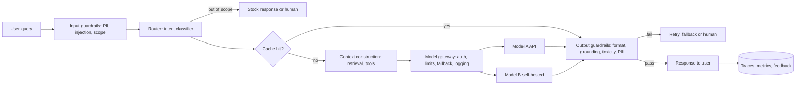
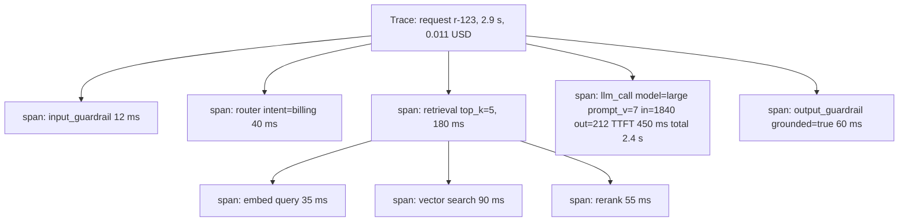

# Guardrails, gateways, caching and tracing

## Growing an LLM application architecture

Huyen's final chapter of *AI Engineering* builds a production architecture incrementally. You start
with the simplest thing — a query goes to a model, a response comes back — and add components only as
needs appear:

1. **Enhance context** (retrieval, tools) so the model has the information it needs.
2. **Put in guardrails** to protect the system and its users.
3. **Add a model router and gateway** to support multiple models and control access and cost.
4. **Reduce latency with caches.**
5. **Add agent patterns** (loops, write actions) where required.

Monitoring and observability run through all of it, and an orchestration layer ties the pieces
together. This lesson covers steps 2–4 and the observability layer; lesson 34 covers making inference
itself cheaper and faster.



## Guardrails

Guardrails are checks placed wherever the system is exposed to risk. Huyen divides them into guardrails
around **inputs** and around **outputs**.

### Input guardrails

They protect against two kinds of risk:

- **Leaking private information to external APIs.** An employee pastes a secret into a prompt; a
  developer puts internal policy into a system prompt; a tool pulls private records into the context.
  There is no airtight fix when you call third-party APIs, but sensitive-data detectors help. When a
  query contains sensitive data you can **block** it or **mask** it: replace a phone number with a
  placeholder such as `[PHONE NUMBER]`, send the masked text, and — if the placeholder appears in the
  response — restore the original value from a reverse dictionary before showing it to the user.
- **Executing bad prompts that compromise the system**: prompt injection and jailbreaks (her chapter 5).
  Defences are layered — instruction hierarchy, delimiting untrusted content, scanning inputs and
  retrieved documents, least-privilege tools, human approval for consequential actions — and the risk can
  be reduced but never eliminated.

```python-run
import re

PATTERNS = {"EMAIL": r"[\w.+-]+@[\w-]+\.[\w.]+", "PHONE": r"\+?\d[\d\s().-]{7,}\d", "CARD": r"\b(?:\d[ -]?){13,16}\b"}

def mask(text):
    reverse, counters = {}, {}
    def repl(kind):
        def _r(m):
            counters[kind] = counters.get(kind, 0) + 1
            ph = f"[{kind}_{counters[kind]}]"
            reverse[ph] = m.group(0)
            return ph
        return _r
    for kind in ("CARD", "EMAIL", "PHONE"):
        text = re.sub(PATTERNS[kind], repl(kind), text)
    return text, reverse

def unmask(text, reverse):
    for ph, original in reverse.items():
        text = text.replace(ph, original)
    return text

query = "Please email the invoice to dana@example.com and call me on +1 415 555 0134."
masked, rev = mask(query)
print("sent to external model :", masked)
model_response = "Sure - I will send the invoice to [EMAIL_1] and call [PHONE_1] tomorrow."
print("shown to user          :", unmask(model_response, rev))
```

Real systems use dedicated detectors (Presidio, cloud DLP services, NER models) rather than three
regexes, but the mask → call → unmask flow is the same.

### Output guardrails

Huyen gives output guardrails two jobs: **catch output failures** and **specify the policy for handling
each failure mode**. Failures fall into two groups:

- **Quality**: malformatted output (invalid JSON where JSON was expected), factually inconsistent or
  hallucinated content, or simply a poor response.
- **Security**: toxic content, private or sensitive information, output that would trigger unintended
  tool or code execution, and brand-risk statements about your company or competitors.

Handling policies:

- **Retry**: models are probabilistic, so trying again often fixes an empty or malformatted response.
  Retries add latency and cost; issuing redundant calls in parallel and picking the better response keeps
  latency down at the price of more calls.
- **Fallback**: a different model, a stock response, or a **human**. She describes teams that hand a
  conversation to human operators when certain phrases appear, when a sentiment model detects anger, or
  after a certain number of turns.
- **Structured output enforcement**: constrained decoding / JSON-schema modes plus validation
  (pydantic) and repair.

Track the **false refusal rate** as well as the failure rate: a system that blocks legitimate requests
is "too secure" and frustrates users.

### Guardrail trade-offs

- **Latency**: every check adds time; Huyen reports teams that skipped guardrails because latency
  mattered more to them. Run cheap checks inline and expensive ones asynchronously or on samples.
- **Streaming**: with token streaming, text reaches the user before the full response can be evaluated,
  so an unsafe response may be shown before a guardrail fires. Options: buffer and check sentence by
  sentence, or stream with the ability to retract.
- **Build vs provided**: API providers ship guardrails out of the box; self-hosting removes the
  external-leak risk but leaves all filtering to you. Off-the-shelf tools she lists include Meta's Purple
  Llama, NVIDIA NeMo Guardrails, Azure AI content filters, the Perspective API and OpenAI's moderation
  API.

```python-run
import json, random
random.seed(4)

def flaky_model(prompt, attempt):
    """Stand-in LLM: sometimes returns malformed JSON or an unsupported claim."""
    r = random.random()
    if r < 0.25: return '{"answer": "Refunds within 30 days", "source": "policy.md"'      # truncated JSON
    if r < 0.40: return '{"answer": "Refunds within 90 days", "source": "policy.md"}'     # not grounded
    return '{"answer": "Refunds within 30 days", "source": "policy.md"}'

CONTEXT = "Refunds are available within 30 days of purchase."

def output_guardrail(raw):
    try:
        obj = json.loads(raw)
    except json.JSONDecodeError:
        return None, "malformed_json"
    if not {"answer", "source"} <= obj.keys():
        return None, "schema"
    nums = [w for w in obj["answer"].split() if w.isdigit()]
    if any(n not in CONTEXT for n in nums):
        return None, "ungrounded"
    return obj, "ok"

def answer(prompt, max_attempts=3):
    reasons = []
    for attempt in range(max_attempts):
        obj, status = output_guardrail(flaky_model(prompt, attempt))
        reasons.append(status)
        if obj:
            return obj["answer"], reasons
    return "I'm not able to answer that reliably - connecting you to a human agent.", reasons

stats = {"ok_first_try": 0, "recovered_by_retry": 0, "fallback": 0}
for _ in range(2000):
    text, reasons = answer("What is the refund policy?")
    key = "fallback" if reasons[-1] != "ok" else ("ok_first_try" if len(reasons) == 1 else "recovered_by_retry")
    stats[key] += 1
print(stats)
```

Retries recover most transient failures; the fallback catches the rest instead of showing the user a
broken or ungrounded answer.

## Routers

Instead of one model for every query, a **router** sends each query to the best handler. Huyen gives two
motivations: specialised solutions can outperform a general one on their niche, and routing simple
queries to cheaper models saves money.

A router is usually an **intent classifier**: reset password → FAQ page; billing error → human;
troubleshooting → a specialised bot. It can also keep the system **in scope** (declining unrelated
questions with a stock response without spending a model call) and detect **ambiguous** queries that
need clarification. Other routers predict the **next action** for an agent. Routers must be fast and
cheap — small models or classifiers — because several may run per request. One wrinkle she notes: models
have different context limits, so a query routed after retrieval may need truncation or re-routing to a
larger-context model.

## Model gateways

A **model gateway** is an intermediate layer through which the whole organisation talks to models —
self-hosted and commercial — in a unified, secure way. From Huyen's description, it provides:

- **A unified interface**: when a provider's API changes, you update the gateway, not every application.
- **Access control and cost management**: applications get gateway credentials rather than the
  organisation's raw provider keys (which leak easily); the gateway enforces who may call which model,
  and monitors and limits usage.
- **Fallback policies** for rate limits and API failures — which she notes are unfortunately common:
  route to an alternative model, retry after a short wait, or degrade gracefully.
- A natural place for **load balancing, logging and analytics**, and sometimes caching and guardrails.

Examples she lists include Portkey's AI Gateway, MLflow AI Gateway, Kong, Cloudflare and TrueFoundry;
LiteLLM is another popular open-source option.

```yaml
# LiteLLM-style gateway config (sketch)
model_list:
  - model_name: chat-default               # the name applications use
    litellm_params: {model: provider-a/large-model-2025-01, api_key: os.environ/PROVIDER_A_KEY}
  - model_name: chat-default               # second deployment under the same name -> load balancing
    litellm_params: {model: provider-b/large-model, api_key: os.environ/PROVIDER_B_KEY}
  - model_name: chat-cheap
    litellm_params: {model: openai/mistral-7b, api_base: http://vllm.internal:8000/v1}   # self-hosted vLLM
router_settings:
  fallbacks: [{chat-default: [chat-cheap]}]
  num_retries: 2
  timeout: 30
general_settings:
  master_key: os.environ/GATEWAY_MASTER_KEY    # apps receive virtual keys with budgets and rate limits
```

```python-run
import random
random.seed(1)

class Provider:
    def __init__(self, name, fail_rate, cost_per_call):
        self.name, self.fail_rate, self.cost = name, fail_rate, cost_per_call
    def call(self, prompt):
        if random.random() < self.fail_rate:
            raise TimeoutError(f"{self.name} unavailable or rate limited")
        return f"[{self.name}] answer"

class Gateway:
    def __init__(self, chain, budgets):
        self.chain, self.budgets, self.spend, self.log = chain, budgets, {}, []
    def complete(self, team, prompt):
        if self.spend.get(team, 0) >= self.budgets[team]:
            self.log.append((team, "BLOCKED_BUDGET")); return None
        for p in self.chain:                       # primary first, then fallbacks
            try:
                out = p.call(prompt)
                self.spend[team] = self.spend.get(team, 0) + p.cost
                self.log.append((team, p.name)); return out
            except TimeoutError:
                continue
        self.log.append((team, "ALL_FAILED")); return None

gw = Gateway([Provider("primary", 0.15, 0.010), Provider("secondary", 0.05, 0.012), Provider("selfhosted", 0.01, 0.004)],
             budgets={"search": 6.0, "support": 2.0})
for i in range(1000):
    gw.complete("search" if i % 2 else "support", "hello")
from collections import Counter
print("who served / what happened:", dict(Counter(k for _, k in gw.log)))
print("spend by team:", {t: round(v, 2) for t, v in gw.spend.items()})
```

Fallbacks turn a 15% primary failure rate into almost no user-visible failures, and per-team budgets cap
runaway spend — two of the gateway's main jobs.

## Caching for LLM applications

Huyen separates **inference caching** (KV cache, prompt cache — lesson 34) from **system caching**:

- **Exact caching**: reuse a stored result only when the *same* item is requested — a product summary
  generated once, or a vector-search result for an identical query. Especially valuable for multi-step or
  slow operations (chains of reasoning, retrieval, SQL, web search). Implement in memory or in stores
  like Redis/Postgres with an **eviction policy** (LRU, LFU, FIFO) and a retention period based on how
  likely the query is to recur. User-specific and time-sensitive queries are poor candidates; some teams
  train a classifier to decide what to cache.
- **Semantic caching**: reuse a result for a *similar* query — embed the query, vector-search the cache,
  and return the cached answer if similarity exceeds a threshold. It raises the hit rate, but Huyen
  calls its value more dubious: it depends on good embeddings, working vector search and a trustworthy
  similarity threshold; a wrong hit returns an incorrect answer; and the embedding plus vector search add
  latency and cost of their own. It only pays off when the hit rate is high.

> [!WARNING]
> Cache keys must capture everything that affects the answer. Huyen's example: a user asks about the
> return policy; the answer depends on that user's membership tier, so the system retrieves their data
> and generates a personalised response — then caches it as if it were generic. The next user who asks
> the same question receives the first user's information. Never cache personalised responses under a
> shared key; include user/tenant scope, prompt version and model version in the key.

## Tracing and observability for LLM apps

A single request may involve a router call, a retrieval, a rerank, two tool calls and three model calls.
When the answer is wrong you need to see every step. Huyen's guidance: a **trace** should let you follow
a query's transformation through the system step by step — the actions taken, the documents retrieved,
the final prompt sent to the model, the time and cost of each step — so a failure can be pinned to the
exact component.



What to record per LLM span: model and version, prompt ID/version/hash, sampling parameters, input and
output token counts, cost, time to first token and total latency, finish reason, cache hit/miss, and
(subject to privacy policy) the rendered prompt and the output. Tools: **OpenTelemetry** with GenAI
semantic conventions, MLflow Tracing, Langfuse, LangSmith, Arize Phoenix, Helicone.

Metrics to aggregate from traces:

| Category | Examples |
|---|---|
| Latency | TTFT, time per output token, total latency (p50/p95/p99), per-step latency |
| Cost | input/output tokens per request, cost per request/user/feature, cache savings |
| Quality | guardrail trigger rates by type, false refusal rate, groundedness scores (sampled judge), format-failure rate, retry rate |
| Feedback | thumbs up/down, regeneration rate, edit rate, conversation length, early termination, hand-off to human |
| Reliability | provider error and rate-limit rates, fallback rate, timeout rate |
| Drift | prompt hash in production, model version, input length and topic mix, output length, refusal rate |

Huyen also advises designing metrics around the failure modes you care about — if you fear
hallucination, track whether outputs can be inferred from the context; if you fear runaway spend, track
tokens and cache hit rate — and warns that metrics are only useful if they tell you when something is
wrong or where to improve.

## Orchestration

Frameworks (LangChain/LangGraph, LlamaIndex, Haystack, DSPy and others) wire components into pipelines.
Huyen's advice is to start **without** one — build directly against the model API first, so you
understand each step — and adopt an orchestrator when the complexity warrants it, judging it by
integration and extensibility, support for complex pipelines (branching, parallelism, error handling),
ease of use, performance overhead and scalability.

> [!INTERVIEW]
> "Design the serving architecture for an LLM support assistant." — Walk the request path: input
> guardrails (PII masking, injection screening) → router (scope/intent; cheap vs strong model; human
> hand-off) → cache lookup (scoped keys) → retrieval → model gateway (unified API, keys, rate limits,
> budgets, fallbacks) → output guardrails (schema, groundedness, toxicity; retry/fallback policy) →
> streaming response. Around it: full tracing with prompt/model versions, token/cost/latency metrics,
> feedback capture, and an eval suite gating changes. Call out trade-offs: guardrail latency, streaming
> vs output checks, semantic-cache risks.

## Summary

- Build the architecture incrementally: context, guardrails, router and gateway, caches, agent patterns.
- Input guardrails prevent leaks and attacks (mask/unmask PII); output guardrails catch quality and
  security failures and define retry/fallback policies; watch latency, streaming and false refusals.
- Routers pick the right handler per query; gateways centralise access, cost control, fallbacks and
  logging.
- Exact caches are safe and effective; semantic caches are riskier; scope cache keys to avoid leaks.
- Trace every step with versions, tokens, cost and latency; design metrics around failure modes.

```quiz
[
  {"q": "What is the mask/unmask pattern for PII in input guardrails?",
   "options": ["Encrypt the whole prompt", "Replace sensitive values with placeholders before calling the model, then restore them in the response using a reverse map", "Delete the user's account", "Send PII only to the largest model"],
   "answer": 1, "explain": "The external API never sees the raw value; a reverse dictionary restores it afterwards."},
  {"q": "Which is an output-guardrail QUALITY failure rather than a security failure?",
   "options": ["Toxic content", "Invalid JSON where JSON was expected", "Leaking private data", "Brand-risk statements"],
   "answer": 1, "explain": "Malformatted and hallucinated responses are quality failures."},
  {"q": "Why can output guardrails be less effective with token streaming?",
   "options": ["Streaming uses more tokens", "Partial text reaches the user before the full response can be evaluated", "Streaming disables logging", "Guardrails need GPUs"],
   "answer": 1, "explain": "Unsafe content may be shown before a check on the complete response fires."},
  {"q": "Which is NOT a typical function of a model gateway?",
   "options": ["Unified interface to many models", "Access control and usage limits", "Fallback when a provider fails", "Training the foundation model"],
   "answer": 3, "explain": "Gateways mediate access; they do not train models."},
  {"q": "Why give applications gateway keys rather than raw provider keys?",
   "options": ["Gateway keys are longer", "Centralised, revocable access with per-app permissions, budgets and logging; provider keys are easily leaked", "Providers forbid direct keys", "It lowers token prices"],
   "answer": 1, "explain": "The gateway is a controlled choke point for access and cost."},
  {"q": "What is the main risk of semantic caching?",
   "options": ["It never hits", "A similar-but-different query may receive a wrong cached answer, and the similarity lookup adds its own cost", "It requires no embeddings", "It deletes prompts"],
   "answer": 1, "explain": "Its value depends on reliable similarity and a high hit rate."},
  {"q": "In Huyen's cache-leak example, what went wrong?",
   "options": ["The cache was too small", "A personalised answer was cached under a generic key and served to another user", "The TTL was too short", "The model was quantized"],
   "answer": 1, "explain": "Keys must include everything that affects the answer, including user scope."},
  {"q": "Why track the false refusal rate?",
   "options": ["To bill users", "A system that blocks legitimate requests harms usability even if it is 'secure'", "To measure GPU load", "It replaces accuracy"],
   "answer": 1, "explain": "Over-blocking is a failure mode too."}
]
```

> **Source:** Chip Huyen, *AI Engineering*, ch. 10 (AI Engineering Architecture: Step 2 guardrails — input/output, PII masking, retry and human fallback, trade-offs; Step 3 router and gateway; Step 4 exact and semantic caching and the cache data-leak warning; monitoring and observability, logs and traces; AI pipeline orchestration) and ch. 5 (prompt attacks and defences); LiteLLM, MLflow AI Gateway, OpenTelemetry GenAI semantic conventions and Langfuse documentation.
