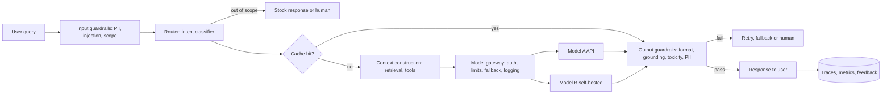
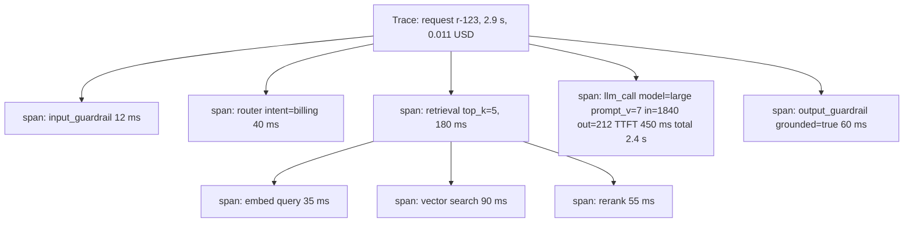

# Guardrails, gateways, caching and tracing

> **Before this lesson:** read [Prompt management and evaluation pipelines](#/lesson/mlops/llmops-prompts-evals)
> (prompts, RAG, hallucination, AI judges), [Metrics, logs, traces and Prometheus](#/lesson/mlops/observability)
> (traces and spans) and [Model servers, batching, autoscaling and caching](#/lesson/mlops/model-servers)
> (caches and eviction). Retries and fallbacks were introduced in
> [REST and gRPC serving with FastAPI](#/lesson/mlops/fastapi-grpc).

## In plain words

Sending a user's question straight to a language model and showing whatever comes back works in a
demo. In a real product you soon need more around it: checks that stop private data leaking out or
harmful text coming back (**guardrails**), a component that sends each question to the right model
(**router**), a single controlled doorway through which every team reaches every model (**gateway**),
a memory of past answers (**cache**), and a record of everything each request did (**tracing**).

An everyday picture is the mail room of a large company. Outgoing letters are checked so that
confidential papers do not leave the building (input guardrails). Incoming letters are opened and
screened before they reach desks (output guardrails). A clerk sorts each item to the right
department (router). All couriers are booked through one desk that holds the accounts, enforces
budgets and switches courier when one is late (gateway). Frequently requested forms are kept
photocopied in a tray (cache). And a logbook records the journey of every parcel (tracing).

Why this matters for a job: these components are what turn an LLM prototype into a service that is
safe, affordable and debuggable. "Design the serving architecture for an LLM assistant" is a common
system-design question, and interviewers expect you to walk the request path through exactly these
pieces and name their trade-offs.

## Growing an LLM application architecture

The final chapter of Huyen's *AI Engineering* builds a production architecture one layer at a time.
It starts with the plainest possible system, a query goes to a model and a response comes back, and
adds a component only when a need appears:

1. **Enhance context** (retrieval, tools) so the model has the information it needs.
2. **Add guardrails** to protect the system and its users.
3. **Add a model router and a gateway** to support several models and to control access and cost.
4. **Reduce latency with caches.**
5. **Add agent patterns** (loops, actions that change things) where required. An **agent** is an
   application in which the model decides on and takes a sequence of steps, such as calling tools.

Monitoring and observability run through every layer, and an orchestration layer ties the pieces
together. This lesson covers steps 2 to 4 and observability; lesson 34 covers making inference itself
cheaper and faster.



Follow one query from left to right: it is screened, classified by intent, checked against the
cache, enriched with retrieved context, sent through the gateway to one of two models, screened
again on the way out, and either returned or retried or handed to a person. Everything is traced.
A **stock response** is a fixed, pre-written reply.

## Guardrails

**Guardrails** are checks placed wherever the system is exposed to risk. Huyen splits them into
guardrails around **inputs** (what goes into the model) and around **outputs** (what comes out).

### Input guardrails

They protect against two kinds of risk.

**1. Private information leaking to outside APIs.** An employee pastes a secret into a prompt; a
developer puts internal policy into a system prompt; a tool pulls private records into the context.
When you send prompts to a third-party API, there is no perfect fix, but detectors for sensitive data
help. When a query contains **PII** (personally identifiable information: names, emails, phone
numbers, card numbers) you can **block** the query or **mask** it: replace each sensitive value with
a placeholder such as `[PHONE_1]`, send the masked text, and, if a placeholder appears in the
response, put the original value back from a lookup table before the user sees it.

**2. Malicious prompts that compromise the system.** **Prompt injection** hides instructions inside
input ("ignore your previous instructions and..."), sometimes inside a retrieved web page or document
rather than the user's own message; a **jailbreak** tries to talk the model out of its safety rules
(Huyen's chapter 5 covers both). Defences are layered: an **instruction hierarchy** (system
instructions outrank user text), clearly **delimiting** untrusted content so the model can tell it
apart from instructions, scanning inputs and retrieved documents, giving tools the least privilege
they need, and requiring human approval for consequential actions. The risk can be reduced but never
eliminated.

The demo shows the mask, call, unmask flow with three simple patterns.

```python-run
import re

PATTERNS = {"EMAIL": r"[\w.+-]+@[\w-]+\.[\w.]+", "PHONE": r"\+?\d[\d\s().-]{7,}\d", "CARD": r"\b(?:\d[ -]?){13,16}\b"}

def mask(text):
    reverse, counters = {}, {}
    def repl(kind):
        def _r(m):
            counters[kind] = counters.get(kind, 0) + 1
            ph = f"[{kind}_{counters[kind]}]"
            reverse[ph] = m.group(0)
            return ph
        return _r
    for kind in ("CARD", "EMAIL", "PHONE"):
        text = re.sub(PATTERNS[kind], repl(kind), text)
    return text, reverse

def unmask(text, reverse):
    for ph, original in reverse.items():
        text = text.replace(ph, original)
    return text

query = "Please email the invoice to dana@example.com and call me on +1 415 555 0134."
masked, rev = mask(query)
print("sent to external model :", masked)
model_response = "Sure - I will send the invoice to [EMAIL_1] and call [PHONE_1] tomorrow."
print("shown to user          :", unmask(model_response, rev))
```

Line by line:

- `PATTERNS` holds three **regular expressions** (text patterns): one for email addresses, one for
  phone numbers (an optional `+`, then digits with spaces, brackets, dots or dashes), one for card
  numbers (13 to 16 digits).
- `mask` replaces every match with a numbered placeholder. `re.sub` accepts a function instead of a
  replacement string; `repl(kind)` builds one that counts matches of that kind, creates the
  placeholder, and remembers the original in `reverse`. Cards are masked first so their digits are not
  mistaken for a phone number.
- `unmask` puts the originals back wherever a placeholder appears.
- A pretend model response uses the placeholders, as a real model would when it has only seen them.

The output:

```text
sent to external model : Please email the invoice to [EMAIL_1] and call me on [PHONE_1].
shown to user          : Sure - I will send the invoice to dana@example.com and call +1 415 555 0134 tomorrow.
```

The external model never saw the email address or the phone number, yet the user's answer is
complete. Real systems use dedicated detectors (Microsoft Presidio, cloud **DLP**, data loss
prevention, services, or **NER**, named-entity recognition, models that find names and places in
text) instead of three regexes, but the flow is the same.

### Output guardrails

Huyen gives output guardrails two jobs: **detect failed outputs**, and **define what to do about each
kind of failure**. Failures come in two groups:

- **Quality**: malformed output (invalid JSON where JSON was required), content that contradicts the
  facts or is invented, or an answer that is plainly poor.
- **Security**: toxic content, private or sensitive information, output that would trigger
  unintended tool calls or code execution, and statements about your company or competitors that
  create **brand risk**.

What to do on failure:

- **Retry**: models sample at random, so a second attempt often fixes an empty or malformed answer.
  Retries add latency and cost. Sending two or three identical calls *in parallel* and keeping the
  best keeps latency down at the price of more calls.
- **Fall back**: to a different model, a stock response, or a **person**. Huyen describes teams that
  hand a conversation to human staff when certain phrases appear, when a sentiment model detects an
  angry user, or after a set number of turns.
- **Enforce structure**: **constrained decoding** or a provider's **JSON-schema mode** (the model is
  only allowed to produce text matching a schema), plus validation with pydantic (lesson 20) and
  automatic repair.

Track the **false refusal rate** as well as the failure rate: a system that blocks legitimate
requests is "too secure" and drives users away.

### Guardrail trade-offs

- **Latency**: every check adds time, and Huyen reports teams that dropped guardrails because latency
  mattered more to them. Run cheap checks inline and expensive ones asynchronously or on a sample.
- **Streaming**: when tokens stream to the user as they are generated, text reaches the screen before
  the full response can be checked, so an unsafe answer may be partly shown before a guardrail fires.
  Options: buffer and check sentence by sentence, or stream with the ability to retract.
- **Built-in or your own**: API providers include guardrails; self-hosting removes the risk of
  leaking data to a third party but leaves all filtering to you. Ready-made tools Huyen lists include
  Meta's Purple Llama, NVIDIA NeMo Guardrails, Azure AI content filters, the Perspective API and
  OpenAI's moderation API.

The demo combines an output guardrail with retries and a human fallback.

```python-run
import json, random
random.seed(4)

def flaky_model(prompt, attempt):
    """Stand-in LLM: sometimes returns malformed JSON or an unsupported claim."""
    r = random.random()
    if r < 0.25: return '{"answer": "Refunds within 30 days", "source": "policy.md"'      # truncated JSON
    if r < 0.40: return '{"answer": "Refunds within 90 days", "source": "policy.md"}'     # not grounded
    return '{"answer": "Refunds within 30 days", "source": "policy.md"}'

CONTEXT = "Refunds are available within 30 days of purchase."

def output_guardrail(raw):
    try:
        obj = json.loads(raw)
    except json.JSONDecodeError:
        return None, "malformed_json"
    if not {"answer", "source"} <= obj.keys():
        return None, "schema"
    nums = [w for w in obj["answer"].split() if w.isdigit()]
    if any(n not in CONTEXT for n in nums):
        return None, "ungrounded"
    return obj, "ok"

def answer(prompt, max_attempts=3):
    reasons = []
    for attempt in range(max_attempts):
        obj, status = output_guardrail(flaky_model(prompt, attempt))
        reasons.append(status)
        if obj:
            return obj["answer"], reasons
    return "I'm not able to answer that reliably - connecting you to a human agent.", reasons

stats = {"ok_first_try": 0, "recovered_by_retry": 0, "fallback": 0}
for _ in range(2000):
    text, reasons = answer("What is the refund policy?")
    key = "fallback" if reasons[-1] != "ok" else ("ok_first_try" if len(reasons) == 1 else "recovered_by_retry")
    stats[key] += 1
print(stats)
```

`flaky_model` stands in for an LLM: 25% of the time it returns JSON cut off before the closing brace,
15% of the time a well-formed answer that contradicts the context (90 days instead of 30), and
otherwise a good answer. `output_guardrail` checks, in order, that the text parses as JSON, that the
required keys are present (`<=` on sets means "is a subset of"), and that every number in the answer
appears in the context. `answer` tries up to three times and then falls back to a human. The script
runs 2,000 questions and counts the outcomes:

```text
{'ok_first_try': 1198, 'recovered_by_retry': 676, 'fallback': 126}
```

About 60% of answers pass first time, retries rescue another 34%, and the remaining 6% go to a person
instead of showing the user a broken or invented answer. Without the guardrail, 40% of users would
have seen a bad response.

## Routers

Instead of using one model for every query, a **router** sends each query to the best handler. Huyen
gives two reasons: specialised solutions can beat a general one in their niche, and sending simple
queries to cheaper models saves money.

A router is usually an **intent classifier**, a small model that labels what the user wants: a
password reset goes to the FAQ page, a billing error to a person, a troubleshooting question to a
specialised bot. It can also keep the system **in scope**, answering unrelated questions with a
stock reply without paying for a model call, and spot **ambiguous** queries that need a clarifying
question. Other routers predict an agent's **next action**. Routers must be fast and cheap (small
models or classifiers), because several may run on one request. One complication Huyen points out:
models have different **context windows** (the maximum number of tokens they accept), so a query that
grows after retrieval may need trimming, or re-routing to a model with a larger window.

## Model gateways

A **model gateway** is an intermediate layer through which a whole organisation reaches its models,
both self-hosted and commercial, in one consistent and secure way. Following Huyen's description, it
provides:

- **One interface**: when a provider changes its API, you update the gateway, not every application.
- **Access control and cost management**: applications receive gateway credentials instead of the
  organisation's real provider keys (which leak easily). The gateway decides who may call which model,
  monitors usage and enforces limits.
- **Fallback policies** for rate limits and API failures, which she notes are depressingly common:
  route to another model, retry after a short wait, or degrade gracefully.
- A natural home for **load balancing, logging and analytics**, and sometimes caching and guardrails.

Examples she lists include Portkey's AI Gateway, MLflow AI Gateway, Kong, Cloudflare and TrueFoundry;
LiteLLM is another popular open-source option.

```yaml
# LiteLLM-style gateway config (sketch)
model_list:
  - model_name: chat-default               # the name applications use
    litellm_params: {model: provider-a/large-model-2025-01, api_key: os.environ/PROVIDER_A_KEY}
  - model_name: chat-default               # second deployment under the same name -> load balancing
    litellm_params: {model: provider-b/large-model, api_key: os.environ/PROVIDER_B_KEY}
  - model_name: chat-cheap
    litellm_params: {model: openai/mistral-7b, api_base: http://vllm.internal:8000/v1}   # self-hosted vLLM
router_settings:
  fallbacks: [{chat-default: [chat-cheap]}]
  num_retries: 2
  timeout: 30
general_settings:
  master_key: os.environ/GATEWAY_MASTER_KEY    # apps receive virtual keys with budgets and rate limits
```

Applications ask for a logical name such as `chat-default`, never a provider. Two deployments share
that name, so the gateway balances load between two providers; `chat-cheap` points at a self-hosted
vLLM server (lesson 34) speaking the OpenAI-compatible protocol. If `chat-default` fails after two
retries or 30 seconds, the gateway falls back to `chat-cheap`. Provider keys are read from
environment variables and never handed to applications; each application gets a **virtual key** with
its own budget and **rate limit** (maximum requests per minute).

The demo simulates a gateway with a fallback chain and per-team budgets.

```python-run
import random
random.seed(1)

class Provider:
    def __init__(self, name, fail_rate, cost_per_call):
        self.name, self.fail_rate, self.cost = name, fail_rate, cost_per_call
    def call(self, prompt):
        if random.random() < self.fail_rate:
            raise TimeoutError(f"{self.name} unavailable or rate limited")
        return f"[{self.name}] answer"

class Gateway:
    def __init__(self, chain, budgets):
        self.chain, self.budgets, self.spend, self.log = chain, budgets, {}, []
    def complete(self, team, prompt):
        if self.spend.get(team, 0) >= self.budgets[team]:
            self.log.append((team, "BLOCKED_BUDGET")); return None
        for p in self.chain:                       # primary first, then fallbacks
            try:
                out = p.call(prompt)
                self.spend[team] = self.spend.get(team, 0) + p.cost
                self.log.append((team, p.name)); return out
            except TimeoutError:
                continue
        self.log.append((team, "ALL_FAILED")); return None

gw = Gateway([Provider("primary", 0.15, 0.010), Provider("secondary", 0.05, 0.012), Provider("selfhosted", 0.01, 0.004)],
             budgets={"search": 6.0, "support": 2.0})
for i in range(1000):
    gw.complete("search" if i % 2 else "support", "hello")
from collections import Counter
print("who served / what happened:", dict(Counter(k for _, k in gw.log)))
print("spend by team:", {t: round(v, 2) for t, v in gw.spend.items()})
```

Each `Provider` fails at random at its own rate and charges a price per call. The `Gateway` first
checks the calling team's budget, then tries the providers in order until one succeeds, charges the
team, and logs who served the request. One thousand requests alternate between the `search` team
(budget \$6) and the `support` team (budget \$2). The output:

```text
who served / what happened: {'secondary': 90, 'primary': 598, 'selfhosted': 8, 'BLOCKED_BUDGET': 304}
spend by team: {'support': 2.0, 'search': 5.09}
```

The primary provider failed about 15% of the time, yet no request ended in `ALL_FAILED`: the fallback
chain absorbed every failure. Meanwhile the support team hit its \$2 budget partway through and its
later requests were blocked instead of running up the bill. Those are two of the gateway's main jobs.
The problem `mlops-token-bucket` asks you to build the rate limiter a gateway uses.

## Caching for LLM applications

Huyen distinguishes **inference caching** (the KV cache and prompt caching inside the model server,
lesson 34) from **system caching** in the application:

- **Exact caching** reuses a stored result only when *exactly* the same item is requested again: a
  product summary generated once, or the vector-search result for an identical query. It pays off
  most for slow or multi-step operations (chains of reasoning, retrieval, SQL queries, web searches).
  Keep it in memory or in a store such as Redis or Postgres, with an **eviction policy** (LRU, LFU,
  FIFO, lesson 21) and a retention period based on how likely the query is to come back. Queries that
  are specific to one user or depend on the current time are poor candidates; some teams train a
  small classifier to decide what is worth caching.
- **Semantic caching** reuses a result for a *similar* query: turn the query into an embedding, search
  the cache for the nearest stored query (a **vector search**), and return its answer if the
  similarity is above a threshold. It raises the hit rate, but Huyen is sceptical of its value: it
  depends on good embeddings, a working vector search and a threshold you can trust; a wrong hit
  returns a wrong answer to a different question; and the embedding and search add their own latency
  and cost. It pays off only when the hit rate is high.

> [!WARNING]
> Cache keys must capture everything that affects the answer. Huyen's example: a user asks about the
> return policy; the answer depends on that user's membership tier, so the system retrieves their data
> and generates a personalised response — then caches it as if it were generic. The next user who asks
> the same question receives the first user's information. Never cache personalised responses under a
> shared key; include user/tenant scope, prompt version and model version in the key.

A **tenant** is one customer organisation in a system shared by many.

## Tracing and observability for LLM apps

A single request may involve a router call, a retrieval, a **rerank** (a second, more careful model
that reorders retrieved documents), two tool calls and three model calls. When the answer is wrong,
you need to see every step. Huyen's guidance is that a trace should let you follow how a query is
transformed through the system, step by step: the actions taken, the documents retrieved, the final
prompt sent to the model, and the time and cost of each step, so that a failure can be pinned on the
exact component.



Reading the tree: the request took 2.9 seconds and cost 1.1 cents; the model call dominates at 2.4
seconds, of which 450 ms passed before the first token appeared (**TTFT**, time to first token); the
retrieval span has three child spans.

What to record on each LLM span: the model and version; the prompt ID, version and hash; the sampling
parameters; input and output token counts; cost; time to first token and total latency; the **finish
reason** (did the model stop naturally, or hit the token limit?); cache hit or miss; and, subject to
privacy policy, the rendered prompt and the output. Tools: **OpenTelemetry** with its GenAI
**semantic conventions** (agreed attribute names for LLM spans), MLflow Tracing, Langfuse, LangSmith,
Arize Phoenix, Helicone.

Metrics to aggregate from traces:

| Category | Examples |
|---|---|
| Latency | TTFT, time per output token, total latency (p50/p95/p99), per-step latency |
| Cost | input/output tokens per request, cost per request/user/feature, cache savings |
| Quality | guardrail trigger rates by type, false refusal rate, groundedness scores (sampled judge), format-failure rate, retry rate |
| Feedback | thumbs up/down, regeneration rate, edit rate, conversation length, early termination, hand-off to human |
| Reliability | provider error and rate-limit rates, fallback rate, timeout rate |
| Drift | prompt hash in production, model version, input length and topic mix, output length, refusal rate |

Huyen also advises building metrics around the failures you actually fear (if hallucination, track
whether outputs can be derived from the context; if runaway spend, track tokens and cache hit rate)
and warns that a metric is only worth having if it tells you that something is wrong or where to
improve.

## Orchestration

Frameworks such as LangChain and LangGraph, LlamaIndex, Haystack and DSPy wire these components into
pipelines. Huyen's advice is to start **without** one: build against the model API directly first,
so that you understand every step, and adopt a framework when the complexity justifies it. Judge it by
how well it integrates and extends, whether it supports complex pipelines (branching, parallel steps,
error handling), how easy it is to use, how much overhead it adds, and how well it scales.

> [!INTERVIEW]
> "Design the serving architecture for an LLM support assistant." — Walk the request path: input
> guardrails (PII masking, injection screening) → router (scope/intent; cheap vs strong model; human
> hand-off) → cache lookup (scoped keys) → retrieval → model gateway (unified API, keys, rate limits,
> budgets, fallbacks) → output guardrails (schema, groundedness, toxicity; retry/fallback policy) →
> streaming response. Around it: full tracing with prompt/model versions, token/cost/latency metrics,
> feedback capture, and an eval suite gating changes. Call out trade-offs: guardrail latency, streaming
> vs output checks, semantic-cache risks.

## Summary

- Build the architecture one layer at a time: context, guardrails, router and gateway, caches, agent
  patterns.
- Input guardrails prevent leaks and attacks (mask and unmask PII); output guardrails catch quality and
  security failures and define retry and fallback policies. Watch latency, streaming and false
  refusals.
- Routers pick the right handler for each query; gateways centralise access, cost control, fallbacks
  and logging.
- Exact caches are safe and effective; semantic caches are riskier; scope cache keys to avoid leaks.
- Trace every step with versions, tokens, cost and latency, and design metrics around failure modes.

## Glossary

- **Guardrail** - a check that blocks or repairs risky inputs or outputs.
- **PII / masking** - personally identifiable information / replacing it with placeholders.
- **Prompt injection / jailbreak** - hidden instructions that override yours / attempts to bypass
  safety rules.
- **Instruction hierarchy / delimiting** - ranking system instructions above user text / marking
  untrusted content clearly.
- **DLP / NER** - data loss prevention services / named-entity recognition models.
- **Quality vs security failure** - a bad or malformed answer / a harmful or leaking one.
- **Brand risk** - output that could damage the company's reputation.
- **Constrained decoding / JSON-schema mode** - restricting generation to text that fits a schema.
- **False refusal rate** - the share of legitimate requests wrongly blocked.
- **Agent** - an application where the model chooses and takes a sequence of steps.
- **Router / intent classifier** - picks a handler per query / labels what the user wants.
- **Context window** - the maximum number of tokens a model accepts.
- **Model gateway** - one controlled layer through which applications reach all models.
- **Virtual key / rate limit / budget** - a gateway-issued credential / a cap on requests per period /
  a cap on spend.
- **Exact / semantic cache** - reuse for identical requests / reuse for similar ones.
- **Vector search** - finding the stored embeddings nearest to a query embedding.
- **Tenant** - one customer organisation in a shared system.
- **Rerank** - reordering retrieved documents with a more careful model.
- **TTFT / finish reason** - time to first token / why generation stopped.
- **Semantic conventions** - agreed attribute names for telemetry.
- **Orchestration framework** - a library that wires LLM components into pipelines.

```quiz
[
  {"q": "What is the mask/unmask pattern for PII in input guardrails?",
   "options": ["Encrypt the whole prompt", "Replace sensitive values with placeholders before calling the model, then restore them in the response using a reverse map", "Delete the user's account", "Send PII only to the largest model"],
   "answer": 1, "explain": "The external API never sees the raw value; a reverse dictionary restores it afterwards."},
  {"q": "Which is an output-guardrail QUALITY failure rather than a security failure?",
   "options": ["Toxic content", "Invalid JSON where JSON was expected", "Leaking private data", "Brand-risk statements"],
   "answer": 1, "explain": "Malformatted and hallucinated responses are quality failures."},
  {"q": "Why can output guardrails be less effective with token streaming?",
   "options": ["Streaming uses more tokens", "Partial text reaches the user before the full response can be evaluated", "Streaming disables logging", "Guardrails need GPUs"],
   "answer": 1, "explain": "Unsafe content may be shown before a check on the complete response fires."},
  {"q": "Which is NOT a typical function of a model gateway?",
   "options": ["Unified interface to many models", "Access control and usage limits", "Fallback when a provider fails", "Training the foundation model"],
   "answer": 3, "explain": "Gateways mediate access; they do not train models."},
  {"q": "Why give applications gateway keys rather than raw provider keys?",
   "options": ["Gateway keys are longer", "Centralised, revocable access with per-app permissions, budgets and logging; provider keys are easily leaked", "Providers forbid direct keys", "It lowers token prices"],
   "answer": 1, "explain": "The gateway is a controlled choke point for access and cost."},
  {"q": "What is the main risk of semantic caching?",
   "options": ["It never hits", "A similar-but-different query may receive a wrong cached answer, and the similarity lookup adds its own cost", "It requires no embeddings", "It deletes prompts"],
   "answer": 1, "explain": "Its value depends on reliable similarity and a high hit rate."},
  {"q": "In Huyen's cache-leak example, what went wrong?",
   "options": ["The cache was too small", "A personalised answer was cached under a generic key and served to another user", "The TTL was too short", "The model was quantized"],
   "answer": 1, "explain": "Keys must include everything that affects the answer, including user scope."},
  {"q": "Why track the false refusal rate?",
   "options": ["To bill users", "A system that blocks legitimate requests harms usability even if it is 'secure'", "To measure GPU load", "It replaces accuracy"],
   "answer": 1, "explain": "Over-blocking is a failure mode too."}
]
```

> **Source:** Chip Huyen, *AI Engineering*, ch. 10 (AI Engineering Architecture: Step 2 guardrails — input/output, PII masking, retry and human fallback, trade-offs; Step 3 router and gateway; Step 4 exact and semantic caching and the cache data-leak warning; monitoring and observability, logs and traces; AI pipeline orchestration) and ch. 5 (prompt attacks and defences); LiteLLM, MLflow AI Gateway, OpenTelemetry GenAI semantic conventions and Langfuse documentation.
