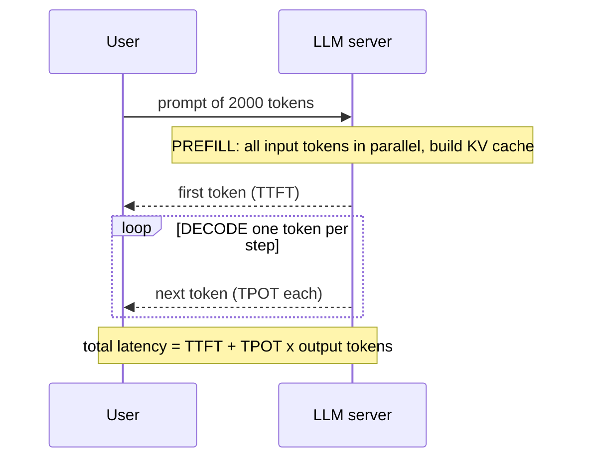
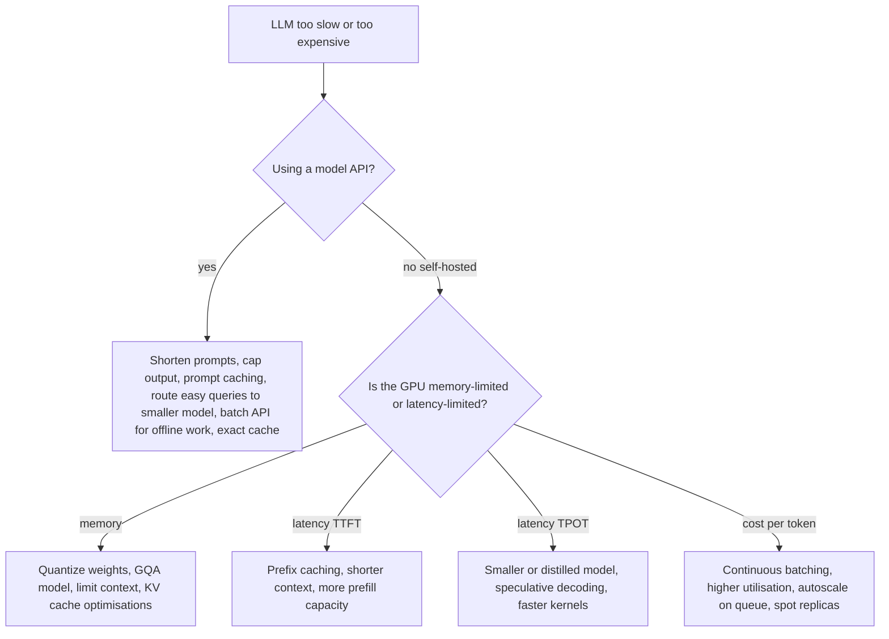

# LLM inference optimization

> **Before this lesson:** read [Guardrails, gateways, caching and tracing](#/lesson/mlops/llmops-gateways)
> (TTFT, gateways, the difference between system caches and inference caches),
> [Model servers, batching, autoscaling and caching](#/lesson/mlops/model-servers) (continuous
> batching, quantization in brief, goodput) and
> [Cost optimisation for ML workloads](#/lesson/mlops/cost-optimization) (cost per token and
> utilisation). Matrix multiplication appears in one demo; it is explained there.

## In plain words

**Inference** is running a trained model to get an answer. For a large language model (LLM),
inference is slow and expensive for a structural reason: the model writes its answer **one token at
a time**, and each new token needs a full pass through billions of numbers on a GPU that costs
dollars per hour. **Inference optimisation** is the toolbox for making that faster and cheaper.

An everyday picture is a storyteller who must reread the whole story so far before adding each new
word. Reading the opening paragraph once is quick if done all at once (that is the **prefill**);
adding words one by one is the slow part (that is the **decode**). Keeping notes on what was already
read, so it does not have to be reread, is the **KV cache**. Letting an apprentice guess the next few
words and having the storyteller only check them is **speculative decoding**. Writing the notes in
shorthand, so more fits on the desk, is **quantization**.

Why this matters for a job: if your company hosts its own models, GPU cost and latency decide whether
an LLM feature is viable at all. Interviewers ask candidates to separate time to first token from time
per token, to compute KV-cache memory, and to explain why speculative decoding works. Even when you
use a provider's API, the same ideas explain its pricing and its latency.

## Why LLM inference is its own subject

A gradient-boosted tree answers in a millisecond on a CPU. A large language model answers in seconds
on an expensive GPU, and the answer arrives token by token. Chapter 9 of Huyen's *AI Engineering* is
devoted to making this cheaper and faster, and sorts the techniques into two levels:

- **Model-level optimisation**: change the model itself: compress it, or change how it generates.
- **Inference-service-level optimisation**: keep the model as it is and manage resources and workload
  better (batching, caching, parallelism). These should not change output quality.

If you call a model through an API, the provider does most of this for you. If you host a model
yourself, it is your job.

## How an LLM generates: prefill and decode

LLMs are **autoregressive**: each output token is predicted from all the tokens before it, then
appended, and the process repeats. Generation has two phases:

1. **Prefill**: process every input token at once, in parallel, building the internal state needed to
   start generating. Its duration grows with input length. It is **compute-bound**: limited by how
   much arithmetic the GPU can do.
2. **Decode**: generate the output tokens one at a time, each depending on everything before it. It is
   **memory-bandwidth-bound**: each step must read the model's weights from GPU memory, and the speed of
   that reading, not arithmetic, sets the pace. And it is sequential, which is the fundamental
   bottleneck.



The user sends a 2,000-token prompt; the server prefills it in one parallel pass and sends the first
token; then the decode loop sends one token per step until the answer is complete.

## Metrics

Following Huyen's chapter:

- **TTFT, time to first token**: how long until the first token appears. It corresponds to prefill
  and depends on input length. A chat product should feel instant; users tolerate more when, say,
  summarising a long document.
- **TPOT, time per output token**: how fast each later token arrives. For streamed text it only needs
  to beat reading speed; Huyen cites roughly 120 ms per token (about 6 to 8 tokens per second) as
  enough for most uses. Related names: **time between tokens** (TBT) and **inter-token latency** (ITL).
- **Total latency** = TTFT + TPOT x (number of output tokens).
- When the model reasons privately or takes agent steps before answering, the first token the *user*
  sees comes much later than the first token the *model* produces; some teams track a **time to
  publish** for that.
- Report **percentiles** (p50, p90, p95, p99), not averages, and plot TTFT against input length.
- **Throughput**: output tokens per second across all users (**TPS**), or completed requests per
  minute. Count input and output throughput separately, since prefill and decode have different
  bottlenecks.
- **Goodput**: requests per second that meet the SLO (lesson 21).
- **Utilisation**: beware that the "GPU utilisation" shown by `nvidia-smi` (NVIDIA's monitoring tool)
  only reports the share of time the GPU was doing *anything at all*. Huyen recommends **MFU** (model
  FLOP/s utilisation: the arithmetic actually achieved compared with the chip's theoretical peak; a
  **FLOP** is one floating-point operation) and **MBU** (model bandwidth utilisation: memory traffic
  achieved compared with the peak) as more meaningful.

```python-run
def latency(ttft_ms, tpot_ms, out_tokens): return ttft_ms + tpot_ms * out_tokens
print("same total latency, different experience:")
for name, ttft, tpot in (("fast start, slower stream", 200, 60), ("slow start, faster stream", 5000, 36)):
    print(f"  {name:28s} TTFT={ttft:5d} ms  TPOT={tpot} ms  200 tokens -> {latency(ttft, tpot, 200)/1000:.1f} s")

# Cost follows throughput (Huyen's example: $2/h at 100 tokens/s)
print(f"\n$2/h at 100 tok/s -> ${2 / (100 * 3600) * 1e6:.3f} per 1M output tokens; "
      f"1K requests x 200 tokens -> ${2 / (100 * 3600) * 200 * 1000:.2f}")
# Goodput
done, meeting_slo = 100, 30
print(f"throughput {done} req/min but only {meeting_slo} meet the SLO -> goodput = {meeting_slo} req/min")
```

The first part applies the total-latency formula to two servers. The second divides an hourly price
by the tokens produced per hour to get a cost per million tokens. The third restates goodput. The
output:

```text
same total latency, different experience:
  fast start, slower stream    TTFT=  200 ms  TPOT=60 ms  200 tokens -> 12.2 s
  slow start, faster stream    TTFT= 5000 ms  TPOT=36 ms  200 tokens -> 12.2 s

$2/h at 100 tok/s -> $5.556 per 1M output tokens; 1K requests x 200 tokens -> $1.11
throughput 100 req/min but only 30 meet the SLO -> goodput = 30 req/min
```

Both servers take 12.2 seconds in total, but the first starts talking after 0.2 seconds and the second
leaves the user staring at a blank screen for 5 seconds. Users experience these very differently, which
is why TTFT and TPOT are tracked separately.

There is a **latency/throughput trade-off**: techniques such as batching raise throughput (lowering
cost per token) but can worsen TTFT and TPOT. Optimising for cost alone can ruin the user experience,
hence goodput.

## Model-level optimisation

### Quantization

**Quantization** stores the model's **weights** (its learned numbers), and sometimes its
**activations** (the intermediate values computed during inference), with fewer bits: 32-bit floats
(FP32) to 16-bit (FP16 or BF16, a 16-bit format with a wider range), to 8-bit integers (INT8), to 4
bits. Halving the precision halves the memory, and less memory traffic means faster decoding, since
decoding is bandwidth-bound. Huyen calls weight-only quantization by far the most popular compression
method: it is easy, works out of the box for many models and is very effective. It also has a hard
floor: you cannot go below one bit per value.

- **Post-training quantization (PTQ)**: quantize a model that is already trained. Cheap, and by far
  the most common. Formats and tools: GGUF (used by llama.cpp), AWQ, GPTQ, bitsandbytes 8- and 4-bit
  loading, TensorRT and ONNX INT8.
- **Quantization-aware training (QAT)**: simulate low precision during training or fine-tuning, so the
  model learns to tolerate it. Better quality at very low bit widths, but more expensive.
- Quality usually holds well at 8 bits and reasonably at 4 bits for large models. **Always re-run your
  evaluation suite** on the quantized model: the damage depends on the task.

The demo quantizes a layer of a million weights and measures how much the layer's output changes.

```python-run
import numpy as np
rng = np.random.default_rng(0)
w = rng.normal(0, 0.05, 1_000_000).astype(np.float32)        # a slab of weights

def quantize(w, bits):
    qmax = 2 ** (bits - 1) - 1
    scale = np.abs(w).max() / qmax                           # symmetric uniform quantization
    q = np.clip(np.round(w / scale), -qmax - 1, qmax)
    return q * scale

x = rng.normal(0, 1, (64, 1000)).astype(np.float32)
W = w.reshape(1000, 1000)
ref = x @ W
print("bits  memory   relative error of layer output")
for bits in (16, 8, 4, 2):
    out = x @ quantize(w, bits).reshape(1000, 1000)
    err = np.linalg.norm(out - ref) / np.linalg.norm(ref)
    print(f"{bits:4d}  {bits/32:5.1%}   {err:.4f}")
print("\nmodel size: 7B params ->", {f"{b}-bit": f"{7e9 * b / 8 / 1e9:.1f} GB" for b in (32, 16, 8, 4)})
```

Line by line:

- `quantize` maps each weight onto a small grid of evenly spaced levels. With `bits` bits there are
  integer levels from `-qmax - 1` to `qmax` (for 8 bits, -128 to 127). The **scale** is chosen so the
  largest weight lands on the top level. Each weight is divided by the scale, rounded to the nearest
  integer, clipped to the allowed range, and multiplied back, so the result shows the rounding damage.
- `x @ W` is **matrix multiplication**, which is what a layer of a neural network does: 64 input rows,
  each multiplied by a 1,000 x 1,000 weight matrix. `ref` is the exact output.
- The **relative error** is the size of the difference between quantized and exact outputs divided by
  the size of the exact output (`np.linalg.norm` measures the overall size of an array).
- The last line computes the memory of a 7-billion-parameter model at each precision.

The output:

```text
bits  memory   relative error of layer output
  16  50.0%   0.0000
   8  25.0%   0.0107
   4  12.5%   0.1949
   2   6.2%   0.9709

model size: 7B params -> {'32-bit': '28.0 GB', '16-bit': '14.0 GB', '8-bit': '7.0 GB', '4-bit': '3.5 GB'}
```

With this naive scheme, the error is tiny at 8 bits (about 1%), noticeable at 4 bits (19%) and
catastrophic at 2 bits. Real methods such as GPTQ and AWQ calibrate the levels much more cleverly and
do far better at 4 bits. A 7-billion-parameter model shrinks from 28 GB to 3.5 GB at 4 bits: the
difference between needing a data-centre GPU and fitting on a laptop.

### Distillation and pruning

- **Distillation**: train a small *student* model to imitate a large *teacher*. Common and effective
  when a smaller model is good enough for your task.
- **Pruning**: remove parts of the network, or set the least useful weights to zero so the model
  becomes **sparse** (mostly zeros). Huyen notes that despite promising research, pruning is less common
  in practice: it is harder to do, gains less than other methods, and not all hardware can take
  advantage of sparsity.

### Overcoming the autoregressive bottleneck

- **Speculative decoding**: a small, fast **draft model** proposes the next K tokens; the large
  **target model** checks all K *in a single parallel pass* and accepts the longest run of them that
  it agrees with, then adds one token of its own; repeat. If nothing is accepted, the step still yields
  one token from the target; if everything is accepted, it yields K + 1. It works for three reasons:
  checking K tokens in parallel is faster than generating them one by one; many tokens are easy to
  predict, so a weak model often guesses right; and decoding leaves arithmetic capacity idle (it is
  bandwidth-bound), which verification can use. The output is exactly what the target model would have
  produced. The **acceptance rate** depends on the domain and is higher for predictable text such as
  code. Huyen cites DeepMind pairing a 4-billion-parameter draft model with the 70-billion-parameter
  Chinchilla, which cut response latency by more than half, and notes the technique is built into vLLM,
  TensorRT-LLM and llama.cpp.
- **Inference with reference**: when the output repeats parts of the input (editing code, quoting a
  document), copy those tokens from the input instead of generating them, like speculative decoding
  without a draft model.
- **Parallel decoding**: research techniques that generate several tokens at once, loosening the
  strict one-after-another dependency.

The simulation estimates the speed-up of speculative decoding for different acceptance rates.

```python-run
import random
random.seed(0)
def speculative(n_tokens, K, accept_prob, t_target=14.1, t_draft=1.8):
    """Returns (time_ms, target_model_calls). Each loop: K draft tokens, then 1 parallel verify pass by the target."""
    produced = time = calls = 0
    while produced < n_tokens:
        time += K * t_draft                     # draft proposes K tokens sequentially (cheap)
        time += t_target; calls += 1            # target verifies K tokens in ONE pass and emits 1 extra token
        accepted = 0
        while accepted < K and random.random() < accept_prob:
            accepted += 1
        produced += accepted + 1
    return time, calls

baseline = 500 * 14.1
print(f"plain decoding: 500 tokens x 14.1 ms = {baseline/1000:.2f} s")
for p in (0.3, 0.6, 0.8, 0.9):
    t, calls = speculative(500, K=4, accept_prob=p)
    print(f"acceptance {p:.0%}: {t/1000:.2f} s  ({baseline/t:.2f}x speedup, {calls} target passes)")
```

Each round costs K draft steps (1.8 ms each) plus one target pass (14.1 ms); the draft tokens are
accepted one after another, each with probability `accept_prob`, until one is rejected; the round
produces the accepted tokens plus one. Plain decoding needs one 14.1 ms target pass per token. (These
per-token timings are the target and draft figures Huyen quotes for the Chinchilla example.) The
output:

```text
plain decoding: 500 tokens x 14.1 ms = 7.05 s
acceptance 30%: 7.77 s  (0.91x speedup, 365 target passes)
acceptance 60%: 4.35 s  (1.62x speedup, 204 target passes)
acceptance 80%: 3.45 s  (2.04x speedup, 162 target passes)
acceptance 90%: 2.64 s  (2.67x speedup, 124 target passes)
```

The speed-up depends heavily on the acceptance rate. With a poor draft model (30%) it is a net loss:
the time spent drafting is wasted. With a good one (90%) the same answer arrives 2.7 times faster.

### Attention, and the KV cache

To understand the KV cache you need one idea about how LLMs work. Inside each **layer** of the model,
every token is turned into three vectors (lists of numbers): a **query**, a **key** and a **value**.
To decide what comes next, the newest token's query is compared with the keys of all earlier tokens,
which says how much **attention** to pay to each, and their values are blended accordingly. The keys
and values of earlier tokens never change once computed.

So instead of recomputing them at every step, the server stores them and reuses them: that store is
the **KV cache**. Each decode step computes keys and values only for the newest token. (It is an
inference-only device; in training the whole sequence is known in advance.)

The price is memory. Huyen gives the size of an unoptimised KV cache as

$$\text{KV cache} = 2 \times B \times S \times L \times H \times M$$

where $B$ is the batch size (sequences served at once), $S$ the sequence length in tokens, $L$ the
number of layers, $H$ the model dimension (the length of each key or value vector, summed over its
attention heads), $M$ the bytes per number, and the 2 counts keys and values. Her example: Llama 2 13B
(40 layers, dimension 5,120), at batch 32, sequence length 2,048 and 2 bytes per value, needs about
**54 GB**. She also cites a Google calculation in which a model of more than 500 billion parameters, at
batch 512 and context 2,048, needs a 3 TB KV cache, three times the size of its weights.

```python-run
def kv_cache_gb(B, S, L, H, M=2, kv_ratio=1.0):
    return 2 * B * S * L * H * M * kv_ratio / 1e9
print(f"Llama-2-13B-like, B=32, S=2048 : {kv_cache_gb(32, 2048, 40, 5120):6.1f} GB  (matches Huyen's 54 GB)")
print(f"  per sequence                  : {kv_cache_gb(1, 2048, 40, 5120):6.2f} GB")
print(f"  with 8x fewer KV heads (GQA)  : {kv_cache_gb(32, 2048, 40, 5120, kv_ratio=1/8):6.1f} GB")
print(f"  with S=32k context            : {kv_cache_gb(32, 32768, 40, 5120):6.1f} GB")
```

The function multiplies out the formula and converts bytes to gigabytes; `kv_ratio` models
architectures that store fewer keys and values (explained below). The output:

```text
Llama-2-13B-like, B=32, S=2048 :   53.7 GB  (matches Huyen's 54 GB)
  per sequence                  :   1.68 GB
  with 8x fewer KV heads (GQA)  :    6.7 GB
  with S=32k context            :  859.0 GB
```

Each 2,048-token conversation needs 1.68 GB of cache, on top of the 26 GB of weights. That is why the
KV cache, not the weights, often limits how many sequences one GPU can serve at once, which is exactly
what you compute in the problem `mlops-kv-cache-capacity`. Long contexts make it dramatically worse:
the cache grows in a straight line with sequence length. Three families of fixes:

1. **Redesign attention** (possible only when training or fine-tuning): local windowed attention
   (each token attends only to recent tokens); **multi-query attention** (all query heads share one set
   of keys and values) and **grouped-query attention** (GQA: groups of heads share), which shrink the
   cache; sharing attention across layers.
2. **Manage the KV cache better**: **PagedAttention** (the core idea of vLLM) stores the cache in small
   blocks that need not sit next to each other, like the pages of virtual memory in an operating
   system. This removes **fragmentation** (memory wasted in unusable gaps) and lets requests with the
   same prefix share blocks. Also: quantizing the KV cache, adaptive compression, caching selectively.
3. **Faster kernels**: a **kernel** is a low-level routine that runs on the GPU; **FlashAttention** is
   an attention kernel written to minimise slow memory traffic.

## Service-level optimisation

### Batching

Static, dynamic and **continuous batching** were covered in lesson 21. For LLMs, continuous batching
is essential: requests finish at different times, and a finished sequence's slot is immediately handed
to a waiting request instead of sitting idle until the whole batch completes.

### Decoupling prefill and decode

Prefill is compute-bound and decode is bandwidth-bound, so running both on the same GPU makes them
compete: when a long new prompt arrives, its prefill can stall the decoding of requests already in
progress, worsening their TPOT. Huyen describes **disaggregation**, running them on different
instances (as in the DistServe system), which raises the number of requests served within latency
targets. The right ratio of prefill to decode instances depends on the workload: more prefill capacity
for long inputs and tight TTFT targets, more decode capacity for short inputs and tight TPOT targets.

### Prompt caching

Many requests share a beginning: the system prompt, a long document, the conversation so far. A
**prompt cache** (also called a context cache or **prefix cache**) stores the processed state of that
shared prefix, so it is computed once and reused. Huyen's arithmetic: a 1,000-token system prompt
sent with a million calls a day means about a billion redundant input tokens processed daily. API
providers offer it with discounted prices for cached tokens; self-hosted servers such as vLLM cache
prefixes automatically. To benefit, **put the stable content first** (system prompt, tool
definitions, documents) and the variable content last, and keep the prefix byte-for-byte identical.

```python-run
def daily_input_cost(calls, system_tokens, user_tokens, price_per_m=3.0, cached_price_ratio=0.1, cache=True):
    if not cache:
        return calls * (system_tokens + user_tokens) * price_per_m / 1e6
    return calls * (system_tokens * cached_price_ratio + user_tokens) * price_per_m / 1e6
calls = 1_000_000
print(f"redundant system-prompt tokens per day: {calls * 1000:,}")
print(f"input cost without prompt cache: ${daily_input_cost(calls, 1000, 300, cache=False):,.0f}/day")
print(f"input cost with prompt cache   : ${daily_input_cost(calls, 1000, 300):,.0f}/day  (illustrative prices)")
```

A million calls a day each carry a 1,000-token system prompt and a 300-token user message, at \$3 per
million input tokens; cached tokens cost a tenth. The output:

```text
redundant system-prompt tokens per day: 1,000,000,000
input cost without prompt cache: $3,900/day
input cost with prompt cache   : $1,200/day  (illustrative prices)
```

Caching the shared prefix cuts the input bill by more than two thirds, with no change to the answers.

### Parallelism

- **Replica parallelism**: more copies of the model; the simplest way to raise throughput.
- **Model parallelism**: split one model across several GPUs. **Tensor parallelism** splits each matrix
  operation across devices, which lets a large model fit and run faster; **pipeline parallelism** puts
  different layers on different devices.
- **Context and sequence parallelism** split very long inputs across devices.

## Putting it into practice with vLLM

**vLLM** is an open-source LLM server that bundles many of these ideas (PagedAttention, continuous
batching, prefix caching, support for quantized models, speculative decoding, tensor parallelism)
behind an **OpenAI-compatible API**, meaning clients written for OpenAI's API work against it
unchanged.

```bash
pip install vllm
vllm serve mistralai/Mistral-7B-Instruct-v0.3 \
  --dtype bfloat16 \
  --max-model-len 8192 \
  --gpu-memory-utilization 0.90 \
  --tensor-parallel-size 1 \
  --enable-prefix-caching \
  --port 8000
```

The flags: run the weights in 16-bit BF16; allow sequences of up to 8,192 tokens (this caps the KV
cache per sequence); let vLLM use 90% of GPU memory (whatever the weights do not need becomes KV
cache); use one GPU (no tensor parallelism); turn on prefix caching; listen on port 8000. The
backslashes continue the command over several lines.

```python
from openai import OpenAI
client = OpenAI(base_url="http://localhost:8000/v1", api_key="not-needed")
stream = client.chat.completions.create(
    model="mistralai/Mistral-7B-Instruct-v0.3",
    messages=[{"role": "system", "content": SYSTEM_PROMPT},      # stable prefix first -> prefix cache hits
              {"role": "user", "content": question}],
    max_tokens=300, temperature=0.2, stream=True)
for chunk in stream:
    print(chunk.choices[0].delta.content or "", end="", flush=True)
```

The standard OpenAI client is pointed at the local server. The messages put the stable system prompt
first so it hits the prefix cache. `stream=True` returns the answer as a series of chunks, and the loop
prints each piece of text as it arrives, which is what makes a chat interface feel responsive.

vLLM publishes Prometheus metrics (queue length, TTFT, tokens per second, KV-cache usage). Scale on
**running and waiting requests**, not CPU (lesson 23). Alternatives: Hugging Face TGI, NVIDIA Triton
with TensorRT-LLM, llama.cpp and Ollama for CPU and edge devices, and SGLang.

## A decision guide



Start from the symptom. If you use an API, your levers are the prompt, the output length, caching,
routing and batch APIs. If you host the model, ask what limits you: memory (shrink weights or cache),
slow first tokens (prefill), slow streaming (decode), or cost per token (utilisation).

Whatever you change, re-run the evaluation suite (lesson 32): service-level techniques should
preserve quality; model-level ones may not.

> [!INTERVIEW]
> "How would you cut LLM latency and cost?" — Separate TTFT from TPOT. API side: trim and reorder prompts
> for prompt caching, cap output, route to smaller models, cache, use batch APIs. Self-hosted: quantize,
> continuous batching, KV-cache-aware capacity planning (2·B·S·L·H·M), prefix caching, speculative
> decoding, decoupled prefill/decode, autoscale on queue depth. Mention the latency/throughput trade-off,
> goodput, and re-evaluating quality after model-level changes.

## Summary

- LLM inference = parallel prefill (which sets TTFT) plus sequential decode (which sets TPOT); track
  percentiles, throughput, goodput and meaningful utilisation (MFU, MBU).
- Model level: quantization (the most popular), distillation, pruning; speculative decoding and
  inference with reference attack the sequential bottleneck without changing outputs.
- The KV cache trades memory for speed and often caps concurrency: 2 x B x S x L x H x M.
- Service level: continuous batching, decoupled prefill and decode, prompt caching, parallelism.
- vLLM packages these behind an OpenAI-compatible server; always re-evaluate after optimising.

## Glossary

- **Inference optimisation** - making a trained model cheaper and faster to run.
- **Autoregressive** - generating each token from all previous ones, one at a time.
- **Prefill / decode** - the parallel pass over the input / the token-by-token generation loop.
- **Compute-bound / memory-bandwidth-bound** - limited by arithmetic / by memory reading speed.
- **TTFT / TPOT** - time to first token / time per output token.
- **TBT / ITL** - time between tokens / inter-token latency, names for TPOT variants.
- **TPS** - output tokens per second across all users.
- **MFU / MBU / FLOP** - achieved arithmetic vs peak / achieved memory traffic vs peak / one
  floating-point operation.
- **Weights / activations** - learned parameters / intermediate values during inference.
- **Quantization / PTQ / QAT** - fewer bits per number / applied after training / simulated during
  training.
- **FP32 / FP16 / BF16 / INT8** - 32-bit float / 16-bit float / 16-bit float with wider range / 8-bit
  integer.
- **Distillation / pruning / sparse** - student imitates teacher / removing weights / mostly zeros.
- **Speculative decoding / draft model / acceptance rate** - a small model proposes, a large one
  verifies / the proposer / the share of proposals kept.
- **Query / key / value / attention** - the vectors each token gets / the mechanism that blends earlier
  tokens' values by relevance.
- **KV cache** - stored keys and values of earlier tokens, reused at each decode step.
- **MQA / GQA** - multi-query / grouped-query attention, which shrink the KV cache.
- **PagedAttention / fragmentation** - block-based KV-cache storage / memory wasted in gaps.
- **Kernel / FlashAttention** - a low-level GPU routine / a memory-efficient attention kernel.
- **Disaggregation** - running prefill and decode on separate instances.
- **Prompt (prefix) cache** - reusing the processed state of a shared prompt beginning.
- **Tensor / pipeline parallelism** - splitting each operation / splitting layers across GPUs.
- **OpenAI-compatible API** - a server interface that OpenAI's client libraries can talk to.

```quiz
[
  {"q": "Which phase determines time to first token (TTFT)?",
   "options": ["Decode", "Prefill of the input tokens", "Tokenizer training", "Output guardrails only"],
   "answer": 1, "explain": "TTFT corresponds to prefill and grows with input length."},
  {"q": "Total latency for a streamed response is approximately...",
   "options": ["TTFT x TPOT", "TTFT + TPOT x number of output tokens", "TPOT / TTFT", "TTFT only"],
   "answer": 1, "explain": "First token after prefill, then one TPOT per further token."},
  {"q": "In speculative decoding, what does the large target model do?",
   "options": ["Generates every token sequentially as usual", "Verifies the draft model's K proposed tokens in parallel and accepts the longest agreeing prefix", "Trains the draft model", "Compresses the KV cache"],
   "answer": 1, "explain": "Parallel verification is faster than sequential generation, and quality is unchanged."},
  {"q": "What does the KV cache store?",
   "options": ["Final responses for repeated prompts", "Key and value vectors of previous tokens so they are not recomputed at each decoding step", "Model weights in 4-bit", "User API keys"],
   "answer": 1, "explain": "It is an inference-time cache that grows linearly with sequence length and batch size."},
  {"q": "Using Huyen's formula, how does KV cache memory change if the context length doubles?",
   "options": ["Unchanged", "It doubles", "It quadruples", "It halves"],
   "answer": 1, "explain": "2 x B x S x L x H x M is linear in S."},
  {"q": "Why does prompt caching require stable content at the START of the prompt?",
   "options": ["Models read right to left", "The cache reuses a shared prefix; any change early in the prompt invalidates everything after it", "It reduces output tokens", "Tokenizers need it"],
   "answer": 1, "explain": "Put system prompt and documents first, variable content last."},
  {"q": "Which statement about quantization is correct?",
   "options": ["It always improves accuracy", "Reducing 32-bit to 16-bit halves memory; quality impact is task-dependent and must be re-evaluated", "It is only possible during training", "It increases the KV cache size"],
   "answer": 1, "explain": "PTQ is cheap and popular, but evaluate the quantized model on your tasks."},
  {"q": "Why can serving prefill and decode on the same GPU hurt TPOT?",
   "options": ["They use different tokenizers", "A new request's compute-heavy prefill competes with in-flight decoding", "Decode needs CPUs", "Prefill disables batching"],
   "answer": 1, "explain": "Disaggregating them onto separate instances avoids the interference."}
]
```

> **Source:** Chip Huyen, *AI Engineering*, ch. 9 (Inference Optimization: performance metrics — TTFT, TPOT, throughput, goodput, MFU/MBU; model compression; speculative decoding, inference with reference, parallel decoding; attention optimisation and KV cache size calculation; batching; decoupling prefill and decode; prompt caching; parallelism) and ch. 7 (quantization: PTQ vs QAT); vLLM documentation (PagedAttention, OpenAI-compatible server, automatic prefix caching); Kwon et al., *Efficient Memory Management for LLM Serving with PagedAttention* (2023).
