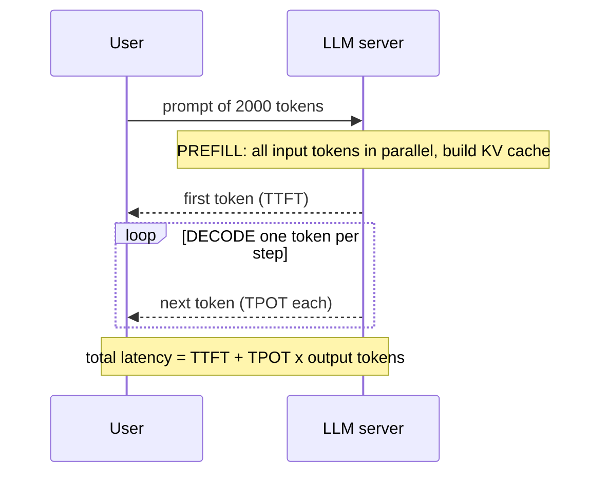
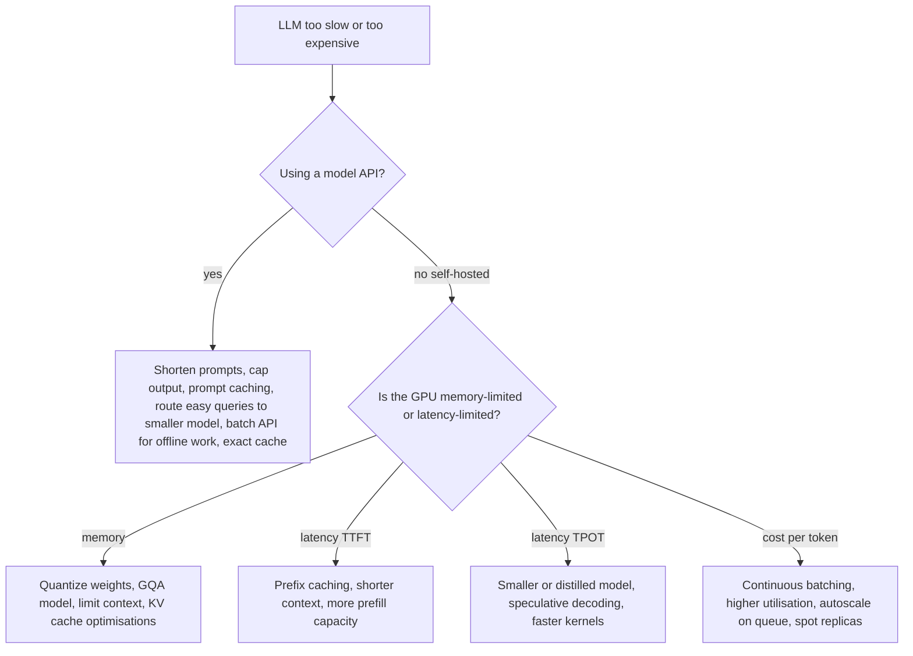

# LLM inference optimization

## Why LLM inference is its own subject

A gradient-boosted model answers in a millisecond on a CPU. A large language model answers in seconds on
a GPU that costs dollars per hour — and the answer arrives **one token at a time**. Huyen's chapter 9 of
*AI Engineering* is devoted to making this cheaper and faster, and divides the techniques into two
levels:

- **Model-level optimisation**: change the model — compress it, or change how it generates.
- **Inference-service-level optimisation**: keep the model, manage resources and workload better
  (batching, caching, parallelism). These should not change output quality.

If you call a model API, the provider does most of this for you; if you host a model yourself, it is
your job.

## How an LLM generates: prefill and decode

Autoregressive generation has two phases:

1. **Prefill**: process all input tokens in parallel, producing the internal state needed to start
   generating. Its duration grows with input length. It is **compute-bound**.
2. **Decode**: generate output tokens one by one, each conditioned on everything before it. It is
   **memory-bandwidth-bound** — and sequential, which is the fundamental bottleneck.



## Metrics

From Huyen's chapter:

- **TTFT — time to first token**: how long until the first token appears; corresponds to prefill and
  depends on input length. Conversational products want it to feel instantaneous; users tolerate more
  for, say, summarising a long document.
- **TPOT — time per output token**: speed of each subsequent token. For streamed text it only needs to
  beat reading speed — she cites roughly 120 ms/token (about 6–8 tokens/s) as sufficient for most uses.
  Variants: time between tokens (TBT), inter-token latency (ITL).
- **Total latency** = TTFT + TPOT × (number of output tokens).
- With hidden reasoning or agent steps, the first token the *user* sees comes much later than the first
  token the *model* generates; some teams track **time to publish** for that.
- Report **percentiles** (p50, p90, p95, p99), not averages, and plot TTFT against input length.
- **Throughput**: output tokens per second across all users (TPS), or completed requests per minute.
  Count input and output throughput separately, since prefill and decode have different bottlenecks.
- **Goodput**: requests per second that meet the SLO.
- **Utilisation**: beware that `nvidia-smi` "GPU utilisation" only reports the share of time the GPU was
  doing *anything*. Huyen recommends **MFU** (model FLOP/s utilisation: achieved throughput relative to
  the chip's theoretical peak) and **MBU** (model bandwidth utilisation) as more meaningful measures.

```python-run
def latency(ttft_ms, tpot_ms, out_tokens): return ttft_ms + tpot_ms * out_tokens
print("same total latency, different experience:")
for name, ttft, tpot in (("fast start, slower stream", 200, 60), ("slow start, faster stream", 5000, 36)):
    print(f"  {name:28s} TTFT={ttft:5d} ms  TPOT={tpot} ms  200 tokens -> {latency(ttft, tpot, 200)/1000:.1f} s")

# Cost follows throughput (Huyen's example: $2/h at 100 tokens/s)
print(f"\n$2/h at 100 tok/s -> ${2 / (100 * 3600) * 1e6:.3f} per 1M output tokens; "
      f"1K requests x 200 tokens -> ${2 / (100 * 3600) * 200 * 1000:.2f}")
# Goodput
done, meeting_slo = 100, 30
print(f"throughput {done} req/min but only {meeting_slo} meet the SLO -> goodput = {meeting_slo} req/min")
```

There is a **latency/throughput trade-off**: techniques like batching raise throughput (lower cost) but
can hurt TTFT and TPOT. Optimising for cost alone can ruin the user experience — hence goodput.

## Model-level optimisation

### Quantization

Represent weights (and sometimes activations) with fewer bits: FP32 → FP16/BF16 → INT8 → 4-bit. Halving
the precision halves the memory footprint, and less memory traffic means higher throughput. Huyen calls
weight-only quantization by far the most popular compression approach because it is easy, works out of
the box for many models and is very effective — while noting the hard floor (you cannot go below one bit
per value).

- **Post-training quantization (PTQ)**: quantize an already-trained model. Cheap and by far the most
  common. Formats/tools: GGUF (llama.cpp), AWQ, GPTQ, bitsandbytes 8-/4-bit loading, TensorRT/ONNX INT8.
- **Quantization-aware training (QAT)**: simulate low precision during training/fine-tuning so the model
  learns to be robust to it. Better quality at low bit widths, more expensive.
- Quality usually holds well at 8 bits and reasonably at 4 bits for large models; **always re-run your
  evaluation suite** on the quantized model — degradation is task-dependent.

```python-run
import numpy as np
rng = np.random.default_rng(0)
w = rng.normal(0, 0.05, 1_000_000).astype(np.float32)        # a slab of weights

def quantize(w, bits):
    qmax = 2 ** (bits - 1) - 1
    scale = np.abs(w).max() / qmax                           # symmetric uniform quantization
    q = np.clip(np.round(w / scale), -qmax - 1, qmax)
    return q * scale

x = rng.normal(0, 1, (64, 1000)).astype(np.float32)
W = w.reshape(1000, 1000)
ref = x @ W
print("bits  memory   relative error of layer output")
for bits in (16, 8, 4, 2):
    out = x @ quantize(w, bits).reshape(1000, 1000)
    err = np.linalg.norm(out - ref) / np.linalg.norm(ref)
    print(f"{bits:4d}  {bits/32:5.1%}   {err:.4f}")
print("\nmodel size: 7B params ->", {f"{b}-bit": f"{7e9 * b / 8 / 1e9:.1f} GB" for b in (32, 16, 8, 4)})
```

Error grows slowly down to 8 bits, noticeably at 4 and badly at 2 (with this naive scheme; real methods
such as GPTQ/AWQ calibrate to do much better at 4 bits). A 7B model shrinks from 28 GB to 3.5 GB at
4-bit — the difference between needing a data-centre GPU and fitting on a laptop.

### Distillation and pruning

- **Distillation**: train a small *student* to imitate a large *teacher*. Common and effective when a
  smaller model is "good enough" for your task.
- **Pruning**: remove nodes, or zero out the least useful weights to make the model sparse. Huyen notes
  that despite encouraging research results, pruning is less common in practice — it is harder to do,
  gives smaller gains than other approaches, and not all hardware exploits sparsity.

### Overcoming the autoregressive bottleneck

- **Speculative decoding**: a small, fast **draft model** proposes the next K tokens; the large **target
  model** verifies them *in parallel* and accepts the longest prefix it agrees with, then generates one
  more token itself; repeat. If nothing is accepted the loop still yields one target token; if all are
  accepted it yields K + 1. It works because (1) verifying K tokens in parallel is faster than generating
  them sequentially, (2) many tokens are easy to predict so a weak model often gets them right, and
  (3) decoding leaves compute idle (it is bandwidth-bound) that verification can use. Output quality is
  unchanged. Acceptance rates are domain-dependent — higher for structured text like code. Huyen cites
  DeepMind's 4B-parameter draft model for Chinchilla-70B, which cut response latency by more than half,
  and notes the technique is built into vLLM, TensorRT-LLM and llama.cpp.
- **Inference with reference**: when the output repeats spans of the input (editing code, quoting a
  document), copy those tokens from the input instead of generating them — like speculative decoding
  without a draft model.
- **Parallel decoding**: research techniques that generate several tokens at once, breaking strict
  sequential dependency.

```python-run
import random
random.seed(0)
def speculative(n_tokens, K, accept_prob, t_target=14.1, t_draft=1.8):
    """Returns (time_ms, target_model_calls). Each loop: K draft tokens, then 1 parallel verify pass by the target."""
    produced = time = calls = 0
    while produced < n_tokens:
        time += K * t_draft                     # draft proposes K tokens sequentially (cheap)
        time += t_target; calls += 1            # target verifies K tokens in ONE pass and emits 1 extra token
        accepted = 0
        while accepted < K and random.random() < accept_prob:
            accepted += 1
        produced += accepted + 1
    return time, calls

baseline = 500 * 14.1
print(f"plain decoding: 500 tokens x 14.1 ms = {baseline/1000:.2f} s")
for p in (0.3, 0.6, 0.8, 0.9):
    t, calls = speculative(500, K=4, accept_prob=p)
    print(f"acceptance {p:.0%}: {t/1000:.2f} s  ({baseline/t:.2f}x speedup, {calls} target passes)")
```

(Timings 14.1 ms and 1.8 ms per token are the target/draft figures Huyen quotes for the Chinchilla
example.) Speedup depends heavily on the acceptance rate; with a poor draft model it can even be a net
loss.

### Attention mechanism optimisation and the KV cache

Generating token $t+1$ needs the **key and value vectors** of all previous tokens in every layer.
Recomputing them each step would be wasteful, so they are stored and reused: the **KV cache**. Only the
newest token's keys and values are computed per step. (It is an inference-only device — in training the
whole sequence is known in advance.)

The cost is memory. Huyen gives the unoptimised size as

$$\text{KV cache} = 2 \times B \times S \times L \times H \times M$$

for batch size $B$, sequence length $S$, layers $L$, model dimension $H$ and $M$ bytes per value. Her
example: Llama 2 13B (40 layers, dimension 5,120) at batch 32, sequence length 2,048 and 2 bytes per
value needs about **54 GB**. She also cites a Google calculation in which a 500B+ parameter model at
batch 512 and context 2,048 needs a 3 TB KV cache — three times the size of the weights.

```python-run
def kv_cache_gb(B, S, L, H, M=2, kv_ratio=1.0):
    return 2 * B * S * L * H * M * kv_ratio / 1e9
print(f"Llama-2-13B-like, B=32, S=2048 : {kv_cache_gb(32, 2048, 40, 5120):6.1f} GB  (matches Huyen's 54 GB)")
print(f"  per sequence                  : {kv_cache_gb(1, 2048, 40, 5120):6.2f} GB")
print(f"  with 8x fewer KV heads (GQA)  : {kv_cache_gb(32, 2048, 40, 5120, kv_ratio=1/8):6.1f} GB")
print(f"  with S=32k context            : {kv_cache_gb(32, 32768, 40, 5120):6.1f} GB")
```

So the KV cache — not the weights — often limits how many concurrent sequences a GPU can serve, which is
what you compute in the `mlops-kv-cache-capacity` problem. Three families of fixes:

1. **Redesign attention** (only at training/fine-tuning time): local windowed attention; **multi-query
   attention** (all query heads share one set of keys/values) and **grouped-query attention** (groups of
   heads share), which shrink the cache; cross-layer attention sharing.
2. **Optimise the KV cache**: **PagedAttention** (vLLM) stores the cache in non-contiguous blocks like
   virtual-memory pages, eliminating fragmentation and enabling sharing; KV-cache quantization; adaptive
   compression; selective caching.
3. **Faster kernels**: hardware-specific attention implementations such as **FlashAttention**.

## Service-level optimisation

### Batching

Static, dynamic and **continuous batching** were covered in lesson 21. For LLMs continuous batching is
essential: requests finish at different times, and a finished sequence's slot is immediately given to a
waiting request.

### Decoupling prefill and decode

Because prefill is compute-bound and decode is bandwidth-bound, running both on the same GPU makes them
compete: a newly arrived long prompt's prefill can stall the decoding of in-flight requests, hurting
their TPOT. Huyen describes disaggregating them onto different instances (as in DistServe), which
improves the volume of requests served within latency targets; the ratio of prefill to decode instances
depends on workload — more prefill capacity for long inputs and tight TTFT, more decode capacity for
short inputs and tight TPOT.

### Prompt caching

Many requests share a prefix — the system prompt, a long document, the conversation so far. A **prompt
cache** (also context or prefix cache) stores the processed state of that prefix so it is computed once
and reused. Huyen's arithmetic: a 1,000-token system prompt across one million calls a day is about a
billion redundant input tokens saved daily. Providers expose it with discounted cached-token prices;
self-hosted servers such as vLLM do automatic prefix caching. To benefit, **put the stable content first**
(system prompt, tools, documents) and the variable content last, and keep the prefix byte-identical.

```python-run
def daily_input_cost(calls, system_tokens, user_tokens, price_per_m=3.0, cached_price_ratio=0.1, cache=True):
    if not cache:
        return calls * (system_tokens + user_tokens) * price_per_m / 1e6
    return calls * (system_tokens * cached_price_ratio + user_tokens) * price_per_m / 1e6
calls = 1_000_000
print(f"redundant system-prompt tokens per day: {calls * 1000:,}")
print(f"input cost without prompt cache: ${daily_input_cost(calls, 1000, 300, cache=False):,.0f}/day")
print(f"input cost with prompt cache   : ${daily_input_cost(calls, 1000, 300):,.0f}/day  (illustrative prices)")
```

### Parallelism

- **Replica parallelism**: more copies of the model; simplest; raises throughput.
- **Model parallelism**: split one model across devices — **tensor parallelism** (split matrix operations)
  to fit and speed up a large model, **pipeline parallelism** (stages on different devices).
- Context and sequence parallelism for very long inputs.

## Putting it into practice with vLLM

vLLM bundles many of these ideas — PagedAttention, continuous batching, prefix caching, quantized model
support, speculative decoding, tensor parallelism — behind an OpenAI-compatible API.

```bash
pip install vllm
vllm serve mistralai/Mistral-7B-Instruct-v0.3 \
  --dtype bfloat16 \
  --max-model-len 8192 \
  --gpu-memory-utilization 0.90 \
  --tensor-parallel-size 1 \
  --enable-prefix-caching \
  --port 8000
```

```python
from openai import OpenAI
client = OpenAI(base_url="http://localhost:8000/v1", api_key="not-needed")
stream = client.chat.completions.create(
    model="mistralai/Mistral-7B-Instruct-v0.3",
    messages=[{"role": "system", "content": SYSTEM_PROMPT},      # stable prefix first -> prefix cache hits
              {"role": "user", "content": question}],
    max_tokens=300, temperature=0.2, stream=True)
for chunk in stream:
    print(chunk.choices[0].delta.content or "", end="", flush=True)
```

vLLM exposes Prometheus metrics (queue length, TTFT, tokens/s, KV-cache usage) — scale on **running and
waiting requests**, not CPU. Alternatives: Hugging Face TGI, NVIDIA Triton + TensorRT-LLM, llama.cpp /
Ollama for CPU and edge, SGLang.

## A decision guide



Whatever you change, re-run the evaluation suite (lesson 32): service-level techniques should preserve
quality; model-level ones may not.

> [!INTERVIEW]
> "How would you cut LLM latency and cost?" — Separate TTFT from TPOT. API side: trim and reorder prompts
> for prompt caching, cap output, route to smaller models, cache, use batch APIs. Self-hosted: quantize,
> continuous batching, KV-cache-aware capacity planning (2·B·S·L·H·M), prefix caching, speculative
> decoding, decoupled prefill/decode, autoscale on queue depth. Mention the latency/throughput trade-off,
> goodput, and re-evaluating quality after model-level changes.

## Summary

- LLM inference = parallel prefill (→ TTFT) + sequential decode (→ TPOT); track percentiles, throughput,
  goodput and meaningful utilisation.
- Model-level: quantization (most popular), distillation, pruning; speculative decoding and inference
  with reference attack the sequential bottleneck without changing outputs.
- The KV cache trades memory for speed and often caps concurrency: 2 × B × S × L × H × M.
- Service-level: continuous batching, decoupled prefill/decode, prompt caching, parallelism.
- vLLM packages these behind an OpenAI-compatible server; always re-evaluate after optimisation.

```quiz
[
  {"q": "Which phase determines time to first token (TTFT)?",
   "options": ["Decode", "Prefill of the input tokens", "Tokenizer training", "Output guardrails only"],
   "answer": 1, "explain": "TTFT corresponds to prefill and grows with input length."},
  {"q": "Total latency for a streamed response is approximately...",
   "options": ["TTFT x TPOT", "TTFT + TPOT x number of output tokens", "TPOT / TTFT", "TTFT only"],
   "answer": 1, "explain": "First token after prefill, then one TPOT per further token."},
  {"q": "In speculative decoding, what does the large target model do?",
   "options": ["Generates every token sequentially as usual", "Verifies the draft model's K proposed tokens in parallel and accepts the longest agreeing prefix", "Trains the draft model", "Compresses the KV cache"],
   "answer": 1, "explain": "Parallel verification is faster than sequential generation, and quality is unchanged."},
  {"q": "What does the KV cache store?",
   "options": ["Final responses for repeated prompts", "Key and value vectors of previous tokens so they are not recomputed at each decoding step", "Model weights in 4-bit", "User API keys"],
   "answer": 1, "explain": "It is an inference-time cache that grows linearly with sequence length and batch size."},
  {"q": "Using Huyen's formula, how does KV cache memory change if the context length doubles?",
   "options": ["Unchanged", "It doubles", "It quadruples", "It halves"],
   "answer": 1, "explain": "2 x B x S x L x H x M is linear in S."},
  {"q": "Why does prompt caching require stable content at the START of the prompt?",
   "options": ["Models read right to left", "The cache reuses a shared prefix; any change early in the prompt invalidates everything after it", "It reduces output tokens", "Tokenizers need it"],
   "answer": 1, "explain": "Put system prompt and documents first, variable content last."},
  {"q": "Which statement about quantization is correct?",
   "options": ["It always improves accuracy", "Reducing 32-bit to 16-bit halves memory; quality impact is task-dependent and must be re-evaluated", "It is only possible during training", "It increases the KV cache size"],
   "answer": 1, "explain": "PTQ is cheap and popular, but evaluate the quantized model on your tasks."},
  {"q": "Why can serving prefill and decode on the same GPU hurt TPOT?",
   "options": ["They use different tokenizers", "A new request's compute-heavy prefill competes with in-flight decoding", "Decode needs CPUs", "Prefill disables batching"],
   "answer": 1, "explain": "Disaggregating them onto separate instances avoids the interference."}
]
```

> **Source:** Chip Huyen, *AI Engineering*, ch. 9 (Inference Optimization: performance metrics — TTFT, TPOT, throughput, goodput, MFU/MBU; model compression; speculative decoding, inference with reference, parallel decoding; attention optimisation and KV cache size calculation; batching; decoupling prefill and decode; prompt caching; parallelism) and ch. 7 (quantization: PTQ vs QAT); vLLM documentation (PagedAttention, OpenAI-compatible server, automatic prefix caching); Kwon et al., *Efficient Memory Management for LLM Serving with PagedAttention* (2023).
