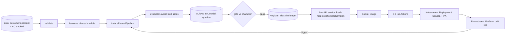

# Capstone part 1: train, track, package and serve

> **Before this lesson:** this lesson puts earlier lessons together, so it helps to have read them,
> though every term is explained again where it first appears. The most useful ones are
> [The ML lifecycle](#/lesson/mlops/ml-lifecycle) (model, feature, pipeline, serving),
> [Python packaging, Makefiles and pre-commit](#/lesson/mlops/packaging-tooling),
> [Data validation and versioning with DVC](#/lesson/mlops/validation-versioning),
> [Feature stores, training/serving skew and labeling](#/lesson/mlops/feature-stores),
> [Experiment tracking with MLflow](#/lesson/mlops/mlflow-tracking),
> [Model registry, model cards and governance](#/lesson/mlops/model-registry),
> [REST and gRPC serving with FastAPI](#/lesson/mlops/fastapi-grpc) and
> [Testing ML systems](#/lesson/mlops/testing-ml). You should be able to read basic Python
> (functions, dictionaries, `import`). You do not need to run anything except the one browser demo.

## In plain words

A **capstone** is a final project that uses everything you have learned at once. Up to now each
lesson looked at one part of a machine-learning system on its own: how to check data, how to record
experiments, how to put a model behind a web address. In this lesson and the next we build one small
but complete system from start to finish, so you can see how the parts connect.

An everyday picture: earlier lessons taught you to make the dough, the sauce and the toppings, and to
run the oven. The capstone is opening a tiny pizza shop: the same skills, but now the order of steps
matters, the handovers between them matter, and a mistake in one place (wrong dough) shows up
somewhere else (a burnt pizza at the counter).

Why this matters for a job: "Tell me about an ML system you built end to end" is one of the most common
interview questions for ML engineers and MLOps engineers. Hiring managers want to hear that you know how
data turns into a model, how the model is checked before it reaches users, how it is served, and how
you would notice and fix problems. A worked project like this one gives you a concrete story, real file
names and real design choices to talk about.

## The project

We will build a **churn-prediction service**. **Churn** means a customer cancels a subscription. A
churn model looks at facts about each customer (how long they have been subscribed, what they pay, how
many support tickets they opened) and outputs a **probability**, a number between 0 and 1, that they
will cancel soon. The retention team uses those probabilities to decide whom to call or offer a
discount.

Here is the whole journey, from a data file to a monitored service. Each box is a step; arrows show
what each step hands to the next.



A few words from the diagram, defined now so they do not trip you up later:

- **Parquet** is a file format for tables that stores data column by column and compresses well.
- **DVC (Data Version Control)** is a tool that versions large data files the way Git versions code.
- A **feature** is one input column the model learns from, such as `tenure_months`.
- A **pipeline** is a chain of steps where each step's output is the next step's input.
- **MLflow** is a tool that records every training run: the settings, the scores and the trained model.
- A **model registry** is a catalogue of trained models with version numbers. An **alias** is a movable
  name tag on one version, such as `@champion` (the model serving users now) or `@challenger` (a new
  model waiting to prove itself).
- A **gate** is an automatic check that must pass before the next step is allowed to run.
- **FastAPI** is a Python library for building web services; **Docker**, **GitHub Actions**,
  **Kubernetes** and **Prometheus** are the packaging, automation, hosting and monitoring tools covered in
  part 2.

Part 1 (this lesson) covers the left half of the diagram: the repository, data validation, features,
training with tracking, evaluation gates, registration and the serving API. Part 2 covers Docker, CI/CD,
Kubernetes, monitoring and retraining.

> [!NOTE]
> Most code blocks below are files from a real repository. They need libraries such as pandas,
> scikit-learn, MLflow and FastAPI installed on your own computer, so they are shown as plain code.
> One block, marked as runnable, is a miniature of the whole training loop that works in the browser.

## Repository layout

A **repository** (repo) is the project folder tracked by Git. A clear layout tells a new teammate where
everything lives before they read a single line.

```text
churn/
├── pyproject.toml            ├── Makefile                 ├── Dockerfile
├── compose.yaml              ├── dvc.yaml                 ├── params.yaml
├── .pre-commit-config.yaml   ├── .dockerignore            ├── .github/workflows/{ci,train,deploy}.yml
├── data/customers.parquet.dvc
├── src/churn/
│   ├── __init__.py
│   ├── config.py             # typed settings
│   ├── data.py               # load + validate
│   ├── features.py           # single source of truth for feature logic
│   ├── train.py              # training entry point (MLflow tracking)
│   ├── evaluate.py           # metrics + slices
│   ├── promote.py            # gate vs champion, set registry alias
│   ├── monitor.py            # drift job (part 2)
│   └── serve/{app.py,schemas.py}
├── tests/{unit,data,model,integration}/
├── k8s/{deployment,service,hpa}.yaml
└── ops/{prometheus.yml,alerts.yml}
```

Reading it top to bottom:

- The top-level files configure tools. `pyproject.toml` describes the Python package and its
  dependencies; the `Makefile` gives short commands such as `make test`; `.pre-commit-config.yaml` runs
  formatters and linters before each commit. All three are explained in the packaging lesson.
- `data/customers.parquet.dvc` is a tiny text file holding a hash (a fingerprint) of the real data
  file. Git stores this small pointer; DVC stores the large file elsewhere.
- `src/churn/` is the Python package. Putting code under `src/` forces you to install the package before
  importing it, which catches "works on my machine" import mistakes early.
- Each module has one job. The most important design choice is that **features.py is the only place
  where feature logic lives**, and every other part (training, batch scoring, the web API) imports it.
- `tests/` is split by what is being tested: plain code (`unit`), data (`data`), model behaviour
  (`model`) and the running service (`integration`).
- `k8s/` and `ops/` hold deployment and monitoring files for part 2.

## Configuration

Hard-coding numbers such as the learning rate inside Python files makes them hard to find and easy to
change by accident. Instead, they live in one configuration file written in **YAML**, a plain-text format
for nested settings where indentation shows structure.

```yaml
# params.yaml  (tracked by Git; referenced by dvc.yaml and logged to MLflow)
data:
  path: data/customers.parquet
  target: churned
  test_size: 0.2
train:
  seed: 42
  model: hist_gbm
  params: {learning_rate: 0.06, max_iter: 300, max_leaf_nodes: 31, l2_regularization: 0.1}
gate:
  min_pr_auc: 0.45
  max_slice_drop: 0.02
  slices: [plan]
serve:
  threshold: 0.5
```

Section by section: `data` says where the table is, which column is the **target** (the answer the model
must learn to predict, here `churned`, 1 for cancelled and 0 for stayed) and that 20% of rows are held
back for testing. `train` fixes the random **seed** (a starting number for the random generator, so runs
can be repeated exactly) and the model's **hyperparameters** (settings chosen before training, such as
how fast it learns). `gate` holds the promotion rules explained later. `serve` holds the
**threshold**: a customer with probability at or above 0.5 is labelled "likely to churn".

The web service reads its own settings from **environment variables**, named values the operating system
hands to a running program. The library `pydantic-settings` reads them into a typed Python object and
rejects bad values at startup:

```python
# src/churn/config.py
from pydantic import Field
from pydantic_settings import BaseSettings, SettingsConfigDict

class ServeSettings(BaseSettings):
    model_config = SettingsConfigDict(env_prefix="CHURN_")
    model_uri: str = "models:/churn@champion"
    threshold: float = Field(0.5, ge=0, le=1)
    max_batch: int = Field(256, ge=1)
    log_level: str = "INFO"
```

`env_prefix="CHURN_"` means the field `threshold` is filled from the variable `CHURN_THRESHOLD` if it
exists, otherwise the default 0.5 is used. `Field(0.5, ge=0, le=1)` adds a rule: the value must be
greater than or equal to 0 and less than or equal to 1. If someone deploys with `CHURN_THRESHOLD=5`, the
service refuses to start and says why, which is far better than silently labelling every customer.
`model_uri` tells the service which model to load; `models:/churn@champion` means "the version of the
registered model `churn` that currently carries the alias `champion`".

## Data loading and validation

**Data validation** means checking that data looks the way you expect before you use it. A model trained
on broken data is broken, but nothing crashes, so the damage is silent. We describe the expected table
as a **schema** (a list of columns with their types and allowed values) using the library `pandera`:

```python
# src/churn/data.py
import pandas as pd
import pandera as pa
from pandera.typing import Series

class Customers(pa.DataFrameModel):
    customer_id: Series[int] = pa.Field(unique=True)
    tenure_months: Series[int] = pa.Field(ge=0, le=600)
    monthly_charges: Series[float] = pa.Field(gt=0, lt=10_000)
    plan: Series[str] = pa.Field(isin=["basic", "pro", "premium"])
    support_tickets_30d: Series[int] = pa.Field(ge=0)
    last_login_days: Series[float] = pa.Field(ge=0, nullable=True)
    churned: Series[int] = pa.Field(isin=[0, 1])

    class Config:
        strict = True          # no unexpected columns
        coerce = True

def load(path: str) -> pd.DataFrame:
    df = pd.read_parquet(path)
    df = Customers.validate(df, lazy=True)                 # raises SchemaErrors listing every failure
    rate = df["churned"].mean()
    if not 0.02 <= rate <= 0.5:
        raise ValueError(f"label rate {rate:.3f} outside expected range - check the label join")
    return df
```

Each line of the class is one rule. `customer_id` must be unique (a duplicated customer would be counted
twice). `tenure_months` must be between 0 and 600 (50 years; anything above is a bug). `plan` may only
take three values. `last_login_days` may be missing (`nullable=True`), because brand-new customers have
not logged in yet. `strict = True` rejects unexpected extra columns, and `coerce = True` converts types
where it safely can (for example the text "12" into the number 12).

In `load`, `lazy=True` asks pandera to collect **every** failure before raising an error, so one run
shows you all problems instead of the first one. The last check is a sanity test on the **label rate**,
the share of customers who churned. If it suddenly reads 0.9 or 0.001, the most likely cause is a broken
**join** (the step that attaches each customer's outcome to their row), not a real change in the
business. Stopping here saves a wasted training run and, worse, a bad model.

## Features: one module for training and serving

**Training/serving skew** is when the model sees inputs computed one way during training and a slightly
different way in production. It is one of the most common reasons a model that scored well in testing
performs badly with real users. The cure is to compute features in exactly one function that every part
of the system calls:

```python
# src/churn/features.py
import numpy as np
import pandas as pd

NUMERIC = ["tenure_months", "monthly_charges", "support_tickets_30d", "last_login_days",
           "charges_per_tenure", "tickets_per_tenure"]
CATEGORICAL = ["plan"]
RAW_INPUTS = ["tenure_months", "monthly_charges", "plan", "support_tickets_30d", "last_login_days"]

def build_features(df: pd.DataFrame) -> pd.DataFrame:
    """Pure function: raw columns in, model features out. Used by train, batch scoring AND the API."""
    out = df[RAW_INPUTS].copy()
    out["last_login_days"] = out["last_login_days"].fillna(-1.0)          # explicit missing marker
    tenure = out["tenure_months"].clip(lower=1)
    out["charges_per_tenure"] = out["monthly_charges"] / tenure
    out["tickets_per_tenure"] = out["support_tickets_30d"] / tenure
    return out[NUMERIC + CATEGORICAL]
```

Line by line: the three lists name the **numeric** columns (numbers), the **categorical** column (a label
from a fixed set, here the plan name) and the raw inputs a caller must supply. `build_features` is a
**pure function**: its output depends only on its input, with no hidden state, so it gives the same
answer in a notebook, a nightly batch job and the web API. It copies the raw columns, replaces a missing
last-login value with -1 (a value that cannot occur naturally, so the model can learn "never logged in"
as its own case), and divides charges and tickets by tenure to get per-month rates. `clip(lower=1)`
turns a tenure of 0 into 1, so a customer who joined today does not cause a division by zero.

The serving path imports the **same function**. That, plus saving the preprocessing inside the model
pipeline (next section), removes the two most common sources of training/serving skew.

## Training with tracking

Training means showing the model many examples with known answers so it can learn the pattern.
**Tracking** means recording everything about that training run, so that months later anyone can see
exactly which code, data and settings produced the model in production.

```python
# src/churn/train.py
import argparse, json, subprocess
import mlflow, mlflow.sklearn, yaml
from mlflow.models import infer_signature
from sklearn.compose import ColumnTransformer
from sklearn.ensemble import HistGradientBoostingClassifier
from sklearn.model_selection import train_test_split
from sklearn.pipeline import Pipeline
from sklearn.preprocessing import FunctionTransformer, OneHotEncoder

from churn.data import load
from churn.evaluate import evaluate
from churn.features import CATEGORICAL, NUMERIC, RAW_INPUTS, build_features

def git_sha() -> str:
    try:
        return subprocess.check_output(["git", "rev-parse", "HEAD"], text=True).strip()
    except Exception:
        return "unknown"

def make_pipeline(params: dict, seed: int) -> Pipeline:
    pre = ColumnTransformer([
        ("num", "passthrough", NUMERIC),
        ("cat", OneHotEncoder(handle_unknown="ignore"), CATEGORICAL),
    ])
    return Pipeline([
        ("features", FunctionTransformer(build_features)),      # feature logic travels inside the model
        ("pre", pre),
        ("clf", HistGradientBoostingClassifier(random_state=seed, **params)),
    ])

def main() -> None:
    ap = argparse.ArgumentParser(); ap.add_argument("--params", default="params.yaml")
    cfg = yaml.safe_load(open(ap.parse_args().params))
    seed = cfg["train"]["seed"]

    df = load(cfg["data"]["path"])
    train_df, test_df = train_test_split(df, test_size=cfg["data"]["test_size"], random_state=seed,
                                         stratify=df[cfg["data"]["target"]])
    mlflow.set_experiment("churn")
    with mlflow.start_run() as run:
        mlflow.set_tags({"git_sha": git_sha(), "data_path": cfg["data"]["path"],
                         "data_rows": len(df), "stage": "training"})
        mlflow.log_params({**cfg["train"]["params"], "seed": seed, "model": cfg["train"]["model"]})
        mlflow.log_dict(cfg, "config/params.yaml")

        pipe = make_pipeline(cfg["train"]["params"], seed)
        pipe.fit(train_df[RAW_INPUTS], train_df[cfg["data"]["target"]])

        metrics = evaluate(pipe, test_df, cfg["data"]["target"], slices=cfg["gate"]["slices"])
        mlflow.log_metrics(metrics)
        json.dump(metrics, open("metrics.json", "w"), indent=2)          # also a DVC metric file

        proba = pipe.predict_proba(test_df[RAW_INPUTS])[:, 1]
        mlflow.sklearn.log_model(pipe, "model",
                                 signature=infer_signature(test_df[RAW_INPUTS], proba),
                                 input_example=test_df[RAW_INPUTS].head(3),
                                 pyfunc_predict_fn="predict_proba")
        open(".last_run_id", "w").write(run.info.run_id)               # handed to promote.py in CI
        print(f"run_id={run.info.run_id} pr_auc={metrics['pr_auc']:.4f}")

if __name__ == "__main__":
    main()
```

This is the longest file, so here it is in pieces.

**`git_sha()`** asks Git for the **commit SHA**, the unique ID of the exact code version being run. If
the folder is not a Git repo it returns `"unknown"` instead of crashing.

**`make_pipeline()`** builds a scikit-learn **Pipeline**: an object that chains steps and behaves like a
single model. Calling `fit` runs every step in order on the training data; calling `predict_proba` runs
the same steps on new data. Its three steps are:

1. `FunctionTransformer(build_features)` wraps our feature function as a pipeline step. Because it is
   inside the pipeline, **the feature logic is saved together with the model**. Whoever loads the model
   later gets the feature code too, with no chance of using a different version.
2. A `ColumnTransformer` treats column groups differently: numeric columns pass through unchanged, and
   the categorical `plan` column goes through a `OneHotEncoder`, which turns one text column into one 0/1
   column per value (`plan_basic`, `plan_pro`, `plan_premium`), because models need numbers.
   `handle_unknown="ignore"` means a plan name never seen in training becomes all zeros instead of an
   error.
3. `HistGradientBoostingClassifier` is the model: a **gradient-boosted tree ensemble**, many small
   decision trees where each new tree corrects the mistakes of the previous ones. It is a strong default
   for tables of numbers and categories.

**`main()`** reads `params.yaml`, loads and validates the data, and splits it with `train_test_split`
into a training set (80%) and a **test set** (20%) the model never sees while learning, so the test
score estimates performance on new customers. `stratify=` keeps the churn rate the same in both parts,
which matters when only a minority of customers churn.

Inside `with mlflow.start_run() as run:` everything is recorded under one **run**:

- **Tags** are labels for searching: the code SHA, the data path and the number of rows.
- **Params** are the input settings; **metrics** are the output scores.
- `log_dict` stores the full configuration file as an **artifact** (any file attached to a run).
- `log_model` stores the trained pipeline. The **signature** records the expected input columns and
  output type, so a caller sending the wrong columns gets a clear error. `input_example` saves three real
  rows as documentation. `pyfunc_predict_fn="predict_proba"` tells MLflow that the generic `predict`
  call should return probabilities rather than hard 0/1 labels.

Finally the run ID is written to `.last_run_id` so the next step (the gate) knows which run to judge.

The evaluation module computes the scores:

```python
# src/churn/evaluate.py
import numpy as np
from sklearn.metrics import average_precision_score, brier_score_loss, roc_auc_score
from churn.features import RAW_INPUTS

def evaluate(model, df, target: str, slices: list[str]) -> dict[str, float]:
    y = df[target].to_numpy()
    p = model.predict_proba(df[RAW_INPUTS])[:, 1]
    out = {"pr_auc": average_precision_score(y, p), "roc_auc": roc_auc_score(y, p),
           "brier": brier_score_loss(y, p), "base_rate": float(y.mean())}
    for col in slices:
        for value, idx in df.groupby(col).indices.items():
            if len(np.unique(y[idx])) == 2:                      # need both classes for a ranking metric
                out[f"pr_auc__{col}={value}"] = average_precision_score(y[idx], p[idx])
    return {k: float(v) for k, v in out.items()}
```

Four metrics, each answering a different question:

- **PR-AUC** (area under the precision-recall curve, computed here as *average precision*) asks: when
  the model ranks customers from most to least risky, how well are the real churners concentrated at
  the top? It suits problems where the positive class is rare. A random model scores about the base rate.
- **ROC-AUC** (area under the receiver operating characteristic curve) is the probability that a random
  churner gets a higher score than a random non-churner. 0.5 is a coin flip; 1.0 is perfect.
- The **Brier score** is the average squared gap between predicted probability and what happened. Lower
  is better, and it rewards probabilities that can be taken at face value (**calibration**).
- The **base rate** is the share of churners in the test set, for context.

The loop computes PR-AUC per **slice**, a subgroup of rows such as customers on the basic plan. Results
are stored under names like `pr_auc__plan=basic`. An average can improve while one group gets worse, and
slice metrics are how you notice. Slices containing only one class are skipped because a ranking metric
needs both churners and non-churners.

## The promotion gate

A model that trained without errors is not automatically better than the one already serving users. The
gate compares the new **candidate** with the current **champion** and refuses to register a model that is
worse.

```python
# src/churn/promote.py
import sys, mlflow, yaml
from mlflow import MlflowClient

def main(run_id: str) -> None:
    cfg = yaml.safe_load(open("params.yaml"))["gate"]
    client = MlflowClient()
    cand = client.get_run(run_id).data.metrics
    reasons = []
    if cand["pr_auc"] < cfg["min_pr_auc"]:
        reasons.append(f"pr_auc {cand['pr_auc']:.3f} below floor {cfg['min_pr_auc']}")
    try:
        champ_v = client.get_model_version_by_alias("churn", "champion")
        champ = client.get_run(champ_v.run_id).data.metrics
        if cand["pr_auc"] < champ["pr_auc"]:
            reasons.append("overall pr_auc worse than champion")
        for k, v in champ.items():
            if k.startswith("pr_auc__") and k in cand and v - cand[k] > cfg["max_slice_drop"]:
                reasons.append(f"slice {k} regressed by {v - cand[k]:.3f}")
    except mlflow.exceptions.MlflowException:
        pass                                                      # no champion yet: first model

    if reasons:
        print("GATE FAILED:", "; ".join(reasons)); sys.exit(1)
    mv = mlflow.register_model(f"runs:/{run_id}/model", "churn")
    client.set_model_version_tag("churn", mv.version, "validation_status", "passed")
    client.set_registered_model_alias("churn", "challenger", mv.version)
    print(f"registered churn v{mv.version} as @challenger")

if __name__ == "__main__":
    main(sys.argv[1])
```

The gate collects **reasons** rather than stopping at the first failure, so the log tells the engineer
everything that is wrong. It runs three checks:

1. **A floor.** PR-AUC must reach an absolute minimum (0.45), whatever the champion scores.
2. **No overall regression.** The candidate must not score below the champion.
3. **No slice regression.** For every slice, the champion's score minus the candidate's score must not
   exceed `max_slice_drop` (0.02). A small tolerance allows for noise.

If the registry has no champion yet (the very first model), MLflow raises an exception, which is caught
and ignored, so only the floor applies. On failure, `sys.exit(1)` ends the program with **exit code** 1.
Every program returns an exit code when it finishes: 0 means success and anything else means failure. CI
systems read it to decide whether to continue, so a failed gate stops the pipeline automatically. On
success, the model is registered as a new version, tagged as validated and given the alias `@challenger`.

Promotion to `@champion` happens only after the model has also behaved well on a slice of real traffic
(the canary in part 2). Doing well offline is necessary, but it is not proof.

> [!TIP]
> You can practise this exact logic in the problem **mlops-slice-gate**, which asks you to write the
> gate as a pure function returning its list of reasons.

## The pipeline as DVC stages

DVC can run the training as a **stage**: a command plus a list of everything it depends on.

```yaml
# dvc.yaml
stages:
  train:
    cmd: python -m churn.train --params params.yaml
    deps: [src/churn/train.py, src/churn/features.py, src/churn/data.py, src/churn/evaluate.py, data/customers.parquet]
    params: [train, data]
    metrics: [{metrics.json: {cache: false}}]
```

`cmd` is the command to run. `deps` lists the files the result depends on; `params` lists the sections of
`params.yaml` it reads; `metrics` names the scores file it writes. `dvc repro` ("reproduce") retrains only
when code, data or params change. It decides by comparing content hashes with those saved in `dvc.lock`,
a file that records the exact fingerprint of every input of the last run. If nothing changed, the stage
is skipped and you save the compute.

## Try the whole training loop in the browser

The cell below is a dependency-light miniature of the same flow (synthetic data, validation, a shared
feature function, a model, evaluation with slices, a gate and a pretend registry) using only NumPy, so it
runs here. Change the seed or the features and run it again.

```python-run
import numpy as np, json, hashlib
rng = np.random.default_rng(42)

# ---- 1. data ---------------------------------------------------------------
n = 6000
tenure = rng.integers(1, 72, n)
charges = rng.uniform(20, 120, n)
plan = rng.choice(["basic", "pro", "premium"], n, p=[0.5, 0.35, 0.15])
tickets = rng.poisson(1.2, n)
logit = -1.2 - 0.045 * tenure + 0.012 * charges + 0.45 * tickets + np.where(plan == "basic", 0.5, 0.0)
y = (rng.random(n) < 1 / (1 + np.exp(-logit))).astype(int)

# ---- 2. validation ---------------------------------------------------------
assert tenure.min() >= 0 and (charges > 0).all() and set(plan) <= {"basic", "pro", "premium"}
assert 0.02 <= y.mean() <= 0.5, "label rate out of range"

# ---- 3. shared feature function (same code would run in serving) -------------
def build_features(tenure, charges, plan, tickets):
    t = np.maximum(tenure, 1)
    return np.column_stack([np.ones_like(t, dtype=float), tenure / 72, charges / 120, tickets / 5,
                            charges / t / 50, (plan == "basic") * 1.0, (plan == "premium") * 1.0])

X = build_features(tenure, charges, plan, tickets)
idx = rng.permutation(n); tr, te = idx[:4800], idx[4800:]

# ---- 4. train: logistic regression by gradient descent ---------------------
def train(X, y, lr=0.5, epochs=400, l2=1e-3):
    w = np.zeros(X.shape[1])
    for _ in range(epochs):
        p = 1 / (1 + np.exp(-X @ w))
        w -= lr * (X.T @ (p - y) / len(y) + l2 * w)
    return w
params = {"lr": 0.5, "epochs": 400, "l2": 1e-3, "seed": 42}
w = train(X[tr], y[tr], params["lr"], params["epochs"], params["l2"])

# ---- 5. evaluate overall + slices ------------------------------------------
def roc_auc(y, p):
    order = np.argsort(p); ranks = np.empty(len(p)); ranks[order] = np.arange(1, len(p) + 1)
    pos = y == 1
    return (ranks[pos].sum() - pos.sum() * (pos.sum() + 1) / 2) / (pos.sum() * (~pos).sum())
p_te = 1 / (1 + np.exp(-X[te] @ w))
metrics = {"roc_auc": round(float(roc_auc(y[te], p_te)), 4), "base_rate": round(float(y[te].mean()), 4)}
for s in ("basic", "pro", "premium"):
    m = plan[te] == s
    metrics[f"roc_auc__plan={s}"] = round(float(roc_auc(y[te][m], p_te[m])), 4)

# ---- 6. "track" the run and gate against a champion -------------------------
run = {"run_id": hashlib.sha1(json.dumps(params, sort_keys=True).encode()).hexdigest()[:8],
       "params": params, "metrics": metrics, "tags": {"git_sha": "9f3c1e2", "data_rows": n}}
champion = {"roc_auc": 0.74, "roc_auc__plan=basic": 0.72, "roc_auc__plan=pro": 0.73, "roc_auc__plan=premium": 0.72}
reasons = [k for k, v in champion.items() if v - metrics[k] > 0.02]
print(json.dumps(run, indent=1))
print("GATE:", "PASS -> register as @challenger" if metrics["roc_auc"] >= champion["roc_auc"] and not reasons
      else f"FAIL {reasons}")
```

What each numbered block does:

1. **Data.** It invents 6,000 customers. The line computing `logit` is the hidden "truth": long tenure
   lowers churn risk, higher charges and more tickets raise it, and the basic plan adds risk. The next
   line turns that into 0/1 outcomes with some randomness, as in real life.
2. **Validation.** `assert` stops the program if a condition is false: the same idea as the pandera
   schema and the label-rate check, in two lines.
3. **Features.** One function builds the model inputs, scaled to similar sizes, with two 0/1 columns for
   the plan. A real serving path would call this same function.
4. **Training.** A **logistic regression** (a model that outputs a probability from a weighted sum of
   inputs) is trained by **gradient descent**: 400 times, it predicts, measures the error and nudges each
   weight a little in the direction that reduces it. The `l2` term keeps weights small to avoid
   overfitting.
5. **Evaluation.** It computes ROC-AUC with a rank formula, overall and per plan.
6. **Tracking and gate.** It builds a run record whose ID is a hash of the parameters, then compares with
   a pretend champion: the gate passes only if overall ROC-AUC is at least the champion's and no slice
   dropped by more than 0.02.

With the seed 42, you should see an overall ROC-AUC near 0.75, a base rate near 0.29, slice scores between
about 0.73 and 0.76, and `GATE: PASS -> register as @challenger`. Try making the model worse (for example
set `epochs` to 5) and watch the gate fail with a list of reasons.

## Serving API

**Serving** means making the model available to other programs. Here it is a web **API** (application
programming interface): a set of web addresses that accept requests and return answers. Other services
send customer data to `/predict` and get probabilities back, using **JSON**, a plain-text format for
nested data.

First, the **schemas** describe the exact shape of valid requests and responses, using the library
**pydantic**:

```python
# src/churn/serve/schemas.py
from typing import Literal, Optional
from pydantic import BaseModel, ConfigDict, Field

class Customer(BaseModel):
    model_config = ConfigDict(extra="forbid")
    tenure_months: int = Field(ge=0, le=600)
    monthly_charges: float = Field(gt=0, lt=10_000)
    plan: Literal["basic", "pro", "premium"]
    support_tickets_30d: int = Field(0, ge=0)
    last_login_days: Optional[float] = Field(None, ge=0)

class PredictRequest(BaseModel):
    instances: list[Customer] = Field(min_length=1, max_length=256)

class PredictResponse(BaseModel):
    model_version: str
    probabilities: list[float]
    labels: list[bool]
```

`Customer` repeats the data rules at the front door: `Literal[...]` allows only the three plan names,
`Optional[float]` allows a missing value, and `extra="forbid"` rejects unknown fields, so a misspelled
`tenure_month` is an error instead of being silently ignored. `PredictRequest` accepts a **batch** of 1 to
256 customers in one call, which is much cheaper than 256 separate calls; the upper limit stops one huge
request from exhausting memory. FastAPI uses these classes to check every request automatically and
answers with HTTP status **422** (unprocessable content) when one fails.

Now the service itself:

```python
# src/churn/serve/app.py
import json, logging, sys, time, uuid
from contextlib import asynccontextmanager

import mlflow, pandas as pd
from fastapi import FastAPI, HTTPException, Request
from fastapi.concurrency import run_in_threadpool
from prometheus_client import Counter, Gauge, Histogram, make_asgi_app

from churn.config import ServeSettings
from churn.features import RAW_INPUTS
from churn.serve.schemas import PredictRequest, PredictResponse

settings = ServeSettings()
logging.basicConfig(stream=sys.stdout, level=settings.log_level, format="%(message)s")
log = logging.getLogger("churn")

REQS = Counter("predict_requests_total", "Requests", ["status", "model_version"])
LAT = Histogram("predict_latency_seconds", "Latency", buckets=[.005, .01, .025, .05, .1, .25, .5, 1, 2.5])
SCORE = Histogram("prediction_score", "Predicted probability", buckets=[i / 10 for i in range(1, 11)])
MISSING = Counter("feature_missing_total", "Missing features", ["feature"])
INFO = Gauge("model_info", "Model metadata", ["model_version"])
state: dict = {}

@asynccontextmanager
async def lifespan(app: FastAPI):
    model = mlflow.pyfunc.load_model(settings.model_uri)
    state.update(model=model, version=(model.metadata.run_id or "local")[:8])
    warm = pd.DataFrame([{"tenure_months": 1, "monthly_charges": 10.0, "plan": "basic",
                          "support_tickets_30d": 0, "last_login_days": 0.0}])[RAW_INPUTS]
    model.predict(warm)                                         # warm-up
    INFO.labels(state["version"]).set(1)
    state["ready"] = True
    yield
    state.clear()

app = FastAPI(title="Churn API", version="1.0.0", lifespan=lifespan)
app.mount("/metrics", make_asgi_app())

@app.get("/healthz")
def healthz():
    return {"status": "ok"}

@app.get("/readyz")
def readyz():
    if not state.get("ready"):
        raise HTTPException(503, "model not loaded")
    return {"status": "ready", "model_version": state["version"]}

@app.post("/predict", response_model=PredictResponse)
async def predict(req: PredictRequest, request: Request):
    rid = request.headers.get("x-request-id", str(uuid.uuid4()))
    t0 = time.perf_counter()
    df = pd.DataFrame([c.model_dump() for c in req.instances])[RAW_INPUTS]
    for col in RAW_INPUTS:
        n_missing = int(df[col].isna().sum())
        if n_missing:
            MISSING.labels(col).inc(n_missing)
    try:
        proba = await run_in_threadpool(state["model"].predict, df)
    except Exception:
        REQS.labels("error", state["version"]).inc()
        log.exception("inference_failed")
        raise HTTPException(500, "inference failed")
    probs = [float(p) for p in proba]
    dt = time.perf_counter() - t0
    LAT.observe(dt); REQS.labels("ok", state["version"]).inc()
    for p in probs:
        SCORE.observe(p)
    # prediction log: one JSON line per request (shipped to the lake by the log pipeline)
    log.info(json.dumps({"event": "prediction", "request_id": rid, "model_version": state["version"],
                         "latency_ms": round(dt * 1000, 2), "features": df.to_dict("records"),
                         "probabilities": probs}))
    return PredictResponse(model_version=state["version"], probabilities=probs,
                           labels=[p >= settings.threshold for p in probs])
```

Reading it from the top:

**Metrics objects.** The five objects created with `Counter`, `Histogram` and `Gauge` come from the
Prometheus client library. A **counter** only goes up (number of requests, number of missing values). A
**histogram** sorts observations into ranges called **buckets** (how many requests took under 10 ms,
under 25 ms, and so on), which later lets you compute percentiles such as the 95th-percentile latency.
**Latency** is the time a request takes. A **gauge** is a value that can go up or down; here it
announces which model version is loaded. The `["status", "model_version"]` lists are **labels**, extra
dimensions so you can, for example, count errors per model version.

**Startup.** `lifespan` runs once when the service starts. It loads the model from the registry, makes
one **warm-up** prediction (the first call is often slow because libraries initialise lazily, and it is
better that a test row pays that cost than a customer), records the version and sets `ready`. Loading the
model once at startup, never per request, is the single biggest performance rule of model serving.

**Two health endpoints.** `/healthz` answers "is the process alive?"; `/readyz` answers "can it serve
predictions yet?" and returns status **503** (service unavailable) until the model is loaded. Part 2 shows
Kubernetes using the first to restart stuck processes and the second to decide when to send traffic.
`/metrics` exposes all the counters and histograms in the text format Prometheus collects.

**The prediction endpoint**, step by step:

1. Take the **request ID** from the `x-request-id` header if the caller sent one, or make a new random
   one with `uuid4`. This ID ties together every log line about one request across services.
2. Start a timer and turn the validated customers into a pandas table with the raw input columns.
3. Count missing values per column. A sudden rise in missing `last_login_days` often means an upstream
   system broke, and this counter is how you notice.
4. Run the model in a thread pool. FastAPI's `async` functions share one **event loop** (a single
   scheduler that interleaves many requests); a slow, CPU-heavy model call inside it would block every
   other request. `run_in_threadpool` moves the work to a separate thread.
5. On failure, count the error, log the full traceback and return status 500 without exposing internals.
6. On success, record latency, count the request and add every probability to the score histogram, so a
   dashboard can show whether predictions are drifting upward or downward.
7. Write the **prediction log**: one JSON line with the request ID, model version, latency, the exact
   features used and the probabilities. Weeks later, when you learn which customers really churned, you
   join their outcomes to these lines to measure real performance, detect skew and build the next
   training set.
8. Return the probabilities and the yes/no labels obtained by comparing each one with the threshold.

Checklist against the FastAPI serving lesson: model loaded once and warmed ✔, typed validation with
bounds and `extra="forbid"` ✔, batch endpoint with a size cap ✔, liveness and readiness split ✔,
inference off the event loop ✔, metrics for request rate, errors and duration plus prediction
distribution and missing features ✔, structured prediction log with request ID, version and served
features ✔.

## Tests

Tests are small programs that check your code does what you expect, run automatically on every change.
They use **pytest**, Python's most common test runner, which finds functions named `test_...` and reports
any whose `assert` fails.

```python
# tests/unit/test_features.py
import pandas as pd
from churn.features import build_features, NUMERIC, CATEGORICAL

def _row(**kw):
    base = dict(tenure_months=12, monthly_charges=60.0, plan="pro", support_tickets_30d=1, last_login_days=3.0)
    return pd.DataFrame([{**base, **kw}])

def test_columns_and_order():
    assert list(build_features(_row()).columns) == NUMERIC + CATEGORICAL

def test_zero_tenure_does_not_divide_by_zero():
    out = build_features(_row(tenure_months=0))
    assert out["charges_per_tenure"].iloc[0] == 60.0

def test_missing_last_login_gets_marker():
    assert build_features(_row(last_login_days=None))["last_login_days"].iloc[0] == -1.0
```

`_row` builds a one-customer table from sensible defaults and lets each test override a single field.
The three **unit tests** (tests of one small piece in isolation) pin down the behaviours we chose on
purpose: the column order the model expects, the zero-tenure guard (charges of 60 divided by a tenure
clipped to 1 is 60) and the missing-value marker. If someone later "simplifies" the feature function and
breaks one of these, the test fails before the change reaches users.

```python
# tests/integration/test_api.py
from fastapi.testclient import TestClient
from churn.serve.app import app

VALID = {"tenure_months": 12, "monthly_charges": 59.9, "plan": "pro", "support_tickets_30d": 1}

def test_predict_roundtrip(monkeypatch, tiny_model_uri):          # fixture trains a tiny model to a temp dir
    monkeypatch.setenv("CHURN_MODEL_URI", tiny_model_uri)
    with TestClient(app) as client:
        assert client.get("/readyz").status_code == 200
        r = client.post("/predict", json={"instances": [VALID, VALID]})
        body = r.json()
        assert r.status_code == 200 and len(body["probabilities"]) == 2
        assert all(0.0 <= p <= 1.0 for p in body["probabilities"])

def test_validation_rejects_unknown_plan_and_extra_fields():
    with TestClient(app) as client:
        assert client.post("/predict", json={"instances": [{**VALID, "plan": "gold"}]}).status_code == 422
        assert client.post("/predict", json={"instances": [{**VALID, "oops": 1}]}).status_code == 422
```

**Integration tests** check that pieces work together, here the whole web service with a real (tiny)
model. `TestClient` sends requests to the app in memory without starting a real server. A **fixture**
(`tiny_model_uri`) is a pytest helper that prepares something a test needs; this one trains a small model
into a temporary folder. `monkeypatch.setenv` sets an environment variable only for the duration of the
test. The first test checks a full round trip (ready, then two predictions between 0 and 1); the second
checks that bad input is rejected with 422.

To run everything locally:

```bash
make install && make test
dvc repro                                    # validate + train + log to MLflow
python -m churn.promote <run_id>             # gate and register @challenger
CHURN_MODEL_URI=models:/churn@challenger make serve
curl -s localhost:8000/predict -H 'content-type: application/json' \
  -d '{"instances":[{"tenure_months":3,"monthly_charges":95,"plan":"basic","support_tickets_30d":4}]}'
```

In order: install the package and run the tests; train through DVC; run the gate on the printed run ID;
start the service pointing at the challenger; and send one request with `curl`, a command-line tool that
makes web requests. A new customer (3 months) on the basic plan with high charges and four tickets should
come back with a high churn probability.

## Common mistakes in projects like this

- **Feature code copied into the API.** Two copies drift apart within months. Import one function, and
  bundle it inside the model pipeline.
- **Evaluating on data the model trained on.** Scores look wonderful and mean nothing. Keep a test set
  aside before any fitting, and for time-dependent problems split by date so the test set is the future.
- **Loading the model inside the request handler.** Every call then pays seconds of loading time. Load
  once at startup and warm up.
- **A gate that only checks the average.** One customer group can get much worse while the mean improves.
  Check slices with a small tolerance.
- **Not logging what was served.** Without the prediction log you cannot measure real performance later,
  cannot see skew and cannot build the next training set.
- **Retraining on unvalidated data.** A broken upstream join produces a confidently wrong model. Validate
  before training, every time.

> [!INTERVIEW]
> When you describe a project like this, narrate the **design decisions**, not the tools: one feature
> function shared by training and serving and embedded in the model pipeline (no skew); validation before
> training (no garbage in); every run tracked with code, data and config (reproducible); a gate with slice
> checks before registration (no silent regressions); aliases decoupling deployment from training (instant
> rollback); the API logging served features with request IDs (monitoring and retraining later).

## Summary

- The project structure separates data, features, training, evaluation, promotion and serving, all
  importing one feature module.
- Training validates data, fits a scikit-learn `Pipeline`, logs params, metrics, config and the model
  with its signature to MLflow, and writes a metrics file for DVC.
- A promotion gate compares the candidate with the champion overall and per slice before registering it
  as `@challenger`; its non-zero exit code stops automation when it fails.
- The FastAPI service loads the model once by alias, validates inputs, exposes health, readiness and
  metrics endpoints and writes a structured prediction log.
- Unit tests pin down deliberate feature behaviour; integration tests check the running service end to
  end.

## Glossary

- **Capstone** - a final project combining the skills of a whole course.
- **Churn** - a customer cancelling a subscription; a churn model predicts its probability.
- **Target (label)** - the column the model learns to predict.
- **Schema** - a description of expected columns, types and allowed values used to validate data.
- **Label rate (base rate)** - the share of positive examples, here churners.
- **Training/serving skew** - inputs computed differently in training and in production.
- **Pure function** - a function whose output depends only on its inputs, with no hidden state.
- **Pipeline (scikit-learn)** - a chain of preprocessing steps and a model that behaves like one model.
- **One-hot encoding** - turning a category column into one 0/1 column per category.
- **Gradient-boosted trees** - many small decision trees, each correcting the errors of the previous ones.
- **Run, params, metrics, tags, artifact** - one tracked training execution and its inputs, scores,
  search labels and attached files.
- **Signature** - the recorded input and output format of a logged model.
- **PR-AUC / ROC-AUC / Brier score** - ranking quality focused on the rare class / probability that a
  positive outranks a negative / average squared error of probabilities.
- **Slice** - a subgroup of rows evaluated separately.
- **Champion / challenger** - the model serving users / a new model waiting to replace it.
- **Exit code** - the number a program returns when it ends; 0 means success.
- **DVC stage, dvc.lock** - a declared command with its dependencies / the file recording their hashes.
- **API, JSON, schema validation, 422** - a programmatic web interface / its data format / automatic
  request checking / the status code for invalid input.
- **Counter, histogram, gauge, bucket, label** - Prometheus metric types and their parts.
- **Liveness / readiness** - "is the process alive?" / "can it serve traffic yet?"
- **Warm-up** - a first prediction made at startup so users do not pay the initial slowness.
- **Event loop, thread pool** - the scheduler of async code / extra threads for blocking work.
- **Prediction log** - one structured record per request with ID, version, features and outputs.
- **Unit test, integration test, fixture** - a test of one piece / of pieces working together / a helper
  that prepares test inputs.

```quiz
[
  {"q": "Why is `build_features` placed inside the scikit-learn Pipeline via FunctionTransformer?",
   "options": ["To speed up training", "So the exact feature logic is saved with the model and executed identically at serving time", "Because MLflow requires it", "To avoid using pandas"],
   "answer": 1, "explain": "Bundling feature code with the model artifact prevents training/serving skew."},
  {"q": "What does the promotion gate check before registering a model?",
   "options": ["Only that training finished", "An absolute metric floor, comparison to the champion, and per-slice regressions", "Docker image size", "The number of Git commits"],
   "answer": 1, "explain": "It blocks candidates that are worse overall or on any monitored slice."},
  {"q": "Why does the gate set the alias `challenger` rather than `champion`?",
   "options": ["Aliases must be alphabetical", "Offline success earns online validation (canary); champion is moved only after that succeeds", "Champion is reserved for humans", "It is a typo"],
   "answer": 1, "explain": "Offline evaluation is necessary but not sufficient for full release."},
  {"q": "What is the purpose of the label-rate check in `load()`?",
   "options": ["To balance classes", "To catch broken label joins or pipeline bugs before training", "To compute accuracy", "To pick a threshold"],
   "answer": 1, "explain": "An implausible base rate usually indicates corrupted labels."},
  {"q": "The API logs `features` and `model_version` with each prediction because...",
   "options": ["It makes responses faster", "Later joins with outcomes enable performance monitoring, skew/drift detection and retraining data", "FastAPI requires it", "To increase log volume"],
   "answer": 1, "explain": "The prediction log is the foundation of ML monitoring."},
  {"q": "What does `dvc repro` do when nothing in code, data or params changed?",
   "options": ["Retrains anyway", "Skips the stage because dependency hashes match dvc.lock", "Deletes the model", "Pushes to the remote"],
   "answer": 1, "explain": "Content hashes decide whether a stage must rerun."},
  {"q": "Why does the `/readyz` endpoint return 503 until the model is loaded?",
   "options": ["To hide the service", "So the orchestrator does not route traffic to a pod that cannot serve yet", "To trigger retraining", "To save memory"],
   "answer": 1, "explain": "Readiness gates traffic; liveness would restart the pod."},
  {"q": "Why does the promote script call `sys.exit(1)` when the gate fails?",
   "options": ["To free memory", "A non-zero exit code tells the CI system the step failed, so the pipeline stops automatically", "To restart the training job", "MLflow requires exit codes"],
   "answer": 1, "explain": "Automation reads exit codes: 0 means success, anything else stops the workflow."}
]
```

> **Source:** Synthesis of this track, applying: Mueller & Guido, *Introduction to Machine Learning with Python*, ch. 5–6 (evaluation, pipelines); Bill Lubanovic, *FastAPI*, ch. 3–5, 8–9, 12 (web layer, pydantic, testing); MLflow, DVC, pandera, scikit-learn and FastAPI documentation; Chip Huyen, *AI Engineering*, ch. 4 (evaluation gates) and ch. 10 (logging for observability).
