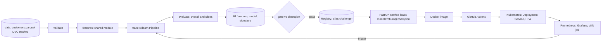

# Capstone part 1: train, track, package and serve

## The project

We will build a small but complete ML system — a **churn-prediction service** — and take it from data to
a monitored deployment. Nothing here is new; the point is to see every piece from the track working
together, with full code you can copy into a repository.



Part 1 (this lesson) covers the left half: repository, data validation, features, training with
tracking, evaluation gates, registration, and the serving API. Part 2 covers Docker, CI/CD, Kubernetes,
monitoring and retraining.

## Repository layout

```text
churn/
├── pyproject.toml            ├── Makefile                 ├── Dockerfile
├── compose.yaml              ├── dvc.yaml                 ├── params.yaml
├── .pre-commit-config.yaml   ├── .dockerignore            ├── .github/workflows/{ci,train,deploy}.yml
├── data/customers.parquet.dvc
├── src/churn/
│   ├── __init__.py
│   ├── config.py             # typed settings
│   ├── data.py               # load + validate
│   ├── features.py           # single source of truth for feature logic
│   ├── train.py              # training entry point (MLflow tracking)
│   ├── evaluate.py           # metrics + slices
│   ├── promote.py            # gate vs champion, set registry alias
│   ├── monitor.py            # drift job (part 2)
│   └── serve/{app.py,schemas.py}
├── tests/{unit,data,model,integration}/
├── k8s/{deployment,service,hpa}.yaml
└── ops/{prometheus.yml,alerts.yml}
```

`pyproject.toml`, `Makefile` and pre-commit are as in lesson 5.

## Configuration

```yaml
# params.yaml  (tracked by Git; referenced by dvc.yaml and logged to MLflow)
data:
  path: data/customers.parquet
  target: churned
  test_size: 0.2
train:
  seed: 42
  model: hist_gbm
  params: {learning_rate: 0.06, max_iter: 300, max_leaf_nodes: 31, l2_regularization: 0.1}
gate:
  min_pr_auc: 0.45
  max_slice_drop: 0.02
  slices: [plan]
serve:
  threshold: 0.5
```

```python
# src/churn/config.py
from pydantic import Field
from pydantic_settings import BaseSettings, SettingsConfigDict

class ServeSettings(BaseSettings):
    model_config = SettingsConfigDict(env_prefix="CHURN_")
    model_uri: str = "models:/churn@champion"
    threshold: float = Field(0.5, ge=0, le=1)
    max_batch: int = Field(256, ge=1)
    log_level: str = "INFO"
```

## Data loading and validation

```python
# src/churn/data.py
import pandas as pd
import pandera as pa
from pandera.typing import Series

class Customers(pa.DataFrameModel):
    customer_id: Series[int] = pa.Field(unique=True)
    tenure_months: Series[int] = pa.Field(ge=0, le=600)
    monthly_charges: Series[float] = pa.Field(gt=0, lt=10_000)
    plan: Series[str] = pa.Field(isin=["basic", "pro", "premium"])
    support_tickets_30d: Series[int] = pa.Field(ge=0)
    last_login_days: Series[float] = pa.Field(ge=0, nullable=True)
    churned: Series[int] = pa.Field(isin=[0, 1])

    class Config:
        strict = True          # no unexpected columns
        coerce = True

def load(path: str) -> pd.DataFrame:
    df = pd.read_parquet(path)
    df = Customers.validate(df, lazy=True)                 # raises SchemaErrors listing every failure
    rate = df["churned"].mean()
    if not 0.02 <= rate <= 0.5:
        raise ValueError(f"label rate {rate:.3f} outside expected range - check the label join")
    return df
```

## Features: one module for training and serving

```python
# src/churn/features.py
import numpy as np
import pandas as pd

NUMERIC = ["tenure_months", "monthly_charges", "support_tickets_30d", "last_login_days",
           "charges_per_tenure", "tickets_per_tenure"]
CATEGORICAL = ["plan"]
RAW_INPUTS = ["tenure_months", "monthly_charges", "plan", "support_tickets_30d", "last_login_days"]

def build_features(df: pd.DataFrame) -> pd.DataFrame:
    """Pure function: raw columns in, model features out. Used by train, batch scoring AND the API."""
    out = df[RAW_INPUTS].copy()
    out["last_login_days"] = out["last_login_days"].fillna(-1.0)          # explicit missing marker
    tenure = out["tenure_months"].clip(lower=1)
    out["charges_per_tenure"] = out["monthly_charges"] / tenure
    out["tickets_per_tenure"] = out["support_tickets_30d"] / tenure
    return out[NUMERIC + CATEGORICAL]
```

The serving path imports the **same function**. That, plus saving the preprocessing inside the model
pipeline, removes the two most common sources of training/serving skew (lesson 9).

## Training with tracking

```python
# src/churn/train.py
import argparse, json, subprocess
import mlflow, mlflow.sklearn, yaml
from mlflow.models import infer_signature
from sklearn.compose import ColumnTransformer
from sklearn.ensemble import HistGradientBoostingClassifier
from sklearn.model_selection import train_test_split
from sklearn.pipeline import Pipeline
from sklearn.preprocessing import FunctionTransformer, OneHotEncoder

from churn.data import load
from churn.evaluate import evaluate
from churn.features import CATEGORICAL, NUMERIC, RAW_INPUTS, build_features

def git_sha() -> str:
    try:
        return subprocess.check_output(["git", "rev-parse", "HEAD"], text=True).strip()
    except Exception:
        return "unknown"

def make_pipeline(params: dict, seed: int) -> Pipeline:
    pre = ColumnTransformer([
        ("num", "passthrough", NUMERIC),
        ("cat", OneHotEncoder(handle_unknown="ignore"), CATEGORICAL),
    ])
    return Pipeline([
        ("features", FunctionTransformer(build_features)),      # feature logic travels inside the model
        ("pre", pre),
        ("clf", HistGradientBoostingClassifier(random_state=seed, **params)),
    ])

def main() -> None:
    ap = argparse.ArgumentParser(); ap.add_argument("--params", default="params.yaml")
    cfg = yaml.safe_load(open(ap.parse_args().params))
    seed = cfg["train"]["seed"]

    df = load(cfg["data"]["path"])
    train_df, test_df = train_test_split(df, test_size=cfg["data"]["test_size"], random_state=seed,
                                         stratify=df[cfg["data"]["target"]])
    mlflow.set_experiment("churn")
    with mlflow.start_run() as run:
        mlflow.set_tags({"git_sha": git_sha(), "data_path": cfg["data"]["path"],
                         "data_rows": len(df), "stage": "training"})
        mlflow.log_params({**cfg["train"]["params"], "seed": seed, "model": cfg["train"]["model"]})
        mlflow.log_dict(cfg, "config/params.yaml")

        pipe = make_pipeline(cfg["train"]["params"], seed)
        pipe.fit(train_df[RAW_INPUTS], train_df[cfg["data"]["target"]])

        metrics = evaluate(pipe, test_df, cfg["data"]["target"], slices=cfg["gate"]["slices"])
        mlflow.log_metrics(metrics)
        json.dump(metrics, open("metrics.json", "w"), indent=2)          # also a DVC metric file

        proba = pipe.predict_proba(test_df[RAW_INPUTS])[:, 1]
        mlflow.sklearn.log_model(pipe, "model",
                                 signature=infer_signature(test_df[RAW_INPUTS], proba),
                                 input_example=test_df[RAW_INPUTS].head(3),
                                 pyfunc_predict_fn="predict_proba")
        open(".last_run_id", "w").write(run.info.run_id)               # handed to promote.py in CI
        print(f"run_id={run.info.run_id} pr_auc={metrics['pr_auc']:.4f}")

if __name__ == "__main__":
    main()
```

```python
# src/churn/evaluate.py
import numpy as np
from sklearn.metrics import average_precision_score, brier_score_loss, roc_auc_score
from churn.features import RAW_INPUTS

def evaluate(model, df, target: str, slices: list[str]) -> dict[str, float]:
    y = df[target].to_numpy()
    p = model.predict_proba(df[RAW_INPUTS])[:, 1]
    out = {"pr_auc": average_precision_score(y, p), "roc_auc": roc_auc_score(y, p),
           "brier": brier_score_loss(y, p), "base_rate": float(y.mean())}
    for col in slices:
        for value, idx in df.groupby(col).indices.items():
            if len(np.unique(y[idx])) == 2:                      # need both classes for a ranking metric
                out[f"pr_auc__{col}={value}"] = average_precision_score(y[idx], p[idx])
    return {k: float(v) for k, v in out.items()}
```

## The promotion gate

```python
# src/churn/promote.py
import sys, mlflow, yaml
from mlflow import MlflowClient

def main(run_id: str) -> None:
    cfg = yaml.safe_load(open("params.yaml"))["gate"]
    client = MlflowClient()
    cand = client.get_run(run_id).data.metrics
    reasons = []
    if cand["pr_auc"] < cfg["min_pr_auc"]:
        reasons.append(f"pr_auc {cand['pr_auc']:.3f} below floor {cfg['min_pr_auc']}")
    try:
        champ_v = client.get_model_version_by_alias("churn", "champion")
        champ = client.get_run(champ_v.run_id).data.metrics
        if cand["pr_auc"] < champ["pr_auc"]:
            reasons.append("overall pr_auc worse than champion")
        for k, v in champ.items():
            if k.startswith("pr_auc__") and k in cand and v - cand[k] > cfg["max_slice_drop"]:
                reasons.append(f"slice {k} regressed by {v - cand[k]:.3f}")
    except mlflow.exceptions.MlflowException:
        pass                                                      # no champion yet: first model

    if reasons:
        print("GATE FAILED:", "; ".join(reasons)); sys.exit(1)
    mv = mlflow.register_model(f"runs:/{run_id}/model", "churn")
    client.set_model_version_tag("churn", mv.version, "validation_status", "passed")
    client.set_registered_model_alias("churn", "challenger", mv.version)
    print(f"registered churn v{mv.version} as @challenger")

if __name__ == "__main__":
    main(sys.argv[1])
```

Promotion to `@champion` happens only after the online canary succeeds (part 2).

## The pipeline as DVC stages

```yaml
# dvc.yaml
stages:
  train:
    cmd: python -m churn.train --params params.yaml
    deps: [src/churn/train.py, src/churn/features.py, src/churn/data.py, src/churn/evaluate.py, data/customers.parquet]
    params: [train, data]
    metrics: [{metrics.json: {cache: false}}]
```

`dvc repro` retrains only when code, data or params change; `dvc.lock` records the exact hashes.

## Try the whole training loop in the browser

The cell below is a dependency-light miniature of the same flow — synthetic data → validation → shared
feature function → model → evaluation with slices → gate → "registry" — using only NumPy, so it runs
here. Change the seed or the features and re-run.

```python-run
import numpy as np, json, hashlib
rng = np.random.default_rng(42)

# ---- 1. data ---------------------------------------------------------------
n = 6000
tenure = rng.integers(1, 72, n)
charges = rng.uniform(20, 120, n)
plan = rng.choice(["basic", "pro", "premium"], n, p=[0.5, 0.35, 0.15])
tickets = rng.poisson(1.2, n)
logit = -1.2 - 0.045 * tenure + 0.012 * charges + 0.45 * tickets + np.where(plan == "basic", 0.5, 0.0)
y = (rng.random(n) < 1 / (1 + np.exp(-logit))).astype(int)

# ---- 2. validation ---------------------------------------------------------
assert tenure.min() >= 0 and (charges > 0).all() and set(plan) <= {"basic", "pro", "premium"}
assert 0.02 <= y.mean() <= 0.5, "label rate out of range"

# ---- 3. shared feature function (same code would run in serving) -------------
def build_features(tenure, charges, plan, tickets):
    t = np.maximum(tenure, 1)
    return np.column_stack([np.ones_like(t, dtype=float), tenure / 72, charges / 120, tickets / 5,
                            charges / t / 50, (plan == "basic") * 1.0, (plan == "premium") * 1.0])

X = build_features(tenure, charges, plan, tickets)
idx = rng.permutation(n); tr, te = idx[:4800], idx[4800:]

# ---- 4. train: logistic regression by gradient descent ---------------------
def train(X, y, lr=0.5, epochs=400, l2=1e-3):
    w = np.zeros(X.shape[1])
    for _ in range(epochs):
        p = 1 / (1 + np.exp(-X @ w))
        w -= lr * (X.T @ (p - y) / len(y) + l2 * w)
    return w
params = {"lr": 0.5, "epochs": 400, "l2": 1e-3, "seed": 42}
w = train(X[tr], y[tr], params["lr"], params["epochs"], params["l2"])

# ---- 5. evaluate overall + slices ------------------------------------------
def roc_auc(y, p):
    order = np.argsort(p); ranks = np.empty(len(p)); ranks[order] = np.arange(1, len(p) + 1)
    pos = y == 1
    return (ranks[pos].sum() - pos.sum() * (pos.sum() + 1) / 2) / (pos.sum() * (~pos).sum())
p_te = 1 / (1 + np.exp(-X[te] @ w))
metrics = {"roc_auc": round(float(roc_auc(y[te], p_te)), 4), "base_rate": round(float(y[te].mean()), 4)}
for s in ("basic", "pro", "premium"):
    m = plan[te] == s
    metrics[f"roc_auc__plan={s}"] = round(float(roc_auc(y[te][m], p_te[m])), 4)

# ---- 6. "track" the run and gate against a champion -------------------------
run = {"run_id": hashlib.sha1(json.dumps(params, sort_keys=True).encode()).hexdigest()[:8],
       "params": params, "metrics": metrics, "tags": {"git_sha": "9f3c1e2", "data_rows": n}}
champion = {"roc_auc": 0.74, "roc_auc__plan=basic": 0.72, "roc_auc__plan=pro": 0.73, "roc_auc__plan=premium": 0.72}
reasons = [k for k, v in champion.items() if v - metrics[k] > 0.02]
print(json.dumps(run, indent=1))
print("GATE:", "PASS -> register as @challenger" if metrics["roc_auc"] >= champion["roc_auc"] and not reasons
      else f"FAIL {reasons}")
```

## Serving API

```python
# src/churn/serve/schemas.py
from typing import Literal, Optional
from pydantic import BaseModel, ConfigDict, Field

class Customer(BaseModel):
    model_config = ConfigDict(extra="forbid")
    tenure_months: int = Field(ge=0, le=600)
    monthly_charges: float = Field(gt=0, lt=10_000)
    plan: Literal["basic", "pro", "premium"]
    support_tickets_30d: int = Field(0, ge=0)
    last_login_days: Optional[float] = Field(None, ge=0)

class PredictRequest(BaseModel):
    instances: list[Customer] = Field(min_length=1, max_length=256)

class PredictResponse(BaseModel):
    model_version: str
    probabilities: list[float]
    labels: list[bool]
```

```python
# src/churn/serve/app.py
import json, logging, sys, time, uuid
from contextlib import asynccontextmanager

import mlflow, pandas as pd
from fastapi import FastAPI, HTTPException, Request
from fastapi.concurrency import run_in_threadpool
from prometheus_client import Counter, Gauge, Histogram, make_asgi_app

from churn.config import ServeSettings
from churn.features import RAW_INPUTS
from churn.serve.schemas import PredictRequest, PredictResponse

settings = ServeSettings()
logging.basicConfig(stream=sys.stdout, level=settings.log_level, format="%(message)s")
log = logging.getLogger("churn")

REQS = Counter("predict_requests_total", "Requests", ["status", "model_version"])
LAT = Histogram("predict_latency_seconds", "Latency", buckets=[.005, .01, .025, .05, .1, .25, .5, 1, 2.5])
SCORE = Histogram("prediction_score", "Predicted probability", buckets=[i / 10 for i in range(1, 11)])
MISSING = Counter("feature_missing_total", "Missing features", ["feature"])
INFO = Gauge("model_info", "Model metadata", ["model_version"])
state: dict = {}

@asynccontextmanager
async def lifespan(app: FastAPI):
    model = mlflow.pyfunc.load_model(settings.model_uri)
    state.update(model=model, version=(model.metadata.run_id or "local")[:8])
    warm = pd.DataFrame([{"tenure_months": 1, "monthly_charges": 10.0, "plan": "basic",
                          "support_tickets_30d": 0, "last_login_days": 0.0}])[RAW_INPUTS]
    model.predict(warm)                                         # warm-up
    INFO.labels(state["version"]).set(1)
    state["ready"] = True
    yield
    state.clear()

app = FastAPI(title="Churn API", version="1.0.0", lifespan=lifespan)
app.mount("/metrics", make_asgi_app())

@app.get("/healthz")
def healthz():
    return {"status": "ok"}

@app.get("/readyz")
def readyz():
    if not state.get("ready"):
        raise HTTPException(503, "model not loaded")
    return {"status": "ready", "model_version": state["version"]}

@app.post("/predict", response_model=PredictResponse)
async def predict(req: PredictRequest, request: Request):
    rid = request.headers.get("x-request-id", str(uuid.uuid4()))
    t0 = time.perf_counter()
    df = pd.DataFrame([c.model_dump() for c in req.instances])[RAW_INPUTS]
    for col in RAW_INPUTS:
        n_missing = int(df[col].isna().sum())
        if n_missing:
            MISSING.labels(col).inc(n_missing)
    try:
        proba = await run_in_threadpool(state["model"].predict, df)
    except Exception:
        REQS.labels("error", state["version"]).inc()
        log.exception("inference_failed")
        raise HTTPException(500, "inference failed")
    probs = [float(p) for p in proba]
    dt = time.perf_counter() - t0
    LAT.observe(dt); REQS.labels("ok", state["version"]).inc()
    for p in probs:
        SCORE.observe(p)
    # prediction log: one JSON line per request (shipped to the lake by the log pipeline)
    log.info(json.dumps({"event": "prediction", "request_id": rid, "model_version": state["version"],
                         "latency_ms": round(dt * 1000, 2), "features": df.to_dict("records"),
                         "probabilities": probs}))
    return PredictResponse(model_version=state["version"], probabilities=probs,
                           labels=[p >= settings.threshold for p in probs])
```

Checklist against lesson 20: model loaded once and warmed ✔, typed validation with bounds and
`extra="forbid"` ✔, batch endpoint with a size cap ✔, liveness and readiness split ✔, inference off the
event loop ✔, metrics for RED + prediction distribution + missing features ✔, structured prediction log
with request ID, version and served features ✔.

## Tests

```python
# tests/unit/test_features.py
import pandas as pd
from churn.features import build_features, NUMERIC, CATEGORICAL

def _row(**kw):
    base = dict(tenure_months=12, monthly_charges=60.0, plan="pro", support_tickets_30d=1, last_login_days=3.0)
    return pd.DataFrame([{**base, **kw}])

def test_columns_and_order():
    assert list(build_features(_row()).columns) == NUMERIC + CATEGORICAL

def test_zero_tenure_does_not_divide_by_zero():
    out = build_features(_row(tenure_months=0))
    assert out["charges_per_tenure"].iloc[0] == 60.0

def test_missing_last_login_gets_marker():
    assert build_features(_row(last_login_days=None))["last_login_days"].iloc[0] == -1.0
```

```python
# tests/integration/test_api.py
from fastapi.testclient import TestClient
from churn.serve.app import app

VALID = {"tenure_months": 12, "monthly_charges": 59.9, "plan": "pro", "support_tickets_30d": 1}

def test_predict_roundtrip(monkeypatch, tiny_model_uri):          # fixture trains a tiny model to a temp dir
    monkeypatch.setenv("CHURN_MODEL_URI", tiny_model_uri)
    with TestClient(app) as client:
        assert client.get("/readyz").status_code == 200
        r = client.post("/predict", json={"instances": [VALID, VALID]})
        body = r.json()
        assert r.status_code == 200 and len(body["probabilities"]) == 2
        assert all(0.0 <= p <= 1.0 for p in body["probabilities"])

def test_validation_rejects_unknown_plan_and_extra_fields():
    with TestClient(app) as client:
        assert client.post("/predict", json={"instances": [{**VALID, "plan": "gold"}]}).status_code == 422
        assert client.post("/predict", json={"instances": [{**VALID, "oops": 1}]}).status_code == 422
```

Run locally:

```bash
make install && make test
dvc repro                                    # validate + train + log to MLflow
python -m churn.promote <run_id>             # gate and register @challenger
CHURN_MODEL_URI=models:/churn@challenger make serve
curl -s localhost:8000/predict -H 'content-type: application/json' \
  -d '{"instances":[{"tenure_months":3,"monthly_charges":95,"plan":"basic","support_tickets_30d":4}]}'
```

> [!INTERVIEW]
> When you describe a project like this, narrate the **design decisions**, not the tools: one feature
> function shared by training and serving and embedded in the model pipeline (no skew); validation before
> training (no garbage in); every run tracked with code, data and config (reproducible); a gate with slice
> checks before registration (no silent regressions); aliases decoupling deployment from training (instant
> rollback); the API logging served features with request IDs (monitoring and retraining later).

## Summary

- The project structure separates data, features, training, evaluation, promotion and serving, all
  importing one feature module.
- Training validates data, fits a scikit-learn `Pipeline`, logs params/metrics/config/model with signature
  to MLflow, and writes a metrics file for DVC.
- A promotion gate compares the candidate with the champion overall and per slice before registering it
  as `@challenger`.
- The FastAPI service loads by alias, validates inputs, exposes health and metrics endpoints and writes a
  structured prediction log.

```quiz
[
  {"q": "Why is `build_features` placed inside the scikit-learn Pipeline via FunctionTransformer?",
   "options": ["To speed up training", "So the exact feature logic is saved with the model and executed identically at serving time", "Because MLflow requires it", "To avoid using pandas"],
   "answer": 1, "explain": "Bundling feature code with the model artifact prevents training/serving skew."},
  {"q": "What does the promotion gate check before registering a model?",
   "options": ["Only that training finished", "An absolute metric floor, comparison to the champion, and per-slice regressions", "Docker image size", "The number of Git commits"],
   "answer": 1, "explain": "It blocks candidates that are worse overall or on any monitored slice."},
  {"q": "Why does the gate set the alias `challenger` rather than `champion`?",
   "options": ["Aliases must be alphabetical", "Offline success earns online validation (canary); champion is moved only after that succeeds", "Champion is reserved for humans", "It is a typo"],
   "answer": 1, "explain": "Offline evaluation is necessary but not sufficient for full release."},
  {"q": "What is the purpose of the label-rate check in `load()`?",
   "options": ["To balance classes", "To catch broken label joins or pipeline bugs before training", "To compute accuracy", "To pick a threshold"],
   "answer": 1, "explain": "An implausible base rate usually indicates corrupted labels."},
  {"q": "The API logs `features` and `model_version` with each prediction because...",
   "options": ["It makes responses faster", "Later joins with outcomes enable performance monitoring, skew/drift detection and retraining data", "FastAPI requires it", "To increase log volume"],
   "answer": 1, "explain": "The prediction log is the foundation of ML monitoring."},
  {"q": "What does `dvc repro` do when nothing in code, data or params changed?",
   "options": ["Retrains anyway", "Skips the stage because dependency hashes match dvc.lock", "Deletes the model", "Pushes to the remote"],
   "answer": 1, "explain": "Content hashes decide whether a stage must rerun."},
  {"q": "Why does the `/readyz` endpoint return 503 until the model is loaded?",
   "options": ["To hide the service", "So the orchestrator does not route traffic to a pod that cannot serve yet", "To trigger retraining", "To save memory"],
   "answer": 1, "explain": "Readiness gates traffic; liveness would restart the pod."}
]
```

> **Source:** Synthesis of this track, applying: Mueller & Guido, *Introduction to Machine Learning with Python*, ch. 5–6 (evaluation, pipelines); Bill Lubanovic, *FastAPI*, ch. 3–5, 8–9, 12 (web layer, pydantic, testing); MLflow, DVC, pandera, scikit-learn and FastAPI documentation; Chip Huyen, *AI Engineering*, ch. 4 (evaluation gates) and ch. 10 (logging for observability).
