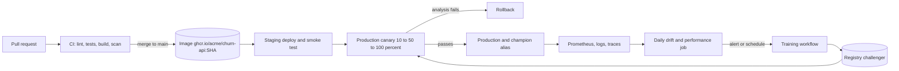

# Capstone part 2: containerise, CI, deploy and monitor

Part 1 produced a tracked, gated model and a FastAPI service. Now we ship it: a container image, a CI/CD
pipeline, a Kubernetes deployment with autoscaling and progressive rollout, and monitoring that closes
the loop back to retraining.



## 1. Container image

```dockerfile
# syntax=docker/dockerfile:1.7
FROM python:3.11.9-slim AS builder
ENV PIP_DISABLE_PIP_VERSION_CHECK=1 PYTHONDONTWRITEBYTECODE=1
RUN python -m venv /opt/venv
ENV PATH="/opt/venv/bin:$PATH"
WORKDIR /build
COPY requirements.lock .
RUN --mount=type=cache,target=/root/.cache/pip pip install --require-hashes -r requirements.lock
COPY pyproject.toml README.md ./
COPY src ./src
RUN pip install --no-deps .

FROM python:3.11.9-slim AS runtime
ARG GIT_SHA=unknown
LABEL org.opencontainers.image.revision=$GIT_SHA
ENV PYTHONUNBUFFERED=1 PATH="/opt/venv/bin:$PATH" GIT_SHA=$GIT_SHA
RUN apt-get update && apt-get install -y --no-install-recommends libgomp1 \
    && rm -rf /var/lib/apt/lists/* \
    && groupadd --system app && useradd --system --gid app --uid 10001 --create-home app
COPY --from=builder /opt/venv /opt/venv
USER 10001
EXPOSE 8000
ENTRYPOINT ["uvicorn", "churn.serve.app:app"]
CMD ["--host", "0.0.0.0", "--port", "8000"]
```

```gitignore
# .dockerignore
.git
.venv
data/
mlruns/
notebooks/
tests/
**/__pycache__
.env
```

Design choices (lessons 16–17): lockfile copied before source for cache hits; multi-stage so no build
tooling ships; non-root numeric UID; SHA label; exec-form entrypoint for clean SIGTERM handling. The
model is **not baked in** — the service loads `models:/churn@champion` at startup, so a model promotion
does not need an image rebuild; a pod restart (or rollout) picks up the new alias target. To make each
rollout fully deterministic, CD resolves the alias to a concrete version and passes
`CHURN_MODEL_URI=models:/churn/<version>`.

## 2. Local stack

```yaml
# compose.yaml (abridged; full version in lesson 18)
services:
  api:
    build: {context: ., target: runtime, args: {GIT_SHA: "${GIT_SHA:-dev}"}}
    ports: ["8000:8000"]
    environment:
      CHURN_MODEL_URI: models:/churn@champion
      MLFLOW_TRACKING_URI: http://mlflow:5000
    depends_on: {mlflow: {condition: service_healthy}}
  mlflow:
    image: ghcr.io/mlflow/mlflow:v2.14.1
    command: mlflow server --host 0.0.0.0 --port 5000 --backend-store-uri sqlite:///mlflow.db --artifacts-destination /artifacts
    volumes: [mlflow:/artifacts]
    healthcheck:
      test: ["CMD", "python", "-c", "import urllib.request; urllib.request.urlopen('http://localhost:5000/health')"]
      interval: 5s
      retries: 20
  prometheus:
    image: prom/prometheus:v2.53.0
    volumes: ["./ops:/etc/prometheus:ro"]
    ports: ["9090:9090"]
volumes: {mlflow: {}}
```

## 3. CI workflow

```yaml
# .github/workflows/ci.yml
name: ci
on:
  pull_request:
  push: {branches: [main]}
concurrency: {group: "ci-${{ github.ref }}", cancel-in-progress: true}
permissions: {contents: read}

jobs:
  test:
    runs-on: ubuntu-latest
    steps:
      - uses: actions/checkout@v4
      - uses: actions/setup-python@v5
        with: {python-version: "3.11", cache: pip}
      - run: pip install -r requirements.lock && pip install -e ".[dev,serve]" --no-deps
      - run: pre-commit run --all-files
      - run: pytest tests/unit tests/data tests/model --cov=churn --cov-fail-under=80
      - name: Training smoke test on fixture data
        run: python -m churn.train --params tests/fixtures/params.small.yaml
        env: {MLFLOW_TRACKING_URI: "file:./mlruns-ci"}

  image:
    needs: test
    runs-on: ubuntu-latest
    permissions: {contents: read, packages: write}
    steps:
      - uses: actions/checkout@v4
      - uses: docker/setup-buildx-action@v3
      - uses: docker/login-action@v3
        with: {registry: ghcr.io, username: "${{ github.actor }}", password: "${{ secrets.GITHUB_TOKEN }}"}
      - uses: docker/build-push-action@v6
        with:
          context: .
          push: ${{ github.event_name == 'push' }}
          tags: ghcr.io/${{ github.repository }}/churn-api:${{ github.sha }}
          build-args: GIT_SHA=${{ github.sha }}
          cache-from: type=gha
          cache-to: type=gha,mode=max
      - name: Integration tests against the container
        run: |
          docker compose up -d --build --wait
          pytest tests/integration -q
          docker compose down -v
```

## 4. Kubernetes manifests

```yaml
# k8s/deployment.yaml
apiVersion: apps/v1
kind: Deployment
metadata: {name: churn-api, labels: {app: churn-api}}
spec:
  replicas: 3
  selector: {matchLabels: {app: churn-api}}
  strategy: {type: RollingUpdate, rollingUpdate: {maxSurge: 1, maxUnavailable: 0}}
  template:
    metadata:
      labels: {app: churn-api}
      annotations: {prometheus.io/scrape: "true", prometheus.io/port: "8000", prometheus.io/path: /metrics}
    spec:
      securityContext: {runAsNonRoot: true, runAsUser: 10001}
      terminationGracePeriodSeconds: 30
      containers:
        - name: api
          image: ghcr.io/acme/churn/churn-api:GIT_SHA          # replaced by CD (kustomize or helm)
          ports: [{name: http, containerPort: 8000}]
          env:
            - {name: CHURN_MODEL_URI, value: "models:/churn/12"}       # pinned version resolved by CD
            - {name: MLFLOW_TRACKING_URI, valueFrom: {configMapKeyRef: {name: churn-config, key: mlflow_uri}}}
          envFrom: [{secretRef: {name: churn-secrets}}]
          resources: {requests: {cpu: 500m, memory: 1Gi}, limits: {memory: 2Gi}}
          startupProbe:   {httpGet: {path: /readyz, port: http}, periodSeconds: 3, failureThreshold: 40}
          readinessProbe: {httpGet: {path: /readyz, port: http}, periodSeconds: 5, failureThreshold: 3}
          livenessProbe:  {httpGet: {path: /healthz, port: http}, periodSeconds: 10, failureThreshold: 3}
          lifecycle: {preStop: {exec: {command: ["sleep", "5"]}}}
---
apiVersion: v1
kind: Service
metadata: {name: churn-api}
spec:
  selector: {app: churn-api}
  ports: [{name: http, port: 80, targetPort: http}]
---
apiVersion: autoscaling/v2
kind: HorizontalPodAutoscaler
metadata: {name: churn-api}
spec:
  scaleTargetRef: {apiVersion: apps/v1, kind: Deployment, name: churn-api}
  minReplicas: 3
  maxReplicas: 20
  metrics:
    - type: Resource
      resource: {name: cpu, target: {type: Utilization, averageUtilization: 60}}
  behavior:
    scaleDown: {stabilizationWindowSeconds: 300}
---
apiVersion: policy/v1
kind: PodDisruptionBudget
metadata: {name: churn-api}
spec:
  minAvailable: 2
  selector: {matchLabels: {app: churn-api}}
```

## 5. CD with a canary

```yaml
# .github/workflows/deploy.yml (essentials)
name: deploy
on:
  workflow_dispatch:
    inputs:
      image_sha: {required: true}
      model_version: {required: true}
jobs:
  canary:
    runs-on: ubuntu-latest
    environment: production                 # required reviewers approve here
    concurrency: deploy-production
    permissions: {id-token: write, contents: read}
    steps:
      - uses: actions/checkout@v4
      - uses: aws-actions/configure-aws-credentials@v4
        with: {role-to-assume: "arn:aws:iam::123456789012:role/gha-deploy", aws-region: eu-west-1}
      - run: aws eks update-kubeconfig --name prod
      - name: Start canary (Argo Rollouts shifts 10 -> 50 -> 100% with Prometheus analysis)
        run: |
          kubectl argo rollouts set image churn-api api=ghcr.io/acme/churn/churn-api:${{ inputs.image_sha }}
          kubectl set env rollout/churn-api CHURN_MODEL_URI=models:/churn/${{ inputs.model_version }}
          kubectl argo rollouts status churn-api --timeout 45m      # non-zero exit if analysis aborts
      - name: Promote registry alias after a healthy rollout
        run: python -m churn.set_alias --name churn --alias champion --version ${{ inputs.model_version }}
        env: {MLFLOW_TRACKING_URI: "${{ vars.MLFLOW_TRACKING_URI }}"}
```

(`churn.set_alias` is a three-line wrapper around `MlflowClient().set_registered_model_alias`.) If the analysis fails, Argo Rollouts aborts and shifts all traffic back to the stable ReplicaSet; the
`champion` alias is never moved. Rollback after promotion is one command: set the alias (and the
rollout) back to the previous version.

## 6. Monitoring configuration

```yaml
# ops/alerts.yml
groups:
  - name: churn-api
    rules:
      - alert: ChurnApiErrorBudgetBurn
        expr: |
          sum(rate(predict_requests_total{status="error"}[5m])) / sum(rate(predict_requests_total[5m])) > 0.072
          and
          sum(rate(predict_requests_total{status="error"}[1h])) / sum(rate(predict_requests_total[1h])) > 0.072
        for: 2m
        labels: {severity: page}
        annotations: {runbook_url: "https://runbooks.acme.example/churn/error-burn"}
      - alert: ChurnApiLatencyP95
        expr: histogram_quantile(0.95, sum by (le) (rate(predict_latency_seconds_bucket[5m]))) > 0.2
        for: 10m
        labels: {severity: ticket}
      - alert: ChurnPredictionMeanShift
        expr: |
          abs(sum(rate(prediction_score_sum[6h])) / sum(rate(prediction_score_count[6h]))
            - sum(rate(prediction_score_sum[6h] offset 7d)) / sum(rate(prediction_score_count[6h] offset 7d))) > 0.05
        for: 3h
        labels: {severity: ticket}
      - alert: ChurnDriftJobStale
        expr: time() - churn_drift_job_last_success_timestamp > 36 * 3600
        labels: {severity: ticket}
```

A Grafana dashboard reads top-down: request rate and error ratio → p50/p95/p99 latency → replicas and CPU
→ score distribution and missing-feature rate → daily drift scores → delayed PR-AUC by cohort, with
deployment annotations on each panel.

## 7. The drift and performance job

The API writes a prediction log (request ID, model version, served features, probabilities). A daily job
compares yesterday's served features with the training reference and, where labels have matured,
computes real performance.

```python
# src/churn/monitor.py  (run daily as a CronJob)
import json, math, sys
import numpy as np, pandas as pd
from churn.features import NUMERIC, build_features

PSI_WARN, PSI_ALERT = 0.10, 0.25

def psi(expected: np.ndarray, actual: np.ndarray, bins: int = 10) -> float:
    lo, hi = float(np.min(expected)), float(np.max(expected))
    if hi == lo:
        return 0.0 if np.all(actual == lo) else float("inf")
    def frac(x):
        idx = np.clip(np.floor((x - lo) / (hi - lo) * bins).astype(int), 0, bins - 1)
        return np.maximum(np.bincount(idx, minlength=bins) / len(x), 1e-4)
    e, a = frac(expected), frac(actual)
    return float(np.sum((a - e) * np.log(a / e)))

def main(reference_path: str, served_path: str, out_path: str) -> int:
    ref = build_features(pd.read_parquet(reference_path))
    cur = build_features(pd.read_parquet(served_path))
    report = {"n_reference": len(ref), "n_current": len(cur), "features": {}}
    for col in NUMERIC:
        report["features"][col] = {
            "psi": round(psi(ref[col].to_numpy(float), cur[col].to_numpy(float)), 4),
            "null_rate_ref": float(ref[col].isna().mean()), "null_rate_cur": float(cur[col].isna().mean()),
        }
    drifted = [c for c, v in report["features"].items() if v["psi"] >= PSI_ALERT]
    report["drifted_features"], report["status"] = drifted, ("alert" if drifted else "ok")
    json.dump(report, open(out_path, "w"), indent=2)
    return 1 if len(drifted) >= 2 else 0          # non-zero exit -> orchestrator marks failure and notifies

if __name__ == "__main__":
    sys.exit(main(*sys.argv[1:4]))
```

### See the monitoring loop run

```python-run
import numpy as np
rng = np.random.default_rng(7)

def psi(expected, actual, bins=10):
    lo, hi = expected.min(), expected.max()
    f = lambda x: np.maximum(np.bincount(np.clip(np.floor((x - lo) / (hi - lo) * bins).astype(int), 0, bins - 1),
                                         minlength=bins) / len(x), 1e-4)
    e, a = f(expected), f(actual)
    return float(np.sum((a - e) * np.log(a / e)))

# reference = training data; production drifts from day 12 (pricing change raises monthly charges)
ref = {"tenure": rng.integers(1, 72, 8000).astype(float), "charges": rng.uniform(20, 120, 8000), "tickets": rng.poisson(1.2, 8000).astype(float)}
THRESH, PATIENCE = 0.25, 2
streak, alerts, retrain_day = 0, [], None
print("day  psi_tenure psi_charges psi_tickets  state")
for day in range(1, 21):
    shift = 0 if day < 12 else 18 + 1.5 * (day - 12)
    cur = {"tenure": rng.integers(1, 72, 1500).astype(float),
           "charges": rng.uniform(20, 120, 1500) + shift,
           "tickets": rng.poisson(1.2, 1500).astype(float)}
    if retrain_day and day > retrain_day:                 # after retraining, the reference is refreshed
        ref["charges"] = rng.uniform(20, 120, 8000) + shift
    scores = {k: psi(ref[k], cur[k]) for k in ref}
    breach = max(scores.values()) >= THRESH
    streak = streak + 1 if breach else 0
    state = "ok"
    if streak == PATIENCE:
        state = "ALERT -> validate data, trigger retraining"; alerts.append(day); retrain_day = day + 1
    elif breach:
        state = "breach (waiting for persistence)" if streak < PATIENCE else "alert active (retraining in progress)"
    if day in (1, 5, 11, 12, 13, 14, 15, 16, 20):
        print(f"{day:3d}  {scores['tenure']:10.3f} {scores['charges']:11.3f} {scores['tickets']:11.3f}  {state}")
print("alerts fired on days:", alerts, "| retrained model live from day", retrain_day + 1 if retrain_day else None)
```

The alert fires only after the breach persists, a retrain is triggered, and — crucially — once the new
model is live the **reference window is updated**, so the alert clears instead of firing forever.

## 8. Continuous training workflow

```yaml
# .github/workflows/train.yml
name: train
on:
  schedule: [{cron: "0 3 1 * *"}]              # monthly baseline
  repository_dispatch: {types: [drift-detected]} # fired by the monitoring job via the GitHub API
  workflow_dispatch:
jobs:
  train:
    runs-on: ubuntu-latest
    env:
      MLFLOW_TRACKING_URI: ${{ vars.MLFLOW_TRACKING_URI }}
    steps:
      - uses: actions/checkout@v4
      - uses: actions/setup-python@v5
        with: {python-version: "3.11", cache: pip}
      - run: pip install -r requirements.lock && pip install -e . --no-deps "dvc[s3]"
      - run: dvc pull && dvc repro                       # validate -> train -> metrics.json
      - id: run
        run: echo "run_id=$(cat .last_run_id)" >> "$GITHUB_OUTPUT"
      - run: python -m churn.promote ${{ steps.run.outputs.run_id }}     # gate; registers @challenger or exits 1
      - run: cat metrics.json >> "$GITHUB_STEP_SUMMARY"
```

A successful run leaves a `@challenger`; the deploy workflow then canaries it. Guardrails against
retraining storms: a cooldown (ignore `drift-detected` events within N days of the last retrain) and a
human review if two consecutive challengers fail the gate.

## 9. Runbook (abridged)

| Alert | First checks | Mitigation |
|---|---|---|
| Error-budget burn | recent deploy? pod restarts/OOM? dependency (MLflow, feature source) down? | `kubectl argo rollouts abort` / undo; scale up; fail over |
| p95 latency | CPU throttling, replica count vs load, batch sizes, downstream latency in traces | scale out, raise HPA max, shed load |
| Prediction mean shift | data-quality report: nulls, ranges, new categories; upstream changes | fix pipeline; if genuine drift, trigger retrain; consider rollback |
| Drift job failed/stale | job logs, input partitions present? | rerun; fix data source |
| Challenger fails gate repeatedly | data quality, label maturity, feature availability | pause automatic retraining; investigate |

## 10. Definition of done

- [ ] Reproducible: `git clone` + `make install` + `dvc pull` + `dvc repro` rebuilds the model.
- [ ] Tracked: each run has code SHA, data hash, config, metrics (overall + slices), model with signature.
- [ ] Tested: unit, data, model, integration tests in CI; coverage gate.
- [ ] Packaged: small non-root image built from a lockfile, tagged with the SHA, scanned.
- [ ] Deployed: probes, resource requests, HPA, PDB; canary with automated analysis; one-step rollback.
- [ ] Observable: RED metrics, score distribution, missing-feature rate, prediction log with request IDs.
- [ ] Monitored: drift and (delayed) performance jobs; alerts with runbooks.
- [ ] Closed loop: scheduled + triggered retraining through the same gates; reference window updates.
- [ ] Documented: README, model card, runbook, architecture diagram.

> [!INTERVIEW]
> A capstone like this is your best answer to "tell me about an ML system you built end to end". Structure
> the story as: problem and metric → data and validation → features and skew prevention → training,
> tracking and gates → packaging → CI/CD and progressive rollout → monitoring and retraining → what broke
> and what you would do next. Interviewers probe trade-offs: why batch vs online, why this gate threshold,
> what happens when the registry is down at startup, how you roll back.

## Summary

- A multi-stage, non-root image built from a lockfile and tagged with the commit SHA packages the service;
  the model is loaded from the registry by pinned version.
- CI runs hooks, tests, a training smoke test, builds and tests the image; CD canaries with automated
  analysis and moves the `champion` alias only after success.
- Kubernetes provides probes, autoscaling and disruption budgets; Prometheus alerts cover errors, latency,
  prediction shift and stale jobs.
- A daily drift/performance job closes the loop by triggering gated retraining, after which the drift
  reference is refreshed.

```quiz
[
  {"q": "Why does CD pass a pinned `models:/churn/<version>` instead of `@champion` to the pods?",
   "options": ["Aliases are slower", "So every pod in a rollout loads the same known version, making rollouts deterministic and auditable", "MLflow forbids aliases in Kubernetes", "To reduce image size"],
   "answer": 1, "explain": "An alias can move between pod restarts; a pinned version cannot."},
  {"q": "When is the `champion` alias moved to the new model version?",
   "options": ["Immediately after training", "After the offline gate only", "After the production canary completes successfully", "Never"],
   "answer": 2, "explain": "Offline gates produce a challenger; online validation earns the champion alias."},
  {"q": "What happens if the canary analysis fails in this setup?",
   "options": ["The rollout continues", "The rollout aborts, traffic returns to the stable version and the alias is not moved", "The cluster is deleted", "A new model is trained automatically"],
   "answer": 1, "explain": "Automated rollback limits the blast radius."},
  {"q": "Why must the drift reference be refreshed after a retrained model is promoted?",
   "options": ["To save disk space", "Otherwise current data is still compared with the old training distribution and the alert never clears", "Prometheus requires it", "To change the threshold"],
   "answer": 1, "explain": "The reference should match what the serving model was trained on."},
  {"q": "What is the purpose of the `ChurnDriftJobStale` alert?",
   "options": ["Detect slow predictions", "Detect that the monitoring job itself stopped running, so silence is not mistaken for health", "Scale the cluster", "Rotate secrets"],
   "answer": 1, "explain": "Absence-of-signal alerts guard the monitors themselves."},
  {"q": "Which guard helps prevent retraining storms?",
   "options": ["Removing the gate", "A cooldown between triggered retrains and human review after repeated gate failures", "Increasing replicas", "Disabling drift detection"],
   "answer": 1, "explain": "Automation needs limits so a noisy signal cannot trigger endless retrains."},
  {"q": "Why is the model not baked into the image here?",
   "options": ["Docker cannot store models", "Model promotions then need no image rebuild; the service loads a pinned registry version at startup", "It would break pydantic", "To avoid using MLflow"],
   "answer": 1, "explain": "The trade-off is a startup dependency on the registry, mitigated by readiness probes and pinning."}
]
```

> **Source:** Synthesis of this track, applying: Bill Lubanovic, *FastAPI*, ch. 13 (production deployment, Docker, Kubernetes); Docker, GitHub Actions, Kubernetes, Argo Rollouts, Prometheus and MLflow documentation; Chip Huyen, *AI Engineering*, ch. 10 (monitoring, feedback and architecture); Google Cloud, *MLOps: Continuous delivery and automation pipelines in machine learning*.
