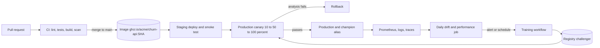

# Capstone part 2: containerise, CI, deploy and monitor

> **Before this lesson:** read [Capstone part 1](#/lesson/mlops/capstone-build), which builds the
> model, the promotion gate and the FastAPI service this lesson ships. The steps here reuse
> [Docker fundamentals](#/lesson/mlops/docker-fundamentals) and
> [Dockerfiles for ML](#/lesson/mlops/dockerfile-ml), [Docker Compose](#/lesson/mlops/compose),
> [CI/CD with GitHub Actions](#/lesson/mlops/github-actions),
> [Kubernetes core objects](#/lesson/mlops/k8s-core) and
> [Scaling, GPUs and KServe](#/lesson/mlops/k8s-ml),
> [Deployment strategies](#/lesson/mlops/deployment-strategies),
> [Metrics, logs, traces and Prometheus](#/lesson/mlops/observability),
> [Data drift](#/lesson/mlops/drift) and
> [Alerting and retraining](#/lesson/mlops/alerting-retraining). Each term is defined again when it
> first appears, so you can follow along even if some of those lessons are still ahead of you.

## In plain words

Part 1 ended with a model that passed its checks and a small web service that can answer questions with
it, running on one laptop. Part 2 is about **shipping**: getting that service onto servers where real
users reach it, updating it safely, and noticing when it starts to go wrong.

Think of a bakery that has perfected a recipe in its test kitchen. Shipping means four more things:
packing each cake in a standard box so it survives any delivery van (the **container image**); an
assembly line that checks every batch before it leaves (**CI/CD**, continuous integration and continuous
delivery); stocking a few shops before all of them, so a bad batch is caught early (**canary
release**); and listening to customer complaints and sales figures so you know when the recipe needs
updating (**monitoring** and **retraining**).

Why this matters for a job: many models never reach users, and many that do quietly decay. Employers hire
MLOps engineers to make the path from "a model works on my laptop" to "a model is safely serving millions
of requests and is retrained when the world changes" routine and boring. In interviews, being able to walk
through this exact flow, with the reasons for each guard rail, is strong evidence you have done real work.

## The shipping pipeline at a glance



Reading left to right: a developer opens a **pull request** (a proposed code change that teammates review
before it is merged). **CI** runs automatic checks on it. When the change is merged into the main branch,
an **image** is built and stored in a **container registry** (a server that stores images, here GitHub's
`ghcr.io`), tagged with the commit SHA (the unique ID of that code version). The image goes first to
**staging** (a copy of production used for final checks) and then to production as a **canary**: a small
share of traffic first, more only if metrics stay healthy. **Rollback** means going back to the previous
version. Once in production, metrics, logs and **traces** (records of one request's path through several
services) feed a daily job that looks for **drift**, a change in the incoming data. Drift or a schedule
starts the **training workflow**, whose gated output becomes a new challenger, and the loop repeats.

## 1. Container image

A **container** is a running program packaged together with everything it needs (Python, libraries,
system files), isolated from the rest of the machine. An **image** is the read-only template a container
starts from, built from a recipe called a **Dockerfile**. The same image runs identically on a laptop, a
CI machine and a production server, which removes a whole family of "but it worked on my machine" bugs.

```dockerfile
# syntax=docker/dockerfile:1.7
FROM python:3.11.9-slim AS builder
ENV PIP_DISABLE_PIP_VERSION_CHECK=1 PYTHONDONTWRITEBYTECODE=1
RUN python -m venv /opt/venv
ENV PATH="/opt/venv/bin:$PATH"
WORKDIR /build
COPY requirements.lock .
RUN --mount=type=cache,target=/root/.cache/pip pip install --require-hashes -r requirements.lock
COPY pyproject.toml README.md ./
COPY src ./src
RUN pip install --no-deps .

FROM python:3.11.9-slim AS runtime
ARG GIT_SHA=unknown
LABEL org.opencontainers.image.revision=$GIT_SHA
ENV PYTHONUNBUFFERED=1 PATH="/opt/venv/bin:$PATH" GIT_SHA=$GIT_SHA
RUN apt-get update && apt-get install -y --no-install-recommends libgomp1 \
    && rm -rf /var/lib/apt/lists/* \
    && groupadd --system app && useradd --system --gid app --uid 10001 --create-home app
COPY --from=builder /opt/venv /opt/venv
USER 10001
EXPOSE 8000
ENTRYPOINT ["uvicorn", "churn.serve.app:app"]
CMD ["--host", "0.0.0.0", "--port", "8000"]
```

This is a **multi-stage build**: two `FROM` lines create two stages, and only the second one becomes the
final image.

**Stage 1, `builder`.** It starts from a small official Python image (`slim`) with an exact version, so a
rebuild next year gets the same Python. It creates a **virtual environment** (`venv`), an isolated folder
of Python packages, and installs the dependencies from `requirements.lock`, a **lockfile** listing every
package with an exact version and a hash. `--require-hashes` refuses any download whose hash does not
match, which blocks tampered packages. The `--mount=type=cache` line keeps pip's download cache between
builds, so rebuilding is faster. Only then is the source code copied and installed.

The order matters because of the **build cache**. Each instruction creates a **layer**, and Docker reuses
a cached layer as long as nothing before it changed. Copying the lockfile and installing dependencies
*before* copying the code means a one-line code change re-runs only the last two steps instead of
reinstalling every library.

**Stage 2, `runtime`.** It starts again from a clean slim image, installs one system library the model
needs (`libgomp1`, which provides parallel processing used by gradient boosting), deletes the package
lists to keep the layer small, and creates an unprivileged user. `COPY --from=builder` brings over only
the finished virtual environment; compilers and caches from stage 1 are left behind, so the final image
is smaller and has fewer tools an attacker could misuse. `USER 10001` runs the service as that
**non-root** user (root is the all-powerful administrator account; a hijacked root process can do far
more damage). `LABEL` stamps the commit SHA into the image's metadata. `EXPOSE 8000` documents the port.
`ENTRYPOINT` starts **uvicorn**, the web server that runs the FastAPI app; written as a JSON list (the
"exec form"), it receives the shutdown signal directly and can finish in-flight requests cleanly.

A `.dockerignore` file lists what must never be sent to the build:

```gitignore
# .dockerignore
.git
.venv
data/
mlruns/
notebooks/
tests/
**/__pycache__
.env
```

Leaving out data, experiment folders and notebooks keeps builds fast and images small; leaving out `.env`
keeps secrets (passwords and keys) out of the image, where anyone who can pull it could read them.

**Why the model is not inside the image.** The service loads `models:/churn@champion` from the registry
when it starts. Promoting a new model therefore needs no image rebuild; restarting the pods (or rolling
out) picks it up. To make each rollout fully predictable, the deployment step resolves the alias to a
concrete version number and passes `CHURN_MODEL_URI=models:/churn/<version>`, so every copy of the
service in one rollout is guaranteed to load the same model even if someone moves the alias halfway
through. The trade-off is that the service now depends on the registry being reachable at startup, which
the readiness probe below handles.

## 2. Local stack

Before touching the cloud, you want the whole system on your laptop: the API, an MLflow server for the
registry and Prometheus for metrics. **Docker Compose** starts several containers together from one file.

```yaml
# compose.yaml (abridged; full version in lesson 18)
services:
  api:
    build: {context: ., target: runtime, args: {GIT_SHA: "${GIT_SHA:-dev}"}}
    ports: ["8000:8000"]
    environment:
      CHURN_MODEL_URI: models:/churn@champion
      MLFLOW_TRACKING_URI: http://mlflow:5000
    depends_on: {mlflow: {condition: service_healthy}}
  mlflow:
    image: ghcr.io/mlflow/mlflow:v2.14.1
    command: mlflow server --host 0.0.0.0 --port 5000 --backend-store-uri sqlite:///mlflow.db --artifacts-destination /artifacts
    volumes: [mlflow:/artifacts]
    healthcheck:
      test: ["CMD", "python", "-c", "import urllib.request; urllib.request.urlopen('http://localhost:5000/health')"]
      interval: 5s
      retries: 20
  prometheus:
    image: prom/prometheus:v2.53.0
    volumes: ["./ops:/etc/prometheus:ro"]
    ports: ["9090:9090"]
volumes: {mlflow: {}}
```

Each entry under `services` is one container. `api` is built from our Dockerfile; `ports: ["8000:8000"]`
makes it reachable on your laptop's port 8000. Inside Compose, containers find each other by service name,
so the API reaches MLflow at `http://mlflow:5000`. `depends_on` with `condition: service_healthy` delays
the API until MLflow's **healthcheck** (a small command run every 5 seconds to test that MLflow answers)
succeeds; otherwise the API would start first, fail to load the model and crash. A **volume** is storage
that survives container restarts, so registered models are not lost. `:ro` mounts the Prometheus config
read-only.

`docker compose up` starts all three; the integration tests in CI use the same file.

## 3. CI workflow

**Continuous integration (CI)** means every change is automatically built and tested, so problems are
found within minutes of being introduced. **GitHub Actions** runs **workflows** described in YAML files:
each workflow has **triggers** (`on:`), **jobs** that run on fresh virtual machines (**runners**), and
**steps** inside each job.

```yaml
# .github/workflows/ci.yml
name: ci
on:
  pull_request:
  push: {branches: [main]}
concurrency: {group: "ci-${{ github.ref }}", cancel-in-progress: true}
permissions: {contents: read}

jobs:
  test:
    runs-on: ubuntu-latest
    steps:
      - uses: actions/checkout@v4
      - uses: actions/setup-python@v5
        with: {python-version: "3.11", cache: pip}
      - run: pip install -r requirements.lock && pip install -e ".[dev,serve]" --no-deps
      - run: pre-commit run --all-files
      - run: pytest tests/unit tests/data tests/model --cov=churn --cov-fail-under=80
      - name: Training smoke test on fixture data
        run: python -m churn.train --params tests/fixtures/params.small.yaml
        env: {MLFLOW_TRACKING_URI: "file:./mlruns-ci"}

  image:
    needs: test
    runs-on: ubuntu-latest
    permissions: {contents: read, packages: write}
    steps:
      - uses: actions/checkout@v4
      - uses: docker/setup-buildx-action@v3
      - uses: docker/login-action@v3
        with: {registry: ghcr.io, username: "${{ github.actor }}", password: "${{ secrets.GITHUB_TOKEN }}"}
      - uses: docker/build-push-action@v6
        with:
          context: .
          push: ${{ github.event_name == 'push' }}
          tags: ghcr.io/${{ github.repository }}/churn-api:${{ github.sha }}
          build-args: GIT_SHA=${{ github.sha }}
          cache-from: type=gha
          cache-to: type=gha,mode=max
      - name: Integration tests against the container
        run: |
          docker compose up -d --build --wait
          pytest tests/integration -q
          docker compose down -v
```

The top section: the workflow runs on every pull request and on every push to `main`. `concurrency` with
`cancel-in-progress` cancels an older run when you push again to the same branch, which saves runner
minutes. `permissions: {contents: read}` gives the workflow's automatic access token the least power it
needs (it can read the code, nothing more), a basic security habit.

**Job `test`** checks out the code, installs Python with a pip cache, installs the exact locked
dependencies, runs the pre-commit hooks (formatting and linting), and runs the unit, data and model tests.
`--cov-fail-under=80` fails the job if less than 80% of the code lines were exercised by tests
(**coverage**). The last step is a **smoke test**: a quick run that checks the basics do not crash. Here it
trains on a tiny fixture dataset, so a broken training script is caught in a minute instead of in the
nightly training job. MLflow writes to a local folder so no server is needed.

**Job `image`** runs only after `test` succeeds (`needs: test`) and gets extra permission to write
packages. It logs in to the registry with a token GitHub provides automatically, then builds the image.
The image is pushed only for pushes to `main` (`push: ${{ github.event_name == 'push' }}`); pull requests
build it to prove it builds but do not publish it. The tag is the commit SHA, so every image can be traced
to exact code. `cache-from` and `cache-to` with `type=gha` store Docker's layer cache in GitHub's cache
service, so builds on fresh runners still reuse layers. Finally, the integration tests run against the
real container started with Compose (`--wait` blocks until healthchecks pass), and `down -v` cleans up.

The `${{ ... }}` syntax inserts values GitHub provides, such as the commit SHA or a stored **secret** (an
encrypted value, such as a password, that is never printed in logs).

## 4. Kubernetes manifests

**Kubernetes** is a system that runs containers across a group of machines (a **cluster**), restarts them
when they fail, spreads traffic among them and adds or removes copies as load changes. You describe the
desired state in YAML files called **manifests**, and Kubernetes keeps reality matching them.

```yaml
# k8s/deployment.yaml
apiVersion: apps/v1
kind: Deployment
metadata: {name: churn-api, labels: {app: churn-api}}
spec:
  replicas: 3
  selector: {matchLabels: {app: churn-api}}
  strategy: {type: RollingUpdate, rollingUpdate: {maxSurge: 1, maxUnavailable: 0}}
  template:
    metadata:
      labels: {app: churn-api}
      annotations: {prometheus.io/scrape: "true", prometheus.io/port: "8000", prometheus.io/path: /metrics}
    spec:
      securityContext: {runAsNonRoot: true, runAsUser: 10001}
      terminationGracePeriodSeconds: 30
      containers:
        - name: api
          image: ghcr.io/acme/churn/churn-api:GIT_SHA          # replaced by CD (kustomize or helm)
          ports: [{name: http, containerPort: 8000}]
          env:
            - {name: CHURN_MODEL_URI, value: "models:/churn/12"}       # pinned version resolved by CD
            - {name: MLFLOW_TRACKING_URI, valueFrom: {configMapKeyRef: {name: churn-config, key: mlflow_uri}}}
          envFrom: [{secretRef: {name: churn-secrets}}]
          resources: {requests: {cpu: 500m, memory: 1Gi}, limits: {memory: 2Gi}}
          startupProbe:   {httpGet: {path: /readyz, port: http}, periodSeconds: 3, failureThreshold: 40}
          readinessProbe: {httpGet: {path: /readyz, port: http}, periodSeconds: 5, failureThreshold: 3}
          livenessProbe:  {httpGet: {path: /healthz, port: http}, periodSeconds: 10, failureThreshold: 3}
          lifecycle: {preStop: {exec: {command: ["sleep", "5"]}}}
---
apiVersion: v1
kind: Service
metadata: {name: churn-api}
spec:
  selector: {app: churn-api}
  ports: [{name: http, port: 80, targetPort: http}]
---
apiVersion: autoscaling/v2
kind: HorizontalPodAutoscaler
metadata: {name: churn-api}
spec:
  scaleTargetRef: {apiVersion: apps/v1, kind: Deployment, name: churn-api}
  minReplicas: 3
  maxReplicas: 20
  metrics:
    - type: Resource
      resource: {name: cpu, target: {type: Utilization, averageUtilization: 60}}
  behavior:
    scaleDown: {stabilizationWindowSeconds: 300}
---
apiVersion: policy/v1
kind: PodDisruptionBudget
metadata: {name: churn-api}
spec:
  minAvailable: 2
  selector: {matchLabels: {app: churn-api}}
```

The file holds four objects separated by `---`.

**The Deployment** keeps a number of identical **pods** running. A pod is the smallest unit Kubernetes
runs: one or more containers sharing a network address. `replicas: 3` asks for three copies. The
**rolling update** strategy replaces pods gradually during an upgrade: `maxSurge: 1` allows one extra pod
above three, and `maxUnavailable: 0` forbids dropping below three, so capacity never shrinks mid-upgrade.
The **annotations** tell Prometheus to collect metrics from port 8000 at `/metrics`. The security context
repeats the non-root rule at the cluster level.

Inside the container section:

- `image` names the image; the `GIT_SHA` placeholder is replaced by the deployment tooling (Kustomize or
  Helm, tools that fill in per-environment values).
- `env` sets the pinned model version and reads the MLflow address from a **ConfigMap** (a Kubernetes
  object holding non-secret settings). `envFrom` with `secretRef` loads every value from a **Secret**
  (the same idea for sensitive values).
- `resources.requests` is what the pod reserves: half a CPU core (`500m`, 500 millicores) and 1 GiB of
  memory. The scheduler only places it on a machine with that much free. `limits.memory` is a hard cap:
  a pod that uses more than 2 GiB is killed (the famous **OOMKilled**, out of memory).
- **Probes** are the health checks Kubernetes runs. The **startup probe** gives a slow-loading model up to
  40 x 3 = 120 seconds before other probes start. The **readiness probe** removes the pod from traffic
  whenever `/readyz` fails. The **liveness probe** restarts the container if `/healthz` fails three times
  in a row.
- `preStop` waits 5 seconds before shutdown so load balancers stop sending new requests first, and
  `terminationGracePeriodSeconds: 30` gives in-flight requests time to finish.

**The Service** gives the pods one stable internal address and spreads requests among the pods whose label
is `app: churn-api`, whichever machines they are on.

**The HorizontalPodAutoscaler (HPA)** changes the replica count between 3 and 20 to keep average CPU use
near 60% of the request. The `stabilizationWindowSeconds: 300` setting makes it wait five minutes before
scaling down, so a brief lull does not remove pods that a returning spike will need.

**The PodDisruptionBudget (PDB)** says at least two pods must stay up during voluntary disruptions, such
as an administrator draining a machine for maintenance.

## 5. CD with a canary

**Continuous delivery (CD)** automates releasing a tested version. Releasing to everyone at once is
risky, so we use a **canary**: send a small share of traffic to the new version, compare its metrics with
the old one, and either increase the share or roll back automatically.

```yaml
# .github/workflows/deploy.yml (essentials)
name: deploy
on:
  workflow_dispatch:
    inputs:
      image_sha: {required: true}
      model_version: {required: true}
jobs:
  canary:
    runs-on: ubuntu-latest
    environment: production                 # required reviewers approve here
    concurrency: deploy-production
    permissions: {id-token: write, contents: read}
    steps:
      - uses: actions/checkout@v4
      - uses: aws-actions/configure-aws-credentials@v4
        with: {role-to-assume: "arn:aws:iam::123456789012:role/gha-deploy", aws-region: eu-west-1}
      - run: aws eks update-kubeconfig --name prod
      - name: Start canary (Argo Rollouts shifts 10 -> 50 -> 100% with Prometheus analysis)
        run: |
          kubectl argo rollouts set image churn-api api=ghcr.io/acme/churn/churn-api:${{ inputs.image_sha }}
          kubectl set env rollout/churn-api CHURN_MODEL_URI=models:/churn/${{ inputs.model_version }}
          kubectl argo rollouts status churn-api --timeout 45m      # non-zero exit if analysis aborts
      - name: Promote registry alias after a healthy rollout
        run: python -m churn.set_alias --name churn --alias champion --version ${{ inputs.model_version }}
        env: {MLFLOW_TRACKING_URI: "${{ vars.MLFLOW_TRACKING_URI }}"}
```

Line by line:

- `workflow_dispatch` means the workflow is started by hand (or by another workflow) with two inputs:
  which image and which model version to release.
- `environment: production` attaches GitHub's environment protection: named people must approve before
  the job runs. `concurrency: deploy-production` prevents two deployments from overlapping.
- `id-token: write` lets the job prove its identity to AWS with a short-lived token (**OIDC**, OpenID
  Connect), so no long-lived cloud password is stored in GitHub. The job then assumes a deployment role
  and connects `kubectl`, the Kubernetes command-line tool, to the production cluster on EKS (Amazon's
  managed Kubernetes).
- **Argo Rollouts** is a Kubernetes add-on that performs canaries. The two `kubectl` commands set the new
  image and pinned model; Argo then shifts 10%, 50% and finally 100% of traffic, and at each step runs an
  **analysis**: Prometheus queries that compare error rate and latency with thresholds.
  `rollouts status` waits up to 45 minutes and exits with a non-zero code if the analysis aborts, which
  fails this job.
- Only if the rollout finished healthily does the last step move the `champion` alias to the new model
  version. (`churn.set_alias` is a three-line wrapper around `MlflowClient().set_registered_model_alias`.)

If the analysis fails, Argo Rollouts aborts and sends all traffic back to the stable version, and the
`champion` alias is never moved. Rollback after promotion is one command: set the alias (and the rollout)
back to the previous version.

## 6. Monitoring configuration

**Monitoring** means continuously measuring the running system and alerting a human when something needs
attention. **Prometheus** collects the metrics the API exposes and evaluates **alert rules** written in its
query language **PromQL**.

```yaml
# ops/alerts.yml
groups:
  - name: churn-api
    rules:
      - alert: ChurnApiErrorBudgetBurn
        expr: |
          sum(rate(predict_requests_total{status="error"}[5m])) / sum(rate(predict_requests_total[5m])) > 0.072
          and
          sum(rate(predict_requests_total{status="error"}[1h])) / sum(rate(predict_requests_total[1h])) > 0.072
        for: 2m
        labels: {severity: page}
        annotations: {runbook_url: "https://runbooks.acme.example/churn/error-burn"}
      - alert: ChurnApiLatencyP95
        expr: histogram_quantile(0.95, sum by (le) (rate(predict_latency_seconds_bucket[5m]))) > 0.2
        for: 10m
        labels: {severity: ticket}
      - alert: ChurnPredictionMeanShift
        expr: |
          abs(sum(rate(prediction_score_sum[6h])) / sum(rate(prediction_score_count[6h]))
            - sum(rate(prediction_score_sum[6h] offset 7d)) / sum(rate(prediction_score_count[6h] offset 7d))) > 0.05
        for: 3h
        labels: {severity: ticket}
      - alert: ChurnDriftJobStale
        expr: time() - churn_drift_job_last_success_timestamp > 36 * 3600
        labels: {severity: ticket}
```

Some vocabulary first. `rate(x[5m])` is the per-second increase of counter `x` over the last 5 minutes.
`for: 2m` means the condition must stay true for 2 minutes before the alert fires, which filters out
blips. `severity: page` wakes someone up; `severity: ticket` opens a task for working hours. A
**runbook** is a written guide for responding to a specific alert.

The four rules:

1. **Error-budget burn.** Suppose the **SLO** (service level objective) is 99.5% successful requests. The
   remaining 0.5% is the **error budget**. The threshold 0.072 is 14.4 times 0.5%: at that rate a 30-day
   budget would be gone in about two days. The rule requires the error ratio to exceed it over both the
   last 5 minutes (it is happening now) and the last hour (it is not a single blip). The problem
   **mlops-error-budget-burn** lets you implement this two-window logic yourself.
2. **Latency p95.** `histogram_quantile(0.95, ...)` estimates from the histogram buckets the time under
   which 95% of requests finish (the **p95**). A ticket opens if it stays above 200 ms for 10 minutes.
3. **Prediction mean shift.** It compares the average predicted probability over the last 6 hours with
   the same 6 hours a week earlier (`offset 7d`, which also cancels out daily and weekly rhythms). A
   shift of more than 0.05 sustained for 3 hours suggests the inputs changed. This works without any
   labels, which matters because true churn outcomes arrive weeks later.
4. **Drift job stale.** The daily monitoring job records the time of its last success. If that is older
   than 36 hours, the job itself is broken. Without this rule, a dead monitor looks exactly like a healthy
   system: no alerts.

A **Grafana** dashboard (Grafana draws charts from Prometheus data) reads from top to bottom: request
rate and error ratio, then p50/p95/p99 latency, then replicas and CPU, then score distribution and
missing-feature rate, then daily drift scores, then delayed PR-AUC by customer group, with a marker on
every panel for each deployment so you can see whether a change lines up with a release.

## 7. The drift and performance job

The API writes a prediction log (request ID, model version, served features, probabilities). Once a day,
a job compares yesterday's served features with the **reference** data the model was trained on, and,
where true outcomes have become known, computes real performance.

The comparison uses the **Population Stability Index (PSI)**. Split a feature's range into bins (10
equal-width intervals between the reference minimum and maximum), compute the fraction of reference rows
and of current rows in each bin, and add up `(current - reference) x ln(current / reference)` over the
bins. Identical distributions give 0. A common rule of thumb reads below 0.1 as stable, 0.1 to 0.25 as a
moderate shift and above 0.25 as a major shift.

```python
# src/churn/monitor.py  (run daily as a CronJob)
import json, math, sys
import numpy as np, pandas as pd
from churn.features import NUMERIC, build_features

PSI_WARN, PSI_ALERT = 0.10, 0.25

def psi(expected: np.ndarray, actual: np.ndarray, bins: int = 10) -> float:
    lo, hi = float(np.min(expected)), float(np.max(expected))
    if hi == lo:
        return 0.0 if np.all(actual == lo) else float("inf")
    def frac(x):
        idx = np.clip(np.floor((x - lo) / (hi - lo) * bins).astype(int), 0, bins - 1)
        return np.maximum(np.bincount(idx, minlength=bins) / len(x), 1e-4)
    e, a = frac(expected), frac(actual)
    return float(np.sum((a - e) * np.log(a / e)))

def main(reference_path: str, served_path: str, out_path: str) -> int:
    ref = build_features(pd.read_parquet(reference_path))
    cur = build_features(pd.read_parquet(served_path))
    report = {"n_reference": len(ref), "n_current": len(cur), "features": {}}
    for col in NUMERIC:
        report["features"][col] = {
            "psi": round(psi(ref[col].to_numpy(float), cur[col].to_numpy(float)), 4),
            "null_rate_ref": float(ref[col].isna().mean()), "null_rate_cur": float(cur[col].isna().mean()),
        }
    drifted = [c for c, v in report["features"].items() if v["psi"] >= PSI_ALERT]
    report["drifted_features"], report["status"] = drifted, ("alert" if drifted else "ok")
    json.dump(report, open(out_path, "w"), indent=2)
    return 1 if len(drifted) >= 2 else 0          # non-zero exit -> orchestrator marks failure and notifies

if __name__ == "__main__":
    sys.exit(main(*sys.argv[1:4]))
```

How the code works:

- In `psi`, if every reference value is identical (`hi == lo`) there is no range to bin, so it returns 0
  when the current data is also constant at that value and infinity otherwise.
- `frac` turns each value into a bin number between 0 and 9. `np.clip` puts values outside the reference
  range into the first or last bin instead of losing them. `np.bincount` counts rows per bin, and dividing
  by the row count gives fractions. `np.maximum(..., 1e-4)` replaces empty bins by a tiny fraction,
  because the logarithm of 0 is undefined.
- `main` runs the **same** `build_features` used in training and serving on both the reference and the
  served data, so it compares like with like. For every numeric feature it records the PSI and the share
  of missing values before and after.
- Features with PSI at or above 0.25 are marked as drifted. If two or more drift, the job exits with code
  1. The scheduler running it (a Kubernetes **CronJob**, which starts a container on a timetable) marks
  the run as failed and notifies the team.

### See the monitoring loop run

The simulation below creates a reference dataset, then 20 days of production data. From day 12 a pricing
change raises monthly charges a little more each day. It computes PSI per feature per day and fires an
alert only after the breach has lasted two days in a row.

```python-run
import numpy as np
rng = np.random.default_rng(7)

def psi(expected, actual, bins=10):
    lo, hi = expected.min(), expected.max()
    f = lambda x: np.maximum(np.bincount(np.clip(np.floor((x - lo) / (hi - lo) * bins).astype(int), 0, bins - 1),
                                         minlength=bins) / len(x), 1e-4)
    e, a = f(expected), f(actual)
    return float(np.sum((a - e) * np.log(a / e)))

# reference = training data; production drifts from day 12 (pricing change raises monthly charges)
ref = {"tenure": rng.integers(1, 72, 8000).astype(float), "charges": rng.uniform(20, 120, 8000), "tickets": rng.poisson(1.2, 8000).astype(float)}
THRESH, PATIENCE = 0.25, 2
streak, alerts, retrain_day = 0, [], None
print("day  psi_tenure psi_charges psi_tickets  state")
for day in range(1, 21):
    shift = 0 if day < 12 else 18 + 1.5 * (day - 12)
    cur = {"tenure": rng.integers(1, 72, 1500).astype(float),
           "charges": rng.uniform(20, 120, 1500) + shift,
           "tickets": rng.poisson(1.2, 1500).astype(float)}
    if retrain_day and day > retrain_day:                 # after retraining, the reference is refreshed
        ref["charges"] = rng.uniform(20, 120, 8000) + shift
    scores = {k: psi(ref[k], cur[k]) for k in ref}
    breach = max(scores.values()) >= THRESH
    streak = streak + 1 if breach else 0
    state = "ok"
    if streak == PATIENCE:
        state = "ALERT -> validate data, trigger retraining"; alerts.append(day); retrain_day = day + 1
    elif breach:
        state = "breach (waiting for persistence)" if streak < PATIENCE else "alert active (retraining in progress)"
    if day in (1, 5, 11, 12, 13, 14, 15, 16, 20):
        print(f"{day:3d}  {scores['tenure']:10.3f} {scores['charges']:11.3f} {scores['tickets']:11.3f}  {state}")
print("alerts fired on days:", alerts, "| retrained model live from day", retrain_day + 1 if retrain_day else None)
```

What you should see: days 1 to 11 have PSI values around 0.01 for every feature (normal sampling noise).
On day 12 the charges PSI jumps to about 1.0, a major shift, but the state is only "breach (waiting for
persistence)". On day 13 the breach persists, so the alert fires and retraining is triggered. Day 14 is
still in breach while the new model is being trained. From day 15 the retrained model is live and the
reference has been refreshed to the new price level, so PSI drops back near 0.01 and the state returns to
"ok". The last line reports one alert on day 13.

Two lessons hide in that output. Requiring **persistence** (two days in a row) avoids retraining on a
single odd day. And once the new model is live, the **reference must be updated** to the data it was
trained on; otherwise today's data would be compared forever with the old training distribution and the
alert would never clear.

## 8. Continuous training workflow

**Continuous training (CT)** means retraining runs automatically, both on a schedule and when monitoring
asks for it, through the same validation and gates as a manual run.

```yaml
# .github/workflows/train.yml
name: train
on:
  schedule: [{cron: "0 3 1 * *"}]              # monthly baseline
  repository_dispatch: {types: [drift-detected]} # fired by the monitoring job via the GitHub API
  workflow_dispatch:
jobs:
  train:
    runs-on: ubuntu-latest
    env:
      MLFLOW_TRACKING_URI: ${{ vars.MLFLOW_TRACKING_URI }}
    steps:
      - uses: actions/checkout@v4
      - uses: actions/setup-python@v5
        with: {python-version: "3.11", cache: pip}
      - run: pip install -r requirements.lock && pip install -e . --no-deps "dvc[s3]"
      - run: dvc pull && dvc repro                       # validate -> train -> metrics.json
      - id: run
        run: echo "run_id=$(cat .last_run_id)" >> "$GITHUB_OUTPUT"
      - run: python -m churn.promote ${{ steps.run.outputs.run_id }}     # gate; registers @challenger or exits 1
      - run: cat metrics.json >> "$GITHUB_STEP_SUMMARY"
```

Three triggers start it. The **cron** expression `0 3 1 * *` means minute 0, hour 3, day 1 of every month
(cron's five fields are minute, hour, day of month, month and day of week). `repository_dispatch` lets the
monitoring job start training through GitHub's API with the event name `drift-detected`.
`workflow_dispatch` allows a manual start.

The steps install dependencies, `dvc pull` downloads the data version recorded in Git, and `dvc repro`
validates and trains. The run ID is saved as a **step output** (`$GITHUB_OUTPUT`) so the next step can
read it as `steps.run.outputs.run_id`. The gate then registers a `@challenger` or exits with code 1, which
fails the workflow. The metrics file is appended to the run's summary page for humans to read.

A successful run leaves a `@challenger`; the deploy workflow then canaries it. Two guard rails stop a
**retraining storm** (a noisy signal triggering retrain after retrain): a **cooldown** that ignores
`drift-detected` events within a few days of the last retrain, and a human review if two challengers in
a row fail the gate, because that usually means a data problem rather than a model problem.

## 9. Runbook (abridged)

When an alert fires at 3 a.m., nobody should have to invent a diagnosis. The runbook lists the first
checks and the safe mitigations for each alert.

| Alert | First checks | Mitigation |
|---|---|---|
| Error-budget burn | recent deploy? pod restarts/OOM? dependency (MLflow, feature source) down? | `kubectl argo rollouts abort` / undo; scale up; fail over |
| p95 latency | CPU throttling, replica count vs load, batch sizes, downstream latency in traces | scale out, raise HPA max, shed load |
| Prediction mean shift | data-quality report: nulls, ranges, new categories; upstream changes | fix pipeline; if genuine drift, trigger retrain; consider rollback |
| Drift job failed/stale | job logs, input partitions present? | rerun; fix data source |
| Challenger fails gate repeatedly | data quality, label maturity, feature availability | pause automatic retraining; investigate |

Some terms in the table: **CPU throttling** happens when a container hits its CPU limit and is forced to
wait; **shedding load** means deliberately rejecting some requests to protect the rest; **failing over**
means switching to a backup system; a **partition** is one slice of a large dataset, often one day's
files; **label maturity** is whether enough time has passed for true outcomes to be known (a customer who
was predicted to churn yesterday has not had time to churn yet).

## 10. Definition of done

A checklist turns "is it finished?" into a yes or no for each item:

- [ ] Reproducible: `git clone` + `make install` + `dvc pull` + `dvc repro` rebuilds the model.
- [ ] Tracked: each run has code SHA, data hash, config, metrics (overall + slices), model with signature.
- [ ] Tested: unit, data, model, integration tests in CI; coverage gate.
- [ ] Packaged: small non-root image built from a lockfile, tagged with the SHA, scanned.
- [ ] Deployed: probes, resource requests, HPA, PDB; canary with automated analysis; one-step rollback.
- [ ] Observable: RED metrics, score distribution, missing-feature rate, prediction log with request IDs.
- [ ] Monitored: drift and (delayed) performance jobs; alerts with runbooks.
- [ ] Closed loop: scheduled + triggered retraining through the same gates; reference window updates.
- [ ] Documented: README, model card, runbook, architecture diagram.

**RED metrics** are Rate, Errors and Duration: how many requests, how many fail and how long they take.
"Scanned" means the image was checked by a vulnerability scanner for libraries with known security holes.
A **model card** is a short document describing what a model is for, how it was evaluated and its known
limits.

## Common mistakes when shipping

- **Moving `@champion` right after training.** Offline scores do not prove online behaviour; move it only
  after the canary succeeds.
- **Pods loading a moving alias.** Two pods restarted an hour apart may load different models. Pin the
  version during each rollout.
- **One probe for everything.** A liveness probe pointed at a slow model load will kill the pod in a loop
  (CrashLoopBackOff). Use a startup probe for the load and readiness for traffic.
- **No memory limit, or one that is too small.** Without a limit one pod can starve its neighbours; too
  small and the model load is OOMKilled.
- **Monitoring that cannot fail loudly.** Add an alert on the monitor itself, as the stale-job rule does.
- **Never refreshing the drift reference.** The alert then fires forever and people learn to ignore it.

> [!INTERVIEW]
> A capstone like this is your best answer to "tell me about an ML system you built end to end". Structure
> the story as: problem and metric, data and validation, features and skew prevention, training,
> tracking and gates, packaging, CI/CD and progressive rollout, monitoring and retraining, and what broke
> and what you would do next. Interviewers probe trade-offs: why batch vs online, why this gate threshold,
> what happens when the registry is down at startup, how you roll back.

## Summary

- A multi-stage, non-root image built from a lockfile and tagged with the commit SHA packages the service;
  the model is loaded from the registry by pinned version, not baked into the image.
- Compose runs the full stack locally and in CI integration tests.
- CI runs hooks, tests, a training smoke test, builds and tests the image; CD canaries with automated
  analysis and moves the `champion` alias only after success.
- Kubernetes provides probes, resource requests and limits, autoscaling and disruption budgets; Prometheus
  alerts cover error-budget burn, latency, prediction shift and stale monitoring jobs.
- A daily drift and performance job closes the loop by triggering gated retraining, with persistence,
  cooldowns and a refreshed reference to keep the loop calm.

## Glossary

- **Container / image / Dockerfile** - an isolated running program / its read-only template / the recipe
  that builds it.
- **Multi-stage build** - a Dockerfile with several stages where only the last becomes the final image.
- **Layer / build cache** - one step's saved filesystem changes / reuse of unchanged layers.
- **Lockfile** - exact versions and hashes of every dependency.
- **Non-root user** - an account without administrator rights, limiting damage if compromised.
- **Container registry** - a server that stores and serves images.
- **Docker Compose / healthcheck / volume** - multi-container local stacks / a periodic readiness test /
  storage that survives restarts.
- **CI / CD / CT** - automatic testing of every change / automatic release / automatic retraining.
- **Workflow, job, step, runner, trigger** - the parts of a GitHub Actions pipeline.
- **Coverage** - the share of code lines exercised by tests.
- **Smoke test** - a quick check that the basics run at all.
- **Secret / OIDC** - an encrypted sensitive value / short-lived identity tokens instead of stored passwords.
- **Kubernetes, cluster, manifest, pod** - container orchestration, its machines, its YAML desired state,
  its smallest unit.
- **Deployment, Service, HPA, PDB** - keeps replicas running / stable address and load balancing /
  autoscaler / minimum available pods during maintenance.
- **Rolling update (maxSurge, maxUnavailable)** - gradual replacement of pods within capacity limits.
- **Requests / limits / OOMKilled** - reserved resources / hard caps / killed for exceeding memory.
- **Startup, readiness, liveness probes** - health checks for slow starts, traffic eligibility, restarts.
- **ConfigMap / Secret** - Kubernetes objects for settings and for sensitive values.
- **Canary / analysis / rollback** - partial release / automated metric comparison / return to the old
  version.
- **SLO / error budget / burn rate** - reliability target / allowed failures / how fast they are spent.
- **p95** - the value under which 95% of observations fall.
- **Runbook** - a written response guide for an alert.
- **PSI / reference window** - a drift score comparing binned distributions / the data the model was
  trained on.
- **CronJob / cron expression** - a scheduled Kubernetes job / the five-field timetable syntax.
- **Retraining storm / cooldown** - repeated triggered retrains / a minimum gap between them.
- **RED metrics** - request Rate, Errors and Duration.
- **Label maturity** - whether enough time has passed for true outcomes to be known.

```quiz
[
  {"q": "Why does CD pass a pinned `models:/churn/<version>` instead of `@champion` to the pods?",
   "options": ["Aliases are slower", "So every pod in a rollout loads the same known version, making rollouts deterministic and auditable", "MLflow forbids aliases in Kubernetes", "To reduce image size"],
   "answer": 1, "explain": "An alias can move between pod restarts; a pinned version cannot."},
  {"q": "When is the `champion` alias moved to the new model version?",
   "options": ["Immediately after training", "After the offline gate only", "After the production canary completes successfully", "Never"],
   "answer": 2, "explain": "Offline gates produce a challenger; online validation earns the champion alias."},
  {"q": "What happens if the canary analysis fails in this setup?",
   "options": ["The rollout continues", "The rollout aborts, traffic returns to the stable version and the alias is not moved", "The cluster is deleted", "A new model is trained automatically"],
   "answer": 1, "explain": "Automated rollback limits the blast radius."},
  {"q": "Why must the drift reference be refreshed after a retrained model is promoted?",
   "options": ["To save disk space", "Otherwise current data is still compared with the old training distribution and the alert never clears", "Prometheus requires it", "To change the threshold"],
   "answer": 1, "explain": "The reference should match what the serving model was trained on."},
  {"q": "What is the purpose of the `ChurnDriftJobStale` alert?",
   "options": ["Detect slow predictions", "Detect that the monitoring job itself stopped running, so silence is not mistaken for health", "Scale the cluster", "Rotate secrets"],
   "answer": 1, "explain": "Absence-of-signal alerts guard the monitors themselves."},
  {"q": "Which guard helps prevent retraining storms?",
   "options": ["Removing the gate", "A cooldown between triggered retrains and human review after repeated gate failures", "Increasing replicas", "Disabling drift detection"],
   "answer": 1, "explain": "Automation needs limits so a noisy signal cannot trigger endless retrains."},
  {"q": "Why is the model not baked into the image here?",
   "options": ["Docker cannot store models", "Model promotions then need no image rebuild; the service loads a pinned registry version at startup", "It would break pydantic", "To avoid using MLflow"],
   "answer": 1, "explain": "The trade-off is a startup dependency on the registry, mitigated by readiness probes and pinning."},
  {"q": "In the Dockerfile, why are the lockfile and dependency install placed before `COPY src`?",
   "options": ["Docker requires alphabetical order", "So a code change reuses the cached dependency layer instead of reinstalling every library", "To make the image run as root", "To skip the tests"],
   "answer": 1, "explain": "The cache is invalidated from the first changed layer onward, so stable layers go first."}
]
```

> **Source:** Synthesis of this track, applying: Bill Lubanovic, *FastAPI*, ch. 13 (production deployment, Docker, Kubernetes); Docker, GitHub Actions, Kubernetes, Argo Rollouts, Prometheus and MLflow documentation; Chip Huyen, *AI Engineering*, ch. 10 (monitoring, feedback and architecture); Google Cloud, *MLOps: Continuous delivery and automation pipelines in machine learning*.
