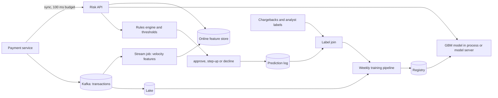

# MLOps interview and ML system design playbook

## What interviewers are looking for

MLOps and ML-engineering interviews usually mix four formats:

1. **ML system design** (45–60 min): "Design a fraud detection system / a recommendation feed / an LLM
   support assistant." Tests structured thinking, trade-offs and production awareness.
2. **MLOps concepts**: drift, skew, CI/CD/CT, deployment strategies, monitoring, reproducibility.
3. **Practical/tooling**: Docker, Kubernetes, CI, Git, cloud, debugging scenarios ("the pod is in
   CrashLoopBackOff...").
4. **Coding**: Python data manipulation and small infrastructure-flavoured algorithms — exactly the kind
   of problems in this track (PSI, KS, dynamic batching, topological ordering, percentiles).

Across all of them the signal is the same: **can you take a model to production and keep it healthy,
and can you explain your trade-offs?** A design that names tools but no trade-offs scores poorly; a
simple design with clear reasoning scores well.

## A framework for ML system design

Use the same skeleton every time. Say it out loud at the start so the interviewer can steer.

```mermaid
flowchart LR
  A[1 Clarify requirements] --> B[2 Frame as ML problem and metrics]
  B --> C[3 Data and labels]
  C --> D[4 Features and pipelines]
  D --> E[5 Model and training]
  E --> F[6 Offline evaluation]
  F --> G[7 Serving architecture]
  G --> H[8 Deployment and online evaluation]
  H --> I[9 Monitoring and retraining]
  I --> J[10 Risks, scale, cost, iterations]
```



### 1. Clarify requirements (3–5 minutes — do not skip)

- **Business goal**: what decision does the prediction drive? What is success?
- **Users and scale**: requests per second, number of entities, data volume, growth.
- **Latency and freshness**: who waits for the answer, and how stale may it be?
- **Constraints**: privacy/regulation, explainability, budget, team size, existing stack.
- **Cost of errors**: false positive vs false negative; who is harmed?

### 2. Frame the ML problem and metrics

- Task type (classification, ranking, regression, generation), prediction target and horizon.
- A **baseline** (heuristic or simple model) and why ML is needed at all.
- **Offline metric** aligned with the goal (PR-AUC, NDCG, MAE...), **online/business metric**
  (conversion, fraud loss, resolution rate) and **guardrail metrics** (latency, cost, fairness, complaint
  rate).

### 3. Data and labels

Sources, volume, freshness; how labels are obtained and **how late** they arrive; class imbalance;
biases and feedback loops; privacy; data validation and versioning.

### 4. Features and pipelines

Key feature families; batch vs streaming computation; **point-in-time correctness**; feature store or
shared library to avoid **training/serving skew**; handling of missing values and new categories.

### 5. Model and training

Start simple (logistic regression / gradient-boosted trees), justify anything heavier. Training cadence,
data window, validation split that respects time, hyperparameter tuning budget, experiment tracking,
reproducibility.

### 6. Offline evaluation

Split strategy, metrics overall and by **slice**, calibration, comparison to baseline and champion,
error analysis, robustness; promotion gates.

### 7. Serving architecture

Batch vs online vs streaming (or a hybrid such as candidate generation offline + ranking online);
latency budget across the request path; model server, batching, caching, autoscaling; fallbacks.

### 8. Deployment and online evaluation

Registry and versioning; CI/CD; shadow → canary → A/B; rollback.

### 9. Monitoring and retraining

Service metrics and SLOs; data quality, drift, prediction distribution; delayed performance; alerts and
runbooks; feedback collection; retraining triggers and gates.

### 10. Risks and iteration

Failure modes, abuse/adversaries, cost, scaling bottlenecks, what you would build in v1 vs later.

> [!TIP]
> Spend your time in proportion to the role: for an MLOps/platform role, compress steps 2–6 and go deep
> on 7–9. Always propose a **v1** that could ship in weeks and name what v2 adds — it shows judgement.

## Worked example 1: real-time fraud detection

**Clarify.** Card-not-present payments; 2,000 TPS peak; decision within 100 ms p99 inside the
authorisation flow; fraud rate ≈ 0.1%; labels from chargebacks arrive 2–8 weeks later; false positives
block legitimate customers; decisions must be explainable to analysts.

**Frame.** Binary classification, P(fraud) per transaction; decision by thresholds: approve / step-up
authentication / decline. Offline: PR-AUC, recall at a fixed false-positive rate. Online: fraud loss
(basis points of volume), false-decline rate, manual review load. Baseline: existing rules.

**Data and labels.** Transaction stream (Kafka), account and device data, historical chargebacks.
Delayed, incomplete labels: declined transactions never get a label → **selection bias**; keep a small
random approve-anyway slice (within risk limits) and use analyst-confirmed labels as earlier signal.

**Features.** Transaction attributes; **velocity features** (count/amount per card, device, merchant
over 1 min/1 h/24 h) computed by a stream processor with event-time windows and served from an online
store; batch aggregates (30-day profiles); graph-style signals later. One feature definition for the
stream job and for backfilled, point-in-time-correct training data.

**Model.** Gradient-boosted trees: strong on tabular data, fast inference, SHAP explanations. Handle
imbalance with class weights and threshold tuning rather than naive oversampling; train on a sliding
window; weekly retrain (fraud patterns shift fast, adversarially).

**Serving.**



Latency budget: network 10 ms, feature lookup 15 ms, model 10 ms, rules 5 ms, headroom. **Fallback**: if
the feature store or model times out, fall back to rules — never block payments on an ML outage.

**Deploy.** Shadow the new model on live traffic (compare decisions), then canary by merchant/traffic
share with automatic rollback on false-decline and latency; A/B on fraud loss takes weeks because labels
are slow.

**Monitor.** p99 latency, error and fallback rates; feature freshness lag from the stream job; score and
decision-rate distributions per segment; feature drift; analyst override rate as an early proxy; weekly
PR-AUC on matured labels. Alerts with runbooks; retrain weekly plus on drift.

**Risks.** Adversarial adaptation, feedback loops from declines, feature-pipeline outages, fairness
across regions.

## Worked example 2: LLM-based customer support assistant

**Clarify.** Answers product questions from documentation and account data; 50 conversations/s peak;
first token under 1 s; must not invent policies; must not leak personal data; hand off to humans.

**Frame.** Retrieval-augmented generation with tool access; success = resolution rate without human
hand-off and CSAT; guardrails = hallucination rate, false-refusal rate, cost per conversation, TTFT.

**Design** (Huyen's incremental architecture, *AI Engineering* ch. 10): input guardrails (PII masking,
injection screening) → router (intent; in/out of scope; simple questions to a small model; billing
disputes to humans) → scoped cache → retrieval (hybrid search + rerank over versioned docs index) →
model gateway (unified API, per-team keys, rate limits, fallback provider) → output guardrails (schema,
groundedness check against retrieved context, toxicity; retry then human fallback) → streamed response.

**Evaluation.** Component-level: retrieval precision/recall on labelled queries; generation
faithfulness and relevance with a versioned, human-calibrated AI judge; functional checks for tool
calls. A sliced eval set including unanswerable and adversarial questions and every past production
failure; run in CI on any prompt/model/retrieval change.

**Ops.** Versioned prompts with hashes logged per request; pinned model versions; full traces (retrieved
chunks, final prompt, tokens, cost, TTFT/TPOT); feedback capture (thumbs, regenerate, edits, hand-off);
canary prompt changes; scheduled re-evaluation to catch provider-side model drift. Cost levers: prompt
caching with stable prefix, shorter contexts, routing, exact caching of frequent questions.

## Worked example 3 (outline): recommendation feed

Two-stage: **candidate generation** (embeddings + approximate nearest neighbours, computed in batch,
refreshed hourly) → **ranking** (online model with session features, ~50 ms) → re-ranking for diversity
and business rules. Labels from clicks/dwell (implicit, biased by position — log propensities, reserve
exploration traffic). Online evaluation by A/B or interleaving on engagement with guardrails on
diversity and complaints. Monitor popularity bias and feedback loops.

## Rapid-fire concept answers

| Question | Core of a strong answer |
|---|---|
| MLOps vs DevOps? | Adds data and model versioning/testing, continuous training, statistical monitoring; ML fails silently. |
| Training/serving skew? | Feature values or preprocessing differ between training and serving; prevent with shared feature code/feature store, bundled preprocessing, logging served features; detect by comparing distributions. |
| Data vs concept drift? | P(X) changes vs P(y\|X) changes; the second needs labels/feedback to detect and retraining to fix. |
| How to detect drift without labels? | PSI/KS/JS per feature and on predictions, domain classifier; effect-size thresholds; persistence. |
| Canary vs blue-green vs shadow vs A/B? | Gradual real exposure with auto-rollback / instant switch at 2× capacity / mirrored traffic with no user impact / randomised test of business impact. |
| Model registry purpose? | Versioned, governed catalog; aliases decouple deployment from training; lineage; rollback. |
| Reproducibility? | Code SHA + data version + config + environment (lockfile, image digest) + seeds, all recorded per run. |
| Why Docker layer order matters? | Cache invalidates from the first changed layer; copy lockfile and install before copying code. |
| Liveness vs readiness? | Restart if dead vs remove from load balancing if not ready; startup probe for slow model loads. |
| How does the HPA compute replicas? | ceil(current × metric/target), tolerance, max across metrics, min/max clamp, scale-down stabilisation. |
| Batch vs online inference? | Driven by who needs the prediction when; batch is cheaper and simpler; hybrids are common. |
| Dynamic batching? | Group requests until max batch size or max wait; trades a little latency for throughput. |
| p99 vs mean latency? | Tail percentiles reflect user experience; means hide outliers; fan-out amplifies tails. |
| When to retrain? | Schedule justified by measured decay, plus performance/drift triggers; always through data validation and promotion gates. |
| Feature store? | Single definition, point-in-time-correct offline retrieval, low-latency online serving, sharing. |
| Evaluate an LLM app? | Criteria and rubrics, sliced eval set, component-level evaluation, code checks + calibrated AI judge + humans, CI gates, online feedback. |
| Reduce LLM latency/cost? | TTFT vs TPOT; prompt caching, shorter prompts, routing, quantization, continuous batching, KV-cache capacity, speculative decoding. |
| What is technical debt in ML? | Entanglement, hidden feedback loops, undeclared consumers, pipeline jungles, config debt. |

## Debugging scenarios

**"The model performed well offline but poorly in production."**
Check, in order: (1) training/serving skew — compare logged serving features with training features;
(2) leakage in offline evaluation — time-based split? features available at prediction time?
(3) distribution shift between training window and now; (4) wrong artifact or preprocessing version
deployed; (5) offline metric not aligned with the online objective; (6) feedback-loop or selection
effects in training data.

**"p99 latency doubled after yesterday's release."**
Compare traces before/after; check model size or batch settings, CPU throttling (limits), replica count
and HPA activity, cold starts, a slower downstream (feature store), GC or memory pressure, and whether
the new image lost a compiled/optimised path. Roll back first if the SLO is burning.

**"The pod is in CrashLoopBackOff."**
`kubectl describe pod` and `kubectl logs --previous`: bad config or missing secret; cannot reach the
registry to load the model; OOMKilled on model load (raise memory or shrink model); liveness probe killing
a slow start (add a startup probe); wrong command/entrypoint; image architecture mismatch.

**"A drift alert fired."**
Verify data quality first (nulls, ranges, schema, units, volume, freshness); identify which features and
slices; check upstream changes and deployments; estimate impact (feature importance, proxy metrics);
then decide: fix pipeline, retrain, adjust thresholds, or acknowledge a benign shift and update the
reference.

**"Retraining produced a worse model."**
The gate should block it. Then: data quality of the new window, label maturity (incomplete recent
labels), a too-short window, a silent feature change, seed variance (rerun with seeds), or a genuinely
harder period.

## Coding-round patterns from this track

```python-run
# Quick self-check: can you write these from memory? (reference implementations)
import math, heapq
from collections import deque

def psi(e, a):                      # e, a: bin fractions
    return sum((ai - ei) * math.log(ai / ei) for ei, ai in zip(e, a))

def p95(xs):                        # nearest-rank
    s = sorted(xs); return s[(95 * len(s) + 99) // 100 - 1]

def topo(tasks, deps):              # deterministic Kahn
    indeg = {t: 0 for t in tasks}; adj = {t: [] for t in tasks}
    for u, v in deps: adj[u].append(v); indeg[v] += 1
    h = [t for t in tasks if indeg[t] == 0]; heapq.heapify(h); out = []
    while h:
        t = heapq.heappop(h); out.append(t)
        for v in adj[t]:
            indeg[v] -= 1
            if indeg[v] == 0: heapq.heappush(h, v)
    return out if len(out) == len(tasks) else []

def hpa(cur, metric, target, lo, hi):
    return cur if abs(metric - target) * 10 <= target else max(lo, min(hi, -(-cur * metric // target)))

def backoff(base, factor, cap, n):
    return [min(cap, base * factor ** i) for i in range(n)]

print("PSI          :", round(psi([0.25, 0.25, 0.25, 0.25], [0.10, 0.20, 0.30, 0.40]), 4))
print("p95          :", p95(list(range(1, 101))))
print("topo order   :", topo(["train", "extract", "validate", "deploy"], [("extract", "validate"), ("validate", "train"), ("train", "deploy")]))
print("HPA replicas :", hpa(4, 90, 60, 2, 20))
print("backoff      :", backoff(100, 2, 1000, 6))
```

| Pattern | Problems in this track |
|---|---|
| Distribution comparison | `mlops-psi`, `mlops-ks-statistic`, `mlops-train-serve-skew` |
| Streaming/window state machines | `mlops-drift-alerts`, `mlops-dynamic-batching`, `mlops-hpa-replicas`, `mlops-rolling-p95` |
| Graphs and ordering | `mlops-dag-order`, `mlops-docker-layer-cache` |
| Sorting with composite keys | `mlops-champion-model`, `mlops-semver-bump` |
| Rules and validation | `mlops-validate-rows`, `mlops-canary-decision` |
| Statistics | `mlops-ab-ztest` |
| Hashing/canonicalisation | `mlops-feature-cache-key` |
| Capacity arithmetic | `mlops-kv-cache-capacity`, `mlops-backoff-schedule` |

## Behavioural and communication tips

- **Tell incident stories** with the structure: situation → detection → mitigation → root cause →
  prevention. Blameless tone.
- **Quantify**: "cut p95 from 180 to 60 ms", "reduced image from 9 GB to 1.2 GB", "retraining went from
  2 days manual to 40 minutes automated".
- **Show judgement about not building things**: "we did not need a feature store for one batch model".
- **Name trade-offs explicitly**: latency vs cost, freshness vs simplicity, automation vs control.
- **Ask about their context** — maturity level, team shape, pain points — and tailor answers.

## A 4-week study plan using this track

| Week | Focus | Practice |
|---|---|---|
| 1 | Modules 1–4: lifecycle, foundations, data, tracking | validate-rows, train-serve-skew, champion-model, semver-bump |
| 2 | Modules 5–8: training, Docker, serving, Kubernetes | dag-order, docker-layer-cache, dynamic-batching, feature-cache-key, backoff-schedule, hpa-replicas |
| 3 | Modules 9–11: CI/CD, monitoring, cloud and cost | canary-decision, ab-ztest, psi, ks-statistic, drift-alerts, rolling-p95 |
| 4 | Modules 12–13: LLMOps, capstone, mock designs | kv-cache-capacity; build the capstone; two timed system-design mocks |

> [!INTERVIEW]
> The one-sentence positioning that works: *"I think of an ML system as code + data + model, each of
> which changes independently — so each needs versioning, testing, progressive delivery and monitoring,
> and the whole loop from production feedback to retraining should be automated and gated."* Then prove
> it with a concrete system you built.

## Summary

- Use a consistent ten-step framework for ML system design; clarify first, start simple, go deep where
  the role demands, and always cover monitoring and failure modes.
- Know crisp answers to the core MLOps concepts and be able to derive them from first principles.
- Practise debugging narratives: skew, latency regressions, crash loops, drift alerts, bad retrains.
- The coding patterns are small state machines, distribution statistics, graph ordering and careful
  specification-following — all practised in this track.

```quiz
[
  {"q": "What should you do first in an ML system design interview?",
   "options": ["Pick a deep learning architecture", "Clarify requirements: goal, scale, latency, constraints and cost of errors", "Draw the Kubernetes cluster", "Discuss hyperparameters"],
   "answer": 1, "explain": "Requirements determine every later choice, including batch vs online."},
  {"q": "In the fraud design, why keep a small random 'approve anyway' slice?",
   "options": ["To increase fraud", "To obtain unbiased labels, because declined transactions never reveal their outcome", "To reduce latency", "To test Kafka"],
   "answer": 1, "explain": "Without it, training data suffers selection bias from the model's own decisions."},
  {"q": "What is the right fallback when the fraud model or feature store times out?",
   "options": ["Decline all payments", "Fall back to the rules engine so payments continue", "Retry forever", "Return HTTP 500 to the customer"],
   "answer": 1, "explain": "Graceful degradation keeps the business running during ML outages."},
  {"q": "A model does well offline but poorly online. Which is the FIRST thing to check?",
   "options": ["GPU driver version", "Training/serving skew by comparing logged serving features with training features", "The README", "Learning rate schedule"],
   "answer": 1, "explain": "Skew and leakage are the most common causes of offline/online gaps."},
  {"q": "For an MLOps-focused role, where should a system design answer go deepest?",
   "options": ["Choice of activation function", "Serving, deployment, monitoring and retraining", "Notebook styling", "Tokenizer internals"],
   "answer": 1, "explain": "Tailor depth to the role; platform roles care most about production operations."},
  {"q": "Why propose a 'v1' and a 'v2' in a design?",
   "options": ["To fill time", "It shows prioritisation: ship the simplest valuable system, then add complexity where evidence justifies it", "Because interviewers require two diagrams", "To avoid discussing monitoring"],
   "answer": 1, "explain": "Incremental delivery demonstrates engineering judgement."},
  {"q": "In the LLM assistant design, what catches a prompt change that degrades answers on unanswerable questions?",
   "options": ["The load balancer", "A sliced evaluation set run in CI with a baseline comparison", "The tokenizer", "A larger context window"],
   "answer": 1, "explain": "Slice-level regression gates catch what averages hide."},
  {"q": "A pod is OOMKilled while loading the model. Which fix is appropriate?",
   "options": ["Add a readiness probe only", "Raise the memory limit/request or reduce the model's footprint", "Increase CPU limit", "Delete the Service"],
   "answer": 1, "explain": "The container exceeded its memory limit during model load."}
]
```

> **Source:** Synthesis of this track; Chip Huyen, *AI Engineering*, ch. 4 (evaluation), ch. 9 (inference optimization), ch. 10 (architecture and user feedback); Martin Kleppmann, *DDIA*, ch. 11 (stream processing for real-time features); Bill Lubanovic, *FastAPI*, ch. 13 (production troubleshooting); Chip Huyen, *Designing Machine Learning Systems* (ML system design framing); Kubernetes troubleshooting documentation.
