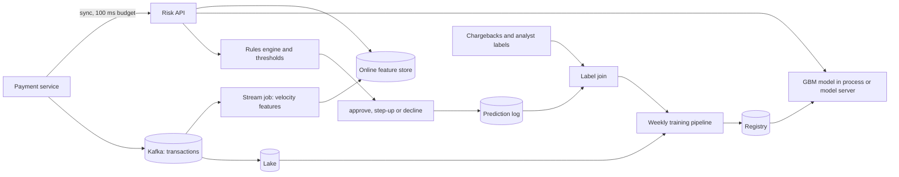

```mermaid
flowchart LR
  A[1 Clarify requirements] --> B[2 Frame as ML problem and metrics]
  B --> C[3 Data and labels]
  C --> D[4 Features and pipelines]
  D --> E[5 Model and training]
  E --> F[6 Offline evaluation]
  F --> G[7 Serving architecture]
  G --> H[8 Deployment and online evaluation]
  H --> I[9 Monitoring and retraining]
  I --> J[10 Risks, scale, cost, iterations]
```

# MLOps interview and ML system design playbook

> **Before this lesson:** this lesson reviews the whole track from the point of view of a job
> interview, so it is most useful after the two capstone lessons,
> [Capstone part 1](#/lesson/mlops/capstone-build) and [Capstone part 2](#/lesson/mlops/capstone-ship).
> Every concept is defined again briefly here, with a pointer to the lesson that teaches it in depth,
> so you can also read it first as a map of what is coming.

## In plain words

An **interview playbook** is a prepared plan for the questions you will face, in the way a sports team
studies its opponents and practises set moves before a match. MLOps and ML-engineering interviews follow
recognisable patterns, and candidates who know the patterns can spend their energy on thinking rather
than on panicking about structure.

The most important format is **ML system design**: the interviewer names a product ("design a fraud
detector") and you have under an hour to describe, out loud and on a whiteboard, how you would build it
from the data to the monitored service. There is no single right answer. What is being judged is whether
you ask the right questions, choose sensible simple components, explain why, and remember the parts that
break in production.

An everyday comparison: an architect asked to design a house does not start by choosing door handles.
They ask who will live there, what the budget is, what the ground is like, and only then sketch rooms.
A good system-design answer works the same way, from requirements to details.

Why this matters for a job: these interviews decide offers for ML engineer, MLOps engineer and ML
platform roles. This lesson gives you a reusable ten-step framework, three worked designs, short answers
to the concepts asked most often, the debugging stories interviewers like, the coding patterns practised
in this track, and a study plan.

## What interviewers are looking for

MLOps and ML-engineering interviews usually mix four formats:

1. **ML system design** (45 to 60 minutes): "Design a fraud detection system / a recommendation feed / an
   LLM support assistant." It tests structured thinking, trade-offs and awareness of production issues.
2. **MLOps concepts**: drift, skew, CI/CD/CT, deployment strategies, monitoring, reproducibility. Each is
   defined in the rapid-fire table below.
3. **Practical and tooling questions**: Docker, Kubernetes, CI, Git, cloud and debugging scenarios such as
   "the pod is in CrashLoopBackOff..." (a pod that keeps crashing and being restarted).
4. **Coding**: Python data manipulation and small infrastructure-flavoured algorithms, exactly the kind of
   problems in this track (PSI, KS, dynamic batching, topological ordering, percentiles, rate limiting).

Across all of them the signal is the same: **can you take a model to production and keep it healthy, and
can you explain your trade-offs?** A **trade-off** is a choice where gaining one thing costs another, such
as lower latency for higher cost. A design that names many tools but no trade-offs scores poorly; a
simple design with clear reasoning scores well.

## A framework for ML system design

Use the same skeleton every time, and say it out loud at the start so the interviewer can steer you
towards the parts they care about.



### 1. Clarify requirements (3 to 5 minutes, do not skip)

Ask before you design. Useful questions:

- **Business goal**: what decision does the prediction drive? What does success look like?
- **Users and scale**: requests per second, number of users or items, data volume, growth.
- **Latency and freshness**: who waits for the answer, and how out of date may the inputs be?
  **Latency** is the time to answer one request; **freshness** is how recent the data behind it is.
- **Constraints**: privacy rules, the need to explain decisions, budget, team size, existing tools.
- **Cost of errors**: is a **false positive** (flagging something that is fine) or a **false negative**
  (missing a real case) worse, and who is harmed by each?

### 2. Frame the ML problem and metrics

- Name the task type: **classification** (pick a category, such as fraud or not), **ranking** (order a
  list), **regression** (predict a number) or **generation** (produce text). State the exact prediction
  target and its time horizon ("will this customer cancel within 30 days").
- Propose a **baseline**: a simple heuristic or model to beat (for example the existing rules), and say
  why ML is needed at all.
- Pick three kinds of metric. The **offline metric** is computed on held-out data before release, such
  as PR-AUC (ranking quality for a rare positive class), NDCG (normalised discounted cumulative gain, a
  ranking score that rewards putting relevant items near the top) or MAE (mean absolute error). The
  **online or business metric** is measured with real users (conversion, fraud loss, resolution rate).
  **Guardrail metrics** must not get worse while you optimise (latency, cost, fairness, complaint rate).

### 3. Data and labels

Where does the data come from, how much is there and how fresh is it? How are **labels** (the true
answers) obtained, and **how late** do they arrive? (Fraud labels from customer disputes can take weeks.)
Is one class much rarer than the other (**class imbalance**)? What biases or **feedback loops** exist (the
model's own decisions shaping the data it will later learn from)? Then privacy, data validation and
versioning (see [Data validation and versioning](#/lesson/mlops/validation-versioning)).

### 4. Features and pipelines

Name the key feature families and whether they are computed in **batch** (on a schedule over stored data)
or by **streaming** (continuously as events arrive). Insist on **point-in-time correctness**: each training
example may only use data that existed at the moment the prediction would have been made, otherwise the
model trains on information from the future (**leakage**). Use a **feature store** or a shared feature
library to avoid **training/serving skew** (features computed differently in training and production),
and decide how missing values and never-seen categories are handled (see
[Feature stores](#/lesson/mlops/feature-stores)).

### 5. Model and training

Start simple, such as logistic regression or gradient-boosted trees, and justify anything heavier. Cover
the training cadence (how often), the data window (how much history), a validation split that respects
time (train on the past, test on the future), the budget for **hyperparameter tuning** (searching for the
best training settings), experiment tracking and reproducibility.

### 6. Offline evaluation

Explain the split strategy; metrics overall and by **slice** (subgroups such as regions or customer
types); **calibration** (whether a predicted 0.8 really means 80%); comparison with the baseline and with
the current production model; **error analysis** (reading the examples the model gets wrong); robustness;
and the **promotion gate** that must pass before release.

### 7. Serving architecture

Choose **batch** (predictions computed ahead of time and stored), **online** (computed on request) or
**streaming** (computed as events flow), or a hybrid such as candidate generation offline plus ranking
online. Split the **latency budget** across the request path. Mention the model server, batching, caching,
autoscaling and **fallbacks** (what happens when the model is unavailable). See
[Serving patterns](#/lesson/mlops/serving-patterns).

### 8. Deployment and online evaluation

Model registry and versioning; CI/CD; then progressive exposure: **shadow** (the new model sees real
traffic but its answers are not used), **canary** (a small share of users get the new model, with
automatic rollback), **A/B test** (a randomised experiment comparing business outcomes); and rollback.
See [Deployment strategies](#/lesson/mlops/deployment-strategies).

### 9. Monitoring and retraining

Service metrics and **SLOs** (service level objectives, such as 99.5% of requests succeed within 200 ms);
data quality; **drift** (changes in the input data or in the relationship between inputs and outcomes);
the distribution of predictions; performance once delayed labels arrive; alerts with **runbooks**
(written response guides); feedback collection; retraining triggers and gates. See
[Alerting and retraining](#/lesson/mlops/alerting-retraining).

### 10. Risks and iteration

Failure modes, abuse and adversaries, cost, scaling bottlenecks, and what you would build in v1 versus
later versions.

> [!TIP]
> Spend your time in proportion to the role: for an MLOps or platform role, compress steps 2 to 6 and go
> deep on 7 to 9. Always propose a **v1** that could ship in weeks and name what v2 adds. It shows
> judgement.

## Worked example 1: real-time fraud detection

**Clarify.** Card-not-present payments (online purchases where the card is not physically shown); 2,000
transactions per second (TPS) at peak; a decision within 100 ms at the 99th percentile (p99, meaning 99 of
100 requests must be faster) inside the authorisation flow; fraud rate about 0.1%; labels from
**chargebacks** (customers disputing a payment) arrive 2 to 8 weeks later; false positives block
legitimate customers; decisions must be explainable to fraud analysts.

**Frame.** Binary classification, P(fraud) per transaction; the decision comes from thresholds: approve,
**step-up authentication** (ask for an extra check such as a one-time code) or decline. Offline: PR-AUC,
and recall at a fixed false-positive rate (how much fraud you catch when only, say, 0.5% of good payments
may be flagged). Online: fraud loss in basis points of volume (hundredths of a percent), false-decline
rate, manual review load. Baseline: the existing rules.

**Data and labels.** The transaction stream (in **Kafka**, a system that stores and delivers event
streams), account and device data, historical chargebacks. Labels are delayed and incomplete: a declined
transaction never gets a label, because nobody learns whether it would have been fraud. That creates
**selection bias**: the training data only contains what the current system let through. A remedy is a
small random "approve anyway" slice (within risk limits) and analyst-confirmed labels as an earlier signal.

**Features.** Transaction attributes; **velocity features** (counts and amounts per card, device or
merchant over the last 1 minute, 1 hour and 24 hours) computed by a stream processor using **event-time
windows** (windows based on when the payment happened, not when the message arrived) and served from an
**online store** (a fast key-value database); batch aggregates such as 30-day spending profiles;
graph-style signals (links between cards, devices and addresses) later. One feature definition is used
both by the streaming job and to rebuild point-in-time-correct training data.

**Model.** Gradient-boosted trees: strong on tabular data, fast to run, and explainable with **SHAP**
values (a method that attributes a prediction to each feature's contribution). Handle the imbalance with
class weights and threshold tuning rather than naive duplication of fraud examples; train on a sliding
window of recent data; retrain weekly because fraudsters adapt quickly.

**Serving.**



How to read it: the payment service calls the risk API **synchronously** (it waits for the answer)
with a 100 ms budget. The risk API reads features from the online store, scores the model, and applies
rules and thresholds to reach a decision, which is logged. Separately, every transaction flows through
Kafka to the stream job that keeps velocity features fresh, and to the **data lake** (cheap bulk storage)
used by weekly training. Labels from chargebacks and analysts are joined to the prediction log to build
training data.

Latency budget: network 10 ms, feature lookup 15 ms, model 10 ms, rules 5 ms, plus headroom.
**Fallback**: if the feature store or model times out, fall back to the rules. Never block payments on an
ML outage.

**Deploy.** Shadow the new model on live traffic (compare its decisions with the current one without
acting on them), then canary by merchant or traffic share with automatic rollback on false-decline rate
and latency. An A/B test on fraud loss takes weeks because labels are slow.

**Monitor.** p99 latency, error and fallback rates; feature freshness lag from the stream job; score and
decision-rate distributions per segment; feature drift; the analyst override rate as an early proxy for
quality; weekly PR-AUC on labels that have matured. Alerts with runbooks; retrain weekly and on drift.

**Risks.** Adversaries adapting to the model, feedback loops from declines, feature-pipeline outages, and
fairness across regions.

## Worked example 2: LLM-based customer support assistant

**Clarify.** It answers product questions from documentation and account data; 50 conversations per
second at peak; first token under 1 second; it must not invent policies, must not leak personal data, and
must hand off to humans when needed.

**Frame.** **Retrieval-augmented generation (RAG)**: before answering, the system searches a document
index and puts the relevant passages into the prompt, so the large language model (LLM) answers from your
documents rather than from memory. It also has **tool access** (it can call functions such as "look up
order status"). Success is the resolution rate without human hand-off and customer satisfaction (CSAT);
guardrails are the **hallucination** rate (confident but false statements), the false-refusal rate, cost
per conversation and **TTFT** (time to first token, how long before the answer starts appearing).

**Design** (following the incremental architecture in Huyen's *AI Engineering*, ch. 10):

1. **Input guardrails**: mask personal data (PII, personally identifiable information) and screen for
   **prompt injection** (text that tries to override the system's instructions).
2. **Router**: classify intent; refuse out-of-scope requests; send simple questions to a small, cheap
   model and billing disputes to humans.
3. **Cache** scoped per user, so one customer's answer is never shown to another.
4. **Retrieval**: hybrid search (keyword plus meaning-based) and a **reranker** (a model that reorders the
   top results) over a versioned document index.
5. **Model gateway**: one API in front of several providers, with per-team keys, rate limits and a
   fallback provider.
6. **Output guardrails**: check the response format, check **groundedness** (every claim is supported by
   the retrieved text) and toxicity; retry, then fall back to a human.
7. Stream the response to the user token by token.

**Evaluation.** Component by component: retrieval precision and recall on labelled queries; generation
faithfulness and relevance scored by a versioned **AI judge** (an LLM prompted to grade answers) whose
scores are checked against human ratings; functional checks for tool calls. Use an evaluation set split
into slices that includes unanswerable and adversarial questions and every past production failure, and
run it in CI on any prompt, model or retrieval change. See
[Prompt management and evaluation pipelines](#/lesson/mlops/llmops-prompts-evals).

**Ops.** Versioned prompts with their hashes logged on every request; pinned model versions; full
**traces** (retrieved chunks, final prompt, tokens, cost, TTFT and TPOT, the time per output token);
feedback capture (thumbs up or down, regenerate clicks, edits, hand-offs); canary releases for prompt
changes; scheduled re-evaluation to catch the provider silently changing its model. Cost levers: **prompt
caching** with a stable prompt beginning, shorter contexts, routing, and exact caching of frequent
questions. See [Guardrails, gateways, caching and tracing](#/lesson/mlops/llmops-gateways).

## Worked example 3 (outline): recommendation feed

Two stages. **Candidate generation** narrows millions of items to a few hundred, using **embeddings**
(lists of numbers that place similar items close together) and **approximate nearest-neighbour search**
(a fast way to find the closest embeddings), computed in batch and refreshed hourly. **Ranking** then
orders those candidates with an online model that uses session features (about 50 ms). A final
re-ranking adds diversity and business rules.

Labels come from clicks and dwell time. They are **implicit** (behaviour, not explicit ratings) and biased
by position (people click what is shown first), so log the probability with which each item was shown
(**propensity**) and reserve some **exploration** traffic that shows less-certain items. Evaluate online
with A/B tests or **interleaving** (mixing two rankers' results in one list and seeing which one's items
get clicked), with guardrails on diversity and complaints. Monitor popularity bias and feedback loops.

## Rapid-fire concept answers

Interviewers often ask short concept questions to check breadth. Aim for a two-sentence core answer, then
offer to go deeper.

| Question | Core of a strong answer |
|---|---|
| MLOps vs DevOps? | Adds data and model versioning/testing, continuous training, statistical monitoring; ML fails silently. |
| Training/serving skew? | Feature values or preprocessing differ between training and serving; prevent with shared feature code/feature store, bundled preprocessing, logging served features; detect by comparing distributions. |
| Data vs concept drift? | P(X) changes vs P(y\|X) changes; the second needs labels/feedback to detect and retraining to fix. |
| How to detect drift without labels? | PSI/KS/JS per feature and on predictions, domain classifier; effect-size thresholds; persistence. |
| Canary vs blue-green vs shadow vs A/B? | Gradual real exposure with auto-rollback / instant switch at 2× capacity / mirrored traffic with no user impact / randomised test of business impact. |
| Model registry purpose? | Versioned, governed catalog; aliases decouple deployment from training; lineage; rollback. |
| Reproducibility? | Code SHA + data version + config + environment (lockfile, image digest) + seeds, all recorded per run. |
| Why Docker layer order matters? | Cache invalidates from the first changed layer; copy lockfile and install before copying code. |
| Liveness vs readiness? | Restart if dead vs remove from load balancing if not ready; startup probe for slow model loads. |
| How does the HPA compute replicas? | ceil(current × metric/target), tolerance, max across metrics, min/max clamp, scale-down stabilisation. |
| Batch vs online inference? | Driven by who needs the prediction when; batch is cheaper and simpler; hybrids are common. |
| Dynamic batching? | Group requests until max batch size or max wait; trades a little latency for throughput. |
| p99 vs mean latency? | Tail percentiles reflect user experience; means hide outliers; fan-out amplifies tails. |
| When to retrain? | Schedule justified by measured decay, plus performance/drift triggers; always through data validation and promotion gates. |
| Feature store? | Single definition, point-in-time-correct offline retrieval, low-latency online serving, sharing. |
| Evaluate an LLM app? | Criteria and rubrics, sliced eval set, component-level evaluation, code checks + calibrated AI judge + humans, CI gates, online feedback. |
| Reduce LLM latency/cost? | TTFT vs TPOT; prompt caching, shorter prompts, routing, quantization, continuous batching, KV-cache capacity, speculative decoding. |
| What is technical debt in ML? | Entanglement, hidden feedback loops, undeclared consumers, pipeline jungles, config debt. |
| How do you protect a shared model API from one noisy client? | Per-key rate limits (token bucket), quotas, timeouts and backoff on clients, separate pools for critical traffic. |
| How do you keep an error budget? | Define an SLO, alert on multi-window burn rate, freeze risky releases when the budget is spent. |

Decoding the shorthand in that table:

- **P(X)** is the distribution of the inputs; **P(y|X)** is the relationship between inputs and the
  outcome. **Data drift** changes the first, **concept drift** the second (see
  [Data drift](#/lesson/mlops/drift)).
- **PSI** (population stability index), **KS** (Kolmogorov-Smirnov statistic, the largest gap between two
  cumulative distributions) and **JS** (Jensen-Shannon divergence) are ways to measure how different two
  distributions are. A **domain classifier** is a model trained to tell old data from new; if it succeeds
  easily, the data has shifted. **Effect size** means how big a difference is, as opposed to whether it is
  statistically detectable.
- **Blue-green** keeps two full environments and switches all traffic at once, which needs double
  capacity during the switch.
- An **image digest** is the content hash that identifies an exact container image.
- The **HPA** (Horizontal Pod Autoscaler) multiplies the current replica count by observed metric over
  target metric and rounds up, ignoring changes within a small tolerance (see
  [Scaling on Kubernetes](#/lesson/mlops/k8s-ml)).
- **Throughput** is requests handled per second. **Fan-out** is one request calling many services; the
  slowest one sets the total time, so tails get worse as fan-out grows.
- **Quantization** stores model numbers with fewer bits; **continuous batching** adds and removes requests
  from a running GPU batch; the **KV cache** stores attention results of earlier tokens; **speculative
  decoding** lets a small model draft tokens that the big model verifies (see
  [LLM inference optimization](#/lesson/mlops/llm-inference)).
- **Entanglement** means changing one input changes everything ("changing anything changes everything");
  **undeclared consumers** are systems that silently read your outputs; **pipeline jungles** are tangled,
  undocumented data preparation scripts (see
  [Roles, teams and hidden technical debt](#/lesson/mlops/tech-debt-roles)).

## Debugging scenarios

Interviewers love "what would you check?" questions. The best answers are ordered: most likely and
cheapest to check first, and mitigation before root cause when users are suffering.

**"The model performed well offline but poorly in production."**
Check, in order: (1) training/serving skew: compare logged serving features with training features;
(2) leakage in offline evaluation: was the split by time? were the features really available at
prediction time? (3) distribution shift between the training window and now; (4) the wrong model artifact
or preprocessing version deployed; (5) an offline metric that does not match the online objective;
(6) feedback-loop or selection effects in the training data.

**"p99 latency doubled after yesterday's release."**
Compare traces before and after; check model size or batch settings, CPU throttling (the container hits
its CPU limit and is made to wait), replica count and autoscaler activity, **cold starts** (new pods slow
on their first requests), a slower downstream service such as the feature store, garbage-collection or
memory pressure, and whether the new image lost a compiled or optimised code path. If the SLO is burning,
roll back first and investigate afterwards.

**"The pod is in CrashLoopBackOff."**
Run `kubectl describe pod` (events, exit codes, probe failures) and `kubectl logs --previous` (the logs of
the crashed container). Usual causes: bad configuration or a missing secret; the registry is unreachable
so the model cannot load; **OOMKilled** on model load (the container exceeded its memory limit; raise the
limit or shrink the model); a liveness probe killing a slow start (add a startup probe); a wrong command
or entrypoint; an image built for the wrong CPU architecture.

**"A drift alert fired."**
Verify data quality first (nulls, ranges, schema, units, volume, freshness); identify which features and
slices moved; check upstream changes and deployments; estimate impact (feature importance, proxy
metrics); then decide: fix the pipeline, retrain, adjust thresholds, or acknowledge a harmless shift and
update the reference.

**"Retraining produced a worse model."**
The gate should block it. Then investigate: data quality of the new window, **label maturity** (recent
examples whose outcomes are not known yet look like negatives), a window that is too short, a silent
feature change upstream, random variation between seeds (rerun with several seeds), or a genuinely harder
period.

**"Costs doubled this month."**
Break the bill down by service and team using resource tags; look for idle GPUs, autoscaler minimums set
too high, forgotten experiments and notebooks, oversized instances (low utilisation), data egress
(charges for moving data out of a cloud region), and log volume. Then right-size, use spot capacity for
fault-tolerant jobs, and add budget alerts (see
[Cost optimisation](#/lesson/mlops/cost-optimization)).

## Coding-round patterns from this track

Coding questions in MLOps interviews are rarely about clever algorithms. They test whether you can turn
a precise operational rule into correct, edge-case-proof code: a percentile, a drift score, an ordering,
a scheduler, a rate limiter. The cell below has compact reference versions of five classics. Read each
one, predict its output, then run it.

```python-run
# Quick self-check: can you write these from memory? (reference implementations)
import math, heapq
from collections import deque

def psi(e, a):                      # e, a: bin fractions
    return sum((ai - ei) * math.log(ai / ei) for ei, ai in zip(e, a))

def p95(xs):                        # nearest-rank
    s = sorted(xs); return s[(95 * len(s) + 99) // 100 - 1]

def topo(tasks, deps):              # deterministic Kahn
    indeg = {t: 0 for t in tasks}; adj = {t: [] for t in tasks}
    for u, v in deps: adj[u].append(v); indeg[v] += 1
    h = [t for t in tasks if indeg[t] == 0]; heapq.heapify(h); out = []
    while h:
        t = heapq.heappop(h); out.append(t)
        for v in adj[t]:
            indeg[v] -= 1
            if indeg[v] == 0: heapq.heappush(h, v)
    return out if len(out) == len(tasks) else []

def hpa(cur, metric, target, lo, hi):
    return cur if abs(metric - target) * 10 <= target else max(lo, min(hi, -(-cur * metric // target)))

def backoff(base, factor, cap, n):
    return [min(cap, base * factor ** i) for i in range(n)]

print("PSI          :", round(psi([0.25, 0.25, 0.25, 0.25], [0.10, 0.20, 0.30, 0.40]), 4))
print("p95          :", p95(list(range(1, 101))))
print("topo order   :", topo(["train", "extract", "validate", "deploy"], [("extract", "validate"), ("validate", "train"), ("train", "deploy")]))
print("HPA replicas :", hpa(4, 90, 60, 2, 20))
print("backoff      :", backoff(100, 2, 1000, 6))
```

What each function does and what it prints:

- **`psi`** adds `(actual - expected) x ln(actual / expected)` over the bins. Moving from four equal bins
  to 10/20/30/40% gives about **0.2282**, a moderate shift.
- **`p95`** uses the **nearest-rank** method: sort, then take the element at position ceil(0.95 x n).
  `(95 * n + 99) // 100` is that ceiling written with integers only. For the numbers 1 to 100 it prints
  **95**.
- **`topo`** is **Kahn's algorithm** for **topological ordering** (an order in which every task comes
  after the tasks it depends on). It counts each task's unmet dependencies (**in-degree**), repeatedly
  takes a task with none, and uses a heap so ties come out alphabetically. If a cycle exists, not all
  tasks are output and it returns an empty list. Here it prints **extract, validate, train, deploy**.
- **`hpa`** keeps the current count if the metric is within 10% of target, otherwise computes
  ceil(4 x 90 / 60) = **6** and clamps it between the minimum and maximum.
- **`backoff`** returns capped exponential retry delays: **100, 200, 400, 800, 1000, 1000**.

The track's problems, grouped by the pattern they practise:

| Pattern | Problems in this track |
|---|---|
| Distribution comparison | `mlops-psi`, `mlops-ks-statistic`, `mlops-train-serve-skew` |
| Streaming/window state machines | `mlops-drift-alerts`, `mlops-dynamic-batching`, `mlops-hpa-replicas`, `mlops-rolling-p95`, `mlops-error-budget-burn`, `mlops-token-bucket` |
| Graphs and ordering | `mlops-dag-order`, `mlops-docker-layer-cache`, `mlops-downstream-impact` |
| Sorting with composite keys | `mlops-champion-model`, `mlops-semver-bump`, `mlops-successive-halving`, `mlops-instance-choice` |
| Parsing and configuration | `mlops-version-satisfies`, `mlops-config-merge` |
| Rules and validation | `mlops-validate-rows`, `mlops-canary-decision`, `mlops-slice-gate` |
| Scheduling and packing | `mlops-pod-scheduling`, `mlops-token-budget-trim` |
| Statistics | `mlops-ab-ztest` |
| Hashing/canonicalisation | `mlops-feature-cache-key`, `mlops-hash-split`, `mlops-registry-storage` |
| Capacity arithmetic | `mlops-kv-cache-capacity`, `mlops-backoff-schedule` |

> [!TIP]
> In a coding round, restate the rule in your own words, write two or three tiny examples including an
> edge case (empty input, a tie, a value exactly on a threshold) before coding, and prefer integer
> arithmetic for anything involving ceilings or money. Interviewers notice candidates who test their own
> code without being asked.

## Behavioural and communication tips

- **Tell incident stories** with the structure: situation, detection, mitigation, root cause, prevention.
  Keep a **blameless** tone (focus on how the system allowed the mistake, not on who made it).
- **Quantify**: "cut p95 from 180 to 60 ms", "reduced the image from 9 GB to 1.2 GB", "retraining went
  from two days of manual work to 40 minutes automated".
- **Show judgement about not building things**: "we did not need a feature store for one batch model".
- **Name trade-offs explicitly**: latency vs cost, freshness vs simplicity, automation vs control.
- **Ask about their context** (maturity level, team shape, pain points) and tailor your answers to it.

## A common mistake list for system-design rounds

- Jumping to a model architecture before asking about scale, latency and the cost of errors.
- Designing only the happy path: no fallback, no rollback, no monitoring.
- Forgetting that labels are delayed or biased by the system's own decisions.
- Proposing a deep neural network for a small tabular problem without a baseline.
- Using only one metric, with no guardrails, so a "better" model could hurt latency, cost or fairness.
- Treating monitoring as dashboards only: no alerts, no owners, no runbooks.

## A four-week study plan using this track

| Week | Focus | Practice |
|---|---|---|
| 1 | Modules 1 to 4: lifecycle, foundations, data, tracking | downstream-impact, version-satisfies, config-merge, validate-rows, train-serve-skew, champion-model, semver-bump, hash-split |
| 2 | Modules 5 to 8: training, Docker, serving, Kubernetes | dag-order, successive-halving, docker-layer-cache, registry-storage, dynamic-batching, feature-cache-key, backoff-schedule, hpa-replicas, pod-scheduling |
| 3 | Modules 9 to 11: CI/CD, monitoring, cloud and cost | canary-decision, ab-ztest, psi, ks-statistic, drift-alerts, rolling-p95, error-budget-burn, instance-choice |
| 4 | Modules 12 and 13: LLMOps, capstone, mock designs | kv-cache-capacity, token-budget-trim, token-bucket, slice-gate; build the capstone; two timed system-design mocks |

A **mock** is a practice interview, ideally with a friend playing the interviewer and a timer running.
Record yourself once: hearing your own answer is the fastest way to find where you ramble or skip steps.

> [!INTERVIEW]
> The one-sentence positioning that works: *"I think of an ML system as code + data + model, each of
> which changes independently, so each needs versioning, testing, progressive delivery and monitoring,
> and the whole loop from production feedback to retraining should be automated and gated."* Then prove
> it with a concrete system you built.

## Summary

- Use a consistent ten-step framework for ML system design: clarify first, start simple, go deep where
  the role demands, and always cover monitoring and failure modes.
- The worked designs (fraud, LLM support assistant, recommendations) show the same moves: delayed and
  biased labels, shared feature definitions, latency budgets, fallbacks, progressive rollout and
  monitoring tied to retraining.
- Know crisp answers to the core MLOps concepts and be able to derive them from first principles.
- Practise debugging narratives: skew, latency regressions, crash loops, drift alerts, bad retrains and
  cost spikes, checking cheap and likely causes first and mitigating before root-causing.
- The coding patterns are small state machines, distribution statistics, graph ordering, parsing and
  careful specification-following, all practised in this track.

## Glossary

- **ML system design interview** - a spoken design exercise for a whole ML product.
- **Trade-off** - a choice where gaining one property costs another.
- **Latency / freshness / throughput** - time per request / age of the data used / requests per second.
- **False positive / false negative** - flagging something harmless / missing a real case.
- **Baseline** - a simple approach the ML solution must beat.
- **Offline, online and guardrail metrics** - scores before release / business outcomes with real users /
  limits that must not get worse.
- **NDCG / MAE** - a ranking score rewarding relevant items near the top / mean absolute error.
- **Class imbalance** - one outcome being much rarer than the other.
- **Point-in-time correctness / leakage** - using only data available at prediction time / training on
  information from the future.
- **Selection bias** - training data shaped by the system's own past decisions.
- **Velocity features / event-time windows** - recent-activity counts / windows based on when events
  happened.
- **SHAP** - a method that attributes a prediction to the contribution of each feature.
- **Fallback** - the safe behaviour used when a component is unavailable.
- **Shadow, canary, blue-green, A/B test** - progressive ways to expose a new version.
- **RAG / hallucination / prompt injection / groundedness** - answering from retrieved documents /
  confident false statements / text that hijacks instructions / claims supported by sources.
- **AI judge** - an LLM used to grade other model outputs, calibrated against humans.
- **Embedding / approximate nearest neighbours** - a vector representation / fast similarity search.
- **Propensity / exploration / interleaving** - probability an item was shown / deliberately showing
  uncertain items / mixing two rankers in one list to compare them.
- **Data drift / concept drift** - change in inputs / change in the input-outcome relationship.
- **PSI, KS, JS, domain classifier** - ways to measure distribution change.
- **Fan-out / cold start** - one request calling many services / slowness of a freshly started instance.
- **CrashLoopBackOff / OOMKilled** - a container repeatedly crashing / killed for exceeding its memory limit.
- **Label maturity** - whether enough time has passed for true outcomes to be known.
- **Topological order / in-degree / nearest rank** - dependency-respecting order / number of unmet
  dependencies / a simple percentile definition.
- **Blameless postmortem** - an incident review focused on system causes, not people.
- **Mock interview** - a timed practice interview.

```quiz
[
  {"q": "What should you do first in an ML system design interview?",
   "options": ["Pick a deep learning architecture", "Clarify requirements: goal, scale, latency, constraints and cost of errors", "Draw the Kubernetes cluster", "Discuss hyperparameters"],
   "answer": 1, "explain": "Requirements determine every later choice, including batch vs online."},
  {"q": "In the fraud design, why keep a small random 'approve anyway' slice?",
   "options": ["To increase fraud", "To obtain unbiased labels, because declined transactions never reveal their outcome", "To reduce latency", "To test Kafka"],
   "answer": 1, "explain": "Without it, training data suffers selection bias from the model's own decisions."},
  {"q": "What is the right fallback when the fraud model or feature store times out?",
   "options": ["Decline all payments", "Fall back to the rules engine so payments continue", "Retry forever", "Return HTTP 500 to the customer"],
   "answer": 1, "explain": "Graceful degradation keeps the business running during ML outages."},
  {"q": "A model does well offline but poorly online. Which is the FIRST thing to check?",
   "options": ["GPU driver version", "Training/serving skew by comparing logged serving features with training features", "The README", "Learning rate schedule"],
   "answer": 1, "explain": "Skew and leakage are the most common causes of offline/online gaps."},
  {"q": "For an MLOps-focused role, where should a system design answer go deepest?",
   "options": ["Choice of activation function", "Serving, deployment, monitoring and retraining", "Notebook styling", "Tokenizer internals"],
   "answer": 1, "explain": "Tailor depth to the role; platform roles care most about production operations."},
  {"q": "Why propose a 'v1' and a 'v2' in a design?",
   "options": ["To fill time", "It shows prioritisation: ship the simplest valuable system, then add complexity where evidence justifies it", "Because interviewers require two diagrams", "To avoid discussing monitoring"],
   "answer": 1, "explain": "Incremental delivery demonstrates engineering judgement."},
  {"q": "In the LLM assistant design, what catches a prompt change that degrades answers on unanswerable questions?",
   "options": ["The load balancer", "A sliced evaluation set run in CI with a baseline comparison", "The tokenizer", "A larger context window"],
   "answer": 1, "explain": "Slice-level regression gates catch what averages hide."},
  {"q": "A pod is OOMKilled while loading the model. Which fix is appropriate?",
   "options": ["Add a readiness probe only", "Raise the memory limit/request or reduce the model's footprint", "Increase CPU limit", "Delete the Service"],
   "answer": 1, "explain": "The container exceeded its memory limit during model load."}
]
```

> **Source:** Synthesis of this track; Chip Huyen, *AI Engineering*, ch. 4 (evaluation), ch. 9 (inference optimization), ch. 10 (architecture and user feedback); Martin Kleppmann, *DDIA*, ch. 11 (stream processing for real-time features); Bill Lubanovic, *FastAPI*, ch. 13 (production troubleshooting); Chip Huyen, *Designing Machine Learning Systems* (ML system design framing); Kubernetes troubleshooting documentation.
