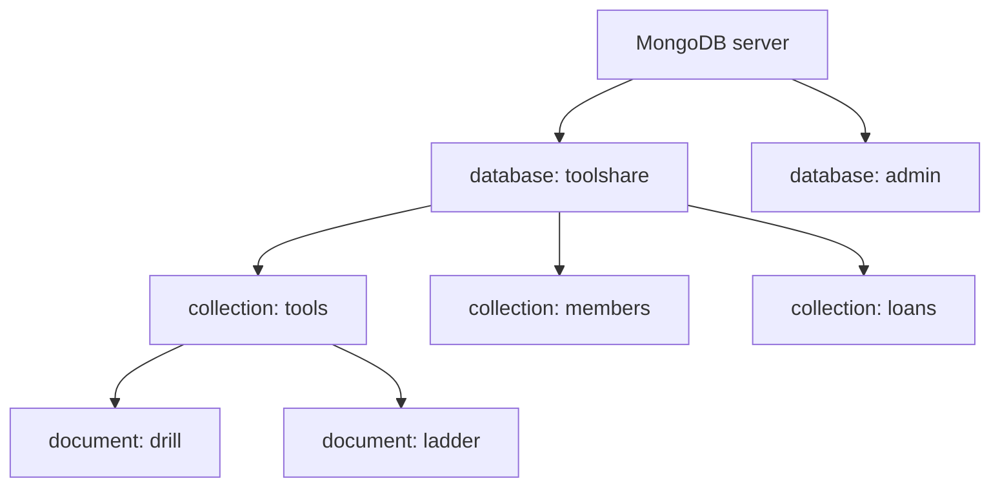

# Documents, collections and why a document database

> **Before this lesson:** nothing is required. You do not need to have used any database before. It helps to have seen a Python dictionary such as `{"name": "Ada"}`, but every piece of notation is explained when it first appears. This is the first lesson of the track.

## In plain words

A **database** is a program whose whole job is to keep information safe on disk and hand it back quickly when asked. MongoDB is a database that stores information as **documents**: small, self-describing records that look like a filled-in form.

Think of a filing cabinet in a tool-lending library. Each drawer holds one kind of thing: one drawer for tools, one for members, one for loans. Inside a drawer are index cards. A card for a drill lists its brand, its power and its accessories; a card for a ladder lists its height and maximum load. The cards in one drawer are about the same kind of thing, but nobody forces every card to have identical boxes. In MongoDB the cabinet is a **database**, each drawer is a **collection**, and each card is a **document**.

Why this matters for a job: MongoDB is one of the most widely used databases for web and mobile back ends, product catalogues, content systems, event logs and, more recently, for storing the text chunks and embeddings behind AI assistants. Interviewers expect you to explain what a document database is, when it fits and when a table-based database fits better.

## The problem documents solve

For decades the standard way to store data has been the **relational database** (a database that keeps data in tables made of rows and columns, queried with a language called SQL, Structured Query Language). A table works like a spreadsheet: every row has the same columns.

That is a good fit when every record has the same shape. It becomes awkward when records vary or contain lists. Take one tool from the lending library:

- a cordless drill, made by Brakka, 18 volts,
- with three accessories: a charger, a spare battery and a bit set,
- and a maintenance history of two service visits.

In tables you would need a `tools` table, an `accessories` table and a `service_visits` table, each row of the last two pointing back at the tool. To show the drill on screen the database must fetch rows from three tables and stitch them together. That stitching is called a **join** (combining rows from several tables by matching a shared value).

A document database stores the drill the way your program already thinks about it, as one nested record:

```javascript
{
  _id: 101,
  name: "Cordless drill",
  brand: "Brakka",
  volts: 18,
  accessories: ["charger", "spare battery", "bit set"],
  service: [
    { date: "2025-03-02", note: "replaced chuck" },
    { date: "2026-01-15", note: "new brushes" }
  ]
}
```

One read from disk returns everything needed to draw the page. Nothing has to be stitched.

> [!NOTE]
> Neither model is "better". Tables shine when many different questions are asked of the same data and when rules between tables must be enforced. Documents shine when the application mostly reads and writes whole objects. The last module of this track compares the two in depth.

## Anatomy of a document

Read the example above piece by piece.

- The curly braces `{ ... }` mark the start and end of one **document**.
- Inside are **fields**. A field is a name and a value separated by a colon: `brand: "Brakka"`. The name is also called a **key**.
- A value can be text in quotes (called a **string**), a number, `true` or `false` (a **boolean**), a date, or nothing at all (`null`).
- A value can be a list in square brackets, called an **array**: `accessories` holds three strings.
- A value can be another document. The entries of `service` are documents inside a document. These are called **embedded documents** (or subdocuments).

Three rules about field names are worth learning early:

1. Names are case-sensitive: `Brand` and `brand` are two different fields.
2. A document cannot contain the same field name twice.
3. Names starting with a dollar sign (`$`) or containing a dot (`.`) have special meaning in queries, so avoid them in your own field names.

MongoDB also remembers the order in which fields were written, although well-written programs do not depend on that order.

### The `_id` field

Every document must have a field called `_id`. Its value must be unique inside its collection, so it acts as the document's identity, like the number printed on a library card. In relational databases the same idea is called a **primary key**.

You may choose the `_id` yourself, as in `_id: 101` above. If you leave it out, MongoDB creates one for you. The generated value is an **ObjectId**, a 12-byte identifier that the next lesson takes apart.

## Collections

A **collection** is a group of documents, comparable to a table. The important difference is that a collection has a **dynamic schema**. A **schema** is the description of which fields exist and what type each one holds. "Dynamic" means MongoDB does not demand that description up front, and two documents in the same collection may have different fields:

```javascript
{ _id: 101, name: "Cordless drill", brand: "Brakka", volts: 18 }
{ _id: 102, name: "Step ladder", height_cm: 240, max_load_kg: 150 }
```

Both can live in the collection `tools`. No command is needed to "add a column" before saving a ladder.

A newcomer's natural question is: if anything can go anywhere, why have more than one collection? Four practical reasons:

- **Sanity.** Code that reads `tools` should not have to check whether it received a member or a loan.
- **Speed.** Finding all tools is faster when they are not mixed with millions of loan records.
- **Locality.** Documents of one kind stored together are read from disk together.
- **Indexes.** An **index** (a lookup structure that makes searches fast, covered in module 4) belongs to one collection and works best when the documents in it share fields.

So in practice a collection holds documents of one kind with *broadly* similar fields, and the flexibility is used for the differences that are real: a drill has volts, a ladder has a height.

> [!TIP]
> Flexible does not mean unplanned. Professional teams decide a document shape on purpose and often attach a validator, a rule set that rejects malformed documents. You will write one in module 6.

### Naming collections

A collection is identified by its name. Keep names short, lower-case and free of spaces: `tools`, `members`, `loans`. Names beginning with `system.` are reserved for MongoDB's own use. A dot is allowed and is often used purely for human organisation, for example `shop.orders` and `shop.refunds`; MongoDB sees no relationship between them.

## Databases and namespaces

Collections are grouped into **databases**. One MongoDB server can host many databases, each with its own files and its own access permissions. A typical layout is one database per application, for example `toolshare` for the lending library.

Three database names already exist on every server and should be left alone:

| name | purpose |
|---|---|
| `admin` | user accounts and server-wide administration |
| `local` | data belonging to this one server, never copied to others |
| `config` | bookkeeping for sharded clusters (module 8) |

Put a database name and a collection name together with a dot and you get a **namespace**, the full address of a collection: `toolshare.tools`.



## What makes MongoDB different

Four ideas appear again and again in this track. Meet them once now.

**1. Scaling out.** When a database outgrows one machine there are two options. **Scaling up** means buying a bigger machine. **Scaling out** means spreading the data over several ordinary machines. Because a document carries its related data inside it, it is easy to place whole documents on different machines. MongoDB's built-in mechanism for this is called **sharding** (module 8).

**2. High availability.** A **replica set** is a group of MongoDB servers holding identical copies of the data. If one fails, another takes over within seconds. Module 7 covers this.

**3. Rich queries.** Being flexible does not mean being primitive. MongoDB supports searches on any field, including fields deep inside embedded documents and arrays, plus secondary indexes, an **aggregation pipeline** for reports (module 5), text search and location search.

**4. Deliberate omissions.** Some features of relational databases are missing or limited by design. Joins exist (a stage called `$lookup`) but are not the default way to work. Multi-document **transactions** (several changes that succeed or fail as one unit) exist too, but a good document design needs them rarely because related data sits in one document, and a change to one document is always all-or-nothing.

> [!INTERVIEW]
> **"What is MongoDB and how does it differ from a relational database?"** A strong answer in four sentences: MongoDB is a document database; it stores records as BSON documents (a binary form of JSON) grouped into collections with a flexible schema. Related data is usually embedded in one document instead of being split across tables, so common reads need no joins. It provides replication for availability and sharding for horizontal scale as built-in features. The trade-off is that data duplicated across documents must be kept consistent by the application, whereas a normalised relational schema stores each fact once.

## Worked example: a first session in the shell

`mongosh` is MongoDB's command-line shell, a program in which you type a command and see the answer. The prompt (the text the shell prints before your typing) shows the current database. Lines beginning with `//` are comments for the reader.

```javascript
test> use toolshare
switched to db toolshare

toolshare> db.tools.insertOne({ _id: 101, name: "Cordless drill", brand: "Brakka", volts: 18 })
{ acknowledged: true, insertedId: 101 }

toolshare> db.tools.insertOne({ name: "Step ladder", height_cm: 240, max_load_kg: 150 })
{ acknowledged: true, insertedId: ObjectId("66f0a1c2e4b0a1b2c3d4e5f6") }

toolshare> db.tools.find()
[
  { _id: 101, name: 'Cordless drill', brand: 'Brakka', volts: 18 },
  { _id: ObjectId("66f0a1c2e4b0a1b2c3d4e5f6"), name: 'Step ladder', height_cm: 240, max_load_kg: 150 }
]

toolshare> db.tools.find({ brand: "Brakka" })
[ { _id: 101, name: 'Cordless drill', brand: 'Brakka', volts: 18 } ]
```

Line by line:

- `use toolshare` switches to the database `toolshare`. It did not exist a moment ago. MongoDB creates databases and collections lazily, at the moment the first document is stored in them.
- `db` is a variable that always refers to the current database. `db.tools` means "the collection `tools` in this database". `insertOne(...)` stores one document.
- The reply `acknowledged: true` means the server confirmed the write. `insertedId` repeats the `_id` of the new document.
- The second insert has no `_id`, so the reply shows a generated `ObjectId(...)`.
- `find()` with nothing between the parentheses returns every document. The two results have different fields, and the collection accepted both.
- `find({ brand: "Brakka" })` passes a **query document**: a description of what to look for. Only documents whose `brand` equals `"Brakka"` come back. The ladder has no `brand` field at all, so it does not match. That is not an error.

## The same thing from Python

Applications talk to MongoDB through a **driver**, a library that speaks the database's network protocol. The Python driver is called **PyMongo**.

```python
from pymongo import MongoClient

client = MongoClient("mongodb://localhost:27017")   # 1
db = client["toolshare"]                            # 2
tools = db["tools"]                                 # 3

result = tools.insert_one({"name": "Hand saw", "teeth_per_inch": 9})   # 4
print(result.inserted_id)                           # 5

for doc in tools.find({"brand": "Brakka"}):         # 6
    print(doc["name"], doc.get("volts"))
```

1. `MongoClient(...)` opens a connection. The text in quotes is a **connection string**: the protocol (`mongodb://`), the machine (`localhost`, meaning this computer) and the port (`27017`, the number MongoDB listens on by default).
2. Square brackets pick a database by name. Nothing is created yet.
3. The same notation picks a collection.
4. `insert_one` takes an ordinary Python dictionary. Notice that method names use underscores in Python (`insert_one`) where the shell uses camel case (`insertOne`).
5. Prints the generated id, something like `66f0a1c2e4b0a1b2c3d4e5f7`.
6. `find` returns the matching documents one at a time as Python dictionaries. `doc.get("volts")` is used instead of `doc["volts"]` because, with a flexible schema, a field may be absent; `.get` returns `None` in that case instead of raising an error. The loop prints `Cordless drill 18`.

## Simulate it yourself

Your browser cannot reach a MongoDB server, so the runnable examples in this track imitate MongoDB with plain Python: a collection is a list, a document is a dictionary. The imitation below supports inserting and equality search, which is enough to *feel* what a flexible schema means. Run it, then change the data.

```python-run
import itertools

class Collection:
    """A tiny stand-in for a MongoDB collection: a list of dicts."""
    _counter = itertools.count(1)          # hands out 1, 2, 3, ... for missing _id values

    def __init__(self, name):
        self.name = name
        self.docs = []

    def insert_one(self, doc):
        doc = dict(doc)                    # copy, so the caller's dict is not changed
        if "_id" not in doc:               # MongoDB adds an _id when you do not give one
            doc = {"_id": "auto-%d" % next(self._counter), **doc}
        if any(d["_id"] == doc["_id"] for d in self.docs):
            raise ValueError("duplicate _id: %r" % doc["_id"])
        self.docs.append(doc)
        return doc["_id"]

    def find(self, query=None):
        query = query or {}
        # keep a document when every field in the query is present and equal
        return [d for d in self.docs
                if all(k in d and d[k] == v for k, v in query.items())]

tools = Collection("tools")
tools.insert_one({"_id": 101, "name": "Cordless drill", "brand": "Brakka", "volts": 18})
tools.insert_one({"name": "Step ladder", "height_cm": 240, "max_load_kg": 150})
tools.insert_one({"name": "Jigsaw", "brand": "Brakka", "volts": 12,
                  "accessories": ["blade set", "guide rail"]})

print("all documents:")
for d in tools.find():
    print("  ", d)

print("brand = Brakka:", [d["name"] for d in tools.find({"brand": "Brakka"})])
print("brand = Brakka and volts = 12:", [d["name"] for d in tools.find({"brand": "Brakka", "volts": 12})])
print("height_cm = 240:", [d["name"] for d in tools.find({"height_cm": 240})])

try:
    tools.insert_one({"_id": 101, "name": "Another drill"})
except ValueError as err:
    print("rejected ->", err)

fields = sorted({key for d in tools.docs for key in d})
print("fields seen across the collection:", fields)
```

What the output shows:

- The ladder and the jigsaw received ids `auto-1` and `auto-2`, because they were inserted without one.
- The search for `brand = Brakka` returns the drill and the jigsaw. The ladder is skipped silently: a missing field does not match.
- Adding a second condition narrows the result to the jigsaw. Several conditions in one query document mean *all of them must hold*.
- Inserting a second document with `_id: 101` is rejected. Uniqueness of `_id` is the one rule every collection enforces.
- The last line lists seven different fields although no single document has all of them. That union of fields is the collection's *implicit* schema, and it lives in your application code, not in the database.

## Pitfalls

- **Assuming a field exists.** With a flexible schema, code must cope with absent fields. A typo such as `brnad` creates a new field without complaint.
- **Type drift.** `volts: 18` (a number) and `volts: "18"` (a string) are different values. A search for one does not find the other.
- **One giant collection.** Mixing unrelated kinds of documents in one collection makes queries slower and code harder to reason about.
- **Treating MongoDB like tables.** Splitting every list into its own collection and joining them back in application code gives up the main benefit of the document model.
- **Believing "no schema" means "no design".** The shape of your documents decides how fast and how safe the application will be. Module 6 is devoted to it.

> [!WARNING]
> A single document may not exceed 16 megabytes. That is a great deal of text, but an array that grows forever, such as every loan a tool has ever had, will reach it eventually. Bounded lists belong inside a document; unbounded ones need their own collection.

## Cheat sheet

| relational term | MongoDB term | everyday picture |
|---|---|---|
| database | database | the filing cabinet |
| table | collection | a drawer |
| row | document | an index card |
| column | field | a box on the card |
| primary key | `_id` | the number printed on the card |
| join | embedding, or `$lookup` | stapling related cards together |
| fixed schema | dynamic schema, optional validator | cards may have different boxes |

| fact | value |
|---|---|
| default port | 27017 |
| maximum document size | 16 MB |
| full name of a collection | `database.collection` (a namespace) |
| reserved databases | `admin`, `local`, `config` |

## Summary

- MongoDB stores **documents**: sets of named fields whose values may be numbers, strings, arrays or further documents.
- Documents live in **collections**, collections live in **databases**, and `database.collection` is a namespace.
- Every document has a unique `_id`; MongoDB generates an ObjectId when you do not supply one.
- Collections have a **dynamic schema**: documents in one collection may differ, which removes ceremony but moves responsibility for consistency to you.
- Embedding related data in one document makes common reads a single lookup and makes it natural to spread data across machines.
- The trade-offs are duplicated data and fewer built-in cross-record guarantees than a relational database offers.

## Glossary

- **Database** - a program (and the named container inside it) that stores data durably and answers questions about it.
- **Document** - one record in MongoDB: a set of fields, written between curly braces.
- **Field / key** - a name paired with a value inside a document.
- **Embedded document** - a document used as the value of a field in another document.
- **Array** - an ordered list of values inside a document.
- **Collection** - a named group of documents, comparable to a table.
- **Schema** - the description of which fields exist and what types they hold.
- **`_id`** - the mandatory field whose value uniquely identifies a document in its collection.
- **Namespace** - the full name of a collection: database name, a dot, collection name.
- **Join** - combining records from separate tables or collections by matching a shared value.
- **Driver** - a library that lets a programming language talk to the database, such as PyMongo.
- **mongosh** - the MongoDB command-line shell.

## Check yourself

```quiz
[
  {"q": "Which statement best describes a MongoDB collection?",
   "options": ["A group of documents that may have different fields", "A spreadsheet in which every row must have identical columns", "A single very large document", "A backup copy of a database"],
   "answer": 0,
   "explain": "A collection groups documents and has a dynamic schema, so two documents in it may carry different fields."},
  {"q": "You insert a document without an _id field. What happens?",
   "options": ["The insert fails with an error", "The document is stored without any identifier", "MongoDB generates a unique ObjectId and stores it as _id", "MongoDB uses the document's position in the collection as _id"],
   "answer": 2,
   "explain": "_id is mandatory, so the driver or server creates an ObjectId when none is supplied."},
  {"q": "The collection holds {_id: 1, brand: \"Brakka\"} and {_id: 2, name: \"Ladder\"}. What does find({brand: \"Brakka\"}) return?",
   "options": ["Both documents", "Only the document with _id 1", "An error, because document 2 has no brand field", "Nothing"],
   "answer": 1,
   "explain": "A document lacking the field does not match an equality condition. That is not an error; it is skipped."},
  {"q": "What is the namespace of the collection loans in the database toolshare?",
   "options": ["loans.toolshare", "toolshare/loans", "toolshare.loans", "db.loans"],
   "answer": 2,
   "explain": "A namespace is the database name, a dot, then the collection name."},
  {"q": "Why can a well-designed document model often avoid joins?",
   "options": ["MongoDB forbids more than one collection", "Related data is embedded in the same document, so one read returns it all", "Documents are always smaller than rows", "Joins are performed automatically on every query"],
   "answer": 1,
   "explain": "Embedding arrays and subdocuments keeps data that is used together stored together."},
  {"q": "Which of these is a real cost of a dynamic schema?",
   "options": ["Documents cannot contain arrays", "Collections cannot be indexed", "A misspelt field name creates a new field without any warning", "Every document must be exactly 16 MB"],
   "answer": 2,
   "explain": "Without a validator the server accepts any field name, so consistency is the application's responsibility."},
  {"q": "What is the maximum size of a single MongoDB document?",
   "options": ["1 MB", "16 MB", "1 GB", "There is no limit"],
   "answer": 1,
   "explain": "The limit is 16 megabytes, which is why unbounded arrays inside one document are a design mistake."}
]
```

> **Source:** MongoDB: The Definitive Guide 3e, ch. 1-2 (topics only; wording and examples are original). MongoDB Manual: https://www.mongodb.com/docs/manual/core/document/ and https://www.mongodb.com/docs/manual/core/databases-and-collections/
