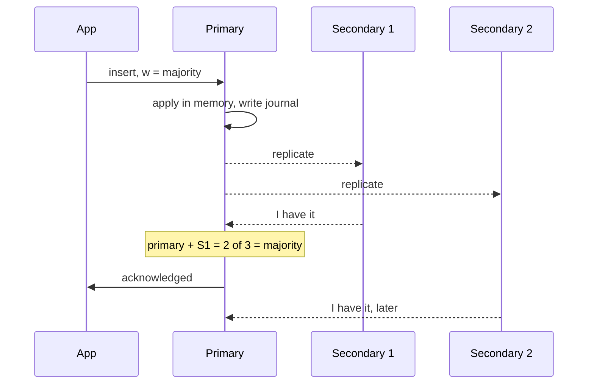

# Inserting, deleting and write concern

> **Before this lesson:** you should know what documents, collections and `_id` are ([Documents, collections and why a document database](#/lesson/mongodb/document-model)) and have seen the shell and the basic value types ([BSON types, ObjectId and the shell](#/lesson/mongodb/bson-shell)).

## In plain words

Putting data into a database and taking it out again sounds like the easy part. The interesting question is: **when the database says "done", what exactly has been done?**

Picture a parcel counter at a post office. You hand over a parcel. The clerk might (a) nod without looking, (b) take the parcel and say "got it", (c) put it in the locked storeroom and then say "got it", or (d) wait until a second branch has confirmed that it holds a copy of the paperwork. Each answer is slower than the one before and safer than the one before. MongoDB lets you choose which of these answers you want for each write. That choice is called the **write concern**.

This lesson covers the two operations that add and remove whole documents - **insert** and **delete** - and then the write concern, which applies to every kind of write.

Why it matters for a job: loading data in bulk, cleaning it up safely and knowing which writes can be lost in a crash are everyday back-end tasks, and "explain write concern" is one of the most common MongoDB interview questions.

## Inserting one document

The simplest write stores one document:

```javascript
bakery> db.orders.insertOne({ customer: "Tomas", item: "rye loaf", qty: 2 })
{ acknowledged: true, insertedId: ObjectId("6801aa10c2d3e4f5a6b7c8d9") }
```

- `db.orders` names the collection `orders` in the current database. It is created on this first insert.
- `insertOne(...)` takes one document.
- No `_id` was given, so one was generated. The reply repeats it as `insertedId`.
- `acknowledged: true` means the server confirmed the write. What "confirmed" guarantees is the write-concern topic below.

Before storing a document the server performs a few checks. It adds an `_id` if there is none. It rejects the document if it is larger than 16 megabytes. It rejects it if another document in the collection already has the same `_id`; the error is called a **duplicate key error** and carries the code `E11000`. And, if the collection has a validator (module 6), it checks the document against those rules. Apart from that, anything goes: the server does not know or care that you misspelt `custmer`.

## Inserting many documents

Sending documents one at a time means one network round trip each. A **round trip** is one request travelling to the server plus the reply travelling back. For a thousand documents that waiting dominates everything. `insertMany` sends a whole list at once:

```javascript
bakery> db.orders.insertMany([
...   { _id: 1, customer: "Tomas", item: "rye loaf", qty: 2 },
...   { _id: 2, customer: "Greta", item: "baguette", qty: 1 },
...   { _id: 3, customer: "Anouk", item: "cinnamon bun", qty: 6 }
... ])
{ acknowledged: true, insertedIds: { '0': 1, '1': 2, '2': 3 } }
```

The square brackets make an array of three documents. The reply lists the `_id` given to each position (0, 1, 2) of that array.

Drivers split very large lists into batches for you. One batch may hold up to 100,000 operations and up to 48 megabytes, so there is no need to chunk the list yourself.

### Ordered and unordered

What should happen when one document in the middle of the list is rejected? There are two reasonable answers, and you choose with the `ordered` option.

- **Ordered** (the default): documents are inserted in list order, and the operation **stops at the first error**. Documents before the bad one are stored; documents after it are not attempted.
- **Unordered** (`{ ordered: false }`): the server may insert in any order, **attempts every document**, and reports all failures at the end.

```javascript
bakery> db.orders.insertMany(
...   [ { _id: 4, item: "scone" }, { _id: 2, item: "duplicate!" }, { _id: 5, item: "focaccia" } ],
...   { ordered: false }
... )
MongoBulkWriteError: E11000 duplicate key error collection: bakery.orders index: _id_ dup key: { _id: 2 }
Result: { insertedCount: 2, insertedIds: { '0': 4, '2': 5 }, writeErrors: [ { index: 1, code: 11000 } ] }
```

Here the middle document reuses `_id: 2`. Because the insert is unordered, documents 4 and 5 are both stored and the error names position 1 as the one that failed. With the default ordered behaviour, document 4 would have been stored, the error raised, and document 5 never tried.

A newcomer's usual confusion is to read the error message and assume *nothing* was inserted. That is wrong in both modes. A multi-document insert is **not** all-or-nothing. If you need all-or-nothing across several documents, you need a transaction (module 6).

> [!TIP]
> Use unordered inserts for bulk loads where the documents are independent, such as importing a file: one bad row does not block the rest, and the server can work on the batch in parallel. Keep ordered inserts when later documents depend on earlier ones.

## Deleting documents

Deleting uses a **filter**: a query document that says which documents to remove. It is the same kind of query document that `find` accepts.

```javascript
bakery> db.orders.deleteOne({ _id: 3 })
{ acknowledged: true, deletedCount: 1 }

bakery> db.orders.deleteMany({ qty: { $lt: 2 } })
{ acknowledged: true, deletedCount: 1 }

bakery> db.orders.deleteMany({})
{ acknowledged: true, deletedCount: 3 }
```

- `deleteOne` removes **the first** document that matches the filter. Which one is "first" when several match depends on storage order and on indexes, so use it with a filter that identifies exactly one document, typically `_id`.
- `deleteMany` removes **every** matching document. `$lt` means "less than", so the second command deletes orders with a quantity below 2. Operators such as `$lt` are covered fully in the querying module.
- `deleteMany({})` uses an empty filter, which matches everything. It empties the collection.

`deletedCount` tells you how many documents were removed. A count of 0 is not an error; it means nothing matched.

To remove a whole collection there is a faster tool: `db.orders.drop()`. Deleting documents one by one updates every index entry for every document. Dropping removes the collection's files, along with its indexes and settings, in one step.

> [!WARNING]
> Deletes cannot be undone. There is no recycle bin and no "undo delete" command; the only way back is a backup. Before running `deleteMany(filter)`, run `find(filter)` or `countDocuments(filter)` with the same filter and look at what it selects. A stray `{}` is the most expensive pair of characters in MongoDB.

## Write concern: what does "done" mean?

To understand the options you need three facts about how MongoDB handles a write. Each is explained in full later; one sentence each is enough here.

1. **Memory first.** A write is first applied to data held in memory, which is fast but disappears if the machine loses power.
2. **The journal.** Shortly afterwards the write is recorded in the **journal**, a file on disk to which every change is appended. After a crash the server replays the journal to recover. By default the journal is written to disk roughly every 100 milliseconds.
3. **Replication.** In production MongoDB runs as a **replica set**: several servers holding copies of the same data. One, the **primary**, accepts writes; the others, the **secondaries**, copy them a moment later.

A **write concern** is a small document attached to a write that says how far the write must have progressed before the server replies. It has three settings.

| setting | meaning |
|---|---|
| `w` | how many replica-set members must have the write: a number, or `"majority"` for more than half of the voting members |
| `j` | `true` = wait until the write is in the on-disk journal of the members counted by `w` |
| `wtimeout` | give up *waiting* after this many milliseconds and report an error |

The common combinations, from fastest to safest:

| write concern | the reply means | can the write still be lost? |
|---|---|---|
| `{ w: 0 }` | "request sent" - no confirmation at all | yes, and you will not even learn of errors such as a duplicate key |
| `{ w: 1 }` | the primary applied it in memory | yes, if the primary crashes before journaling, or fails before any secondary copied it |
| `{ w: 1, j: true }` | the primary wrote it to its journal on disk | yes, if the primary is lost for good before a secondary copied it |
| `{ w: "majority" }` | more than half of the members have it, journaled | no, short of losing most of the cluster |

Since MongoDB 5.0 the default is `{ w: "majority" }` for ordinary replica sets, and with `majority` the journal wait is implied by default. Earlier versions defaulted to `{ w: 1 }`, which is why much older advice urges you to raise it.



Setting a write concern in the shell is an option on the write:

```javascript
bakery> db.orders.insertOne(
...   { customer: "Selim", item: "sourdough", qty: 1 },
...   { writeConcern: { w: "majority", wtimeout: 5000 } }
... )
{ acknowledged: true, insertedId: ObjectId("6801ab77c2d3e4f5a6b7c8da") }
```

The second argument asks for a majority and limits the wait to 5,000 milliseconds.

Two points confuse nearly everyone at first.

**A `wtimeout` error does not undo the write.** It means "I stopped waiting", not "I rolled back". The write was applied on the primary and will probably reach the secondaries a little later. Code that retries after a timeout must be able to cope with the first attempt having succeeded.

**`w: 1` writes can be rolled back.** If the primary acknowledges a write and then fails before any secondary has copied it, a different member becomes primary without that write. When the old primary returns, it discovers the disagreement and discards the write. This is called a **rollback**, and it is why data that matters is written with `w: "majority"`.

> [!INTERVIEW]
> **"What write concern would you use, and why?"** Start from the cost of losing a write. For orders, payments and anything a user was told is saved: `w: "majority"`, because it is the only setting that survives the loss of the primary. For high-volume, low-value data such as clickstream events or metrics, `w: 1` is a defensible trade for lower latency. `w: 0` is acceptable only when losing data silently is fine. Then mention that the default has been `majority` since version 5.0, and that `wtimeout` should always be set alongside a numeric or majority `w` so that the application does not hang when members are down.

## The same from Python

```python
from pymongo import MongoClient, WriteConcern
from pymongo.errors import BulkWriteError, DuplicateKeyError

db = MongoClient("mongodb://localhost:27017/?replicaSet=rs0")["bakery"]           # 1
orders = db.get_collection("orders", write_concern=WriteConcern(w="majority", wtimeout=5000))   # 2

try:
    orders.insert_one({"_id": 1, "customer": "Tomas", "item": "rye loaf", "qty": 2})
    orders.insert_one({"_id": 1, "customer": "Tomas again"})                     # 3
except DuplicateKeyError as err:
    print("duplicate:", err.details["keyValue"])                                # 4

batch = [{"_id": 2, "item": "baguette"}, {"_id": 1, "item": "clash"}, {"_id": 3, "item": "bun"}]
try:
    orders.insert_many(batch, ordered=False)                                     # 5
except BulkWriteError as err:
    print(err.details["nInserted"], [e["index"] for e in err.details["writeErrors"]])   # 6

print(orders.delete_many({"qty": {"$lt": 2}}).deleted_count)                     # 7
```

1. The connection string names the replica set, so the driver can find the primary.
2. In PyMongo the write concern belongs to a collection object. Every write through `orders` now waits for a majority, for at most five seconds.
3. A second insert with the same `_id` raises `DuplicateKeyError`.
4. Prints `duplicate: {'_id': 1}`: the error says which key clashed.
5. An unordered bulk insert in which the middle document clashes.
6. Prints `2 [1]`: two documents were inserted and position 1 failed. Errors arrive as an exception, and the exception's details tell you what did succeed.
7. Deletes every order with `qty` below 2 and prints how many were removed. Documents with no `qty` field are not matched by `$lt`.

## Simulate it yourself

The first half of the simulation reproduces ordered and unordered bulk inserts. The second half models a three-member replica set and shows what each write concern waits for.

```python-run
def insert_many(collection, docs, ordered=True):
    """Insert docs into collection (a list of dicts). Return (inserted positions, failed positions)."""
    inserted, failed = [], []
    for position, doc in enumerate(docs):
        if any(existing["_id"] == doc["_id"] for existing in collection):
            failed.append(position)            # duplicate key error
            if ordered:
                break                          # ordered: stop at the first error
            continue                           # unordered: carry on with the rest
        collection.append(dict(doc))
        inserted.append(position)
    return inserted, failed

batch = [{"_id": 4, "item": "scone"}, {"_id": 2, "item": "duplicate!"},
         {"_id": 5, "item": "focaccia"}, {"_id": 4, "item": "second scone"}]

for ordered in (True, False):
    orders = [{"_id": 1, "item": "rye loaf"}, {"_id": 2, "item": "baguette"}]
    done, errors = insert_many(orders, batch, ordered)
    print("ordered =", ordered, "| inserted positions", done, "| failed positions", errors,
          "| ids now", [d["_id"] for d in orders])

print()

# --- write concern -------------------------------------------------------
# Time in milliseconds at which each member has the write in memory / in its journal.
members = {
    "primary":     {"memory": 0,  "journal": 60},
    "secondary-1": {"memory": 25, "journal": 90},
    "secondary-2": {"memory": 400, "journal": 470},   # a slow or distant member
}

def acknowledged_at(w, journal, wtimeout=None):
    """When does the client get its reply for this write concern?"""
    if w == 0:
        return "0 ms (no confirmation requested)"
    stage = "journal" if journal else "memory"
    needed = len(members) // 2 + 1 if w == "majority" else w
    times = sorted(m[stage] for m in members.values())     # fastest members first
    t = max(times[needed - 1], members["primary"][stage])  # the primary always takes part
    if wtimeout is not None and t > wtimeout:
        return "ERROR after %d ms: timed out waiting (the write itself is NOT undone)" % wtimeout
    return "%d ms" % t

print("w=0                 ->", acknowledged_at(0, False))
print("w=1                 ->", acknowledged_at(1, False))
print("w=1, j=true         ->", acknowledged_at(1, True))
print("w=majority (j=true) ->", acknowledged_at("majority", True))
print("w=3, j=true         ->", acknowledged_at(3, True))
print("w=3, wtimeout=200   ->", acknowledged_at(3, True, wtimeout=200))
```

Reading the output:

- With `ordered = True` only position 0 is inserted: the duplicate at position 1 stops everything, so `_id: 5` never arrives. With `ordered = False` positions 0 and 2 are inserted and positions 1 and 3 fail (position 3 clashes with the scone inserted moments earlier in the same batch).
- `w=1` answers at 0 ms: the primary has the write in memory. Asking for the journal moves the answer to 60 ms.
- `majority` needs two of three journals. The two fastest are the primary (60) and secondary-1 (90), so the reply comes at 90 ms. The slow member does not hold things up.
- `w=3` must wait for the slow member: 470 ms. With a 200 ms timeout the client receives an error, yet the write is on two members already and will reach the third.

Try making `secondary-1` slow as well and watch `majority` degrade.

## Pitfalls

- **Assuming a failed `insertMany` inserted nothing.** Check `insertedCount` or the error details.
- **`deleteOne` with a filter matching many documents.** You cannot predict which one disappears.
- **Emptying a large collection with `deleteMany({})`** when `drop()` would do: far slower. Remember that `drop()` also removes the indexes, which must be recreated.
- **Treating a write-concern timeout as a failed write** and blindly retrying an insert, which then produces a duplicate key error or a duplicate document.
- **Using `w: 0` and wondering why errors never appear.** No reply means no error report.
- **Asking for `w` equal to the number of members.** One member down for maintenance and every write blocks until the timeout. `majority` tolerates that.

## Cheat sheet

| task | shell | PyMongo |
|---|---|---|
| insert one | `db.c.insertOne(doc)` | `c.insert_one(doc)` |
| insert many, stop at first error | `db.c.insertMany(docs)` | `c.insert_many(docs)` |
| insert many, try all | `db.c.insertMany(docs, {ordered: false})` | `c.insert_many(docs, ordered=False)` |
| delete one / many | `db.c.deleteOne(f)` / `db.c.deleteMany(f)` | `c.delete_one(f)` / `c.delete_many(f)` |
| remove the collection | `db.c.drop()` | `c.drop()` |
| set write concern | `{writeConcern: {w: "majority", wtimeout: 5000}}` | `WriteConcern(w="majority", wtimeout=5000)` |

| limit | value |
|---|---|
| document size | 16 MB |
| operations per batch | 100,000 |
| batch message size | 48 MB |
| duplicate key error code | 11000 |

## Summary

- `insertOne` stores one document; `insertMany` stores a list in few round trips. The server adds `_id` if missing and rejects oversized or duplicate-`_id` documents.
- Ordered bulk inserts stop at the first error; unordered ones attempt everything. Neither is all-or-nothing.
- `deleteOne` and `deleteMany` take a filter; `drop()` removes a collection with its indexes. Deletes are permanent.
- The write concern decides what an acknowledgement means: `w` (how many members), `j` (on disk in the journal), `wtimeout` (how long to wait).
- `w: "majority"` is the default since 5.0 and the only setting that protects a write against the loss of the primary. A timeout stops the wait, not the write.

## Glossary

- **Round trip** - one request to the server plus its reply.
- **Filter** - a query document that selects which documents an operation applies to.
- **Duplicate key error (E11000)** - the error raised when a write would create a second document with the same unique value, such as `_id`.
- **Ordered / unordered** - whether a bulk write stops at the first error or attempts every operation.
- **Journal** - an on-disk file to which every change is appended so the server can recover after a crash.
- **Replica set** - a group of servers holding copies of the same data.
- **Primary / secondary** - the member that accepts writes / the members that copy them.
- **Write concern** - the level of confirmation a write waits for before the server replies.
- **Majority** - more than half of the voting members of a replica set.
- **Rollback** - the discarding of writes that were acknowledged by a failed primary but never reached the other members.

## Check yourself

```quiz
[
  {"q": "An ordered insertMany of five documents fails on the third because of a duplicate _id. How many documents are stored?",
   "options": ["0", "2", "4", "5"],
   "answer": 1,
   "explain": "Ordered inserts stop at the first error: the first two are stored, the third fails, the last two are never attempted."},
  {"q": "The same five documents are inserted with ordered: false. How many are stored?",
   "options": ["0", "2", "4", "5"],
   "answer": 2,
   "explain": "Unordered inserts attempt every document, so only the duplicate is rejected."},
  {"q": "What does the write concern {w: 1} guarantee when the server acknowledges?",
   "options": ["The write is on disk on every member", "The primary has applied the write in memory", "A majority of members have the write", "Nothing at all"],
   "answer": 1,
   "explain": "w: 1 waits for the primary only, and without j: true it does not wait for the journal."},
  {"q": "A write with {w: \"majority\", wtimeout: 2000} returns a timeout error. What is true?",
   "options": ["The write was rolled back everywhere", "The write may still be applied on the primary and reach the other members later", "The collection is locked until an administrator intervenes", "The document was deleted"],
   "answer": 1,
   "explain": "wtimeout limits how long the client waits. It does not cancel or undo the write."},
  {"q": "Why is drop() faster than deleteMany({}) for emptying a large collection?",
   "options": ["drop() skips the write concern", "deleteMany removes documents and index entries one by one, while drop() removes the collection's files in one step", "drop() only hides the documents", "There is no difference"],
   "answer": 1,
   "explain": "Dropping discards the data and index files wholesale; the price is that indexes and options must be recreated."},
  {"q": "Which write can be lost through a rollback after it was acknowledged?",
   "options": ["One written with w: \"majority\"", "One written with w: 1 whose primary failed before any secondary copied it", "Any write that used insertMany", "None; acknowledged writes are never lost"],
   "answer": 1,
   "explain": "A write known only to the old primary is discarded when a member without it becomes the new primary."},
  {"q": "With w: 0, what happens when an insert violates the unique _id rule?",
   "options": ["The driver raises DuplicateKeyError", "The server retries with a new _id", "The document is not stored and the client is not told", "The existing document is overwritten"],
   "answer": 2,
   "explain": "Unacknowledged writes get no reply, so errors on the server go unreported."}
]
```

> **Source:** MongoDB: The Definitive Guide 3e, ch. 3 (topics only; wording and examples are original). MongoDB Manual: https://www.mongodb.com/docs/manual/reference/write-concern/ , https://www.mongodb.com/docs/manual/reference/method/db.collection.insertMany/ , https://www.mongodb.com/docs/manual/reference/limits/
