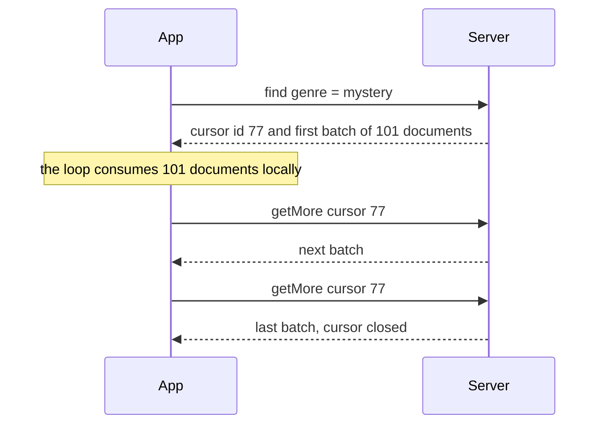

# Cursors, sorting and pagination done right

> **Before this lesson:** you should be able to write filters with operators such as `$gt` and `$in` - see [Query operators and how documents match](#/lesson/mongodb/query-operators). Knowing the BSON types from [BSON types, ObjectId and the shell](#/lesson/mongodb/bson-shell) helps with the section on sort order.

## In plain words

A query can match millions of documents. Sending them all to your program in one piece would be slow and could exhaust its memory. So `find` does not return the documents themselves. It returns a **cursor**: a handle that fetches results a portion at a time as you ask for them.

Think of a water dispenser fed by a large tank. You do not carry the tank to your desk; you press the tap and fill one cup at a time. The tap is the cursor, each cup is a **batch** of documents, and the tank stays on the server.

Three more ideas ride on top of the cursor. **Sorting** puts results in order. **Projection** picks which fields to send. **Pagination** hands results to a user one screenful at a time, like pages of search results.

Why it matters for a job: every list screen in every application is "filter, sort, take a page". The textbook way of paging, with `skip`, gets slower the deeper the user goes, and explaining the better way is a standard interview question.

## What a cursor is

In the shell, `find` returns a cursor and the shell prints the first 20 results. Type `it` (short for *iterate*) to see the next 20.

```javascript
lib> const cur = db.books.find({ genre: "mystery" })
lib> cur.hasNext()
true
lib> cur.next()
{ _id: 3, title: 'The Salt Road', genre: 'mystery', year: 1998, pages: 310 }
```

- The first line stores the cursor in a variable. **No query has run yet.** Building a cursor is free; the server is contacted only when results are first requested. This is called **lazy** evaluation.
- `hasNext()` asks whether another document is available. This is the moment the query is sent.
- `next()` returns one document and moves the cursor forward.

Behind the scenes the server does not send one document per request. It sends a **batch**. The first batch contains up to 101 documents, later batches as many as fit in 16 megabytes. When your loop has used up a batch, the driver quietly asks for the next one with a command called `getMore`. You see a smooth stream of documents.



A cursor occupies memory on the server while it is open. The server closes it when you have read everything. If you stop reading halfway and walk away, the server removes the idle cursor after 10 minutes. A long-running job that pauses for more than 10 minutes between batches will therefore fail with a "cursor not found" error. The remedies are to process faster, to request smaller batches with `batchSize(n)` so that each one is consumed sooner, or to re-run the query from where you stopped.

## Shaping the result: sort, limit, skip

Because the cursor is lazy, you can attach instructions to it before any result is fetched. These methods return the cursor itself, so they can be chained:

```javascript
lib> db.books.find({ genre: "mystery" }).sort({ year: -1 }).limit(3)
```

Read it left to right: mysteries, newest first, at most three.

| method | meaning |
|---|---|
| `sort({ field: 1 })` | order ascending by `field`; `-1` for descending |
| `limit(n)` | return at most `n` documents |
| `skip(n)` | discard the first `n` documents |

A sort may name several fields: `sort({ genre: 1, year: -1 })` orders by genre, and within one genre by year, newest first. The first field listed is the most significant.

A detail that confuses newcomers: the order in which you *write* the chained methods does not matter. `find().limit(3).sort({ year: -1 })` gives the same three books as the version above. The server always applies **sort first, then skip, then limit**.

> [!WARNING]
> Without a `sort`, the order of results is not defined. Documents often come back in insertion order, which tempts people to rely on it, but the server is free to return them in any order and that order can change after updates or when a different index is used. If order matters, sort explicitly.

### How values of different types are ordered

A flexible schema allows `year` to be a number in one document, a string in another and absent in a third. A sort still has to put them in *some* order. MongoDB first compares by type, in this sequence from lowest to highest (abbreviated to the common types):

1. missing field and `null`
2. numbers (all numeric types compared by value)
3. strings
4. embedded documents
5. arrays
6. binary data
7. ObjectId
8. booleans (`false` before `true`)
9. dates
10. regular expressions

Only values of the same type are compared with each other by value. So, sorted ascending, a document with no `year` comes before `year: 1998`, which comes before `year: "unknown"`. If results look strangely grouped, check for mixed types in the sort field.

### Sorting is not free

To sort, the server needs every matching document's sort value before it can return even the first result. If an **index** on the sort field exists (a pre-sorted lookup structure, explained in the next module), the server walks the index in order and returns documents as it goes. Without one, it must load all matching documents into memory and sort them there. That in-memory sort is limited to 100 megabytes; beyond that the query spills to temporary files on disk (recent versions) or fails (older ones). Either way it is slow. The practical rule is: any sort used by the application on a large collection should be backed by an index.

## Projection: asking for fewer fields

The second argument of `find` is the **projection**: a document saying which fields to return.

```javascript
lib> db.books.find({ genre: "mystery" }, { title: 1, year: 1 })
{ _id: 3, title: 'The Salt Road', year: 1998 }

lib> db.books.find({ genre: "mystery" }, { title: 1, year: 1, _id: 0 })
{ title: 'The Salt Road', year: 1998 }

lib> db.books.find({ genre: "mystery" }, { reviews: 0 })
{ _id: 3, title: 'The Salt Road', genre: 'mystery', year: 1998, pages: 310 }
```

- `1` means "include this field". Listing some fields with `1` returns only those, plus `_id`, which is included unless you switch it off.
- `_id: 0` removes `_id`.
- `0` means "exclude". Listing fields with `0` returns everything else.
- Including and excluding cannot be mixed in one projection, with `_id` as the only exception.

Projection saves network traffic and memory in your program. It does not, on its own, save the database the work of locating the documents.

## Counting

`countDocuments(filter)` returns the exact number of documents matching the filter. It has to count them, so on a big result it is as expensive as reading them. `estimatedDocumentCount()` returns the collection's total size from its bookkeeping data instantly, and takes no filter. Showing "about 2.3 million results" is cheap. Showing "2,317,442 results" on every page view is not.

## Pagination with skip and limit

The obvious way to show page 3 with 20 items per page:

```javascript
lib> db.books.find({ genre: "mystery" }).sort({ year: -1 }).skip(40).limit(20)
```

Skip two pages' worth, take one page. It is easy, it lets the user jump to any page number, and for the first few pages it is fine.

The trouble is how `skip` works. It does not jump. The server walks through the results in order and **throws away** the first 40. For page 3 that is trivial. For page 5,000 the server walks past 99,980 entries to return 20. The cost of a page grows in direct proportion to its distance from the start.

There is a second, quieter problem. Suppose a user is reading page 1 and a new book is inserted at the top of the list. Every item shifts down by one. When the user asks for page 2, the last item of page 1 has moved to the first position of page 2 and is shown **again**. If a book is deleted instead, an item is silently **skipped**.

## Pagination done right: remember where you stopped

The better technique has several names: **range-based**, **keyset** or **cursor-based** pagination. (The word "cursor" here means a bookmark held by the client, not the server-side cursor described above.) Instead of saying how many items to throw away, the client says where it stopped, and the query asks for what comes after that point.

First page:

```javascript
lib> db.books.find({ genre: "mystery" }).sort({ year: -1, _id: -1 }).limit(20)
```

Suppose the last book on that page has `year: 1998` and `_id: 3`. Next page:

```javascript
lib> db.books.find({
...   genre: "mystery",
...   $or: [ { year: { $lt: 1998 } },
...          { year: 1998, _id: { $lt: 3 } } ]
... }).sort({ year: -1, _id: -1 }).limit(20)
```

Two things need explaining.

**Why is `_id` in the sort?** Many books share a year. If the sort were by `year` alone, the order among the 1998 books would be undefined, and "everything after 1998" would skip the remaining 1998 books that did not fit on the page. Adding `_id`, which is unique, as a final sort field gives every document a distinct position. A unique final sort field is called a **tie-breaker**.

**What does the `$or` say?** "Strictly after position (1998, 3)" in a list sorted downwards means: a smaller year, **or** the same year with a smaller `_id`. That is precisely the two branches.

With an index on `{ genre: 1, year: -1, _id: -1 }`, the server jumps straight to the bookmark and reads 20 entries. Page 5,000 costs the same as page 1. And because the query is anchored to a position and not to a count, inserts and deletes elsewhere in the list cannot cause repeats or gaps.

| | skip / limit | range-based |
|---|---|---|
| cost of page *n* | grows with *n* | constant |
| jump to an arbitrary page number | yes | no (next / previous only) |
| stable while data changes | no (repeats, gaps) | yes |
| needs a unique sort key | no | yes (add `_id` as tie-breaker) |
| complexity of the query | trivial | moderate |

> [!TIP]
> To find out whether a next page exists without a separate count query, ask for one more item than you display: `limit(21)` for a page of 20. If 21 come back, there is a next page; show 20 and use the 20th as the bookmark.

> [!INTERVIEW]
> **"How would you paginate a feed with millions of items?"** Say that `skip`/`limit` is acceptable for shallow paging but its cost grows linearly with the offset because skipped entries are still scanned, and that concurrent inserts cause duplicates or gaps. Then describe range-based pagination: sort by a key plus a unique tie-breaker such as `_id`, return the last item's key to the client as an opaque token, and fetch the next page with a "greater than / less than the token" filter and a matching compound index. Mention the trade-off - no random access to page *n* - and that infinite-scroll interfaces do not need it.

## The same from Python

```python
from pymongo import MongoClient, DESCENDING

books = MongoClient()["lib"]["books"]

cursor = (books.find({"genre": "mystery"}, {"title": 1, "year": 1})        # 1
               .sort([("year", DESCENDING), ("_id", DESCENDING)])          # 2
               .limit(20))
page = list(cursor)                                                       # 3
print(len(page), page[0]["title"] if page else None)

def next_page(last, size=20):                                             # 4
    after = {"$or": [{"year": {"$lt": last["year"]}},
                     {"year": last["year"], "_id": {"$lt": last["_id"]}}]}
    query = {"genre": "mystery", **after}                                 # 5
    return list(books.find(query, {"title": 1, "year": 1})
                     .sort([("year", DESCENDING), ("_id", DESCENDING)])
                     .limit(size))

if page:
    print([b["title"] for b in next_page(page[-1])])                      # 6

with books.find({}, no_cursor_timeout=True).batch_size(500) as slow:      # 7
    for book in slow:
        pass   # long processing per document
```

1. The second argument is the projection. Nothing is sent to the server yet.
2. In PyMongo a multi-field sort is a list of `(field, direction)` pairs, which makes the order of the fields explicit.
3. `list(cursor)` runs the query and collects the results. Prints the count and the first title.
4. `last` is the final document of the previous page.
5. `**after` merges the bookmark condition into the base filter.
6. Prints the titles of page two.
7. For a long job, `no_cursor_timeout=True` asks the server not to remove the cursor after 10 idle minutes, and the `with` block guarantees it is closed at the end. `batch_size(500)` controls how many documents each `getMore` fetches.

## Simulate it yourself

The simulation counts how many entries the server must walk for a page with each technique, then shows the repeated-item problem when a document is inserted between two page requests.

```python-run
import bisect

# 50,000 books, already in feed order: year descending, _id descending.
books = sorted(({"_id": i, "year": 1900 + (i * 7919) % 120} for i in range(1, 50_001)),
               key=lambda b: (b["year"], b["_id"]), reverse=True)

def page_with_skip(docs, page, size):
    examined = min(len(docs), page * size + size)        # entries walked: the skipped ones too
    return docs[page * size: page * size + size], examined

def page_after(docs, bookmark, size, keys=None):
    if keys is None:                                     # the "index": the sort keys, in order
        keys = [(-d["year"], -d["_id"]) for d in docs]
    start = 0 if bookmark is None else bisect.bisect_right(keys, (-bookmark[0], -bookmark[1]))
    items = docs[start:start + size]
    return items, len(items)                             # a seek, then exactly one page is read

print("entries examined to fetch one page of 20")
print("page      skip/limit   range-based")
bookmark = None
index_keys = [(-d["year"], -d["_id"]) for d in books]   # built once, like a real index
for page in range(0, 2001):
    by_skip, cost_skip = page_with_skip(books, page, 20)
    by_range, cost_range = page_after(books, bookmark, 20, index_keys)
    assert by_skip == by_range                           # both techniques return the same documents
    if page in (0, 1, 10, 100, 1000, 2000):
        print(str(page).ljust(9), str(cost_skip).ljust(12), cost_range)
    bookmark = (by_range[-1]["year"], by_range[-1]["_id"])

print()
# --- what happens when the list changes between two page requests ----------
feed = [{"_id": i, "year": 2000 + i} for i in range(10, 0, -1)]     # newest first: ids 10..1
first, _ = page_with_skip(feed, 0, 3)
print("page 1:", [d["_id"] for d in first])
feed.insert(0, {"_id": 11, "year": 2011})                            # a new item arrives at the top
second_skip, _ = page_with_skip(feed, 1, 3)
second_range, _ = page_after(feed, (first[-1]["year"], first[-1]["_id"]), 3)
print("page 2 with skip :", [d["_id"] for d in second_skip], "<- item 8 is shown twice")
print("page 2 with range:", [d["_id"] for d in second_range])
```

Reading the output:

- The table shows the skip technique examining 20, 40, 220, 2,020, 20,020 and 40,020 entries as the page number grows, while the range technique examines 20 every time. The `assert` confirms that both return identical documents.
- In the second part, page 1 is `[10, 9, 8]`. After item 11 is inserted at the top, skip-based page 2 is `[8, 7, 6]`: item 8 appears a second time. Range-based page 2 is `[7, 6, 5]`, which is what the user expects.

## Pitfalls

- **Relying on unsorted order.** Add an explicit `sort`.
- **Sorting on a field that is not unique** when paginating: ties make pages overlap or miss items. Add `_id` as a tie-breaker.
- **Deep `skip`.** Use range-based pagination for anything beyond the first few pages.
- **Sorting without an index** on a large result: an in-memory sort capped at 100 MB.
- **Exact counts on every request.** They scan the matches.
- **Abandoned or slow cursors** timing out after 10 idle minutes.
- **Mixed types in the sort field**, producing type-grouped order.
- **Mixing inclusion and exclusion** in one projection (other than `_id`).

## Cheat sheet

| task | shell |
|---|---|
| sort newest first | `.sort({ created: -1 })` |
| stable sort for paging | `.sort({ created: -1, _id: -1 })` |
| first N | `.limit(N)` |
| page by offset | `.skip(page * N).limit(N)` |
| page by bookmark | filter `{ $or: [ { created: { $lt: c } }, { created: c, _id: { $lt: i } } ] }` + same sort + `.limit(N)` |
| only some fields | `find(filter, { a: 1, b: 1, _id: 0 })` |
| all but some fields | `find(filter, { big: 0 })` |
| exact count | `countDocuments(filter)` |
| fast approximate total | `estimatedDocumentCount()` |
| batch size | `.batchSize(n)` |

| number | meaning |
|---|---|
| 101 | documents in the first batch (at most) |
| 16 MB | maximum size of a batch |
| 10 minutes | idle time before the server removes a cursor |
| 100 MB | memory limit for a sort without an index |

## Summary

- `find` returns a lazy cursor; documents arrive in batches fetched by `getMore` as you iterate.
- The server applies sort, then skip, then limit, whatever order you chain them in. Without a sort, order is undefined.
- Values of different types sort by type first; missing and null come lowest.
- Projection chooses the fields returned: all `1`s or all `0`s, with `_id` as the exception.
- `skip`-based pagination costs more the deeper the page and shows repeats or gaps when data changes.
- Range-based pagination sorts by a key plus a unique tie-breaker and filters for "after the last item seen"; with a matching index every page costs the same.

## Glossary

- **Cursor** - a server-side handle from which query results are fetched a batch at a time.
- **Lazy evaluation** - postponing work until its result is needed; a cursor runs its query on first use.
- **Batch** - one group of documents sent from server to client.
- **`getMore`** - the command a driver sends to fetch the next batch of a cursor.
- **Sort** - ordering results by one or more fields, ascending (`1`) or descending (`-1`).
- **Projection** - the selection of which fields of each document to return.
- **Pagination** - delivering a long result list in consecutive pages.
- **Offset pagination** - paging with `skip` and `limit`.
- **Range-based (keyset) pagination** - paging by filtering for items after the last one seen.
- **Tie-breaker** - a unique final sort field, usually `_id`, that gives every document a distinct position.
- **Cursor timeout** - the removal of an idle cursor by the server after 10 minutes.

## Check yourself

```quiz
[
  {"q": "When does db.books.find({genre: \"mystery\"}) contact the server?",
   "options": ["Immediately when find is called", "When the first result is requested from the cursor", "Only after sort is called", "Never; find is purely local"],
   "answer": 1,
   "explain": "A cursor is lazy: the query is sent when you first iterate, which is why sort and limit can be chained beforehand."},
  {"q": "What is the result of find().limit(5).sort({year: -1}) compared with find().sort({year: -1}).limit(5)?",
   "options": ["The first sorts only five arbitrary documents", "They are identical: the server always sorts before limiting", "The first is an error", "The second returns ten documents"],
   "answer": 1,
   "explain": "Chaining order is irrelevant; the server applies sort, then skip, then limit."},
  {"q": "Why does skip(100000).limit(20) get slow even with a good index?",
   "options": ["The server must walk past the 100,000 skipped entries before returning 20", "skip disables indexes", "limit is applied before skip", "The driver downloads all skipped documents"],
   "answer": 0,
   "explain": "skip counts entries off one by one; the work grows with the offset."},
  {"q": "In range-based pagination sorted by {year: -1, _id: -1}, why is _id part of the sort?",
   "options": ["To make the query use less memory", "Because year is not unique, and a unique tie-breaker gives every document a distinct position", "Because _id must appear in every sort", "To sort alphabetically"],
   "answer": 1,
   "explain": "Without a unique final key, documents sharing a year would be repeated or skipped at page boundaries."},
  {"q": "Which projection is invalid?",
   "options": ["{title: 1, year: 1}", "{title: 1, _id: 0}", "{title: 1, reviews: 0}", "{reviews: 0, notes: 0}"],
   "answer": 2,
   "explain": "Inclusion and exclusion cannot be mixed, except for excluding _id."},
  {"q": "A collection is sorted ascending by a field that is a number in some documents, a string in others and missing in the rest. In what order do they appear?",
   "options": ["Strings, numbers, missing", "Missing, numbers, strings", "Numbers, missing, strings", "The sort fails"],
   "answer": 1,
   "explain": "BSON comparison order puts missing/null first, then numbers, then strings."},
  {"q": "A user is on page 1 of a skip-based feed when a new item is inserted at the top. What do they see on page 2?",
   "options": ["Exactly the expected items", "The last item of page 1 again", "An error", "An empty page"],
   "answer": 1,
   "explain": "Everything shifts down by one, so the item that was last on page 1 is now first on page 2."},
  {"q": "What happens to a cursor that the client stops reading for more than 10 minutes?",
   "options": ["It stays open forever", "The server removes it, and the next getMore fails", "It restarts from the beginning", "It is converted into a collection"],
   "answer": 1,
   "explain": "Idle cursors are cleaned up after 10 minutes unless the timeout is disabled."}
]
```

> **Source:** MongoDB: The Definitive Guide 3e, ch. 4 (topics only; wording and examples are original). MongoDB Manual: https://www.mongodb.com/docs/manual/tutorial/iterate-a-cursor/ , https://www.mongodb.com/docs/manual/reference/bson-type-comparison-order/ , https://www.mongodb.com/docs/manual/reference/method/cursor.skip/
