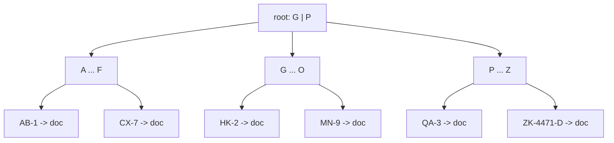

# Single-field and compound indexes: the ESR rule

> **Before this lesson:** you should be able to write filters and sorts ([Query operators and how documents match](#/lesson/mongodb/query-operators), [Cursors, sorting and pagination done right](#/lesson/mongodb/cursors-pagination)). No knowledge of data structures is assumed; the one needed here, the sorted tree, is explained from the ground up.

## In plain words

An **index** is a separate, sorted list that tells the database where to find documents, so that it does not have to look at every one.

The everyday version is the index at the back of a cookbook. To find every recipe that uses saffron you could read all 600 pages, or you could turn to the back, find "saffron" in the alphabetical list and read off "pages 41, 212, 388". The alphabetical list is small, it is sorted, and each entry points to the place where the real content lives. A database index is the same thing: a sorted list of field values, each with a pointer to its document.

Why it matters for a job: missing or badly designed indexes are the number one cause of slow MongoDB applications. Designing a **compound index** (one index over several fields) for a given query is something you will do in real work and will almost certainly be asked to do on a whiteboard. The rule of thumb for it has a name - **ESR** - and this lesson builds up to it.

## Life without an index

Suppose a delivery company has a collection `parcels` with five million documents like this:

```javascript
{ _id: ObjectId("..."), tracking: "ZK-4471-D", status: "in_transit", depot: "leeds", weight_kg: 2.4, created: ISODate("2026-03-02T08:15:00Z") }
```

A customer types a tracking number:

```javascript
ship> db.parcels.find({ tracking: "ZK-4471-D" })
```

With no index on `tracking`, the server has one option: read the first document, compare, read the second, compare, and so on through all five million. This is a **collection scan** (often abbreviated COLLSCAN). Its cost grows in proportion to the size of the collection. With five million documents, most of which are not in memory, it takes seconds - and it is repeated for every customer.

## How an index is organised

Imagine writing down the `tracking` value of every parcel together with the location of its document, then sorting that list alphabetically. In a sorted list you can find a value the way you find a word in a dictionary: open in the middle, see whether your word is before or after, and repeat on the right half. Each step halves what remains. Five million entries need about 23 steps. This is called **binary search**.

A real index refines the idea into a **B-tree**: a sorted structure shaped like a tree, in which each **node** (a block of the tree) holds a few hundred sorted keys and pointers to child nodes covering the ranges in between. Because each node fans out to hundreds of children, a tree holding millions of keys is only three or four levels deep. Finding one key means reading three or four blocks instead of five million documents.



Two properties of this structure explain everything that follows:

1. **The keys are sorted.** So an index can answer "equal to X", "between X and Y" and "in sorted order" efficiently, because matching keys sit next to each other.
2. **Each entry points to a document.** After finding a key, the server follows the pointer to fetch the document. That second step is called a **fetch**.

## Creating and using an index

```javascript
ship> db.parcels.createIndex({ tracking: 1 })
tracking_1

ship> db.parcels.find({ tracking: "ZK-4471-D" })
```

- `createIndex` takes a document naming the field and a direction: `1` for ascending order, `-1` for descending. For a single field the direction makes no practical difference, because a sorted list can be read from either end.
- The reply `tracking_1` is the index's name, built from the field and direction.
- The `find` is written exactly as before. You never mention the index in a query. A component of the server called the **query planner** looks at the available indexes and picks one.

Every collection is born with one index, on `_id`. That is why looking a document up by `_id` is always fast.

Other housekeeping commands: `db.parcels.getIndexes()` lists the indexes of a collection, and `db.parcels.dropIndex("tracking_1")` removes one.

### What an index costs

If indexes make reads fast, why not index every field? Because an index is a second copy of some of the data, and it has to be kept in step with the collection.

- **Slower writes.** Every insert must add an entry to every index. Every delete must remove them. An update that changes an indexed field must move an entry. Ten indexes mean roughly ten extra pieces of work per insert.
- **Memory.** Indexes are fast only while they fit in **RAM** (the computer's working memory, which is far quicker than disk). Indexes that do not fit force disk reads and slow everything down.
- **Disk space.** Each index is stored on disk.

So the craft is to create the few indexes your real queries need, and no others.

> [!WARNING]
> Building an index on a large collection reads every document and can take minutes or hours. On a busy production system, create indexes at a quiet time and one at a time, and watch the server's load while the build runs. An unused index is pure cost: it slows every write and occupies memory while helping no query, so review and drop indexes that nothing uses.

> [!TIP]
> An index is most valuable when it narrows the search a lot. A field in which nearly every document has a different value, such as `tracking` or `email`, is said to have high **cardinality** (many distinct values) and makes an excellent index. A field with two possible values, such as a yes/no flag, has low cardinality; an index on it alone still leaves half the collection to read.

## Compound indexes

Real queries rarely filter on one field. Take:

```javascript
ship> db.parcels.find({ depot: "leeds", status: "in_transit" })
```

An index on `depot` alone would find all Leeds parcels, perhaps 400,000 of them, and then the server would have to fetch each one to check its status. A **compound index** holds several fields in each entry:

```javascript
ship> db.parcels.createIndex({ depot: 1, status: 1 })
```

Its entries are sorted by `depot` first; entries with the same depot are sorted by `status`. Picture a telephone directory: sorted by surname, and people with the same surname sorted by first name.

```
(aberdeen, delivered)  -> doc
(aberdeen, in_transit) -> doc
...
(leeds, delivered)     -> doc
(leeds, delivered)     -> doc
(leeds, in_transit)    -> doc   <- all Leeds parcels in transit
(leeds, in_transit)    -> doc      sit together in one stretch
(leeds, returned)      -> doc
...
```

The query jumps to the first `(leeds, in_transit)` entry and reads until the pair changes. Only matching entries are touched.

### The prefix rule

The telephone-directory picture also shows what a compound index *cannot* do. A directory sorted by surname then first name is useless for finding everyone called "Ada": the Adas are scattered all through the book.

A compound index can be entered only through its leading fields. The index `{ depot: 1, status: 1, created: -1 }` supports queries on:

- `depot`
- `depot` and `status`
- `depot`, `status` and `created`

These leading combinations are called **prefixes** of the index. It does not efficiently support a query on `status` alone, or on `created` alone, or on `status` and `created`, because none of those starts at the first field.

A useful consequence: if you have the index `{ depot: 1, status: 1 }`, a separate index on `{ depot: 1 }` is redundant. The compound index already serves it.

### Sorting with an index

Since an index is already sorted, the server can use it to return results in order without sorting anything. Consider:

```javascript
ship> db.parcels.find({ depot: "leeds" }).sort({ created: -1 }).limit(10)
```

With the index `{ depot: 1, created: -1 }`, all Leeds entries form one stretch, and inside that stretch they are ordered by `created`, newest first. The server jumps to the start of the stretch, reads ten entries and stops. Without `created` in the index, it would have to fetch every Leeds parcel and sort them in memory to find the ten newest. A sort done in memory is called a **blocking sort**, because no result can be returned until all the input has been read.

Direction matters only for sorts on several fields with *mixed* directions. An index `{ a: 1, b: -1 }` can serve `sort({ a: 1, b: -1 })` and, read backwards, `sort({ a: -1, b: 1 })`. It cannot serve `sort({ a: 1, b: 1 })`.

## The ESR rule

Now the question an interviewer asks: for a query with several kinds of condition, in what order should the fields appear in the compound index?

Take this query, "the ten newest in-transit parcels at Leeds that weigh over 20 kg":

```javascript
ship> db.parcels.find({ depot: "leeds", status: "in_transit", weight_kg: { $gt: 20 } })
...             .sort({ created: -1 }).limit(10)
```

It contains three kinds of work:

- **E - Equality**: `depot` and `status` are compared with one exact value each.
- **S - Sort**: results are ordered by `created`.
- **R - Range**: `weight_kg` is compared with `$gt`, which selects a span of values. (`$lt`, `$gte`, `$ne` and usually `$in` with many values behave as ranges too.)

The **ESR rule** says: put the Equality fields first, then the Sort fields, then the Range fields.

```javascript
ship> db.parcels.createIndex({ depot: 1, status: 1, created: -1, weight_kg: 1 })
//                             E         E          S            R
```

The reasoning, one step at a time:

1. **Equality first.** Equality conditions narrow the index to a single contiguous stretch: all entries beginning `(leeds, in_transit, ...)`. Nothing outside that stretch is read.
2. **Sort next.** Inside that stretch, entries are ordered by the next field of the index. If that field is `created`, they are already in the requested order. The server can read from the top and stop after ten matches. No blocking sort.
3. **Range last.** `weight_kg` is the final part of each entry, so the server can test it on the index entry itself, without fetching the document, and skip those that fail.

What goes wrong with the tempting alternative, Equality-Range-Sort (`{ depot: 1, status: 1, weight_kg: 1, created: -1 }`)? After the two equality fields the stretch is ordered by `weight_kg`. The range selects a sub-stretch of weights above 20, but within it the entries are ordered by weight, and `created` is ordered only among entries of *identical* weight. The newest ten could be anywhere. The server must read every entry in the range and sort them all.

> [!INTERVIEW]
> **"Design an index for: filter on `a` equals, `b` greater than, sort by `c`."** Answer `{ a: 1, c: 1, b: 1 }` and justify it with ESR: equality narrows to one contiguous block, the sort field next means results come out ordered with no in-memory sort, and the range is checked last on the index keys. Then show judgement: ESR is a guideline, not a law. If the range is extremely selective (say it keeps 5 documents out of a million) and the sort is over those few, putting the range before the sort can examine fewer keys, and sorting 5 documents is free. The way to decide is to compare the plans with `explain`.

### Selectivity among equality fields

When there are several equality fields, their relative order does not affect correctness, but two considerations help you choose. Put first the fields that *other* queries also filter on, so that the index's prefixes are reusable. And, other things being equal, more selective fields (those that narrow the most) earlier keep the index stretch small.

## The same from Python

```python
from pymongo import MongoClient, ASCENDING, DESCENDING

parcels = MongoClient()["ship"]["parcels"]

name = parcels.create_index(                                         # 1
    [("depot", ASCENDING), ("status", ASCENDING), ("created", DESCENDING), ("weight_kg", ASCENDING)],
    name="depot_status_created_weight",
)
print(name)                                                          # 2

for ix in parcels.list_indexes():                                    # 3
    print(ix["name"], dict(ix["key"]))

heavy = (parcels.find({"depot": "leeds", "status": "in_transit", "weight_kg": {"$gt": 20}})
                .sort("created", DESCENDING)                         # 4
                .limit(10))
print([p["tracking"] for p in heavy])

parcels.drop_index("depot_status_created_weight")                    # 5
```

1. In PyMongo a compound index is a list of `(field, direction)` pairs; a list is used because the order of the fields is the whole point. Giving the index a readable `name` is optional.
2. Prints `depot_status_created_weight`. Calling `create_index` again with the same definition does nothing, so it is safe to run at application start-up.
3. Lists every index, including the automatic `_id_`.
4. The query does not mention the index. The planner selects it because it fits.
5. Removes the index by name.

## Simulate it yourself

The simulation builds an index as a sorted Python list and counts how many index entries each plan has to read. It compares no index, an Equality-Range-Sort index and an Equality-Sort-Range index for the same query: paid orders over 400, newest first, top five.

```python-run
import bisect, random

random.seed(4)
orders = [{"_id": i,
           "status": random.choice(["paid", "paid", "paid", "pending", "refunded"]),
           "total": random.randint(1, 500),
           "created": random.randint(0, 1_000_000)}
          for i in range(40_000)]

def build_index(docs, fields):
    """A compound index: a sorted list of (key tuple, position of the document)."""
    return sorted((tuple(d[f] for f in fields), pos) for pos, d in enumerate(docs))

WANT = 5
def matches(d):
    return d["status"] == "paid" and d["total"] > 400

# Plan 0: collection scan, then sort everything that matched.
hits = [d for d in orders if matches(d)]
answer = sorted(hits, key=lambda d: -d["created"])[:WANT]
print("COLLSCAN            docs examined:", len(orders), "| sorted in memory:", len(hits))

# Plan 1: index (status, total, created)  = Equality, Range, Sort.
ers = build_index(orders, ["status", "total", "created"])
lo = bisect.bisect_right(ers, (("paid", 400, float("inf")), 0))      # first key with total > 400
hi = bisect.bisect_left(ers, (("paid", float("inf")), 0))            # end of the "paid" stretch
scanned = ers[lo:hi]
ers_answer = sorted((orders[pos] for _, pos in scanned), key=lambda d: -d["created"])[:WANT]
print("index E-R-S         keys examined:", len(scanned), "| sorted in memory:", len(scanned))

# Plan 2: index (status, created, total)  = Equality, Sort, Range.
esr = build_index(orders, ["status", "created", "total"])
lo = bisect.bisect_left(esr, (("paid",), 0))
hi = bisect.bisect_left(esr, (("paid", float("inf")), 0))
examined, esr_answer = 0, []
for key, pos in reversed(esr[lo:hi]):          # walk the "paid" stretch backwards = newest first
    examined += 1
    if key[2] > 400:                           # the range is tested on the index key itself
        esr_answer.append(orders[pos])
        if len(esr_answer) == WANT:
            break                              # already in order: stop as soon as we have enough
print("index E-S-R         keys examined:", examined, "| sorted in memory: 0")

same = [d["_id"] for d in answer] == [d["_id"] for d in ers_answer] == [d["_id"] for d in esr_answer]
print("all three plans return the same five orders:", same)

# The prefix rule: can the index (status, created, total) help a query on total alone?
positions = [i for i, (key, _) in enumerate(esr) if key[2] == 77]
print("entries with total == 77:", len(positions), "| spread over index positions",
      positions[0], "to", positions[-1], "| contiguous:", positions[-1] - positions[0] + 1 == len(positions))
```

Reading the output:

- The collection scan examines all 40,000 documents and sorts about 4,800 matches to keep five.
- The E-R-S index examines only the matching keys (about 4,800) but still has to sort every one of them, because inside the range they are ordered by total, not by creation time.
- The E-S-R index examines a few dozen keys and sorts nothing. It walks the paid stretch from newest to oldest, tests the total on each key and stops at the fifth hit.
- All three return the same five orders: an index changes the cost, never the answer.
- The last line shows that the entries with one particular total are spread across almost the whole index and are not contiguous. An index that begins with `status` and `created` cannot jump to them, which is the prefix rule seen from the inside.

Change `WANT` to 2,000 and run again. The E-S-R plan now reads far more keys, because it must walk much further to collect that many. ESR shines when a `limit` lets the scan stop early, which is the common case for list screens.

## Pitfalls

- **No index for a frequent query**, producing collection scans that grow with the data.
- **Wrong field order.** `{ created: -1, depot: 1 }` cannot serve "depot equals" efficiently; the equality field must lead.
- **Range before sort**, forcing a blocking in-memory sort.
- **Believing a compound index serves any subset of its fields.** Only prefixes.
- **Redundant indexes**: `{ a: 1 }` alongside `{ a: 1, b: 1 }`.
- **Too many indexes**, slowing every write and overflowing RAM.
- **Low-cardinality single-field indexes** that barely narrow the search.
- **Mixed sort directions** not mirrored in the index.

## Cheat sheet

| task | command |
|---|---|
| create a single-field index | `db.c.createIndex({ f: 1 })` |
| create a compound index | `db.c.createIndex({ a: 1, b: -1 })` |
| list indexes | `db.c.getIndexes()` |
| drop an index | `db.c.dropIndex("name")` |

| query shape | index |
|---|---|
| `{ a: x }` | `{ a: 1 }` |
| `{ a: x, b: y }` | `{ a: 1, b: 1 }` |
| `{ a: x }` sorted by `c` | `{ a: 1, c: 1 }` |
| `{ a: x, b: { $gt: y } }` | `{ a: 1, b: 1 }` |
| `{ a: x, b: { $gt: y } }` sorted by `c` | `{ a: 1, c: 1, b: 1 }` (ESR) |
| sorted by `a` ascending, `b` descending | `{ a: 1, b: -1 }` |

## Summary

- Without an index a query scans every document; with one it descends a sorted B-tree in a handful of steps and reads only the matching stretch.
- Indexes cost write time, memory and disk, so create those your queries need and no more.
- A compound index is sorted by its first field, then its second, and so on; it serves queries on its prefixes only.
- An index can also deliver results already sorted, avoiding a blocking sort.
- ESR: Equality fields first, then Sort fields, then Range fields. Equality narrows to one stretch, the sort field keeps it ordered, the range is filtered on the keys.
- ESR is a guideline; confirm with `explain`, the subject of the next lesson.

## Glossary

- **Index** - a sorted structure of field values with pointers to documents, used to avoid scanning a collection.
- **Collection scan (COLLSCAN)** - reading every document to find the matches.
- **Binary search** - finding a value in a sorted list by repeatedly halving the search range.
- **B-tree** - a shallow, sorted tree of blocks; the structure behind MongoDB indexes.
- **Node** - one block of a tree.
- **Fetch** - following an index entry's pointer to read the full document.
- **Query planner** - the server component that chooses how to execute a query.
- **Cardinality** - the number of distinct values a field takes.
- **Selectivity** - how strongly a condition narrows the set of candidate documents.
- **Compound index** - an index over two or more fields.
- **Prefix** - the first one or more fields of a compound index.
- **Blocking sort** - an in-memory sort that must read all input before returning any result.
- **ESR rule** - order compound-index fields as Equality, Sort, Range.
- **RAM** - the computer's fast working memory.

## Check yourself

```quiz
[
  {"q": "What does the server do for find({tracking: \"ZK-1\"}) when no index on tracking exists?",
   "options": ["Returns an error", "Reads every document in the collection and compares each one", "Builds an index automatically", "Returns only documents from memory"],
   "answer": 1,
   "explain": "Without a usable index the only plan is a collection scan."},
  {"q": "Which queries can the index {depot: 1, status: 1, created: -1} serve efficiently?",
   "options": ["Any query mentioning at least one of the three fields", "Queries on depot; on depot and status; on depot, status and created", "Only queries on all three fields", "Queries on status alone"],
   "answer": 1,
   "explain": "A compound index is usable through its prefixes: the leading field, the first two, or all three."},
  {"q": "You already have {a: 1, b: 1}. Is a separate index {a: 1} useful?",
   "options": ["Yes, it is required for queries on a alone", "No, it is redundant: the compound index serves queries on a through its prefix", "Yes, compound indexes cannot be used for single fields", "Only for sorting"],
   "answer": 1,
   "explain": "The prefix {a} of the compound index does the same job, so the extra index only costs writes and memory."},
  {"q": "For find({a: 5, b: {$gt: 10}}).sort({c: 1}), which index follows the ESR rule?",
   "options": ["{b: 1, a: 1, c: 1}", "{a: 1, b: 1, c: 1}", "{a: 1, c: 1, b: 1}", "{c: 1, b: 1, a: 1}"],
   "answer": 2,
   "explain": "Equality (a), then Sort (c), then Range (b)."},
  {"q": "Why does placing the range field before the sort field force an in-memory sort?",
   "options": ["Range operators disable indexes", "Within the range the entries are ordered by the range field, so the sort field's order is not preserved across the stretch", "The index becomes too large", "Sorts never use indexes"],
   "answer": 1,
   "explain": "Only among entries with an identical range-field value is the following field ordered; across many values it is not."},
  {"q": "Which is a real cost of adding an index?",
   "options": ["Queries return different results", "Every insert, delete and relevant update must also maintain the index", "Documents become larger", "The _id index is removed"],
   "answer": 1,
   "explain": "Indexes speed reads but add work to writes and consume memory and disk."},
  {"q": "Can the index {a: 1, b: -1} serve sort({a: -1, b: 1})?",
   "options": ["No", "Yes, by reading the index backwards", "Only with a hint", "Only if b is unique"],
   "answer": 1,
   "explain": "Reversing the scan direction flips every direction at once, so the fully inverted sort is supported."},
  {"q": "Which field makes the best single-field index?",
   "options": ["is_active (true or false)", "country (about 200 values) in a collection of 500 documents", "email (different for almost every document)", "A field present in only two documents"],
   "answer": 2,
   "explain": "High cardinality means an equality lookup narrows the search to very few documents."}
]
```

> **Source:** MongoDB: The Definitive Guide 3e, ch. 5 (topics only; wording and examples are original). MongoDB Manual: https://www.mongodb.com/docs/manual/indexes/ , https://www.mongodb.com/docs/manual/core/indexes/index-types/index-compound/ , https://www.mongodb.com/docs/manual/tutorial/equality-sort-range-guideline/
