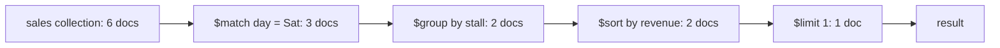

# Pipelines: $match, $project, $group and $unwind

> **Before this lesson:** you should be comfortable with filters and operators such as `$gt` and `$in` ([Query operators and how documents match](#/lesson/mongodb/query-operators)), with sorting and projection ([Cursors, sorting and pagination done right](#/lesson/mongodb/cursors-pagination)) and with the idea of an index ([Single-field and compound indexes: the ESR rule](#/lesson/mongodb/index-basics)).

## In plain words

`find` answers questions of the form "show me the documents that look like this". Many useful questions are not of that form: "what did each stall earn last week?", "which three dishes sell best?", "what is the average order size per day?". These need documents to be grouped, counted, summed and reshaped. That kind of work is called **aggregation**: combining many records into summary results.

MongoDB's tool for it is the **aggregation pipeline**. Picture a factory assembly line. Raw parts enter at one end. At each station a worker does one small job - discards faulty parts, trims something off, bundles parts into boxes - and passes the result along the belt. At the far end, finished goods come off. In a pipeline the parts are documents, each station is called a **stage**, and the output of one stage is the input of the next.

Why it matters for a job: reporting, dashboards, analytics endpoints and data clean-up scripts are all written as pipelines. If you know SQL, this is MongoDB's counterpart to `GROUP BY`, `JOIN` and friends, and interviewers often ask you to translate a small reporting question into a pipeline on the spot.

## The data

A street-food market records every sale. Six sample documents are used throughout this lesson:

```javascript
{ _id: 1, stall: "Dumpling Den", day: "Sat", total: 18, items: ["pork bao", "tea"],        card: true  }
{ _id: 2, stall: "Dumpling Den", day: "Sat", total: 9,  items: ["veg bao"],                card: false }
{ _id: 3, stall: "Taco Tide",    day: "Sat", total: 24, items: ["fish taco", "tea", "lime soda"], card: true }
{ _id: 4, stall: "Taco Tide",    day: "Sun", total: 12, items: ["fish taco"],              card: true  }
{ _id: 5, stall: "Dumpling Den", day: "Sun", total: 30, items: ["pork bao", "veg bao", "tea"], card: true }
{ _id: 6, stall: "Waffle Works", day: "Sun", total: 7,  items: [],                         card: false }
```

## The shape of a pipeline

A pipeline is an array of stages passed to `aggregate`. Each stage is a document with exactly one key, the stage's name, which always begins with a dollar sign:

```javascript
market> db.sales.aggregate([
...   { $match: { day: "Sat" } },
...   { $sort: { total: -1 } },
...   { $limit: 2 }
... ])
[
  { _id: 3, stall: 'Taco Tide', day: 'Sat', total: 24, items: [ 'fish taco', 'tea', 'lime soda' ], card: true },
  { _id: 1, stall: 'Dumpling Den', day: 'Sat', total: 18, items: [ 'pork bao', 'tea' ], card: true }
]
```

Follow the documents along the belt:

1. `$match` keeps the three Saturday sales and discards the rest.
2. `$sort` orders those three by `total`, largest first.
3. `$limit` lets the first two through.

So far this is nothing `find().sort().limit()` could not do. The difference is that stages can be combined freely, in any number and order, and that some stages do things `find` cannot.



## $match: filter

`$match` takes an ordinary query filter, the same language as `find`. Its job is to throw away documents the rest of the pipeline does not need.

Place `$match` as early as you can. When it is the first stage, it can use an index exactly as `find` would. And every document it removes is a document that later stages do not have to process.

## $project and $addFields: reshape

`$project` chooses and computes the fields of each outgoing document.

```javascript
market> db.sales.aggregate([
...   { $project: { _id: 0, stall: 1, total: 1, tip: { $multiply: ["$total", 0.1] }, n_items: { $size: "$items" } } }
... ])
{ stall: 'Dumpling Den', total: 18, tip: 1.8, n_items: 2 }
...
```

- `stall: 1` and `total: 1` keep those fields, as in a `find` projection. `_id: 0` drops the id.
- `tip` and `n_items` are **computed fields**. Their values are **expressions**: small formulas the server evaluates for each document.
- Inside an expression, a string that starts with a dollar sign is a **field path**. `"$total"` means "the value of the field `total` in the current document". Without the dollar sign, `"total"` would be the literal five-letter word.
- `{ $multiply: ["$total", 0.1] }` multiplies the total by 0.1. `{ $size: "$items" }` gives the length of the array.

This double use of the dollar sign trips up every newcomer, so it is worth stating once plainly: a `$` at the start of a **key** names an operator or stage (`$multiply`, `$match`); a `$` at the start of a **string value** refers to a field (`"$total"`).

`$addFields` (also spelt `$set`) adds or overwrites fields and keeps all the others. Use it when you want "everything, plus one more field" and `$project` when you want "only these".

A few commonly used expression operators:

| kind | operators |
|---|---|
| arithmetic | `$add`, `$subtract`, `$multiply`, `$divide`, `$round` |
| strings | `$concat`, `$toUpper`, `$toLower`, `$substrCP` |
| dates | `$year`, `$month`, `$dayOfWeek`, `$dateToString`, `$dateTrunc` |
| arrays | `$size`, `$arrayElemAt`, `$filter`, `$map`, `$in` |
| conditions | `$cond`, `$ifNull`, `$switch` |
| comparison | `$eq`, `$gt`, `$lt` (returning true or false) |

## $group: combine documents

`$group` is the heart of aggregation. It sorts incoming documents into piles and produces **one output document per pile**.

```javascript
market> db.sales.aggregate([
...   { $group: { _id: "$stall", revenue: { $sum: "$total" }, orders: { $sum: 1 }, biggest: { $max: "$total" } } }
... ])
[
  { _id: 'Dumpling Den', revenue: 57, orders: 3, biggest: 30 },
  { _id: 'Taco Tide',    revenue: 36, orders: 2, biggest: 24 },
  { _id: 'Waffle Works', revenue: 7,  orders: 1, biggest: 7 }
]
```

Read the stage piece by piece.

- `_id: "$stall"` is the **group key**: documents with the same `stall` go on the same pile. The name `_id` is fixed; it is the identity of each output document.
- Every other field is defined by an **accumulator**: an operator that folds the values of a pile into one value.
- `revenue: { $sum: "$total" }` adds up `total` across the pile.
- `orders: { $sum: 1 }` adds 1 for each document, which counts them. This idiom is so common that newer versions also offer `{ $count: {} }`.
- `biggest: { $max: "$total" }` keeps the largest value.

Only the group key and the accumulated fields come out. The original fields (`day`, `items`, ...) are gone unless an accumulator carried them through.

| accumulator | result |
|---|---|
| `$sum` | total of the values, or a count with `$sum: 1` |
| `$avg` | mean of the numeric values |
| `$min`, `$max` | smallest, largest |
| `$first`, `$last` | value from the first / last document of the pile (meaningful after a `$sort`) |
| `$push` | array of all the values |
| `$addToSet` | array of the distinct values |

Two variations of the group key are worth learning at once.

**One group for everything.** `_id: null` puts all documents on a single pile, for grand totals:

```javascript
{ $group: { _id: null, revenue: { $sum: "$total" }, avg_order: { $avg: "$total" } } }
// { _id: null, revenue: 100, avg_order: 16.666666666666668 }
```

**Grouping by several fields.** Make the key a document:

```javascript
{ $group: { _id: { stall: "$stall", day: "$day" }, revenue: { $sum: "$total" } } }
// { _id: { stall: 'Dumpling Den', day: 'Sat' }, revenue: 27 }, { _id: { stall: 'Dumpling Den', day: 'Sun' }, revenue: 30 }, ...
```

> [!WARNING]
> `$group` does not promise any order of its output. If the report must be ordered, add a `$sort` stage after the group. Also, `$group` has to hold every pile in memory; a group stage that needs more than 100 megabytes writes temporary files to disk (or fails on older versions unless `allowDiskUse` is set). Filter with `$match` first so that fewer documents reach it.

## $unwind: one document per array element

Question: which item is ordered most often? The items are locked inside arrays, and `$group` groups whole documents. `$unwind` opens the arrays. It replaces each document by several copies, one per element, each copy holding a single element in place of the array.

```javascript
market> db.sales.aggregate([
...   { $match: { _id: 1 } },
...   { $unwind: "$items" }
... ])
[
  { _id: 1, stall: 'Dumpling Den', day: 'Sat', total: 18, items: 'pork bao', card: true },
  { _id: 1, stall: 'Dumpling Den', day: 'Sat', total: 18, items: 'tea', card: true }
]
```

Sale 1 had two items, so it became two documents. Now grouping by `items` is possible:

```javascript
market> db.sales.aggregate([
...   { $unwind: "$items" },
...   { $group: { _id: "$items", times: { $sum: 1 } } },
...   { $sort: { times: -1, _id: 1 } },
...   { $limit: 3 }
... ])
[ { _id: 'tea', times: 3 }, { _id: 'fish taco', times: 2 }, { _id: 'pork bao', times: 2 } ]
```

Unwind, pile up by item, count each pile, sort by count (and by name to settle ties), keep three. The stage combination `$unwind` → `$group` → `$sort` → `$limit` is the standard "top N things inside arrays" recipe.

Two details. A document whose array is **empty or missing** produces *no* output from `$unwind` and so vanishes from the pipeline: sale 6 from Waffle Works disappeared above. To keep such documents, use the long form `{ $unwind: { path: "$items", preserveNullAndEmptyArrays: true } }`. And after unwinding, any field that was per-sale, such as `total`, is repeated on every copy. Summing `total` after an unwind counts it once per item, which overstates revenue. Do sums of per-document values before unwinding, or in a separate pipeline.

## $sort, $limit, $skip and $count

`$sort`, `$limit` and `$skip` behave like their cursor counterparts, with one difference: in a pipeline, **order matters**. `$limit` then `$sort` sorts whichever documents happened to pass the limit; `$sort` then `$limit` gives the true top N. The belt processes stages strictly in the order written.

`{ $count: "n" }` replaces all incoming documents by a single document `{ n: <how many> }`. `{ $sortByCount: "$stall" }` is shorthand for "group by this, count, sort descending".

## Worked example: a weekend report

"For card payments only, show each stall's revenue, number of orders and average order value, best earner first."

```javascript
market> db.sales.aggregate([
...   { $match: { card: true } },
...   { $group: { _id: "$stall", revenue: { $sum: "$total" }, orders: { $sum: 1 }, avg_order: { $avg: "$total" } } },
...   { $project: { _id: 0, stall: "$_id", revenue: 1, orders: 1, avg_order: { $round: ["$avg_order", 1] } } },
...   { $sort: { revenue: -1 } }
... ])
[
  { revenue: 48, orders: 2, stall: 'Dumpling Den', avg_order: 24 },
  { revenue: 36, orders: 2, stall: 'Taco Tide', avg_order: 18 }
]
```

Stage by stage:

1. `$match` keeps the four card sales (ids 1, 3, 4, 5).
2. `$group` makes two piles. Dumpling Den: 18 + 30 = 48 over 2 orders. Taco Tide: 24 + 12 = 36 over 2 orders. Waffle Works took only cash, so it has no pile.
3. `$project` renames `_id` to the friendlier `stall` (by reading the field path `"$_id"`) and rounds the average to one decimal place.
4. `$sort` puts the highest revenue first.

> [!TIP]
> Build pipelines one stage at a time. Run the pipeline with only the first stage and look at a few documents. Add the second stage and look again. When the output of stage *n* is wrong, the bug is in stage *n*, because you saw that stage *n - 1* was right. In the shell, appending `{ $limit: 5 }` while developing keeps the output readable.

> [!INTERVIEW]
> **"Translate `SELECT stall, SUM(total) AS revenue FROM sales WHERE day = 'Sat' GROUP BY stall HAVING SUM(total) > 20 ORDER BY revenue DESC` into a pipeline."** `[{ $match: { day: "Sat" } }, { $group: { _id: "$stall", revenue: { $sum: "$total" } } }, { $match: { revenue: { $gt: 20 } } }, { $sort: { revenue: -1 } }]`. The points to make aloud: `WHERE` is a `$match` before the group, `HAVING` is a `$match` after it, `GROUP BY` is `$group` with the key in `_id`, and the first `$match` can use an index while the second cannot because it filters computed values.

## The same from Python

```python
from pymongo import MongoClient

sales = MongoClient()["market"]["sales"]

pipeline = [                                                         # 1
    {"$match": {"card": True}},
    {"$group": {"_id": "$stall",
                "revenue": {"$sum": "$total"},
                "orders": {"$sum": 1},
                "avg_order": {"$avg": "$total"}}},
    {"$sort": {"revenue": -1}},
]
for row in sales.aggregate(pipeline):                                # 2
    print(row["_id"], row["revenue"], row["orders"], round(row["avg_order"], 1))   # 3

top_items = sales.aggregate([{"$unwind": "$items"}, {"$sortByCount": "$items"}, {"$limit": 3}])
print([(r["_id"], r["count"]) for r in top_items])                   # 4

big = sales.aggregate(pipeline, allowDiskUse=True)                   # 5
```

1. A pipeline is a Python list of dictionaries. Keeping it in a variable makes it easy to print, test and build up step by step.
2. `aggregate` returns a cursor, like `find`; iterate over it to receive the result documents.
3. Prints `Dumpling Den 48 2 24.0` and `Taco Tide 36 2 18.0`.
4. Prints the three most-ordered items with their counts, beginning with `('tea', 3)`.
5. `allowDiskUse=True` lets memory-hungry stages spill to temporary files.

## Simulate it yourself

The pipeline runner below implements six stages over a list of dictionaries and prints how many documents leave each stage, so you can watch the belt at work. It supports `"$field"` paths in `$group` keys and accumulators.

```python-run
sales = [
    {"_id": 1, "stall": "Dumpling Den", "day": "Sat", "total": 18, "items": ["pork bao", "tea"], "card": True},
    {"_id": 2, "stall": "Dumpling Den", "day": "Sat", "total": 9,  "items": ["veg bao"], "card": False},
    {"_id": 3, "stall": "Taco Tide",    "day": "Sat", "total": 24, "items": ["fish taco", "tea", "lime soda"], "card": True},
    {"_id": 4, "stall": "Taco Tide",    "day": "Sun", "total": 12, "items": ["fish taco"], "card": True},
    {"_id": 5, "stall": "Dumpling Den", "day": "Sun", "total": 30, "items": ["pork bao", "veg bao", "tea"], "card": True},
    {"_id": 6, "stall": "Waffle Works", "day": "Sun", "total": 7,  "items": [], "card": False},
]

def value(doc, expr):
    """Evaluate an expression: "$field" reads a field, anything else is a constant."""
    if isinstance(expr, str) and expr.startswith("$"):
        return doc.get(expr[1:])
    return expr

def stage_match(docs, cond):
    return [d for d in docs if all(d.get(k) == v for k, v in cond.items())]

def stage_group(docs, spec):
    piles = {}                                         # group key -> list of documents (dicts keep insertion order)
    for d in docs:
        piles.setdefault(value(d, spec["_id"]), []).append(d)
    out = []
    for key, pile in piles.items():
        row = {"_id": key}
        for field, acc in spec.items():
            if field == "_id":
                continue
            (name, expr), = acc.items()                # e.g. name="$sum", expr="$total"
            values = [value(d, expr) for d in pile]
            if name == "$sum":
                row[field] = sum(values)
            elif name == "$avg":
                row[field] = sum(values) / len(values)
            elif name == "$max":
                row[field] = max(values)
            elif name == "$push":
                row[field] = values
        out.append(row)
    return out

def stage_unwind(docs, path):
    field = path[1:]
    return [{**d, field: element} for d in docs for element in (d.get(field) or [])]

def stage_sort(docs, spec):
    for field, direction in reversed(list(spec.items())):       # least significant key first
        docs = sorted(docs, key=lambda d: d[field], reverse=(direction == -1))
    return docs

STAGES = {"$match": stage_match, "$group": stage_group, "$unwind": stage_unwind, "$sort": stage_sort,
          "$limit": lambda docs, n: docs[:n],
          "$project": lambda docs, spec: [{k: value(d, v) if v != 1 else d.get(k) for k, v in spec.items()} for d in docs]}

def aggregate(docs, pipeline, trace=True):
    if trace:
        print("  input".ljust(12), len(docs), "docs")
    for stage in pipeline:
        (name, arg), = stage.items()
        docs = STAGES[name](docs, arg)
        if trace:
            print(("  " + name).ljust(12), len(docs), "docs")
    return docs

print("Weekend report (card payments):")
for row in aggregate(sales, [
        {"$match": {"card": True}},
        {"$group": {"_id": "$stall", "revenue": {"$sum": "$total"}, "orders": {"$sum": 1}, "avg": {"$avg": "$total"}}},
        {"$sort": {"revenue": -1}},
        {"$project": {"stall": "$_id", "revenue": 1, "orders": 1, "avg": 1}}]):
    print("   ", row)

print("Top items:")
for row in aggregate(sales, [{"$unwind": "$items"},
                             {"$group": {"_id": "$items", "times": {"$sum": 1}}},
                             {"$sort": {"times": -1, "_id": 1}},
                             {"$limit": 3}]):
    print("   ", row)

wrong = aggregate(sales, [{"$unwind": "$items"}, {"$group": {"_id": None, "revenue": {"$sum": "$total"}}}], trace=False)
right = aggregate(sales, [{"$group": {"_id": None, "revenue": {"$sum": "$total"}}}], trace=False)
print("revenue summed after $unwind:", wrong[0]["revenue"], "| summed before:", right[0]["revenue"])
```

Reading the output:

- In the first trace the document count goes 6 → 4 (`$match`) → 2 (`$group`) → 2 → 2. Grouping is where many documents turn into few.
- In the second trace `$unwind` turns 6 sales into 10 item-documents (sale 6 with its empty array contributes none), `$group` reduces them to 5 distinct items and `$limit` keeps 3: tea 3, fish taco 2, pork bao 2.
- The last line shows the double-counting trap: summing `total` after unwinding gives 219, because each sale's total was repeated once per item. The true revenue is 100.

Try adding a `{"$match": {"day": "Sun"}}` stage at the front of the second pipeline and predict the new top items.

## Pitfalls

- **`"total"` where `"$total"` was meant.** Without the dollar sign you get the literal string, and `$sum` of strings is 0.
- **`$limit` before `$sort`** when the top N was wanted.
- **Expecting ordered output from `$group`.** Sort afterwards.
- **Summing per-document values after `$unwind`**, which multiplies them by the array length.
- **`$unwind` silently dropping documents** with empty or missing arrays.
- **Late `$match`.** Filtering after grouping what could have been filtered before wastes work and cannot use an index.
- **Forgetting that `$group` discards every field** not named in the key or an accumulator.

## Cheat sheet

| SQL | pipeline stage |
|---|---|
| `WHERE` | `$match` (before `$group`) |
| `SELECT a, b` | `$project` |
| `SELECT ..., expr AS x` | `$addFields` / `$project` with an expression |
| `GROUP BY k` | `$group` with `_id: "$k"` |
| `COUNT(*)` | `{ $sum: 1 }` or `{ $count: {} }` |
| `SUM(x)`, `AVG(x)`, `MIN(x)`, `MAX(x)` | `$sum`, `$avg`, `$min`, `$max` |
| `HAVING` | `$match` (after `$group`) |
| `ORDER BY` | `$sort` |
| `LIMIT` / `OFFSET` | `$limit` / `$skip` |
| (no direct equivalent) | `$unwind` |

| idiom | pipeline |
|---|---|
| count per category | `[{ $group: { _id: "$cat", n: { $sum: 1 } } }]` |
| grand total | `[{ $group: { _id: null, total: { $sum: "$x" } } }]` |
| top N values inside arrays | `$unwind` → `$group` → `$sort` → `$limit` |
| group by two fields | `_id: { a: "$a", b: "$b" }` |

## Summary

- An aggregation pipeline is an ordered list of stages; each stage transforms the stream of documents it receives.
- `$match` filters (early, so it can use an index); `$project` and `$addFields` reshape and compute fields with expressions; `"$name"` in a value means "the field `name`".
- `$group` collects documents by a key in `_id` and reduces each group with accumulators such as `$sum`, `$avg`, `$max` and `$push`.
- `$unwind` turns one document with an array into one document per element, dropping empty or missing arrays by default.
- Stage order matters: sort before limit, filter before group, and sum per-document values before unwinding.

## Glossary

- **Aggregation** - combining many documents into summary results.
- **Pipeline** - an ordered list of stages through which documents flow.
- **Stage** - one step of a pipeline, such as `$match` or `$group`.
- **Expression** - a formula evaluated per document, such as `{ $multiply: ["$total", 0.1] }`.
- **Field path** - a string beginning with `$` that refers to a field of the current document.
- **Computed field** - a field whose value is produced by an expression.
- **Group key** - the value in `_id` of a `$group` stage that decides which documents are combined.
- **Accumulator** - an operator that reduces the values of a group to one value.
- **`$unwind`** - the stage that outputs one document per element of an array field.
- **`allowDiskUse`** - an option letting large stages write temporary files when they exceed the memory limit.

## Check yourself

```quiz
[
  {"q": "In {$group: {_id: \"$stall\", revenue: {$sum: \"$total\"}}}, what does \"$stall\" mean?",
   "options": ["The literal text $stall", "The value of the field stall in each incoming document", "A stage named stall", "The name of the output collection"],
   "answer": 1,
   "explain": "A string value beginning with a dollar sign is a field path: it reads that field from the current document."},
  {"q": "What does {$sum: 1} compute inside a $group stage?",
   "options": ["The sum of a field named 1", "The number of documents in each group", "Always 1", "The first document of each group"],
   "answer": 1,
   "explain": "Adding 1 per document counts the documents in the group."},
  {"q": "A sale has items: [\"tea\", \"bao\", \"soda\"]. How many documents does {$unwind: \"$items\"} output for it?",
   "options": ["1", "3", "0", "6"],
   "answer": 1,
   "explain": "One output document per array element."},
  {"q": "What happens to a document whose items array is empty when it passes through {$unwind: \"$items\"}?",
   "options": ["It passes through unchanged", "It is dropped from the pipeline", "It causes an error", "It is output with items: null"],
   "answer": 1,
   "explain": "By default empty or missing arrays yield no output; preserveNullAndEmptyArrays: true keeps the document."},
  {"q": "Which pipeline returns the three largest sales?",
   "options": ["[{$limit: 3}, {$sort: {total: -1}}]", "[{$sort: {total: -1}}, {$limit: 3}]", "[{$group: {_id: null}}, {$limit: 3}]", "[{$match: {total: 3}}]"],
   "answer": 1,
   "explain": "Stages run in order: sorting first and then limiting gives the top three. Limiting first sorts three arbitrary documents."},
  {"q": "Why should a $match stage be placed as early as possible?",
   "options": ["Later stages are not allowed to filter", "It can use an index when first, and it reduces the documents later stages must process", "It makes $group output sorted", "It is required before $project"],
   "answer": 1,
   "explain": "An initial $match behaves like find and can use indexes; fewer documents downstream means less work and memory."},
  {"q": "After {$unwind: \"$items\"}, you sum the per-sale field total. What is wrong?",
   "options": ["Nothing", "Each sale's total is counted once per item, inflating the sum", "total no longer exists", "The sum is always zero"],
   "answer": 1,
   "explain": "Unwinding repeats the non-array fields on every copy, so per-document values are multiplied by the array length."},
  {"q": "How is SQL's HAVING expressed in a pipeline?",
   "options": ["A $match stage before $group", "A $match stage after $group", "A $project stage", "It cannot be expressed"],
   "answer": 1,
   "explain": "HAVING filters on aggregated values, so it is a $match placed after the $group that computes them."}
]
```

> **Source:** MongoDB: The Definitive Guide 3e, ch. 7 (topics only; wording and examples are original). MongoDB Manual: https://www.mongodb.com/docs/manual/core/aggregation-pipeline/ , https://www.mongodb.com/docs/manual/reference/operator/aggregation/group/ , https://www.mongodb.com/docs/manual/reference/operator/aggregation/unwind/
