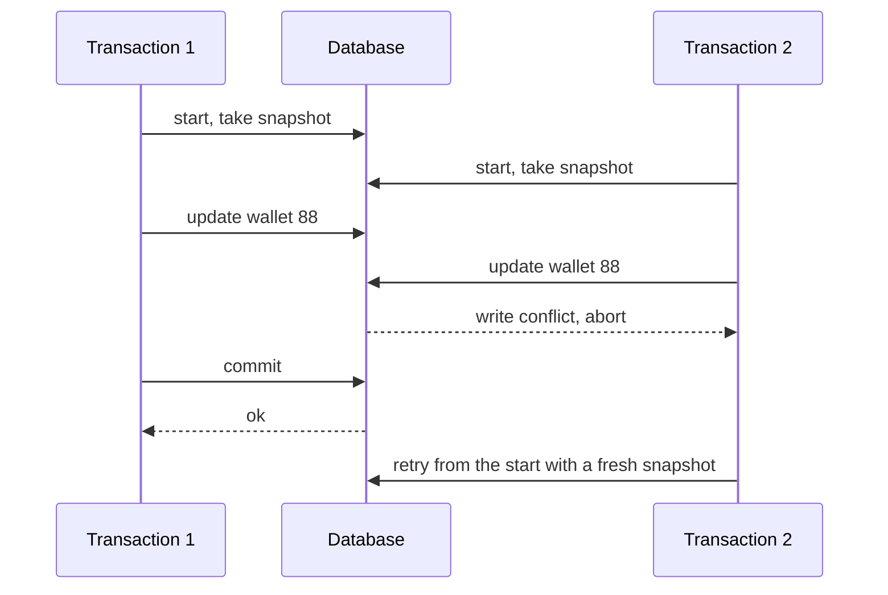

# Transactions: ACID in MongoDB and its limits

> **Before this lesson:** you should know that an update to a single document is atomic and why that prevents lost updates ([Update operators, arrays and upserts](#/lesson/mongodb/update-operators)), and what write concern and a replica set are at the level described in [Inserting, deleting and write concern](#/lesson/mongodb/insert-delete).

## In plain words

Some changes only make sense together. Moving 50 euros from one bank account to another is two changes: subtract 50 here, add 50 there. If the computer crashes between them, 50 euros have vanished. What you want is a promise that **both happen or neither happens**.

A **transaction** is that promise: a group of operations the database treats as a single unit. Think of buying a house. Money, keys and signed papers change hands at one meeting. If any part falls through, the whole meeting is called off and everybody leaves with what they brought. Nobody ends up with the keys but no payment.

MongoDB gives this promise automatically for any change to *one* document. For changes spread over *several* documents it offers **multi-document transactions**, which you switch on explicitly.

Why it matters for a job: "Does MongoDB support ACID transactions?" is a question interviewers love, because the honest answer has three parts - yes; here is what they cost; and a good document design often makes them unnecessary.

## ACID, one letter at a time

**ACID** is an acronym for four guarantees. Each is easier to grasp from what goes wrong without it.

| letter | name | the promise | without it |
|---|---|---|---|
| A | **Atomicity** | all the operations in the transaction take effect, or none do | money leaves one account and never arrives in the other |
| C | **Consistency** | the data obeys its rules before and after (unique values stay unique, validators are satisfied) | two members end up with the same membership number |
| I | **Isolation** | transactions running at the same time do not see each other's unfinished work | a report reads the balance halfway through a transfer and shows money missing |
| D | **Durability** | once the database says "committed", the change survives a crash | the server restarts and yesterday's confirmed order is gone |

Two words from the table recur throughout the lesson. To **commit** a transaction is to make all its changes permanent and visible. To **abort** (or roll back) is to discard all of them, as if the transaction had never started.

## You already have single-document transactions

The update lesson showed that one update to one document is atomic. That statement is stronger than it first looks, because a document can contain a great deal. Suppose a wallet application stores both balances of a user in one document:

```javascript
{ _id: "user-88", name: "Farid", balances: { current: 420, savings: 1500 } }
```

Moving 50 from current to savings is a single update:

```javascript
bank> db.wallets.updateOne(
...   { _id: "user-88", "balances.current": { $gte: 50 } },
...   { $inc: { "balances.current": -50, "balances.savings": 50 } }
... )
```

The filter requires enough money to be present; the two `$inc` changes are applied together or not at all. No transaction syntax is needed, because both numbers live in the same document. This is the first and most important tool: **put data that must change together into one document**.

## When one document is not enough

A transfer from Farid to a different user touches two documents. Without a transaction there is a moment at which the first update has happened and the second has not, and a crash, a network failure or a bug at that moment leaves the books wrong.

A multi-document transaction wraps the two updates:

```javascript
bank> const session = db.getMongo().startSession()
bank> const wallets = session.getDatabase("bank").wallets
bank> session.startTransaction({ readConcern: { level: "snapshot" }, writeConcern: { w: "majority" } })

bank> wallets.updateOne({ _id: "user-88", balance: { $gte: 50 } }, { $inc: { balance: -50 } })
{ acknowledged: true, matchedCount: 1, modifiedCount: 1 }
bank> wallets.updateOne({ _id: "user-91" }, { $inc: { balance: 50 } })
{ acknowledged: true, matchedCount: 1, modifiedCount: 1 }

bank> session.commitTransaction()
bank> session.endSession()
```

Line by line:

- A **session** is a conversation between a client and the server that can span several operations. Transactions live inside sessions.
- `session.getDatabase("bank").wallets` gives a collection handle tied to that session. Operations made through it belong to the transaction; operations made through the plain `db` do not.
- `startTransaction` opens the transaction. The options are explained in the next section.
- The two updates run. Until the commit, no other client can see their effects.
- `commitTransaction` makes both changes permanent at one instant. Had something gone wrong, `session.abortTransaction()` would have discarded both.

Transactions require a replica set (available since MongoDB 4.0) or a sharded cluster (since 4.2). They do not work on a lone server started without replication.

## What a transaction sees: snapshot isolation

When a transaction starts with read concern `"snapshot"`, it works from a **snapshot**: a frozen view of the data as it was at one moment. Whatever other clients do while the transaction is running, its own reads keep returning the snapshot's data plus its own changes. This is how the "I" of ACID is delivered.

A newcomer's natural question: what if two transactions both change the same document? MongoDB does not make the second one wait in a long queue. It uses **optimistic concurrency**: transactions proceed on the assumption that conflicts are rare, and when a transaction tries to modify a document that another unfinished transaction has already modified, it receives a **write conflict** error at once and is aborted. The losing transaction is then started again from the beginning.



The two options passed to `startTransaction` fit into this picture:

- `readConcern: { level: "snapshot" }` asks for the frozen, consistent view described above.
- `writeConcern: { w: "majority" }` means the commit is acknowledged only once a majority of replica-set members have it, which is what makes the "D" of ACID hold even if the primary fails straight afterwards.

## Retrying: the part people forget

Two kinds of temporary failure are normal in a healthy system, and drivers label them so that code can react:

| error label | meaning | correct reaction |
|---|---|---|
| `TransientTransactionError` | the transaction was aborted by something temporary: a write conflict, or the primary changing | run the **whole transaction** again |
| `UnknownTransactionCommitResult` | the commit was sent but the reply was lost, so the outcome is unknown | retry the **commit** only; committing twice is safe |

Writing that retry loop by hand is fiddly, so every driver offers a helper that takes a function containing your operations and handles both cases. In the Python driver it is `with_transaction`, shown below. It is the recommended way to run transactions.

One consequence is easy to overlook: the function may run more than once. It must therefore contain nothing whose repetition would hurt. Sending an email or charging a card inside the function could happen twice. Keep side effects outside it, after the transaction has committed.

## The limits

Transactions in MongoDB are real, but they come with boundaries that relational databases place differently.

1. **Time.** A transaction that runs for more than 60 seconds is aborted by the server (the setting is `transactionLifetimeLimitSeconds`). Transactions are meant to be short: a handful of operations taking milliseconds.
2. **Size.** Keep the number of modified documents modest; a common guideline is no more than about 1,000 per transaction. Very large transactions strain memory and replication.
3. **Cost.** While a transaction is open, the server has to retain old versions of data so that the snapshot stays readable. Many long transactions put pressure on the **cache** (the server's in-memory working area) and slow everything else.
4. **Conflicts.** Under heavy contention on the same documents, write conflicts and retries multiply. A transaction is not a queue.
5. **Restrictions.** Some operations are not allowed inside a transaction, such as dropping a collection or building most indexes on an existing collection. Capped collections cannot be written.
6. **Lock waits.** A transaction that needs a lock held by something else waits only 5 milliseconds by default before giving up, again to keep transactions from piling up.

> [!WARNING]
> A transaction is not a cure for a poor data model. If every screen of your application needs a multi-document transaction, the data has probably been split into table-like collections. Each transaction costs more than a single-document write and adds retry logic to your code. Redesign first; reach for transactions where they are truly needed.

## Designing so you rarely need them

Three techniques cover most cases.

**Embed what changes together.** An order and its line items in one document are created and modified atomically. This is the main reason document databases got by for years without multi-document transactions.

**Conditional updates.** Put the required precondition in the filter: `updateOne({ _id: seat, taken: false }, { $set: { taken: true, by: user } })`. If `modifiedCount` is 0, someone else got there first. This technique is called **compare-and-set**, and it turns a "check, then act" sequence into one atomic step.

**Idempotent steps with a record of intent.** An operation is **idempotent** if performing it twice has the same effect as performing it once. Some workflows cannot be made atomic at all because they involve other systems - a payment provider, an email service. They are built as a series of steps, each safe to repeat, with a document recording how far the workflow has got, so that a crashed process can pick it up again.

Genuine cases for a multi-document transaction remain: transfers between two accounts held in separate documents, keeping a document and a separate audit record in step, or updating several documents that reference each other.

> [!TIP]
> Before writing a transaction, ask: could these documents be one document? If the answer is yes without making an array unbounded, restructure. If the answer is no, use `with_transaction`, keep it short and make its body safe to run twice.

> [!INTERVIEW]
> **"Is MongoDB ACID compliant?"** Yes, in two layers. Single-document writes have always been atomic and, with journaling and majority write concern, durable. Since 4.0 (replica sets) and 4.2 (sharded clusters) multi-document transactions provide snapshot isolation across documents, collections and shards. Then give the nuance: they are intended to be short (60-second default limit), they use optimistic concurrency so conflicting writers abort and retry, and they cost more than single-document writes - so the first design choice is still to keep data that changes together in one document.

## The same from Python

```python
from pymongo import MongoClient, WriteConcern
from pymongo.read_concern import ReadConcern

client = MongoClient("mongodb://localhost:27017/?replicaSet=rs0")            # 1
wallets = client["bank"]["wallets"]

def transfer(session, src, dst, amount):                                     # 2
    taken = wallets.update_one({"_id": src, "balance": {"$gte": amount}},
                               {"$inc": {"balance": -amount}}, session=session)   # 3
    if taken.modified_count == 0:
        raise ValueError("insufficient funds")                               # 4
    wallets.update_one({"_id": dst}, {"$inc": {"balance": amount}}, session=session)

with client.start_session() as session:                                      # 5
    try:
        session.with_transaction(                                            # 6
            lambda s: transfer(s, "user-88", "user-91", 50),
            read_concern=ReadConcern("snapshot"),
            write_concern=WriteConcern("majority"),
        )
        print("committed")
    except ValueError as err:
        print("aborted:", err)                                               # 7
```

1. The connection string names the replica set; transactions need one.
2. The function holding the transaction's operations. It receives the session.
3. Every operation passes `session=session`. An operation that omits it runs outside the transaction - a silent and common mistake.
4. Raising an exception inside the function aborts the transaction; neither update is kept.
5. The `with` block ends the session when done.
6. `with_transaction` starts the transaction, calls the function, commits, and repeats the right step when it meets `TransientTransactionError` or `UnknownTransactionCommitResult`.
7. A business-rule failure such as too little money is not retried; the exception passes through to the caller after the abort.

## Simulate it yourself

The simulation models snapshot isolation and optimistic concurrency with a version number per document. It shows a transfer that commits, a transfer that aborts and leaves no trace, a reader that sees a consistent total throughout, and a write conflict that is resolved by retrying.

```python-run
import copy

class Store:
    """Documents with version numbers; transactions buffer their writes until commit."""
    def __init__(self, docs):
        self.docs = {d["_id"]: dict(d, _v=0) for d in docs}

    def begin(self):
        return {"snapshot": copy.deepcopy(self.docs), "writes": {}}      # a frozen view

    def read(self, txn, key):
        return txn["writes"].get(key, txn["snapshot"][key])              # own writes first, then the snapshot

    def write(self, txn, key, **changes):
        txn["writes"][key] = {**self.read(txn, key), **changes}

    def commit(self, txn):
        for key in txn["writes"]:                                        # did anyone change these since our snapshot?
            if self.docs[key]["_v"] != txn["snapshot"][key]["_v"]:
                return False                                             # write conflict: abort, nothing applied
        for key, doc in txn["writes"].items():                           # all writes become visible together
            self.docs[key] = dict(doc, _v=doc["_v"] + 1)
        return True

    def total(self):
        return sum(d["balance"] for d in self.docs.values())

def transfer(store, txn, src, dst, amount):
    if store.read(txn, src)["balance"] < amount:
        raise ValueError("insufficient funds")
    store.write(txn, src, balance=store.read(txn, src)["balance"] - amount)
    store.write(txn, dst, balance=store.read(txn, dst)["balance"] + amount)

bank = Store([{"_id": "farid", "balance": 420}, {"_id": "lena", "balance": 80}, {"_id": "omar", "balance": 0}])
show = lambda: {k: d["balance"] for k, d in bank.docs.items()}

# 1. A transfer that commits.
t = bank.begin(); transfer(bank, t, "farid", "lena", 50)
print("before commit, others still see:", show())
print("commit ok:", bank.commit(t), "->", show(), "| total", bank.total())

# 2. A transfer that fails halfway is discarded entirely.
t = bank.begin()
try:
    transfer(bank, t, "lena", "omar", 100)
    transfer(bank, t, "omar", "farid", 5000)          # this step fails
    bank.commit(t)
except ValueError as err:
    print("aborted (%s) ->" % err, show(), "| total", bank.total())

# 3. A long-running reader keeps its snapshot while a transfer commits.
reader = bank.begin()
t = bank.begin(); transfer(bank, t, "farid", "omar", 300); bank.commit(t)
print("reader's view of farid:", bank.read(reader, "farid")["balance"], "| latest value:", bank.docs["farid"]["balance"])

# 4. Two transactions touch the same document: one must retry.
t1, t2 = bank.begin(), bank.begin()
transfer(bank, t1, "lena", "omar", 10)
transfer(bank, t2, "lena", "farid", 20)
print("t1 commit:", bank.commit(t1), "| t2 commit:", bank.commit(t2), "(write conflict)")
attempts = 1
while True:                                           # what with_transaction does for you
    attempts += 1
    t2 = bank.begin(); transfer(bank, t2, "lena", "farid", 20)
    if bank.commit(t2):
        break
print("t2 succeeded on attempt", attempts, "->", show(), "| total", bank.total())
```

Reading the output:

- Before the first commit, other clients still see the old balances; afterwards both accounts have changed and the total is still 500.
- The second transfer made one valid step and then failed. Nothing was applied: Lena still has 130, and the total is unchanged. That is atomicity.
- The reader that began earlier still sees Farid at 370 while the latest value is 70. That is snapshot isolation.
- Two transactions changed Lena's wallet. The first to commit wins; the second detects that the version moved under it and aborts, then succeeds on its second attempt with a fresh snapshot. The total remains 500 throughout, which is the consistency guarantee at work.

## Pitfalls

- **Forgetting `session=`** on an operation, so that it silently runs outside the transaction.
- **No retry logic.** Write conflicts and elections are normal; use the driver's helper.
- **Side effects inside the transaction function**, repeated when it is retried.
- **Long transactions**: aborted after 60 seconds, and costly while they run.
- **Using transactions to paper over a table-style schema.**
- **Expecting transactions on a standalone server.** A replica set is required.
- **Weak write concern on commit.** Without `majority`, a committed transaction can still be rolled back if the primary fails.
- **Treating `UnknownTransactionCommitResult` as a failure** and re-running the whole transaction; retry the commit.

## Cheat sheet

| step | shell | PyMongo |
|---|---|---|
| start a session | `s = db.getMongo().startSession()` | `with client.start_session() as s:` |
| start | `s.startTransaction({...})` | `s.start_transaction(...)` or `s.with_transaction(fn)` |
| operate | via `s.getDatabase("db").coll` | pass `session=s` to each call |
| commit / abort | `s.commitTransaction()` / `s.abortTransaction()` | automatic with `with_transaction` |

| fact | value |
|---|---|
| single-document writes | always atomic |
| multi-document transactions | replica sets since 4.0, sharded clusters since 4.2 |
| default lifetime limit | 60 seconds |
| recommended settings | read concern `snapshot`, write concern `majority` |
| concurrency control | optimistic: conflicting writer aborts and retries |
| labels to handle | `TransientTransactionError`, `UnknownTransactionCommitResult` |

## Summary

- A transaction groups operations so that all take effect or none do; ACID names the four guarantees: atomicity, consistency, isolation, durability.
- Every single-document write is already atomic, so embedding data that changes together removes the need for most transactions.
- Multi-document transactions run inside a session, see a snapshot of the data, and commit all their writes at one instant.
- Conflicting writers do not wait: one receives a write conflict and must retry. Drivers provide helpers that retry correctly.
- Transactions are limited to 60 seconds by default, cost cache and throughput, and exclude some operations; keep them short and few.
- Conditional updates and idempotent steps are alternatives that often suffice.

## Glossary

- **Transaction** - a group of operations treated as one all-or-nothing unit.
- **ACID** - atomicity, consistency, isolation, durability.
- **Commit / abort** - make a transaction's changes permanent / discard them all.
- **Session** - a client-server conversation within which transactions run.
- **Snapshot** - a frozen, consistent view of the data at one moment.
- **Snapshot isolation** - the guarantee that a transaction reads from its snapshot regardless of concurrent changes.
- **Optimistic concurrency** - proceeding without waiting, and aborting on detecting a conflict.
- **Write conflict** - the error raised when a transaction modifies a document changed by another unfinished transaction.
- **`TransientTransactionError`** - a label marking failures after which the whole transaction should be retried.
- **`UnknownTransactionCommitResult`** - a label marking a commit whose outcome is unknown and may be retried.
- **Compare-and-set** - an update whose filter includes the expected current state.
- **Idempotent** - having the same effect whether performed once or several times.
- **Cache** - the server's in-memory working area for data.

## Check yourself

```quiz
[
  {"q": "Which statement about single-document writes in MongoDB is true?",
   "options": ["They need an explicit transaction to be atomic", "They are always atomic, even when they change several fields and embedded documents", "They are atomic only on sharded clusters", "They are never durable"],
   "answer": 1,
   "explain": "An update to one document is applied completely or not at all, with no transaction syntax required."},
  {"q": "What does the I in ACID promise?",
   "options": ["Data is stored in indexes", "Concurrent transactions do not see each other's unfinished changes", "Writes are idempotent", "Transactions are instant"],
   "answer": 1,
   "explain": "Isolation means a transaction's intermediate state is invisible to others."},
  {"q": "Two transactions try to update the same document. What does MongoDB do?",
   "options": ["Queues the second until the first commits, however long that takes", "Lets both succeed and merges the changes", "Gives one a write conflict so that it aborts and must be retried", "Deletes the document"],
   "answer": 2,
   "explain": "MongoDB uses optimistic concurrency: the later writer gets a write conflict instead of waiting."},
  {"q": "A commit raises an error labelled UnknownTransactionCommitResult. What should the code do?",
   "options": ["Assume the transaction failed and tell the user", "Retry the commit", "Re-run all the operations in a new transaction immediately", "Drop the collection"],
   "answer": 1,
   "explain": "The commit may or may not have been applied; retrying the commit is safe and settles the outcome."},
  {"q": "Why should the function passed to with_transaction avoid sending emails?",
   "options": ["Emails are not allowed in Python", "The function may be run more than once when the transaction is retried", "Transactions cannot contain strings", "It slows the commit by 60 seconds"],
   "answer": 1,
   "explain": "Retries re-execute the function, so side effects outside the database would be repeated."},
  {"q": "What is the default maximum lifetime of a transaction?",
   "options": ["5 milliseconds", "60 seconds", "10 minutes", "Unlimited"],
   "answer": 1,
   "explain": "transactionLifetimeLimitSeconds defaults to 60; longer transactions are aborted."},
  {"q": "A seat-booking system must stop two users taking the same seat. Which approach needs no transaction?",
   "options": ["Read the seat, check it in code, then update it", "updateOne({_id: seat, taken: false}, {$set: {taken: true, by: user}}) and check modifiedCount", "Insert a second seat document", "Use w: 0"],
   "answer": 1,
   "explain": "Putting the precondition in the filter makes check-and-change one atomic single-document update."},
  {"q": "What is the best first response when every request in an application needs a multi-document transaction?",
   "options": ["Raise the lifetime limit", "Reconsider the schema so that data changing together lives in one document", "Disable journaling", "Use larger transactions"],
   "answer": 1,
   "explain": "Pervasive transactions usually signal a table-style schema; embedding removes most of the need."}
]
```

> **Source:** MongoDB: The Definitive Guide 3e, ch. 8 (topics only; wording and examples are original). MongoDB Manual: https://www.mongodb.com/docs/manual/core/transactions/ , https://www.mongodb.com/docs/manual/core/transactions-production-consideration/ , https://www.mongodb.com/docs/manual/core/transactions-in-applications/
