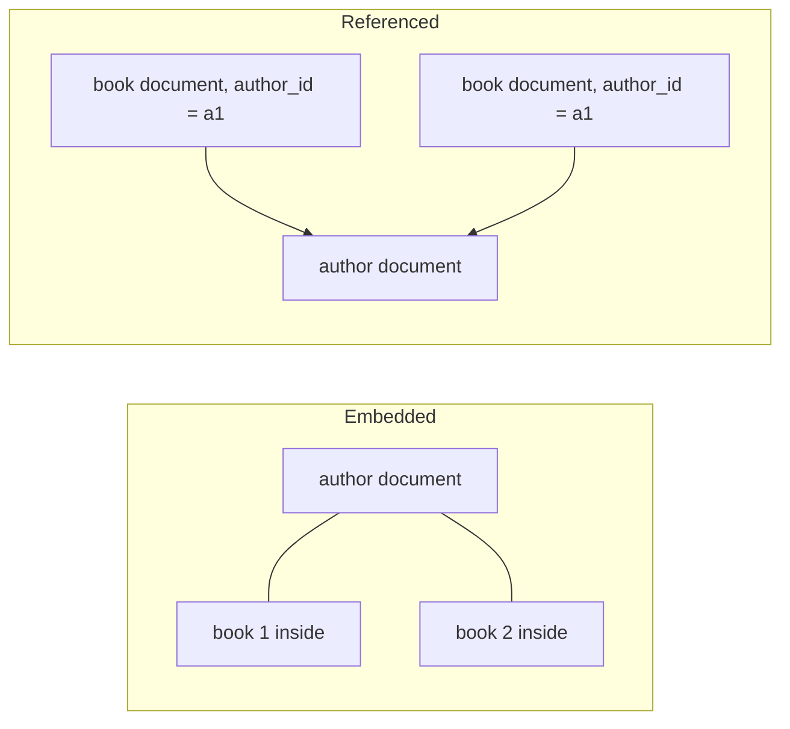

# Embedding vs referencing, cardinality and normalisation trade-offs

> **Before this lesson:** you should know documents, arrays and embedded documents ([Documents, collections and why a document database](#/lesson/mongodb/document-model)), array update operators ([Update operators, arrays and upserts](#/lesson/mongodb/update-operators)), indexes ([Single-field and compound indexes: the ESR rule](#/lesson/mongodb/index-basics)) and what `$lookup` does ([$lookup, $facet and pipeline performance](#/lesson/mongodb/lookup-facet-performance)).

## In plain words

Every application has things that belong to other things: a blog post has comments, a customer has addresses, a course has students. When you store them, you face one question again and again: **do the related things go inside the same document, or in a document of their own with a pointer between them?**

Think about how you might keep recipes at home. You could write the ingredient list directly on each recipe card. Or you could keep a separate box of ingredient cards and write "see ingredient card 14" on the recipe. The first way means one card tells you everything you need to cook. The second means the price of flour is written in exactly one place, so when it changes you correct one card and not forty recipes.

Putting related data inside the parent document is called **embedding**. Storing it separately and keeping only its identity in the parent is called **referencing**. Choosing between them is the central skill of MongoDB **schema design** (deciding the shape of your documents).

Why it matters for a job: schema decisions are hard to change once millions of documents exist, and they decide whether a page needs one database read or fifty. "Model X in MongoDB" is the single most common MongoDB interview exercise, and this embed-or-reference reasoning is what is being tested.

## The two shapes side by side

A small publishing example: authors and their books.

**Embedded.** The books live inside the author document:

```javascript
{
  _id: "a1",
  name: "Noor Haddad",
  books: [
    { title: "Salt Harbour", year: 2019 },
    { title: "The Quiet Tide", year: 2023 }
  ]
}
```

**Referenced.** Books are separate documents that carry the author's `_id`:

```javascript
// authors
{ _id: "a1", name: "Noor Haddad" }

// books
{ _id: "b1", author_id: "a1", title: "Salt Harbour", year: 2019 }
{ _id: "b2", author_id: "a1", title: "The Quiet Tide", year: 2023 }
```



With embedding, "show the author's page with all books" is one read. With referencing it is two reads - the author, then `find({ author_id: "a1" })` on books - or one `$lookup`.

## Normalisation and denormalisation

Two terms from database theory describe the ends of this spectrum.

**Normalisation** means storing each fact exactly once, and using references everywhere else. The author's name exists in one document. Changing it is one write, and it can never disagree with itself.

**Denormalisation** means storing copies of data where it is read, even though that duplicates it. If every book document also contained `author_name: "Noor Haddad"`, listing books would need no second read - but a change of name would have to be written to every one of those books.

The trade is always the same:

| | normalised (references) | denormalised (embedded or duplicated) |
|---|---|---|
| reads | need extra queries or `$lookup` | one document has everything |
| writes to shared data | change one place | change every copy |
| consistency | automatic | your responsibility |
| document size | small | larger |

Relational databases start from normalisation and denormalise for speed. Document databases start from the question **"what does the application read together?"** and normalise where duplication would hurt.

## The questions that decide

Work through these five questions for any relationship. They are ordered roughly by how decisive they are.

### 1. Is the related data read together with the parent?

If the application nearly always shows the children when it shows the parent, embedding saves a read every time. A product page that always displays the product's specifications should hold them inside the product. If the children are usually wanted on their own or not at all, embedding makes every read of the parent carry dead weight.

### 2. How many children can one parent have?

This number is the relationship's **cardinality** (how many items stand on each side). It helps to use four rough sizes:

| cardinality | example | usual choice |
|---|---|---|
| one-to-one | user and their profile settings | embed |
| one-to-few (up to a few dozen) | customer and delivery addresses | embed as an array |
| one-to-many (hundreds to thousands) | product and its reviews | reference from the child; perhaps embed a small subset |
| one-to-squillions (millions, unbounded) | server and its log lines | reference from the child, always |

The hard limit behind this table is the 16-megabyte maximum document size. Long before that limit, a document with a large array becomes slow: the whole document is read and rewritten for each change, and it occupies memory even when only the parent's name is wanted.

### 3. Does the number of children keep growing?

A customer has a few addresses and that number is stable. A chat room's messages grow forever. An array that grows without limit is called an **unbounded array** and is the best-known MongoDB design mistake. If you cannot name a sensible upper bound for the array, do not embed it.

### 4. Is the child needed on its own?

If reviews are searched across all products ("the newest one-star reviews site-wide"), they must be reachable without opening every product, so they belong in their own collection. If an address is only ever shown as part of its customer, it has no independent life and can be embedded.

### 5. How often does the duplicated data change, compared with how often it is read?

This question governs denormalised copies. A product name read a million times a day and renamed twice a year is a fine candidate for copying into order lines. A stock level that changes every second is a terrible one. The measure is the **read-to-write ratio**: copy data whose reads vastly outnumber its changes.

> [!TIP]
> A compact rule worth memorising: **data that is accessed together should be stored together.** Embed by default for one-to-one and one-to-few relationships that are read with the parent; reference when the children are many, growing, needed independently or shared between several parents.

## Where to put the reference

When you reference, the pointer can sit on either side.

**Child holds the parent's id** (the books example above: `author_id` in each book). This scales to any number of children, because the parent document never grows. Finding the children needs an index on `author_id`. It is the standard choice for one-to-many and beyond.

**Parent holds an array of child ids:**

```javascript
{ _id: "a1", name: "Noor Haddad", book_ids: ["b1", "b2"] }
```

This is convenient when the list is small and its *order* matters (a playlist's tracks), since the array records the order. It has the same growth problem as embedding if the list becomes large.

Both sides can hold a reference when navigation is needed in both directions, at the price of two writes for every link.

## Many-to-many

Students take many courses; a course has many students. This is a **many-to-many** relationship. Relational databases need a third table to connect the two. MongoDB can put an array of ids on one side:

```javascript
// students
{ _id: "s1", name: "Kofi", course_ids: ["c10", "c11"] }

// courses
{ _id: "c10", title: "Statistics" }
```

Put the array on the side where it stays small. A student takes perhaps six courses; a course may have 400 students. So the student holds `course_ids`. "Who takes Statistics?" is then `db.students.find({ course_ids: "c10" })`, which an index on `course_ids` (a multikey index) answers efficiently.

When the link itself carries data - a grade, an enrolment date - give it its own collection, `enrolments`, with one document per student-course pair. That is the third-table solution, and it is entirely legitimate in MongoDB when the relationship has attributes of its own.

## The middle way: embed a little, reference the rest

The choice is not all-or-nothing. Two hybrid shapes are used constantly and are developed further in the next lesson.

**Copy a few fields along with the reference.** An order stores the customer's `_id` *and* the name and shipping city it needs for display:

```javascript
{ _id: 7001, customer: { _id: "c1", name: "Renata", city: "Porto" }, total: 48 }
```

Listing orders needs no join. The full customer record is one lookup away when wanted. In this particular case the copy is also *correct to keep stale*: an order should show the address it was shipped to, not the customer's address today.

**Embed a bounded subset.** A product document holds its five most recent reviews and a review count; all reviews live in a `reviews` collection. The product page renders from one document, and "see all 2,317 reviews" queries the other collection.

## Worked example: a help-desk ticket

Requirements: a ticket has a subject, a status, the customer who raised it, a handful of tags, and a conversation of messages. Staff view a ticket with its conversation. A dashboard lists open tickets with customer names. Customers occasionally change their email address.

Apply the questions:

- **Tags** - few, bounded, read with the ticket, never used alone → embed as an array of strings.
- **Messages** - read with the ticket; typically 5 to 30, rarely more than a hundred → embed. Add a safety valve: if a ticket ever passes, say, 200 messages, continue in overflow documents.
- **Customer** - exists independently, has many tickets, is edited independently → reference. The dashboard needs the name on every row → copy `name` beside the id.

```javascript
{
  _id: 5012,
  subject: "Invoice shows the wrong VAT rate",
  status: "open",
  tags: ["billing", "vat"],
  customer: { _id: "c88", name: "Okafor Supplies" },
  messages: [
    { at: ISODate("2026-04-02T09:12:00Z"), from: "customer", text: "Our March invoice uses 21%..." },
    { at: ISODate("2026-04-02T10:40:00Z"), from: "agent:li", text: "Thanks, checking with finance." }
  ],
  message_count: 2
}
```

Operations against this shape:

```javascript
desk> db.tickets.find({ status: "open" }, { subject: 1, "customer.name": 1 }).sort({ _id: -1 }).limit(25)
// the dashboard: one query, no join

desk> db.tickets.updateOne({ _id: 5012 },
...   { $push: { messages: { at: new Date(), from: "customer", text: "Any news?" } }, $inc: { message_count: 1 } })
// a new message: one atomic update of one document

desk> db.tickets.updateMany({ "customer._id": "c88" }, { $set: { "customer.name": "Okafor Supplies Ltd" } })
// the customer is renamed: every ticket carrying the copy is updated
```

The third command is the cost of the copied name: a rename touches every ticket of that customer. Renames are rare and the dashboard is viewed all day, so the trade is a good one. An index on `"customer._id"` makes the update efficient.

> [!WARNING]
> Duplicated data must have an owner. Decide, at design time, which collection holds the authoritative value and which code path refreshes the copies when it changes. Copies that nobody maintains slowly drift apart, and users then see two different names for the same customer on two screens. If you cannot say how a copy is kept fresh - or why it is allowed to be stale - do not make the copy.

> [!INTERVIEW]
> **"How do you decide between embedding and referencing?"** Give the decision as a short checklist: read together? cardinality (one-to-few embeds, one-to-many references from the child side, unbounded always references)? does the child need independent access? how often does the data change compared with how often it is read? Then mention the 16 MB limit and unbounded arrays as the hard constraint, and hybrids - copying a few display fields beside a reference, or embedding a recent subset - as the practical middle ground. Finish with the trade-off in one line: embedding buys single-read speed and atomic updates; referencing buys small documents and a single source of truth.

## The same from Python

```python
from pymongo import MongoClient

db = MongoClient()["desk"]

ticket = db.tickets.find_one({"_id": 5012})                                   # 1
print(ticket["customer"]["name"], len(ticket["messages"]))                    # 2

customer = db.customers.find_one({"_id": ticket["customer"]["_id"]})          # 3
print(customer["email"])

db.tickets.create_index("customer._id")                                       # 4
changed = db.tickets.update_many({"customer._id": "c88"},
                                 {"$set": {"customer.name": "Okafor Supplies Ltd"}})
print(changed.modified_count)                                                 # 5

by_customer = db.tickets.aggregate([                                          # 6
    {"$match": {"status": "open"}},
    {"$group": {"_id": "$customer._id", "name": {"$first": "$customer.name"}, "open": {"$sum": 1}}},
    {"$sort": {"open": -1}}, {"$limit": 5},
])
print(list(by_customer))
```

1. One read returns the ticket with its tags, its conversation and the customer's display name.
2. The copied name and the embedded messages are ordinary nested dictionaries and lists.
3. The full customer record is fetched only when a screen needs fields that were not copied.
4. An index on the embedded id, so that finding one customer's tickets is fast.
5. The rename fans out; the count shows how many tickets carried the copy.
6. A report of the customers with the most open tickets, computed without any join because the name travels with the ticket.

## Simulate it yourself

The simulation stores the same blog data in an embedded and a referenced shape, then counts what each design costs for three operations: rendering a post page, renaming a commenter, and listing a user's recent comments across all posts.

```python-run
import random

random.seed(8)
USERS = {"u%d" % i: "user-%d" % i for i in range(50)}
raw_comments = [{"post": "p%d" % random.randrange(200), "user": random.choice(list(USERS)), "n": i}
                for i in range(6000)]

# Design A: comments embedded in posts, each carrying a copy of the commenter's name.
embedded = {"p%d" % i: {"_id": "p%d" % i, "comments": []} for i in range(200)}
for c in raw_comments:
    embedded[c["post"]]["comments"].append({"user_id": c["user"], "user_name": USERS[c["user"]], "n": c["n"]})

# Design B: comments in their own collection, referencing post and user; names only in users.
ref_posts = {"p%d" % i: {"_id": "p%d" % i} for i in range(200)}
ref_comments = [{"_id": c["n"], "post_id": c["post"], "user_id": c["user"]} for c in raw_comments]
by_post, by_user = {}, {}                                   # two indexes on the comments collection
for c in ref_comments:
    by_post.setdefault(c["post_id"], []).append(c)
    by_user.setdefault(c["user_id"], []).append(c)

def row(label, a, b):
    print(label.ljust(44), str(a).ljust(34), b)

row("operation", "A: embedded + copied names", "B: referenced")

# 1. Render one post page with its comments and commenter names.
page_a = embedded["p7"]
page_b = by_post["p7"]
distinct_users = len({c["user_id"] for c in page_b})
row("render post p7 (%d comments)" % len(page_a["comments"]), "1 read",
    "1 + 1 + %d reads (post, comments, users)" % distinct_users)

# 2. A user changes their display name.
touched_docs = sum(1 for p in embedded.values() if any(c["user_id"] == "u3" for c in p["comments"]))
copies = sum(c["user_id"] == "u3" for p in embedded.values() for c in p["comments"])
row("rename user u3", "%d posts rewritten (%d copies)" % (touched_docs, copies), "1 document updated")

# 3. Show one user's 10 most recent comments across the site.
scanned = sum(len(p["comments"]) for p in embedded.values())
row("10 newest comments by u3", "scan %d comments in 200 posts" % scanned,
    "index seek, read 10 of %d" % len(by_user["u3"]))

# 4. Size: how large does the biggest post document get?
biggest = max(embedded.values(), key=lambda p: len(p["comments"]))
row("largest post document", "%d embedded comments, and growing" % len(biggest["comments"]), "stays tiny")
```

Reading the output:

- **Rendering a post** is a single read with embedding. The referenced design needs the post, its comments and then the name of each distinct commenter - a couple of dozen reads, or a `$lookup`.
- **Renaming a user** is where the bill for the copies arrives: about a hundred copies spread over roughly eighty post documents must be rewritten, against one document in the referenced design.
- **A user's own comments** are easy to find when comments are a collection with an index on `user_id`. Embedded inside posts, they are scattered through every post document.
- **Document growth**: embedded comment arrays keep growing with a post's popularity. Here the largest holds a few dozen; on a real site it could be hundreds of thousands, which is the unbounded-array problem.

No design wins every row. The right one depends on which of these operations the application performs a thousand times a second and which it performs once a month. A common resolution for this exact case is the hybrid: comments in their own collection carrying a copied `user_name`, plus the newest few embedded in the post.

## Pitfalls

- **Unbounded arrays** in a parent document.
- **Modelling tables.** One collection per entity with references everywhere, then joining in application code.
- **Embedding data that is queried independently**, forcing scans through parents.
- **Copies with no refresh path.**
- **Copying fast-changing data**, such as stock levels or live prices.
- **Array of ids on the "many" side** of a lopsided many-to-many relationship.
- **No index on the reference field** in the child collection.
- **Designing from the entities instead of from the screens and queries.**

## Cheat sheet

| situation | choice |
|---|---|
| one-to-one, read together | embed |
| one-to-few, bounded, read together | embed as an array |
| one-to-many | child holds the parent's id, index it |
| unbounded growth | child holds the parent's id, never embed |
| child queried on its own | separate collection |
| many-to-many | array of ids on the smaller side, or a link collection if the link has data |
| list screen needs a couple of parent fields | copy those fields beside the reference |
| page shows only the newest few of many | embed a capped subset, keep the rest separate |
| data shared by many parents and often changed | reference, do not copy |

## Summary

- Embedding stores related data inside the parent; referencing stores it separately with an id pointing across.
- Normalised data has one copy of each fact and cheap, consistent writes; denormalised data has fast single-document reads and copies that must be maintained.
- Decide with five questions: read together? how many? still growing? needed alone? how often changed versus read?
- Embed one-to-one and one-to-few; reference one-to-many and anything unbounded, from the child side, with an index.
- Many-to-many relationships use an array of ids on the smaller side or a separate link collection.
- Hybrids - a few copied fields beside a reference, or an embedded recent subset - are the everyday answer, provided every copy has an owner and a refresh path.

## Glossary

- **Schema design** - deciding what documents look like and how they relate.
- **Embedding** - storing related data inside the parent document.
- **Referencing** - storing related data in its own documents and keeping only an id in the other.
- **Normalisation** - storing each fact once and referring to it elsewhere.
- **Denormalisation** - storing duplicate copies of data where it is read.
- **Cardinality** - how many items stand on each side of a relationship.
- **One-to-few / one-to-many / one-to-squillions** - informal sizes of a one-sided relationship: dozens, thousands, unbounded.
- **Many-to-many** - a relationship in which each side can link to many of the other.
- **Unbounded array** - an array with no natural upper limit on its length.
- **Read-to-write ratio** - how often data is read compared with how often it changes.
- **Link collection** - a collection with one document per related pair, used for many-to-many relationships that carry data.

## Check yourself

```quiz
[
  {"q": "A customer has between one and four delivery addresses, always shown on the customer's account page. How should the addresses be stored?",
   "options": ["In a separate addresses collection with a reference", "Embedded as an array in the customer document", "As a comma-separated string", "In a capped collection"],
   "answer": 1,
   "explain": "One-to-few, bounded and read together with the parent: embed."},
  {"q": "An IoT device produces a log line every second, forever. Where do the log lines go?",
   "options": ["In an array inside the device document", "In their own collection, each holding the device's id", "In the admin database", "Nowhere; logs cannot be stored"],
   "answer": 1,
   "explain": "Unbounded growth must never be embedded: the array would hit the 16 MB limit. Reference from the child side."},
  {"q": "What is the main cost of denormalising a customer's name into every order document?",
   "options": ["Orders can no longer be indexed", "A change of name must be written to every copy, or copies become stale", "Reads become slower", "The name cannot be searched"],
   "answer": 1,
   "explain": "Duplication speeds reads but makes updates fan out and consistency the application's job."},
  {"q": "Students take about 6 courses; a course has up to 400 students. Where should the array of ids go?",
   "options": ["course.student_ids", "student.course_ids", "Both, always", "In neither; use a string"],
   "answer": 1,
   "explain": "Put the array on the side where it stays small; an index on course_ids answers 'who takes this course'."},
  {"q": "Which data is the worst candidate for copying into many other documents?",
   "options": ["A product's name", "A country's ISO code", "A warehouse stock level that changes every few seconds", "An author's year of birth"],
   "answer": 2,
   "explain": "Frequently changing data has a poor read-to-write ratio: every change would fan out to all copies."},
  {"q": "In the referenced design 'book holds author_id', what is needed to list an author's books efficiently?",
   "options": ["An index on books.author_id", "A unique index on authors.name", "A transaction", "A text index"],
   "answer": 0,
   "explain": "Finding children by their parent's id is a query on the reference field, which should be indexed."},
  {"q": "Why can it be correct for an order to keep a stale copy of the shipping address?",
   "options": ["Stale data is always acceptable", "The order should record the address used at the time, not the customer's current address", "Addresses cannot be updated in MongoDB", "It saves an index"],
   "answer": 1,
   "explain": "Some copies are historical facts by nature; refreshing them would make the record wrong."},
  {"q": "Which guideline best summarises document schema design?",
   "options": ["Store every entity in its own collection", "Data that is accessed together should be stored together", "Never duplicate anything", "Always embed everything"],
   "answer": 1,
   "explain": "Design starts from the application's access patterns, embedding what is read together and referencing the rest."}
]
```

> **Source:** MongoDB: The Definitive Guide 3e, ch. 9 (topics only; wording and examples are original). MongoDB Manual: https://www.mongodb.com/docs/manual/data-modeling/ , https://www.mongodb.com/docs/manual/data-modeling/embedding/ , https://www.mongodb.com/docs/manual/data-modeling/referencing/
