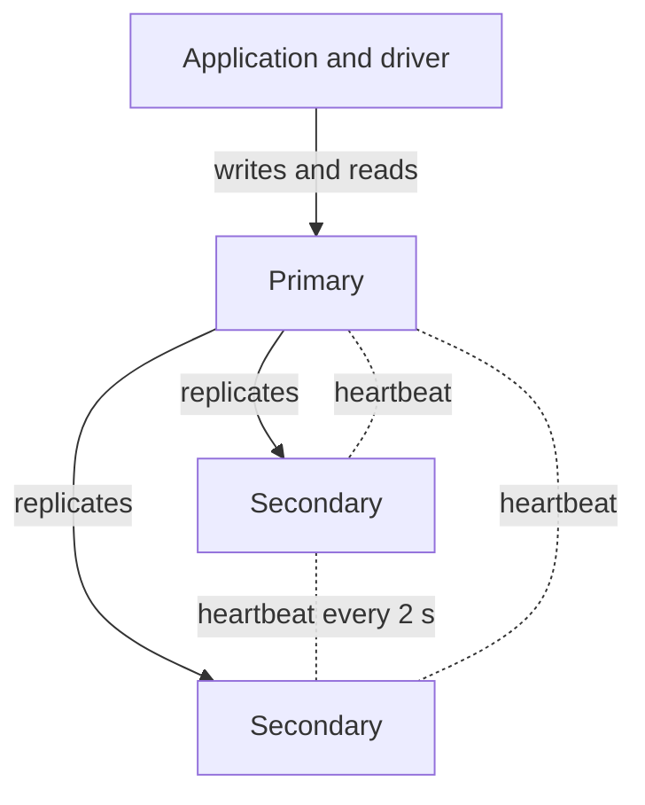
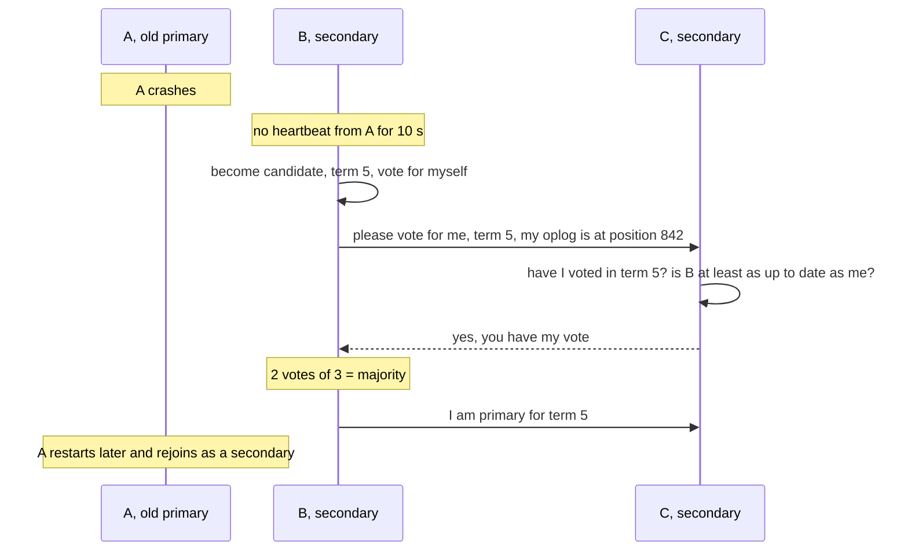

# Replica sets, members and elections

> **Before this lesson:** you should know what a write concern is and the words primary, secondary and majority at the level introduced in [Inserting, deleting and write concern](#/lesson/mongodb/insert-delete). No knowledge of networking or distributed systems is assumed; each idea is built up here.

## In plain words

A single database server is a single point of failure. If its disk dies, the data is gone. If it is restarted for an upgrade, the application is down. **Replication** removes that weakness by keeping the same data on several servers at once.

Picture a small orchestra. One musician is the conductor; the others follow. Everyone has a copy of the score. If the conductor faints, the musicians do not stop for the night: they quickly agree on one of themselves to conduct, and the concert goes on. When the first conductor recovers, they rejoin as an ordinary player.

In MongoDB the orchestra is a **replica set**, the conductor is the **primary**, the players are **secondaries**, the agreement is an **election**, and the takeover is called **failover**.

Why it matters for a job: every production MongoDB deployment is a replica set, including every cluster on the hosted Atlas service. Understanding why three members are the minimum, what "majority" protects against and what happens during the seconds of a failover is required for running an application reliably, and it is standard interview territory.

## What replication buys

Three benefits, in order of importance.

1. **High availability.** *Availability* is the proportion of time a system is usable. With copies on several machines, the failure of one machine does not stop the service.
2. **Data safety.** A copy on another machine, ideally in another building, survives a disk failure or a fire.
3. **Maintenance without downtime.** Members can be upgraded or repaired one at a time while the others serve the application.

A fourth is sometimes claimed: spreading reads across the copies. It is real but limited, and the next lesson explains its catches. Replication does **not** increase write capacity: every write must be applied by every member.

## The roles in a replica set

A **replica set** is a group of `mongod` processes (the MongoDB server program) that hold the same data. Each process is a **member**.

- The **primary** is the one member that accepts writes. There is at most one at any time.
- **Secondaries** copy every write from the primary and apply it to their own data. They are continuously catching up, usually within milliseconds.



Members watch each other. Every two seconds each member sends every other member a small "are you alive?" message called a **heartbeat**. If a member hears nothing from the primary for 10 seconds (the default **election timeout**), it concludes the primary is unreachable.

## Why a majority, and why an odd number

Here is the central difficulty. Suppose a set has two members and the network cable between them is cut. Each is alive. Each sees that the other has stopped answering. Should each one act as primary?

If both did, the application could write different data to each, and the two copies would diverge with no way of reconciling them. Two primaries at once is called **split brain**, and avoiding it is the reason the rules look the way they do.

A break in the network that divides the members into groups that cannot reach each other is called a **network partition**. The rule that prevents split brain is:

> A member may be primary only while it can reach a **majority** of the voting members of the set - more than half.

Two groups cannot both contain more than half of the members. So at most one side of any partition can have a primary.

Work out the consequences for different set sizes:

| members | majority | failures tolerated |
|---|---|---|
| 1 | 1 | 0 |
| 2 | 2 | 0 |
| 3 | 2 | 1 |
| 4 | 3 | 1 |
| 5 | 3 | 2 |
| 7 | 4 | 3 |

Two observations that interviewers ask about:

- **Two members are no safer than one.** A majority of 2 is 2, so losing either member leaves no majority and no primary.
- **Even numbers add cost without adding tolerance.** Four members tolerate one failure, the same as three. That is why sets have an odd number of voting members: three is the standard, five where two simultaneous failures must be survived.

Notice also that the majority is counted from the **configured** size of the set, not from how many members are alive. In a five-member set with three members down, the two survivors do not form a majority (2 is not more than half of 5), and there is no primary. The set becomes read-only until a third member returns. That is uncomfortable, but it is correct: the two survivors cannot tell "the other three are dead" from "the other three are alive on the far side of a broken network, with a primary of their own".

> [!WARNING]
> When the primary cannot reach a majority, it **steps down** and becomes a secondary on its own initiative. Writes are refused until a majority is restored. Spread members over at least three separate locations if you want to survive the loss of a whole site: with two sites, whichever holds the majority is a single point of failure.

## How an election works

When a secondary has not heard from the primary for the election timeout, it starts an election. Follow the steps for a three-member set A (primary), B and C, where A crashes.



1. **Timeout.** B notices the silence. It becomes a **candidate**.
2. **New term.** B increases the **term** number, a counter that goes up with every election attempt. Terms let members tell a current election from a stale one.
3. **Vote request.** B votes for itself and asks the other members for their votes. The request states how far B's copy of the data has got.
4. **Voting rules.** A member grants its vote only if (a) it has not already voted in this term, and (b) the candidate's data is **at least as up to date** as its own. Rule (b) guarantees that a member which is missing recent writes cannot be elected over members that have them.
5. **Majority.** A candidate that collects votes from a majority of the voting members becomes primary. Otherwise the election fails, and after a short random delay someone tries again in a higher term. The randomness makes it unlikely that two candidates keep colliding.
6. **Catch-up.** The new primary announces itself, and the others begin replicating from it.

From failure to a new primary typically takes around twelve seconds with default settings: ten to notice, a moment to vote. During that window there is no primary and writes cannot proceed. Well-written applications ride through it, as the lesson on connecting from applications shows.

### What happened to the old primary's last writes?

Suppose A accepted a write immediately before crashing, and that write had not yet reached B or C. B becomes primary without it. When A comes back, its history disagrees with the set's. A must discard that write to rejoin; this is a **rollback**. The discarded data is saved to a file for an administrator, but the application was told the write succeeded, and now it is gone.

This is the reason for `w: "majority"`. A write acknowledged by a majority exists on more than half the members. Any future primary must win votes from a majority, the two majorities overlap in at least one member, and voting rule (b) ensures the winner has that write. **Majority-acknowledged writes are never rolled back.**

## Member configuration options

Not every member has to be an equal candidate. Each member has settings that shape its role.

| option | effect | typical use |
|---|---|---|
| `priority` (default 1) | higher values are preferred as primary; 0 means "never primary" | keep the primary in your main data centre |
| `votes` (1 or 0) | whether the member votes in elections | sets larger than 7 members: at most 7 may vote |
| `hidden: true` | invisible to applications; requires priority 0 | a member dedicated to backups or reporting |
| `secondaryDelaySecs` | applies writes that many seconds late; requires priority 0 | a "time machine" to recover from an accidental mass delete |
| `arbiterOnly: true` | votes but stores no data | a tie-breaker when a third data member is unaffordable |

A set may have up to 50 members, of which at most 7 vote.

**Priority** decides preference, not eligibility by itself. A high-priority member that is behind on data still cannot win, because of voting rule (b). Once it has caught up, it calls an election and takes over; this is a *priority takeover*.

An **arbiter** deserves a caution. It exists only to provide a vote. A set of two data members plus an arbiter can elect a primary when one data member fails - but then only one member holds data, so `w: "majority"` (which needs two data-bearing acknowledgements out of three voters) can no longer be satisfied, and majority writes hang. Prefer three data-bearing members whenever possible.

> [!TIP]
> The dependable default is three data-bearing members, all with priority 1, in three separate failure zones (different racks, availability zones or regions). Add complexity - hidden members, delayed members, tuned priorities - only when you have a specific reason.

## Setting up and inspecting a replica set

For learning, three `mongod` processes can run on one machine with different ports and data folders. All must be started with the same replica set name.

```javascript
// in three terminals (shown as comments):
// mongod --replSet rs0 --port 27017 --dbpath /data/a
// mongod --replSet rs0 --port 27018 --dbpath /data/b
// mongod --replSet rs0 --port 27019 --dbpath /data/c

test> rs.initiate({
...   _id: "rs0",
...   members: [ { _id: 0, host: "localhost:27017" },
...              { _id: 1, host: "localhost:27018" },
...              { _id: 2, host: "localhost:27019" } ]
... })
{ ok: 1 }

rs0 [direct: primary] test> rs.status().members.map(m => [m.name, m.stateStr, m.health])
[ [ 'localhost:27017', 'PRIMARY', 1 ], [ 'localhost:27018', 'SECONDARY', 1 ], [ 'localhost:27019', 'SECONDARY', 1 ] ]
```

- `--replSet rs0` tells each process which set it belongs to. `--port` and `--dbpath` give each its own network port and data folder.
- `rs.initiate(...)` is run once, on one member. The document is the set's **configuration**: its name and member list. The members hold an election, and a moment later the prompt shows which role this member has.
- `rs.status()` reports the live state. The snippet picks out each member's address, state and health (1 means reachable).

Other everyday helpers: `rs.conf()` shows the configuration, `rs.add("host:port")` adds a member, `rs.stepDown()` asks the primary to give up its role (used before maintenance), and `db.hello()` tells a client which member is primary.

> [!INTERVIEW]
> **"Why does a replica set need an odd number of members, and what happens in a network partition?"** A primary must be able to reach a strict majority of voting members; that prevents two primaries (split brain), because two disjoint groups cannot both hold a majority. An even count adds a machine without adding fault tolerance - four members tolerate one failure, like three. In a partition, the side with a majority keeps or elects a primary; the minority side's primary steps down and that side becomes read-only. Writes the old primary accepted but had not replicated are rolled back when it rejoins, which is why durable writes use `w: "majority"`.

## The same from Python

```python
from pymongo import MongoClient

client = MongoClient("mongodb://localhost:27017,localhost:27018,localhost:27019/?replicaSet=rs0")   # 1

status = client.admin.command("replSetGetStatus")                       # 2
for m in status["members"]:
    print(m["name"], m["stateStr"], m["health"])                        # 3

print("primary:", client.primary, "| secondaries:", sorted(client.secondaries))   # 4

config = client.admin.command("replSetGetConfig")["config"]             # 5
voting = sum(m["votes"] for m in config["members"])
print("voting members:", voting, "| majority:", voting // 2 + 1)        # 6
```

1. The connection string lists several members, called the **seed list**, and names the set. The driver contacts whichever it can reach, learns the full membership and finds the primary by itself.
2. `replSetGetStatus` is the command behind the shell's `rs.status()`.
3. Prints one line per member, for example `localhost:27017 PRIMARY 1.0`.
4. The driver keeps track of the current roles as `(host, port)` pairs.
5. The command behind `rs.conf()`.
6. For three voters this prints `voting members: 3 | majority: 2`.

## Simulate it yourself

The simulation implements the election rules from this lesson and runs them against several failure scenarios, including a network partition and a stale candidate.

```python-run
def member(name, optime, priority=1, votes=1):
    return {"name": name, "optime": optime, "priority": priority, "votes": votes}

def elect(members, reachable):
    """Who becomes primary? `reachable` is the set of names in one connected group."""
    voters = [m for m in members if m["votes"]]
    majority = len(voters) // 2 + 1                       # counted from the CONFIGURED set, not the survivors
    group = [m for m in members if m["name"] in reachable]
    candidates = sorted((m for m in group if m["priority"] > 0),
                        key=lambda m: (-m["priority"], -m["optime"], m["name"]))
    for cand in candidates:
        # a voter supports a candidate only if the candidate is at least as up to date as the voter
        ballots = [v["name"] for v in group if v["votes"] and cand["optime"] >= v["optime"]]
        if len(ballots) >= majority:
            return "%s wins with votes from %s" % (cand["name"], ballots)
    return "NO PRIMARY (group has %d of the %d votes needed)" % (sum(m["votes"] for m in group), majority)

three = [member("A", 842), member("B", 842), member("C", 840)]
print("3 members, majority 2")
print("  all healthy             :", elect(three, {"A", "B", "C"}))
print("  A crashes               :", elect(three, {"B", "C"}))
print("  A and B crash           :", elect(three, {"C"}))

five = [member(n, 500) for n in "ABCDE"]
print("5 members, majority 3")
print("  partition {A,B} | {C,D,E}: left ->", elect(five, {"A", "B"}))
print("                             right ->", elect(five, {"C", "D", "E"}))
print("  three members down      :", elect(five, {"A", "B"}))

four = [member(n, 500) for n in "ABCD"]
print("4 members, majority 3")
print("  partition {A,B} | {C,D} : left ->", elect(four, {"A", "B"}), "| right ->", elect(four, {"C", "D"}))

stale = [member("A", 700, priority=5), member("B", 842), member("C", 842)]
print("high priority but stale   :", elect(stale, {"A", "B", "C"}))

with_arbiter = [member("A", 300), member("B", 300), member("arb", 0, priority=0)]
print("2 data members + arbiter, A down:", elect(with_arbiter, {"B", "arb"}))

print()
for n in range(1, 8):
    print("members %d -> majority %d, failures tolerated %d" % (n, n // 2 + 1, n - (n // 2 + 1)))
```

Reading the output:

- With three members, losing one still leaves a majority of two, and the most up-to-date survivor wins. Losing two leaves no primary.
- In the five-member partition, the side with three members elects a primary and the side with two does not. That asymmetry is what prevents split brain.
- With four members split two and two, **neither** side has the three votes needed. An even-sized set can end up with no primary at all, which is the practical argument for odd sizes.
- Member A has priority 5 but is behind. B wins, because the others refuse to vote for a candidate with older data.
- With an arbiter, B is elected using the arbiter's vote, even though only one member now holds data.
- The closing table reproduces the tolerance table: 3 and 4 members both tolerate one failure, 5 and 6 both tolerate two.

## Pitfalls

- **Two-member sets.** No fault tolerance; the loss of either member removes the primary.
- **Even numbers of voters**, which add cost and the risk of a tied partition.
- **All members in one location**, so that one power or network failure takes out the majority.
- **Relying on arbiters**, then finding that majority writes hang when a data member is down.
- **Assuming a high priority forces a member to be primary.** It must also be up to date.
- **Using `w: 1` for important data** and losing acknowledged writes in a rollback.
- **Application code that cannot tolerate the ten or so seconds of an election.**
- **Counting majority from the surviving members** when reasoning about failures.

## Cheat sheet

| task | command |
|---|---|
| start a member | `mongod --replSet rs0 --port 27017 --dbpath /data/a` |
| create the set | `rs.initiate({ _id: "rs0", members: [...] })` |
| live state | `rs.status()` |
| configuration | `rs.conf()` |
| add / remove a member | `rs.add("host:port")` / `rs.remove("host:port")` |
| make the primary step down | `rs.stepDown()` |
| which member is primary | `db.hello()` |

| fact | value |
|---|---|
| heartbeat interval | 2 seconds |
| default election timeout | 10 seconds |
| typical failover time | about 12 seconds |
| maximum members / voting members | 50 / 7 |
| majority of n voters | floor(n / 2) + 1 |

## Summary

- A replica set keeps the same data on several members: one primary accepting writes and secondaries copying them.
- Members exchange heartbeats; when the primary is silent for the election timeout, a secondary stands for election.
- A candidate needs votes from a majority of the configured voting members, and members only vote for candidates at least as up to date as themselves.
- The majority rule prevents split brain during network partitions and is why sets use an odd number of voters: three tolerate one failure, five tolerate two.
- Writes that reached only the old primary are rolled back; majority-acknowledged writes never are.
- Priority, hidden, delayed, non-voting and arbiter members adapt a set to special needs; three ordinary data-bearing members in three locations is the sound default.

## Glossary

- **Replication** - keeping copies of the same data on several servers.
- **Replica set** - a group of `mongod` processes that maintain the same data.
- **Member** - one `mongod` process in a replica set.
- **Primary / secondary** - the member that accepts writes / a member that copies them.
- **Availability** - the proportion of time a system is usable.
- **Heartbeat** - a small periodic message by which members check each other.
- **Election timeout** - how long a member waits without hearing from the primary before calling an election.
- **Election** - the voting procedure that chooses a primary.
- **Term** - a counter increased with every election attempt.
- **Majority** - more than half of the voting members.
- **Network partition** - a network failure that splits members into groups unable to communicate.
- **Split brain** - two members acting as primary at once; prevented by the majority rule.
- **Failover** - the automatic replacement of a failed primary.
- **Rollback** - discarding writes that an old primary accepted but never replicated.
- **Arbiter** - a member that votes but holds no data.
- **Priority** - a setting expressing how strongly a member is preferred as primary.

## Check yourself

```quiz
[
  {"q": "How many members can fail in a five-member replica set while a primary can still be elected?",
   "options": ["1", "2", "3", "4"],
   "answer": 1,
   "explain": "The majority of 5 is 3, so two members may be lost."},
  {"q": "Why is a two-member replica set no more available than a single server?",
   "options": ["The majority of 2 is 2, so losing either member leaves no primary", "Two members cannot replicate", "Secondaries cannot vote", "It has no oplog"],
   "answer": 0,
   "explain": "A primary needs a strict majority of the configured voters; with two members that means both."},
  {"q": "A five-member set is partitioned into groups of two and three. What happens?",
   "options": ["Both groups elect a primary", "Only the group of three can have a primary; the other side becomes read-only", "Neither group can have a primary", "The set deletes its data"],
   "answer": 1,
   "explain": "Only one group can hold a majority of five, which prevents split brain."},
  {"q": "A candidate asks for a vote. When does a member refuse?",
   "options": ["When the candidate has a lower port number", "When the member has already voted in this term or the candidate's data is behind its own", "When the candidate has priority 1", "Members never refuse"],
   "answer": 1,
   "explain": "One vote per term, and only for candidates at least as up to date as the voter."},
  {"q": "What does priority 0 mean for a member?",
   "options": ["It cannot vote", "It can never become primary", "It stores no data", "It is hidden from elections entirely"],
   "answer": 1,
   "explain": "Priority 0 members replicate and vote but are never elected primary."},
  {"q": "Which writes are guaranteed never to be rolled back?",
   "options": ["All acknowledged writes", "Writes acknowledged with w: \"majority\"", "Writes acknowledged with w: 1", "Writes made with insertMany"],
   "answer": 1,
   "explain": "A majority-acknowledged write is present on some member of every possible electing majority, and a candidate lacking it cannot win."},
  {"q": "Why does a four-member set tolerate no more failures than a three-member set?",
   "options": ["Its majority is 3, so only one member may fail", "Four members cannot hold elections", "The fourth member is always an arbiter", "Heartbeats stop working"],
   "answer": 0,
   "explain": "Majority of 4 is 3; losing two leaves two, which is not a majority."},
  {"q": "What is the drawback of a set with two data members and one arbiter when a data member fails?",
   "options": ["No primary can be elected", "A primary is elected, but w: \"majority\" writes cannot be acknowledged because only one member holds data", "The arbiter becomes primary", "The set loses its configuration"],
   "answer": 1,
   "explain": "The arbiter supplies a vote but cannot acknowledge data, so majority write concern stalls."}
]
```

> **Source:** MongoDB: The Definitive Guide 3e, ch. 10-11 (topics only; wording and examples are original). MongoDB Manual: https://www.mongodb.com/docs/manual/replication/ , https://www.mongodb.com/docs/manual/core/replica-set-elections/ , https://www.mongodb.com/docs/manual/core/replica-set-members/
