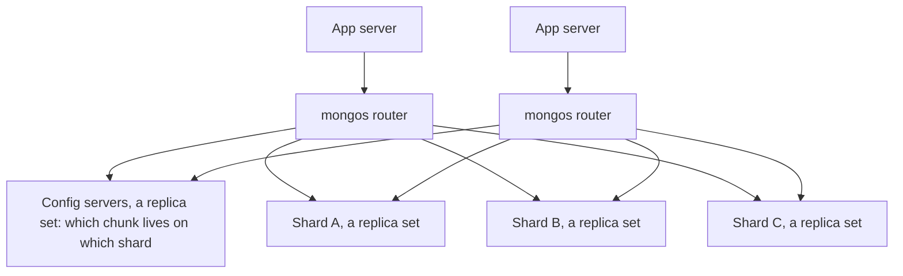
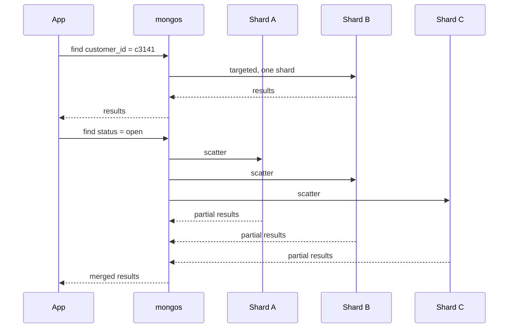

# Sharded cluster components and query routing

> **Before this lesson:** you should know what a replica set is and why it does not add write capacity ([Replica sets, members and elections](#/lesson/mongodb/replica-sets-elections), [The oplog, write concern, read concern and read preference](#/lesson/mongodb/oplog-concerns)), and how indexes and compound-index prefixes work ([Single-field and compound indexes: the ESR rule](#/lesson/mongodb/index-basics)).

## In plain words

A replica set keeps *copies* of the same data, so every member must store everything and apply every write. When the data no longer fits on one machine, or one machine cannot keep up with the writes, copies do not help. You need to **split** the data so that each machine holds only a part.

Think of a national library that has outgrown its building. It opens four branches and divides the books by the first letter of the author's surname: A-F in the north branch, G-L in the east, and so on. No branch holds everything. At the entrance of each stands an information desk with a chart: "authors starting with K? East branch." A reader looking for one author is sent to one branch. A reader asking for "every book published in 1987" has to be sent to all four, and the lists combined.

In MongoDB the branches are **shards**, the information desk is a router called **mongos**, the chart is kept by the **config servers**, and the rule "by first letter of surname" is the **shard key**. Splitting data across machines this way is called **sharding**.

Why it matters for a job: sharding is how MongoDB handles very large data sets and write volumes. It is also the feature with the most expensive mistakes, so interviewers probe whether you understand what the pieces do and - more importantly - which queries stay fast and which become slow.

## Two ways to grow

When one server is no longer enough, there are two directions.

**Vertical scaling** (scaling up) means a bigger machine: more memory, faster disks, more processor cores. It needs no change to the application. But prices rise steeply at the top end, there is a largest machine you can buy, and one machine is still one place for things to go wrong.

**Horizontal scaling** (scaling out) means more machines, each holding part of the data. Capacity grows by adding ordinary machines. The price is complexity: more parts to run, and queries that must sometimes visit several machines.

Sharding is horizontal scaling. The usual reasons to adopt it are that the data will not fit on one server's disks, that the working data no longer fits in memory, that write volume exceeds what one primary can handle, or that data must be kept in particular countries for legal reasons.

## The three components



**Shards** hold the data. Each shard is itself a full replica set - a primary and secondaries - so that losing one machine does not lose a slice of the data. A cluster with three shards of three members each is nine `mongod` processes.

**Config servers** hold the cluster's **metadata**: data about the data. They record which collections are sharded, by which key, and which ranges of key values live on which shard. They form a replica set of their own. If they are unreachable, existing data can still be read and written for a while using cached information, but nothing about the layout can change.

**mongos** is the router. Applications connect to `mongos` exactly as they would to an ordinary server and never talk to shards directly. A `mongos` stores no data. It keeps a copy of the layout from the config servers in memory, sends each operation to the right shard or shards, and merges the answers. Because it holds no data, you can run as many `mongos` processes as you like, often one beside each application server.

The complete arrangement is called a **sharded cluster**.

## The shard key and chunks

To split a collection, MongoDB needs a rule that says, for any document, where it belongs. The rule is the **shard key**: one field, or a few fields, present in every document of the collection.

MongoDB divides the range of possible shard key values into contiguous pieces called **chunks**. Each chunk covers a range from an inclusive lower bound to an exclusive upper bound and is assigned to one shard. For a collection of support tickets sharded on `customer_id`, the layout might be:

| chunk | shard key range | shard |
|---|---|---|
| 1 | from the lowest possible value up to `"c2000"` | A |
| 2 | `"c2000"` up to `"c5000"` | B |
| 3 | `"c5000"` up to `"c7500"` | A |
| 4 | `"c7500"` up to the highest possible value | C |

A document with `customer_id: "c3141"` falls in chunk 2 and lives on shard B. The special markers for "lowest possible" and "highest possible" are written `MinKey` and `MaxKey`. Notice that one shard can own several chunks that are not next to each other.

This table is the chart on the information desk. It is all `mongos` needs to route an operation.

Not every collection has to be sharded. Each database has a **primary shard** (unrelated to a replica set's primary) on which its unsharded collections live in full.

## Setting it up

Assuming the processes are running and you are connected to a `mongos`:

```javascript
mongos> sh.addShard("shardA/a1.example.net:27018,a2.example.net:27018,a3.example.net:27018")
mongos> sh.addShard("shardB/b1.example.net:27018,b2.example.net:27018,b3.example.net:27018")

mongos> sh.shardCollection("desk.tickets", { customer_id: 1 })
{ collectionsharded: 'desk.tickets', ok: 1 }

mongos> sh.status()
// ... lists shards, databases, and for each sharded collection its shard key and chunk distribution
```

- `sh.addShard(...)` registers a replica set as a shard. The text before the slash is the replica set's name, followed by some of its members.
- `sh.shardCollection("desk.tickets", { customer_id: 1 })` shards the collection `tickets` in database `desk` on the key `customer_id`. The collection needs an index that starts with the shard key; for an empty collection MongoDB creates it.
- `sh.status()` prints the current layout. It is the first command to run when investigating a cluster.

## How mongos routes a query

Everything about sharded performance follows from one question: **can `mongos` tell, from the query alone, which shards might hold matching documents?**

### Targeted queries

If the filter contains the shard key, `mongos` looks in its chunk table and sends the query only to the shards that own the relevant ranges.

```javascript
mongos> db.tickets.find({ customer_id: "c3141", status: "open" })
// chunk table: "c3141" is in chunk 2 -> shard B only
```

This is a **targeted query**. One shard does the work, and the others are not disturbed. A range on the shard key is also targeted: `{ customer_id: { $gte: "c1000", $lt: "c2500" } }` overlaps chunks 1 and 2, so shards A and B are asked and C is not.

### Scatter-gather queries

If the filter does not include the shard key, `mongos` has no way of knowing where matches are. It sends the query to **every** shard, waits for all of them, and merges the results.

```javascript
mongos> db.tickets.find({ status: "open", priority: "high" })
// no customer_id -> sent to shards A, B and C; results merged by mongos
```

This is a **scatter-gather query** (also called a broadcast). It has three costs. Every shard spends effort on it, so adding shards does not make it cheaper. The response is as slow as the slowest shard. And if one shard is unavailable, the query fails or returns partial results.



A newcomer's question: is a scatter-gather query a bug? No. For an occasional report it is fine, and each shard still uses its own indexes locally. It becomes a problem when the application's *most frequent* queries are scatter-gather, because then every request loads every shard, and the cluster behaves like one overloaded server with extra network hops.

### Sorting, limiting and counting across shards

When a query with a sort touches several shards, each shard sorts its own portion and `mongos` performs a **merge sort**: it repeatedly takes the smallest next item from the fronts of the already-sorted streams. With `limit(10)`, each shard returns its own top 10 and `mongos` keeps the best 10 overall. With a `skip`, `mongos` cannot push the skip down: each shard must return skip plus limit documents, which makes deep `skip` paging even more costly on a cluster than on one server.

### Writes

An insert must contain the full shard key, since the key decides where the document goes. An `updateOne` or `deleteOne` is routed directly when its filter includes the shard key (or `_id` in common cases); without it, the operation must be coordinated across shards, which is slower. `updateMany` and `deleteMany` without the shard key are broadcast.

One more rule connects sharding with the indexes lesson: a **unique index** on a sharded collection must include the shard key as a prefix. A shard can only check uniqueness among its own documents, so uniqueness of some other field across the whole cluster cannot be guaranteed. `_id` uniqueness is likewise only enforced per shard unless `_id` is the shard key, which is one reason to keep generating `_id` with ObjectId.

> [!WARNING]
> Sharding multiplies operational work: more processes to deploy, monitor, back up and upgrade, and a new class of design decisions. Exhaust the cheaper options first - better indexes, a better schema, archiving old data, a larger machine. Shard when you have a concrete limit that those cannot remove, and plan it before the system is overloaded, because moving data between shards under heavy load is slow.

> [!TIP]
> When explaining a slow query on a sharded cluster, look at the `shards` section of `explain()` output. It lists every shard that took part. One shard listed for a query you expected to be frequent is the goal; all shards listed means the query lacks the shard key.

> [!INTERVIEW]
> **"Describe the components of a sharded cluster and what happens when a query arrives."** Shards hold the data, each a replica set. Config servers, also a replica set, hold the metadata mapping chunk ranges to shards. `mongos` routers hold no data; they cache that metadata and route operations. If the query includes the shard key (or a prefix of a compound shard key), `mongos` targets only the shards owning those ranges. Otherwise it broadcasts to all shards and merges the results - scatter-gather - which does not scale with the number of shards. So the shard key should appear in the application's most frequent queries.

## The same from Python

```python
from pymongo import MongoClient

client = MongoClient("mongodb://router1.example.net:27017,router2.example.net:27017/")   # 1
tickets = client["desk"]["tickets"]

tickets.insert_one({"customer_id": "c3141", "status": "open", "subject": "Login fails"})   # 2

plan = tickets.find({"customer_id": "c3141"}).explain()                                    # 3
print("shards" in plan["queryPlanner"]["winningPlan"])

def shards_used(query):                                                                    # 4
    winning = tickets.find(query).explain()["queryPlanner"]["winningPlan"]
    return [s["shardName"] for s in winning.get("shards", [])]

print(shards_used({"customer_id": "c3141"}))                                               # 5
print(shards_used({"status": "open"}))                                                     # 6

layout = client["config"]["chunks"].aggregate([{"$group": {"_id": "$shard", "chunks": {"$sum": 1}}}])
print({row["_id"]: row["chunks"] for row in layout})                                       # 7
```

1. The application lists `mongos` routers, not shards. No `replicaSet` option is given, because a `mongos` is not a replica set member.
2. The document includes the shard key, so `mongos` knows where to send it.
3. On a sharded collection the explain output contains a `shards` list, so this prints `True`.
4. A helper that extracts the names of the shards a query was sent to.
5. Prints one shard name, for example `['shardB']`: targeted.
6. Prints every shard name: scatter-gather.
7. The chunk table is an ordinary collection in the `config` database; this counts chunks per shard.

## Simulate it yourself

The simulation builds a three-shard cluster with a chunk table, stores documents by shard key and routes queries like `mongos`, reporting which shards are contacted and how many documents each examined.

```python-run
import random

random.seed(5)
INF = float("inf")
CHUNKS = [(-INF, 2000, "A"), (2000, 5000, "B"), (5000, 7500, "A"), (7500, INF, "C")]   # [low, high) -> shard
shards = {"A": [], "B": [], "C": []}

def owner(customer):
    for low, high, shard in CHUNKS:
        if low <= customer < high:
            return shard

for i in range(30_000):                                   # insert: the shard key decides the shard
    doc = {"_id": i, "customer": random.randrange(10_000), "status": random.choice(["open", "closed", "closed"]),
           "created": random.randrange(1_000_000)}
    shards[owner(doc["customer"])].append(doc)

print("documents per shard:", {s: len(d) for s, d in shards.items()})

def route(query):
    """Return the shards mongos must contact for this query."""
    cond = query.get("customer")
    if cond is None:
        return sorted(shards)                                           # no shard key: everyone
    low, high = (cond, cond) if not isinstance(cond, tuple) else cond   # a value, or an inclusive (low, high) range
    return sorted({shard for lo, hi, shard in CHUNKS if low < hi and lo <= high})

def run(query, sort=None, limit=None):
    targets = route(query)
    examined, streams = {}, []
    for name in targets:
        docs = shards[name]
        cond = query.get("customer")
        if cond is not None:                                            # each shard uses its own index on the key
            low, high = (cond, cond) if not isinstance(cond, tuple) else cond
            docs = [d for d in docs if low <= d["customer"] <= high]
        examined[name] = len(docs)
        hits = [d for d in docs if all(d[k] == v for k, v in query.items() if k != "customer")]
        if sort:
            hits.sort(key=lambda d: -d[sort])                           # every shard sorts its own part
        streams.append(hits[:limit] if limit else hits)
    merged = [d for stream in streams for d in stream]
    if sort:
        merged.sort(key=lambda d: -d[sort])                             # mongos merges the sorted streams
    merged = merged[:limit] if limit else merged
    kind = "targeted" if "customer" in query else "scatter-gather"
    return kind, targets, examined, len(merged)

tests = [
    ("one customer",                 {"customer": 3141}, {}),
    ("one customer, open tickets",   {"customer": 3141, "status": "open"}, {}),
    ("customers 1000..2500",         {"customer": (1000, 2500)}, {}),
    ("all open tickets",             {"status": "open"}, {}),
    ("10 newest open tickets",       {"status": "open"}, {"sort": "created", "limit": 10}),
]
for label, query, options in tests:
    kind, targets, examined, returned = run(query, **options)
    print("%-28s %-15s shards %-16s examined %-34s returned %d" % (label, kind, targets, examined, returned))
```

Reading the output:

- Shard A holds the most documents because it owns two chunks (4,500 key values out of 10,000).
- A query for one customer contacts shard B alone and examines only that customer's handful of tickets.
- The range 1000 to 2500 crosses a chunk boundary at 2000, so two shards are contacted; shard C is left in peace.
- "All open tickets" has no shard key. All three shards are contacted and, lacking an index on `status` in this model, each examines everything it holds: 30,000 documents in total.
- The "10 newest" query is also scatter-gather. Each shard returns its own top 10, and the router keeps the best 10 of those 30.

## Pitfalls

- **Frequent queries without the shard key**, turning every request into a broadcast.
- **Connecting applications directly to shards**, which bypasses routing and can return partial or inconsistent data.
- **Only one `mongos`**, making the router a single point of failure.
- **Expecting a unique index on an arbitrary field** to work cluster-wide.
- **Deep `skip` pagination**, which forces every shard to return skip plus limit documents.
- **Sharding too early**, taking on the complexity before any limit has been reached.
- **Sharding too late**, when the system is already too loaded to move data comfortably.
- **Forgetting that unsharded collections all sit on the database's primary shard.**

## Cheat sheet

| component | role | stores data? |
|---|---|---|
| shard | holds a subset of the data; a replica set | yes |
| config servers | hold chunk ranges and cluster settings; a replica set | metadata only |
| mongos | routes operations, merges results | no |

| query | routing |
|---|---|
| equality on the shard key | targeted to one shard |
| range on the shard key (ranged sharding) | targeted to the shards owning that range |
| prefix of a compound shard key | targeted |
| no shard key | scatter-gather to all shards |
| insert | routed by the document's shard key |

| command | purpose |
|---|---|
| `sh.status()` | show shards, databases, chunk distribution |
| `sh.addShard("rs/host:port")` | add a shard |
| `sh.shardCollection("db.coll", { key: 1 })` | shard a collection |
| `db.coll.getShardDistribution()` | data and document counts per shard |

## Summary

- Sharding splits a collection across several replica sets so that data size and write load can exceed one machine.
- Shards hold data, config servers hold the map of chunk ranges to shards, and `mongos` routers direct operations and merge results.
- The shard key decides which chunk, and therefore which shard, a document belongs to.
- Queries containing the shard key are targeted to the relevant shards; queries without it are scatter-gather and load every shard.
- Sorts and limits across shards are merged by `mongos`; inserts need the shard key; unique indexes must begin with it.
- Sharding adds real operational cost, so adopt it for a concrete limit and design the key around the most frequent queries.

## Glossary

- **Sharding** - distributing a collection's data across several servers.
- **Vertical / horizontal scaling** - a bigger machine / more machines.
- **Shard** - a replica set holding one part of the sharded data.
- **Config servers** - the replica set storing the cluster's metadata.
- **Metadata** - data describing other data, here the mapping from key ranges to shards.
- **mongos** - the stateless router through which applications reach a sharded cluster.
- **Sharded cluster** - shards, config servers and routers working together.
- **Shard key** - the field or fields that determine where a document is stored.
- **Chunk** - a contiguous range of shard key values assigned to one shard.
- **`MinKey` / `MaxKey`** - markers for the lowest and highest possible key values.
- **Primary shard** - the shard holding a database's unsharded collections.
- **Targeted query** - a query routed only to the shards that can hold matches.
- **Scatter-gather query** - a query sent to all shards with the results merged.
- **Merge sort** - combining several already-sorted streams into one sorted stream.

## Check yourself

```quiz
[
  {"q": "Which component of a sharded cluster stores no data at all?",
   "options": ["A shard", "The config servers", "mongos", "The primary shard"],
   "answer": 2,
   "explain": "mongos only routes and merges; shards hold data and config servers hold metadata."},
  {"q": "A collection is sharded on customer_id. Which query is targeted?",
   "options": ["find({status: \"open\"})", "find({customer_id: \"c3141\", status: \"open\"})", "find({priority: \"high\"})", "find({})"],
   "answer": 1,
   "explain": "Only a filter containing the shard key lets mongos identify the owning shard."},
  {"q": "What does mongos do with a query that does not contain the shard key?",
   "options": ["Rejects it", "Sends it to every shard and merges the results", "Sends it to the config servers", "Picks one shard at random"],
   "answer": 1,
   "explain": "Without the key it cannot rule any shard out, so it broadcasts: a scatter-gather query."},
  {"q": "Why does adding shards not speed up scatter-gather queries?",
   "options": ["Every shard must still process the query, and the response waits for the slowest one", "Shards cannot use indexes", "mongos caches all results", "Scatter-gather queries are run on the config servers"],
   "answer": 0,
   "explain": "The work is repeated on every shard, so more shards mean more total work, not less."},
  {"q": "What is each shard in a production cluster?",
   "options": ["A single mongod", "A replica set", "A mongos", "A collection"],
   "answer": 1,
   "explain": "Each shard is a replica set so that the failure of one machine does not make a slice of the data unavailable."},
  {"q": "What must a unique index on a sharded collection include?",
   "options": ["The _id field", "The shard key as a prefix", "A text field", "Nothing special"],
   "answer": 1,
   "explain": "A shard can only check uniqueness among its own documents, so the key that decides placement must lead the index."},
  {"q": "A query with sort and limit(10) is broadcast to three shards. How is the result produced?",
   "options": ["One shard sorts everything", "Each shard returns its own top 10 and mongos merges them, keeping the best 10", "mongos fetches all documents and sorts them", "The limit is ignored"],
   "answer": 1,
   "explain": "Shards sort locally; mongos merge-sorts the streams and applies the final limit."},
  {"q": "Which is a sound reason to shard?",
   "options": ["A query is missing an index", "The data set no longer fits on one server and write volume exceeds one primary", "You want backups", "You have two collections"],
   "answer": 1,
   "explain": "Sharding addresses capacity limits that indexing, schema changes and a larger machine cannot remove."}
]
```

> **Source:** MongoDB: The Definitive Guide 3e, ch. 14-15 (topics only; wording and examples are original). MongoDB Manual: https://www.mongodb.com/docs/manual/sharding/ , https://www.mongodb.com/docs/manual/core/sharded-cluster-components/ , https://www.mongodb.com/docs/manual/core/sharded-cluster-query-router/
